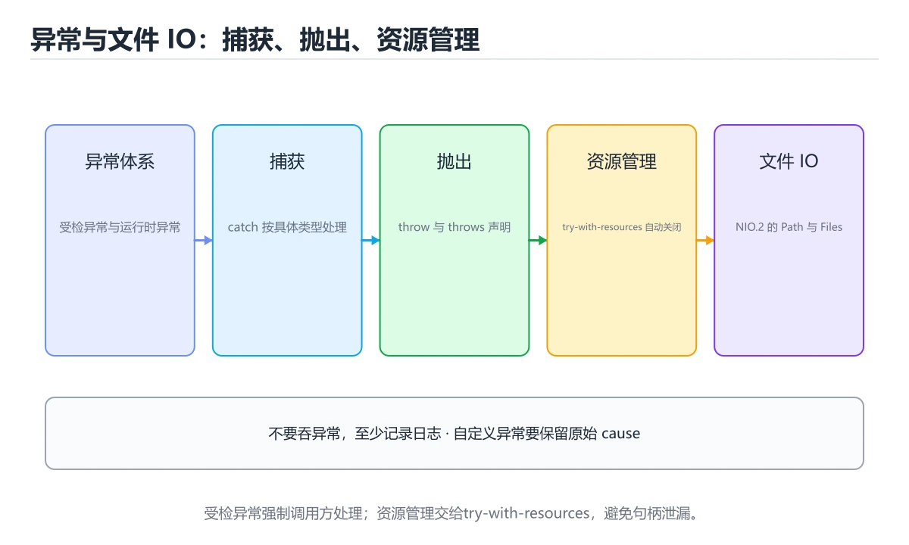
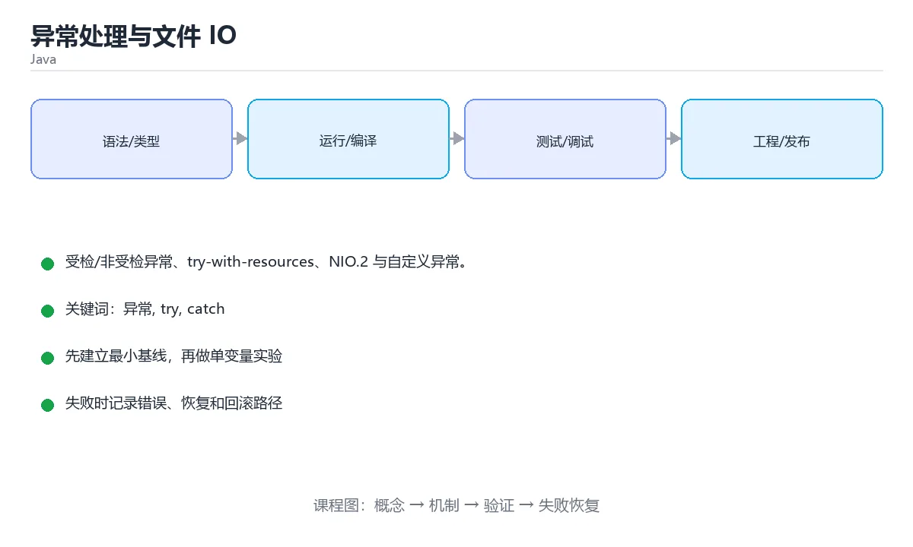

# 异常处理与文件 IO

> 内容更新时间：2026-10-06 · 学习阶段：进阶 · 预计用时：25 分钟





## 本节知识框架

想象你在做饭：正常流程是洗菜、切菜、炒菜。但可能出意外——刀切到手（异常）、煤气没了（资源耗尽）、锅烧干了（文件不存在）。Java 的异常处理就是告诉你：出了事怎么办，以及怎么保证不管出不出事，最后都要关火（关闭资源）。

**本课你将学到：**
- 受检异常和非受检异常的区别
- try-catch-finally 和 try-with-resources 的写法
- 自定义异常的正确姿势
- NIO.2 读写文件

**先修要求：** 学完《集合框架与泛型》即可。

### 复习清单

- [ ] 能说出受检异常和非受检异常的区别及各自的处理方式
- [ ] 能用 try-with-resources 写出安全的文件读取代码
- [ ] 能解释为什么 finally 里不应该写 return

## 核心概念定义

| 术语 | 一句话说明 |
| --- | --- |
| 受检异常 | 编译器强制你处理的异常（IOException 等），必须 try-catch 或 throws 声明。 |
| 非受检异常 | RuntimeException 及其子类，编译器不强制处理，通常是编程错误。 |
| try-with-resources | 自动关闭实现了 AutoCloseable 的资源，比手写 finally 更安全。 |
| 自定义异常 | 继承 RuntimeException 或 Exception，让调用方能精确区分不同错误。 |

## 原理与运行机制

### 异常家族结构

```text
Throwable
├── Error（严重错误，不应捕获，如 OutOfMemoryError）
└── Exception
    ├── RuntimeException（非受检：NullPointerException、IllegalArgumentException）
    └── 其他（受检：IOException、SQLException，必须处理或声明）
```

### try-catch-finally

```java
public static int parse(String text) {
    try {
        return Integer.parseInt(text);
    } catch (NumberFormatException e) {
        System.err.println("格式错误：" + e.getMessage());
        return 0;
    } finally {
        System.out.println("无论如何都会执行");
    }
}
```

多条 catch 时，子类异常必须写在父类前面：

```java
try { ... }
catch (FileNotFoundException e) { ... }   // 子类在前
catch (IOException e) { ... }             // 父类在后
```

### try-with-resources

```java
try (BufferedReader reader = Files.newBufferedReader(Path.of("data.txt"))) {
    String line;
    while ((line = reader.readLine()) != null) {
        System.out.println(line);
    }
} catch (IOException e) {
    log.error("读取失败", e);
}
```

只要资源实现了 `AutoCloseable`，写在 try(...) 里就会自动关闭，比手写 finally 更安全。

### 抛异常的三条规范

```java
// 1. 参数校验抛非受检，尽早暴露
if (amount <= 0) throw new IllegalArgumentException("金额必须为正");

// 2. 保留原因链，别丢掉原始异常
throw new ServiceException("下单失败", e);

// 3. 自定义异常让调用方精确处理
class InsufficientBalanceException extends RuntimeException {
    InsufficientBalanceException(String msg) { super(msg); }
}
```

### NIO.2 文件读写

```java
Path path = Path.of("notes.txt");
Files.writeString(path, "第一行\n", StandardOpenOption.CREATE, StandardOpenOption.APPEND);
List<String> lines = Files.readAllLines(path);
Files.createDirectories(Path.of("data/cache"));
```

## 典型应用场景

| 场景 | 推荐做法 | 为什么 |
| --- | --- | --- |
| 参数校验 | 抛 IllegalArgumentException | 尽早失败，错误明确 |
| 读文件 | try-with-resources | 自动关闭，不会泄漏 |
| 业务错误 | 自定义 RuntimeException | 调用方能精确处理 |
| 记录日志 | log.error("上下文", e) | 保留异常栈和上下文 |

## 代码/协议/SQL 示例

### 自定义异常示例

```java
public class BalanceException extends RuntimeException {
    public BalanceException(String message) {
        super("余额不足：" + message);
    }
}

public void withdraw(double amount) {
    if (amount > balance) {
        throw new BalanceException("余额 " + balance);
    }
    balance -= amount;
}
```

### 安全解析数字

```java
static int parseScore(String raw) {
    try {
        int value = Integer.parseInt(raw.trim());
        if (value < 0 || value > 100) {
            throw new IllegalArgumentException("分数必须在 0~100：" + raw);
        }
        return value;
    } catch (NumberFormatException e) {
        throw new IllegalArgumentException("不是合法数字：" + raw, e);
    }
}
```

### Optional 防御空指针

```java
Optional<String> nickname = Optional.ofNullable(user.getNickname());
String shown = nickname.orElse("匿名用户");
```

## 时间/空间复杂度或性能分析

- **异常创建**：new Exception 会收集调用栈，开销较大（微秒级），所以不要用异常控制正常流程
- **try-with-resources**：编译器生成的关闭代码和手写 finally 性能一致
- **NIO.2**：Files.readAllLines 一次性读入内存，大文件用 BufferedReader 逐行读
- **日志记录**：用占位符 log.error("msg {}", arg) 比字符串拼接快，因为不抛异常时不拼接

## 常见误区与易错点

| 容易写错的做法 | 实际现象 | 原因与正确做法 |
| --- | --- | --- |
| 捕获后什么都不做 | 问题被彻底掩盖 | 至少记录日志或重新抛出 |
| catch (Exception e) 一把抓 | 掩盖真正的 bug | 先捕获具体类型 |
| 用异常做流程控制 | 又慢又难读 | 能用判断就用判断 |
| finally 里 return | 覆盖返回值甚至吞掉异常 | finally 只做资源释放 |
| 丢掉 cause | 排查看不到根因 | 用带 cause 的构造方法 |
| 忘了关闭资源 | 句柄泄漏 | 用 try-with-resources |
| 自定义异常太多 | 没人能记住 | 只在需要区别处理时才自定义 |

## 与其他知识点的关系

- **先修**：《集合框架与泛型》——集合操作可能抛异常
- **后续**：《Lambda 与 Stream API》——Stream 操作中的异常处理
- **关联**：《构建、测试与生态》——测试中需要断言异常

## 自测题与参考答案

1. **受检异常和非受检异常有什么区别？** 受检异常编译器强制处理（IOException），非受检异常不强制（NullPointerException）。
2. **为什么 finally 里不该写 return？** 会覆盖 try 中的返回值，甚至吞掉异常。
3. **try-with-resources 比 try-finally 好在哪？** 自动关闭资源，代码更简洁，异常处理更正确。
4. **抛异常时为什么要保留 cause？** 方便排查根因，否则只看到一句"失败了"。
5. **什么时候该自定义异常？** 调用方需要针对不同错误做不同处理时。

## 考点精讲

`异常处理与文件 IO` 的题库有 6 道题，下面逐题给出题干、正确项与判断依据。

### 考点 1：第 1 题

- **题目**：围绕“异常处理与文件 IO”中的 异常、try、catch，下列哪两项是本课强调的实践判断？
- **正确项**：学习 异常 时要同时说明输入、输出和失败路径，不能只看正常流程；验证 try 时要固定版本并覆盖边界输入，结论才可复现
- **判断依据**：本题正确项是学习 异常 时要同时说明输入、输出和失败路径，不能只看正常流程。术语 异常（异常处理与文件 IO）：程序执行中偏离正常控制流的错误事件，需要捕获、传播或转换，本题取学习 异常 时要同时说明输入、输出和失败路径，不能只看正常流程这条。易错点是捕获后什么都不做会造成问题被彻底掩盖，改法是至少记录日志，或重新抛出，干扰项把 try 的单次运行结果当成所有版本和规模都成立正踩在这条上。

### 考点 2：第 2 题

- **题目**：这段 `java` 代码对应 `异常处理与文件 IO` 的 `AutoCloseable`。课程要解决的是受检/非受检异常、try-with-resources、NIO.2 与自定义异常。关于代码内容，哪一项说法准确？
- **正确项**：调用了 `BalanceException()`
- **判断依据**：本题正确项是调用了 `BalanceException()`。术语 AutoCloseable（异常处理与文件 IO）：实现 `AutoCloseable` 的资源会在代码块结束时自动关闭，异常也不会漏关，本题取调用了 `BalanceException()`这条。易错点是捕获后什么都不做会造成问题被彻底掩盖，改法是至少记录日志，或重新抛出，干扰项调用了 `Color()`正踩在这条上。

### 考点 3：第 3 题

- **题目**：多个 catch 子句的书写顺序要求是？
- **正确项**：子类异常必须在前
- **判断依据**：本题正确项是子类异常必须在前。术语 异常（异常处理与文件 IO）：程序执行中偏离正常控制流的错误事件，需要捕获、传播或转换，本题取子类异常必须在前这条。易错点是捕获后什么都不做会造成问题被彻底掩盖，改法是至少记录日志，或重新抛出，干扰项必须按字母顺序正踩在这条上。

### 考点 4：第 4 题

- **题目**：在 finally 中写 return 的风险是？
- **正确项**：会覆盖 try 中的返回值甚至吞掉异常
- **判断依据**：本题正确项是会覆盖 try 中的返回值甚至吞掉异常。术语 异常（异常处理与文件 IO）：程序执行中偏离正常控制流的错误事件，需要捕获、传播或转换，本题取会覆盖 try 中的返回值甚至吞掉异常这条。易错点是在 finally 里 return会造成覆盖返回值、吞掉异常，改法是finally 只做资源释放，干扰项会触发内存泄漏正踩在这条上。

### 考点 5：第 5 题

- **题目**：抛出异常时想保留原始异常信息，正确做法是？
- **正确项**：new RuntimeException("处理失败", cause)
- **判断依据**：本题正确项是new RuntimeException("处理失败", cause)。术语 异常（异常处理与文件 IO）：程序执行中偏离正常控制流的错误事件，需要捕获、传播或转换，本题取new RuntimeException("处理失败", cause)这条。易错点是捕获后什么都不做会造成问题被彻底掩盖，改法是至少记录日志，或重新抛出，干扰项e.printStackTrace 后返回 null，同时忽略原始异常信息正踩在这条上。

### 考点 6：第 6 题

- **题目**：填空：补齐下面这段术语说明中的空缺。课程 `受检/非受检异常、try-with-resources、NIO.2 与自定义异常。`，这段说明是：尽早失败：参数校验失败立刻抛 ``____``。空缺处应填哪个术语？
- **正确项**：IllegalArgumentException
- **判断依据**：正确项：IllegalArgumentException。涉及术语 IllegalArgumentException：尽早失败：参数校验失败立刻抛 `IllegalArgumentException`。易错点：捕获后什么都不做会造成问题被彻底掩盖。正确做法：至少记录日志，或重新抛出。本题还要同时命中illegalargumentexception这条。

## 术语速查

| 术语 | 一句话说明 |
| --- | --- |
| 受检异常 | 编译器强制处理，如 IOException |
| 非受检异常 | RuntimeException 子类，通常是编程错误 |
| try-with-resources | 自动关闭 AutoCloseable 资源 |
| finally | 无论是否异常都执行的清理代码 |
| cause | 原始异常，保留在异常链中便于排查 |
| IllegalArgumentException | 参数校验失败时抛出的非受检异常 |

## 参考资料与复核

- 最后复核：2026-10-04
- 下次复核：2027-02-24
- 复核范围：版本兼容、API 行为、安全建议与工程实践

| 参考资料 | 本课用途 |
| --- | --- |
| [Java SE 官方教程：异常](https://docs.oracle.com/javase/tutorial/essential/exceptions/) | 异常处理基础语法 |
| [Java SE API 文档](https://docs.oracle.com/en/java/javase/21/docs/api/) | NIO.2 与异常类 API 查询 |
| [dev.java 学习路径](https://dev.java/learn/) | 现代 Java 官方入门教程 |

## 内容元数据

- 内容版本：v2.0
- 最后更新：2026-10-06
- 学习阶段：进阶
- 适用环境：Java 21+ / Maven 或 Gradle
- 内容来源：内置结构化课程与工程实践整理
- 相关主题：异常、try、catch、finally、AutoCloseable、NIO.2
