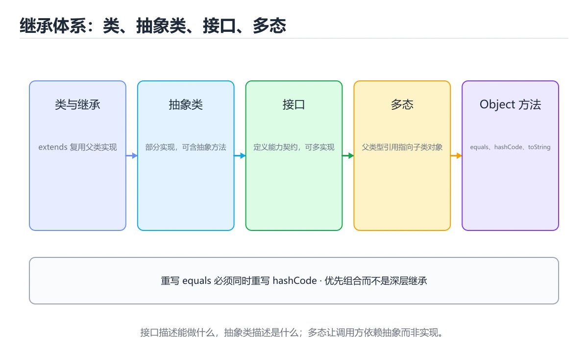
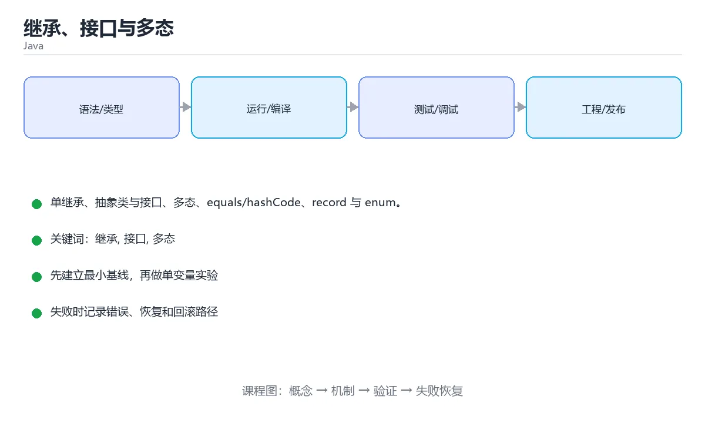

# 继承、接口与多态

> 内容更新时间：2026-10-06 · 学习阶段：进阶 · 预计用时：20 分钟





## 本节知识框架

上一课你学会了用 class 创建对象。但现实世界里事物之间往往有"是一种"的关系——猫是动物，电动车是交通工具。Java 用**继承**表达这种关系，用**接口**约定能力，用**多态**让同一句代码在不同对象上表现不同。

打个比方：你家的猫和邻居家的狗都会"叫"，但叫法不同。喊一声"叫！"，猫会喵喵、狗会汪汪——这就是多态。

**本课你将学到：**
- 用 extends 让子类继承父类
- 用 abstract class 和 interface 定义抽象模板
- 理解多态如何让代码更灵活
- 用 record 和 enum 简化常见场景

**先修要求：** 学完《类与对象》即可。

### 复习清单

- [ ] 能画出本课示例的类继承关系图
- [ ] 能说出抽象类和接口的三个区别
- [ ] 能解释 super 关键字的两种用法

## 核心概念定义

| 术语 | 一句话说明 |
| --- | --- |
| 继承（extends） | 子类自动拥有父类的字段和方法，还能重写父类行为。Java 只支持单继承。 |
| 抽象类 | 不能被 new 的类，可包含抽象方法，强制子类去实现。 |
| 接口 | 一组能力约定，Java 8+ 可以有默认实现。一个类可实现多个接口。 |
| 多态 | 父类引用指向子类对象，调用被重写的方法时执行子类版本。 |

## 原理与运行机制

### 用生活场景理解

1. **继承** — "易碎品包裹"继承了"包裹"的属性，额外加了 fragile 标记
2. **抽象类** — "包裹"本身是抽象概念，你不会寄一个"纯包裹"
3. **接口** — "可追踪"是一个能力，跟继承无关
4. **多态** — 分拣员对所有包裹说"称重"，不同包裹表现不同

### 继承的基本用法

```java
public class Animal {
    protected String name;
    public Animal(String name) { this.name = name; }
    public void speak() { System.out.println(name + "发出声音"); }
}

public class Cat extends Animal {
    public Cat(String name) { super(name); }
    @Override
    public void speak() { System.out.println(name + "喵喵叫"); }
}

Animal a = new Cat("咪咪");
a.speak();  // 咪咪喵喵叫 ← 多态！
```

### 抽象类 vs 接口

```text
对比维度      抽象类                 接口
──────────────────────────────────────────────
关键字       abstract class         interface
继承         只能单继承              可以多实现
字段         可以有实例字段           只能有 static final
方法         可以有具体实现           Java 8+ 有 default 方法
适用         "是一种"关系            "有某种能力"
```

```java
public abstract class Shape {
    protected String color;
    public Shape(String color) { this.color = color; }
    public abstract double area();
}

public interface Resizable {
    void resize(double factor);
}

public class Circle extends Shape implements Resizable {
    private double radius;
    public Circle(String color, double radius) {
        super(color);
        this.radius = radius;
    }
    @Override public double area() { return Math.PI * radius * radius; }
    @Override public void resize(double factor) { radius *= factor; }
}
```

### @Override 与 equals/hashCode

@Override 让编译器检查方法签名是否与父类一致，防止拼写错误。重写 equals() 必须同时重写 hashCode()，否则 HashMap/HashSet 出问题。

### record：不可变数据快捷写法

```java
public record Point(int x, int y) {}
Point p = new Point(3, 4);
System.out.println(p.x());  // 3
```

## 典型应用场景

| 场景 | 推荐做法 | 为什么 |
| --- | --- | --- |
| 多个类共享代码 | 抽象类 + 继承 | 减少重复 |
| 约定能力 | 接口 | 可以多实现 |
| 同一操作不同表现 | 多态 + @Override | 调用方不需要知道具体类型 |
| 纯数据载体 | record | 自动生成 equals/hashCode/toString |

## 代码/协议/SQL 示例

### super 的两种用法

```java
public class Base {
    protected int value = 10;
    public Base() { System.out.println("Base 构造器"); }
    public void show() { System.out.println("Base: " + value); }
}

public class Child extends Base {
    private int value = 20;
    public Child() {
        super();  // 1. 调用父类构造器
    }
    @Override
    public void show() {
        super.show();  // 2. 调用父类方法
        System.out.println("Child: " + this.value);
    }
}
```

### 多态验证

```java
Shape shape = new Circle("红色", 2);
System.out.println(shape.area());  // 运行时调用 Circle 的实现
```

### 接口组合

```java
public interface Flyable { void fly(); }
public interface Swimmable { void swim(); }

public class Duck extends Animal implements Flyable, Swimmable {
    public Duck(String name) { super(name); }
    @Override public void speak() { System.out.println(name + "嘎嘎叫"); }
    @Override public void fly() { System.out.println(name + "在飞"); }
    @Override public void swim() { System.out.println(name + "在游泳"); }
}
```

## 时间/空间复杂度或性能分析

- **多态调用**：虚方法调用比静态调用慢纳秒级，JIT 会通过内联缓存优化
- **继承层次**：超过 3-4 层影响可维护性，推荐用组合替代
- **record**：和普通类性能一致，编译器生成的代码是最优实现
- **interface default 方法**：运行时解析开销可忽略

## 常见误区与易错点

| 容易写错的做法 | 实际现象 | 原因与正确做法 |
| --- | --- | --- |
| 子类构造器不写 super() | 父类无无参构造时编译报错 | 父类有参构造时必须显式调用 |
| 重写方法签名不一致 | 变成新方法不是重写 | 加 @Override 让编译器检查 |
| 重写 equals 不重写 hashCode | HashMap 行为异常 | 两者必须同时重写 |
| 用继承复用不相关代码 | 耦合过深 | 用组合或接口 |
| 在构造器里调用可重写方法 | 子类字段未初始化 | 构造器里只调 private/final 方法 |
| 强转前不判断类型 | ClassCastException | 用 instanceof 模式匹配 |

## 与其他知识点的关系

- **先修**：《类与对象》——继承、重写建立在类定义基础上
- **后续**：《集合框架与泛型》——排序、比较器大量使用接口和多态
- **关联**：《Lambda 与 Stream API》——函数式接口是接口思想的延伸

## 自测题与参考答案

1. **Java 为什么只支持单继承？** 避免菱形继承问题，用接口多实现弥补。
2. **抽象类和接口怎么选？** "是一种"用抽象类，"有某种能力"用接口。
3. **多态的好处？** 调用方只依赖抽象类型，新增子类不改调用方。
4. **super 有什么用途？** 调用父类构造器和父类被重写的方法。
5. **record 和普通类区别？** 自动生成 final 字段、构造器、getter、equals、hashCode、toString。

## 考点精讲

`继承、接口与多态` 的题库有 6 道题，下面逐题给出题干、正确项与判断依据。

### 考点 1：第 1 题

- - **题目**：围绕“继承、接口与多态”中的 继承、接口、多态，下列哪两项是本课强调的实践判断？
- **正确项**：学习 继承 时要同时说明输入、输出和失败路径，不能只看正常流程；验证 接口 时要固定版本并覆盖边界输入，结论才可复现
- **判断依据**：继承和接口是面向对象设计的核心，必须通过实践来区分。

### 考点 2：第 2 题

- **题目**：`继承、接口与多态` 的示例代码用于验证 `super`，其背景是单继承、抽象类与接口、多态、equals/hashCode、record 与 enum。代码的真实内容是下面哪一项？
- **正确项**：调用了 `Circle()`
- **判断依据**：本课 Circle 类继承 Shape，构造器里使用 super(color) 调用父类构造器。

### 考点 3：第 3 题

- **题目**：抽象类与接口的关系，下面说法正确的是？
- **正确项**：抽象类可以持有状态
- **判断依据**：抽象类可以有实例字段，接口字段只能是 static final。

### 考点 4：第 4 题

- **题目**：@Override 注解的价值是？
- **正确项**：让编译器检查是否真的重写了父类/接口方法，避免拼写错误
- **判断依据**：不加 @Override 时方法名拼错会被当成新方法。

### 考点 5：第 5 题

- **题目**：父类引用指向子类对象并调用被重写的方法时，执行的是？
- **正确项**：子类的实现（运行时多态）
- **判断依据**：运行时根据对象实际类型决定调用哪个方法版本。

### 考点 6：第 6 题

- **题目**：填空：补齐下面这段术语说明中的空缺。课程 `单继承、抽象类与接口、多态、equals/hashCode、record 与 enum。`，这段说明是：Java 只支持单继承；``____`` 调用父类构造器或方法，`final` 修饰的类不能被继承。空缺处应填哪个术语？
- **正确项**：super
- **判断依据**：super 关键字用于子类中调用父类构造器或方法。

## 术语速查

| 术语 | 一句话说明 |
| --- | --- |
| extends | 子类继承父类，Java 只支持单继承 |
| abstract class | 不能被 new，可包含抽象方法 |
| interface | 约定能力的契约，可多实现 |
| @Override | 标记重写方法，编译器检查签名 |
| super | 调用父类构造器或方法 |
| record | 不可变数据快捷类 |

## 参考资料与复核

- 最后复核：2026-10-04
- 下次复核：2027-02-24
- 复核范围：版本兼容、API 行为、安全建议与工程实践

| 参考资料 | 本课用途 |
| --- | --- |
| [Java SE 官方教程：继承](https://docs.oracle.com/javase/tutorial/java/IandI/) | 继承、接口、多态基础语法 |
| [Java SE API 文档](https://docs.oracle.com/en/java/javase/21/docs/api/) | Object 类与接口 API 查询 |
| [dev.java 学习路径](https://dev.java/learn/) | 现代 Java 官方入门教程 |

## 内容元数据

- 内容版本：v2.0
- 最后更新：2026-10-06
- 学习阶段：进阶
- 适用环境：Java 21+ / Maven 或 Gradle
- 内容来源：内置结构化课程与工程实践整理
- 相关主题：继承、接口、多态、抽象类、super、record
