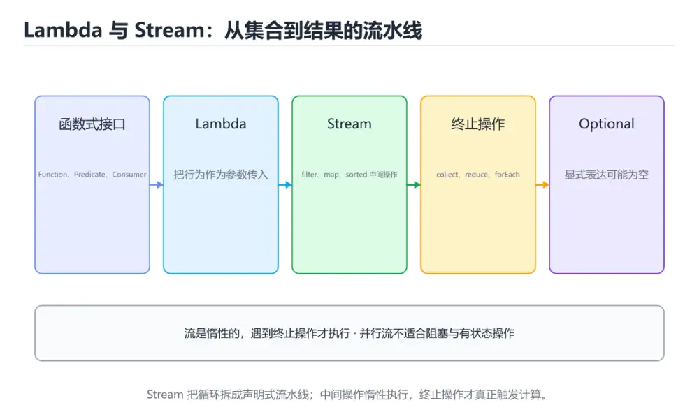
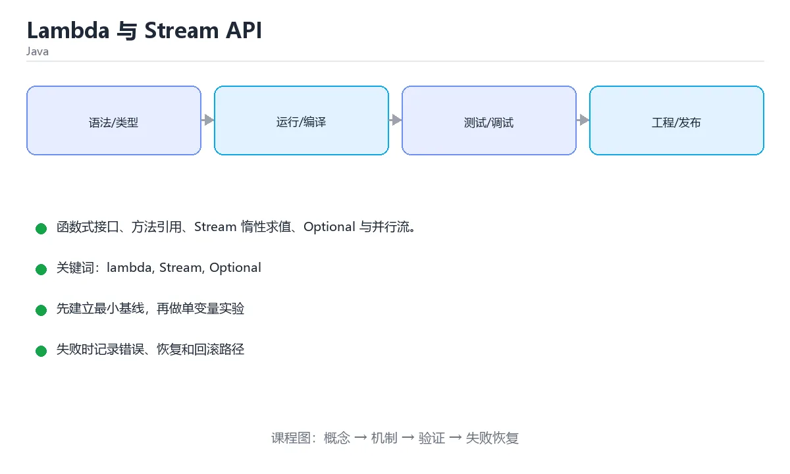

# Lambda 与 Stream API

> 内容更新时间：2026-10-06 · 学习阶段：进阶 · 预计用时：25 分钟





## 本节知识框架

想象一条工厂流水线：原材料（集合）进来后，经过一道道加工工位（filter、map、sorted），最后在出货口（collect）打包成品。Lambda 就是"把一段行为当参数传进去"，Stream 就是"用链式操作处理集合"。两者配合，能把过去要写十几行的循环压缩成一条清晰的数据流水线。

**本课你将学到：**
- Lambda 表达式和方法引用的写法
- Stream 的中间操作与终止操作
- Optional 如何替代 null
- 并行流的适用场景与陷阱

**先修要求：** 学完《异常处理与文件 IO》即可。

### 复习清单

- [ ] 能区分 Stream 的中间操作和终止操作
- [ ] 能写出 Optional 的安全取值方式
- [ ] 能说出并行流什么时候不该用

## 核心概念定义

| 术语 | 一句话说明 |
| --- | --- |
| Lambda | 匿名函数，把一段行为当参数传递。写法：(参数) -> { 方法体 } |
| 函数式接口 | 只有一个抽象方法的接口，可以用 lambda 实现。如 Function、Consumer、Predicate。 |
| Stream | 集合的函数式视图。中间操作惰性求值，终止操作触发执行。流只能消费一次。 |
| Optional | 包装可能为 null 的值，强制你处理"没有值"的情况，避免空指针。 |

## 原理与运行机制

### Lambda 的四步演化

```java
List<String> names = List.of("小明", "小红", "小刚");

// 1. 匿名内部类（老写法，啰嗦）
names.forEach(new Consumer<String>() {
    @Override public void accept(String s) { System.out.println(s); }
});

// 2. Lambda
names.forEach(s -> System.out.println(s));

// 3. 方法引用（更短）
names.forEach(System.out::println);

// 4. 带条件与方法链
names.stream()
     .filter(s -> s.length() > 1)
     .map(String::toUpperCase)
     .forEach(System.out::println);
```

### 四大内置函数式接口

| 接口 | 签名 | 用途 |
| --- | --- | --- |
| Supplier<T> | () -> T | 提供值 |
| Consumer<T> | T -> void | 消费值 |
| Function<T,R> | T -> R | 转换 |
| Predicate<T> | T -> boolean | 判断 |

### Stream 常用操作

```java
List<String> result = names.stream()
        .filter(n -> n.length() > 3)     // 中间操作：惰性
        .map(String::toUpperCase)        // 转换
        .sorted()                        // 排序
        .distinct()                      // 去重
        .limit(10)
        .collect(Collectors.toList());   // 终止操作：触发执行
```

中间操作（filter/map/sorted）不会立刻执行，只有遇到终止操作（collect/forEach/count）才会遍历。

### 分组与统计

```java
Map<Integer, List<String>> byLength = names.stream()
        .collect(Collectors.groupingBy(String::length));

long count = names.stream().filter(n -> n.startsWith("a")).count();
int totalLength = names.stream().mapToInt(String::length).sum();
```

### Optional：不用再返回 null

```java
Optional<String> maybe = names.stream()
        .filter(n -> n.startsWith("z"))
        .findFirst();

String value = maybe.orElse("默认值");
maybe.ifPresent(System.out::println);
// 不要用 optional.get()，先判断或使用 orElseThrow
```

### 并行流

```java
long total = IntStream.rangeClosed(1, 1_000_000)
        .parallel()
        .filter(n -> n % 2 == 0)
        .count();
```

并行流使用公共 ForkJoinPool，适合纯计算且数据量大；有共享可变状态、IO 操作时不要用。

## 典型应用场景

| 场景 | 推荐做法 | 为什么 |
| --- | --- | --- |
| 集合数据过滤转换 | Stream filter + map + collect | 声明式，可读性好 |
| 分组统计 | Collectors.groupingBy | 一行完成分组 |
| 可能为 null 的返回值 | Optional | 强制处理空值情况 |
| 大数据量纯计算 | 并行流 parallel() | 自动利用多核 |

## 代码/协议/SQL 示例

### 函数式接口与方法引用

```java
@FunctionalInterface
interface Calculator {
    int apply(int a, int b);
}

Calculator add = (a, b) -> a + b;
Calculator max = Integer::max;
System.out.println(add.apply(1, 2));
```

### Stream 流水线练习

```java
record Student(String name, String team, int score) {}

var students = List.of(
    new Student("小明", "A", 88),
    new Student("小红", "B", 95),
    new Student("小刚", "A", 59)
);

List<String> passed = students.stream()
    .filter(s -> s.score() >= 60)
    .map(Student::name)
    .toList();

Map<String, List<Student>> byTeam = students.stream()
    .collect(Collectors.groupingBy(Student::team));
```

### 收集器速查

```text
目的            写法
───────────────────────────────────────────────────
收集成 List      .collect(Collectors.toList())
收集成 Set       .collect(Collectors.toSet())
收集成 Map       .collect(Collectors.toMap(K::get, V::get, (a,b) -> a))
分组             .collect(Collectors.groupingBy(Item::category))
拼接字符串       .collect(Collectors.joining(", ", "[", "]"))
```

## 时间/空间复杂度或性能分析

- **Stream 创建**：几乎零开销，JIT 会内联 lambda
- **中间操作**：惰性求值，只在终止操作时遍历一次
- **并行流**：使用 ForkJoinPool，数据量大且无副作用时才有加速效果
- **装箱开销**：mapToInt/mapToLong 避免自动装箱，比 map(Integer::valueOf) 快

## 常见误区与易错点

| 容易写错的做法 | 实际现象 | 原因与正确做法 |
| --- | --- | --- |
| 把 Stream 当集合复用 | IllegalStateException | 流只能消费一次 |
| 中间操作不写终止操作 | 什么也不执行 | 流是惰性的 |
| Lambda 里改变量 | 编译错误 | 捕获的变量必须 effectively final |
| 乱用并行流 | 结果错乱或更慢 | 只在纯计算大数据量时用 |
| toMap 键重复 | IllegalStateException | 提供合并函数 (a,b) -> a |
| 用 orElse 做重计算 | 每次都白算 | 改用 orElseGet |
| Optional.get() 直接取值 | NoSuchElementException | 用 orElse 或 ifPresent |
| forEach 里修改外部集合 | 并发问题 | 用 collect 生成新集合 |

## 与其他知识点的关系

- **先修**：《异常处理与文件 IO》——lambda 里抛受检异常需要包装
- **后续**：《构建、测试与生态》——Stream 常用于测试数据准备
- **关联**：《集合框架与泛型》——Stream 就是集合的函数式视图

## 自测题与参考答案

1. **Stream 的中间操作什么时候执行？** 遇到终止操作时才执行，这是惰性求值。
2. **collect 和 forEach 有什么区别？** collect 收集结果返回新集合，forEach 只执行副作用不返回值。
3. **方法引用 String::length 等价于什么 lambda？** s -> s.length()
4. **并行流什么时候不该用？** 有共享可变状态、IO 操作、数据量小时不要用。
5. **Optional.orElse 和 orElseGet 有什么区别？** orElse 无论是否需要都执行参数，orElseGet 延迟执行。

## 考点精讲

`Lambda 与 Stream API` 的题库有 6 道题，下面逐题给出题干、正确项与判断依据。

### 考点 1：第 1 题

- **题目**：Stream 的中间操作（filter/map）什么时候真正执行？
- **正确项**：遇到终止操作才执行
- **判断依据**：本题正确项是「遇到终止操作时才执行」。术语 Optional（Lambda 与 Stream API）：.findFirst()，本题取「遇到终止操作时才执行」这条。易错点是把 Stream 当集合复用，改法是流只能消费一次。易错点是中间操作不写终止操作，会造成什么也不执行，改法是流是惰性的。

### 考点 2：第 2 题

- **题目**：代码语言为 `java`，选自 `Lambda 与 Stream API` 的 `Optional` 部分。课程问题为函数式接口、方法引用、Stream 惰性求值、Optional 与并行流。哪一项描述与代码一致？
- **正确项**：调用了 `length()`
- **判断依据**：本题正确项是「调用了 `length()`」。术语 Optional（Lambda 与 Stream API）：.findFirst()，本题取「调用了 `length()`」这条。易错点是中间操作不写终止操作，会造成什么也不执行，改法是流是惰性的。本题干扰项「调用了 `ValueError()`」不成立：展示代码里找不到 `ValueError()`。

### 考点 3：第 3 题

- **题目**：围绕“Lambda 与 Stream API”中的 lambda、Stream、Optional，下列哪两项是本课强调的实践判断？
- **正确项**：验证 Stream 时要固定版本并覆盖边界输入，结论才可复现；学习 lambda 时要同时说明输入、输出和失败路径，不能只看正常流程
- **判断依据**：按《Lambda 与 Stream API》的正文口径，本题要同时选中「验证 Stream 时要固定版本并覆盖边界输入，结论才可复现」、「学习 lambda 时要同时说明输入、输出和失败路径，不能只看正常流程」，漏掉任一项都算没答全。术语 Optional（Lambda 与 Stream API）：.findFirst()。易错点是Lambda 里改变量，会造成编译错误，改法是捕获的变量必须 effectively final。

### 考点 4：第 4 题

- **题目**：Stream 的 collect 与 forEach 的区别是？
- **正确项**：collect 是终止操作
- **判断依据**：本题正确项是「collect 是终止操作」。术语 Optional（Lambda 与 Stream API）：.findFirst()，本题取「collect 是终止操作」这条。易错点是乱用并行流，会造成结果错乱或更慢，改法是只在纯计算大数据量时用。

### 考点 5：第 5 题

- **题目**：方法引用 String::length 等价于哪个 lambda？
- **正确项**：s -> s.length
- **判断依据**：本题正确项是「s -> s.length」。术语 方法引用（Lambda 与 Stream API）：用双冒号语法把已有方法当作函数式接口的实现，比 lambda 更短也更易读，本题取「s -> s.length」这条。易错点是toMap 键重复，改法是提供合并函数 (a,b) -> a。

### 考点 6：第 6 题

- **题目**：填空：补齐下面这段术语说明中的空缺。课程 `函数式接口、方法引用、Stream 惰性求值、Optional 与并行流。`，这段说明是：`____`使用公共 ForkJoinPool，适合纯计算且数据量大；有共享可变状态、IO 操作时不要用。空缺处应填哪个术语？
- **正确项**：并行流
- **判断依据**：涉及术语 Optional：.findFirst()。易错点：把 Stream 当集合复用会造成`IllegalStateException: stream has already been operated upon`。正确做法：每条流水线只用一个流。本课Lambda 与 Stream API要解决的是函数式接口、方法引用、Stream 惰性求值、Optional 与并行流

## 术语速查

| 术语 | 一句话说明 |
| --- | --- |
| Lambda | 匿名函数，(参数) -> { 方法体 } |
| 函数式接口 | 只有一个抽象方法，可用 lambda 实现 |
| Stream | 集合的函数式视图，惰性求值 |
| Optional | 包装可能为 null 的值 |
| 方法引用 | Class::method 语法，比 lambda 更短 |
| 并行流 | 使用 ForkJoinPool 的并行处理 |

## 参考资料与复核

- 最后复核：2026-10-04
- 下次复核：2027-02-24
- 复核范围：版本兼容、API 行为、安全建议与工程实践

| 参考资料 | 本课用途 |
| --- | --- |
| [Java SE 官方教程：Lambda](https://docs.oracle.com/javase/tutorial/java/javaOO/lambdaexpressions.html) | Lambda 与 Stream 基础语法 |
| [Java SE API 文档](https://docs.oracle.com/en/java/javase/21/docs/api/) | Stream/Optional/Collector API 查询 |
| [dev.java 学习路径](https://dev.java/learn/) | 现代 Java 官方入门教程 |

## 内容元数据

- 内容版本：v2.0
- 最后更新：2026-10-06
- 学习阶段：进阶
- 适用环境：Java 21+ / Maven 或 Gradle
- 内容来源：内置结构化课程与工程实践整理
- 相关主题：lambda、Stream、Optional、函数式接口、并行流、方法引用
