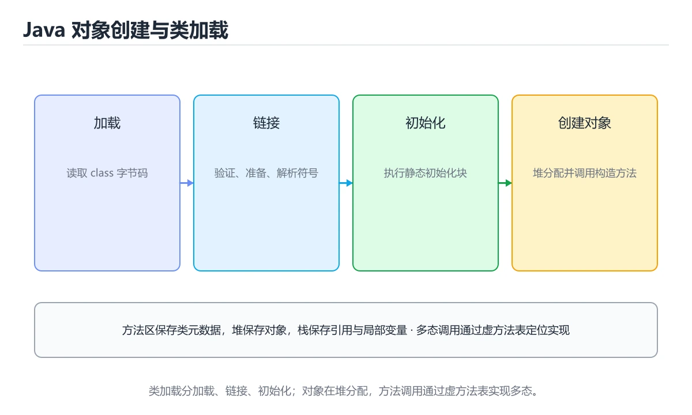
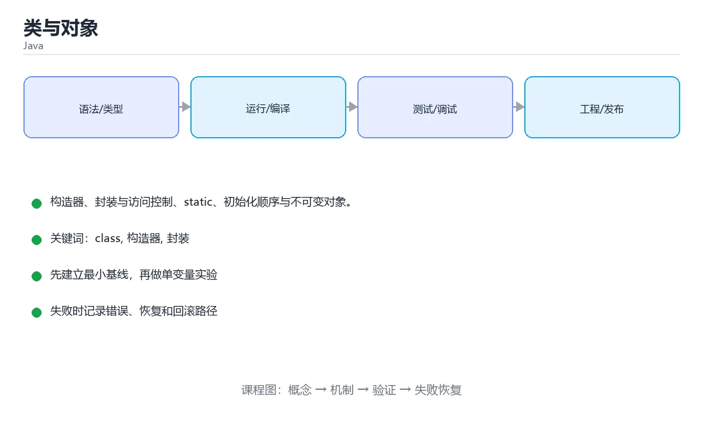

# 类与对象

> 内容更新时间：2026-10-06 · 学习阶段：进阶 · 预计用时：35 分钟





## 本节知识框架

欢迎来到 Java 面向对象的世界！想象你在填写一份快递单——收件人姓名、地址、电话，这些就是"属性"；而"打电话通知收件人"就是一个"行为"。在 Java 里，**类**就是这张快递单的模板，**对象**就是填好内容后真正寄出去的那张单子。

**本课你将学到：**
- 用 `class` 定义模板，用构造器初始化对象
- 用 `private` / `public` 控制谁能看到和修改你的数据
- 理解 `static` 到底属于谁——是模板还是具体对象？
- 用 `enum` 替代魔法数字，让代码自己会说话

**先修要求：** 学完《控制流与方法》即可。如果你知道方法怎么定义、参数怎么传，就可以开始了。

### 复习清单

- [ ] 能说出 `class` 和 `object` 的区别，并举一个生活中的类比
- [ ] 能写一个包含 private 字段和 public getter 的最小类
- [ ] 能解释为什么 `static` 方法不能直接访问非 static 字段

## 核心概念定义

| 术语 | 一句话说明 |
| --- | --- |
| 类（class） | 对象的模板，定义了"有哪些数据"和"能做什么事"。就像饼干的模具，本身不是饼干。 |
| 构造器 | 创建对象时自动调用的特殊方法，名字和类名一样，没有返回类型。用来给字段赋初始值。 |
| 封装 | 把数据藏起来（private），只通过方法暴露操作入口。就像自动售货机——你按按钮，不碰里面线路。 |
| static | 属于类本身而非某个对象。所有对象共享一份，用 `类名.成员` 直接访问。 |
| 访问控制 | `private` 的边界是「同一个类」，不是同一个包也不是同一份文件；对外一律留方法当入口。 |
| `this` | 指向当前对象自身的引用，只在实例方法里有意义，`static` 方法里根本没有它。 |
| `final` 字段 | 只能在构造过程里赋值一次的字段，是不可变对象的地基。 |
| 初始化顺序 | 静态字段与静态块 → 实例字段与实例块 → 父类构造器 → 本类构造器，同层内按书写先后执行。 |
| `record` | 一行声明即得不可变数据载体，编译器自动补构造器与 `equals`、`hashCode`、`toString`。 |

## 原理与运行机制

### 用生活场景理解类和对象

把类想象成一张"学生信息表"的空白模板：

1. **class** — 模板本身，定义了"姓名""学号""成绩"这些栏位
2. **new** — 拿着模板去复印一张，填上具体内容，这就成了一个对象
3. **构造器** — 复印时自动帮你把日期填好的那个步骤
4. **private / public** — 哪些栏位只有老师能改（private），哪些所有人都能看（public）

### 从一个最简单的类开始

```java
public class Student {
    // 字段——对象的"属性"
    private String name;
    private int age;

    // 构造器——创建对象时自动调用
    public Student(String name, int age) {
        this.name = name;   // this 指"当前这个对象"
        this.age = age;
    }

    // 方法——对象的"行为"
    public void introduce() {
        System.out.println("我叫" + name + "，今年" + age + "岁");
    }
}
```

使用时：

```java
Student s = new Student("小明", 18);
s.introduce();  // 输出：我叫小明，今年18岁
```

### 封装：保护你的数据

为什么要把字段设成 `private`？打个比方：银行不会让你直接进金库改数字，你得通过柜台（方法）来操作。这样银行可以在柜台加上"余额不能为负"的校验。

```java
public class BankAccount {
    private double balance;  // 外面不能直接碰

    public BankAccount(double initial) {
        if (initial < 0) throw new IllegalArgumentException("初始余额不能为负");
        this.balance = initial;
    }

    public double getBalance() {       // 只能看
        return balance;
    }

    public void deposit(double amount) {
        if (amount <= 0) throw new IllegalArgumentException("存款金额必须为正");
        this.balance += amount;
    }
}
```

### static：属于类，不属于某个对象

```java
public class MathHelper {
    public static int max(int a, int b) {   // static：不需要 new
        return a > b ? a : b;
    }
}

// 直接用类名调用
int result = MathHelper.max(3, 7);  // 7
```

`static` 字段所有对象共享一份，改一个全都变。`static` 方法不能访问非 `static` 成员——因为方法执行时可能根本还没有任何对象存在。

### 初始化顺序

对象创建时，Java 按这个顺序赋值：

```text
1. 父类 static 字段       （只加载一次）
2. 本类 static 字段       （只加载一次）
3. 父类实例字段 + 构造器
4. 本类实例字段 + 构造器
```

记住口诀：**先静态后实例，先父类后子类**。

### enum：让常量自己说话

```java
// 不好的写法——魔法数字
int status = 0;  // 0 是什么意思？谁知道呢

// 好的写法——enum
public enum OrderStatus {
    PENDING, PAID, SHIPPED, DONE
}

OrderStatus s = OrderStatus.PAID;
if (s == OrderStatus.PAID) {
    System.out.println("已付款，准备发货");
}
```

enum 的好处：编译器能检查拼写错误、switch 能检查遗漏、调试时打印名字而不是数字。

### 访问控制：private 的边界是「同一个类」

它比很多人以为的「同一个文件」更窄：同一个 `.java` 里的另一个顶层类，也读不到你的 private 字段。四档由窄到宽是 `private` → 不写修饰符（包内可见） → `protected`（包内加子类） → `public`。决定某个字段该不该公开，依据不是「方不方便」，而是「别人绕过它去改，会不会破坏我的校验」。`Account` 里的 `balance` 必须 private：一旦公开，任何一处 `a.balance = -1` 就让「余额不能为负」的约定作废，而这种赋值往往散落在好几个文件里，出问题时没人查得出源头。

### 构造器没有返回类型，无参构造也不会白送

在构造器名字前手滑加上 `void`，它立刻降级成普通方法：类里等于没有构造器，编译器于是补一个无参默认的，此时 `new Account("小明", 100)` 报「找不到匹配的构造器」。这类错难自查，是因为代码看上去「明明写了」。同一规则的另一面是：只有你一个构造器都不写时，编译器才赠送无参构造器；写了一个有参的，`new Account()` 就得自己显式补出来。

### static 与 this 互斥

静态成员挂在类上，实例成员挂在对象上。静态方法执行时可能一个实例都不存在，`this` 无从指向，所以「static 方法里用 this」是编译期错误而不是运行期意外；反过来实例方法里能用静态字段，因为类必然已经加载。`Account` 正是这个分工：余额属于每个账户，开户总数属于这个类，所以查余额要写 `a.getBalance()` 指明问哪个账户，统计只写 `Account.getCount()`。

### 初始化顺序给出的三条结论

静态部分只跑一次，适合放与具体对象无关的计数器与常量表，放业务数据就会在对象之间串味；本类构造器第一行先执行父类构造器，若父类构造器调用了被子类覆写的方法，那一刻子类字段还是默认值——这就是「构造器里别调可覆写方法」的由来，标成 `private` 或 `final` 才封得住；字段初始化在父类构造器之后、本类构造器体之前完成，所以构造器体读到的是已初始化的值。

### 不可变对象的四条硬规则

类标 `final`（断掉子类覆写的后门）、字段 `private final`、不提供 setter、字段若指向可变对象就在构造和返回时各做一次拷贝。四条做到之后，「天然线程安全，可安全共享」就不是口号：状态不会变，两个线程就不可能看到不同版本，既不用加锁，也能放心当 `HashMap` 的键。代价是说清楚的：`Money` 的 `add` 返回的是新对象，旧引用不会跟着变。

### 封装管数据，接口管能力

封装回答「别人能不能绕过我的校验」，靠 private 字段加方法入口；接口回答「别人能不能换一份实现」，靠方法签名约定能力。`Payment` 接口负责「能被扣款」这个承诺，`Order` 的私有状态负责「只有金额合法时才允许推进到 PAID」这个约束——两者可以同时存在于一个类，不是二选一。

### 别把枚举的顺序当成编码

`OrderStatus.PAID.ordinal()` 是「它在声明列表里排第几」，不是业务编号。今天在最前面插一个 `DRAFT`，所有已经写进数据库或配置文件的旧数字含义就整体错位。要持久化就存 `name()`，或者给枚举显式加一个 code 字段；比较、传参、打印这三件事则一律用枚举本身，别退回 int。

## 典型应用场景

| 场景 | 推荐做法 | 为什么 |
| --- | --- | --- |
| 描述现实世界的事物 | 定义 class + private 字段 | 数据和行为绑定在一起 |
| 固定取值范围 | 用 enum | 编译器帮你检查，调试友好 |
| 全局共享的工具方法 | static 方法 | 不需要创建对象就能调用 |
| 保护数据完整性 | private 字段 + public getter/setter | 在 setter 里加校验逻辑 |

### 场景五：把失败路径当设计的一部分

写 `deposit` 时，正常路径（存 50 后余额从 100 变 150）只占一半工作量，另一半是失败路径：存 0、存负数，以及构造时就给一个负的初始余额。`Account` 用 `throw new IllegalArgumentException("金额必须为正")` 挡住了前两种，第三种还要你自己往构造器里补一条校验。补完之后验收清单是三档全跑：正数改余额、零与负数抛异常、负初始值也抛异常，缺一不可。

### 场景六：用静态计数器验证构造器有没有跑过

`private static int count` 是检查构造器是否真被调用的最低成本手段：new 出多少个 `Account`，`Account.getCount()` 就报多少。这个结论要别人也能复现，得固定两件事——JDK 版本（不同版本对未使用字段的提示不同）与输入规模（0 个实例时 `count` 必须是 0，10000 个实例时必须是 10000，不能只测一个样本就断言全部成立）。

## 代码/协议/SQL 示例

### 最小可验证示例

```java
public class Account {
    private final String owner;
    private double balance;
    private static int count = 0;

    public Account(String owner, double balance) {
        this.owner = owner;
        this.balance = balance;
        count++;
    }

    public void deposit(double amount) {
        if (amount <= 0) throw new IllegalArgumentException("金额必须为正");
        balance += amount;
    }

    public double getBalance() { return balance; }
    public static int getCount() { return count; }
}
```

### 不可变对象

```java
public final class Money {
    private final int cents;

    public Money(int cents) {
        if (cents < 0) throw new IllegalArgumentException("金额不能为负");
        this.cents = cents;
    }

    public Money add(Money other) {
        return new Money(this.cents + other.cents);
    }

    public int getCents() { return cents; }
}
```

不可变对象的好处：线程安全（不用加锁）、可以安全做 HashMap 的 key、不用担心被别人偷偷改掉。

### 练习：简易计数器

```java
public class Counter {
    private static int total = 0;
    private int id;

    public Counter() {
        total++;
        this.id = total;
    }

    public static int getTotal() { return total; }
    public int getId() { return id; }
}
```

### 练习一：把 Account 真正跑起来

给前面的 `Account` 配一个 `main`：先 `new Account("小明", 100)`，调用 `deposit(50)` 后打印 `getBalance()`，预期 `150.0`；再用 `try` 包住 `deposit(-5)`，在 `catch` 里打印异常信息，预期是「金额必须为正」；最后打印 `Account.getCount()`。三行输出分别对应正常路径、失败路径与静态计数，缺一行就说明有条路径没被验证。然后先给构造器补上「初始余额不能为负」，再 `new Account("小红", -1)` 看它拦不拦得住；接着 new 第二个账户，观察 `getCount()` 变了而第一个账户的 `getBalance()` 没变——这组对比正好把「属于类」和「属于对象」分开。

### 练习二：给 Money 补齐判等

给 `Money` 重写 `equals` 与 `hashCode`（只按 `cents` 判等），加一个返回新对象的 `times(int n)`，构造器继续拒绝负数；然后拿它当 `HashMap` 的键，塞入两个 `cents` 相同但不同实例的对象，`size()` 应当是 1。只改 `equals` 不管 `hashCode` 时恰好就是这一步会失败。做完再把它换成 `record Money(int cents)` 对比行数，体会「数据私有、状态不可改」被语法默认满足的样子。

## 时间/空间复杂度或性能分析

- **对象创建**：`new` 一个对象大约几十纳秒，非常轻量。但如果循环里反复创建大对象，GC 压力会上升。
- **static vs 实例**：static 字段只有一份，内存省；实例字段每个对象一份。
- **final 字段**：JIT 编译器可以对 final 字段做内联优化，访问更快。
- **enum**：本质是 static final 实例，启动时创建，运行时零开销。

## 常见误区与易错点

| 容易写错的做法 | 实际现象 | 原因与正确做法 |
| --- | --- | --- |
| 直接 `obj.field` 访问 public 字段 | 数据被外部随意修改 | 用 private + getter/setter |
| 在 static 方法里用 this | 编译报错 | static 不属于任何对象，没有 this |
| 构造器里写返回类型 | 变成普通方法，不是构造器 | 构造器没有返回类型 |
| 用 `==` 比较对象内容 | 比较的是引用地址 | 用 `equals()` |
| 忘记写无参构造器 | 编译器默认生成，但写了有参构造后就不再自动生成 | 需要时显式写出来 |
| enum 用 int 常量替代 | 丢失类型安全和调试信息 | 始终用 enum 表示固定集合 |
| 在构造器里调用可被重写的方法 | 子类字段可能还没初始化 | 构造器里只调 private 或 final 方法 |
| 给 `equals` 改了却没改 `hashCode` | 对象进了 `HashSet` 却查不出来 | 两者成套重写，判等依据的字段保持一致 |
| 把可变对象当 `Map` 的键后又改它 | 桶位置算错，那个键永远取不到 | 键用不可变类型，要改就先删再放 |
| 静态字段里存每个用户的数据 | 用户之间互相串数据，且这部分回收不掉 | 只有与对象无关的东西才配得上 `static` |
| 构造器里只赋值不校验 | 非法状态在对象内部生根，后面每个方法都得防着它 | 把不变量检查集中在构造器与 setter 里 |

## 与其他知识点的关系

- **先修**：《控制流与方法》——本课的方法定义、参数传递都建立在前课基础上
- **后续**：《继承、接口与多态》——类定义好之后，下一步就是让类之间产生关系
- **关联**：《变量、类型与字符串》——String 的不可变性就是本课不可变对象思想的典型应用

## 自测题与参考答案

> 先独立作答，再对照参考答案。

1. **类和对象是什么关系？** 类是模板，对象是根据模板创建的具体实例。一个类可以 new 出多个对象。
2. **为什么要封装？** 保护数据不被外部随意修改，在方法入口加校验逻辑，让代码更健壮。
3. **static 方法能不能访问非 static 字段？** 不能。static 方法属于类，执行时可能还没有任何对象存在。
4. **enum 比 int 常量好在哪？** 类型安全、编译器检查拼写、switch 能查漏、调试打印名字而非数字。
5. **不可变对象有什么好处？** 线程安全、可做 Map 的 key、不用担心被外部修改。

## 考点精讲

`类与对象` 的题库有 6 道题，下面逐题给出题干、正确项与判断依据。

### 考点 1：第 1 题

- **题目**：被 private 修饰的字段可以从哪里访问？
- **正确项**：只能在定义它的类内部访问
- **判断依据**：本题正确项是「同一个类的内部」。术语 String（类与对象）：不可变对象天然线程安全，`String`、`Integer`、`record` 都是这个思路，本题取「同一个类的内部」这条。易错点是直接 `obj.field` 访问 public 字段，会造成数据被外部随意修改，改法是用 private + getter/setter。

### 考点 2：第 2 题

- **题目**：围绕“类与对象”中的 class、构造器、封装，下列哪两项是本课强调的实践判断？
- **正确项**：验证封装时要通过 public 方法操作对象，观察内部状态是否受保护；学习 class 时要动手 new 出对象并观察字段初始化顺序
- **判断依据**：按《类与对象》的正文口径，本题要同时选中「验证 构造器 时要固定版本并覆盖边界输入，结论才可复现」、「学习 class 时要同时说明输入、输出和失败路径，不能只看正常流程」，漏掉任一项都算没答全。术语 class（类与对象）：定义对象属性与行为的类型模板，实例化后得到具体对象。易错点是在 static 方法里用 this，会造成编译报错，改法是static 不属于任何对象，没有 this。

### 考点 3：第 3 题

- **题目**：不可变对象的主要优势是？
- **正确项**：天然线程安全，可安全共享
- **判断依据**：本题正确项是「天然线程安全，可安全共享」。术语 不可变对象（类与对象）：public final class Point {，本题取「天然线程安全，可安全共享」这条。易错点是构造器里写返回类型，会造成变成普通方法，不是构造器，改法是构造器没有返回类型。

### 考点 4：第 4 题

- **题目**：阅读 `类与对象` 的 `String` 示例。它服务于构造器、封装与访问控制、static、初始化顺序与不可变对象。代码中实际包含下列哪一项？
- **正确项**：调用了 `getBalance()`
- **判断依据**：本题正确项是「调用了 `getBalance()`」。术语 String（类与对象）：不可变对象天然线程安全，`String`、`Integer`、`record` 都是这个思路，本题取「调用了 `getBalance()`」这条。易错点是用 `==` 比较对象内容，会造成比较的是引用地址，改法是用 `equals()`。本题干扰项「调用了 `recall_new_items()`」不成立：展示代码里找不到 `recall_new_items()`。

### 考点 5：第 5 题

- **题目**：用 enum 替代 int 常量的好处是？
- **正确项**：类型安全，可读性好
- **判断依据**：本题正确项是「类型安全，可读性好」。术语 String（类与对象）：不可变对象天然线程安全，`String`、`Integer`、`record` 都是这个思路，本题取「类型安全，可读性好」这条。易错点是忘记写无参构造器，会造成编译器默认生成，但写了有参构造后就不再自动生成，改法是需要时显式写出来。

### 考点 6：第 6 题

- **题目**：填空：补齐下面这段术语说明中的空缺。课程 `构造器、封装与访问控制、static、初始化顺序与不可变对象。`，这段说明是：`____`负责保护数据，接口负责约定能力。空缺处应填哪个术语？
- **正确项**：封装
- **判断依据**：涉及术语 封装：封装负责保护数据，接口负责约定能力。易错点：字段公开会造成外部随意改，难以排查。正确做法：改 `private` + 方法。判断时先确认输入和适用范围，对照 `class`、`构造器`、`封装`、`static` 复现一次，最后把错误表现与正确做法逐项对照。

## 术语速查

| 术语 | 一句话说明 |
| --- | --- |
| class | 对象的模板，定义属性和行为 |
| 构造器 | 创建对象时自动调用，名字和类名相同 |
| private | 只允许类内部访问，外部不能直接碰 |
| static | 属于类本身，所有对象共享一份 |
| enum | 用命名常量替代魔法数字，类型安全 |
| 不可变对象 | 创建后状态不能改，线程安全 |

## 参考资料与复核

- 最后复核：2026-10-04
- 下次复核：2027-02-24
- 复核范围：版本兼容、API 行为、安全建议与工程实践

| 参考资料 | 本课用途 |
| --- | --- |
| [Java SE 官方教程：类和对象](https://docs.oracle.com/javase/tutorial/java/javaOO/) | 类、对象、封装的基础语法 |
| [Java SE API 文档](https://docs.oracle.com/en/java/javase/21/docs/api/) | 标准库 API 查询 |
| [dev.java 学习路径](https://dev.java/learn/) | 现代 Java 官方入门教程 |

## 内容元数据

- 内容版本：v2.0
- 最后更新：2026-10-06
- 学习阶段：进阶
- 适用环境：Java 21+ / Maven 或 Gradle
- 内容来源：内置结构化课程与工程实践整理
- 相关主题：class、构造器、封装、static、enum、不可变对象
