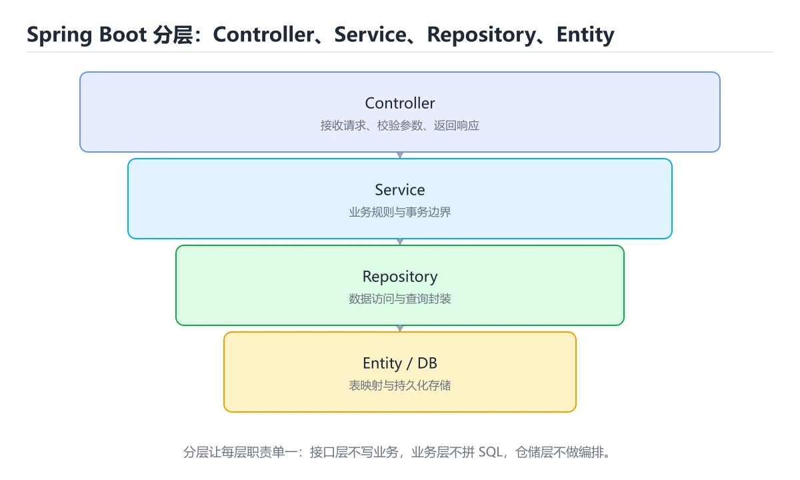
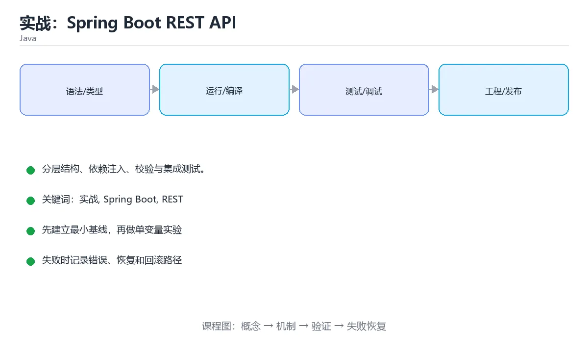

# 实战：Spring Boot REST API





> 内容更新时间：2026-10-06 · 学习阶段：高级 · 预计用时：110 分钟

## 本节知识框架

把 Spring Boot 项目想象成一家餐厅：

- **前台（Controller）**：接待顾客、点菜、上菜——接收 HTTP 请求，校验参数，返回状态码。
- **后厨（Service）**：按菜谱做菜——承载业务规则和事务。
- **仓库（Repository）**：取食材——只跟数据库打交道。
- **菜单（DTO）**：给顾客看的菜品描述——对外数据结构，不暴露后厨细节。
- **库存台账（Entity）**：仓库里的实际记录——与表结构对应。

为什么要把菜单和台账分开？因为顾客不需要知道你冰箱里有几斤肉。同样，API 用户不需要看到你的数据库字段。

本课主线：分层结构、依赖注入、校验与集成测试。先修内容：《构建、测试与生态》。

### 复习清单

- [ ] 能不看正文说出 Controller、Service、Repository 各自的职责。
- [ ] 能运行或推演本课示例，记录输入、输出和失败现象。
- [ ] 能完成一次自测，并把错题对照错误表定位原因。

## 核心概念定义

| 术语 | 一句话说明 |
| --- | --- |
| `record` | Java 14+ 的简洁数据载体，天生适合做 API 的请求/响应模型。坑：不同版本行为可能不同。 |
| `实战` | 把 Spring Boot 的分层、注入、校验落地为可运行的 REST 服务。坑：升级前要按官方变更说明重新验证。 |
| `REST` | 以资源 URI、HTTP 方法和状态码组织接口的无状态风格。坑：网络延迟和版本协商会改变行为。 |
| `测试` | 用可重复的输入和断言验证代码行为是否符合预期。坑：字段注入会导致循环依赖、难测试。 |

## 原理与运行机制

### 分层结构：各司其职，互不越界

就像餐厅里前台不管后厨怎么做菜，后厨也不管食材怎么采购——每一层只做自己该做的事：

| 层 | 职责 | 不该做的事 |
| --- | --- | --- |
| Controller | 参数绑定、校验、返回状态码 | 写业务规则、拼 SQL |
| Service | 业务规则、事务边界、编排 | 直接依赖 HTTP 对象 |
| Repository | 数据访问 | 写业务判断 |
| DTO | 对外数据结构 | 直接暴露实体与敏感字段 |
| Entity | 持久化模型 | 承担接口返回格式 |

### 依赖注入：构造器注入优于字段注入

想象后厨需要食材，与其让厨师自己去仓库拿（字段注入），不如在入职时就把食材清单配好（构造器注入）。这样谁依赖什么一目了然，测试时也能轻松替换。

```java
@RestController
@RequestMapping("/api/orders")
public class OrderController {
    private final OrderService service;

    public OrderController(OrderService service) {   // 构造注入，便于测试
        this.service = service;
    }

    @PostMapping
    public ResponseEntity<OrderView> create(@Valid @RequestBody CreateOrderRequest req) {
        OrderView view = service.create(req);
        return ResponseEntity.status(HttpStatus.CREATED).body(view);
    }
}

@Service
public class OrderService {
    private final OrderRepository repository;

    public OrderService(OrderRepository repository) {
        this.repository = repository;
    }

    @Transactional
    public OrderView create(CreateOrderRequest req) {
        if (req.quantity() <= 0) {
            throw new IllegalArgumentException("数量必须为正");
        }
        Order saved = repository.save(Order.from(req));
        return OrderView.from(saved);
    }
}
```

```java
public record CreateOrderRequest(
        @NotBlank String customer,
        @Positive int quantity) {}

public record OrderView(long id, String customer, int quantity, String status) {
    static OrderView from(Order order) {
        return new OrderView(order.getId(), order.getCustomer(),
                             order.getQuantity(), order.getStatus().name());
    }
}
```

### 统一异常处理：别把堆栈返回给用户

```java
@RestControllerAdvice
public class GlobalExceptionHandler {
    private static final Logger log = LoggerFactory.getLogger(GlobalExceptionHandler.class);

    @ExceptionHandler(MethodArgumentNotValidException.class)
    @ResponseStatus(HttpStatus.BAD_REQUEST)
    public ApiError onValidation(MethodArgumentNotValidException ex) {
        List<String> issues = ex.getBindingResult().getFieldErrors().stream()
                .map(e -> e.getField() + ": " + e.getDefaultMessage())
                .toList();
        return new ApiError("参数不合法", "VALIDATION_FAILED", issues);
    }

    @ExceptionHandler(OrderNotFoundException.class)
    @ResponseStatus(HttpStatus.NOT_FOUND)
    public ApiError onNotFound(OrderNotFoundException ex) {
        return new ApiError(ex.getMessage(), "ORDER_NOT_FOUND", List.of());
    }

    @ExceptionHandler(Exception.class)
    @ResponseStatus(HttpStatus.INTERNAL_SERVER_ERROR)
    public ApiError onUnexpected(Exception ex) {
        log.error("未预期异常", ex);              // 细节只进日志
        return new ApiError("服务内部错误", "INTERNAL_ERROR", List.of());
    }
}

public record ApiError(String message, String code, List<String> issues) {}
```

### JPA 与事务速查

| 目的 | 写法 |
| --- | --- |
| 查询单条 | `findById(id)` 返回 `Optional` |
| 条件查询 | `findByStatusAndCreatedAtAfter(...)` |
| 分页 | `PageRequest.of(page, size, Sort.by("createdAt").descending())` |
| 避免 N+1 | `@EntityGraph` 或 `join fetch` |
| 只读事务 | `@Transactional(readOnly = true)` |
| 乐观锁 | `@Version` 字段 + 捕获冲突后重试 |

### 项目专属规格

分层结构、依赖注入、校验与集成测试。项目目标是把「实战、Spring Boot、REST、依赖注入、测试」落实为可运行、可测试、可回滚的交付物。

**验收场景**：
1. 正常路径：最小输入得到预期输出，并留下日志与指标。
2. 边界路径：空值、最大值、重复数据和超长内容都得到明确处理。
3. 失败路径：依赖超时或不可用时能快速失败、重试或降级。
4. 幂等路径：同一请求执行两次不会产生重复副作用。
5. 回滚路径：Spring Boot 的失败能按预案恢复，并记录影响范围。

### 项目交付物

```text
src/main/java/
src/main/resources/
src/test/java/
pom.xml
README.md
```

**测试矩阵**：

| 层级 | 覆盖内容 | 最低数量 | 通过标准 |
| --- | --- | ---: | --- |
| 单元测试 | 领域规则、边界和错误分类 | 8 | 正常、边界、失败路径全部通过 |
| 集成测试 | 数据库、网络、文件或平台边界 | 3 | 使用真实边界且可重复运行 |
| 端到端测试 | 核心用户路径 | 1 | 从输入到输出完整跑通 |
| 手动验收 | 文档中列出的 5 个场景 | 5 | 有命令、输出和结论记录 |

### 验证命令与预期输出

| 阶段 | 命令 | 预期输出 |
| --- | --- | --- |
| 编译 | `./mvnw -q -DskipTests package` | 生成 JAR 且编译无错误 |
| 运行测试 | `./mvnw test` | JUnit 测试全部通过 |
| 启动服务 | `java -jar target/app.jar` | 端口监听成功并输出启动日志 |

## 典型应用场景

### 配置外置与校验

```yaml
# application.yml
server:
  port: ${PORT:8080}
  shutdown: graceful          # 优雅关闭

spring:
  datasource:
    url: ${DB_URL}
    username: ${DB_USER}
    password: ${DB_PASSWORD}
  lifecycle:
    timeout-per-shutdown-phase: 20s

app:
  retry:
    max-attempts: ${RETRY_MAX:3}
```

```java
@ConfigurationProperties(prefix = "app.retry")
@Validated
public record RetryProperties(
        @Min(1) @Max(10) int maxAttempts) {}
```

**启动时校验配置**，而不是运行到一半才发现缺变量。

### 测试三层

```java
@ExtendWith(MockitoExtension.class)
class OrderServiceTest {
    @Mock OrderRepository repository;
    @InjectMocks OrderService service;

    @Test
    void 数量为零时抛出异常() {
        var req = new CreateOrderRequest("小明", 0);
        assertThatThrownBy(() -> service.create(req))
                .isInstanceOf(IllegalArgumentException.class)
                .hasMessageContaining("数量");
    }
}
```

| 层级 | 工具 | 覆盖 |
| --- | --- | --- |
| 单元测试 | JUnit 5 + Mockito | 业务规则 |
| 切片测试 | `@WebMvcTest` | 控制器与序列化 |
| 集成测试 | `@SpringBootTest` + Testcontainers | 数据库与外部依赖 |

## 代码/协议/SQL 示例

### 最小可验证示例

```java
@Service
public class UserService {
    private final Map<Long, User> store = new ConcurrentHashMap<>();
    private final AtomicLong ids = new AtomicLong();

    public List<User> findAll() { return List.copyOf(store.values()); }

    public User create(String name, int age) {
        long id = ids.incrementAndGet();
        User user = new User(id, name, age);
        store.put(id, user);
        return user;
    }

    public Optional<User> findById(long id) { return Optional.ofNullable(store.get(id)); }
}

@RestController
@RequestMapping("/api/users")
public class UserController {
    private final UserService service;

    public UserController(UserService service) { this.service = service; }   // 构造器注入

    @GetMapping
    public List<User> list() { return service.findAll(); }

    @GetMapping("/{id}")
    public User get(@PathVariable long id) {
        return service.findById(id).orElseThrow(() -> new ResponseStatusException(HttpStatus.NOT_FOUND));
    }

    @PostMapping
    @ResponseStatus(HttpStatus.CREATED)
    public User create(@Valid @RequestBody User request) {
        return service.create(request.name(), request.age());
    }
}
```

```java
@SpringBootTest(webEnvironment = SpringBootTest.WebEnvironment.RANDOM_PORT)
class UserControllerTest {
    @Autowired TestRestTemplate rest;

    @Test
    void createsAndFetchesUser() {
        User created = rest.postForObject("/api/users", new User(null, "tom", 18), User.class);
        assertThat(created.id()).isNotNull();
        assertThat(rest.getForObject("/api/users/" + created.id(), User.class).name()).isEqualTo("tom");
    }
}
```

**Spring Boot 注解速查**：

| 注解 | 作用 |
| --- | --- |
| `@SpringBootApplication` | 启动类，组合配置与组件扫描 |
| `@RestController` | REST 控制器，返回值序列化为 JSON |
| `@RequestMapping` / `@GetMapping` / `@PostMapping` | 路由映射 |
| `@Valid` / `@Validated` | 触发参数校验 |
| `@Service` / `@Repository` / `@Component` | 组件声明 |
| `@Transactional` | 事务边界 |

运行方式：保存为 `.java` 后用 `javac` 编译、`java` 运行；注意类名与文件名一致。

## 时间/空间复杂度或性能分析

**性能关注点**：JVM 预热与 GC 影响测量——记录吞吐、P99 延迟与堆占用，先跑预热再采样。

**本课特有开销**：并发度提高后要观察是否出现拐点——延迟上升而吞吐不增，说明瓶颈已转移。

| 参数 | 作用 |
| --- | --- |
| `MaxRAMPercentage` | 容器里按比例限制堆，避免被 OOM Kill |
| `USER` | 非 root 运行 |
| `shutdown: graceful` | 发布时不中断在途请求 |

**测量方法**：固定输入跑一遍记录基线，再把规模或并发度提高一个数量级复测；两次结果的差值与波动范围才是结论依据。

## 常见误区与易错点

新手最容易踩的八个坑：

| 容易写错的做法 | 实际现象 | 原因与正确做法 |
| --- | --- | --- |
| Entity 直接当接口返回 | 泄露字段、耦合表结构 | 用 DTO 转换 |
| 用字段注入 | 循环依赖、难测试 | 用构造注入 |
| 把异常堆栈返回给用户 | 泄露实现细节 | 统一异常处理 |
| 事务加在 Controller | 事务边界不清 | 加在 Service 方法 |
| 配置硬编码 | 换环境要改代码 | 用环境变量与 profile |
| 忘了 graceful shutdown | 发布时 502 | 开启并设置超时 |
| 用 `System.out` 打日志 | 无法分级与采集 | 用 SLF4J |
| 容器里堆内存不限 | 被 OOM Kill | 设置 `MaxRAMPercentage` |
| 忘记 `@Transactional` | 多次写入出现半成功 | 在 Service 层声明事务 |
| 拼接 SQL 字符串 | 注入风险 | 用参数绑定或 Spring Data 方法命名 |

**现场排错示范**：

**症状**：Entity 直接当接口返回，泄露字段、耦合表结构。
**根因**：没有做 DTO 转换层。
**修复**：用 DTO 转换。
**自检**：在本课示例里复现该现象，改成 DTO 转换后重跑；如果症状消失说明定位正确。

## 与其他知识点的关系

- **先修**：`构建、测试与生态`。本课默认这些内容已经掌握。
- **相关或后续**：`实战：Java 库存管理 REST 服务`。本课术语会在这些课程里继续使用。
- 同一分类的《实战：Java 库存管理 REST 服务》也涉及 `Spring Boot`；两课衔接时先确认这个术语的定义是否一致。

**容易混淆的相邻概念**：
- `record` vs `class`：record 是不可变数据载体，自动生成 equals/hashCode/toString；class 更灵活但需要手写。
- `@RestController` vs `@Controller`：前者默认返回 JSON，后者返回视图。
- `@Transactional` 加在 Service vs Controller：事务边界应该在 Service 层，Controller 只处理 HTTP。

## 自测题与参考答案

> 先独立作答，再对照参考答案；答案都能在本课正文、术语表或错误表里找到依据。

### 自测 1（概念复述）

不看正文，写出 `record` 的操作性定义，并说明它与 `实战` 的区别。

**参考答案**：`record` 天生适合做 API 的请求/响应模型；`@NotBlank`、`@Min` 由 Bean Validation 在入口处自动校验。`实战` 的定位是：实战：Spring Boot REST API 解决了什么问题，而不是只背术语；两者的差别要从适用对象与失败模式上说明。

### 自测 2（排错）

本课错误表记录了「Entity 直接当接口返回」这类做法。请写出它会出现的现象、根因，以及修复顺序。

**参考答案**：现象是泄露字段、耦合表结构；正确做法是用 DTO 转换。修复时先复现现象并保留证据，再改动一处假设重跑，确认现象消失。

### 自测 3（动手验证）

运行本课的 Java 示例，把其中的 `0` 换成一个边界值后重新运行，记录输出与错误信息。

**参考答案**：正常输入下 Java 示例应当复现正文给出的结果；把 `0` 换成边界值后，如果结果改变或报错，先核对它是否满足 record 的适用范围，再检查错误表里是否有同类现象。

### 自测 4（代码阅读）

阅读本课开头的 Java 示例，说明它体现了 record 的哪一条性质，并指出改动哪个输入会让这条性质不再成立。

**参考答案**：record 的定义是天性适合做 API 的请求/响应模型，示例正是在实现这条定义。改动与 record 有关的一个输入后，如果结果不再符合正文描述，就说明该性质只在当前前提成立。

### 自测 5（迁移）

把实战：Spring Boot REST API 的方法迁移到自己的项目：围绕 record 写出一个与错误表同类的风险点，并说明触发条件和检验方式。

**参考答案**：例如「忘记 @Transactional」，它会导致多次写入出现半成功；检验方式是按在 Service 层声明事务改一处再复现，确认现象消失且没有引入新的失败分支。

## 术语速查

| 术语 | 一句话说明 |
| --- | --- |
| `record` | `record` 天生适合做 API 的请求/响应模型；`@NotBlank`、`@Min` 由 Bean Validation 在入口处自动校验。 |
| `实战` | 实战：Spring Boot REST API 解决了什么问题，而不是只背术语。 |
| `REST` | 以资源 URI、HTTP 方法和状态码组织接口的无状态风格。 |
| `测试` | 用可重复的输入和断言验证代码行为是否符合预期。 |
| `依赖注入` | 通过构造器把依赖传进来，而不是在类内部自己创建。 |
| `DTO` | 对外数据结构，与 Entity 分开，避免暴露敏感字段。 |

## 考点精讲

`实战：Spring Boot REST API` 的题库有 6 道题，下面逐题给出题干、正确项与判断依据：先自己作答，再核对正确项，最后回到正文对应小节复核。

### 考点 1：第 1 题

- - **题目**：围绕“实战：Spring Boot REST API”中的 实战、Spring Boot、REST，下列哪两项是本课强调的实践判断？
- **正确项**：验证 Spring Boot 时要固定版本并覆盖边界输入，结论才可复现；学习 实战 时要同时说明输入、输出和失败路径，不能只看正常流程
- **判断依据**：Spring Boot 项目需要在固定版本下验证边界输入才能确保结论可复现，同时每个功能都要覆盖正常、边界和失败路径。回到正文「验收场景」一节复习。

### 考点 2：第 2 题

- **题目**：使用构造器注入的主要好处是？
- **正确项**：依赖显式且便于测试
- **判断依据**：构造器注入让依赖关系在创建时就明确，不像字段注入那样隐藏依赖，测试时可以直接传入 mock 对象。回到正文「依赖注入」一节复习。

### 考点 3：第 3 题

- **题目**：这段 `java` 代码对应 `实战：Spring Boot REST API` 的 `record`。课程要解决的是分层结构、依赖注入、校验与集成测试。关于代码内容，哪一项说法准确？
- **正确项**：调用了 `Min()`
- **判断依据**：代码中 `@Positive int quantity` 使用了 Bean Validation 注解，`@Min()` 是同类校验注解。回到正文 record 定义部分核对。

### 考点 4：第 4 题

- **题目**：@RestController 与 @Controller 的差别是？
- **正确项**：@RestController 默认返回 JSON
- **判断依据**：@RestController 等于 @Controller + @ResponseBody，返回值自动序列化为 JSON 而不是视图名。回到正文「Spring Boot 注解速查」复习。

### 考点 5：第 5 题

- **题目**：JPA 中 N+1 查询问题的常见解法是？
- **正确项**：用 join fetch / @EntityGraph 一次性预加载关联数据
- **判断依据**：N+1 问题是指查 N 条记录时额外执行 N 次关联查询。用 join fetch 或 @EntityGraph 可以在一条 SQL 里把关联数据一起加载出来。回到正文「JPA 与事务速查」复习。

### 考点 6：第 6 题

- **题目**：填空：补齐下面这段术语说明中的空缺。课程 `分层结构、依赖注入、校验与集成测试。`，这段说明是：`____`：以资源 URI、HTTP 方法和状态码组织接口的无状态风格。空缺处应填哪个术语？
- **正确项**：REST
- **判断依据**：这是 REST 的定义——以资源 URI、HTTP 方法和状态码组织接口的无状态风格。回到正文「核心概念定义」核对原文。

## 内容元数据

- 内容版本：v2.0
- 最后更新：2026-10-06
- 学习阶段：高级
- 适用环境：Java 21+ / Maven 或 Gradle；本课聚焦实战。
- 内容来源：内置结构化课程与工程实践整理
- 相关主题：实战、Spring Boot、REST、依赖注入、测试
- 质量版本：P0 测验标准 + P1 覆盖扩展 + P2 体验补全

## 参考资料与复核

- 最后复核：2026-10-04
- 下次复核：2027-02-24
- 复核范围：版本兼容、API 行为、安全建议与工程实践
- 来源性质：官方文档、标准或权威教材；本课核对关键词：实战、Spring Boot、REST、依赖注入、测试。

| 参考资料 | 本课用途 |
| --- | --- |
| [Spring Boot 官方文档](https://docs.spring.io/spring-boot/docs/current/reference/html/) | 框架配置与注解参考 |
| [JUnit 用户指南](https://junit.org/junit5/docs/current/user-guide/) | 自动化测试与断言 |
| [dev.java 学习](https://dev.java/learn/) | 现代 Java 官方教程 |
