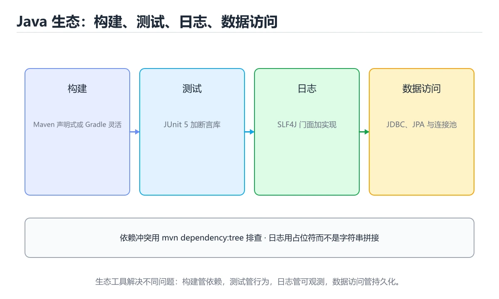
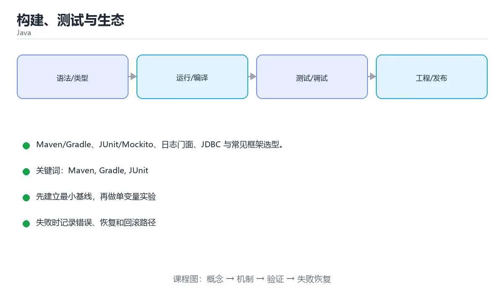

# 构建、测试与生态

> 内容更新时间：2026-10-06 · 学习阶段：进阶 · 预计用时：65 分钟





## 本节知识框架

写完了 Java 代码，接下来要解决"怎么跑起来"的问题。想象你开了一家餐厅：Maven/Gradle 是施工队负责拉材料、编译、打包；JUnit 是验收员负责自动检查菜品质量；日志系统是你的监控摄像头记录每天发生了什么；JDBC 是通往仓库的通道让你存取食材。

**本课你将学到：**
- Maven 和 Gradle 的基本用法
- JUnit 5 写单元测试
- 日志框架的正确使用方式
- JDBC 数据库访问与防 SQL 注入

**先修要求：** 学完前面所有 Java 基础课程即可。

### 复习清单

- [ ] 能说出 Maven 和 Gradle 的三个区别
- [ ] 能用 JUnit 5 写一个包含断言和异常断言的测试
- [ ] 能解释为什么不该用 System.out.println 做日志

## 核心概念定义

| 术语 | 一句话说明 |
| --- | --- |
| Maven | 基于 XML 的构建工具，约定优于配置，pom.xml 管理依赖和构建流程。 |
| Gradle | 基于 Groovy/Kotlin DSL 的构建工具，增量构建更快，build.gradle 配置。 |
| JUnit | Java 最常用的单元测试框架，用注解声明测试、断言和生命周期。 |
| JDBC | Java 数据库连接标准 API，实际项目常用连接池 + JPA/MyBatis。 |

## 原理与运行机制

### Maven vs Gradle

```text
对比维度      Maven                    Gradle
─────────────────────────────────────────────────────
配置格式      pom.xml (XML)            build.gradle (Groovy/Kotlin)
编译命令      mvn compile              gradle compileJava
测试命令      mvn test                 gradle test
打包命令      mvn package              gradle build
依赖树        mvn dependency:tree      gradle dependencies
学习曲线      平缓                     前期略陡
构建速度      一般                     增量与缓存更好
```

### Maven pom.xml 关键片段

```xml
<project>
  <modelVersion>4.0.0</modelVersion>
  <groupId>com.example</groupId>
  <artifactId>demo</artifactId>
  <version>1.0.0</version>
  <properties>
    <maven.compiler.release>21</maven.compiler.release>
  </properties>
  <dependencies>
    <dependency>
      <groupId>org.junit.jupiter</groupId>
      <artifactId>junit-jupiter</artifactId>
      <version>5.10.0</version>
      <scope>test</scope>
    </dependency>
  </dependencies>
</project>
```

### Gradle build.gradle 关键片段

```groovy
plugins { id 'java' }
java { toolchain { languageVersion = JavaLanguageVersion.of(21) } }
repositories { mavenCentral() }
dependencies {
    testImplementation 'org.junit.jupiter:junit-jupiter:5.10.0'
}
```

settings.gradle 定义项目结构（包含哪些模块），build.gradle 定义构建逻辑和依赖。

### JUnit 5 测试

```java
import org.junit.jupiter.api.Test;
import static org.junit.jupiter.api.Assertions.*;

class CalculatorTest {
    @Test
    void addsNumbers() {
        assertEquals(5, Calculator.add(2, 3));
    }

    @Test
    void throwsOnDivideByZero() {
        assertThrows(ArithmeticException.class, () -> Calculator.divide(1, 0));
    }

    @ParameterizedTest
    @CsvSource({"1,2,3", "0,0,0", "-1,1,0"})
    void addsVarious(int a, int b, int expected) {
        assertEquals(expected, Calculator.add(a, b));
    }
}
```

### 日志的正确用法

```java
private static final Logger log = LoggerFactory.getLogger(Service.class);

log.info("创建订单 id={} userId={}", orderId, userId);
log.warn("库存不足 sku={}", sku);
log.error("下单失败 userId={}", userId, exception);
```

用 SLF4J 门面 + Logback/Log4j2 实现，避免直接使用 System.out.println。

### JDBC 数据库访问

```java
try (Connection conn = DriverManager.getConnection(url, user, password);
     PreparedStatement ps = conn.prepareStatement(
         "SELECT name FROM users WHERE id = ?")) {
    ps.setLong(1, userId);
    try (ResultSet rs = ps.executeQuery()) {
        if (rs.next()) System.out.println(rs.getString("name"));
    }
}
```

永远使用 PreparedStatement 防 SQL 注入，不要拼接 SQL 字符串。

## 典型应用场景

| 场景 | 推荐做法 | 为什么 |
| --- | --- | --- |
| 新项目构建 | Maven 或 Gradle | 依赖管理、编译、打包一体化 |
| 单元测试 | JUnit 5 + Mockito | 行业标准，注解丰富 |
| 日志记录 | SLF4J + Logback | 门面模式，可切换实现 |
| 数据库访问 | JDBC + HikariCP | 连接池提升性能 |
| 防 SQL 注入 | PreparedStatement | 参数化查询 |

## 代码/协议/SQL 示例

### 完整测试示例

```java
class PriceCalculatorTest {
    private PriceCalculator calculator;

    @BeforeEach
    void setUp() { calculator = new PriceCalculator(); }

    @Test
    @DisplayName("VIP 用户免运费")
    void vipFreeShipping() {
        assertEquals(0, calculator.shippingFee("vip", 100));
    }

    @ParameterizedTest
    @CsvSource({"normal,100,10", "normal,300,0"})
    void shippingByAmount(String type, int amount, int expected) {
        assertEquals(expected, calculator.shippingFee(type, amount));
    }

    @Test
    void rejectsNegativeAmount() {
        assertThrows(IllegalArgumentException.class,
                () -> calculator.shippingFee("normal", -1));
    }
}
```

### Mockito 隔离依赖

```java
UserRepository repo = mock(UserRepository.class);
when(repo.findById(1L)).thenReturn(Optional.of(new User("tom")));
```

### CI 质量门禁

```text
检查              工具
──────────────────────────────
单元测试          JUnit 5
覆盖率            JaCoCo
静态分析          SpotBugs
代码格式          Spotless
依赖漏洞          OWASP Dependency-Check
```

## 时间/空间复杂度或性能分析

- **Gradle 增量构建**：只编译变化的文件，比 Maven 全量编译快很多
- **测试并行执行**：JUnit 5 支持 @Execution(CONCURRENT) 并行跑测试
- **连接池**：HikariCP 复用数据库连接，避免每次请求创建新连接的开销
- **日志占位符**：log.info("msg {}", arg) 比字符串拼接快，不抛异常时不拼接

## 常见误区与易错点

| 容易写错的做法 | 实际现象 | 原因与正确做法 |
| --- | --- | --- |
| 用 system 路径引本地 jar | 换机器就失败 | 装进私服或本地仓库 |
| 依赖版本冲突 | NoSuchMethodError | 用 dependency:tree 排查 |
| 忘提交 wrapper | 构建环境不一致 | 提交 mvnw / gradlew |
| 用 System.out.println 调试 | 生产日志无法统一收集 | 用日志框架并分级 |
| 测试依赖不标 test 范围 | 打包体积变大 | 测试依赖标 test scope |
| SQL 字符串拼接 | SQL 注入风险 | 用 PreparedStatement |
| 日志打印密码或令牌 | 安全事件 | 脱敏处理 |
| 测试之间共享静态状态 | 单跑通过一起跑失败 | 每个用例独立准备数据 |

## 与其他知识点的关系

- **先修**：前面所有 Java 课程
- **后续**：《实战：Spring Boot REST API》——本课工具链在实战中综合运用
- **关联**：《Lambda 与 Stream API》——测试数据准备常用 Stream

## 自测题与参考答案

1. **Maven 和 Gradle 有什么区别？** Maven 用 XML 配置，Gradle 用 Groovy/Kotlin DSL；Gradle 增量构建更快。
2. **JUnit 5 参数化测试用什么注解？** @ParameterizedTest 配合 @ValueSource 或 @CsvSource。
3. **为什么不该用 System.out.println 做日志？** 无法分级、无法统一收集、无法带上下文。用 SLF4J + Logback。
4. **怎么防止 SQL 注入？** 永远使用 PreparedStatement 参数占位符，不要拼接 SQL 字符串。
5. **settings.gradle 和 build.gradle 有什么区别？** settings 定义项目结构（包含哪些模块），build 定义构建逻辑和依赖。

## 考点精讲

`构建、测试与生态` 的题库有 6 道题，下面逐题给出题干、正确项与判断依据。

### 考点 1：第 1 题

- - **题目**：围绕“构建、测试与生态”中的 Maven、Gradle、JUnit，下列哪两项是本课强调的实践判断？
- **正确项**：学习 Maven 时要同时说明输入、输出和失败路径，不能只看正常流程；验证 Gradle 时要固定版本并覆盖边界输入，结论才可复现
- **判断依据**：构建工具必须同时验证正常构建和失败场景。

### 考点 2：第 2 题

- **题目**：`构建、测试与生态` 的示例代码用于验证 `System.out.println`，其背景是Maven/Gradle、JUnit/Mockito、日志门面、JDBC 与常见框架选型。代码的真实内容是下面哪一项？
- **正确项**：出现字面量 `java`
- **判断依据**：本课 Gradle 示例中出现 JavaLanguageVersion.of(21) 字面量 "java"。

### 考点 3：第 3 题

- **题目**：防止 SQL 注入的正确做法是？
- **正确项**：使用 PreparedStatement 参数占位符
- **判断依据**：PreparedStatement 将参数与 SQL 分离，数据库驱动会正确转义，防止注入。

### 考点 4：第 4 题

- **题目**：JUnit 5 中编写参数化测试使用哪个注解？
- **正确项**：@ParameterizedTest
- **判断依据**：@ParameterizedTest 配合 @ValueSource/@CsvSource 可以用多组数据跑同一个测试逻辑。

### 考点 5：第 5 题

- **题目**：Gradle 中 settings.gradle 与 build.gradle 的分工是？
- **正确项**：settings 定义项目结构（包含哪些模块）
- **判断依据**：settings.gradle 声明项目名和子模块，build.gradle 定义构建逻辑和依赖。

### 考点 6：第 6 题

- **题目**：填空：补齐下面这段术语说明中的空缺。课程 `Maven/Gradle、JUnit/Mockito、日志门面、JDBC 与常见框架选型。`，这段说明是：`____`：Java 常用的单元测试框架，用注解声明测试、断言和生命周期。空缺处应填哪个术语？
- **正确项**：JUnit
- **判断依据**：JUnit 是 Java 最常用的单元测试框架，用 @Test、@BeforeEach 等注解声明测试。

## 术语速查

| 术语 | 一句话说明 |
| --- | --- |
| Maven | 基于 XML 的构建工具，pom.xml 管理依赖 |
| Gradle | 基于 DSL 的构建工具，增量构建更快 |
| JUnit | Java 单元测试框架，注解声明测试 |
| Mockito | 模拟依赖对象的测试框架 |
| SLF4J | 日志门面，搭配 Logback 使用 |
| PreparedStatement | 参数化 SQL 查询，防注入 |

## 参考资料与复核

- [本课资料锚点 java_tooling](https://zh.wikipedia.org/w/index.php?search=java_tooling)

- 最后复核：2026-10-04
- 下次复核：2027-02-24
- 复核范围：版本兼容、API 行为、安全建议与工程实践

| 参考资料 | 本课用途 |
| --- | --- |
| [Maven 官方指南](https://maven.apache.org/guides/) | Maven 依赖与构建配置 |
| [Gradle 用户指南](https://docs.gradle.org/current/userguide/userguide.html) | Gradle 构建脚本与依赖管理 |
| [JUnit 5 用户指南](https://junit.org/junit5/docs/current/user-guide/) | 自动化测试与断言 |

## 内容元数据

- 内容版本：v2.0
- 最后更新：2026-10-06
- 学习阶段：进阶
- 适用环境：Java 21+ / Maven 或 Gradle
- 内容来源：内置结构化课程与工程实践整理
- 相关主题：Maven、Gradle、JUnit、Mockito、SLF4J、JDBC
