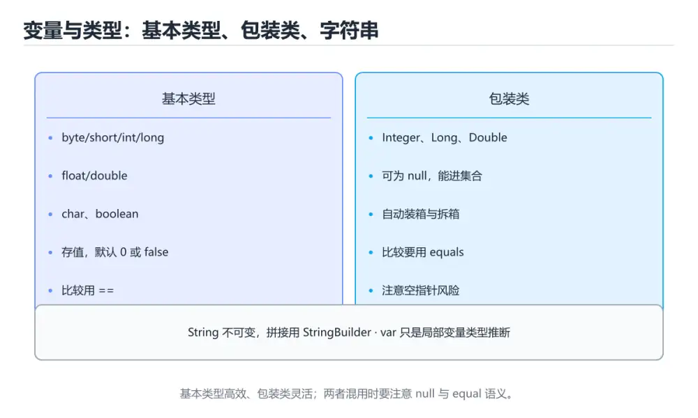
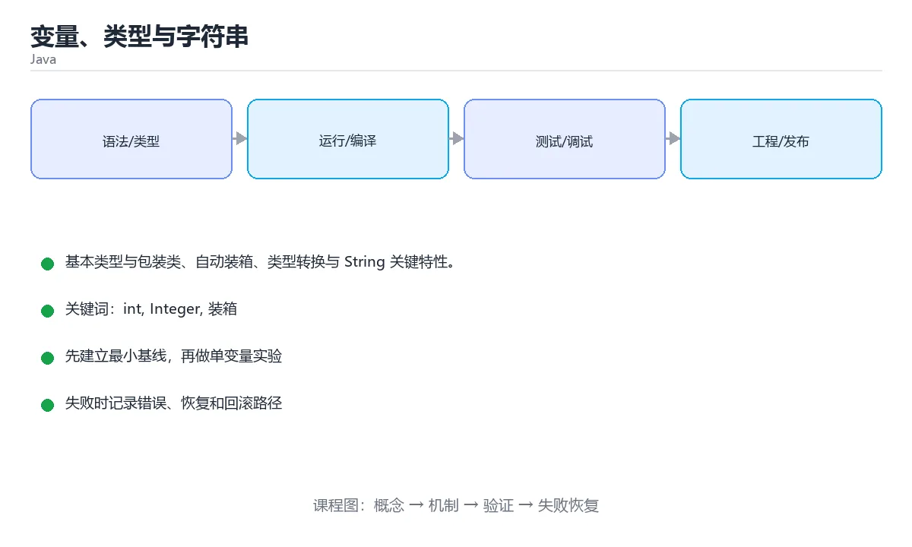

# 变量、类型与字符串





> 内容更新时间：2026-10-06 · 学习阶段：基础 · 预计用时：35 分钟

## 本节知识框架

想象你去超市买东西。每件商品都有价格标签——有的标价几块钱（整数），有的精确到分（小数），有的只标"有货/没货"（是或否）。Java 里的**变量**就像超市的价签：每个变量都有一个名字和一个**类型**，类型决定了它能存什么样的数据、占多大空间。

本课我们会从最基本的 8 种**基本类型**出发，再认识它们的"升级版"——**包装类**，然后搞懂 Java 自动帮你做的**装箱/拆箱**，最后重点聊 `String` 这个最常用的类以及它的**不可变性**。

**先修**：《环境与 JVM》。**后续**：《控制流与方法》。

学完本课你应当能够：
- 区分基本类型和包装类，说出各自什么时候能为 `null`
- 解释自动装箱/拆箱的原理，以及 `Integer` 缓存带来的"坑"
- 用 `StringBuilder` 高效拼接字符串，理解 `String` 不可变的含义
- 知道为什么算钱不能用 `double`

### 复习清单

- [ ] 能不看正文说出 8 种基本类型和对应的包装类名称。
- [ ] 能解释 Integer 缓存机制，并说明为什么比较包装类要用 equals。
- [ ] 能写出用 StringBuilder 循环拼接字符串的代码。
- [ ] 能说明为什么金额计算不能用 double，以及替代方案。

## 核心概念定义

| 术语 | 一句话说明 |
| --- | --- |
| 基本类型 | Java 预定义的 8 种类型（int、long、double、float、boolean、char、byte、short），直接存值，不能为 null |
| 包装类 | 每个基本类型都有一个对应的"对象版"，比如 int 对应 Integer，可以为 null，能当泛型参数 |
| 自动装箱 | Java 自动把基本类型转成包装类对象，比如 `Integer boxed = 42;` |
| 自动拆箱 | Java 自动把包装类对象转回基本类型，比如 `int n = boxed;`，若 boxed 为 null 会抛 NullPointerException |
| String 不可变 | 字符串一旦创建就不能修改内容，任何"修改"操作都会返回一个新字符串 |
| StringBuilder | 专门用来高效拼接字符串的类，循环拼接场景下比 String + 快得多 |

### 基本类型速查表

| 类型 | 大小 | 典型用途 | 注意事项 |
| --- | --- | --- | --- |
| byte | 1 字节 | 字节流、底层数据 | 范围 -128~127 |
| short | 2 字节 | 较少使用 | 范围约正负3.2万 |
| int | 4 字节 | 最常用的整数类型 | 范围约正负21亿，溢出要用 long |
| long | 8 字节 | 大整数、时间戳 | 字面量加 L 后缀 |
| float | 4 字节 | 科学计算 | 字面量加 f 后缀，有精度误差 |
| double | 8 字节 | 一般小数计算 | 有精度误差，不适合算钱 |
| char | 2 字节 | 单个字符 | 用单引号包裹 |
| boolean | 1 位语义 | 真假判断 | 只有 true 和 false |

## 原理与运行机制

### 基本类型与包装类的关系

Java 设计了 8 种基本类型用于高效存储数据，但面向对象的世界里一切都需要是对象。于是每种基本类型都有一个对应的**包装类**：

| 基本类型 | 包装类 |
| --- | --- |
| int | Integer |
| long | Long |
| double | Double |
| float | Float |
| boolean | Boolean |
| char | Character |
| byte | Byte |
| short | Short |

包装类是真正的对象——可以为 null、可以当泛型参数（比如 `List<Integer>`）、有丰富的工具方法。但代价是额外的内存开销和拆装箱的运行时成本。

### 自动装箱与拆箱

Java 编译器帮你自动完成基本类型和包装类之间的转换：

```java
Integer boxed = 42;     // 自动装箱：等价于 Integer.valueOf(42)
int unboxed = boxed;    // 自动拆箱：等价于 boxed.intValue()
```

拆箱时如果对象为 null，就会调用 `null.intValue()`，抛出 `NullPointerException`。这是新手最常遇到的运行时错误之一。

### Integer 缓存机制

Integer 内部维护了一个 **-128 到 127** 的缓存池。`Integer.valueOf(n)` 在这个范围内返回的是同一个对象引用：

```java
Integer x = Integer.valueOf(127);
Integer y = Integer.valueOf(127);
System.out.println(x == y);   // true（缓存内，同一对象）

Integer m = Integer.valueOf(1000);
Integer n = Integer.valueOf(1000);
System.out.println(m == n);   // false（缓存外，不同对象）
System.out.println(m.equals(n)); // true（比较值要用 equals）
```

所以比较包装类的值，永远用 `equals()` 而不是 `==`。

### String 的不可变性

`String` 对象一旦创建，内部的字符数组就不能修改。所谓"修改字符串"其实是创建了一个新字符串：

```java
String s = "hello";
s = s + " world";   // 不是修改了原来的字符串，而是创建了新串
```

不可变的好处：线程安全、可以当 HashMap 的 key、字符串常量池可以复用。坏处：频繁拼接时性能差。

### var 类型推断

Java 10 引入了 `var`，让编译器自动推断局部变量的类型：

```java
var message = "hello";   // 编译器推断为 String
var number = 42;         // 编译器推断为 int
```

`var` 不是弱类型——编译期就确定了类型，只是省得你手写。为了可读性，如果类型名本身能帮助理解代码意图，显式写出来更好。

## 典型应用场景

### 场景 1：选择合适的基本类型

- 计数器、数组下标用 `int`
- 超过 21 亿的大数用 `long`（字面量加 `L` 后缀）
- 科学计算用 `double`，需要精确小数时用 `BigDecimal`
- 单个字符用 `char`，字符串用 `String`
- 真假判断用 `boolean`

### 场景 2：泛型集合必须用包装类

```java
List<Integer> scores = new ArrayList<>();   // 正确：泛型要用对象类型
// List<int> wrong = new ArrayList<>();     // 编译错误：基本类型不能当泛型参数
```

### 场景 3：字符串拼接

少量拼接直接用 `+` 即可，编译器会优化。循环中大量拼接必须用 `StringBuilder`：

```java
StringBuilder sb = new StringBuilder();
for (int i = 0; i < 1000; i++) {
    sb.append("item").append(i).append(",");
}
String result = sb.toString();
```

### 场景 4：金额计算

涉及金额不能用 `double`，因为二进制浮点无法精确表示十进制小数。用 `BigDecimal` 并指定舍入模式：

```java
import java.math.BigDecimal;
import java.math.RoundingMode;

BigDecimal price = new BigDecimal("19.99");
BigDecimal total = price.multiply(BigDecimal.valueOf(3))
                        .setScale(2, RoundingMode.HALF_UP);
```

## 代码/协议/SQL 示例

### 示例 1：基本类型与包装类

```java
int      count = 42;              // 4 字节
long     big = 9_000_000_000L;    // 8 字节
double   pi = 3.14159;            // 8 字节
float    ratio = 0.5f;            // 4 字节
boolean  ok = true;               // 1 位
char     letter = 'A';            // 2 字节

Integer boxed = count;            // 自动装箱
int unboxed = boxed;              // 自动拆箱
```

### 示例 2：String 要点

```java
String a = "hello";
String b = "hello";
System.out.println(a == b);            // true：字符串常量池复用

String c = new String("hello");
System.out.println(a == c);            // false：不同对象
System.out.println(a.equals(c));       // true：内容相同

String joined = a + " " + "world";     // 编译期优化为 StringBuilder
String upper = joined.toUpperCase();
```

### 示例 3：StringBuilder 与 var

```java
StringBuilder sb = new StringBuilder();
for (int i = 0; i < 3; i++) {
    sb.append(i).append(',');
}
System.out.println(sb.toString());  // 0,1,2,

var names = new java.util.ArrayList<String>();  // Java 10+ 类型推断
final int MAX = 100;                            // 常量，不可重新赋值
```

### 示例 4：BigDecimal 算钱

```java
import java.math.BigDecimal;
import java.math.RoundingMode;

BigDecimal price = new BigDecimal("19.9");
BigDecimal total = price.multiply(BigDecimal.valueOf(3))
                        .setScale(2, RoundingMode.HALF_UP);
System.out.println(total);  // 57.90
```

## 时间/空间复杂度或性能分析

### 基本类型 vs 包装类的性能差异

- **内存**：int 占 4 字节，Integer 对象占 16 字节（对象头 12 字节 + 4 字节 int 值，对齐到 16 字节）。大量数据场景下基本类型更省内存。
- **装箱/拆箱开销**：每次自动装箱调用 `Integer.valueOf()`，拆箱调用 `intValue()`。循环中频繁装箱拆箱会拖慢性能。
- **缓存命中**：Integer 缓存（-128~127）减少了小整数的对象创建，但超出缓存范围的值每次都会 new 新对象。

### String 拼接性能

- 少量 `+` 拼接：编译器自动优化为 `StringBuilder`，性能无差别。
- 循环中 `+` 拼接：每次创建新 String 对象，产生大量临时对象，GC 压力大。
- `StringBuilder`：内部维护可变字符数组，append 操作均摊 O(1)，循环拼接首选。

### 浮点精度与测量

- 比较浮点数是否相等不能用 `==`，要用误差范围：`Math.abs(a - b) < 1e-9`。
- 性能测量时先跑预热（JVM JIT 编译），再采样；固定输入规模跑基线，再提高一个数量级复测。

## 常见误区与易错点

| 容易写错的做法 | 实际现象 | 原因与正确做法 |
| --- | --- | --- |
| `Integer a = 1000; Integer b = 1000; a == b` | 结果为 false | 超出缓存范围，比较的是对象引用；用 `a.equals(b)` |
| `int x = null;` | 编译报错 | 基本类型不能为 null；用 `Integer x = null;` 并判空 |
| `String s = s + "a"` 以为修改了原串 | 原串不变，创建了新串 | String 不可变；循环拼接用 StringBuilder |
| `double` 算金额 | 0.1 + 0.2 不等于 0.3 | 二进制浮点精度问题；用 BigDecimal |
| `float f = 3.14;` | 编译报错 | 浮点字面量默认是 double；写成 `float f = 3.14f;` |
| `str.equals("x")` 且 str 为 null | NullPointerException | 写成 `"x".equals(str)` 或用 `Objects.equals` |
| `a == b` 比较字符串 | 内容相同时可能为 false | 用 `equals`，注意顺序避免空指针 |
| 忘记 `L` / `f` 后缀 | 编译错误或精度丢失 | `long n = 10L; float f = 1.5f;` |

## 与其他知识点的关系

- **先修**：《环境与 JVM》——理解了 JVM 和 javac 才能明白类型在运行时如何表示。
- **后续**：《控制流与方法》——本课的类型知识会在 if/for/方法中大量使用。
- **术语归属**：基本类型、包装类、String、StringBuilder 的定义以本课为准，后续课程会直接引用。

## 自测题与参考答案

### 自测 1：概念复述

不看正文，写出 8 种基本类型和对应的包装类名称。

**参考答案**：byte/Byte、short/Short、int/Integer、long/Long、float/Float、double/Double、char/Character、boolean/Boolean。

### 自测 2：代码阅读

阅读以下代码，写出输出结果：

```java
Integer a = 127;
Integer b = 127;
Integer c = 128;
Integer d = 128;
System.out.println(a == b);
System.out.println(c == d);
System.out.println(c.equals(d));
```

**参考答案**：true、false、true。127 在缓存范围内（-128~127），`valueOf` 返回同一对象，`==` 为 true。128 超出缓存，每次创建新对象，`==` 为 false。`equals` 比较值，128 等于 128，为 true。

### 自测 3：排错

以下代码有什么问题？怎么修？

```java
Integer count = null;
int total = count + 1;
```

**参考答案**：`count` 为 null，`count + 1` 会触发自动拆箱调用 `null.intValue()`，抛出 NullPointerException。修复方式：使用前判空，或给 count 一个默认值。

### 自测 4：设计决策

为什么循环拼接字符串要用 StringBuilder 而不用 String 的 `+`？

**参考答案**：String 不可变，每次 `+` 都会创建新的 String 对象。循环中拼接 N 次就创建 N 个临时对象，浪费内存和 GC 时间。StringBuilder 内部维护可变字符数组，append 不创建新对象，性能远优于 `+`。

### 自测 5：浮点精度

`0.1 + 0.2 == 0.3` 在 Java 中结果是什么？为什么？怎么处理金额计算？

**参考答案**：结果为 false。double 用二进制存储小数，0.1 和 0.2 无法精确表示，累积误差导致 0.1 + 0.2 约等于 0.30000000000000004。金额计算应使用 BigDecimal 并指定舍入模式。

## 考点精讲

### 考点 1：int、Integer 与装箱的实践判断

**题目**：围绕“变量、类型与字符串”中的 int、Integer、装箱，下列哪两项是本课强调的实践判断？

- 验证 Integer 时要固定版本并覆盖边界输入，结论才可复现
- 把 Integer 的单次运行结果当成所有版本和规模都成立
- 学习 int 时要同时说明输入、输出和失败路径，不能只看正常流程
- 只要 int 的常规示例通过，就可以跳过边界与异常路径

**答案**：第 1 项和第 3 项。学习基本类型和包装类时，必须同时覆盖正常路径和异常路径（比如 null 拆箱、溢出），并且验证 Integer 的行为要固定 JDK 版本、覆盖缓存边界（-128~127）等输入，结论才能复现。

### 考点 2：示例代码验证 null

**题目**：`变量、类型与字符串` 的示例代码用于验证 `null`，其背景是基本类型与包装类、自动装箱、类型转换与 String 关键特性。代码的真实内容是下面哪一项？

- 调用了 `main()`
- 调用了 `valueOf()`
- 调用了 `range()`
- 调用了 `CallCost()`

**答案**：调用了 `valueOf()`。本课示例使用 `Integer.valueOf(127)` 和 `Integer.valueOf(1000)` 来验证缓存机制和 null 行为。

### 考点 3：循环拼接字符串

**题目**：循环中拼接字符串推荐使用？

- StringBuilder
- String 的 +
- String.concat
- 字符数组

**答案**：StringBuilder。`String` 不可变，每次 `+` 拼接都创建新对象。循环中用 `StringBuilder` 只创建一个可变字符序列，性能远优于 `+` 或 `concat`。

### 考点 4：String 的不可变性

**题目**：Java 中 String 的不可变性意味着？

- String 可以当基本类型使用
- 字符串内容创建后不能修改
- String 变量不能再赋值
- String 只能存 ASCII

**答案**：字符串内容创建后不能修改。不可变是指 String 对象内部的字符数组一旦确定就不能修改。变量可以重新赋值指向新对象，但原对象内容不变。

### 考点 5：double 计算金额的风险

**题目**：用 double 计算金额的主要风险是？

- 二进制浮点无法精确表示十进制小数
- double 精度太高浪费内存
- double 不能做加减乘除
- double 会自动四舍五入

**答案**：二进制浮点无法精确表示十进制小数。`double` 用二进制存储小数，0.1 等无法精确表示，累积误差导致金额出错。应当用 `BigDecimal` 并指定舍入模式。

### 考点 6：填空题——比较内容用什么

**题目**：填空：补齐下面这段术语说明中的空缺。课程 `基本类型与包装类、自动装箱、类型转换与 String 关键特性。`，这段说明是：比较内容一律用 ``____``；字符串不可变，每次「修改」都会产生新对象，循环拼接应使用 `StringBuilder`。空缺处应填哪个术语？

**答案**：equals。比较包装类的值一律用 `equals()` 而不是 `==`，因为 `==` 比较的是对象引用。

## 术语速查

| 术语 | 一句话说明 |
| --- | --- |
| 基本类型 | 8 种内置数据类型，直接存值，不能为 null，性能最好 |
| 包装类 | 基本类型的对象版本，可以为 null，能当泛型参数 |
| 自动装箱/拆箱 | Java 自动在基本类型和包装类之间转换，null 拆箱会崩溃 |
| String 不可变 | 字符串创建后内容不能修改，任何修改都返回新对象 |
| StringBuilder | 高效拼接字符串的类，循环拼接场景必用 |
| BigDecimal | 精确小数计算类，算钱必用，需指定舍入模式 |

## 参考资料与复核

- 最后复核：2026-10-04
- 下次复核：2027-02-24
- [Java 官方教程：基本数据类型](https://docs.oracle.com/javase/tutorial/java/nutsandbolts/datatypes.html)
- [Java API：String 类](https://docs.oracle.com/en/java/javase/21/docs/api/java.base/java/lang/String.html)
- [Java API：BigDecimal 类](https://docs.oracle.com/en/java/javase/21/docs/api/java.base/java/math/BigDecimal.html)
- [Java API：StringBuilder 类](https://docs.oracle.com/en/java/javase/21/docs/api/java.base/java/lang/StringBuilder.html)

## 内容元数据

- 内容版本：v2.0
- 最后更新：2026-10-06
- 学习阶段：基础
- 适用环境：Java 21+
- 内容来源：内置结构化课程与工程实践整理
- 相关主题：int、Integer、装箱、String、StringBuilder、var
