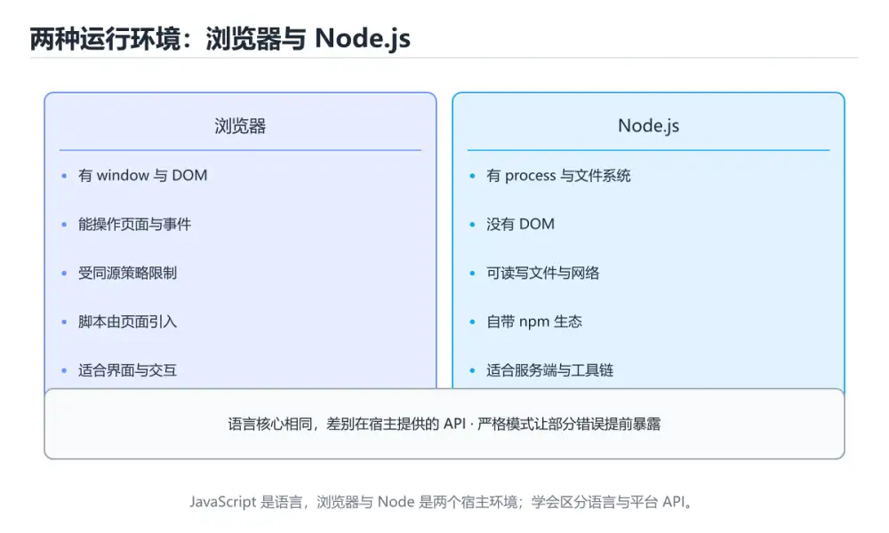
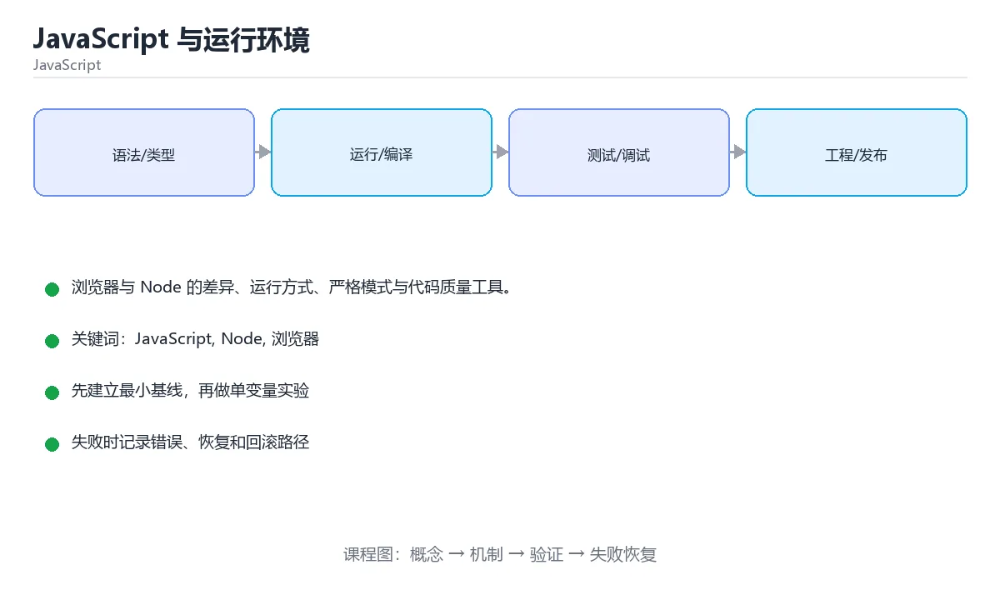

# JavaScript 与运行环境





> 内容更新时间：2026-10-06 · 学习阶段：基础 · 预计用时：45 分钟

## 本节知识框架

**课程定位**：所属分类 `javascript`（JavaScript），课程主题 `JavaScript 与运行环境`，学习阶段 基础，建议用时 50 分钟。

本课主线：浏览器与 Node 的差异、运行方式、严格模式与代码质量工具。

**学完本课应当能够**
- 说清 `JavaScript` 与 `浏览器` 的含义与区别，并各举一个正例和一个反例。
- 用本课示例验证 `事件循环` 的行为，记录输入、输出与失败条件。
- 遇到「用 `==` 比较」这类问题时，能说出触发条件与修复顺序。

### 复习清单

- [ ] 能不看正文复述本课核心术语，并指出一个边界或反例。
- [ ] 能运行或推演本课示例，记录输入、输出与失败现象。
- [ ] 能完成一次自测，并把错题对照错误表定位原因。

## 核心概念定义

| 术语 | 操作性定义 | 常见边界与风险 |
| --- | --- | --- |
| JavaScript | JavaScript 是动态类型、基于原型的脚本语言，标准名为 ECMAScript。它既能跑在浏览器里操作页面，也能通过 Node.js 写服务端、命令行和桌面应用。 | 静态检查只在编译期成立，运行期输入仍需校验。 |
| 浏览器 | 解析 HTML/CSS、执行 JavaScript 并管理网络与页面的客户端环境。 | 网络延迟、超时与版本协商会改变行为，只在真实链路或多版本客户端上验证才算数。 |
| 事件循环 | 先执行同步代码与微任务，再取宏任务，它决定了 setTimeout 与 Promise 的执行顺序。 | 只在「先执行同步代码与微任务，再取宏任务，它决定了 setTimeout 与 Promise 的执行顺序」这一前提下成立，换输入或换环境要重新验证。 |
| 严格模式 | 用 use strict 或在 ES 模块中默认启用，禁止隐式全局变量与部分静默失败的行为。 | 易错：严格模式报错，非严格模式污染全局；正确做法是始终用 `let` / `const`。 |

## 原理与运行机制

### 机制总览

**教材衔接：JavaScript 是什么**

JavaScript 是**动态类型、基于原型**的脚本语言，标准名为 ECMAScript。它既能跑在浏览器里操作页面，也能通过 Node.js 写服务端、命令行和桌面应用。

**教材衔接：两种运行环境**

| 环境 | 提供的能力 |
| --- | --- |
| 浏览器 | DOM、事件、fetch、localStorage、Canvas |
| Node.js | 文件系统、进程、网络、npm 生态 |

语言核心（变量、函数、对象、Promise）两边通用，宿主 API 不同。

**教材衔接：运行方式**

```html
<!-- 浏览器：defer 表示解析完 HTML 再执行，避免阻塞 -->
<script src="app.js" defer></script>
```

```bash
node app.js      # 运行脚本
node             # 进入 REPL 交互模式
```

```javascript
console.log('Hello, JavaScript!');
console.warn('警告');
console.error('错误');
console.table([{ a: 1 }, { a: 2 }]);   // 以表格展示
```

**教材衔接：运行环境速查**

| 能力 | 浏览器 | Node.js |
| --- | --- | --- |
| 操作 DOM | 有（`document`） | 无 |
| 获取用户事件 | 有（`addEventListener`） | 无 |
| 读写本地文件 | 受限（File API） | 有（`node:fs`） |
| 发起网络请求 | `fetch` | `fetch`（18+ 内置） |
| 定时器 | `setTimeout` / `setInterval` | 同样支持 |
| 全局对象 | `window` | `globalThis` |
| 模块系统 | ESM 为主 | ESM 与 CommonJS 都支持 |
| 环境变量 | 无（构建时注入） | `process.env` |

脚本加载方式速查：

| 写法 | 解析阻塞 | 执行时机 |
| --- | --- | --- |
| `<script src="a.js">` | 阻塞解析 | 立即按顺序执行 |
| `<script async src="a.js">` | 不阻塞 | 下载完立刻执行（顺序不确定） |
| `<script defer src="a.js">` | 不阻塞 | DOM 解析完成后按顺序执行 |
| `type="module"` | 不阻塞 | 默认 defer 语义，作用域独立 |

**教材衔接：控制台速查**

| 目的 | 写法 |
| --- | --- |
| 打印值 | `console.log(a, b)` |
| 打印对象结构 | `console.dir(obj, { depth: null })` |
| 表格展示数组 | `console.table(list)` |
| 分组输出 | `console.group()` / `console.groupEnd()` |
| 计时 | `console.time("t")` / `console.timeEnd("t")` |
| 断言 | `console.assert(cond, "提示")` |
| 调用栈 | `console.trace()` |
| 断点 | 代码里写 `debugger;` |

**教材衔接：零基础详解：JavaScript 到底在哪里运行**

### 一句话说清它是什么

JavaScript 是**脚本语言**：不需要提前编译，写完立刻由运行环境解释执行。
它有两大宿主：浏览器（能操作页面）和 Node.js（能读写文件、起服务）。

### 用生活比喻理解

| 概念 | 比喻 | 说明 |
| --- | --- | --- |
| 引擎 | 翻译官 | V8（Chrome/Node）、JavaScriptCore（Safari） |
| 宿主环境 | 翻译官上班的公司 | 浏览器给了 `document`，Node 给了 `fs` |
| 事件循环 | 排队叫号 | 同步任务先做完，再处理回调队列 |
| 单线程 | 只有一个窗口办业务 | 所以耗时操作要异步，否则界面卡死 |

**同一门语言，能用的 API 取决于宿主环境**——浏览器里没有 `fs`，Node 里没有 `document`。

### 逐行拆解第一个程序

```javascript
// 浏览器控制台或 Node 里都能运行
console.log("Hello, World!");   // 打印到控制台

const name = "小明";             // 常量，不能重新赋值
let age = 18;                   // 变量，可以改
age = age + 1;                  // 重新赋值

console.log(`你好，${name}，明年 ${age} 岁`);
```

| 行 | 在做什么 | 为什么这么写 |
| --- | --- | --- |
| `console.log(...)` | 输出内容 | 调试最常用的手段 |
| `const name = ...` | 声明一个不可重新赋值的名字 | 默认就用 `const`，更安全 |
| `let age = 18` | 声明一个可以改的变量 | 确实需要改时才用 `let` |
| `` `...${x}...` `` | 模板字符串 | 反引号 + `${}` 才能插值 |

### `var`、`let`、`const` 三者的取舍

| 关键字 | 能否重新赋值 | 作用域 | 能否重复声明 | 建议 |
| --- | --- | --- | --- | --- |
| `var` | 能 | 函数作用域 | 能 | 老代码里见，新代码别用 |
| `let` | 能 | 块作用域 `{}` | 不能 | 需要改时用 |
| `const` | 不能 | 块作用域 `{}` | 不能 | **默认选择** |

注意：`const` 锁的是「绑定」，不是内容：
`const arr = [1]; arr.push(2);` 是合法的，但 `arr = []` 会报错。

### 在浏览器里怎么跑起来

```html
<!DOCTYPE html>
<html lang="zh-CN">
  <head><meta charset="utf-8"><title>JS 入门</title></head>
  <body>
    <p id="out">等待中…</p>
    <script src="main.js"></script>
    <!-- 也可以直接内联：<script>console.log('hi')</script> -->
  </body>
</html>
```

脚本放在 `</body>` 前，或用 `defer`，能保证 HTML 先解析完，`document` 才可用。

### 新手最容易踩的八个坑

| 坑 | 现象 | 正确做法 |
| --- | --- | --- |
| 用 `==` 比较 | `"1" == 1` 是 true | 一律用 `===` |
| 忘记 `await` | 拿到的是 Promise 而不是结果 | 在 `async` 函数里 `await` |
| 循环里用 `var` | 回调里全是最后一个值 | 改用 `let` |
| 变量未声明就赋值 | 严格模式报错，非严格模式污染全局 | 始终用 `let` / `const` |
| 数字与字符串相加 | `"1" + 2` 得到 `"12"` | 先 `Number()` 转换 |
| 直接读 `undefined` 的属性 | `TypeError: Cannot read properties of undefined` | 用 `?.` 可选链 |
| 以为对象是复制的 | 改副本影响了原对象 | 用展开 `{...obj}` 做浅拷贝 |
| 中文标点 | `SyntaxError` | 代码里全部用英文半角 |

### 三类运行环境要分清

| 环境 | 能做什么 | 不能做什么 |
| --- | --- | --- |
| 浏览器 | 操作 DOM、发请求、存 localStorage | 读写本地文件 |
| Node.js | 读写文件、起 HTTP 服务 | 访问 `document` |
| 两者共有 | 语法、内置对象、Promise、JSON | —— |

### 手把手练习：命令行问候与简单统计

```javascript
// Node 环境：node hello.js
const readline = require("node:readline/promises");

async function main() {
  const rl = readline.createInterface({
    input: process.stdin,
    output: process.stdout,
  });

  const name = (await rl.question("请输入姓名：")).trim();
  const scores = [88, 92, 79];
  const total = scores.reduce((sum, n) => sum + n, 0);
  const avg = (total / scores.length).toFixed(1);

  console.log(`你好，${name || "朋友"}！平均分 ${avg}`);
  rl.close();
}

main();
```

### 学完自测

- [ ] 能说出浏览器和 Node 各自多出哪些能力。
- [ ] 能解释 `const` 声明的数组为什么还能 `push`。
- [ ] 知道 `var` 与 `let` 在循环回调里的差别。
- [ ] 能说出 `==` 和 `===` 的区别。
- [ ] 知道脚本为什么建议放在 `</body>` 前或用 `defer`。

**教材衔接：版本与时效**

- JavaScript 依赖的新 API 必须有降级路径，否则老环境直接报错。
- 升级「JavaScript 与运行环境」涉及的依赖前，先用 JavaScript 复现当前行为，再逐项核对版本说明与破坏性变更。

## 典型应用场景

- **用 `==` 比较**：典型现象是`"1" == 1` 是 true；正确做法是一律用 `===`。
- **忘记 `await`**：典型现象是拿到的是 Promise 而不是结果；正确做法是在 `async` 函数里 `await`。
- **循环里用 `var`**：典型现象是回调里全是最后一个值；正确做法是改用 `let`。
- **变量未声明就赋值**：典型现象是严格模式报错，非严格模式污染全局；正确做法是始终用 `let` / `const`。

### 最小验证场景

- 准备：保留 `html` 示例的原始输入，先记录 `JavaScript 与运行环境` 的基线输出和完整运行命令。
- 观察：先核对 出现字面量 `app.js`，再改变一个与 `JavaScript` 相关的条件。
- 判定：新结果与 `JavaScript 与运行环境` 的基线不同不等于错误；只有当差异破坏了 `JavaScript` 的定义或错误表中的约束，才判定为失败。

### 选择与边界

- 使用 `JavaScript` 时，先满足它的定义：JavaScript 是动态类型、基于原型的脚本语言，标准名为 ECMAScript。它既能跑在浏览器里操作页面，也能通过 Node.js 写服务端、命令行和桌面应用；静态检查只在编译期成立，运行期输入仍需校验。
- 使用 `浏览器` 时，先满足它的定义：解析 HTML/CSS、执行 JavaScript 并管理网络与页面的客户端环境；网络延迟、超时与版本协商会改变行为，只在真实链路或多版本客户端上验证才算数。
- 使用 `事件循环` 时，先满足它的定义：先执行同步代码与微任务，再取宏任务，它决定了 setTimeout 与 Promise 的执行顺序；只在「先执行同步代码与微任务，再取宏任务，它决定了 setTimeout 与 Promise 的执行顺序」这一前提下成立，换输入或换环境要重新验证。
- 使用 `严格模式` 时，先满足它的定义：用 use strict 或在 ES 模块中默认启用，禁止隐式全局变量与部分静默失败的行为；易错：严格模式报错，非严格模式污染全局；正确做法是始终用 `let` / `const`。

## 代码/协议/SQL 示例

### 最小可验证示例

**教材衔接：严格模式**

```javascript
'use strict';    // 禁止隐式全局变量、静默失败等历史行为
```

ES Module 默认就是严格模式；新代码建议使用模块而不是全局脚本。

**教材衔接：代码质量工具**

```bash
npm install --save-dev eslint prettier
npx eslint . --fix
npx prettier --write .
```

ESLint 抓潜在错误，Prettier 统一格式，两者配合是前端工程的标准配置。

## 时间/空间复杂度或性能分析

**性能关注点（JavaScript 与运行环境）**：事件循环与 DOM 操作是瓶颈来源：记录脚本执行时间、长任务与主线程阻塞时长。

**本课特有开销（JavaScript 与运行环境 · JavaScript）**：小文件看元数据开销，大文件看吞吐，两者要分别测量。

**测量方法**：以 `JavaScript 与运行环境` 的 `JavaScript` 场景为对象，固定输入跑一遍记录基线，再把规模或并发度提高一个数量级复测；两次结果的差值与波动范围才是结论依据。

## 常见误区与易错点

| 容易写错的做法 | 实际现象 | 原因与正确做法 |
| --- | --- | --- |
| 用 `==` 比较 | `"1" == 1` 是 true | 一律用 `===` |
| 忘记 `await` | 拿到的是 Promise 而不是结果 | 在 `async` 函数里 `await` |
| 循环里用 `var` | 回调里全是最后一个值 | 改用 `let` |
| 变量未声明就赋值 | 严格模式报错，非严格模式污染全局 | 始终用 `let` / `const` |
| 数字与字符串相加 | `"1" + 2` 得到 `"12"` | 先 `Number()` 转换 |
| 直接读 `undefined` 的属性 | `TypeError: Cannot read properties of undefined` | 用 `?.` 可选链 |
| 以为对象是复制的 | 改副本影响了原对象 | 用展开 `{...obj}` 做浅拷贝 |
| 中文标点 | `SyntaxError` | 代码里全部用英文半角 |
| ReferenceError: x is not defined | 变量未声明就使用。 | 检查拼写与作用域，声明后再用。 |
| TypeError: Cannot read properties of undefined | 访问了 undefined 的属性。 | 用可选链或先判空。 |
| SyntaxError: Unexpected token | 语法错误（常漏括号或逗号）。 | 看行号，检查上一行是否完整。 |

### 现场 1：用 `==` 比较

**症状**：`"1" == 1` 是 true。

**根因与修复**：一律用 `===`。

**自检**：在本课示例里复现「用 `==` 比较」，改成一律用 `===`后重跑；如果症状消失且失败路径按预期变化，说明定位正确。

### 现场 2：忘记 `await`

**症状**：拿到的是 Promise 而不是结果。

**根因与修复**：在 `async` 函数里 `await`。

**自检**：在本课示例里复现「忘记 `await`」，改成在 `async` 函数里 `await`后重跑；如果症状消失且失败路径按预期变化，说明定位正确。

### 现场 3：循环里用 `var`

**症状**：回调里全是最后一个值。

**根因与修复**：改用 `let`。

**自检**：在本课示例里复现「循环里用 `var`」，改成改用 `let`后重跑；如果症状消失且失败路径按预期变化，说明定位正确。

### 现场 4：变量未声明就赋值

**症状**：严格模式报错，非严格模式污染全局。

**根因与修复**：始终用 `let` / `const`。

**自检**：在本课示例里复现「变量未声明就赋值」，改成始终用 `let` / `const`后重跑；如果症状消失且失败路径按预期变化，说明定位正确。

### 现场 5：数字与字符串相加

**症状**：`"1" + 2` 得到 `"12"`。

**根因与修复**：先 `Number()` 转换。

**自检**：在本课示例里复现「数字与字符串相加」，改成先 `Number()` 转换后重跑；如果症状消失且失败路径按预期变化，说明定位正确。

### 现场 6：直接读 `undefined` 的属性

**症状**：`TypeError: Cannot read properties of undefined`。

**根因与修复**：用 `?.` 可选链。

**自检**：在本课示例里复现「直接读 `undefined` 的属性」，改成用 `?.` 可选链后重跑；如果症状消失且失败路径按预期变化，说明定位正确。

### 现场 7：以为对象是复制的

**症状**：改副本影响了原对象。

**根因与修复**：用展开 `{...obj}` 做浅拷贝。

**自检**：在本课示例里复现「以为对象是复制的」，改成用展开 `{...obj}` 做浅拷贝后重跑；如果症状消失且失败路径按预期变化，说明定位正确。

### 现场 8：中文标点

**症状**：`SyntaxError`。

**根因与修复**：代码里全部用英文半角。

**自检**：在本课示例里复现「中文标点」，改成代码里全部用英文半角后重跑；如果症状消失且失败路径按预期变化，说明定位正确。

### 现场 9：ReferenceError: x is not defined

**症状**：变量未声明就使用。

**根因与修复**：检查拼写与作用域，声明后再用。

**自检**：在本课示例里复现「ReferenceError: x is not defined」，改成检查拼写与作用域，声明后再用后重跑；如果症状消失且失败路径按预期变化，说明定位正确。

## 与其他知识点的关系

- **相关或后续**：`变量、类型与类型转换`。本课术语会在这些课程里继续使用。
- **术语归属**：`JavaScript`、`浏览器`、`事件循环` 的定义以本课「核心概念定义」为准，换到其他课程时先确认定义是否被改写。
- 同一分类的《JavaScript 控制台入门》也涉及 `JavaScript`；两课衔接时先确认这个术语的定义是否一致。
- 同一分类的《JavaScript 变量与类型入门》也涉及 `JavaScript`；两课衔接时先确认这个术语的定义是否一致。

## 自测题与参考答案

> 先独立作答，再对照参考答案；答案都能在本课正文、术语表或错误表里找到依据。

### 自测 1（概念复述）

不看正文，写出 `JavaScript` 的操作性定义，并说明它与 `浏览器` 的区别。

**参考答案**：JavaScript 是动态类型、基于原型的脚本语言，标准名为 ECMAScript。它既能跑在浏览器里操作页面，也能通过 Node.js 写服务端、命令行和桌面应用。

`浏览器` 的定位是：解析 HTML/CSS、执行 JavaScript 并管理网络与页面的客户端环境；两者的差别要从适用对象与失败模式上说明。

### 自测 2（排错）

本课错误表记录了「用 `==` 比较」这类做法。请写出它会出现的现象、根因，以及修复顺序。

**参考答案**：现象是`"1" == 1` 是 true；正确做法是一律用 `===`。修复时先复现现象并保留证据，再改动一处假设重跑，确认现象消失。

### 自测 3（动手验证）

运行本课的 `html` 示例，把其中的 `"app.js"` 换成一个边界值后重新运行，记录输出与错误信息。

**参考答案**：正常输入下 `html` 示例应当复现正文给出的结果；把 `"app.js"` 换成边界值后，如果结果改变或报错，先核对它是否满足 `JavaScript 与运行环境` 中`JavaScript` 的适用范围，再检查错误表里是否有同类现象。

### 自测 4（代码阅读）

阅读本课开头的 `html` 示例，说明它体现了`JavaScript` 的哪一条性质，并指出改动哪个输入会让这条性质不再成立。

**参考答案**：`JavaScript` 的定义是 JavaScript 是动态类型、基于原型的脚本语言，标准名为 ECMAScript，它既能跑在浏览器里操作页面，也能通过 Node.js 写服务端、命令行和桌面应用，示例正是在实现这条定义。改动与 `JavaScript` 有关的一个输入后，如果结果不再符合 `JavaScript 与运行环境` 的正文描述，就说明该性质只在当前前提成立。

### 自测 5（迁移）

把 `JavaScript 与运行环境` 的方法迁移到自己的项目：围绕 `JavaScript` 写出一个与错误表同类的风险点，并说明触发条件和检验方式。

**参考答案**：例如「SyntaxError: Unexpected token」，它会导致语法错误（常漏括号或逗号）；检验方式是按看行号，检查上一行是否完整改一处再复现，确认现象消失且没有引入新的失败分支。

### 自测 6（对比）

用一个表格对比 `JavaScript` 与 `浏览器`：各写一行适用场景、一行失败表现。

**参考答案**：`JavaScript` 的定义是JavaScript 是动态类型、基于原型的脚本语言，标准名为 ECMAScript。它既能跑在浏览器里操作页面，也能通过 Node.js 写服务端、命令行和桌面应用；`浏览器` 的定义是解析 HTML/CSS、执行 JavaScript 并管理网络与页面的客户端环境。两者的失败表现分别对应本课错误表里与本术语相关的行。

### 自测 7（排错顺序）

面对「用 `==` 比较」引发的问题，请把“复现 `"1" == 1` 是 true → 保留证据 → 一律用 `===` → 回归验证”四步写成可执行的检查清单。

**参考答案**：第一步按`"1" == 1` 是 true复现；第二步记录输入、版本与完整报错；第三步按一律用 `===`只改一处；第四步重跑并确认失败路径也按预期变化。

### 自测 8（边界判断）

针对 `严格模式`，分别写出“可以使用”的条件和“结论不再成立”的条件。

**参考答案**：易错：严格模式报错，非严格模式污染全局；正确做法是始终用 `let` / `const`。 同时要把 `严格模式` 的定义 用 use strict 或在 ES 模块中默认启用，禁止隐式全局变量与部分静默失败的行为 与实际输入逐项对照。

### 自测 9（机制重建）

不看正文，按输入、转换、输出、验证四段重建 `JavaScript` → `浏览器` → `事件循环` → `严格模式` 的作用链。

**参考答案**：起点是 `JavaScript` 的定义 JavaScript 是动态类型、基于原型的脚本语言，标准名为 ECMAScript。它既能跑在浏览器里操作页面，也能通过 Node.js 写服务端、命令行和桌面应用；中间每一步都保留可观察状态；终点由 `严格模式` 检查，失败时回到错误表定位第一个偏离定义的步骤。

### 自测 10（综合排错）

在 `JavaScript 与运行环境` 中，现象是 语法错误（常漏括号或逗号）。请围绕 SyntaxError: Unexpected token 写出最小复现、关键证据、修复动作和回归验证，并说明为什么不能只凭一次运行下结论。

**参考答案**：先复现 SyntaxError: Unexpected token，记录输入与完整错误；再按 看行号，检查上一行是否完整 只改一处。回归时同时跑正常路径和边界路径，只有两次结果都可解释，才把修复视为完成。

### 自测 11（一分钟复述）

用每分钟约 200 字的速度复述 `JavaScript 与运行环境`：先给主问题，再按顺序说出 `JavaScript`、`浏览器`、`事件循环`、`严格模式`，最后给一个失败案例。

**自评标准**：主问题必须对应 浏览器与 Node 的差异、运行方式、严格模式与代码质量工具；每个术语都要能接上一句定义或边界；失败案例必须写成可观察现象，不能用“可能有风险”代替证据。

## 术语速查

| 术语 | 一句话说明 |
| --- | --- |
| `JavaScript` | JavaScript 是动态类型、基于原型的脚本语言，标准名为 ECMAScript。它既能跑在浏览器里操作页面，也能通过 Node.js 写服务端、命令行和桌面应用。 |
| `浏览器` | 解析 HTML/CSS、执行 JavaScript 并管理网络与页面的客户端环境。 |
| `事件循环` | 先执行同步代码与微任务，再取宏任务，它决定了 setTimeout 与 Promise 的执行顺序。 |
| `严格模式` | 用 use strict 或在 ES 模块中默认启用，禁止隐式全局变量与部分静默失败的行为。 |

**术语关系**：`JavaScript`（JavaScript 是动态类型、基于原型的脚本语言） → `浏览器`（解析 HTML/CSS、执行 JavaScript 并管理网络与页面的客户端环境） → `事件循环`（先执行同步代码与微任务） → `严格模式`（用 use strict 或在 ES 模块中默认启用）。

## 考点精讲

`JavaScript 与运行环境` 的题库有 6 道题，下面逐题给出题干、正确项与判断依据：先自己作答，再核对正确项，最后回到正文对应小节复核。

### 考点 1：第 1 题

- **题目**：下面哪项是浏览器提供、Node.js 没有的能力？
- **正确项**：DOM 操作
- **判断依据**：本题正确项是DOM 操作。术语 浏览器（JavaScript 与运行环境）：解析 HTML/CSS、执行 JavaScript 并管理网络与页面的客户端环境，本题取DOM 操作这条。易错点是用 `==` 比较会造成`"1" == 1` 是 true，改法是一律用 `===`，干扰项数组方法正踩在这条上。

### 考点 2：第 2 题

- **题目**：<script defer> 的作用是？
- **正确项**：HTML 解析完成后再执行脚本
- **判断依据**：本题正确项是HTML 解析完成后再执行脚本。术语 JavaScript（JavaScript 与运行环境）：JavaScript 是动态类型、基于原型的脚本语言，标准名为 ECMAScript，它既能跑在浏览器里操作页面，也能通过 Node.js 写服务端、命令行和桌面应用，本题取HTML 解析完成后再执行脚本这条。易错点是用 `==` 比较会造成`"1" == 1` 是 true，改法是一律用 `===`，干扰项只在模块中生效正踩在这条上。

### 考点 3：第 3 题

- **题目**：`JavaScript 与运行环境` 的示例代码用于验证 `JavaScript`，其背景是浏览器与 Node 的差异、运行方式、严格模式与代码质量工具。代码的真实内容是下面哪一项？
- **正确项**：调用了 `warn()`
- **判断依据**：本题正确项是调用了 `warn()`。术语 JavaScript（JavaScript 与运行环境）：JavaScript 是动态类型、基于原型的脚本语言，标准名为 ECMAScript，它既能跑在浏览器里操作页面，也能通过 Node.js 写服务端、命令行和桌面应用，本题取调用了 `warn()`这条。易错点是用 `==` 比较会造成`"1" == 1` 是 true，改法是一律用 `===`，干扰项调用了 `Open()`正踩在这条上。

### 考点 4：第 4 题

- **题目**：围绕“JavaScript 与运行环境”中的 JavaScript、Node、浏览器，下列哪两项是本课强调的实践判断？
- **正确项**：验证 Node 时要固定版本并覆盖边界输入，结论才可复现；学习 JavaScript 时要同时说明输入、输出和失败路径，不能只看正常流程
- **判断依据**：本题正确项是验证 Node 时要固定版本并覆盖边界输入，结论才可复现。术语 JavaScript（JavaScript 与运行环境）：JavaScript 是动态类型、基于原型的脚本语言，标准名为 ECMAScript，它既能跑在浏览器里操作页面，也能通过 Node.js 写服务端、命令行和桌面应用，本题取验证 Node 时要固定版本并覆盖边界输入，结论才可复现这条。易错点是用 `==` 比较会造成`"1" == 1` 是 true，改法是一律用 `===`，干扰项只要 JavaScript 的常规示例通过，就可以跳过边界与异常路径正踩在这条上。

### 考点 5：第 5 题

- **题目**："use strict" 严格模式的主要作用是？
- **正确项**：把未声明就赋值等静默错误改为直接抛错
- **判断依据**：按《JavaScript 与运行环境》的正文口径，本题正确项是「把未声明就赋值等静默错误改为直接抛错」。术语「严格模式」在本课里的界定是用 use strict 或在 ES 模块中默认启用，禁止隐式全局变量与部分静默失败的行为，题干「"use strict" 严格模式的主要作用是」问的就是这一条。常见错法是用 `==` 比较，其后果是`"1" == 1` 是 true。正确做法是一律用 `===`。干扰项「自动压缩代码」与题干「"use strict" 严格模式的主要作用是」的要求对不上，应排除。

### 考点 6：第 6 题

- **题目**：填空：补齐下面这段术语说明中的空缺。课程 `浏览器与 Node 的差异、运行方式、严格模式与代码质量工具。`，这段说明是：`____` 是动态类型、基于原型的脚本语言，标准名为 ECMAScript。它既能跑在浏览器里操作页面，也能通过 Node.js 写服务端、命令行和桌面应用。空缺处应填哪个术语？
- **正确项**：JavaScript
- **判断依据**：《JavaScript 与运行环境》这题的填空口径是「JavaScript」或「javascript」，正文写法与其中任一项一致即可。术语「JavaScript」在本课里的界定是JavaScript 是动态类型、基于原型的脚本语言，标准名为 ECMAScript，它既能跑在浏览器里操作页面，也能通过 Node.js 写服务端、命令行和桌面应用，题干「填空：补齐下面这段术语说明中的空缺，课程 `浏览器与 Node 的差」问的就是这一条。常见错法是用 `==` 比较，其后果是`"1" == 1` 是 true。正确做法是一律用 `===`。

### 考点 7：`JavaScript`

- **要点**：JavaScript 是动态类型、基于原型的脚本语言，标准名为 ECMAScript。它既能跑在浏览器里操作页面，也能通过 Node.js 写服务端、命令行和桌面应用。
- **JavaScript 的边界**：静态检查只在编译期成立，运行期输入仍需校验。

### 考点 8：`浏览器`

- **要点**：解析 HTML/CSS、执行 JavaScript 并管理网络与页面的客户端环境。
- **浏览器 的边界**：网络延迟、超时与版本协商会改变行为，只在真实链路或多版本客户端上验证才算数。

### 考点 9：`事件循环`

- **要点**：先执行同步代码与微任务，再取宏任务，它决定了 setTimeout 与 Promise 的执行顺序。
- **事件循环 的边界**：只在「先执行同步代码与微任务，再取宏任务，它决定了 setTimeout 与 Promise 的执行顺序」这一前提下成立，换输入或换环境要重新验证。

### 考点 10：`严格模式`

- **要点**：用 use strict 或在 ES 模块中默认启用，禁止隐式全局变量与部分静默失败的行为。
- **严格模式 的边界**：易错：严格模式报错，非严格模式污染全局；正确做法是始终用 `let` / `const`。

### 考点 11：排错——用 `==` 比较

- **现象**：`"1" == 1` 是 true。
- **处理**：一律用 `===`。

### 考点 12：排错——忘记 `await`

- **现象**：拿到的是 Promise 而不是结果。
- **处理**：在 `async` 函数里 `await`。

### 考点 13：综合辨析——`JavaScript` 与 `严格模式`

- **辨析点**：`JavaScript` 的定义是 JavaScript 是动态类型、基于原型的脚本语言，标准名为 ECMAScript。它既能跑在浏览器里操作页面，也能通过 Node.js 写服务端、命令行和桌面应用；`严格模式` 的定义是 用 use strict 或在 ES 模块中默认启用，禁止隐式全局变量与部分静默失败的行为。
- **答题要求**：面对 `JavaScript 与运行环境` 的题目，先判断描述的是 `JavaScript` 还是 `严格模式`，再归到对应定义，最后写出一个会让该定义失效的边界输入。

### 考点 14：排错评分点

- **现象分**：能写出 `"1" == 1` 是 true，而不是只写“程序有错”。
- **证据分**：保留触发 用 `==` 比较 的输入、版本和错误原文。
- **修复分**：按 一律用 `===` 只改一处，并同时回归正常路径与边界路径。

## 内容元数据

- 内容版本：v2.0
- 最后更新：2026-10-06
- 学习阶段：基础
- 适用环境：Node.js 22+ / 现代浏览器
；本课聚焦 JavaScript。
- 内容来源：内置结构化课程与工程实践整理
- 相关主题：JavaScript、Node、浏览器、console、ECMAScript
- 质量版本：P0 测验标准 + P1 覆盖扩展 + P2 体验补全

## 参考资料与复核

- [本课资料锚点 js_basics](https://zh.wikipedia.org/w/index.php?search=js_basics)

- 最后复核：2026-10-04
- 下次复核：2027-05-17
- 复核范围：版本兼容、API 行为、安全建议与工程实践
- 来源性质：官方文档、标准或权威教材；本课核对关键词：JavaScript、Node、浏览器、console、ECMAScript。

| 参考资料 | 本课用途 |
| --- | --- |
| [ECMAScript 标准](https://tc39.es/ecma262/) | JavaScript 语言标准 |
| [Node.js 文档](https://nodejs.org/docs/latest/api/) | 服务端运行时与模块 |
| [MDN JavaScript 指南](https://developer.mozilla.org/docs/Web/JavaScript/Guide) | 语言基础与浏览器 API |

| [本课术语索引：JavaScript 与运行环境](#核心概念定义) | 按本课输入、术语边界和错误表现逐项核对 |
> 「JavaScript 与运行环境」的链接用于离线阅读后的延伸核对；App 不会自动联网。