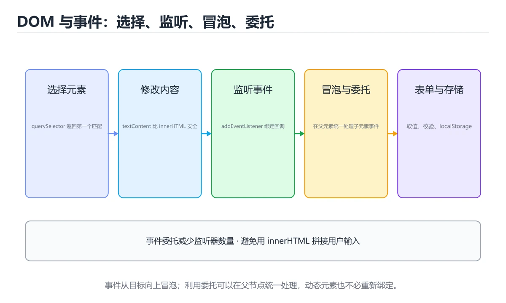
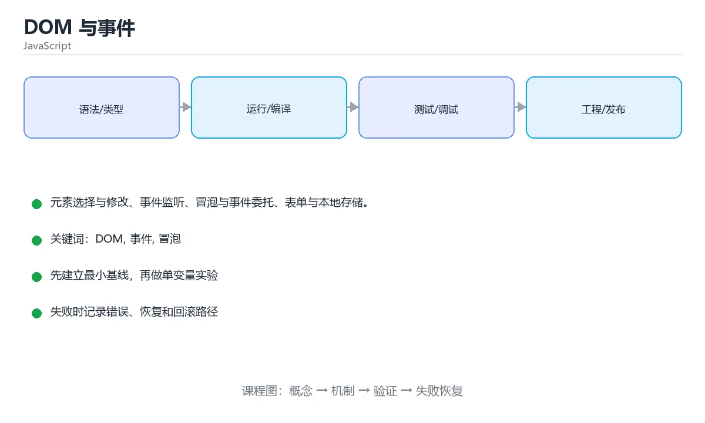

# DOM 与事件





> 内容更新时间：2026-10-06 · 学习阶段：进阶 · 预计用时：50 分钟

## 本节知识框架

**课程定位**：所属分类 `javascript`（JavaScript），课程主题 `DOM 与事件`，学习阶段 进阶，建议用时 55 分钟。

本课主线：元素选择与修改、事件监听、冒泡与事件委托、表单与本地存储。

**学完本课应当能够**
- 说清 `DOM` 与 `事件` 的含义与区别，并各举一个正例和一个反例。
- 用本课示例验证 `冒泡` 的行为，记录输入、输出与失败条件。
- 遇到「脚本在元素之前执行」这类问题时，能说出触发条件与修复顺序。

### 复习清单

- [ ] 能讲清 DOM 与 事件 的分工，并指出其中一个前提失效的边界。
- [ ] 能跑通 DOM 的最小示例，记录一组正常输出和一组失败输出。
- [ ] 能完成一次自测，并把错题对照错误表定位原因。

## 核心概念定义

| 术语 | 操作性定义 | 常见边界与风险 |
| --- | --- | --- |
| DOM | DOM 操作记住三件事：用 querySelector 选择、用 addEventListener 绑定、用事件委托处理动态列表，并把用户内容当作不可信数据。 | 易错：`Cannot read properties of null`；正确做法是用 `defer`、放到 `</body>` 前，或监听 `DOMContentLoaded`。 |
| 事件 | 事件是「用户做了什么」的通知，你注册回调函数来决定怎么响应。 | 同一个事件多次 `addEventListener` 都会触发；解绑必须传同一函数引用，箭头闭包每次都算新函数就解不掉。 |
| 冒泡 | 事件从触发元素向上传播到祖先节点的过程。 | 易错：逢冲突就调 `stopPropagation()`；父层的事件委托会跟着失效，其他祖先监听器收不到事件。 |
| 事件委托 | 把监听器挂在父元素上，靠事件冒泡统一处理子元素事件，避免为每个子节点绑定监听。 | 委托依赖冒泡，任一子监听调 `stopPropagation()` 就失效；定位真正目标要用 `event.target.closest()` 而不是 `target`。 |
| localStorage | 浏览器提供的同源持久化键值存储，容量有限且只能存字符串。 | 易错：以为它什么都能装；写入只认字符串、容量有限，换一个源（协议或域名）就读不到原来那份数据。 |
| XSS | 插入用户输入时优先 textContent，使用 innerHTML 前必须转义，否则存在 XSS 风险。 | 易错：XSS 漏洞；正确做法是用 `textContent`。 |

## 原理与运行机制

### 机制总览

**教材衔接：开发者工具**

Elements 看结构、Console 试代码、Network 看请求、Sources 打断点、Application 看存储与缓存。

**教材衔接：表单速查**

| 目的 | 写法 |
| --- | --- |
| 阻止提交刷新页面 | `form.addEventListener("submit", (e) => { e.preventDefault(); ... })` |
| 读取输入 | `input.value.trim()` |
| 复选框状态 | `checkbox.checked` |
| 单选组取值 | `form.elements["gender"].value` |
| 表单整体取值 | `new FormData(form)` 或 `Object.fromEntries(new FormData(form))` |
| 自定义校验 | `input.setCustomValidity("提示")` |
| 触发原生校验 | `form.reportValidity()` |

**教材衔接：版本与时效**

- querySelectorAll 依赖的新 API 必须有降级路径，否则老环境直接报错。
- 升级前确认 DOM 的兼容范围，把不可回退的改动单独拆成一次提交。

## 典型应用场景

- **脚本在元素之前执行**：典型现象是`Cannot read properties of null`；正确做法是用 `defer` 或放到 `</body>` 前。
- **用 `innerHTML` 拼接用户输入**：典型现象是XSS 漏洞；正确做法是用 `textContent`。
- **循环里绑定监听**：典型现象是元素多时性能差；正确做法是用事件委托。
- **`removeEventListener` 无效**：典型现象是回调传的是新函数；正确做法是保存同一个函数引用。

### 最小验证场景

- 准备：保留 `javascript` 示例的原始输入，先记录 `DOM 与事件` 的基线输出和完整运行命令。
- 观察：先核对 调用了 `querySelector()`，再改变一个与 `DOM` 相关的条件。
- 判定：新结果与 `DOM 与事件` 的基线不同不等于错误；只有当差异破坏了 `DOM` 的定义或错误表中的约束，才判定为失败。

### 选择与边界

- 使用 `DOM` 时，DOM 操作记住三件事：用 querySelector 选择、用 addEventListener 绑定、用事件委托处理动态列表，并把用户内容当作不可信数据；易错：`Cannot read properties of null`；正确做法是用 `defer`、放到 `</body>` 前，或监听 `DOMContentLoaded`。
- 使用 `事件` 时，事件是「用户做了什么」的通知，你注册回调函数来决定怎么响应；易错：元素多时性能差；正确做法是用事件委托。
- 使用 `冒泡` 时，事件从触发元素向上传播到祖先节点的过程。
- 使用 `事件委托` 时，把监听器挂在父元素上，靠事件冒泡统一处理子元素事件，避免为每个子节点绑定监听；易错：元素多时性能差；正确做法是用事件委托。
- 使用 `localStorage` 时，浏览器提供的同源持久化键值存储，容量有限且只能存字符串。

## 代码/协议/SQL 示例

### 最小可验证示例

```javascript
const title = document.querySelector('#title');        // 第一个匹配
const items = document.querySelectorAll('.item');      // NodeList

title.textContent = '新标题';                          // 纯文本，安全
title.innerHTML = '<b>加粗</b>';                       // 解析 HTML，注意 XSS
title.classList.add('active');
title.classList.toggle('hidden');
title.style.color = 'red';

const div = document.createElement('div');
div.textContent = '动态创建';
document.body.append(div);
items.forEach(item => item.remove());                  // NodeList 支持 forEach
```

**教材衔接：选择与修改元素**

插入用户输入时优先 `textContent`，使用 `innerHTML` 前必须转义，否则存在 XSS 风险。

**教材衔接：事件监听**

```javascript
const button = document.querySelector('#save');

function handleClick(event) {
  console.log('点击了', event.target);
}
button.addEventListener('click', handleClick);
button.removeEventListener('click', handleClick);   // 移除需传同一函数引用
```

**教材衔接：冒泡与事件委托**

事件默认从目标向外冒泡（target → 祖先），因此可以在父元素上统一处理子元素事件：

```javascript
document.querySelector('#list').addEventListener('click', event => {
  const item = event.target.closest('li[data-id]');
  if (!item) return;
  console.log('点击了', item.dataset.id);   // data-id → dataset.id
});

event.stopPropagation();   // 阻止继续冒泡（慎用）
event.preventDefault();    // 阻止默认行为，如提交表单
```

委托的好处：动态新增的元素无需重新绑定监听器。

**教材衔接：表单与本地存储**

```javascript
form.addEventListener('submit', event => {
  event.preventDefault();                  // 阻止页面刷新
  const data = new FormData(form);
  console.log(Object.fromEntries(data));
});

localStorage.setItem('token', 'abc');      // 持久保存（同源、仅字符串）
sessionStorage.setItem('step', '1');       // 关闭标签页即清除
const token = localStorage.getItem('token');
```

**教材衔接：DOM 查询与修改速查**

| 目的 | 写法 | 说明 |
| --- | --- | --- |
| 查单个元素 | `document.querySelector(".card")` | 返回第一个匹配或 `null` |
| 查全部元素 | `document.querySelectorAll(".card")` | 返回静态 NodeList，可 `forEach` |
| 按 id 查 | `document.getElementById("app")` | 最快，但只按 id |
| 改文本 | `el.textContent = "内容"` | 安全，不解析 HTML |
| 改 HTML | `el.innerHTML = html` | 有 XSS 风险，只用可信内容 |
| 改样式 | `el.classList.add("active")` | 优于直接拼 `style` |
| 改属性 | `el.setAttribute("aria-label", "关闭")` | 表单值优先用 `el.value` |
| 创建节点 | `document.createElement("li")` | 配合 `append` 插入 |
| 插入节点 | `parent.append(child)` | `prepend` / `before` / `after` 同理 |
| 删除节点 | `el.remove()` | 直接把自己从文档中移除 |
| 事件委托 | `list.addEventListener("click", fn)` | 在父元素上监听，减少监听器数量 |
| 阻止默认行为 | `event.preventDefault()` | 如阻止表单提交跳转 |
| 阻止冒泡 | `event.stopPropagation()` | 慎用，会破坏事件委托 |
| 一次性监听 | `addEventListener("click", fn, { once: true })` | 自动移除，避免泄漏 |

```js
// 事件委托：动态新增的条目也能响应
const list = document.querySelector("#todo-list");
list.addEventListener("click", (event) => {
  const target = event.target.closest("li[data-id]");
  if (!target) return;
  target.classList.toggle("done");
});
```

**教材衔接：零基础详解：DOM 操作与事件处理**

### 一句话说清它是什么

DOM 是浏览器把 HTML 变成的一棵「节点树」，JS 通过它读写页面；
事件是「用户做了什么」的通知，你注册回调函数来决定怎么响应。

### 用生活比喻理解

| 概念 | 比喻 | 说明 |
| --- | --- | --- |
| DOM 树 | 家谱 | 每个标签是一个节点，有父子兄弟关系 |
| 选择器 | 点名 | 按 id、class、标签找到元素 |
| 事件监听 | 装门铃 | 有人按铃就执行你的回调 |
| 事件冒泡 | 水泡上浮 | 子元素的事件会往父元素传 |
| 事件委托 | 前台统一收件 | 只在一个父节点上监听所有子节点 |

### 选取元素的四种方式

```javascript
const one = document.querySelector("#app");          // 第一个匹配
const all = document.querySelectorAll(".item");       // 全部匹配，返回 NodeList
const byId = document.getElementById("app");          // 最快
const byClass = document.getElementsByClassName("item");   // 实时集合

for (const el of all) {                               // NodeList 可迭代
  el.classList.add("active");
}
```

### 读写内容与属性

```javascript
const box = document.querySelector("#box");

box.textContent = "纯文本";                  // 安全，不会解析标签
box.innerHTML = "<b>富文本</b>";             // 会解析 HTML，注意 XSS

box.classList.add("active");
box.classList.toggle("dark");
box.classList.remove("active");

box.setAttribute("data-id", "7");
box.dataset.userId;                          // 读取 data-user-id

box.style.color = "red";                     // 行内样式，少量使用
box.hidden = true;                           // 推荐：用类或 hidden 控制显隐
```

**安全提醒**：只有内容可信时才用 `innerHTML`；用户输入一律用 `textContent`。

### 创建、插入与移除

```javascript
const list = document.querySelector("#list");

const li = document.createElement("li");
li.textContent = "新条目";
list.append(li);                 // 追加到末尾

li.remove();                     // 删除自己
list.replaceChildren();          // 一次清空（比循环删更快）
```

### 事件处理与冒泡控制

```javascript
const button = document.querySelector("#save");

function onSave(event) {
  event.preventDefault();        // 阻止默认行为（表单提交、链接跳转）
  console.log("点击了", event.target);
}

button.addEventListener("click", onSave);
// 需要移除时必须传同一个函数引用
// button.removeEventListener("click", onSave);
```

| 方法 | 作用 |
| --- | --- |
| `preventDefault()` | 阻止默认行为 |
| `stopPropagation()` | 阻止继续冒泡（谨慎使用） |
| `event.target` | 实际触发事件的元素 |
| `event.currentTarget` | 绑定监听的那个元素 |
| `{ once: true }` | 只触发一次后自动移除 |

### 事件委托：列表点击的标准写法

```javascript
const list = document.querySelector("#list");

list.addEventListener("click", (event) => {
  const item = event.target.closest("li[data-id]");
  if (!item) return;                       // 点在空白处，忽略
  console.log("选中", item.dataset.id);
});
```

好处：**新加的子元素自动生效，不用重复绑定**。

### 新手最容易踩的八个坑

| 坑 | 现象 | 正确做法 |
| --- | --- | --- |
| 脚本在元素之前执行 | `Cannot read properties of null` | 用 `defer` 或放到 `</body>` 前 |
| 用 `innerHTML` 拼接用户输入 | XSS 漏洞 | 用 `textContent` |
| 循环里绑定监听 | 元素多时性能差 | 用事件委托 |
| `removeEventListener` 无效 | 回调传的是新函数 | 保存同一个函数引用 |
| 忘记 `preventDefault` | 表单刷新页面 | 在提交处理里加上 |
| 用 `style` 到处改样式 | 难以维护 | 用 class 切换 |
| 频繁读写 `offsetHeight` | 强制同步布局，卡顿 | 批量读取后统一写 |
| 以为 NodeList 是数组 | `map` 报错 | 用 `Array.from` 或 `[...]` |

### 手把手练习：可增删的待办列表

```javascript
const form = document.querySelector("#todo-form");
const input = document.querySelector("#todo-input");
const list = document.querySelector("#todo-list");

form.addEventListener("submit", (event) => {
  event.preventDefault();
  const text = input.value.trim();
  if (!text) return;

  const li = document.createElement("li");
  li.textContent = text;
  li.dataset.id = String(Date.now());
  list.append(li);
  input.value = "";
  input.focus();
});

// 事件委托：删除按钮未来新增的也能生效
list.addEventListener("click", (event) => {
  const li = event.target.closest("li");
  if (li) li.remove();
});
```

### 学完自测

- [ ] 能说出 `querySelector` 与 `querySelectorAll` 的区别。
- [ ] 知道为什么不能直接用 `innerHTML` 渲染用户输入。
- [ ] 能解释事件冒泡与事件委托。
- [ ] 知道 `event.target` 与 `currentTarget` 的差别。
- [ ] 能说出脚本放在 `<head>` 里要注意什么。

**运行方式**：运行 `DOM 与事件` 的示例时，保存为 `.js` 后用 `node 文件名.js` 运行；涉及浏览器 API 的示例要放到页面里执行。

## 时间/空间复杂度或性能分析

**性能关注点（DOM 与事件）**：事件循环与 DOM 操作是瓶颈来源：记录脚本执行时间、长任务与主线程阻塞时长。

**测量方法**：以 `DOM 与事件` 的 `DOM` 场景为对象，固定输入跑一遍记录基线，再把规模或并发度提高一个数量级复测；两次结果的差值与波动范围才是结论依据。

## 常见误区与易错点

| 容易写错的做法 | 实际现象 | 原因与正确做法 |
| --- | --- | --- |
| 脚本在元素之前执行 | `Cannot read properties of null` | 用 `defer` 或放到 `</body>` 前 |
| 用 `innerHTML` 拼接用户输入 | XSS 漏洞 | 用 `textContent` |
| 循环里绑定监听 | 元素多时性能差 | 用事件委托 |
| `removeEventListener` 无效 | 回调传的是新函数 | 保存同一个函数引用 |
| 忘记 `preventDefault` | 表单刷新页面 | 在提交处理里加上 |
| 用 `style` 到处改样式 | 难以维护 | 用 class 切换 |
| 频繁读写 `offsetHeight` | 强制同步布局，卡顿 | 批量读取后统一写 |
| 以为 NodeList 是数组 | `map` 报错 | 用 `Array.from` 或 `[...]` |
| `<script>` 放在 `<head>` 里直接查 DOM | `Cannot read properties of null` | 用 `defer`、放到 `</body>` 前，或监听 `DOMContentLoaded` |
| 用 `innerHTML` 插入用户输入 | XSS 漏洞 | 用 `textContent`，必要时先转义 |
| 循环里给每个元素 `addEventListener` | 列表大时性能差、内存占用高 | 用事件委托在父元素监听 |
| `querySelectorAll` 结果直接 `.map` | `TypeError: map is not a function` | NodeList 不是数组，先 `Array.from(...)` |
| 用 `event.target` 当委托目标 | 点到子元素时拿到子元素 | 用 `event.target.closest(选择器)` |
| 忘了 `preventDefault` | 表单提交导致页面刷新 | 在 `submit` 里阻止默认行为 |
| 用 `stopPropagation` 处理所有问题 | 其他监听器失效 | 明确事件流，只在必要时阻止 |
| 动态元素直接绑定事件 | 新增元素不响应 | 事件委托或插入后再绑定 |
| 在循环里拼接 `innerHTML +=` | 反复重排，性能差、监听器丢失 | 先拼字符串或 DocumentFragment，最后一次性插入 |
| 直接读 `element.style.width` | 拿到的是内联样式，可能是空字符串 | 用 `getComputedStyle(el).width` |
| <script> 放在 <head> 里直接查 DOM | Cannot read properties of null。 | 用 defer、放到 </body> 前，或监听 DOMContentLoaded。 |
| 用 innerHTML 插入用户输入 | XSS 漏洞。 | 用 textContent，必要时先转义。 |
| 循环里给每个元素 addEventListener | 列表大时性能差、内存占用高。 | 用事件委托在父元素监听。 |

### 现场 1：脚本在元素之前执行

**症状**：`Cannot read properties of null`。

**根因与修复**：用 `defer` 或放到 `</body>` 前。

**自检**：在本课示例里复现「脚本在元素之前执行」，改成用 `defer` 或放到 `</body>` 前后重跑；如果症状消失且失败路径按预期变化，说明定位正确。

### 现场 2：用 `innerHTML` 拼接用户输入

**症状**：XSS 漏洞。

**根因与修复**：用 `textContent`。

**自检**：在本课示例里复现「用 `innerHTML` 拼接用户输入」，改成用 `textContent`后重跑；如果症状消失且失败路径按预期变化，说明定位正确。

### 现场 3：循环里绑定监听

**症状**：元素多时性能差。

**根因与修复**：用事件委托。

**自检**：在本课示例里复现「循环里绑定监听」，改成用事件委托后重跑；如果症状消失且失败路径按预期变化，说明定位正确。

### 现场 4：`removeEventListener` 无效

**症状**：回调传的是新函数。

**根因与修复**：保存同一个函数引用。

**自检**：在本课示例里复现「`removeEventListener` 无效」，改成保存同一个函数引用后重跑；如果症状消失且失败路径按预期变化，说明定位正确。

### 现场 5：忘记 `preventDefault`

**症状**：表单刷新页面。

**根因与修复**：在提交处理里加上。

**自检**：在本课示例里复现「忘记 `preventDefault`」，改成在提交处理里加上后重跑；如果症状消失且失败路径按预期变化，说明定位正确。

### 现场 6：用 `style` 到处改样式

**症状**：难以维护。

**根因与修复**：用 class 切换。

**自检**：在本课示例里复现「用 `style` 到处改样式」，改成用 class 切换后重跑；如果症状消失且失败路径按预期变化，说明定位正确。

### 现场 7：频繁读写 `offsetHeight`

**症状**：强制同步布局，卡顿。

**根因与修复**：批量读取后统一写。

**自检**：在本课示例里复现「频繁读写 `offsetHeight`」，改成批量读取后统一写后重跑；如果症状消失且失败路径按预期变化，说明定位正确。

### 现场 8：以为 NodeList 是数组

**症状**：`map` 报错。

**根因与修复**：用 `Array.from` 或 `[...]`。

**自检**：在本课示例里复现「以为 NodeList 是数组」，改成用 `Array.from` 或 `[...]`后重跑；如果症状消失且失败路径按预期变化，说明定位正确。

### 现场 9：`<script>` 放在 `<head>` 里直接查 DOM

**症状**：`Cannot read properties of null`。

**根因与修复**：用 `defer`、放到 `</body>` 前，或监听 `DOMContentLoaded`。

**自检**：在本课示例里复现「`<script>` 放在 `<head>` 里直接查 DOM」，改成用 `defer`、放到 `</body>` 前，或监听 `DOMContentLoaded`后重跑；如果症状消失且失败路径按预期变化，说明定位正确。

## 与其他知识点的关系

- **先修**：`异步编程`。本课默认这些内容已经掌握。
- **相关或后续**：`错误处理与调试`。本课术语会在这些课程里继续使用。
- **术语归属**：`DOM`、`事件`、`冒泡` 的定义以本课「核心概念定义」为准，换到其他课程时先确认定义是否被改写。

## 自测题与参考答案

> 先独立作答，再对照参考答案；答案都能在本课正文、术语表或错误表里找到依据。

### 自测 1（概念复述）

不看正文，写出 `DOM` 的操作性定义，并说明它与 `事件` 的区别。

**参考答案**：DOM 操作记住三件事：用 querySelector 选择、用 addEventListener 绑定、用事件委托处理动态列表，并把用户内容当作不可信数据。

`事件` 的定位是：事件是「用户做了什么」的通知，你注册回调函数来决定怎么响应；两者的差别要从适用对象与失败模式上说明。

### 自测 2（排错）

本课错误表记录了「脚本在元素之前执行」这类做法。请写出它会出现的现象、根因，以及修复顺序。

**参考答案**：现象是`Cannot read properties of null`；正确做法是用 `defer` 或放到 `</body>` 前。修复时先复现现象并保留证据，再改动一处假设重跑，确认现象消失。

### 自测 3（动手验证）

运行本课的 `javascript` 示例，把其中的 `'#title'` 换成一个边界值后重新运行，记录输出与错误信息。

**参考答案**：正常输入下 `javascript` 示例应当复现正文给出的结果；把 `'#title'` 换成边界值后，如果结果改变或报错，先核对它是否满足 `DOM 与事件` 中`DOM` 的适用范围，再检查错误表里是否有同类现象。

### 自测 4（代码阅读）

阅读本课开头的 `javascript` 示例，说明它体现了`DOM` 的哪一条性质，并指出改动哪个输入会让这条性质不再成立。

**参考答案**：`DOM` 的定义是 DOM 操作记住三件事：用 querySelector 选择、用 addEventListener 绑定、用事件委托处理动态列表，并把用户内容当作不可信数据，示例正是在实现这条定义。改动与 `DOM` 有关的一个输入后，如果结果不再符合 `DOM 与事件` 的正文描述，就说明该性质只在当前前提成立。

### 自测 5（迁移）

把 `DOM 与事件` 的方法迁移到自己的项目：围绕 `DOM` 写出一个与错误表同类的风险点，并说明触发条件和检验方式。

**参考答案**：例如「循环里给每个元素 addEventListener」，它会导致列表大时性能差、内存占用高；检验方式是按用事件委托在父元素监听改一处再复现，确认现象消失且没有引入新的失败分支。

### 自测 6（对比）

用一个表格对比 `DOM` 与 `事件`：各写一行适用场景、一行失败表现。

**参考答案**：`DOM` 的定义是DOM 操作记住三件事：用 querySelector 选择、用 addEventListener 绑定、用事件委托处理动态列表，并把用户内容当作不可信数据；`事件` 的定义是事件是「用户做了什么」的通知，你注册回调函数来决定怎么响应。两者的失败表现分别对应本课错误表里与本术语相关的行。

### 自测 7（排错顺序）

面对「脚本在元素之前执行」引发的问题，请把“复现 `Cannot read properties of null` → 保留证据 → 用 `defer` 或放到 `</body>` 前 → 回归验证”四步写成可执行的检查清单。

**参考答案**：第一步按`Cannot read properties of null`复现；第二步记录输入、版本与完整报错；第三步按用 `defer` 或放到 `</body>` 前只改一处；第四步重跑并确认失败路径也按预期变化。

### 自测 8（边界判断）

针对 `XSS`，分别写出“可以使用”的条件和“结论不再成立”的条件。

**参考答案**：易错：XSS 漏洞；正确做法是用 `textContent`。 同时要把 `XSS` 的定义 插入用户输入时优先 textContent，使用 innerHTML 前必须转义，否则存在 XSS 风险 与实际输入逐项对照。

### 自测 9（机制重建）

不看正文，按输入、转换、输出、验证四段重建 `DOM` → `事件` → `冒泡` → `事件委托` 的作用链。

**参考答案**：起点是 `DOM` 的定义 DOM 操作记住三件事：用 querySelector 选择、用 addEventListener 绑定、用事件委托处理动态列表，并把用户内容当作不可信数据；中间每一步都保留可观察状态；终点由 `XSS` 检查，失败时回到错误表定位第一个偏离定义的步骤。

### 自测 10（综合排错）

在 `DOM 与事件` 中，现象是 列表大时性能差、内存占用高。请围绕 循环里给每个元素 addEventListener 写出最小复现、关键证据、修复动作和回归验证，并说明为什么不能只凭一次运行下结论。

**参考答案**：先复现 循环里给每个元素 addEventListener，记录输入与完整错误；再按 用事件委托在父元素监听 只改一处。回归时同时跑正常路径和边界路径，只有两次结果都可解释，才把修复视为完成。

### 自测 11（一分钟复述）

用每分钟约 200 字的速度复述 `DOM 与事件`：先给主问题，再按顺序说出 `DOM`、`事件`、`冒泡`、`事件委托`，最后给一个失败案例。

**自评标准**：主问题必须对应 元素选择与修改、事件监听、冒泡与事件委托、表单与本地存储；每个术语都要能接上一句定义或边界；失败案例必须写成可观察现象，不能用“可能有风险”代替证据。

## 延伸阅读

想更直观地理解本课概念？推荐参阅以下图解专题：

- [图解事件循环：同步、微任务与宏任务](visual_event_loop.md)

## 术语速查

| 术语 | 一句话说明 |
| --- | --- |
| `DOM` | DOM 操作记住三件事：用 querySelector 选择、用 addEventListener 绑定、用事件委托处理动态列表，并把用户内容当作不可信数据。 |
| `事件` | 事件是「用户做了什么」的通知，你注册回调函数来决定怎么响应。 |
| `冒泡` | 事件从触发元素向上传播到祖先节点的过程。 |
| `事件委托` | 把监听器挂在父元素上，靠事件冒泡统一处理子元素事件，避免为每个子节点绑定监听。 |
| `localStorage` | 浏览器提供的同源持久化键值存储，容量有限且只能存字符串。 |
| `XSS` | 插入用户输入时优先 textContent，使用 innerHTML 前必须转义，否则存在 XSS 风险。 |

**术语关系**：`DOM`（DOM 操作记住三件事：用 querySelector 选择、用 addEventListener 绑定、用事件委托处理动态列表） → `事件`（事件是「用户做了什么」的通知） → `冒泡`（事件从触发元素向上传播到祖先节点的过程） → `事件委托`（把监听器挂在父元素上）。

## 考点精讲

`DOM 与事件` 的题库有 6 道题，下面逐题给出题干、正确项与判断依据：先自己作答，再核对正确项，最后回到正文对应小节复核。

### 考点 1：第 1 题

- **题目**：`DOM 与事件` 的示例代码用于验证 `DOM`，其背景是元素选择与修改、事件监听、冒泡与事件委托、表单与本地存储。代码的真实内容是下面哪一项？
- **正确项**：调用了 `querySelectorAll()`
- **判断依据**：本题正确项是「调用了 `querySelectorAll()`」。术语 DOM（DOM 与事件）：DOM 操作记住三件事：用 querySelector 选择、用 addEventListener 绑定、用事件委托处理动态列表，并把用户内容当作不可信数据，本题取「调用了 `querySelectorAll()`」这条。易错点是脚本在元素之前执行，改法是用 `defer` 或放到 `</body>` 前。本题干扰项「调用了 `die()`」不成立：展示代码里找不到 `die()`。

### 考点 2：第 2 题

- **题目**：把用户输入插入页面，安全的做法是？
- **正确项**：textContent
- **判断依据**：本题正确项是「textContent」。术语 DOM（DOM 与事件）：DOM 操作记住三件事：用 querySelector 选择、用 addEventListener 绑定、用事件委托处理动态列表，并把用户内容当作不可信数据，本题取「textContent」这条。易错点是用 `innerHTML` 拼接用户输入，会造成XSS 漏洞，改法是用 `textContent`。

### 考点 3：第 3 题

- **题目**：event.preventDefault 的作用是？
- **正确项**：阻止浏览器默认行为（如提交表单、跳转链接）
- **判断依据**：本题正确项是「阻止浏览器默认行为（如提交表单、跳转链接）」。术语 DOM（DOM 与事件）：DOM 操作记住三件事：用 querySelector 选择、用 addEventListener 绑定、用事件委托处理动态列表，并把用户内容当作不可信数据，本题取「阻止浏览器默认行为（如提交表单、跳转链接）」这条。易错点是循环里绑定监听，会造成元素多时性能差，改法是用事件委托。

### 考点 4：第 4 题

- **题目**：围绕“DOM 与事件”中的 DOM、事件、冒泡，下列哪两项是本课强调的实践判断？
- **正确项**：验证 事件 时要固定版本并覆盖边界输入，结论才可复现；学习 DOM 时要同时说明输入、输出和失败路径，不能只看正常流程
- **判断依据**：按《DOM 与事件》的正文口径，本题要同时选中「验证 事件 时要固定版本并覆盖边界输入，结论才可复现」、「学习 DOM 时要同时说明输入、输出和失败路径，不能只看正常流程」，漏掉任一项都算没答全。术语 DOM（DOM 与事件）：DOM 操作记住三件事：用 querySelector 选择、用 addEventListener 绑定、用事件委托处理动态列表，并把用户内容当作不可信数据。易错点是`removeEventListener` 无效，会造成回调传的是新函数，改法是保存同一个函数引用。

### 考点 5：第 5 题

- **题目**：DOMContentLoaded 与 load 的区别是？
- **正确项**：DOMContentLoaded 在 HTML 解析完成时触发
- **判断依据**：本题正确项是「DOMContentLoaded 在 HTML 解析完成时触发」。术语 DOM（DOM 与事件）：DOM 操作记住三件事：用 querySelector 选择、用 addEventListener 绑定、用事件委托处理动态列表，并把用户内容当作不可信数据，本题取「DOMContentLoaded 在 HTML 解析完成时触发」这条。易错点是忘记 `preventDefault`，会造成表单刷新页面，改法是在提交处理里加上。

### 考点 6：第 6 题

- **题目**：填空：补齐下面这段术语说明中的空缺。课程 `元素选择与修改、事件监听、冒泡与事件委托、表单与本地存储。`，这段说明是：`____`：浏览器提供的同源持久化键值存储，容量有限且只能存字符串。空缺处应填哪个术语？
- **正确项**：localStorage
- **判断依据**：《DOM 与事件》这题的填空口径是「localStorage」或「localstorage」，正文写法与其中任一项一致即可。术语「事件」在本课里的界定是事件是「用户做了什么」的通知，你注册回调函数来决定怎么响应，题干问的就是这一条。常见错法是脚本在元素之前执行，其后果是`Cannot read properties of null`。正确做法是用 `defer` 或放到 `</body>` 前。

### 考点 7：`DOM`

- **要点**：DOM 操作记住三件事：用 querySelector 选择、用 addEventListener 绑定、用事件委托处理动态列表，并把用户内容当作不可信数据。
- **DOM 的边界**：易错：`Cannot read properties of null`；正确做法是用 `defer`、放到 `</body>` 前，或监听 `DOMContentLoaded`。

### 考点 8：`事件`

- **要点**：事件是「用户做了什么」的通知，你注册回调函数来决定怎么响应。
- **事件 的边界**：易错：元素多时性能差；正确做法是用事件委托。

### 考点 9：`冒泡`

- **要点**：事件从触发元素向上传播到祖先节点的过程。

### 考点 10：`事件委托`

- **要点**：把监听器挂在父元素上，靠事件冒泡统一处理子元素事件，避免为每个子节点绑定监听。
- **事件委托 的边界**：易错：元素多时性能差；正确做法是用事件委托。

### 考点 11：`localStorage`

- **要点**：浏览器提供的同源持久化键值存储，容量有限且只能存字符串。

### 考点 12：`XSS`

- **要点**：插入用户输入时优先 textContent，使用 innerHTML 前必须转义，否则存在 XSS 风险。
- **XSS 的边界**：易错：XSS 漏洞；正确做法是用 `textContent`。

### 考点 13：排错——脚本在元素之前执行

- **现象**：`Cannot read properties of null`。
- **处理**：用 `defer` 或放到 `</body>` 前。

### 考点 14：排错——用 `innerHTML` 拼接用户输入

- **现象**：XSS 漏洞。
- **处理**：用 `textContent`。

### 考点 15：综合辨析——`DOM` 与 `XSS`

- **辨析点**：`DOM` 的定义是 DOM 操作记住三件事：用 querySelector 选择、用 addEventListener 绑定、用事件委托处理动态列表，并把用户内容当作不可信数据；`XSS` 的定义是 插入用户输入时优先 textContent，使用 innerHTML 前必须转义，否则存在 XSS 风险。
- **答题要求**：面对 `DOM 与事件` 的题目，先判断描述的是 `DOM` 还是 `XSS`，再归到对应定义，最后写出一个会让该定义失效的边界输入。

### 考点 16：排错评分点

- **现象分**：能写出 `Cannot read properties of null`，而不是只写“程序有错”。
- **证据分**：保留触发 脚本在元素之前执行 的输入、版本和错误原文。
- **修复分**：按 用 `defer` 或放到 `</body>` 前 只改一处，并同时回归正常路径与边界路径。

## 内容元数据

- 内容版本：v2.0
- 最后更新：2026-10-06
- 学习阶段：进阶
- 适用环境：Node.js 22+ / 现代浏览器；本课聚焦 DOM。
- 内容来源：内置结构化课程与工程实践整理
- 相关主题：DOM、事件、冒泡、事件委托、localStorage、XSS
- 质量版本：P0 测验标准 + P1 覆盖扩展 + P2 体验补全

## 参考资料与复核

- 最后复核：2026-10-04
- 下次复核：2027-05-17
- 复核范围：版本兼容、API 行为、安全建议与工程实践
- 来源性质：官方文档、标准或权威教材；本课核对关键词：DOM、事件、冒泡、事件委托、localStorage、XSS。

| 参考资料 | 本课用途 |
| --- | --- |
| [MDN JavaScript 指南](https://developer.mozilla.org/docs/Web/JavaScript/Guide) | 语言基础与浏览器 API |
| [MDN 模块](https://developer.mozilla.org/docs/Web/JavaScript/Guide/Modules) | ES Module 与依赖组织 |
| [Node 事件循环](https://nodejs.org/en/learn/asynchronous-work/event-loop-timers-and-nexttick) | 事件循环与异步顺序 |

| [本课术语索引：DOM 与事件](#核心概念定义) | 按本课输入、术语边界和错误表现逐项核对 |
> 「DOM 与事件」的链接用于离线阅读后的延伸核对；App 不会自动联网。