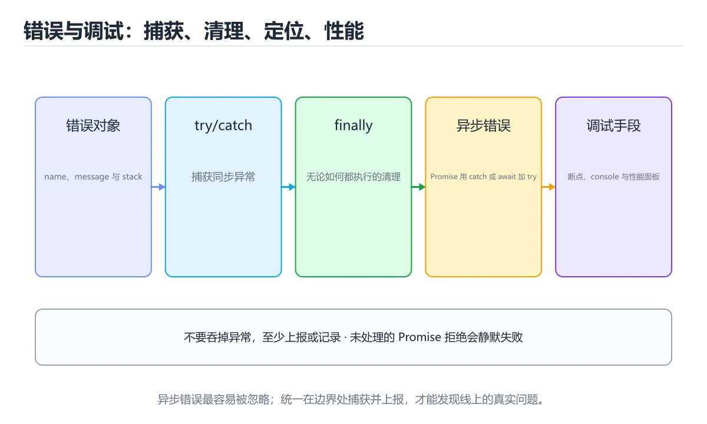
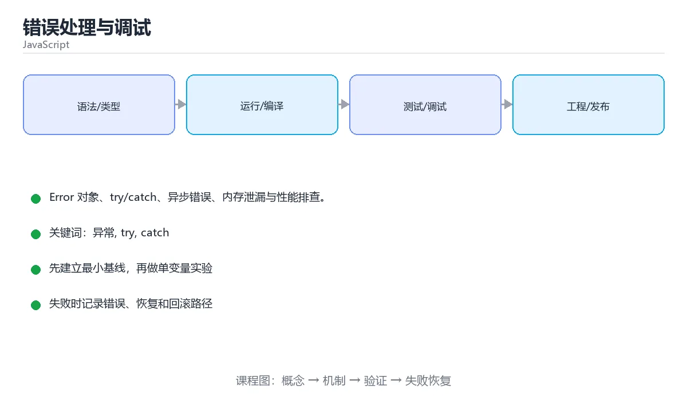

# 错误处理与调试





> 内容更新时间：2026-10-06 · 学习阶段：进阶 · 预计用时：45 分钟

## 本节知识框架

**课程定位**：所属分类 `javascript`（JavaScript），课程主题 `错误处理与调试`，学习阶段 进阶，建议用时 50 分钟。

本课主线：Error 对象、try/catch、异步错误、内存泄漏与性能排查。

**学完本课应当能够**
- 说清 `异常` 与 `try` 的含义与区别，并各举一个正例和一个反例。
- 用本课示例验证 `调试` 的行为，记录输入、输出与失败条件。
- 遇到「`SyntaxError`」这类问题时，能说出触发条件与修复顺序。

### 复习清单

- [ ] 能讲清 异常 与 try 的分工，并指出其中一个前提失效的边界。
- [ ] 能跑通 异常 的最小示例，记录一组正常输出和一组失败输出。
- [ ] 能完成一次自测，并把错题对照错误表定位原因。

## 核心概念定义

| 术语 | 操作性定义 | 常见边界与风险 |
| --- | --- | --- |
| 异常 | 程序执行中偏离正常控制流的错误事件，需要捕获、传播或转换。 | 易错：部分数据静默丢失；正确做法是记录失败的条目与原因。 |
| try | 异步错误要额外注意：try/catch 只能捕获 await 的错误，未处理的 Promise 拒绝需要 .catch() 或 window.addEventListener('unhandledrejection', ...)。 | 易错：出现未处理的拒绝；正确做法是加 `try/catch` 或 `.catch`。 |
| 调试 | 通过日志、断点和最小复现定位程序偏差，确认根因后再修改代码。 | 易错：复现步骤不稳定就打断点，停下来的现场不是出错那一刻的状态；先把复现做稳再改代码。 |
| 性能 | 系统在给定负载下表现出的吞吐、延迟、资源占用和稳定性。 | 易错：泄露信息、性能损耗；正确做法是提交前清理或用日志库。 |
| SyntaxError | 语法错误 | 易错：语法错误；正确做法是少括号、少逗号。 |
| ReferenceError | 使用未声明的变量 | 易错：使用未声明的变量；正确做法是拼写错误、作用域外访问。 |
| TypeError | 类型不匹配或访问空值 | 易错：类型不匹配或访问空值；正确做法是`undefined.foo`、调用非函数。 |
| RangeError | 数值越界或栈溢出 | 易错：数值越界或栈溢出；正确做法是递归过深、`new Array(-1)`。 |
| URIError | URI 编解码错误 | 易错：URI 编解码错误；正确做法是`decodeURIComponent("%")`。 |
| AggregateError | 多个错误聚合 | 易错：多个错误聚合；正确做法是`Promise.any` 全部失败。 |
| 断点 | 源码面板打断点 | 易错：循环里每轮都停在同一个断点上；只有条件断点能留下真正出错的那一次现场。 |
| 条件断点 | 设置表达式为真时暂停 | 易错：条件表达式引用了当前作用域还没有的变量，断点永不触发，还以为代码没执行到。 |
| debugger 语句 | 代码里直接写 | 易错：忘了删就带进发布包；DevTools 没打开时它根本不暂停，问题照样漏到用户那边。 |
| 调用栈 | 面板查看 Call Stack | 易错：只盯栈顶那一帧，它常是 throw 的位置；要顺着 error.stack 点开自己写的那一帧。 |
| 网络面板 | 查看请求与响应 | 易错：请求与响应看着正常就收工；页面仍报错时缺陷多在拿到响应之后的解析里，要回到控制台的第一条报错继续定位。 |
| try / catch | 捕获并记录 | 易错：用空 catch 吞掉错误掩盖问题，或只捕获不再 throw 让上层以为成功；至少记录并继续抛出。 |
| 全局兜底 | `window.onerror`、`unhandledrejection` | 易错：只有冒泡到顶层的错误才接得到；本地被 catch 吞掉的异常它看不见，仍会上报不到。 |
| Source Map | 构建时生成并上传 | 易错：只在本地能复现就放过；线上没有配 source map 与错误上报，用户先撞上问题你才后知后觉。 |

## 原理与运行机制

### 机制总览

**教材衔接：版本与时效**

- 运行时要同时考虑浏览器基线与 Node LTS；异常 的降级策略要写清楚。
- 升级前先用 SyntaxError 建立基线：记录版本、命令和输出，升级后只比较这些可观察量。

## 典型应用场景

- **`SyntaxError`**：典型现象是语法错误；正确做法是少括号、少逗号。
- **`ReferenceError`**：典型现象是使用未声明的变量；正确做法是拼写错误、作用域外访问。
- **`TypeError`**：典型现象是类型不匹配或访问空值；正确做法是`undefined.foo`、调用非函数。
- **`RangeError`**：典型现象是数值越界或栈溢出；正确做法是递归过深、`new Array(-1)`。

### 最小验证场景

- 准备：保留 `javascript` 示例的原始输入，先记录 `错误处理与调试` 的基线输出和完整运行命令。
- 观察：先核对 调用了 `Error()`，再改变一个与 `异常` 相关的条件。
- 判定：新结果与 `错误处理与调试` 的基线不同不等于错误；只有当差异破坏了 `异常` 的定义或错误表中的约束，才判定为失败。

### 选择与边界

- 使用 `异常` 时，程序执行中偏离正常控制流的错误事件，需要捕获、传播或转换；易错：部分数据静默丢失；正确做法是记录失败的条目与原因。
- 使用 `try` 时，异步错误要额外注意：try/catch 只能捕获 await 的错误，未处理的 Promise 拒绝需要 .catch() 或 window.addEventListener('unhandledrejection', ...)；易错：出现未处理的拒绝；正确做法是加 `try/catch` 或 `.catch`。
- 使用 `调试` 时，通过日志、断点和最小复现定位程序偏差，确认根因后再修改代码。
- 使用 `性能` 时，系统在给定负载下表现出的吞吐、延迟、资源占用和稳定性；易错：泄露信息、性能损耗；正确做法是提交前清理或用日志库。

## 代码/协议/SQL 示例

### 最小可验证示例

```javascript
const error = new Error('出错了');
error.name;      // 'Error'
error.message;   // '出错了'
error.stack;     // 调用栈，定位问题的关键

// 常见内置错误类型
// TypeError、ReferenceError、RangeError、SyntaxError、URIError
```

**教材衔接：try / catch / finally**

```javascript
function parse(json) {
  try {
    return JSON.parse(json);
  } catch (error) {
    if (error instanceof SyntaxError) {
      console.warn('JSON 格式错误', error.message);
      return null;
    }
    throw error;              // 处理不了的错误继续抛出
  } finally {
    console.log('解析结束');    // 无论成功失败都执行
  }
}
```

异步错误要额外注意：`try/catch` 只能捕获 `await` 的错误，**未处理的 Promise 拒绝**需要 `.catch()` 或 `window.addEventListener('unhandledrejection', ...)`。

```javascript
window.onerror = (message, source, line) => { /* 上报 */ };
```

**教材衔接：调试手段**

```javascript
console.log({ user });              // 用对象打印，保留变量名
console.table(users);
console.time('loop');
// ... 代码
console.timeEnd('loop');            // 简单性能测量
debugger;                           // 断点，DevTools 打开时暂停
```

定位顺序：看控制台第一条报错 → 点开 stack 找到自己的代码 → 在可疑处打条件断点 → 缩小复现范围。

**教材衔接：零基础详解：错误处理与调试方法**

### 一句话说清它是什么

错误处理让程序在出错时走可预期的分支，调试则是「在不知道原因时，用工具一步步缩小范围」。
关键在于：**先看报错类型，再定位行号，最后用断点验证猜测**。

### 用生活比喻理解

| 工具 | 比喻 | 说明 |
| --- | --- | --- |
| `try/catch` | 安全网 | 出问题时不至于整个掉下去 |
| `throw` | 主动报警 | 自己发现异常时上报 |
| `Error` 对象 | 病历 | 含类型、消息与调用栈 |
| 断点 | 暂停键 | 停在关键位置检查现场 |
| `console` 家族 | 记录仪 | 不同级别留痕 |

### 错误处理的完整结构

```javascript
class ValidationError extends Error {
  constructor(message) {
    super(message);
    this.name = "ValidationError";
  }
}

function parseAge(raw) {
  const n = Number(raw);
  if (!Number.isInteger(n) || n < 0 || n > 150) {
    throw new ValidationError(`年龄不合法：${raw}`);
  }
  return n;
}

try {
  console.log(parseAge("abc"));
} catch (error) {
  if (error instanceof ValidationError) {
    console.warn("输入问题：", error.message);
  } else {
    console.error("意外错误：", error);       // 保留完整堆栈
    throw error;                              // 处理不了就继续往上抛
  }
} finally {
  console.log("处理结束");
}
```

### 异步代码的错误处理

```javascript
// Promise 方式
fetch("/api/user")
  .then((res) => {
    if (!res.ok) throw new Error(`HTTP ${res.status}`);
    return res.json();
  })
  .catch((error) => console.error("请求失败：", error.message));

// async/await 方式（推荐）
async function loadUser() {
  try {
    const res = await fetch("/api/user");
    if (!res.ok) throw new Error(`HTTP ${res.status}`);
    return await res.json();
  } catch (error) {
    console.error("请求失败：", error.message);
    return null;
  }
}
```

**注意**：`await` 之后如果不加 `try/catch`，错误会变成未处理的 Promise 拒绝。

### console 家族与调试工具

| 方法 | 用途 |
| --- | --- |
| `console.log` | 普通输出 |
| `console.warn` / `error` | 警告与错误，可在面板过滤 |
| `console.table` | 数组或对象以表格展示 |
| `console.group` / `groupEnd` | 分组折叠 |
| `console.time` / `timeEnd` | 测量耗时 |
| `console.trace` | 打印调用栈 |
| `debugger` | 代码里直接下断点 |

```javascript
const users = [{ id: 1, name: "小明" }, { id: 2, name: "小红" }];
console.table(users);

console.time("解析");
// 一些耗时操作
console.timeEnd("解析");
```

### 断点调试的标准流程

1. **复现**：先找到稳定复现的步骤。
2. **定位**：在可疑函数入口打断点，看参数对不对。
3. **二分**：范围太大时，在中间位置验证，排除一半。
4. **验证**：看调用栈与作用域变量，确认是「数据错」还是「逻辑错」。
5. **收尾**：修完补一个测试或断言，避免复发。

### 新手最容易踩的八个坑

| 坑 | 现象 | 正确做法 |
| --- | --- | --- |
| 用 `catch {}` 什么都不做 | 问题被完全掩盖 | 至少记录日志 |
| 只 `catch` 不 `throw` | 上层以为成功了 | 处理不了就继续抛 |
| 把 `console.log` 留在生产 | 泄露信息、性能损耗 | 提交前清理或用日志库 |
| 直接打印对象 | 看不到当前值 | 打印副本 `{...obj}` 或 `JSON.stringify` |
| 捕获了但丢掉了 `error` | 失去堆栈 | 打印 `error` 本身而不是 `error.message` |
| 在循环里吞异常 | 部分数据静默丢失 | 记录失败的条目与原因 |
| 依赖字符串比较错误信息 | 文案一变就失效 | 用自定义错误类与 `instanceof` |
| 忘了异步错误也需处理 | 出现未处理的拒绝 | 加 `try/catch` 或 `.catch` |

### 手把手练习：带容错的批量处理

```javascript
class DataError extends Error {
  constructor(index, reason) {
    super(`第 ${index} 条数据有问题：${reason}`);
    this.name = "DataError";
    this.index = index;
  }
}

function processAll(rows) {
  const ok = [];
  const failed = [];

  rows.forEach((row, i) => {
    try {
      const value = Number(row.value);
      if (!Number.isFinite(value)) throw new Error("不是数字");
      ok.push({ id: row.id, value });
    } catch (error) {
      failed.push(new DataError(i, error.message));
    }
  });

  return { ok, failed };
}

const result = processAll([
  { id: 1, value: "10" },
  { id: 2, value: "abc" },
  { id: 3, value: "30" },
]);

console.log(`成功 ${result.ok.length} 条，失败 ${result.failed.length} 条`);
for (const e of result.failed) console.warn(e.message);
```

### 学完自测

- [ ] 能写出自定义错误类并区分处理。
- [ ] 知道为什么不能写空的 `catch`。
- [ ] 能说出 `console.table`、`time`、`trace` 各自的用途。
- [ ] 知道断点调试的五步流程。
- [ ] 能说出异步代码里错误容易被漏掉的原因。

**运行方式**：运行 `错误处理与调试` 的示例时，保存为 `.js` 后用 `node 文件名.js` 运行；涉及浏览器 API 的示例要放到页面里执行。

## 时间/空间复杂度或性能分析

**教材衔接：内存与性能**

- 全局变量、未清理的定时器、未移除的监听器、闭包长期引用大对象 → 内存泄漏。
- 用 DevTools Memory 面板做堆快照对比，Performance 面板看长任务与重排。
- 大列表使用虚拟滚动；频繁 DOM 操作合并为一次（DocumentFragment）。

**测量方法**：以 `错误处理与调试` 的 `异常` 场景为对象，固定输入跑一遍记录基线，再把规模或并发度提高一个数量级复测；两次结果的差值与波动范围才是结论依据。

## 常见误区与易错点

| 容易写错的做法 | 实际现象 | 原因与正确做法 |
| --- | --- | --- |
| `SyntaxError` | 语法错误 | 少括号、少逗号 |
| `ReferenceError` | 使用未声明的变量 | 拼写错误、作用域外访问 |
| `TypeError` | 类型不匹配或访问空值 | `undefined.foo`、调用非函数 |
| `RangeError` | 数值越界或栈溢出 | 递归过深、`new Array(-1)` |
| `URIError` | URI 编解码错误 | `decodeURIComponent("%")` |
| `AggregateError` | 多个错误聚合 | `Promise.any` 全部失败 |
| 用 `catch {}` 什么都不做 | 问题被完全掩盖 | 至少记录日志 |
| 只 `catch` 不 `throw` | 上层以为成功了 | 处理不了就继续抛 |
| 把 `console.log` 留在生产 | 泄露信息、性能损耗 | 提交前清理或用日志库 |
| 直接打印对象 | 看不到当前值 | 打印副本 `{...obj}` 或 `JSON.stringify` |
| 捕获了但丢掉了 `error` | 失去堆栈 | 打印 `error` 本身而不是 `error.message` |
| 在循环里吞异常 | 部分数据静默丢失 | 记录失败的条目与原因 |
| 依赖字符串比较错误信息 | 文案一变就失效 | 用自定义错误类与 `instanceof` |
| 忘了异步错误也需处理 | 出现未处理的拒绝 | 加 `try/catch` 或 `.catch` |
| `catch (e) { console.log("出错") }` | 丢失堆栈与原因 | 打印 `e` 本身，并上报到监控 |
| `throw "字符串"` | 没有堆栈 | 抛 `Error` 实例 |
| 自定义错误不继承 `Error` | 拿不到堆栈与 `instanceof` 判断 | `class MyError extends Error {}` |
| `catch` 后返回 `null` | 调用方继续访问字段报错 | 明确返回失败结果或重新抛出 |
| 用 `try` 包住整个函数 | 误捕获无关错误 | 只包可能失败的最小片段 |
| 异步错误用同步 `try` 包 | 捕获不到 | 需要 `await`，或 `.catch()` |
| `finally` 里 `return` | 覆盖 try 的返回值 | `finally` 只做清理 |
| 只在本地复现不了就放线上 | 用户先遇到问题 | 加 source map 与错误上报 |
| 报错日志不含上下文 | 无法定位用户与操作 | 带上请求 ID、用户标识与关键参数 |
| 生产环境打印完整对象 | 泄露敏感信息 | 只记录必要字段并脱敏 |
| catch (e) { console.log("出错") } | 丢失堆栈与原因。 | 打印 e 本身，并上报到监控。 |
| 自定义错误不继承 Error | 拿不到堆栈与 instanceof 判断。 | class MyError extends Error {}。 |
| catch 后返回 null | 调用方继续访问字段报错。 | 明确返回失败结果或重新抛出。 |

### 现场 1：`SyntaxError`

**症状**：语法错误。

**根因与修复**：少括号、少逗号。

**自检**：在本课示例里复现「`SyntaxError`」，改成少括号、少逗号后重跑；如果症状消失且失败路径按预期变化，说明定位正确。

### 现场 2：`ReferenceError`

**症状**：使用未声明的变量。

**根因与修复**：拼写错误、作用域外访问。

**自检**：在本课示例里复现「`ReferenceError`」，改成拼写错误、作用域外访问后重跑；如果症状消失且失败路径按预期变化，说明定位正确。

### 现场 3：`TypeError`

**症状**：类型不匹配或访问空值。

**根因与修复**：`undefined.foo`、调用非函数。

**自检**：在本课示例里复现「`TypeError`」，改成`undefined.foo`、调用非函数后重跑；如果症状消失且失败路径按预期变化，说明定位正确。

### 现场 4：`RangeError`

**症状**：数值越界或栈溢出。

**根因与修复**：递归过深、`new Array(-1)`。

**自检**：在本课示例里复现「`RangeError`」，改成递归过深、`new Array(-1)`后重跑；如果症状消失且失败路径按预期变化，说明定位正确。

### 现场 5：`URIError`

**症状**：URI 编解码错误。

**根因与修复**：`decodeURIComponent("%")`。

**自检**：在本课示例里复现「`URIError`」，改成`decodeURIComponent("%")`后重跑；如果症状消失且失败路径按预期变化，说明定位正确。

### 现场 6：`AggregateError`

**症状**：多个错误聚合。

**根因与修复**：`Promise.any` 全部失败。

**自检**：在本课示例里复现「`AggregateError`」，改成`Promise.any` 全部失败后重跑；如果症状消失且失败路径按预期变化，说明定位正确。

### 现场 7：用 `catch {}` 什么都不做

**症状**：问题被完全掩盖。

**根因与修复**：至少记录日志。

**自检**：在本课示例里复现「用 `catch {}` 什么都不做」，改成至少记录日志后重跑；如果症状消失且失败路径按预期变化，说明定位正确。

### 现场 8：只 `catch` 不 `throw`

**症状**：上层以为成功了。

**根因与修复**：处理不了就继续抛。

**自检**：在本课示例里复现「只 `catch` 不 `throw`」，改成处理不了就继续抛后重跑；如果症状消失且失败路径按预期变化，说明定位正确。

### 现场 9：把 `console.log` 留在生产

**症状**：泄露信息、性能损耗。

**根因与修复**：提交前清理或用日志库。

**自检**：在本课示例里复现「把 `console.log` 留在生产」，改成提交前清理或用日志库后重跑；如果症状消失且失败路径按预期变化，说明定位正确。

## 与其他知识点的关系

| 关系 | 课程 | 为什么 |
| --- | --- | --- |
| 先修 | 《DOM 与事件》 | 本课会直接使用它的概念或操作前提。 |
| 关联 | 《模块化与工程化》 | 用于横向比较或把本课结论迁移到相邻主题。 |
| 关联 | 《异常处理与文件操作》 | 用于横向比较或把本课结论迁移到相邻主题。 |
| 关联 | 《异常处理与文件 IO》 | 用于横向比较或把本课结论迁移到相邻主题。 |
| 关联 | 《调试与日志》 | 用于横向比较或把本课结论迁移到相邻主题。 |
| 前置顺序 | 《DOM 与事件》 | 同分类中安排在本课之前，建议先完成其自测。 |
| 后续顺序 | 《模块化与工程化》 | 同分类中安排在本课之后，会继续使用本课术语。 |

- **先修**：`DOM 与事件`。本课默认这些内容已经掌握。
- **相关或后续**：`模块化与工程化`、`异常处理与文件操作`、`异常处理与文件 IO`、`调试与日志`。本课术语会在这些课程里继续使用。
- **术语归属**：`异常`、`try`、`调试` 的定义以本课「核心概念定义」为准，换到其他课程时先确认定义是否被改写。

## 自测题与参考答案

> 先独立作答，再对照参考答案；答案都能在本课正文、术语表或错误表里找到依据。

### 自测 1（概念复述）

不看正文，写出 `异常` 的操作性定义，并说明它与 `try` 的区别。

**参考答案**：程序执行中偏离正常控制流的错误事件，需要捕获、传播或转换。

`try` 的定位是：异步错误要额外注意：try/catch 只能捕获 await 的错误，未处理的 Promise 拒绝需要 .catch() 或 window.addEventListener('unhandledrejection', ...)；两者的差别要从适用对象与失败模式上说明。

### 自测 2（排错）

本课错误表记录了「`SyntaxError`」这类做法。请写出它会出现的现象、根因，以及修复顺序。

**参考答案**：现象是语法错误；正确做法是少括号、少逗号。修复时先复现现象并保留证据，再改动一处假设重跑，确认现象消失。

### 自测 3（动手验证）

运行本课的 `javascript` 示例，把其中的 `'出错了'` 换成一个边界值后重新运行，记录输出与错误信息。

**参考答案**：正常输入下 `javascript` 示例应当复现正文给出的结果；把 `'出错了'` 换成边界值后，如果结果改变或报错，先核对它是否满足 `错误处理与调试` 中`异常` 的适用范围，再检查错误表里是否有同类现象。

### 自测 4（代码阅读）

阅读本课开头的 `javascript` 示例，说明它体现了`异常` 的哪一条性质，并指出改动哪个输入会让这条性质不再成立。

**参考答案**：`异常` 的定义是 程序执行中偏离正常控制流的错误事件，需要捕获、传播或转换，示例正是在实现这条定义。改动与 `异常` 有关的一个输入后，如果结果不再符合 `错误处理与调试` 的正文描述，就说明该性质只在当前前提成立。

### 自测 5（迁移）

把 `错误处理与调试` 的方法迁移到自己的项目：围绕 `异常` 写出一个与错误表同类的风险点，并说明触发条件和检验方式。

**参考答案**：例如「catch 后返回 null」，它会导致调用方继续访问字段报错；检验方式是按明确返回失败结果或重新抛出改一处再复现，确认现象消失且没有引入新的失败分支。

### 自测 6（对比）

用一个表格对比 `异常` 与 `try`：各写一行适用场景、一行失败表现。

**参考答案**：`异常` 的定义是程序执行中偏离正常控制流的错误事件，需要捕获、传播或转换；`try` 的定义是异步错误要额外注意：try/catch 只能捕获 await 的错误，未处理的 Promise 拒绝需要 .catch() 或 window.addEventListener('unhandledrejection', ...)。两者的失败表现分别对应本课错误表里与本术语相关的行。

### 自测 7（排错顺序）

面对「`SyntaxError`」引发的问题，请把“复现 语法错误 → 保留证据 → 少括号、少逗号 → 回归验证”四步写成可执行的检查清单。

**参考答案**：第一步按语法错误复现；第二步记录输入、版本与完整报错；第三步按少括号、少逗号只改一处；第四步重跑并确认失败路径也按预期变化。

### 自测 8（边界判断）

针对 `性能`，分别写出“可以使用”的条件和“结论不再成立”的条件。

**参考答案**：易错：泄露信息、性能损耗；正确做法是提交前清理或用日志库。 同时要把 `性能` 的定义 系统在给定负载下表现出的吞吐、延迟、资源占用和稳定性 与实际输入逐项对照。

### 自测 9（机制重建）

不看正文，按输入、转换、输出、验证四段重建 `异常` → `try` → `调试` → `性能` 的作用链。

**参考答案**：起点是 `异常` 的定义 程序执行中偏离正常控制流的错误事件，需要捕获、传播或转换；中间每一步都保留可观察状态；终点由 `性能` 检查，失败时回到错误表定位第一个偏离定义的步骤。

### 自测 10（综合排错）

在 `错误处理与调试` 中，现象是 调用方继续访问字段报错。请围绕 catch 后返回 null 写出最小复现、关键证据、修复动作和回归验证，并说明为什么不能只凭一次运行下结论。

**参考答案**：先复现 catch 后返回 null，记录输入与完整错误；再按 明确返回失败结果或重新抛出 只改一处。回归时同时跑正常路径和边界路径，只有两次结果都可解释，才把修复视为完成。

### 自测 11（一分钟复述）

用每分钟约 200 字的速度复述 `错误处理与调试`：先给主问题，再按顺序说出 `异常`、`try`、`调试`、`性能`，最后给一个失败案例。

**自评标准**：主问题必须对应 Error 对象、try/catch、异步错误、内存泄漏与性能排查；每个术语都要能接上一句定义或边界；失败案例必须写成可观察现象，不能用“可能有风险”代替证据。

## 术语速查

| 术语 | 一句话说明 |
| --- | --- |
| `异常` | 程序执行中偏离正常控制流的错误事件，需要捕获、传播或转换。 |
| `try` | 异步错误要额外注意：try/catch 只能捕获 await 的错误，未处理的 Promise 拒绝需要 .catch() 或 window.addEventListener('unhandledrejection', ...)。 |
| `调试` | 通过日志、断点和最小复现定位程序偏差，确认根因后再修改代码。 |
| `性能` | 系统在给定负载下表现出的吞吐、延迟、资源占用和稳定性。 |

**术语关系**：`异常`（程序执行中偏离正常控制流的错误事件） → `try`（异步错误要额外注意：try/catch 只能捕获 await 的错误） → `调试`（通过日志、断点和最小复现定位程序偏差） → `性能`（系统在给定负载下表现出的吞吐、延迟、资源占用和稳定性）。

## 考点精讲

`错误处理与调试` 的题库有 6 道题，下面逐题给出题干、正确项与判断依据：先自己作答，再核对正确项，最后回到正文对应小节复核。

### 考点 1：第 1 题

- **题目**：围绕“错误处理与调试”中的 异常、try、catch，下列哪两项是本课强调的实践判断？
- **正确项**：验证 try 时要固定版本并覆盖边界输入，结论才可复现；学习 异常 时要同时说明输入、输出和失败路径，不能只看正常流程
- **判断依据**：按《错误处理与调试》的正文口径，本题要同时选中「验证 try 时要固定版本并覆盖边界输入，结论才可复现」、「学习 异常 时要同时说明输入、输出和失败路径，不能只看正常流程」，漏掉任一项都算没答全。术语 异常（错误处理与调试）：程序执行中偏离正常控制流的错误事件，需要捕获、传播或转换。易错点是`SyntaxError`，会造成语法错误，改法是少括号、少逗号。

### 考点 2：第 2 题

- **题目**：定位报错位置最关键的信息是？
- **正确项**：error.stack
- **判断依据**：本题正确项是「error.stack」。术语 异常（错误处理与调试）：程序执行中偏离正常控制流的错误事件，需要捕获、传播或转换，本题取「error.stack」这条。易错点是`ReferenceError`，使用未声明的变量，改法是拼写错误、作用域外访问。

### 考点 3：第 3 题

- **题目**：未被捕获的 Promise 拒绝会导致？
- **正确项**：变成 unhandledrejection，可能静默失败
- **判断依据**：本题正确项是「变成 unhandledrejection，可能静默失败」。术语 异常（错误处理与调试）：程序执行中偏离正常控制流的错误事件，需要捕获、传播或转换，本题取「变成 unhandledrejection，可能静默失败」这条。易错点是`TypeError`，会造成类型不匹配或访问空值，改法是`undefined.foo`、调用非函数。

### 考点 4：第 4 题

- **题目**：让自定义错误继承 Error 的好处是？
- **正确项**：保留堆栈信息
- **判断依据**：本题正确项是「保留堆栈信息」。术语 异常（错误处理与调试）：程序执行中偏离正常控制流的错误事件，需要捕获、传播或转换，本题取「保留堆栈信息」这条。易错点是`RangeError`，会造成数值越界或栈溢出，改法是递归过深、`new Array(-1)`。

### 考点 5：第 5 题

- **题目**：这段 `javascript` 代码对应 `错误处理与调试` 的 `异常`。课程要解决的是Error 对象、try/catch、异步错误、内存泄漏与性能排查。关于代码内容，哪一项说法准确？
- **正确项**：调用了 `JSON.parse()`
- **判断依据**：本题正确项是「调用了 `JSON.parse()`」。术语 异常（错误处理与调试）：程序执行中偏离正常控制流的错误事件，需要捕获、传播或转换，本题取「调用了 `JSON.parse()`」这条。易错点是`URIError`，会造成URI 编解码错误，改法是`decodeURIComponent("%")`。本题干扰项「出现字面量 `completed`」不成立：展示代码里找不到 `completed`。

### 考点 6：第 6 题

- **题目**：把 `错误处理与调试` 中与 `异常` 有关的步骤调整为正确顺序；该课主线是Error 对象、try/catch、异步错误、内存泄漏与性能排查。
- **正确项**：复现：先找到稳定复现的步骤 → 定位：在可疑函数入口打断点，看参数对不对 → 二分：范围太大时，在中间位置验证，排除一半 → 验证：看调用栈与作用域变量，确认是「数据错」还是「逻辑错」
- **判断依据**：按《错误处理与调试》正文的先后，本题顺序是「复现：先找到稳定复现的步骤」 → 「定位：在可疑函数入口打断点，看参数对不对」 → 「二分：范围太大时，在中间位置验证，排除一半」 → 「验证：看调用栈与作用域变量，确认是「数据错」还是「逻辑错」」。术语 异常（错误处理与调试）：程序执行中偏离正常控制流的错误事件，需要捕获、传播或转换。易错点是`SyntaxError`会造成语法错误，改法是少括号、少逗号。

### 考点 7：`异常`

- **要点**：程序执行中偏离正常控制流的错误事件，需要捕获、传播或转换。
- **异常 的边界**：易错：部分数据静默丢失；正确做法是记录失败的条目与原因。

### 考点 8：`try`

- **要点**：异步错误要额外注意：try/catch 只能捕获 await 的错误，未处理的 Promise 拒绝需要 .catch() 或 window.addEventListener('unhandledrejection', ...)。
- **try 的边界**：易错：出现未处理的拒绝；正确做法是加 `try/catch` 或 `.catch`。

### 考点 9：`调试`

- **要点**：通过日志、断点和最小复现定位程序偏差，确认根因后再修改代码。

### 考点 10：`性能`

- **要点**：系统在给定负载下表现出的吞吐、延迟、资源占用和稳定性。
- **性能 的边界**：易错：泄露信息、性能损耗；正确做法是提交前清理或用日志库。

### 考点 11：排错——`SyntaxError`

- **现象**：语法错误。
- **处理**：少括号、少逗号。

### 考点 12：排错——`ReferenceError`

- **现象**：使用未声明的变量。
- **处理**：拼写错误、作用域外访问。

### 考点 13：综合辨析——`异常` 与 `性能`

- **辨析点**：`异常` 的定义是 程序执行中偏离正常控制流的错误事件，需要捕获、传播或转换；`性能` 的定义是 系统在给定负载下表现出的吞吐、延迟、资源占用和稳定性。
- **答题要求**：面对 `错误处理与调试` 的题目，先判断描述的是 `异常` 还是 `性能`，再归到对应定义，最后写出一个会让该定义失效的边界输入。

### 考点 14：排错评分点

- **现象分**：能写出 语法错误，而不是只写“程序有错”。
- **证据分**：保留触发 `SyntaxError` 的输入、版本和错误原文。
- **修复分**：按 少括号、少逗号 只改一处，并同时回归正常路径与边界路径。

## 内容元数据

- 内容版本：v2.0
- 最后更新：2026-10-06
- 学习阶段：进阶
- 适用环境：Node.js 22+ / 现代浏览器；本课聚焦 异常。
- 内容来源：内置结构化课程与工程实践整理
- 相关主题：异常、try、catch、调试、内存泄漏、性能
- 质量版本：P0 测验标准 + P1 覆盖扩展 + P2 体验补全

## 参考资料与复核

- 最后复核：2026-10-04
- 下次复核：2027-05-17
- 复核范围：版本兼容、API 行为、安全建议与工程实践
- 来源性质：官方文档、标准或权威教材；本课核对关键词：异常、try、catch、调试、内存泄漏、性能。

| 参考资料 | 本课用途 |
| --- | --- |
| [MDN Promise](https://developer.mozilla.org/docs/Web/JavaScript/Reference/Global_Objects/Promise) | Promise 与异步链 |
| [Node 事件循环](https://nodejs.org/en/learn/asynchronous-work/event-loop-timers-and-nexttick) | 事件循环与异步顺序 |
| [MDN 模块](https://developer.mozilla.org/docs/Web/JavaScript/Guide/Modules) | ES Module 与依赖组织 |

| [本课术语索引：错误处理与调试](#核心概念定义) | 按本课输入、术语边界和错误表现逐项核对 |
> 「错误处理与调试」的链接用于离线阅读后的延伸核对；App 不会自动联网。