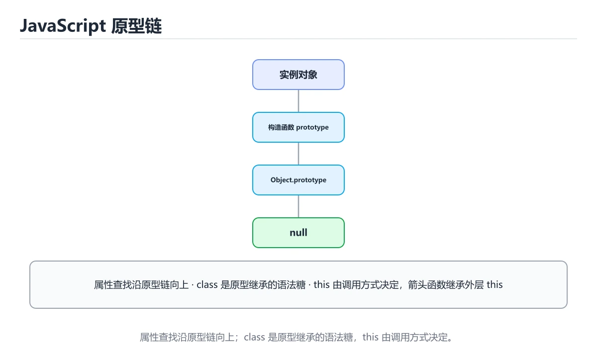
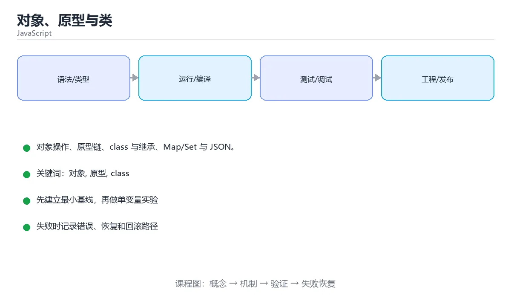

# 对象、原型与类

> 内容更新时间：2026-10-06 · 学习阶段：进阶 · 预计用时：40 分钟





## 本节知识框架

**课程定位**：所属分类 `javascript`（JavaScript），课程主题 `对象、原型与类`，学习阶段 进阶，建议用时 50 分钟。

本课主线：对象操作、原型链、class 与继承、Map/Set 与 JSON。

**学完本课应当能够**
- 说清 `Object.prototype` 与 `class` 的含义与区别，并各举一个正例和一个反例。
- 用本课示例验证 `JSON` 的行为，记录输入、输出与失败条件。
- 遇到「用 `if (obj.k)` 判存在」这类问题时，能说出触发条件与修复顺序。

### 复习清单

- [ ] 能不看正文复述本课核心术语，并指出一个边界或反例。
- [ ] 能运行或推演本课示例，记录输入、输出与失败现象。
- [ ] 能完成一次自测，并把错题对照错误表定位原因。

## 核心概念定义

| 术语 | 操作性定义 | 常见边界与风险 |
| --- | --- | --- |
| Object.prototype | 访问属性时会沿原型链向上查找，直到 Object.prototype，仍找不到才返回 undefined。 | 拿到 `undefined` 也说明不了属性不存在，可能值本身就是 `undefined`；判存在要改用 `in` 或 `Object.hasOwn`。 |
| class | class 是原型继承的语法糖，但语义更清晰，extends 会自动维护原型链。 | 派生类构造器里必须先 `super` 才能碰 `this`，父类的 `#field` 私有字段子类也读不到。 |
| JSON | 用对象、数组、字符串和数字等表示结构化数据的文本格式。 | 易错：比的是引用；正确做法是逐字段比较或用 `JSON.stringify`。 |
| 原型链 | 属性查找会沿原型向上追溯，class 只是原型继承的语法糖。 | 链上的属性是共享的：改了原型对象，已经建好的实例跟着一起变；再用 `obj.constructor` 判类型还容易被伪造。 |
| 读取可能不存在的属性 | `obj?.a?.b` | 只在遇到 `null` 或 `undefined` 时短路；属性存在但值是 `0` 或空串仍会继续往右取。 |
| 取默认值 | `obj.a ?? "默认"` | 只有 `null` 和 `undefined` 才取默认值；`0`、空串、`false` 会原样保留，别把它当判空兜底。 |
| 解构并重命名 | `const { a: x, b = 1 } = obj` | 重命名后本地变量是 `x` 而不是 `a`；`b` 的默认值仅在该属性值为 `undefined` 时才生效。 |
| 剩余属性 | `const { a, ...rest } = obj` | `rest` 只收自身的可枚举属性，不含原型链上的键；里层嵌套属性仍是共享引用。 |
| 合并对象 | `{ ...a, ...b }` | 后展开的 `b` 会整键覆盖 `a` 的同名键，且嵌套字段仍指向同一引用。 |
| 复制并改字段 | `{ ...user, name: "新名字" }` | 只生成新的顶层对象，未改到的嵌套属性仍与原对象共用同一引用。 |
| 安全修改嵌套字段 | `{ ...s, user: { ...s.user, age: 18 } }` | 路径每一层都要展开，漏一层引用就不变；`s.user` 为 `undefined` 时展开会报错，需先判空。 |
| 取键 / 值 / 键值对 | `Object.keys/values/entries` | 只返回自身可枚举属性，拿不到原型链上的键；传入 `null` 或 `undefined` 会抛 `TypeError`。 |
| 转成 Map | `new Map(Object.entries(obj))` | 只会带进对象自身的可枚举属性，原型链上的键丢失；且键仍全是字符串。 |
| 冻结对象 | `Object.freeze(obj)` | 只锁当前一层，嵌套对象仍可改；改冻结属性在非严格模式静默失败，严格模式抛错。 |
| 判断自有属性 | `Object.hasOwn(obj, "key")` | 只认自身属性，原型链上的同名键会返回 `false`；要连继承一起判就得改用 `in`。 |
| 对象 | 一张信息卡 | 易错：把卡当值传来传去；`user.email = ...` 会同时反映到每个引用它的变量上，要一份独立的就写 `{ ...user }`。 |
| 属性 | 卡片上的条目 | 易错：键还在；正确做法是用 `delete obj.k`。 |
| 方法 | 卡片能做的事 | `greet()` 内部靠 `this.name` 取名字：方法只是挂在卡上的函数，调用方式一变 `this` 就不再是这张卡，取值会错甚至抛错。 |
| 原型 | 家族遗传 | `cat` 自己没有 `speak`，`hasOwnProperty` 返回 false 却照样能调用；只按自身键统计条目时这份遗传会被漏掉。 |
| 解构 | 按需摘取 | 键名要和源对象的属性名对齐；源为 `null` 或 `undefined` 时直接抛错，数组解构按下标取值。 |
| obj.method() | `obj` 本身 | 点号调用时 `this` 才绑定到 `obj`；方法被单独取出再调用就丢 `this`，要 `bind` 或箭头函数。 |
| fn() 直接调用 | 严格模式下是 `undefined` | 非严格模式直接调用时 `this` 落到 `globalThis` 而非 `undefined`，会悄悄写到全局对象。 |
| new Fn() | 新建的对象 | 漏写 `new` 直接调用时 `this` 就不再是新建对象；严格模式下变成 `undefined` 直接抛错。 |
| 箭头函数 | 继承定义时的外层 `this`，不受调用方式影响 | 正因 `this` 在定义时就定死，把它当卡片方法写反而拿不到调用者；需要按调用方绑定时得用普通函数或 `bind`。 |
| "k" in obj | 含 | `in` 会沿原型链向上查，原型上的同名键也返回 `true`；只想看自身属性得改用 `Object.hasOwn`。 |
| Object.hasOwn(obj, "k") | 只查自身 | 键继承自原型链时返回 `false`；要判含继承来的键必须改用 `in`，两者口径不同别混用。 |
| obj.k !== undefined | 含（沿链） | 分不清键不存在还是键值本就是 `undefined`，还会沿原型链匹配，不能当作判存在的依据。 |
| if (obj.k) | 含 | 易错：0、空串被当成不存在；正确做法是用 `in` 或 `Object.hasOwn`。 |
| 用 if (obj.k) 判存在 | 0、空串被当成不存在 | 键存在但值是 `0`、`""`、`false` 时同样被当成不存在；要判存在改用 `in` 或 `Object.hasOwn`。 |
| 对象赋值当复制 | 改一处全变 | 判据是赋值后 `copy === user` 仍为 `true`；只有改成 `{ ...user }` 或 `structuredClone`，这个等式才不再成立。 |
| 浅拷贝嵌套对象 | 内层仍互相影响 | 易错：内层仍互相影响；正确做法是用 `structuredClone`。 |
| 方法被单独取出 | `this` 丢失 | 把 `user.greet` 当回调交出去时，调用方身上已经没有 `user`，`this` 落空；包一层箭头函数或先 `bind` 才保得住。 |
| 遍历时用 for...in | 拿到继承来的键 | 会沿原型链把可枚举属性一起遍历进来；只要自身键就改用 `Object.keys` 或 `entries` 并用 `Object.hasOwn` 过滤。 |
| 用对象当 Map | 键只能是字符串或 Symbol | 易错：键只能是字符串或 Symbol；正确做法是需要任意类型键就用 `Map`。 |
| 删除属性用 = undefined | 键还在 | 只改值不删键，`in`、`Object.keys` 里仍看得到它；要真正移除得用 `delete obj.k`。 |
| 比较对象用 === | 比的是引用 | 内容相同的两个字面量用 `===` 仍返回 false，因为它只认引用；要判是否等价得逐字段比或退一步用 `JSON.stringify`。 |

## 原理与运行机制

### 机制总览

| 阶段 | 关注对象 | 失败时应检查 |
| --- | --- | --- |
| 输入 | Object.prototype | 类型、范围、编码、版本或前置状态是否满足定义。 |
| 处理 | class | 顺序、可见性、锁、路由、事务或调度规则是否被破坏。 |
| 输出 | JSON | 结果是否可复现，错误是否被正确传播而不是被吞掉。 |

**教材衔接：版本与时效**

- 运行时要同时考虑浏览器基线与 Node LTS；对象 的降级策略要写清楚。
- 升级「对象、原型与类」涉及的依赖前，先用 getPrototypeOf 复现当前行为，再逐项核对版本说明与破坏性变更。

## 典型应用场景

- **用 `if (obj.k)` 判存在**：典型现象是0、空串被当成不存在；正确做法是用 `in` 或 `Object.hasOwn`。
- **对象赋值当复制**：典型现象是改一处全变；正确做法是用展开做浅拷贝。
- **浅拷贝嵌套对象**：典型现象是内层仍互相影响；正确做法是用 `structuredClone`。
- **方法被单独取出**：典型现象是`this` 丢失；正确做法是用 `bind` 或箭头函数。

### 最小验证场景

- 准备：保留 `javascript` 示例的原始输入，先记录 `对象、原型与类` 的基线输出和完整运行命令。
- 观察：先核对 调用了 `greet()`，再改变一个与 `Object.prototype` 相关的条件。
- 判定：新结果与 `对象、原型与类` 的基线不同不等于错误；只有当差异破坏了 `Object.prototype` 的定义或错误表中的约束，才判定为失败。

### 选择与边界

- 使用 `Object.prototype` 时，先满足它的定义：访问属性时会沿原型链向上查找，直到 `Object.prototype`，仍找不到才返回 `undefined`。
- 使用 `class` 时，先满足它的定义：`class` 是原型继承的语法糖，但语义更清晰，`extends` 会自动维护原型链。
- 使用 `JSON` 时，先满足它的定义：用对象、数组、字符串和数字等表示结构化数据的文本格式；易错：比的是引用；正确做法是逐字段比较或用 `JSON.stringify`。
- 使用 `原型链` 时，先满足它的定义：属性查找会沿原型向上追溯，class 只是原型继承的语法糖；易错：会带上原型链上的可枚举属性；正确做法是用 `Object.entries` 或 `Object.hasOwn` 过滤。

## 代码/协议/SQL 示例

### 最小可验证示例

```javascript
const user = {
  name: 'tom',
  'favorite color': 'blue',
  greet() { return `你好 ${this.name}`; },
};

user.name;                      // 点号访问
user['favorite color'];         // 键含空格时用方括号
user.email = 'tom@example.com'; // 新增属性
delete user.email;              // 删除属性

Object.keys(user);              // 键数组
Object.entries(user);           // [[key, value], ...]
const copy = { ...user, city: '上海' };   // 浅拷贝 + 合并

const { name, age = 0 } = user;  // 解构 + 默认值
```

**教材衔接：原型链**

```javascript
const animal = { speak() { return '...'; } };
const cat = Object.create(animal);

cat.speak();                       // 沿原型链找到 speak
Object.getPrototypeOf(cat) === animal;
cat.hasOwnProperty('speak');       // false：属性在原型上
```

访问属性时会沿原型链向上查找，直到 `Object.prototype`，仍找不到才返回 `undefined`。

**教材衔接：class 语法**

```javascript
class Animal {
  #secret = 'private';            // 私有字段
  static category = 'animal';

  constructor(name) { this.name = name; }
  speak() { return `${this.name} 发出声音`; }
  get label() { return this.name.toUpperCase(); }
}

class Dog extends Animal {
  constructor(name, breed) {
    super(name);                  // 必须先调用 super
    this.breed = breed;
  }
  speak() { return `${super.speak()}：汪`; }
}
```

`class` 是原型继承的语法糖，但语义更清晰，`extends` 会自动维护原型链。

**教材衔接：Map、Set 与 JSON**

```javascript
const map = new Map([['a', 1]]);   // 键可以是任意类型，保留插入顺序
const set = new Set([1, 1, 2]);    // 自动去重，size = 2

JSON.stringify({ a: 1 });          // 对象 → 字符串
JSON.parse('{"a":1}');             // 字符串 → 对象
Object.freeze(obj);                // 冻结对象
```

**教材衔接：class 与原型速查**

| 概念 | 说明 |
| --- | --- |
| `class Dog extends Animal` | 语法糖，底层仍是原型链 |
| `super()` | 子类构造器中必须先调用，才能使用 `this` |
| `#field` | 真正的私有字段，外部无法访问 |
| `static` | 挂在类本身而非实例上 |
| `get` / `set` | 属性访问器，可做校验 |
| `instanceof` | 沿原型链判断类型 |
| `Object.getPrototypeOf(obj)` | 查看原型对象 |
| `obj.hasOwnProperty(k)` | 是否为自身属性（推荐 `Object.hasOwn`） |

```js
class Counter {
  #count = 0;                       // 私有字段
  static created = 0;

  constructor() {
    Counter.created += 1;
  }

  increment() {
    this.#count += 1;
    return this;
  }

  get value() {
    return this.#count;
  }
}

new Counter().increment().increment().value;   // 2，支持链式调用
```

**运行方式**：运行 `对象、原型与类` 的示例时，保存为 `.js` 后用 `node 文件名.js` 运行；涉及浏览器 API 的示例要放到页面里执行。

## 时间/空间复杂度或性能分析

**性能关注点（对象、原型与类）**：事件循环与 DOM 操作是瓶颈来源：记录脚本执行时间、长任务与主线程阻塞时长。

**测量方法**：以 `对象、原型与类` 的 `对象` 场景为对象，固定输入跑一遍记录基线，再把规模或并发度提高一个数量级复测；两次结果的差值与波动范围才是结论依据。

## 常见误区与易错点

| 容易写错的做法 | 实际现象 | 原因与正确做法 |
| --- | --- | --- |
| 用 `if (obj.k)` 判存在 | 0、空串被当成不存在 | 用 `in` 或 `Object.hasOwn` |
| 对象赋值当复制 | 改一处全变 | 用展开做浅拷贝 |
| 浅拷贝嵌套对象 | 内层仍互相影响 | 用 `structuredClone` |
| 方法被单独取出 | `this` 丢失 | 用 `bind` 或箭头函数 |
| 遍历时用 `for...in` | 拿到继承来的键 | 用 `Object.keys` 或 `entries` |
| 用对象当 Map | 键只能是字符串或 Symbol | 需要任意类型键就用 `Map` |
| 删除属性用 `= undefined` | 键还在 | 用 `delete obj.k` |
| 比较对象用 `===` | 比的是引用 | 逐字段比较或用 `JSON.stringify` |
| `{ a: 1 } + { b: 2 }` | `"[object Object][object Object]"` | 对象相加会转字符串，用 `{ ...a, ...b }` |
| `Object.keys(null)` | `TypeError` | 先判空：`obj ? Object.keys(obj) : []` |
| 用 `for...in` 遍历对象 | 会带上原型链上的可枚举属性 | 用 `Object.entries` 或 `Object.hasOwn` 过滤 |
| 直接改 `state.user.name` | 引用未变，React 不刷新 | 逐层展开生成新对象，或用不可变库 |
| `const obj = { a: 1 }; Object.freeze(obj); obj.a = 2` | 静默失败（严格模式抛错） | 冻结只作用于当前层，嵌套结构要递归处理 |
| 用对象当 Map | 键会被转成字符串，`1` 与 `"1"` 冲突 | 需要任意键类型时用 `new Map()` |
| `JSON.parse(JSON.stringify(obj))` 深拷贝 | 丢失 `Date`、`undefined`、函数 | 需要完整深拷贝时用 `structuredClone` |
| `obj.constructor` 判断类型 | 容易被伪造 | 用 `instanceof` 或 `Object.getPrototypeOf` |
| 展开运算符拷贝嵌套对象 | 内层仍是共享引用 | 浅拷贝只复制第一层，嵌套要另行处理 |
| { a: 1 } + { b: 2 } | "[object Object][object Object]"。 | 对象相加会转字符串，用 { ...a, ...b }。 |
| Object.keys(null) | TypeError。 | 先判空：obj ? Object.keys(obj) : []。 |
| 用 for...in 遍历对象 | 会带上原型链上的可枚举属性。 | 用 Object.entries 或 Object.hasOwn 过滤。 |

### 现场 1：用 `if (obj.k)` 判存在

**症状**：0、空串被当成不存在。

**根因与修复**：用 `in` 或 `Object.hasOwn`。

**自检**：在本课示例里复现「用 `if (obj.k)` 判存在」，改成用 `in` 或 `Object.hasOwn`后重跑；如果症状消失且失败路径按预期变化，说明定位正确。

### 现场 2：对象赋值当复制

**症状**：改一处全变。

**根因与修复**：用展开做浅拷贝。

**自检**：在本课示例里复现「对象赋值当复制」，改成用展开做浅拷贝后重跑；如果症状消失且失败路径按预期变化，说明定位正确。

### 现场 3：浅拷贝嵌套对象

**症状**：内层仍互相影响。

**根因与修复**：用 `structuredClone`。

**自检**：在本课示例里复现「浅拷贝嵌套对象」，改成用 `structuredClone`后重跑；如果症状消失且失败路径按预期变化，说明定位正确。

### 现场 4：方法被单独取出

**症状**：`this` 丢失。

**根因与修复**：用 `bind` 或箭头函数。

**自检**：在本课示例里复现「方法被单独取出」，改成用 `bind` 或箭头函数后重跑；如果症状消失且失败路径按预期变化，说明定位正确。

### 现场 5：遍历时用 `for...in`

**症状**：拿到继承来的键。

**根因与修复**：用 `Object.keys` 或 `entries`。

**自检**：在本课示例里复现「遍历时用 `for...in`」，改成用 `Object.keys` 或 `entries`后重跑；如果症状消失且失败路径按预期变化，说明定位正确。

### 现场 6：用对象当 Map

**症状**：键只能是字符串或 Symbol。

**根因与修复**：需要任意类型键就用 `Map`。

**自检**：在本课示例里复现「用对象当 Map」，改成需要任意类型键就用 `Map`后重跑；如果症状消失且失败路径按预期变化，说明定位正确。

### 现场 7：删除属性用 `= undefined`

**症状**：键还在。

**根因与修复**：用 `delete obj.k`。

**自检**：在本课示例里复现「删除属性用 `= undefined`」，改成用 `delete obj.k`后重跑；如果症状消失且失败路径按预期变化，说明定位正确。

### 现场 8：比较对象用 `===`

**症状**：比的是引用。

**根因与修复**：逐字段比较或用 `JSON.stringify`。

**自检**：在本课示例里复现「比较对象用 `===`」，改成逐字段比较或用 `JSON.stringify`后重跑；如果症状消失且失败路径按预期变化，说明定位正确。

### 现场 9：`{ a: 1 } + { b: 2 }`

**症状**：`"[object Object][object Object]"`。

**根因与修复**：对象相加会转字符串，用 `{ ...a, ...b }`。

**自检**：在本课示例里复现「`{ a: 1 } + { b: 2 }`」，改成对象相加会转字符串，用 `{ ...a, ...b }`后重跑；如果症状消失且失败路径按预期变化，说明定位正确。

## 与其他知识点的关系

- **先修**：`函数、作用域与 this`。本课默认这些内容已经掌握。
- **相关或后续**：`数组与常用方法`、`类与对象`。本课术语会在这些课程里继续使用。
- **术语归属**：`Object.prototype`、`class`、`JSON` 的定义以本课「核心概念定义」为准，换到其他课程时先确认定义是否被改写。

## 自测题与参考答案

> 先独立作答，再对照参考答案；答案都能在本课正文、术语表或错误表里找到依据。

### 自测 1（概念复述）

不看正文，写出 `Object.prototype` 的操作性定义，并说明它与 `class` 的区别。

**参考答案**：访问属性时会沿原型链向上查找，直到 `Object.prototype`，仍找不到才返回 `undefined`。

`class` 的定位是：`class` 是原型继承的语法糖，但语义更清晰，`extends` 会自动维护原型链；两者的差别要从适用对象与失败模式上说明。

### 自测 2（排错）

本课错误表记录了「用 `if (obj.k)` 判存在」这类做法。请写出它会出现的现象、根因，以及修复顺序。

**参考答案**：现象是0、空串被当成不存在；正确做法是用 `in` 或 `Object.hasOwn`。修复时先复现现象并保留证据，再改动一处假设重跑，确认现象消失。

### 自测 3（动手验证）

运行本课的 `javascript` 示例，把其中的 `'tom'` 换成一个边界值后重新运行，记录输出与错误信息。

**参考答案**：正常输入下 `javascript` 示例应当复现正文给出的结果；把 `'tom'` 换成边界值后，如果结果改变或报错，先核对它是否满足 `对象、原型与类` 中`Object.prototype` 的适用范围，再检查错误表里是否有同类现象。

### 自测 4（代码阅读）

阅读本课开头的 `javascript` 示例，说明它体现了`Object.prototype` 的哪一条性质，并指出改动哪个输入会让这条性质不再成立。

**参考答案**：`Object.prototype` 的定义是 访问属性时会沿原型链向上查找，直到 `Object.prototype`，仍找不到才返回 `undefined`，示例正是在实现这条定义。改动与 `Object.prototype` 有关的一个输入后，如果结果不再符合 `对象、原型与类` 的正文描述，就说明该性质只在当前前提成立。

### 自测 5（迁移）

把 `对象、原型与类` 的方法迁移到自己的项目：围绕 `Object.prototype` 写出一个与错误表同类的风险点，并说明触发条件和检验方式。

**参考答案**：例如「用 for...in 遍历对象」，它会导致会带上原型链上的可枚举属性；检验方式是按用 Object.entries 或 Object.hasOwn 过滤改一处再复现，确认现象消失且没有引入新的失败分支。

### 自测 6（对比）

用一个表格对比 `Object.prototype` 与 `class`：各写一行适用场景、一行失败表现。

**参考答案**：`Object.prototype` 的定义是访问属性时会沿原型链向上查找，直到 `Object.prototype`，仍找不到才返回 `undefined`；`class` 的定义是`class` 是原型继承的语法糖，但语义更清晰，`extends` 会自动维护原型链。两者的失败表现分别对应本课错误表里与本术语相关的行。

### 自测 7（排错顺序）

面对「用 `if (obj.k)` 判存在」引发的问题，请把“复现 0、空串被当成不存在 → 保留证据 → 用 `in` 或 `Object.hasOwn` → 回归验证”四步写成可执行的检查清单。

**参考答案**：第一步按0、空串被当成不存在复现；第二步记录输入、版本与完整报错；第三步按用 `in` 或 `Object.hasOwn`只改一处；第四步重跑并确认失败路径也按预期变化。

### 自测 8（边界判断）

针对 `原型链`，分别写出“可以使用”的条件和“结论不再成立”的条件。

**参考答案**：易错：会带上原型链上的可枚举属性；正确做法是用 `Object.entries` 或 `Object.hasOwn` 过滤。 同时要把 `原型链` 的定义 属性查找会沿原型向上追溯，class 只是原型继承的语法糖 与实际输入逐项对照。

### 自测 9（机制重建）

不看正文，按输入、转换、输出、验证四段重建 `Object.prototype` → `class` → `JSON` → `原型链` 的作用链。

**参考答案**：起点是 `Object.prototype` 的定义 访问属性时会沿原型链向上查找，直到 `Object.prototype`，仍找不到才返回 `undefined`；中间每一步都保留可观察状态；终点由 `原型链` 检查，失败时回到错误表定位第一个偏离定义的步骤。

### 自测 10（综合排错）

在 `对象、原型与类` 中，现象是 会带上原型链上的可枚举属性。请围绕 用 for...in 遍历对象 写出最小复现、关键证据、修复动作和回归验证，并说明为什么不能只凭一次运行下结论。

**参考答案**：先复现 用 for...in 遍历对象，记录输入与完整错误；再按 用 Object.entries 或 Object.hasOwn 过滤 只改一处。回归时同时跑正常路径和边界路径，只有两次结果都可解释，才把修复视为完成。

### 自测 11（一分钟复述）

用每分钟约 200 字的速度复述 `对象、原型与类`：先给主问题，再按顺序说出 `Object.prototype`、`class`、`JSON`、`原型链`，最后给一个失败案例。

**自评标准**：主问题必须对应 对象操作、原型链、class 与继承、Map/Set 与 JSON；每个术语都要能接上一句定义或边界；失败案例必须写成可观察现象，不能用“可能有风险”代替证据。

## 术语速查

| 术语 | 一句话说明 |
| --- | --- |
| `Object.prototype` | 访问属性时会沿原型链向上查找，直到 `Object.prototype`，仍找不到才返回 `undefined`。 |
| `class` | `class` 是原型继承的语法糖，但语义更清晰，`extends` 会自动维护原型链。 |
| `JSON` | 用对象、数组、字符串和数字等表示结构化数据的文本格式。 |
| `原型链` | 属性查找会沿原型向上追溯，class 只是原型继承的语法糖。 |

**术语关系**：`Object.prototype`（访问属性时会沿原型链向上查找） → `class`（`class` 是原型继承的语法糖） → `JSON`（用对象、数组、字符串和数字等表示结构化数据的文本格式） → `原型链`（属性查找会沿原型向上追溯）。

## 考点精讲

`对象、原型与类` 的题库有 6 道题，下面逐题给出题干、正确项与判断依据：先自己作答，再核对正确项，最后回到正文对应小节复核。

### 考点 1：第 1 题

- **题目**：围绕“对象、原型与类”中的 对象、原型、class，下列哪两项是本课强调的实践判断？
- **正确项**：学习 对象 时要同时说明输入、输出和失败路径，不能只看正常流程；验证 原型 时要固定版本并覆盖边界输入，结论才可复现
- **判断依据**：按《对象、原型与类》的正文口径，本题要同时选中「学习 对象 时要同时说明输入、输出和失败路径，不能只看正常流程」、「验证 原型 时要固定版本并覆盖边界输入，结论才可复现」，漏掉任一项都算没答全。术语 class（对象、原型与类）：`class` 是原型继承的语法糖，但语义更清晰，`extends` 会自动维护原型链。易错点是用 `if (obj.k)` 判存在，会造成0、空串被当成不存在，改法是用 `in` 或 `Object.hasOwn`。

### 考点 2：第 2 题

- **题目**：访问对象不存在的属性时，JS 会？
- **正确项**：沿原型链向上查找
- **判断依据**：本题正确项是「沿原型链向上查找」。术语 原型链（对象、原型与类）：属性查找会沿原型向上追溯，class 只是原型继承的语法糖，本题取「沿原型链向上查找」这条。易错点是对象赋值当复制，会造成改一处全变，改法是用展开做浅拷贝。易错点是浅拷贝嵌套对象，会造成内层仍互相影响，改法是用 `structuredClone`。

### 考点 3：第 3 题

- **题目**：相比普通对象，Map 的优势是？
- **正确项**：键可以是任意类型且提供 size 与迭代
- **判断依据**：本题正确项是「键可以是任意类型且提供 size 与迭代」。术语 Object.prototype（对象、原型与类）：访问属性时会沿原型链向上查找，直到 `Object.prototype`，仍找不到才返回 `undefined`，本题取「键可以是任意类型且提供 size 与迭代」这条。易错点是浅拷贝嵌套对象，会造成内层仍互相影响，改法是用 `structuredClone`。

### 考点 4：第 4 题

- **题目**：阅读 `对象、原型与类` 的 `Object.prototype` 示例。它服务于对象操作、原型链、class 与继承、Map/Set 与 JSON。代码中实际包含下列哪一项？
- **正确项**：出现字面量 `blue`
- **判断依据**：本题正确项是「出现字面量 `blue`」。术语 Object.prototype（对象、原型与类）：访问属性时会沿原型链向上查找，直到 `Object.prototype`，仍找不到才返回 `undefined`，本题取「出现字面量 `blue`」这条。易错点是方法被单独取出，会造成`this` 丢失，改法是用 `bind` 或箭头函数。本题干扰项「出现字面量 `model-b`」不成立：展示代码里找不到 `model-b`。

### 考点 5：第 5 题

- **题目**：const { a = 1 } = { a: undefined } 之后 a 的值是？
- **正确项**：1，只有 undefined 才触发默认值
- **判断依据**：本题正确项是「1，只有 undefined 才触发默认值」。术语 Object.prototype（对象、原型与类）：访问属性时会沿原型链向上查找，直到 `Object.prototype`，仍找不到才返回 `undefined`，本题取「1，只有 undefined 才触发默认值」这条。易错点是遍历时用 `for...in`，会造成拿到继承来的键，改法是用 `Object.keys` 或 `entries`。

### 考点 6：第 6 题

- **题目**：填空：补齐下面这段术语说明中的空缺。课程 `对象操作、原型链、class 与继承、Map/Set 与 JSON。`，这段说明是：`____`：属性查找会沿原型向上追溯，class 只是原型继承的语法糖。空缺处应填哪个术语？
- **正确项**：原型链
- **判断依据**：涉及术语 class：`class` 是原型继承的语法糖，但语义更清晰，`extends` 会自动维护原型链。易错点：用 `if (obj.k)` 判存在会造成0、空串被当成不存在。正确做法：用 `in` 或 `Object.hasOwn`。本课《对象、原型与类》要解决的是对象操作、原型链、class 与继承、Map/Set 与 JSON

### 考点 7：`Object.prototype`

- **要点**：访问属性时会沿原型链向上查找，直到 `Object.prototype`，仍找不到才返回 `undefined`。

### 考点 8：`class`

- **要点**：`class` 是原型继承的语法糖，但语义更清晰，`extends` 会自动维护原型链。

### 考点 9：`JSON`

- **要点**：用对象、数组、字符串和数字等表示结构化数据的文本格式。
- **JSON 的边界**：易错：比的是引用；正确做法是逐字段比较或用 `JSON.stringify`。

### 考点 10：`原型链`

- **要点**：属性查找会沿原型向上追溯，class 只是原型继承的语法糖。
- **原型链 的边界**：易错：会带上原型链上的可枚举属性；正确做法是用 `Object.entries` 或 `Object.hasOwn` 过滤。

### 考点 11：排错——用 `if (obj.k)` 判存在

- **现象**：0、空串被当成不存在。
- **处理**：用 `in` 或 `Object.hasOwn`。

### 考点 12：排错——对象赋值当复制

- **现象**：改一处全变。
- **处理**：用展开做浅拷贝。

### 考点 13：综合辨析——`Object.prototype` 与 `原型链`

- **辨析点**：`Object.prototype` 的定义是 访问属性时会沿原型链向上查找，直到 `Object.prototype`，仍找不到才返回 `undefined`；`原型链` 的定义是 属性查找会沿原型向上追溯，class 只是原型继承的语法糖。
- **答题要求**：面对 `对象、原型与类` 的题目，先判断描述的是 `Object.prototype` 还是 `原型链`，再归到对应定义，最后写出一个会让该定义失效的边界输入。

### 考点 14：排错评分点

- **现象分**：能写出 0、空串被当成不存在，而不是只写“程序有错”。
- **证据分**：保留触发 用 `if (obj.k)` 判存在 的输入、版本和错误原文。
- **修复分**：按 用 `in` 或 `Object.hasOwn` 只改一处，并同时回归正常路径与边界路径。

## 内容元数据

- 内容版本：v2.0
- 最后更新：2026-10-06
- 学习阶段：进阶
- 适用环境：Node.js 22+ / 现代浏览器
；本课聚焦 对象。
- 内容来源：内置结构化课程与工程实践整理
- 相关主题：对象、原型、class、extends、Map、JSON
- 质量版本：P0 测验标准 + P1 覆盖扩展 + P2 体验补全

## 参考资料与复核

- 最后复核：2026-10-04
- 下次复核：2027-05-17
- 复核范围：版本兼容、API 行为、安全建议与工程实践
- 来源性质：官方文档、标准或权威教材；本课核对关键词：对象、原型、class、extends、Map、JSON。

| 参考资料 | 本课用途 |
| --- | --- |
| [MDN JavaScript 指南](https://developer.mozilla.org/docs/Web/JavaScript/Guide) | 语言基础与浏览器 API |
| [MDN Fetch API](https://developer.mozilla.org/docs/Web/API/Fetch_API) | 网络请求与响应处理 |
| [Node 事件循环](https://nodejs.org/en/learn/asynchronous-work/event-loop-timers-and-nexttick) | 事件循环与异步顺序 |

| [本课术语索引：对象、原型与类](#核心概念定义) | 按本课输入、术语边界和错误表现逐项核对 |
> 「对象、原型与类」的链接用于离线阅读后的延伸核对；App 不会自动联网。