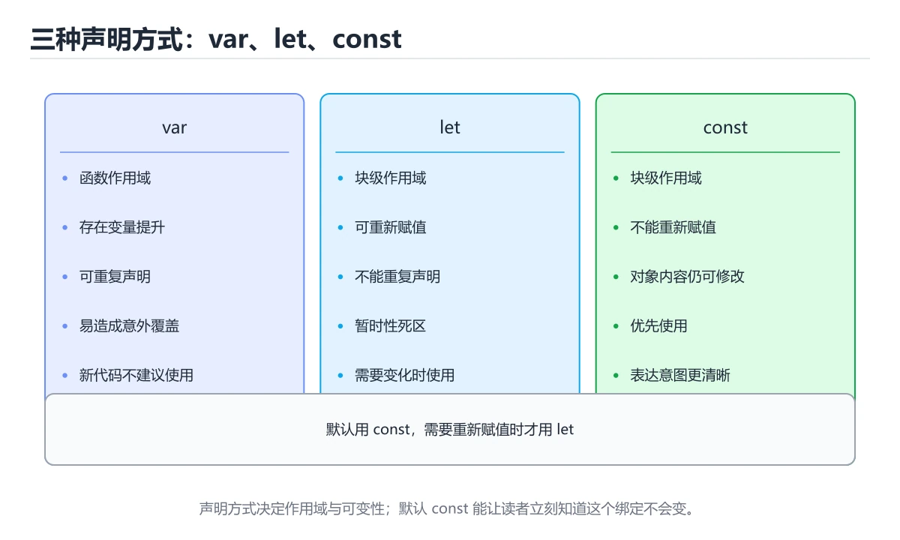
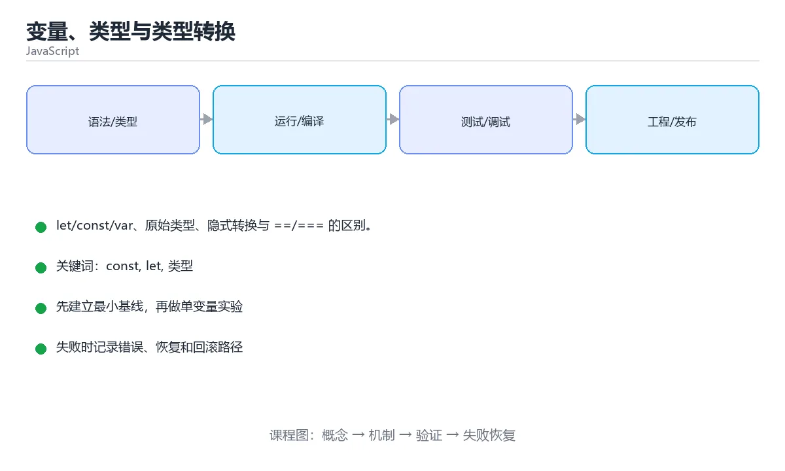

# 变量、类型与类型转换





> 内容更新时间：2026-10-06 · 学习阶段：基础 · 预计用时：35 分钟

## 本节知识框架

**课程定位**：所属分类 `javascript`（JavaScript），课程主题 `变量、类型与类型转换`，学习阶段 基础，建议用时 45 分钟。

本课主线：let/const/var、原始类型、隐式转换与 ==/=== 的区别。

**学完本课应当能够**
- 说清 `与` 与 `类型` 的含义与区别，并各举一个正例和一个反例。
- 用本课示例验证 `类型转换` 的行为，记录输入、输出与失败条件。
- 遇到「用 `==`」这类问题时，能说出触发条件与修复顺序。

### 复习清单

- [ ] 能不看正文复述本课核心术语，并指出一个边界或反例。
- [ ] 能运行或推演本课示例，记录输入、输出与失败现象。
- [ ] 能完成一次自测，并把错题对照错误表定位原因。

## 核心概念定义

| 术语 | 操作性定义 | 常见边界与风险 |
| --- | --- | --- |
| 隐式转换 | 三条铁律：**默认 const、比较用 ===、空值判断用 ?? 或 == null**。理解 `+` 与 `-` 的隐式转换差异，能解释多数「诡异」行为。 | `==` 会按类型规则改值，`'' == 0` 与 `null == undefined` 都是坑；从别的模块拿到值时先归一化再比较。 |
| 类型 | 值允许的表示、取值范围和可执行操作集合。 | 动态类型下类型只跟着值走，变量本身不带类型，同一变量先后放 `number` 和 `string` 都合法，分支要按当前值判断。 |
| 类型转换 | 把值按目标形态重新取一次：`Number('42')` 得 `42`，`'1' + 1` 得 `'11'`，`'1' - 1` 得 `0`。 | `+` 碰到字符串走拼接，`-`、`*`、`/` 一律先把操作数转成数字，混写时要先定结合顺序。 |
| null | null == undefined // true 规定如此。 | 易错：`null == undefined` 恒真，用 `== null` 判空会把从未赋值的 undefined 也当成 null；要严格区分两者只能靠 `===`。 |
| JavaScript | 动态类型、基于原型的脚本语言，标准名为 ECMAScript；既能跑在浏览器里操作页面，也能用 Node.js 跑在服务端。 | 易错：JavaScript 动态类型没有编译期类型检查，`let x;` 后直接 `x.toFixed(2)` 要到运行期才抛 `TypeError`，只能自行校验。 |
| typeof "a" | `"string"` | `typeof` 返回的是小写类型关键字字符串，原始值判定够用，但它认的是当前值的类型而非变量声明。 |
| typeof 1 | `"number"` | 整数和浮点都归 `number`，`typeof 1` 区分不了整数还是小数，精度仍受浮点规则限制。 |
| typeof 1n | `"bigint"` | 只有带 `n` 后缀才返回 `bigint`，它不在 `Number` 系列里，判断时别把它和 `number` 混为一类。 |
| typeof true | `"boolean"` | 原始布尔值才返回 `boolean`；条件里的真值不等于布尔类型，只有 `Boolean(x)` 转完才得到 `true` 或 `false`。 |
| typeof undefined | `"undefined"` | 未赋值、函数无返回、属性不存在都返回 `undefined`，只看 `typeof` 分不出究竟来自哪一种。 |
| typeof null | `"object"` | 历史遗留误报：判空要用 `x === null` 或 `== null`，靠 `typeof` 会把 `null` 当成对象放过。 |
| typeof [] | `"object"` | 数组也报 `object`，`typeof` 分不出数组和普通对象，要判定数组得改用 `Array.isArray`。 |
| typeof function(){} | `"function"` | 函数是唯一返回 `function` 而非 `object` 的类型，可据此先判断它能不能被调用再执行。 |
| typeof Symbol() | `"symbol"` | 它作为原始类型返回 `symbol`，和 `string` 不是一回事，判类型时别拿字符串的规则去套它。 |
| Number.isNaN(NaN) | `true` | `typeof NaN` 仍是 `number`，只有这个函数能把 `NaN` 单独挑出来，判非数别只靠 `typeof`。 |
| Array.isArray([]) | `true` | 分数组只能靠它；`typeof` 对数组返回 `object`，会把普通对象和数组混在一起。 |
| x instanceof Date | 布尔值 | 它沿原型链确认对象身份，对 `null` 或原始值没意义；数组和 `NaN` 还得回 `Array.isArray` 或 `Number.isNaN`。 |
| Number("12") | `12` | 整串能解析成数字才返回 `12`；空串也会变 `0` 而非报错，转换前要先校验输入非空。 |
| parseInt("12px", 10) | `12` | 显式传 `10` 才稳：它取前导数字丢掉 `px`，省掉进制参数时老浏览器可能把 `08` 当八进制。 |
| parseFloat("3.14abc") | `3.14` | 它只吃掉开头合法的数字段、丢弃 `abc`，小数只认第一个点，别指望解析带单位或千分位的串。 |
| String(12) | `"12"` | 结果 `"12"` 是字符串，后面再接 `+` 就走拼接，和 `"1" + 2` 得到 `"12"` 是同一个坑。 |
| Boolean("") | `false` | 空串是少数假值才返回 `false`；注意 `"0"`、`"false"` 这类非空字符串转换后仍是 `true`。 |
| Boolean("0") | `true` | 只要字符串非空就为真，内容写着 `"0"` 也一样；想按数值判真假得先 `Number()` 再比较。 |
| [1, 2] + "" | `"1,2"` | 数组和字符串相加会先 `toString` 成 `"1,2"`；要参与数值运算前必须显式转换，别让它悄悄变成拼接结果。 |
| 0.1 + 0.2 | `0.30000000000000004` | 浮点精度有限，`0.1 + 0.2` 实际得 `0.30000000000000004`，用 `===` 比 `0.3` 恒为 false，判等要改用误差比较。 |
| null == undefined | `true` | 宽松相等规定两者互等；用 `== null` 判空可同时覆盖 `null` 和 `undefined`，但 `0`、`""` 不会被算进来。 |
| null === undefined | `false` | 严格相等先比类型，两者类型不同所以 `false`；用 `===` 判空时得把 `null` 和 `undefined` 分开写。 |
| "5" - 1 | `4` | 减号强制把 `"5"` 转数字再算得 `4`，它不像 `+` 会走拼接，非数字串喂进来只会得 `NaN`。 |
| number | `1`、`3.14`、`NaN` | 整数和小数同属 `number`，精度有限导致 `0.1 + 0.2 !== 0.3`，金额要退回整数分处理。 |
| string | `"hi"`、`` `hi` `` | 单双引号和模板串都是 `string`，它一进 `+` 就触发拼接、把数字拉成文本，算术前别混进来。 |
| boolean | `true` / `false` | 只有这两个字面量；条件表达式会把非布尔值折成真假分支，判断前先确认值到底属于哪一类。 |
| undefined | `let x;` | 易错：`let x;` 后 `x` 是 undefined，用 `if (x)` 会把 `0`、`""` 也当成没值；判真正缺失要用 `x === undefined` 或 `typeof x`。 |
| null | `let y = null;` | 显式赋 `null` 表示故意留空，用逻辑或兜默认值会连 `0`、`""` 一起替换掉；只在 null/undefined 时兜底要用 `??`。 |
| symbol | `Symbol("id")` | 它有独立的 `typeof` 结果，每次 `Symbol()` 生成的是新值，判等时别把它当普通标签字符串比。 |
| bigint | `10n` | 字面量以 `n` 结尾才成立，超出 `number` 安全整数范围时才用它，别和 `number` 塞进同一个算术表达式。 |
| object | `{}`、`[]`、函数 | `typeof` 下数组也归 `object`（函数除外），比较看的是引用，`{ a: 1 } === { a: 1 }` 得到 `false`。 |
| 含义 | 还没有值 | `undefined` 只代表还没有值；空串和 `0` 是有效值，判缺失时别把它们一并当成 undefined 扔掉。 |
| 谁产生的 | JS 引擎自动 | 由引擎在 `let x;` 未赋值或函数无返回时自动给出，不是显式写的 `null`，判空要分清来源。 |
| 典型场景 | 未赋值、函数无返回、属性不存在 | 三种场景都给出 `undefined`；要区分"键不存在"还是"值就是 undefined"，得改用 `"name" in obj`。 |
| Number("12") | `12` | 它走显式数字转换，和 `+` 的隐式拼接不同；输入里只要掺了非数字字符结果就不是 `12`，别拿它代替校验。 |
| Number("") | `0` | 易错：`0`；正确做法是空输入要先校验，别直接转换。 |
| parseInt("12px") | `12` | 不写进制时它仍取前导数字得 `12`，但省略第二参在老环境有八进制隐患，稳妥写法是补上 `, 10`。 |
| String(12) | `"12"` | 它显式产出文本 `"12"`，效果和 `12 + ""` 接近；一旦进了字符串轨道，再想拿回数值必须重新转换。 |
| Boolean("") | `false` | 空串、`0`、`NaN` 这类才算假值；判字符串是否为空别借它，直接比长度更直白。 |
| Boolean("false") | `true` | 非空字符串一律为真，内容写着 `"false"` 也返回 `true`；表单传来的布尔文本必须自己解析，靠 `Boolean` 会反。 |
| "1" + 2 | `"12"` | 易错：`+` 只要有一边是字符串就走拼接，`"1" + 2` 得 `"12"` 而不是 3；想要求和得先 `Number("1")`。 |
| "3" * 2 | `6` | 乘号先把 `"3"` 转成数字得 `6`；它没有拼接分支，任何一边是非数字串就整体塌成 `NaN`。 |
| 用 == | 结果反直觉 | 宽松相等会隐式改值，`[] == false` 这类都成立；判空可留 `== null`，其余一律换成 `===`。 |
| 把 NaN 当相等 | `NaN === NaN` 是 false | 用 `===` 判 `NaN` 永远不成立，别写 `x === NaN`；要识别它得走 `Number.isNaN(x)`。 |
| 直接调 parseInt 忘传进制 | 老浏览器把 `08` 当八进制 | 省略第二参时 `08`、`09` 在老引擎可能按八进制解析；统一写 `parseInt(s, 10)` 才没有歧义。 |
| 数字精度 | `0.1 + 0.2 !== 0.3` | 多次浮点运算误差会累积，`number` 精度有限；比较要留误差、金额退回整数分，别直接 `===`。 |
| 字符串拼数字 | `"1" + 2` 得到 `"12"` | 字符串与数字用 `+` 混算会被拉成文本而非相加，参与计算前先 `Number()` 显式转成数字再运算。 |
| 判断属性是否存在 | `if (obj.name)` 漏掉 0 和 "" | 易错：`if (obj.name)` 漏掉 0 和 ""；正确做法是用 `"name" in obj` 或 `??`。 |
| 引用赋值当复制 | 改一处全变 | 易错：改一处全变；正确做法是用展开运算符浅拷贝。 |

## 原理与运行机制

### 机制总览

| 阶段 | 关注对象 | 失败时应检查 |
| --- | --- | --- |
| 输入 | 与 | 类型、范围、编码、版本或前置状态是否满足定义。 |
| 处理 | 类型 | 顺序、可见性、锁、路由、事务或调度规则是否被破坏。 |
| 输出 | 类型转换 | 结果是否可复现，错误是否被正确传播而不是被吞掉。 |

**教材衔接：版本与时效**

- 运行时要同时考虑浏览器基线与 Node LTS；const 的降级策略要写清楚。
- 升级前确认 const 的兼容范围，把不可回退的改动单独拆成一次提交。

## 典型应用场景

- **用 `==`**：典型现象是结果反直觉；正确做法是用 `===`。
- **把 `NaN` 当相等**：典型现象是`NaN === NaN` 是 false；正确做法是用 `Number.isNaN(x)`。
- **直接调 `parseInt` 忘传进制**：典型现象是老浏览器把 `08` 当八进制；正确做法是写 `parseInt(s, 10)`。
- **数字精度**：典型现象是`0.1 + 0.2 !== 0.3`；正确做法是用误差比较，金额用整数分。

### 最小验证场景

- 准备：保留 `javascript` 示例的原始输入，先记录 `变量、类型与类型转换` 的基线输出和完整运行命令。
- 观察：先核对 调用了 `Symbol()`，再改变一个与 `与` 相关的条件。
- 判定：新结果与 `变量、类型与类型转换` 的基线不同不等于错误；只有当差异破坏了 `与` 的定义或错误表中的约束，才判定为失败。

### 选择与边界

- 使用 `与` 时，三条铁律：**默认 const、比较用 ===、空值判断用 ?? 或 == null**。理解 `+` 与 `-` 的隐式转换差异，能解释多数「诡异」行为。
- 使用 `类型` 时，值允许的表示、取值范围和可执行操作集合。
- 使用 `类型转换` 时，Number('42'); // 42。
- 使用 `null` 时，null == undefined // true 规定如此；易错：空字符串或 0 被当成缺失；正确做法是明确判断：`obj.name !== undefined && obj.name !== null` 或 `obj.name ?? ""`。
- 使用 `JavaScript` 时，JavaScript 是动态类型、基于原型的脚本语言，标准名为 ECMAScript。它既能跑在浏览器里操作页面；静态检查只在编译期成立，运行期输入仍需校验。

## 代码/协议/SQL 示例

### 最小可验证示例

```javascript
const PI = 3.14;    // 常量，不能重新赋值（默认选择）
let count = 0;      // 块级作用域变量
var old = 1;        // 函数作用域 + 提升，旧代码才用

const user = { name: 'tom' };
user.name = 'alice';   // const 只限制重新赋值，不限制修改内容
```

**教材衔接：三种声明方式**

**教材衔接：判空与默认值**

```javascript
value ?? 'default';        // 只有 null/undefined 才用默认值
0 || 'default';            // 'default'：|| 会把 0 也当成假值
user?.address?.city;       // 可选链，中间为空返回 undefined
if (value == null) {}      // 同时判断 null 与 undefined
```

**运行方式**：运行 `变量、类型与类型转换` 的示例时，保存为 `.js` 后用 `node 文件名.js` 运行；涉及浏览器 API 的示例要放到页面里执行。

## 时间/空间复杂度或性能分析

**性能关注点（变量、类型与类型转换）**：事件循环与 DOM 操作是瓶颈来源：记录脚本执行时间、长任务与主线程阻塞时长。

**测量方法**：以 `变量、类型与类型转换` 的 `const` 场景为对象，固定输入跑一遍记录基线，再把规模或并发度提高一个数量级复测；两次结果的差值与波动范围才是结论依据。

## 常见误区与易错点

| 容易写错的做法 | 实际现象 | 原因与正确做法 |
| --- | --- | --- |
| 用 `==` | 结果反直觉 | 用 `===` |
| 把 `NaN` 当相等 | `NaN === NaN` 是 false | 用 `Number.isNaN(x)` |
| 直接调 `parseInt` 忘传进制 | 老浏览器把 `08` 当八进制 | 写 `parseInt(s, 10)` |
| 数字精度 | `0.1 + 0.2 !== 0.3` | 用误差比较，金额用整数分 |
| 字符串拼数字 | `"1" + 2` 得到 `"12"` | 先 `Number()` 转 |
| 判断属性是否存在 | `if (obj.name)` 漏掉 0 和 "" | 用 `"name" in obj` 或 `??` |
| 引用赋值当复制 | 改一处全变 | 用展开运算符浅拷贝 |
| `if (obj.name)` | 空字符串或 0 被当成缺失 | 明确判断：`obj.name !== undefined && obj.name !== null` 或 `obj.name ?? ""` |
| `const obj = {}; obj.a = 1` | 正常，能改属性 | `const` 只锁变量绑定，不改对象内容；要冻结用 `Object.freeze(obj)` |
| `{ a: 1 } === { a: 1 }` | `false` | 对象比较的是引用；比较内容要逐字段或用深比较函数 |
| `JSON.parse(undefined)` | `SyntaxError` | 先判断空值：`text ? JSON.parse(text) : null` |
| `Number("")` | `0` | 空输入要先校验，别直接转换 |
| `[] == false` | `true` | 宽松相等会做隐式转换，规则复杂，统一用 `===` |
| `let x; x.toFixed(2)` | `TypeError` | `let` 声明未赋值是 `undefined`，先赋数字 |
| 用 `==` 比较 `null` 与 `0` | `false`，但 `0 == ""` 是 `true` | 宽松相等陷阱多，直接上 `===` |
| if (obj.name) | 空字符串或 0 被当成缺失。 | 明确判断：obj.name !== undefined && obj.name !== null 或 obj.name ?? ""。 |
| const obj = {}; obj.a = 1 | 正常，能改属性。 | const 只锁变量绑定，不改对象内容；要冻结用 Object.freeze(obj)。 |
| JSON.parse(undefined) | SyntaxError。 | 先判断空值：text ? JSON.parse(text) : null。 |

### 现场 1：用 `==`

**症状**：结果反直觉。

**根因与修复**：用 `===`。

**自检**：在本课示例里复现「用 `==`」，改成用 `===`后重跑；如果症状消失且失败路径按预期变化，说明定位正确。

### 现场 2：把 `NaN` 当相等

**症状**：`NaN === NaN` 是 false。

**根因与修复**：用 `Number.isNaN(x)`。

**自检**：在本课示例里复现「把 `NaN` 当相等」，改成用 `Number.isNaN(x)`后重跑；如果症状消失且失败路径按预期变化，说明定位正确。

### 现场 3：直接调 `parseInt` 忘传进制

**症状**：老浏览器把 `08` 当八进制。

**根因与修复**：写 `parseInt(s, 10)`。

**自检**：在本课示例里复现「直接调 `parseInt` 忘传进制」，改成写 `parseInt(s, 10)`后重跑；如果症状消失且失败路径按预期变化，说明定位正确。

### 现场 4：数字精度

**症状**：`0.1 + 0.2 !== 0.3`。

**根因与修复**：用误差比较，金额用整数分。

**自检**：在本课示例里复现「数字精度」，改成用误差比较，金额用整数分后重跑；如果症状消失且失败路径按预期变化，说明定位正确。

### 现场 5：字符串拼数字

**症状**：`"1" + 2` 得到 `"12"`。

**根因与修复**：先 `Number()` 转。

**自检**：在本课示例里复现「字符串拼数字」，改成先 `Number()` 转后重跑；如果症状消失且失败路径按预期变化，说明定位正确。

### 现场 6：判断属性是否存在

**症状**：`if (obj.name)` 漏掉 0 和 ""。

**根因与修复**：用 `"name" in obj` 或 `??`。

**自检**：在本课示例里复现「判断属性是否存在」，改成用 `"name" in obj` 或 `??`后重跑；如果症状消失且失败路径按预期变化，说明定位正确。

### 现场 7：引用赋值当复制

**症状**：改一处全变。

**根因与修复**：用展开运算符浅拷贝。

**自检**：在本课示例里复现「引用赋值当复制」，改成用展开运算符浅拷贝后重跑；如果症状消失且失败路径按预期变化，说明定位正确。

### 现场 8：`if (obj.name)`

**症状**：空字符串或 0 被当成缺失。

**根因与修复**：明确判断：`obj.name !== undefined && obj.name !== null` 或 `obj.name ?? ""`。

**自检**：在本课示例里复现「`if (obj.name)`」，改成明确判断：`obj.name !== undefined && obj.name !== null` 或 `obj.name ?? ""`后重跑；如果症状消失且失败路径按预期变化，说明定位正确。

### 现场 9：`const obj = {}; obj.a = 1`

**症状**：正常，能改属性。

**根因与修复**：`const` 只锁变量绑定，不改对象内容；要冻结用 `Object.freeze(obj)`。

**自检**：在本课示例里复现「`const obj = {}; obj.a = 1`」，改成`const` 只锁变量绑定，不改对象内容；要冻结用 `Object.freeze(obj)`后重跑；如果症状消失且失败路径按预期变化，说明定位正确。

## 与其他知识点的关系

- **先修**：`JavaScript 与运行环境`。本课默认这些内容已经掌握。
- **相关或后续**：`运算符与控制流`。本课术语会在这些课程里继续使用。
- **术语归属**：`与`、`类型`、`类型转换` 的定义以本课「核心概念定义」为准，换到其他课程时先确认定义是否被改写。

## 自测题与参考答案

> 先独立作答，再对照参考答案；答案都能在本课正文、术语表或错误表里找到依据。

### 自测 1（概念复述）

不看正文，写出 `与` 的操作性定义，并说明它与 `类型` 的区别。

**参考答案**：三条铁律：**默认 const、比较用 ===、空值判断用 ?? 或 == null**。理解 `+` 与 `-` 的隐式转换差异，能解释多数「诡异」行为。

`类型` 的定位是：值允许的表示、取值范围和可执行操作集合；两者的差别要从适用对象与失败模式上说明。

### 自测 2（排错）

本课错误表记录了「用 `==`」这类做法。请写出它会出现的现象、根因，以及修复顺序。

**参考答案**：现象是结果反直觉；正确做法是用 `===`。修复时先复现现象并保留证据，再改动一处假设重跑，确认现象消失。

### 自测 3（动手验证）

运行本课的 `javascript` 示例，把其中的 `'text'` 换成一个边界值后重新运行，记录输出与错误信息。

**参考答案**：正常输入下 `javascript` 示例应当复现正文给出的结果；把 `'text'` 换成边界值后，如果结果改变或报错，先核对它是否满足 `变量、类型与类型转换` 中`与` 的适用范围，再检查错误表里是否有同类现象。

### 自测 4（代码阅读）

阅读本课开头的 `javascript` 示例，说明它体现了`与` 的哪一条性质，并指出改动哪个输入会让这条性质不再成立。

**参考答案**：`与` 的定义是 三条铁律：**默认 const、比较用 ===、空值判断用 ?? 或 == null**，理解 `+` 与 `-` 的隐式转换差异，能解释多数「诡异」行为，示例正是在实现这条定义。改动与 `与` 有关的一个输入后，如果结果不再符合 `变量、类型与类型转换` 的正文描述，就说明该性质只在当前前提成立。

### 自测 5（迁移）

把 `变量、类型与类型转换` 的方法迁移到自己的项目：围绕 `与` 写出一个与错误表同类的风险点，并说明触发条件和检验方式。

**参考答案**：例如「JSON.parse(undefined)」，它会导致SyntaxError；检验方式是按先判断空值：text ? JSON.parse(text) : null改一处再复现，确认现象消失且没有引入新的失败分支。

### 自测 6（对比）

用一个表格对比 `与` 与 `类型`：各写一行适用场景、一行失败表现。

**参考答案**：`与` 的定义是三条铁律：**默认 const、比较用 ===、空值判断用 ?? 或 == null**。理解 `+` 与 `-` 的隐式转换差异，能解释多数「诡异」行为；`类型` 的定义是值允许的表示、取值范围和可执行操作集合。两者的失败表现分别对应本课错误表里与本术语相关的行。

### 自测 7（排错顺序）

面对「用 `==`」引发的问题，请把“复现 结果反直觉 → 保留证据 → 用 `===` → 回归验证”四步写成可执行的检查清单。

**参考答案**：第一步按结果反直觉复现；第二步记录输入、版本与完整报错；第三步按用 `===`只改一处；第四步重跑并确认失败路径也按预期变化。

### 自测 8（边界判断）

针对 `JavaScript`，分别写出“可以使用”的条件和“结论不再成立”的条件。

**参考答案**：静态检查只在编译期成立，运行期输入仍需校验。 同时要把 `JavaScript` 的定义 JavaScript 是动态类型、基于原型的脚本语言，标准名为 ECMAScript。它既能跑在浏览器里操作页面 与实际输入逐项对照。

### 自测 9（机制重建）

不看正文，按输入、转换、输出、验证四段重建 `与` → `类型` → `类型转换` → `null` 的作用链。

**参考答案**：起点是 `与` 的定义 三条铁律：**默认 const、比较用 ===、空值判断用 ?? 或 == null**。理解 `+` 与 `-` 的隐式转换差异，能解释多数「诡异」行为；中间每一步都保留可观察状态；终点由 `JavaScript` 检查，失败时回到错误表定位第一个偏离定义的步骤。

### 自测 10（综合排错）

在 `变量、类型与类型转换` 中，现象是 SyntaxError。请围绕 JSON.parse(undefined) 写出最小复现、关键证据、修复动作和回归验证，并说明为什么不能只凭一次运行下结论。

**参考答案**：先复现 JSON.parse(undefined)，记录输入与完整错误；再按 先判断空值：text ? JSON.parse(text) : null 只改一处。回归时同时跑正常路径和边界路径，只有两次结果都可解释，才把修复视为完成。

### 自测 11（一分钟复述）

用每分钟约 200 字的速度复述 `变量、类型与类型转换`：先给主问题，再按顺序说出 `与`、`类型`、`类型转换`、`null`，最后给一个失败案例。

**自评标准**：主问题必须对应 let/const/var、原始类型、隐式转换与 ==/=== 的区别；每个术语都要能接上一句定义或边界；失败案例必须写成可观察现象，不能用“可能有风险”代替证据。

## 术语速查

| 术语 | 一句话说明 |
| --- | --- |
| `与` | 三条铁律：**默认 const、比较用 ===、空值判断用 ?? 或 == null**。理解 `+` 与 `-` 的隐式转换差异，能解释多数「诡异」行为。 |
| `类型` | 值允许的表示、取值范围和可执行操作集合。 |
| `类型转换` | Number('42'); // 42。 |
| `null` | null == undefined // true 规定如此。 |
| `JavaScript` | JavaScript 是动态类型、基于原型的脚本语言，标准名为 ECMAScript。它既能跑在浏览器里操作页面。 |

**术语关系**：`与`（三条铁律：**默认 const、比较用 ===、空值判断用 ?? 或 == null**） → `类型`（值允许的表示、取值范围和可执行操作集合） → `类型转换`（Number('42'); // 42） → `null`（null == undefined // true 规定如此）。

## 考点精讲

`变量、类型与类型转换` 的题库有 6 道题，下面逐题给出题干、正确项与判断依据：先自己作答，再核对正确项，最后回到正文对应小节复核。

### 考点 1：第 1 题

- **题目**：const 声明的对象，能否修改它的属性？
- **正确项**：可以，const 只禁止重新赋值
- **判断依据**：本题正确项是「可以，const 只禁止重新赋值」。术语 与（变量、类型与类型转换）：三条铁律：**默认 const、比较用 ===、空值判断用 ?? 或 == null**，理解 `+` 与 `-` 的隐式转换差异，能解释多数「诡异」行为，本题取「可以，const 只禁止重新赋值」这条。易错点是用 `==`，会造成结果反直觉，改法是用 `===`。

### 考点 2：第 2 题

- **题目**：在 JavaScript 中，表达式 1 === '1' 的求值结果是什么？
- **正确项**：false
- **判断依据**：本题正确项是「false」。术语 与（变量、类型与类型转换）：三条铁律：**默认 const、比较用 ===、空值判断用 ?? 或 == null**，理解 `+` 与 `-` 的隐式转换差异，能解释多数「诡异」行为，本题取「false」这条。易错点是把 `NaN` 当相等，会造成`NaN === NaN` 是 false，改法是用 `Number.isNaN(x)`。

### 考点 3：第 3 题

- **题目**：代码语言为 `javascript`，选自 `变量、类型与类型转换` 的 `与` 部分。课程问题为let/const/var、原始类型、隐式转换与 ==/=== 的区别。哪一项描述与代码一致？
- **正确项**：调用了 `console.log()`
- **判断依据**：本题正确项是「调用了 `console.log()`」。术语 与（变量、类型与类型转换）：三条铁律：**默认 const、比较用 ===、空值判断用 ?? 或 == null**，理解 `+` 与 `-` 的隐式转换差异，能解释多数「诡异」行为，本题取「调用了 `console.log()`」这条。易错点是直接调 `parseInt` 忘传进制，会造成老浏览器把 `08` 当八进制，改法是写 `parseInt(s, 10)`。本题干扰项「调用了 `emplace()`」不成立：展示代码里找不到 `emplace()`。

### 考点 4：第 4 题

- **题目**：typeof null 的结果是？
- **正确项**：'object'
- **判断依据**：本题正确项是「'object'」。术语 null（变量、类型与类型转换）：null == undefined // true 规定如此，本题取「'object'」这条。易错点是数字精度，改法是用误差比较，金额用整数分。易错点是字符串拼数字，会造成`"1" + 2` 得到 `"12"`，改法是先 `Number()` 转。

### 考点 5：第 5 题

- **题目**：下列哪些属于 JavaScript 的原始类型？请选择所有正确答案。
- **正确项**：string；number；symbol
- **判断依据**：按《变量、类型与类型转换》的正文口径，本题要同时选中「string」、「number」、「symbol」，漏掉任一项都算没答全。术语 类型（变量、类型与类型转换）：值允许的表示、取值范围和可执行操作集合。易错点是字符串拼数字，会造成`"1" + 2` 得到 `"12"`，改法是先 `Number()` 转。

### 考点 6：第 6 题

- **题目**：下面几项都与 `与` 有关，请按 `变量、类型与类型转换` 的正文顺序排列；该课主线是let/const/var、原始类型、隐式转换与 ==/=== 的区别。
- **正确项**：三种声明方式 → 数据类型 → 类型转换 → 判空与默认值
- **判断依据**：按《变量、类型与类型转换》正文的先后，本题顺序是「三种声明方式」 → 「数据类型」 → 「类型转换」 → 「判空与默认值」。术语 与（变量、类型与类型转换）：三条铁律：**默认 const、比较用 ===、空值判断用 ?? 或 == null**，理解 `+` 与 `-` 的隐式转换差异，能解释多数「诡异」行为。易错点是用 `==`会造成结果反直觉，改法是用 `===`。

### 考点 7：`与`

- **要点**：三条铁律：**默认 const、比较用 ===、空值判断用 ?? 或 == null**。理解 `+` 与 `-` 的隐式转换差异，能解释多数「诡异」行为。

### 考点 8：`类型`

- **要点**：值允许的表示、取值范围和可执行操作集合。

### 考点 9：`类型转换`

- **要点**：Number('42'); // 42。

### 考点 10：`null`

- **要点**：null == undefined // true 规定如此。
- **null 的边界**：易错：空字符串或 0 被当成缺失；正确做法是明确判断：`obj.name !== undefined && obj.name !== null` 或 `obj.name ?? ""`。

### 考点 11：`JavaScript`

- **要点**：JavaScript 是动态类型、基于原型的脚本语言，标准名为 ECMAScript。它既能跑在浏览器里操作页面
- **JavaScript 的边界**：静态检查只在编译期成立，运行期输入仍需校验。

### 考点 12：排错——用 `==`

- **现象**：结果反直觉。
- **处理**：用 `===`。

### 考点 13：排错——把 `NaN` 当相等

- **现象**：`NaN === NaN` 是 false。
- **处理**：用 `Number.isNaN(x)`。

### 考点 14：综合辨析——`与` 与 `JavaScript`

- **辨析点**：`与` 的定义是 三条铁律：**默认 const、比较用 ===、空值判断用 ?? 或 == null**。理解 `+` 与 `-` 的隐式转换差异，能解释多数「诡异」行为；`JavaScript` 的定义是 JavaScript 是动态类型、基于原型的脚本语言，标准名为 ECMAScript。它既能跑在浏览器里操作页面。
- **答题要求**：面对 `变量、类型与类型转换` 的题目，先判断描述的是 `与` 还是 `JavaScript`，再归到对应定义，最后写出一个会让该定义失效的边界输入。

### 考点 15：排错评分点

- **现象分**：能写出 结果反直觉，而不是只写“程序有错”。
- **证据分**：保留触发 用 `==` 的输入、版本和错误原文。
- **修复分**：按 用 `===` 只改一处，并同时回归正常路径与边界路径。

## 内容元数据

- 内容版本：v2.0
- 最后更新：2026-10-06
- 学习阶段：基础
- 适用环境：Node.js 22+ / 现代浏览器
；本课聚焦 const。
- 内容来源：内置结构化课程与工程实践整理
- 相关主题：const、let、类型、类型转换、===、null
- 质量版本：P0 测验标准 + P1 覆盖扩展 + P2 体验补全

## 参考资料与复核

- 最后复核：2026-10-04
- 下次复核：2027-05-17
- 复核范围：版本兼容、API 行为、安全建议与工程实践
- 来源性质：官方文档、标准或权威教材；本课核对关键词：const、let、类型、类型转换、===、null。

| 参考资料 | 本课用途 |
| --- | --- |
| [MDN JavaScript 指南](https://developer.mozilla.org/docs/Web/JavaScript/Guide) | 语言基础与浏览器 API |
| [MDN Fetch API](https://developer.mozilla.org/docs/Web/API/Fetch_API) | 网络请求与响应处理 |
| [MDN Promise](https://developer.mozilla.org/docs/Web/JavaScript/Reference/Global_Objects/Promise) | Promise 与异步链 |

| [本课术语索引：变量、类型与类型转换](#核心概念定义) | 按本课输入、术语边界和错误表现逐项核对 |
> 「变量、类型与类型转换」的链接用于离线阅读后的延伸核对；App 不会自动联网。