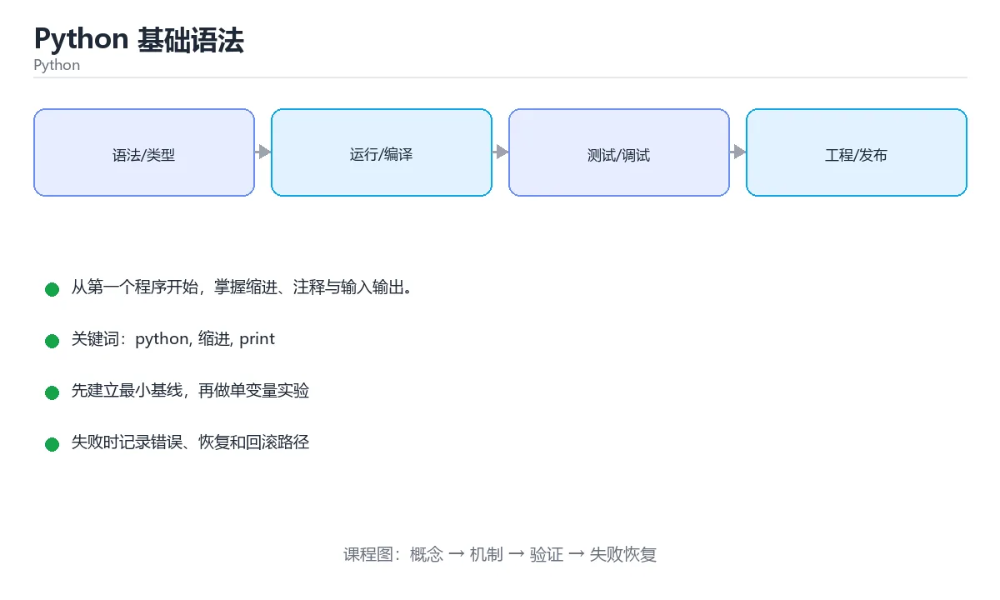

# Python 基础语法

> 内容更新时间：2026-10-06 · 学习阶段：基础 · 预计用时：65 分钟



> 从第一行代码开始，搞懂缩进、注释、运算符和表达式——写给完全零基础的你。

## 本节知识框架

在学 Python 之前，先看看这节课会覆盖哪些内容，以及它们之间的关系：

```text
Python 基础语法
├── 缩进规则 ──── Python 用缩进来划分代码块（不像其他语言用大括号）
├── 注释 ──────── 写给人看的说明，电脑会跳过
├── 运算符 ────── 加、减、乘、除、比较……对数据做运算的符号
├── 表达式 ────── 能算出一个值的一段代码
├── 语句 ──────── 电脑执行的一个完整动作
└── 输入输出 ──── print() 和 input()，和使用者交互的基本工具
```

你可以把 Python 想象成一本「写给电脑的菜谱」：你写一行，电脑就照着做一步。而这节课要学的，就是这本菜谱最基本的书写格式。

## 核心概念定义

先把最重要的几个术语搞清楚，后面学什么都围绕它们展开。

**缩进（Indentation）**
Python 用行首的空格数量来表示代码的层级关系。就像写信时每个段落开头要空两格一样，Python 里同一个代码块的每一行必须缩进相同数量的空格。官方推荐用 **4 个空格**，千万不要混用 Tab 和空格。

**注释（Comment）**
用 `#` 开头的文字，Python 会完全忽略它。注释就像贴在代码旁边的便条——写给你自己或者别的程序员看的，电脑根本不理它。

**运算符（Operator）**
对数据进行操作的符号。比如 `+` 是加法，`-` 是减法，`==` 是判断是否相等。你可以把运算符想象成厨房里的工具：刀用来切菜，锅用来炒菜，不同的工具做不同的事。

**表达式（Expression）**
一段能「算出结果」的代码。比如 `1 + 2` 是一个表达式，它的结果是 `3`；`"hello" + " world"` 也是表达式，结果是 `"hello world"`。表达式的核心特征：**它一定会产出一个值**。

**语句（Statement）**
电脑执行的某个完整动作。比如 `x = 10` 是一条赋值语句，`print("你好")` 是一条输出语句。语句不一定产出值，但它一定会「做某件事」。

**语句 vs 表达式的区别**：表达式产出值，语句执行动作。`x + 1` 是表达式（产出 x 加 1 的结果），`x = x + 1` 是语句（把结果赋值给 x）。你可以这样记：表达式可以放在等号右边，语句不行。

## 原理与运行机制

### Python 是怎么运行你的代码的？

Python 是一门**解释型语言**。这意味着你写的代码不需要事先编译成机器码，而是由 Python 解释器逐行读取、逐行执行。就像翻译官一边听你说话一边翻译，而不是等你说完一整篇再翻译。

运行流程很简单：

```text
你写的代码 (.py 文件)
    ↓
Python 解释器逐行读取
    ↓
遇到 print() → 输出到屏幕
遇到 input() → 等待用户输入
遇到运算     → 算出结果
遇到错误     → 停下来并报告
```

### 缩进为什么这么重要？

在 C、Java 这些语言里，代码块用大括号 `{}` 括起来，缩进只是为了好看。但 Python 不一样——**缩进本身就是语法**。少一个空格或多一个空格，程序的含义可能就完全不同，甚至直接报错。

想象你在读一本书：

```text
第一章
  第一节
    内容 A
    内容 B
  第二节
    内容 C
```

你一看缩进就知道「内容 A 和内容 B 属于第一节」。Python 也是这样理解代码的。

### 运算符的优先级

和数学里一样，Python 的运算符也有优先级：

| 优先级（从高到低） | 运算符 | 含义 |
| --- | --- | --- |
| 1 | `**` | 幂运算 |
| 2 | `*`, `/`, `//`, `%` | 乘、除、整除、取余 |
| 3 | `+`, `-` | 加、减 |
| 4 | `==`, `!=`, `<`, `>` | 比较运算 |
| 5 | `and`, `or`, `not` | 逻辑运算 |

拿不准的时候，加括号最保险：`(1 + 2) * 3` 永远比 `1 + 2 * 3` 清楚。

### 一条语句从源码走到屏幕要几步

「解释型语言」不等于「完全不编译」。Python 先对源码做一次语法检查，把它变成中间代码（字节码），之后才逐条执行。这个先后顺序解释了两类报错为什么出现的时间点不同：

```text
括号少一半、用了中文标点   → 语法检查阶段就失败，报 SyntaxError
类型对不上、名字还没出现   → 已经跑到那一行了才失败，报 TypeError 或 NameError
```

`print("hello"` 少一个右括号，你连第 2 行都执行不到；而 `print("18" + 1)` 语法完全合规，程序会跑到这一行才把 `TypeError` 抛出来。写代码时报错信息里的「行号」指的是解释器认为问题暴露的位置，不一定是你真正打错字的位置——少写的括号经常把报错推到下一行。

### 可变与不可变：为什么 tuple 能当键而 list 不能

Python 的类型可以粗略分成两栏：

```text
不可变：int、float、bool、str、tuple、bytes    ← 创建之后内容改不了
可变  ：list、dict、set                        ← 可以原地增删改
```

不可变的值可以被哈希，所以能放进集合、能当字典的键；把 list 当键会得到 `TypeError: unhashable type: 'list'`：

```python
points = {}
points[(1, 2)] = "左上"      # tuple 当键，合法
points[[1, 2]] = "左下"      # TypeError: unhashable type: 'list'
```

要分清「值不能改」和「名字不能换」：`a = 10` 之后再写 `a = 20` 完全合法，只是 `a` 这个标签被撕下来贴到了另一个整数对象上。`int`、`str`、`tuple` 都属于前者那种「对象本身不能改」的类型，这也是第 5、6 两道题会反复考的地方。

### 缩进报错的四种现场

同一个 `IndentationError` 家族，报错文字其实分好几种，认得出第一行就能直接定位问题：

```python
if True:
print("没缩进")         # expected an indented block

if True:
    print("a")
   print("b")           # 同一代码块里空格数不一致

if True:
    print("a")
     print("b")         # unexpected indent，多缩了一格

if True:
        print("a")      # 能跑，但 8 格与下一层级的对齐关系一团乱
```

编辑器把 Tab 显示成 4 格宽，看起来和空格一模一样，Python 却把它们当成两种东西分别计数——这就是「肉眼看不出问题、报错偏指着缩进」的根源。

### print() 还有两个参数值得现在记住

```python
print("a", "b", "c", sep="-", end="!\n")    # 输出 a-b-c!
print("我想接着同一行写", end="")            # 光标停在这行末尾
```

`sep` 决定多个参数之间插什么（默认一个空格），`end` 决定结尾插什么（默认换行）。表格状输出、单行进度提示都会用到它们，比手动拼 `' - '` 清楚。

### 转换失败有两种报错，别混着记

```python
int("")        # ValueError：字符串本身不是数字的样子
"18" + 1       # TypeError：str 和 int 不能相加
```

`TypeError` 说的是「这两个类型不能一起做这件事」，`ValueError` 说的是「类型对了，但内容不对」。分清之后，修法也不同：前者要么转类型要么改成拼接，后者要么加判断要么用 `try/except` 接住。

## 典型应用场景

**场景 1：写第一个程序**
每个程序员的起点都是 `print("Hello, World!")`。这行代码做的事情很简单：把括号里的文字显示到屏幕上。

**场景 2：和用户交互**
用 `input()` 问用户一个问题，用 `print()` 把结果反馈回去。比如一个计算年龄的小工具：

```python
name = input("你叫什么名字？")
print("你好，" + name + "！")
```

**场景 3：做数学计算**
Python 可以当计算器用，而且比手机计算器更灵活：

```python
price = 99
count = 3
total = price * count
print(f"总价：{total} 元")
```

**场景 4：给代码写说明**
代码写完过一个月，你可能自己都看不懂了。注释就是给未来的自己留便条：

```python
# 计算折扣价：原价打八折
discount_price = original_price * 0.8
```

**场景 5：先把「输入、输出、约束」写清楚再动手**

一个查岁数的小程序，动笔前把三件事说明白：输入只能是 1900 到 2026 之间的整数；输出一句带岁数的问候；约束是空输入、汉字、带小数点的内容都要被接住，而不是让程序崩掉。

```python
name = input("请输入你的名字：").strip()
year_text = input("请输入出生年份：").strip()

if not year_text.isdigit():
    print("年份请写成 1900 到 2026 之间的数字。")
else:
    year = int(year_text)
    if 1900 <= year <= 2026:
        print(f"你好，{name}！你大约 {2026 - year} 岁")
    else:
        print(f"{year} 不在允许范围内。")
```

拿 `2000`、`2050`、`二零二零` 各跑一次。三次输入之间**只有年份这一个变量在变**，报错或分支的变化才说得清是谁引起的。

**场景 6：用注释做临时开关**

调试时想暂时关掉一段逻辑，与其删掉再凭记忆恢复，不如整段注释；同时在注释里写清「为什么关」和「什么时候恢复」，否则一周后谁也不知道这段代码为什么被埋了。

```python
# 2026-10 调试：先跳过发送步骤，只看拼接结果；恢复时删掉这三行
# with open("outbox.txt", "a", encoding="utf-8") as f:
#     f.write(message)
print(message)
```

## 代码/协议/SQL 示例

### 示例 1：最简单的 Python 程序

```python
# 第一个 Python 程序
print("Hello, World!")
```

就这一行代码（不算注释），完成了你的第一个程序。`print()` 是一个内置函数，负责把内容输出到屏幕。

### 示例 2：和用户打招呼

```python
# 读取用户输入并打招呼
name = input("请输入你的名字：")
print(f"你好，{name}！")
```

这里出现了两个新概念：
- `input()` 会暂停程序，等用户输入内容并按回车，然后把输入的内容作为字符串返回。
- `f"你好，{name}！"` 是 f-string 格式化字符串，`{name}` 会被替换成变量 `name` 的值。

### 示例 3：缩进的作用

```python
score = 85

if score >= 60:
    print("及格")       # 缩进 4 个空格 → 属于 if 分支
else:
    print("不及格")     # 缩进 4 个空格 → 属于 else 分支

print("程序结束")       # 没有缩进 → 无论条件如何都会执行
```

注意看缩进：`print("及格")` 前面有 4 个空格，说明它属于 `if` 分支。`print("程序结束")` 没有缩进，说明它不在任何分支里，一定会执行。

### 示例 4：运算符和表达式

```python
# 算术运算
a = 10
b = 3
print(a + b)     # 加法：13
print(a - b)     # 减法：7
print(a * b)     # 乘法：30
print(a / b)     # 除法：3.333...（结果是浮点数）
print(a // b)    # 整除：3（只取整数部分）
print(a % b)     # 取余：1（10 除以 3 余 1）
print(a ** b)    # 幂运算：1000（10 的 3 次方）

# 比较运算（结果是 True 或 False）
print(a > b)     # True
print(a == b)    # False
print(a != b)    # True

# 逻辑运算
x = True
y = False
print(x and y)   # False（两个都为 True 才是 True）
print(x or y)    # True（至少一个为 True 就是 True）
print(not x)     # False（取反）
```

### 示例 5：input() 的陷阱——类型转换

```python
# 错误示范：input() 返回的永远是字符串
age_text = input("请输入年龄：")
# 如果用户输入 18，age_text 的值是 "18"（字符串），不是 18（数字）

# 直接做算术会报错：
# age_text + 1  →  TypeError!

# 正确做法：先转换成数字
age = int(age_text)    # 把字符串 "18" 转成数字 18
print(f"明年你 {age + 1} 岁")
```

这是一个新手必踩的坑：`input()` 拿回来的东西**永远是字符串**，想做数学运算必须先用 `int()` 或 `float()` 转换。

### 示例 6：语句 vs 表达式

```python
# 表达式：能算出一个值
1 + 2              # 表达式，值为 3
len("hello")       # 表达式，值为 5
x > 10             # 表达式，值为 True 或 False

# 语句：执行一个动作
x = 10             # 赋值语句
print("你好")      # 输出语句
if x > 5:          # 条件语句
    pass
```

### 示例 7：综合练习——问候小程序

```python
# 问用户姓名和出生年份，输出问候语
name = input("请输入你的名字：").strip()
year_text = input("请输入出生年份（如 2000）：").strip()

if not year_text.isdigit():
    print("年份只能是数字哦！")
else:
    age = 2026 - int(year_text)
    print(f"你好，{name}，你大约 {age} 岁")
```

逐行解释：
- `.strip()` 去掉用户不小心输入的首尾空格。
- `.isdigit()` 检查字符串是否全是数字，防止程序崩溃。
- `int(year_text)` 把字符串转成整数，才能做减法。
- f-string 把变量直接嵌入字符串，比用 `+` 拼接清晰得多。

### 示例 8：最小可跑——先跑通，并留下版本证据

```python
age_text = input("请输入年龄：")
age = int(age_text)
print(f"明年你 {age + 1} 岁")
```

```bash
python3 --version      # 先记录解释器版本，例如 Python 3.12.4
python3 age.py
```

一次正常运行的样子：

```text
请输入年龄：18
明年你 19 岁
```

这一步只确认「基线」：给定合法输入，输出与预期一致。基线没核对就往下改，出问题时你无法判断是改动引入的还是原本就有的。

### 示例 9：完整——把三条失败路径接在一起

```python
def read_age(text):
    text = text.strip()
    if not text.lstrip("-").isdigit():
        raise ValueError("年龄只能是数字")
    age = int(text)
    if not 0 <= age <= 120:
        raise ValueError("年龄超出合理范围")
    return age

for sample in ["18", "18.5", "十八", " 20 ", "-3"]:
    try:
        print(f"{sample!r} -> {read_age(sample)} 岁")
    except ValueError as error:
        print(f"{sample!r} -> 失败：{error}")
```

预期输出：

```text
'18' -> 18 岁
'18.5' -> 失败：年龄只能是数字
'十八' -> 失败：年龄只能是数字
' 20 ' -> 20 岁
'-3' -> 失败：年龄超出合理范围
```

这里第一次用到 `def`（定义函数，函数体靠缩进划范围）和 `try/except`（把可能失败的代码圈起来，失败时走另一条路）。`sample!r` 会带上引号打印原样，方便看出空串、空格这些看不见的差异。

### 示例 10：练习——亲手验证可变与不可变

```python
a = (1, 2, 3)          # tuple：不可变
b = [1, 2, 3]          # list：可变

b.append(4)
print(b)               # [1, 2, 3, 4]

a += (4,)              # 这不是「改内容」，是重新生成一个新 tuple 再贴标签
print(a)               # (1, 2, 3, 4)

a[0] = 9               # TypeError: 'tuple' object does not support item assignment
```

自己动手改一遍：把 `a` 换成列表，最后一行还能不能跑？把 `a += (4,)` 换成 `a[0] = 9`，报错信息变成什么？只改一处、记录报错第一行的原文，这份记录以后可以直接拿去和同学的机器对比。

## 时间/空间复杂度或性能分析

Python 基础语法的各项操作在性能上几乎不需要担心：

| 操作 | 时间复杂度 | 说明 |
| --- | --- | --- |
| `print()` 输出 | O(n) | n 是输出内容的长度 |
| `input()` 读取 | O(n) | n 是用户输入的长度 |
| 算术运算 | O(1) | 普通整数运算可以看作常数时间 |
| 字符串拼接 | O(n+m) | n 和 m 是两个字符串的长度 |
| 类型转换 `int()` | O(n) | n 是字符串长度 |

对于初学者来说，记住一点就行：**基础操作都很快，不用担心性能问题**。等你写到需要处理百万级数据的时候，再考虑优化也不迟。

### 两种拼接的代价差别

`str` 不可变，这个语言规则同时也决定了它的性能脾气：

| 写法 | 每轮实际发生的事 | 一万轮之后的感受 |
| --- | --- | --- |
| `result += "字"` | 复制出一条更长的新字符串 | 越写越慢，因为每轮都要搬一次全部内容 |
| `parts.append("字")` | 往列表尾部放一个元素 | 每轮代价基本不变，最后 `"".join(parts)` 一次成型 |

同理，`tuple` 因为不能改内容，可以被哈希、能当字典的键；`list` 因为可以原地改，就不能当键。可变性与性能是同一枚硬币的两面。

### 一次「只改一个变量」的实验怎么记

固定 `python3 --version` 的输出和同一份输入，然后一次只动一处：把 `"18" + 1` 改成 `int("18") + 1`，或者把某个代码块的 4 个空格换成一个 Tab。按下面这个格式留三列，最后附上版本号存档：

```text
改动内容        报错第一行原文                     恢复后是否正常
int 换成 str    TypeError: can only concatenate    是
4 空格换 Tab    TabError: inconsistent use         是
```

只写「跑通了」或「报错了」是不够的：同一句报错在 3.11 和 3.13 上的文字不完全一样，没有版本号和原文，别人复现不出来，你自己三个月后也复现不出来。

## 常见误区与易错点

### 误区 1：混用 Tab 和空格

**现象**：程序报 `IndentationError` 或 `TabError`。

**原因**：同一个文件里，有些地方用 Tab 缩进，有些地方用空格缩进。Python 看到这种不一致就会罢工。

**正确做法**：全程用 4 个空格。大多数编辑器可以设置「按 Tab 键自动插入 4 个空格」，打开这个选项就一劳永逸了。

### 误区 2：忘了 `input()` 返回的是字符串

**现象**：`"18" + 1` 报 `TypeError`。

**原因**：`input()` 不管用户输入什么，返回的都是字符串类型。字符串和数字不能直接做算术运算。

**正确做法**：先用 `int()` 或 `float()` 转换，再做运算。

### 误区 3：用中文标点符号

**现象**：程序报 `SyntaxError: invalid character`。

**原因**：代码里的括号、引号、冒号、逗号都必须是英文半角符号。中文全角符号长得很像但 Python 不认识。

**正确做法**：写代码时切换到英文输入法。`print("你好")` 里的引号必须是英文的 `""`，不能是中文的 `""`。

### 误区 4：用 `print "hello"` 而不是 `print("hello")`

**现象**：程序报 `SyntaxError`。

**原因**：Python 2 里 `print` 是一个语句，可以不加括号。但 Python 3 里 `print` 是一个函数，必须加括号。

**正确做法**：永远写 `print("内容")`，带括号。

### 误区 5：用 `=` 做比较

**现象**：程序报 `SyntaxError`。

**原因**：`=` 是赋值运算符（把右边的值放进左边的变量），`==` 才是比较运算符（判断两边是否相等）。

**正确做法**：比较用 `==`，赋值用 `=`。`if x == 10:` 是对的，`if x = 10:` 是错的。

### 误区 6：用 `is` 比较值

**现象**：`a = 1000; b = 1000; print(a is b)` 结果可能是 `False`。

**原因**：`is` 判断的是两个变量是否指向同一个对象（内存地址是否相同），而不是值是否相等。

**正确做法**：比较值用 `==`，`is` 一般只用来和 `None` 比较。

### 误区 7：代码块下没有内容

**现象**：`IndentationError: expected an indented block`。

**原因**：`if`、`for`、`while`、`def`、`class` 这些关键字后面必须跟一个缩进的代码块。如果暂时没想好写什么，至少放一个 `pass`。

**正确做法**：

```python
if condition:
    pass    # 占位，表示「这里以后会填代码」
```

### 误区 8：把「不可变」理解成变量不能重新赋值

**现象**：以为 `a = 10` 之后再写 `a = 20` 会报错；或者以为 `b = a` 之后改 `b` 一定影响不到 `a`——对列表恰恰相反。

**原因**：不可变约束的是那个对象本身，变量只是贴在对象上的标签。`b = a` 是让两个标签指向同一个列表，`b.append(3)` 之后 `print(a)` 也会多出 3。

**正确做法**：整数、字符串、元组这类不可变值，重新赋值随便写；列表要一份独立的就 `b = a.copy()`；元组需要换内容，直接重建一个：`a = a[:1] + (0,) + a[2:]`。

### 误区 9：把三引号当注释

**现象**：文件里到处是 `"""..."""`，以为它们和 `#` 一样被忽略，结果文档工具读出来的说明乱七八糟。

**原因**：只有 `#` 开头的才是注释。三引号写的内容本质上是一个字符串表达式，解释器照样创建它；写在模块、函数或类的**第一行**时才有身份，叫文档字符串（docstring）。

**正确做法**：说明代码意图用 `#`，给函数和模块留正式说明就用 docstring，批量屏蔽代码时两种都可以，但别把它们当成同一种东西。

### 误区 10：注释时只关掉半个括号

**现象**：`SyntaxError: unexpected EOF while parsing`，报错却指向文件最后一行，而最后一行明明是好的。

**原因**：被注释的那行里留下一个没闭合的 `(` 或引号，前面还活着的行会继续等着闭合，一直等到文件结束才发现等不到。

**正确做法**：注释就整行整段关；确认括号成对之后再运行一次，别只靠肉眼数括号。

### 误区 11：`int("18.5")` 期望自动取整

**现象**：抛 `ValueError`，而不是得到 18。

**原因**：`int()` 对字符串只接受整数的写法，带小数点就走不通；它对浮点**对象**才做截断。

**正确做法**：想先解析再截断写 `int(float("18.5"))`，得到 18；想四舍五入写 `round(float("18.5"))`。注意 `round` 走的是「向偶数靠」的规则：`round(18.5)` 得 18，`round(19.5)` 得 20，做统计汇总前先跟同学确认这条口径，否则两人的平均分会差一分。

## 与其他知识点的关系

学完这节课之后，你会自然地进入以下内容：

- **变量与数据类型**：本课提到了 `int()`、`float()`、字符串，下一课会系统地讲 Python 的各种数据类型（列表、字典、元组……）以及变量的深入用法。
- **条件判断（if/elif/else）**：本课示例里出现了 `if` 的基本用法，下一课会详细讲多分支判断和嵌套条件。
- **循环（for/while）**：有了缩进的基础，循环的代码块就很好理解了。
- **函数（def）**：函数的定义也依赖缩进来划分函数体。

简单来说，这节课学的缩进、注释、运算符、表达式，是后面所有内容的地基。地基打好了，后面学什么都快。

- **与《变量与数据类型》的接口**：下一课的第一个练习就是 `print(type(input()))`，你会亲眼看到它返回 `<class 'str'>`，本课反复强调的「input 永远给字符串」在那课会展开成整张类型表。
- **与《异常处理》的接口**：本课出现的 `SyntaxError`、`IndentationError`、`TypeError`、`ValueError`、`NameError`，在那课会被 `try/except` 主动接住，从此「失败路径」不再等于「程序崩溃」。
- **工具侧的准备**：`python3 --version` 记录版本、编辑器开启「Tab 转 4 空格」、用 `python3 -m tabnanny 文件名.py` 专门揪出混用的缩进——这三件事能把相当一部分缩进报错挡在运行之前。

## 自测题

学完了？来检验一下自己。先独立作答，再对答案。

**自测 1**：不看正文，写出 Python 中缩进的作用，以及混用 Tab 和空格会报什么错。

参考答案：Python 用缩进来表示代码块的层级关系，缩进相同的行属于同一个代码块。混用 Tab 和空格会报 `IndentationError`（或 `TabError`）。

**自测 2**：`input()` 的返回值是什么类型？如果想拿到的值参与算术运算，应该怎么做？

参考答案：`input()` 的返回值永远是字符串（`str` 类型）。需要先用 `int()` 或 `float()` 转换成数字类型，才能做算术运算。

**自测 3**：以下代码的输出是什么？

```python
x = 10
y = 3
print(x // y)
print(x % y)
print(x ** y)
```

参考答案：`3`（整除）、`1`（取余）、`1000`（幂运算，10 的 3 次方）。

**自测 4**：`x = 5` 和 `x == 5` 分别是什么？

参考答案：`x = 5` 是赋值语句，把数字 5 放进变量 x；`x == 5` 是比较表达式，判断 x 的值是否等于 5，结果是 `True` 或 `False`。

**自测 5**：写一个程序，让用户输入两个数字，输出它们的和。

参考答案：

```python
a = int(input("请输入第一个数字："))
b = int(input("请输入第二个数字："))
print(f"它们的和是：{a + b}")
```

## 自测题与参考答案

### 自测 1

**题目**：Python 用什么符号表示单行注释？

**参考答案**：`#` 号。`#` 后面的内容会被解释器忽略。

### 自测 2

**题目**：混用 Tab 和空格缩进会报什么错？

**参考答案**：`IndentationError`。Python 要求同一代码块的缩进方式必须一致。

### 自测 3

**题目**：`input()` 的返回值是什么类型？

**参考答案**：字符串 `str`。想参与计算需要先用 `int()` 或 `float()` 转换。

## 复习清单

- [ ] 能不看正文复述本课核心术语，并指出一个边界或反例
- [ ] 能默写本课最重要的代码示例，并解释每一行的作用
- [ ] 能说出本课内容和前后两课的联系

## 延伸阅读

想更直观地理解本课概念？推荐参阅以下图解专题：

- [图解内存布局：栈、堆与引用](visual_memory_layout.md)

## 术语速查

| 术语 | 一句话说明 |
| --- | --- |
| 缩进 | 用行首空格数表示代码层级，推荐 4 个空格，禁止混用 Tab |
| 注释 | `#` 开头的文字，给人看，电脑跳过 |
| 运算符 | `+` `-` `*` `/` `==` `>` 等对数据做运算的符号 |
| 表达式 | 能算出一个值的代码片段，如 `1 + 2` |
| 语句 | 电脑执行的一个完整动作，如 `x = 10` |
| `print()` | 把内容输出到屏幕的内置函数 |
| `input()` | 读取用户输入的内置函数，返回值永远是字符串 |
| `int()` | 把字符串或其他类型转换成整数 |
| `float()` | 把字符串或其他类型转换成浮点数 |
| f-string | `f"文本{变量}"` 格式的字符串，`{}` 里的变量会被替换成值 |
| `TypeError` | 类型错误，比如字符串和数字直接做加法 |
| `IndentationError` | 缩进错误，通常是 Tab 和空格混用 |
| `SyntaxError` | 语法错误，比如忘了冒号、用了中文标点 |
| `NameError` | 名字错误，使用了还没赋值的变量 |
| 不可变类型 | `int`、`float`、`bool`、`str`、`tuple` 等创建后不能改内容的类型，可以哈希 |
| 可变类型 | `list`、`dict`、`set` 能原地增删改，因此不能当字典的键 |
| 可哈希 | 能算出稳定哈希值的性质，有它才能进集合或当键，不可变类型都满足 |
| docstring | 写在模块、函数或类第一行的三引号说明文字，是文档而不是注释 |
| `sep` 与 `end` | `print()` 的可选参数，分别控制多参数之间的分隔符与结尾字符 |
| `tabnanny` | 标准库自带的检查工具，`python3 -m tabnanny` 专门找 Tab 与空格混用 |
| `try/except` | 把可能失败的代码圈起来，失败时走另一条路而不是让程序停住 |

## 考点精讲

下面逐题列出本课的考试题目、正确答案和判断依据。先自己作答，再核对。

### 考点 1

- **题目**：代码语言为 `python`，选自 `Python 基础语法` 的 `TypeError` 部分。课程问题为从第一个程序开始，掌握缩进、注释与输入输出。哪一项描述与代码一致？
- **正确项**：出现字面量 `Hello, World!`
- **判断依据**：本题正确项是「出现字面量 `Hello, World!`」。术语 TypeError（Python 基础语法）：常见错误：直接对 `input()` 的结果做加法会得到字符串拼接，`"18" + 1` 会抛出 `TypeError`，本题取「出现字面量 `Hello, World!`」这条。易错点是混用 Tab 和空格，会造成程序报 `IndentationError` 或 `TabError`，改法是全程用 4 个空格。本题干扰项「出现字面量 `排入待办：按容量逐步处理`」不成立：展示代码里找不到 `排入待办：按容量逐步处理`。

### 考点 2

- **题目**：按“Python 基础语法”中 python、缩进、print 的实践顺序，把四个步骤排成从准备到复盘的合理顺序。
- **正确项**：先明确 python 的输入、输出与约束 → 写出最小示例并核对 缩进 的基线结果 → 只改一个变量，记录边界与失败路径的变化 → 固定版本与证据，把“Python 基础语法”的结论写成可复现记录
- **判断依据**：按《Python 基础语法》正文的先后，本题顺序是「先明确 python 的输入、输出与约束」 → 「写出最小示例并核对 缩进 的基线结果」 → 「只改一个变量，记录边界与失败路径的变化」 → 「固定版本与证据，把“Python 基础语法”的结论写成可复现记录」。术语 缩进（Python 基础语法）：Python 用缩进表示代码块，同一代码块必须使用相同数量的空格，官方推荐 4 个空格，不要混用 Tab 和空格。易错点是`print "hello"`会造成`SyntaxError`，改法是Python 3 中 `print` 是函数，必须加括号。

### 考点 3

- **题目**：下面哪个是 Python 的单行注释写法？
- **正确项**：# 注释
- **判断依据**：术语 Python（Python 基础语法）：一种解释型通用编程语言，用缩进划分代码块，标准库覆盖面广，本题取「# 注释」这条。易错点是用中文标点符号，会造成程序报 `SyntaxError: invalid character`，改法是写代码时切换到英文输入法。

### 考点 4

- **题目**：同一次缩进中混用 Tab 和空格，Python 会报什么错？
- **正确项**：IndentationError
- **判断依据**：本题正确项是「IndentationError」。术语 缩进（Python 基础语法）：Python 用缩进表示代码块，同一代码块必须使用相同数量的空格，官方推荐 4 个空格，不要混用 Tab 和空格，本题取「IndentationError」这条。易错点是用 `print "hello"` 而不是 `print("hello")`，会造成程序报 `SyntaxError`，改法是永远写 `print("内容")`，带括号。

### 考点 5

- **题目**：下列哪些是 Python 的内置不可变类型？请选择所有正确答案。
- **正确项**：int；tuple
- **判断依据**：按《Python 基础语法》的正文口径，本题要同时选中「int」、「tuple」，漏掉任一项都算没答全。术语 Python（Python 基础语法）：一种解释型通用编程语言，用缩进划分代码块，标准库覆盖面广。易错点是用 `=` 做比较，会造成程序报 `SyntaxError`，改法是比较用 `==`，赋值用 `=`。

### 考点 6

- **题目**：关于 `TypeError`，下列哪些说法与 `Python 基础语法` 的正文一致？判断时以从第一个程序开始，掌握缩进、注释与输入输出。为主线。（多选）
- **正确项**：int、str、tuple；字符串 str
- **判断依据**：按《Python 基础语法》的正文口径，本题要同时选中「int、str、tuple」、「字符串 str」，漏掉任一项都算没答全。术语 TypeError（Python 基础语法）：常见错误：直接对 `input()` 的结果做加法会得到字符串拼接，`"18" + 1` 会抛出 `TypeError`。易错点是用 `is` 比较值，会造成`a = 1000; b = 1000; print(a is b)` 结果可能是 `False`，改法是比较值用 `==`，`is` 一般只用来和 `None` 比较。

## 内容元数据
- 内容版本：v2.0

- 课程 ID：python_basics
- 课程标题：Python 基础语法
- 学习阶段：基础
- 适用环境：Python 3.12+
- 预计用时：65 分钟
- 最后更新：2026-10-19
- 先修要求：无（本课是 Python 系列的入门课）
- 后续课程：变量与数据类型、条件判断、循环

## 参考资料与复核

- 最后复核：2026-10-04
- 下次复核：2026-11-10
- 复核范围：语法、缩进、注释、输入输出

| 参考资料 | 本课用途 |
| --- | --- |
| [Python 官方教程 - 入门](https://docs.python.org/3/tutorial/introduction.html) | Python 语法基础 |
| [PEP 8 风格指南](https://peps.python.org/pep-0008/) | 代码风格规范 |
| [Python 缩进说明](https://docs.python.org/3/reference/lexical_analysis.html#indentation) | 缩进规则详解 |
