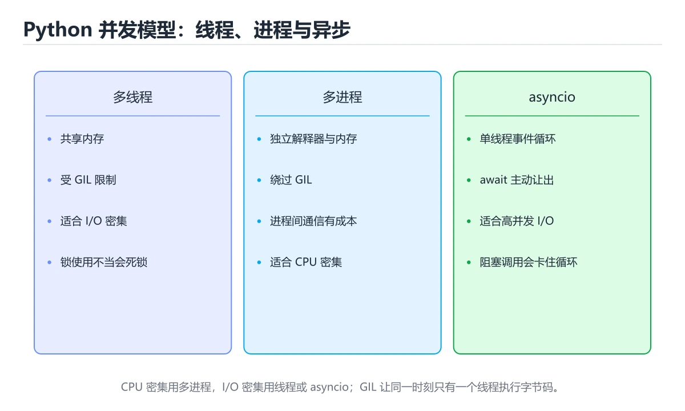
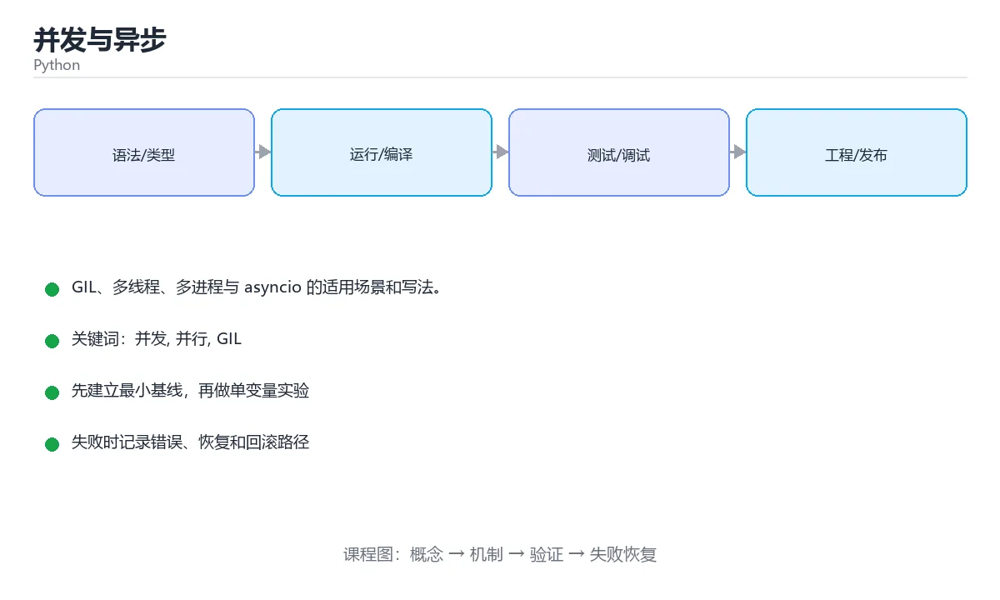

# 并发与异步

> 内容更新时间：2026-10-06 · 学习阶段：高级 · 预计用时：40 分钟





## 本节知识框架

想象你是一家奶茶店的老板。你只有一个店员（CPU），但顾客不断下单。你可以选择：多招几个店员（多进程）、让一个店员同时接好几单轮流做（多线程）、或者让店员在等奶茶机出茶的时候先去接下一单（异步 asyncio）。本课就是帮你搞清楚——什么时候该用哪种策略，以及 Python 里那个让人又爱又恨的 GIL 到底是什么。

**课程定位**：所属分类 `python`（Python），课程主题 `并发与异步`，学习阶段 高级，建议用时 50 分钟。

本课主线：GIL、多线程、多进程与 asyncio 的适用场景和写法。

**学完本课应当能够**
- 说清 `ProcessPoolExecutor` 与 `await` 的含义与区别，并各举一个正例和一个反例。
- 用本课示例验证 `time.sleep` 的行为，记录输入、输出与失败条件。
- 遇到「用多线程跑 CPU 密集」这类问题时，能说出触发条件与修复顺序。

## 核心概念定义

在正式进入之前，我们先用最直白的话把四个核心概念讲清楚。你可以把这一节当作"术语速查卡"，后面遇到不懂的随时回来查。

| 术语 | 一句话解释（ beginner-friendly ） | 操作性定义 | 常见边界与风险 |
| --- | --- | --- | --- |
| ProcessPoolExecutor | 就像开了一家"分身工厂"，每个分身独立干活，互不干扰。 | 线程池同理，把 `ProcessPoolExecutor` 换成 `ThreadPoolExecutor` 即可，适合 IO 密集场景。 | 易错：`PicklingError`；正确做法是传简单数据或可序列化对象。 |
| await | 就像你在等外卖时，不是傻站着，而是趁这个时间去洗碗。 | 异步是单线程内的事件循环协作：遇到 `await` 就让出控制权，适合高并发网络请求。 | 易错：事件循环冲突；正确做法是用 `await main()` 或 nest_asyncio。 |
| time.sleep | 就像你在厨房里发呆——什么都不干，也不让别人进来。 | 注意：**异步函数里不能写阻塞调用**（如 `time.sleep`、同步 requests），否则整个事件循环被卡住，应改用 `asyncio.sleep`、`aiohttp` 等异步库。 | 易错：整个事件循环被卡住；正确做法是改 `await asyncio.sleep()`；同步阻塞库用 `run_in_executor`。 |
| 并发 | 就像同时煮面、切菜、烧水——这些事在同一个时间窗口里交替推进。 | 多个任务在重叠时间窗口内推进，关注共享状态、同步与调度。 | 易错：并发全部退化成串行；正确做法是用异步库或线程池。 |

## 原理与运行机制

### 先搞懂 GIL：一把话筒的故事

Python 有一个叫 GIL（全局解释器锁）的东西。你可以把它想象成**一支话筒**——一个会议室里虽然坐了很多线程，但话筒只有一支。谁拿到话筒谁才能说话（执行 Python 字节码），其他人只能等着。

这就意味着：**多线程在 Python 里不能真正并行做计算**。如果你的任务是算数学题（CPU 密集），多线程反而因为抢话筒、切换开销变得更慢。但如果你的任务是等外卖（IO 等待），那等的时候话筒自然就给了别人，多线程就很好用。

### 四种方案，一张表搞定

| 方案 | 生活比喻 | 适合场景 | 关键 API |
| --- | --- | --- | --- |
| 多线程 `threading` | 一个收银员轮流给多个人结账 | IO 等待（下载、读写文件） | `Thread`、`Lock` |
| 多进程 `multiprocessing` | 开几家分店，每店各干各的 | CPU 密集（计算、图像处理） | `Process`、`ProcessPoolExecutor` |
| 线程池 `ThreadPoolExecutor` | 多开几个收银台 | IO 密集，任务数不多 | `executor.map`、`submit` |
| 异步 `asyncio` | 一个服务员同时照看多桌，谁菜好了就端给谁 | 高并发网络请求 | `async def`、`await`、`asyncio.gather` |

### 决策流程：先看任务是 IO 还是 CPU

拿到一个需求，先问自己一个问题：**这个任务大部分时间在"等"还是在"算"？**

- 大部分时间在**等**（网络请求、读文件）→ IO 密集 → 用 `asyncio` 或线程池
- 大部分时间在**算**（数值计算、图像处理）→ CPU 密集 → 用多进程 `ProcessPoolExecutor`
- 任务数**极多**（上万条 HTTP 请求）→ `asyncio` 最合适
- 任务数**不多**，代码想写简单点 → `ThreadPoolExecutor`

### 失败路径（来自本课错误表）

这些都是前人踩过的坑，你先记住，后面代码示例里会一一验证：

- 用多线程跑 CPU 密集 → 比单线程还慢 → 改多进程。
- 在协程里做阻塞调用 → 并发全部退化成串行 → 用异步库或线程池。
- 忘了加锁 → 计数结果偏小 → 共享变量加锁或换原子方案。
- 用进程池传 lambda → 无法序列化，报错 → 用模块级函数。

## 典型应用场景

### 场景一：批量下载文件（IO 密集）

想象你要下载 100 张图片。如果一个个下载，每张等 1 秒，总共要 100 秒。用多线程或 asyncio，可以让等待"重叠"，总时间可能只要几秒。

### 场景二：图像处理（CPU 密集）

你要对 1000 张图片做滤镜处理，每张要算 2 秒。这时候多线程没用（GIL 限制），必须用多进程，让多个 CPU 核心同时干活。

### 场景三：Web 服务器（高并发 IO）

一个服务器同时处理上万条连接。用 asyncio，一个线程就能搞定，因为大部分时间都在等网络数据。

### 常见错误场景速查

| 错误做法 | 典型现象 | 正确做法 |
| --- | --- | --- |
| 用多线程跑 CPU 密集 | 比单线程还慢 | 改多进程 |
| 在协程里做阻塞调用 | 并发全部退化成串行 | 用异步库或线程池 |
| 忘了加锁 | 计数结果偏小 | 共享变量加锁或换原子方案 |
| 用进程池传 lambda | 无法序列化，报错 | 用模块级函数 |

## 代码/协议/SQL 示例

### 示例 1：多线程下载（入门级）

这是最简单的并发写法。想象你同时让 3 个朋友帮你下载文件，谁下完了就喊一声。

```python
import threading
import time

def download(name):
    time.sleep(1)              # 模拟网络等待 1 秒
    print(f"{name} 下载完成")

# 创建 3 个线程，每个负责下载一个文件
threads = [threading.Thread(target=download, args=(f"文件{i}",)) for i in range(3)]
for t in threads:
    t.start()                  # 启动线程
for t in threads:
    t.join()                   # 等待全部结束
```

**运行结果**：大约 1 秒后，三行"下载完成"几乎同时出现（而不是 3 秒）。这就是 IO 密集场景下多线程的威力。

### 示例 2：共享变量要加锁（进阶）

多个线程同时改一个变量，就像多人同时在一个账本上记账——不加锁就会丢数据。

```python
import threading

lock = threading.Lock()
count = 0

def increase():
    global count
    for _ in range(100000):
        with lock:             # 加锁：同一时刻只有一个人改 count
            count += 1

threads = [threading.Thread(target=increase) for _ in range(4)]
for t in threads:
    t.start()
for t in threads:
    t.join()

print(count)                   # 正确结果：400000
```

如果不加 `lock`，结果可能只有 30 多万——因为 `count += 1` 其实是"读→改→写"三步操作，中间可能被别的线程打断。

### 示例 3：多进程处理 CPU 密集任务

```python
from concurrent.futures import ProcessPoolExecutor

def cpu_heavy(n):
    return sum(i * i for i in range(n))

if __name__ == "__main__":
    with ProcessPoolExecutor() as pool:
        results = list(pool.map(cpu_heavy, [10**6, 10**6, 10**6]))
    print(results)
```

**为什么用多进程？** 因为 CPU 密集任务被 GIL 锁死了，多线程无法真正并行。多进程等于开了几个独立的 Python 解释器，每个有自己的 GIL，才能真正同时计算。

### 示例 4：asyncio 异步并发

```python
import asyncio

async def fetch(name):
    await asyncio.sleep(1)         # 模拟网络请求（注意不是 time.sleep！）
    return f"{name} 完成"

async def main():
    results = await asyncio.gather(
        fetch("A"), fetch("B"), fetch("C")
    )
    print(results)                 # 三个任务并发，总耗时约 1 秒

asyncio.run(main())
```

**关键区别**：`asyncio.sleep` 会让出控制权，让事件循环去处理其他任务；`time.sleep` 则是死死卡住，什么都不让做。

### 示例 5：三种写法对比

```python
# 1. 多线程：适合 IO
from concurrent.futures import ThreadPoolExecutor

def download(url: str) -> int:
    ...                       # 假设这里是网络请求
    return len(url)

with ThreadPoolExecutor(max_workers=8) as pool:
    sizes = list(pool.map(download, urls))

# 2. 多进程：适合 CPU
from concurrent.futures import ProcessPoolExecutor

def heavy(n: int) -> int:
    return sum(i * i for i in range(n))

with ProcessPoolExecutor() as pool:
    results = list(pool.map(heavy, [10**6, 10**6, 10**6]))

# 3. asyncio：适合高并发 IO
import asyncio
import httpx

async def fetch(client: httpx.AsyncClient, url: str) -> int:
    resp = await client.get(url)
    return resp.status_code

async def main() -> None:
    async with httpx.AsyncClient() as client:
        tasks = [fetch(client, url) for url in urls]
        statuses = await asyncio.gather(*tasks)
    print(statuses)

asyncio.run(main())
```

### 示例 6：实战——并发抓取并统计耗时

```python
import asyncio
import time

import httpx

async def fetch(client: httpx.AsyncClient, url: str) -> tuple[str, int | str]:
    try:
        resp = await client.get(url, timeout=5)
        return url, resp.status_code
    except httpx.HTTPError as exc:
        return url, f"失败：{exc.__class__.__name__}"

async def main(urls: list[str]) -> None:
    start = time.perf_counter()
    async with httpx.AsyncClient() as client:
        results = await asyncio.gather(*(fetch(client, u) for u in urls))
    for url, status in results:
        print(f"{status}  {url}")
    print(f"耗时 {time.perf_counter() - start:.2f} 秒")

if __name__ == "__main__":
    asyncio.run(main(["https://example.com"] * 5))
```

### asyncio 的三条铁律

1. **不要在协程里写阻塞调用**（`time.sleep`、`requests.get`），它会卡住整个事件循环。
2. 用 `asyncio.sleep`、`httpx.AsyncClient`、`aiofiles` 这类异步库。
3. CPU 密集的工作丢给 `run_in_executor` 或进程池。

```python
import asyncio

async def main() -> None:
    await asyncio.sleep(1)                 # 正确：异步睡眠，不阻塞
    # time.sleep(1)                        # 错误：会阻塞整个事件循环
```

## 时间/空间复杂度或性能分析

### 各方案性能对比

| 场景 | 推荐方案 | 理由 | 关键 API |
| --- | --- | --- | --- |
| 大量网络 / 文件 IO | `asyncio` | 单线程事件循环，开销最小 | `async def`、`await`、`asyncio.gather` |
| 少量并发、用同步库 | `ThreadPoolExecutor` | 等待 IO 时会释放 GIL | `executor.map`、`submit` |
| CPU 密集计算 | `ProcessPoolExecutor` | 绕开 GIL，真正并行 | `ProcessPoolExecutor`、`multiprocessing` |
| 需要共享状态的多线程 | 线程 + 锁 | 保证复合操作原子性 | `threading.Lock`、`RLock` |
| 生产消费模型 | `queue.Queue` | 天然线程安全 | `put`、`get`、`task_done` |
| 定时 / 延迟任务 | `asyncio.sleep` 或调度库 | 不阻塞线程 | 避免 `time.sleep` 出现在协程里 |

### 用数字说话

假设你要下载 100 个网页，每个请求耗时 0.5 秒：

| 方案 | 总耗时 | 资源开销 |
| --- | --- | --- |
| 串行 | 50 秒 | 最低 |
| 10 线程 | ~5 秒 | 中等（10 个线程栈） |
| asyncio 100 并发 | ~0.5 秒 | 最低（单线程） |
| 100 进程 | ~0.5 秒 | 最高（100 个 Python 解释器） |

### 性能测量方法

以 `并发与异步` 的 `并发` 场景为对象，固定输入跑一遍记录基线，再把规模或并发度提高一个数量级复测；两次结果的差值与波动范围才是结论依据。

## 常见误区与易错点

### 新手最容易踩的八个坑

| 坑 | 现象 | 正确做法 |
| --- | --- | --- |
| 用多线程跑 CPU 密集 | 比单线程还慢 | 改多进程 |
| 在协程里做阻塞调用 | 并发全部退化成串行 | 用异步库或线程池 |
| 忘了加锁 | 计数结果偏小 | 共享变量加锁或换原子方案 |
| 用进程池传 lambda | 无法序列化，报错 | 用模块级函数 |
| 线程里异常被吞掉 | 任务静默失败 | 收集 `future.exception()` |
| 无限制创建线程 | 内存暴涨 | 用线程池控制并发数 |
| 忘了 `asyncio.run` | 协程没有执行 | 用 `asyncio.run(main())` |
| 在 Jupyter 里用 `asyncio.run` | 事件循环冲突 | 用 `await main()` 或 nest_asyncio |

### 更多易错点详解

| 容易写错的做法 | 实际现象 | 原因与正确做法 |
| --- | --- | --- |
| 在协程里调用 `time.sleep()` | 整个事件循环被卡住 | 改 `await asyncio.sleep()`；同步阻塞库用 `run_in_executor` |
| 在协程里直接 `requests.get()` | 其他任务全部等待 | 用 `httpx` / `aiohttp` 等异步客户端 |
| 忘了 `await` 协程 | `RuntimeWarning: coroutine was never awaited` | 调用协程函数必须 `await` 或交给 `create_task` |
| 多线程共享计数变量直接 `+=` | 结果偏小 | 加锁或用 `queue` 汇总 |
| `ProcessPoolExecutor` 里传不可序列化对象 | `PicklingError` | 传简单数据或可序列化对象 |
| 忘记关闭线程池 | 进程无法退出 | `with ThreadPoolExecutor() as ex:` 或显式 `shutdown` |
| 多进程直接改全局变量 | 父进程看不到变化 | 进程内存独立，用返回值或共享内存 / 队列 |
| 用 `asyncio.run` 嵌套调用 | `RuntimeError: asyncio.run() cannot be called from a running event loop` | 顶层只调用一次，内部用 `await` 或 `create_task` |

### 现场排错演练

#### 现场 1：用多线程跑 CPU 密集

**症状**：比单线程还慢。

**根因与修复**：改多进程。

**自检**：在本课示例里复现「用多线程跑 CPU 密集」，改成改多进程后重跑；如果症状消失且失败路径按预期变化，说明定位正确。

#### 现场 2：在协程里做阻塞调用

**症状**：并发全部退化成串行。

**根因与修复**：用异步库或线程池。

**自检**：在本课示例里复现「在协程里做阻塞调用」，改成用异步库或线程池后重跑；如果症状消失且失败路径按预期变化，说明定位正确。

#### 现场 3：忘了加锁

**症状**：计数结果偏小。

**根因与修复**：共享变量加锁或换原子方案。

**自检**：在本课示例里复现「忘了加锁」，改成共享变量加锁或换原子方案后重跑；如果症状消失且失败路径按预期变化，说明定位正确。

#### 现场 4：用进程池传 lambda

**症状**：无法序列化，报错。

**根因与修复**：用模块级函数。

**自检**：在本课示例里复现「用进程池传 lambda」，改成用模块级函数后重跑；如果症状消失且失败路径按预期变化，说明定位正确。

## 与其他知识点的关系

- **先修**：`类型注解与测试`。本课默认这些内容已经掌握。
- **相关或后续**：`实战：爬虫与数据分析`。本课术语会在这些课程里继续使用。
- **术语归属**：`ProcessPoolExecutor`、`await`、`time.sleep` 的定义以本课「核心概念定义」为准，换到其他课程时先确认定义是否被改写。
- 同一分类的《Python 并发模型、GIL 与线程进程选型》也涉及 `GIL`；两课衔接时先确认这个术语的定义是否一致。
- 同一分类的《Python asyncio 异步编程：任务、超时与取消》也涉及 `asyncio`；两课衔接时先确认这个术语的定义是否一致。

## 自测题与参考答案

> 先独立作答，再对照参考答案；答案都能在本课正文、术语表或错误表里找到依据。

### 自测 1（概念复述）

不看正文，写出 `ProcessPoolExecutor` 的操作性定义，并说明它与 `await` 的区别。

**参考答案**：线程池同理，把 `ProcessPoolExecutor` 换成 `ThreadPoolExecutor` 即可，适合 IO 密集场景。

`await` 的定位是：异步是单线程内的事件循环协作：遇到 `await` 就让出控制权，适合高并发网络请求；两者的差别要从适用对象与失败模式上说明。

### 自测 2（排错）

本课错误表记录了「用多线程跑 CPU 密集」这类做法。请写出它会出现的现象、根因，以及修复顺序。

**参考答案**：现象是比单线程还慢；正确做法是改多进程。修复时先复现现象并保留证据，再改动一处假设重跑，确认现象消失。

### 自测 3（动手验证）

运行本课的 `python` 示例，把其中的 `"{name} 下载完成"` 换成一个边界值后重新运行，记录输出与错误信息。

**参考答案**：正常输入下 `python` 示例应当复现正文给出的结果；把 `"{name} 下载完成"` 换成边界值后，如果结果改变或报错，先核对它是否满足 `并发与异步` 中`ProcessPoolExecutor` 的适用范围，再检查错误表里是否有同类现象。

### 自测 4（代码阅读）

阅读本课开头的 `python` 示例，说明它体现了`ProcessPoolExecutor` 的哪一条性质，并指出改动哪个输入会让这条性质不再成立。

**参考答案**：`ProcessPoolExecutor` 的定义是 线程池同理，把 `ProcessPoolExecutor` 换成 `ThreadPoolExecutor` 即可，适合 IO 密集场景，示例正是在实现这条定义。改动与 `ProcessPoolExecutor` 有关的一个输入后，如果结果不再符合 `并发与异步` 的正文描述，就说明该性质只在当前前提成立。

### 自测 5（迁移）

把 `并发与异步` 的方法迁移到自己的项目：围绕 `ProcessPoolExecutor` 写出一个与错误表同类的风险点，并说明触发条件和检验方式。

**参考答案**：例如「忘了 await 协程」，它会导致RuntimeWarning: coroutine was never awaited；检验方式是按调用协程函数必须 await 或交给 create_task改一处再复现，确认现象消失且没有引入新的失败分支。

### 自测 6（对比）

用一个表格对比 `ProcessPoolExecutor` 与 `await`：各写一行适用场景、一行失败表现。

**参考答案**：`ProcessPoolExecutor` 的定义是线程池同理，把 `ProcessPoolExecutor` 换成 `ThreadPoolExecutor` 即可，适合 IO 密集场景；`await` 的定义是异步是单线程内的事件循环协作：遇到 `await` 就让出控制权，适合高并发网络请求。两者的失败表现分别对应本课错误表里与本术语相关的行。

### 自测 7（排错顺序）

面对「用多线程跑 CPU 密集」引发的问题，请把"复现 比单线程还慢 → 保留证据 → 改多进程 → 回归验证"四步写成可执行的检查清单。

**参考答案**：第一步按比单线程还慢复现；第二步记录输入、版本与完整报错；第三步按改多进程只改一处；第四步重跑并确认失败路径也按预期变化。

### 自测 8（边界判断）

针对 `并发`，分别写出"可以使用"的条件和"结论不再成立"的条件。

**参考答案**：易错：并发全部退化成串行；正确做法是用异步库或线程池。 同时要把 `并发` 的定义 多个任务在重叠时间窗口内推进，关注共享状态、同步与调度 与实际输入逐项对照。

### 自测 9（机制重建）

不看正文，按输入、转换、输出、验证四段重建 `ProcessPoolExecutor` → `await` → `time.sleep` → `并发` 的作用链。

**参考答案**：起点是 `ProcessPoolExecutor` 的定义 线程池同理，把 `ProcessPoolExecutor` 换成 `ThreadPoolExecutor` 即可，适合 IO 密集场景；中间每一步都保留可观察状态；终点由 `并发` 检查，失败时回到错误表定位第一个偏离定义的步骤。

### 自测 10（综合排错）

在 `并发与异步` 中，现象是 RuntimeWarning: coroutine was never awaited。请围绕 忘了 await 协程 写出最小复现、关键证据、修复动作和回归验证，并说明为什么不能只凭一次运行下结论。

**参考答案**：先复现 忘了 await 协程，记录输入与完整错误；再按 调用协程函数必须 await 或交给 create_task 只改一处。回归时同时跑正常路径和边界路径，只有两次结果都可解释，才把修复视为完成。

### 自测 11（一分钟复述）

用每分钟约 200 字的速度复述 `并发与异步`：先给主问题，再按顺序说出 `ProcessPoolExecutor`、`await`、`time.sleep`、`并发`，最后给一个失败案例。

**自评标准**：主问题必须对应 GIL、多线程、多进程与 asyncio 的适用场景和写法；每个术语都要能接上一句定义或边界；失败案例必须写成可观察现象，不能用"可能有风险"代替证据。

## 复习清单

- [ ] 能用自己的话说明「并发与异步」里的 并发，再举一个它不成立的场景。
- [ ] 能默写本课最重要的代码示例，并解释每一行的作用
- [ ] 能说出本课内容和前后两课的联系

## 延伸阅读

想更直观地理解本课概念？推荐参阅以下图解专题：

- [图解并发调度：线程、协程与 Goroutine](visual_concurrency_schedule.md)

## 术语速查

| 术语 | 一句话说明 |
| --- | --- |
| `ProcessPoolExecutor` | 线程池同理，把 `ProcessPoolExecutor` 换成 `ThreadPoolExecutor` 即可，适合 IO 密集场景。 |
| `await` | 异步是单线程内的事件循环协作：遇到 `await` 就让出控制权，适合高并发网络请求。 |
| `time.sleep` | 注意：**异步函数里不能写阻塞调用**（如 `time.sleep`、同步 requests），否则整个事件循环被卡住，应改用 `asyncio.sleep`、`aiohttp` 等异步库。 |
| `并发` | 多个任务在重叠时间窗口内推进，关注共享状态、同步与调度。 |
| GIL | 全局解释器锁，同一时刻只允许一个线程执行 Python 字节码。 |
| `ThreadPoolExecutor` | 线程池，适合 IO 密集场景，用法与 `ProcessPoolExecutor` 相同。 |
| `asyncio.gather` | 并发调度并等待多个协程，总耗时约等于最慢的那个。 |
| `threading.Lock` | 互斥锁，保护共享变量的读-改-写过程。 |

## 考点精讲

`并发与异步` 的题库有 6 道题，下面逐题给出题干、正确项与判断依据：先自己作答，再核对正确项，最后回到正文对应小节复核。

### 考点 1：第 1 题

- **题目**：围绕“并发与异步”中的 并发、并行、GIL，下列哪两项是本课强调的实践判断？
- **正确项**：验证 并行 时要固定版本并覆盖边界输入，结论才可复现；学习 并发 时要同时说明输入、输出和失败路径，不能只看正常流程
- **判断依据**：按《并发与异步》的正文口径，本题要同时选中「验证 并行 时要固定版本并覆盖边界输入，结论才可复现」、「学习 并发 时要同时说明输入、输出和失败路径，不能只看正常流程」，漏掉任一项都算没答全。术语 并发（并发与异步）：多个任务在重叠时间窗口内推进，关注共享状态、同步与调度。易错点是用多线程跑 CPU 密集，会造成比单线程还慢，改法是改多进程。

### 考点 2：第 2 题

- **题目**：代码语言为 `python`，选自 `并发与异步` 的 `ProcessPoolExecutor` 部分。课程问题为GIL、多线程、多进程与 asyncio 的适用场景和写法。哪一项描述与代码一致？
- **正确项**：调用了 `sleep()`
- **判断依据**：本题正确项是「调用了 `sleep()`」。术语 ProcessPoolExecutor（并发与异步）：线程池同理，把 `ProcessPoolExecutor` 换成 `ThreadPoolExecutor` 即可，适合 IO 密集场景，本题取「调用了 `sleep()`」这条。易错点是在协程里做阻塞调用，会造成并发全部退化成串行，改法是用异步库或线程池。本题干扰项「调用了 `base()`」不成立：展示代码里找不到 `base()`。

### 考点 3：第 3 题

- **题目**：多线程共享计数变量时出现结果偏小，解决办法是？
- **正确项**：用 Lock 保护读-改-写过程
- **判断依据**：本题正确项是「用 Lock 保护读-改-写过程」。术语 ProcessPoolExecutor（并发与异步）：线程池同理，把 `ProcessPoolExecutor` 换成 `ThreadPoolExecutor` 即可，适合 IO 密集场景，本题取「用 Lock 保护读-改-写过程」这条。易错点是忘了加锁，会造成计数结果偏小，改法是共享变量加锁或换原子方案。

### 考点 4：第 4 题

- **题目**：GIL 带来的实际影响是？
- **正确项**：多线程无法并行执行 Python 字节码，CPU 密集任务难以提速
- **判断依据**：本题正确项是「多线程无法并行执行 Python 字节码，CPU 密集任务难以提速」。术语 ProcessPoolExecutor（并发与异步）：线程池同理，把 `ProcessPoolExecutor` 换成 `ThreadPoolExecutor` 即可，适合 IO 密集场景，本题取「多线程无法并行执行 Python 字节码，CPU 密集任务难以提速」这条。易错点是用进程池传 lambda，会造成无法序列化，报错，改法是用模块级函数。

### 考点 5：第 5 题

- **题目**：asyncio.gather 的作用是？
- **正确项**：并发调度并等待多个协程
- **判断依据**：本题正确项是「并发调度并等待多个协程」。术语 并发（并发与异步）：多个任务在重叠时间窗口内推进，关注共享状态、同步与调度，本题取「并发调度并等待多个协程」这条。易错点是线程里异常被吞掉，会造成任务静默失败，改法是收集 `future.exception()`。

### 考点 6：第 6 题

- **题目**：填空：补齐下面这段术语说明中的空缺。课程 `GIL、多线程、多进程与 asyncio 的适用场景和写法。`，这段说明是：线程池同理，把 ``____`` 换成 `ThreadPoolExecutor` 即可，适合 IO 密集场景。空缺处应填哪个术语？
- **正确项**：ProcessPoolExecutor
- **判断依据**：正确项：「ProcessPoolExecutor」。涉及术语 ProcessPoolExecutor：线程池同理，把 `ProcessPoolExecutor` 换成 `ThreadPoolExecutor` 即可，适合 IO 密集场景。易错点：用多线程跑 CPU 密集会造成比单线程还慢。本题要填的是「ProcessPoolExecutor」。

### 考点 7：`ProcessPoolExecutor`

- **要点**：线程池同理，把 `ProcessPoolExecutor` 换成 `ThreadPoolExecutor` 即可，适合 IO 密集场景。
- **ProcessPoolExecutor 的边界**：易错：`PicklingError`；正确做法是传简单数据或可序列化对象。

### 考点 8：`await`

- **要点**：异步是单线程内的事件循环协作：遇到 `await` 就让出控制权，适合高并发网络请求。
- **await 的边界**：易错：事件循环冲突；正确做法是用 `await main()` 或 nest_asyncio。

### 考点 9：`time.sleep`

- **要点**：注意：**异步函数里不能写阻塞调用**（如 `time.sleep`、同步 requests），否则整个事件循环被卡住，应改用 `asyncio.sleep`、`aiohttp` 等异步库。
- **time.sleep 的边界**：易错：整个事件循环被卡住；正确做法是改 `await asyncio.sleep()`；同步阻塞库用 `run_in_executor`。

### 考点 10：`并发`

- **要点**：多个任务在重叠时间窗口内推进，关注共享状态、同步与调度。
- **并发 的边界**：易错：并发全部退化成串行；正确做法是用异步库或线程池。

### 考点 11：排错——用多线程跑 CPU 密集

- **现象**：比单线程还慢。
- **处理**：改多进程。

### 考点 12：排错——在协程里做阻塞调用

- **现象**：并发全部退化成串行。
- **处理**：用异步库或线程池。

### 考点 13：综合辨析——`ProcessPoolExecutor` 与 `并发`

- **辨析点**：`ProcessPoolExecutor` 的定义是 线程池同理，把 `ProcessPoolExecutor` 换成 `ThreadPoolExecutor` 即可，适合 IO 密集场景；`并发` 的定义是 多个任务在重叠时间窗口内推进，关注共享状态、同步与调度。
- **答题要求**：面对 `并发与异步` 的题目，先判断描述的是 `ProcessPoolExecutor` 还是 `并发`，再归到对应定义，最后写出一个会让该定义失效的边界输入。

### 考点 14：排错评分点

- **现象分**：能写出 比单线程还慢，而不是只写"程序有错"。
- **证据分**：保留触发 用多线程跑 CPU 密集 的输入、版本和错误原文。
- **修复分**：按 改多进程 只改一处，并同时回归正常路径与边界路径。

## 内容元数据

- 内容版本：v2.0
- 最后更新：2026-10-06
- 学习阶段：高级
- 适用环境：Python 3.12+；本课聚焦 并发。
- 内容来源：内置结构化课程与工程实践整理
- 相关主题：并发、并行、GIL、threading、asyncio、多进程
- 质量版本：P0 测验标准 + P1 覆盖扩展 + P2 体验补全

## 参考资料与复核

- 最后复核：2026-10-04
- 下次复核：2026-11-10
- 复核范围：版本兼容、API 行为、安全建议与工程实践
- 来源性质：官方文档、标准或权威教材；本课核对关键词：并发、并行、GIL、threading、asyncio、多进程。

| 参考资料 | 本课用途 |
| --- | --- |
| [asyncio 官方文档](https://docs.python.org/3/library/asyncio.html) | 异步 I/O、事件循环与并发任务的核心参考 |
| [threading — 基于线程的并行](https://docs.python.org/3/library/threading.html) | 线程创建、锁机制与线程安全 |
| [concurrent.futures — 高级并行接口](https://docs.python.org/3/library/concurrent.futures.html) | ThreadPoolExecutor 与 ProcessPoolExecutor 的用法 |
| [multiprocessing — 基于进程的并行](https://docs.python.org/3/library/multiprocessing.html) | 多进程、进程间通信与共享内存 |
| [Python GIL 官方说明](https://docs.python.org/3/glossary.html#term-global-interpreter-lock) | GIL 的权威定义与行为约束 |

| [本课术语索引：并发与异步](#核心概念定义) | 按本课输入、术语边界和错误表现逐项核对 |
> 「并发与异步」的链接用于离线阅读后的延伸核对；App 不会自动联网。
