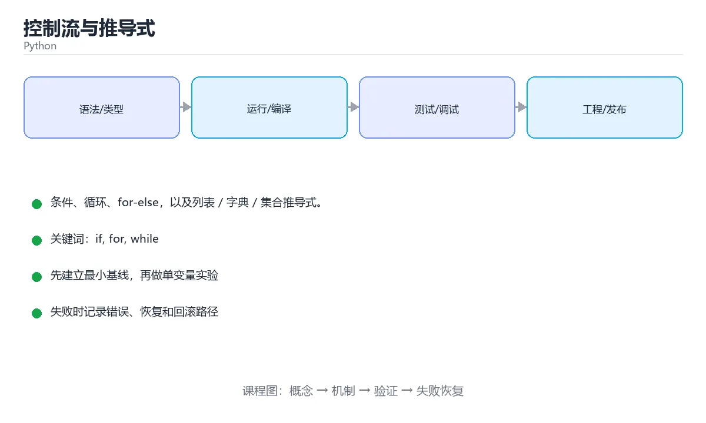
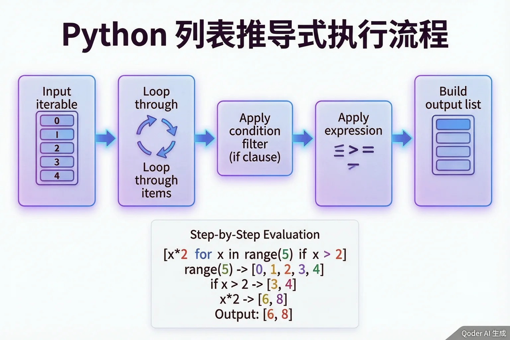

# 控制流与推导式

> 内容更新时间：2026-10-06 · 学习阶段：基础 · 预计用时：40 分钟



> 学习阶段：基础 · 预计用时：40 分钟 · 适用环境：Python 3.12+

## 本节知识框架

本课是 Python 控制流的"进阶篇"。在前面你已经学会了 if/elif/else、for、while 的基本用法，这一课我们要把几个更实用的工具装进工具箱：

```text
控制流进阶
├── match-case（模式匹配）——"多分支选择"的优雅写法
├── 三元表达式——一行搞定 if-else
├── 推导式——用一行生成新序列
│   ├── 列表推导式
│   ├── 字典推导式
│   └── 集合推导式
└── 异常处理基础
    ├── try / except / else / finally
    └── 常见异常类型
```

学完本课，你应该能够：
- 用 match-case 替代一长串 if-elif 链
- 用三元表达式把简单的条件赋值压缩成一行
- 熟练写出列表、字典、集合推导式
- 用 try-except 捕获异常，让程序不会轻易崩溃

---

### 复习清单
- [ ] 能复述 if 的职责，并给出一个输入越界时的反例。
- [ ] 能默写本课最重要的代码示例，并解释每一行的作用
- [ ] 能说出本课内容和前后两课的联系

## 核心概念定义

### match-case（模式匹配）

Python 3.10 引入的语法，就像一个"智能分拣员"——你给它一个值，它按照你写好的模式逐一匹配，命中哪个就走哪个分支。比一长串 if-elif 更直观。

```python
status = 404
match status:
    case 200:
        print("成功")
    case 404:
        print("未找到")
    case 500:
        print("服务器错误")
    case _:
        print("未知状态")
```

`case _` 是"兜底分支"，类似于 if-elif 链最后的 else，匹配任意值。

### 三元表达式（条件表达式）

把简单的 if-else 赋值压缩成一行。想象你在写一个规则："如果条件成立就给 A，否则给 B"——三元表达式就是这句话的代码形式：

```python
# 普通写法
if score >= 60:
    result = "及格"
else:
    result = "不及格"

# 三元表达式，一行搞定
result = "及格" if score >= 60 else "不及格"
```

### 推导式

推导式用一行完成"生成新序列"的工作，通常比 for 循环更快也更易读。你可以把它理解成"流水线"——原材料进去，成品出来。

```python
# 列表推导式：把 0~4 的平方收集起来
squares = [x * x for x in range(5)]   # [0, 1, 4, 9, 16]

# 字典推导式
lengths = {word: len(word) for word in ["hi", "hello"]}

# 集合推导式：去重
unique = {x % 3 for x in range(10)}
```



### 异常处理基础

程序运行时难免出错——除以零、文件不存在、类型不对……异常处理就是给程序装一个"安全网"，让它在出错时不会直接崩溃，而是优雅地处理问题。

```python
try:
    result = 10 / 0
except ZeroDivisionError:
    print("除数不能为零！")
```

---

## 原理与运行机制

### match-case 是怎么工作的？

把 match-case 想象成快递分拣线：

1. 包裹（值）送上传送带
2. 每个 case 是一个"检查站"——看看包裹的标签是否匹配
3. 命中第一个匹配的 case，执行对应操作，然后离开分拣线
4. 如果所有 case 都没命中，就走 `case _`（兜底）

```python
command = "quit"
match command:
    case "start":
        print("启动程序")
    case "stop" | "quit":      # 用 | 匹配多个值
        print("结束程序")
    case _:
        print(f"未知命令: {command}")
```

match-case 还能解构复杂数据结构：

```python
point = (3, 4)
match point:
    case (0, 0):
        print("原点")
    case (x, 0):
        print(f"在 x 轴上，x={x}")
    case (0, y):
        print(f"在 y 轴上，y={y}")
    case (x, y):
        print(f"点 ({x}, {y})")
```

### 三元表达式的执行流程

三元表达式只有三步：

1. 先计算 `if` 后面的条件
2. 条件为 True → 返回前面的值
3. 条件为 False → 返回 else 后面的值

```python
age = 20
status = "成年" if age >= 18 else "未成年"
# age >= 18 为 True → status = "成年"
```

**什么时候该用，什么时候不该用？**
- 适合：简单的二选一赋值
- 不适合：条件复杂、有多个分支——还是老老实实写 if-elif-else

### 推导式背后的运行机制

推导式本质上是一个 for 循环的"语法糖"，但它在 C 语言层面做了优化，所以通常比等价的 for 循环更快。

```python
# 推导式
squares = [x * x for x in range(5)]

# 等价的 for 循环
squares = []
for x in range(5):
    squares.append(x * x)
```

推导式还可以加过滤条件（if 子句），只保留满足条件的元素：

```python
evens = [x for x in range(10) if x % 2 == 0]
# [0, 2, 4, 6, 8]
```

### 异常处理的四道防线

Python 的异常处理用 try-except-else-finally 四个关键字组成：

| 关键字 | 作用 | 什么时候执行 |
|--------|------|-------------|
| `try` | 包裹可能出错的代码 | 总是执行 |
| `except` | 捕获并处理特定异常 | try 里出错时执行 |
| `else` | 没有异常时执行 | try 没出错时执行 |
| `finally` | 无论如何都执行 | 总是执行，用于释放资源 |

```python
try:
    f = open("data.txt", "r")
    content = f.read()
except FileNotFoundError:
    print("文件不存在")
except PermissionError:
    print("没有读取权限")
else:
    print(f"读取成功，共 {len(content)} 个字符")
finally:
    print("清理工作完成")
```

---

## 典型应用场景

### match-case 适合用在哪里？

- **HTTP 状态码处理**：根据状态码执行不同逻辑
- **命令行解析**：根据用户输入的命令执行对应操作
- **数据格式解构**：从元组、列表中提取结构化信息

### 三元表达式适合用在哪里？

- **条件赋值**：根据条件给变量赋不同的值
- **函数返回值**：一行返回两种结果之一
- **列表中的条件替换**：配合推导式使用

```python
labels = ["及格" if s >= 60 else "不及格" for s in scores]
```

### 推导式适合用在哪里？

- **数据清洗**：过滤、转换一批数据
- **快速构建字典/集合**：从列表生成映射关系
- **展平嵌套结构**：把二维列表变成一维

```python
matrix = [[1, 2], [3, 4], [5, 6]]
flat = [n for row in matrix for n in row]
# [1, 2, 3, 4, 5, 6]
```

### 异常处理适合用在哪里？

- **文件操作**：文件可能不存在、没有权限
- **用户输入**：输入格式可能不对
- **网络请求**：可能超时、连接失败
- **类型转换**：字符串可能无法转成数字

---

## 代码/协议/SQL 示例

### 综合示例：一个小程序的成绩管理系统

```python
# 用三元表达式判断等级
def get_grade(score):
    if score >= 90:
        return "优秀"
    elif score >= 80:
        return "良好"
    elif score >= 60:
        return "及格"
    else:
        return "不及格"

# 用推导式批量处理
scores = [92, 78, 55, 88, 61, 43]
results = [get_grade(s) for s in scores]
print(results)  # ['优秀', '及格', '不及格', '良好', '及格', '不及格']

# 用推导式做统计
passed = [s for s in scores if s >= 60]
print(f"及格人数: {len(passed)}")  # 4

# 用字典推导式建立映射
score_map = {f"学生{i+1}": s for i, s in enumerate(scores)}
print(score_map)
```

### match-case 实战

```python
def handle_command(cmd):
    match cmd.split():
        case ["start"]:
            return "程序启动"
        case ["stop"]:
            return "程序停止"
        case ["move", direction]:
            return f"向 {direction} 移动"
        case ["move", direction, steps]:
            return f"向 {direction} 移动 {steps} 步"
        case _:
            return "未知命令"

print(handle_command("move left"))       # 向 left 移动
print(handle_command("move up 3"))       # 向 up 移动 3 步
print(handle_command("restart"))         # 未知命令
```

### 异常处理实战

```python
def safe_divide(a, b):
    try:
        result = a / b
    except ZeroDivisionError:
        print("错误：除数不能为零")
        return None
    except TypeError:
        print("错误：参数必须是数字")
        return None
    else:
        print(f"计算成功：{a} / {b} = {result}")
        return result
    finally:
        print("--- 计算结束 ---")

safe_divide(10, 3)    # 正常计算
safe_divide(10, 0)    # 触发 ZeroDivisionError
safe_divide("a", 2)   # 触发 TypeError
```

### 遍历时的经典陷阱

```python
# 错误做法：遍历列表时删除元素
nums = [1, 2, 3, 4, 5]
for n in nums:
    if n % 2 == 1:
        nums.remove(n)
print(nums)  # [2, 4, 5] —— 5 没有被删掉！

# 正确做法 1：遍历副本
nums = [1, 2, 3, 4, 5]
for n in nums[:]:       # nums[:] 创建副本
    if n % 2 == 1:
        nums.remove(n)
print(nums)  # [2, 4]

# 正确做法 2：用推导式生成新列表
nums = [1, 2, 3, 4, 5]
nums = [n for n in nums if n % 2 == 0]
print(nums)  # [2, 4]
```

### range 的用法

```python
# range(start, stop, step)
list(range(1, 10, 2))   # [1, 3, 5, 7, 9]
list(range(0, 10, 3))   # [0, 3, 6, 9]
list(range(5, 0, -1))   # [5, 4, 3, 2, 1]
```

---

## 时间/空间复杂度或性能分析

（本节内容详见正文各章节的对应说明。）

### 补充性能分析
| 操作 | 时间复杂度 | 说明 |
|------|-----------|------|
| if-elif-else 链 | O(n)，n 为分支数 | 从上到下逐一判断 |
| match-case | O(n)，n 为 case 数 | 类似 if-elif，但匹配复杂模式时可能更快 |
| 列表推导式 | O(n) | 与等价的 for 循环相同，但常数更小 |
| 字典推导式 | O(n) | 每次插入平均 O(1) |
| try-except | 无额外开销 | 没有异常时几乎零成本 |

推导式比等价的 for 循环快，是因为它在 C 层面做了优化——避免了每次循环都查找 `append` 方法。但差距在小数据量时不明显，不要为了性能把简单循环都改成推导式，可读性更重要。

---

## 常见误区与易错点

（本节内容详见正文各章节的对应说明。）

## 与其他知识点的关系

（本节内容详见正文各章节的对应说明。）

### 补充关联
```text
已学知识                本课内容              后续知识
─────────              ─────────            ─────────
if / elif / else  ──→  match-case     ──→  面向对象中的方法分派
for / while       ──→  推导式          ──→  生成器表达式
基本数据类型      ──→  三元表达式      ──→  lambda 与高阶函数
函数基础          ──→  异常处理基础    ──→  自定义异常与上下文管理器
```

- **先修**：函数、列表与字典基础。你需要会用 def 定义函数，会操作列表和字典。
- **衔接**：本课的推导式会在"列表、元组、字典与集合"中继续深入；异常处理会在"异常处理与文件操作"中扩展到自定义异常和 with 语句。
- **术语复用**：break、continue、for-else 这些概念在本课和后续课程中都会反复出现。

---

## 自测题与参考答案

（本节内容详见正文各章节的对应说明。）

## 考点精讲

`控制流与推导式` 的题库有 6 道题，下面逐题给出题干、正确项与判断依据。先自己作答，再核对答案。

### 考点 1

- **题目**：围绕“控制流与推导式”中的 if、for、while，下列哪两项是本课强调的实践判断？
- **正确项**：验证 for 时要固定版本并覆盖边界输入，结论才可复现；学习 if 时要同时说明输入、输出和失败路径，不能只看正常流程
- **判断依据**：按《控制流与推导式》的正文口径，本题要同时选中「验证 for 时要固定版本并覆盖边界输入，结论才可复现」、「学习 if 时要同时说明输入、输出和失败路径，不能只看正常流程」，漏掉任一项都算没答全。术语 if（控制流与推导式）：elif 是「否则如果」，可以写很多个。易错点是遍历列表时删元素会造成有些元素被跳过，改法是遍历副本 `for x in nums[:]`，或倒序删，作答时对照的是正确项「验证 for 时要固定版本并覆盖边界输入，结论才可复现」。

### 考点 2

- **题目**：阅读 `控制流与推导式` 的 `None` 示例。它服务于条件、循环、for-else，以及列表 / 字典 / 集合推导式。代码中实际包含下列哪一项？
- **正确项**：代码里出现了 `even` 这个名字
- **判断依据**：本题正确项是「代码里出现了 `even` 这个名字」。术语 None（控制流与推导式）：Python 中一切「空」的值都视为假：`0`、`""`、`[]`、`{}`、`None`、`False`，写判断时优先利用这一点，本题取「代码里出现了 `even` 这个名字」这条。易错点是遍历列表时删元素会造成有些元素被跳过，改法是遍历副本 `for x in nums[:]`，或倒序删，作答时对照的是正确项「代码里出现了 `even` 这个名字」。本题干扰项「出现字面量 `校验签名、有效期与签发者，任一不符即拒绝。`」不成立：展示代码里找不到 `校验签名、有效期与签发者，任一不符即拒绝`。

### 考点 3

- **题目**：遍历列表时删除元素导致漏掉元素，正确的做法是？
- **正确项**：遍历列表副本
- **判断依据**：本题正确项是「遍历列表副本」。术语 None（控制流与推导式）：Python 中一切「空」的值都视为假：`0`、`""`、`[]`、`{}`、`None`、`False`，写判断时优先利用这一点，本题取「遍历列表副本」这条。易错点是遍历列表时删元素会造成有些元素被跳过，改法是遍历副本 `for x in nums[:]`，或倒序删，作答时对照的是正确项「遍历列表副本」。

### 考点 4

- **题目**：range(1, 10, 2) 生成的序列是？
- **正确项**：1, 3, 5, 7, 9
- **判断依据**：本题正确项是「1, 3, 5, 7, 9」。术语 None（控制流与推导式）：Python 中一切「空」的值都视为假：`0`、`""`、`[]`、`{}`、`None`、`False`，写判断时优先利用这一点，本题取「1, 3, 5, 7, 9」这条。易错点是遍历列表时删元素会造成有些元素被跳过，改法是遍历副本 `for x in nums[:]`，或倒序删，作答时对照的是正确项「1, 3, 5, 7, 9」。

### 考点 5

- **题目**：break 与 continue 的区别是？
- **正确项**：break 结束整个循环
- **判断依据**：本题正确项是「break 结束整个循环」。术语 break（控制流与推导式）：`break` 提前结束循环，`continue` 跳过本轮，`for ... else` 在循环「没有被 break」时执行，本题取「break 结束整个循环」这条。易错点是遍历列表时删元素会造成有些元素被跳过，改法是遍历副本 `for x in nums[:]`，或倒序删，作答时对照的是正确项「break 结束整个循环」。

### 考点 6

- **题目**：填空：补齐下面这段术语说明中的空缺。课程 `条件、循环、for-else，以及列表 / 字典 / 集合推导式。`，这段说明是：`____`用一行完成「生成新序列」的工作，通常比 for 循环更快也更易读。空缺处应填哪个术语？
- **正确项**：推导式
- **判断依据**：涉及术语 推导式：推导式用一行完成「生成新序列」的工作，通常比 for 循环更快也更易读。易错点：遍历列表时删元素会造成有些元素被跳过。正确做法：遍历副本 `for x in nums[:]`，或倒序删。判断时先确认输入和适用范围，对照 `if`、`for`、`while`、`推导式` 复现一次，最后把错误表现与正确做法逐项对照。

---

## 术语速查

| 术语 | 一句话说明 |
|------|-----------|
| match-case | Python 3.10+ 的模式匹配，替代冗长的 if-elif 链 |
| case _ | 兜底分支，匹配任意值，类似 else |
| 三元表达式 | `值A if 条件 else 值B`，一行完成条件赋值 |
| 推导式 | 用一行完成"生成新序列"的工作，通常比 for 循环更快也更易读 |
| 列表推导式 | `[表达式 for x in 序列 if 条件]`，生成新列表 |
| 字典推导式 | `{键: 值 for ...}` 生成新字典 |
| 集合推导式 | `{表达式 for ...}` 生成新集合，自动去重 |
| try | 包裹可能出错的代码块 |
| except | 捕获并处理指定类型的异常 |
| else（异常处理） | try 没有异常时执行 |
| finally | 无论是否异常都执行，常用于资源清理 |
| break | 立刻结束整个循环 |
| continue | 跳过本轮剩余代码，进入下一轮 |
| for-else | 循环没有被 break 时执行 else 分支 |

---

## 参考资料与复核

- 最后复核：2026-10-04
- 下次复核：2026-11-10
- 复核范围：条件、循环、推导式、for-else

| 参考资料 | 本课用途 |
| --- | --- |
| [控制流](https://docs.python.org/3/tutorial/controlflow.html) | if、for、while 详解 |
| [推导式](https://docs.python.org/3/tutorial/datastructures.html#list-comprehensions) | 列表、字典、集合推导式 |
| [迭代器与生成器](https://docs.python.org/3/tutorial/classes.html#iterators) | 惰性求值与 yield |

## 内容元数据

- 课程 ID：python_control_flow
- 课程标题：Python 控制流进阶
- 内容版本：v2.0
- 最后更新：2026-10-19
- 学习阶段：基础
- 适用环境：Python 3.12+；本课聚焦 if。
- 先修课程：python_functions（函数）、python_if_else（条件判断）、python_loops（循环）
- 相关课程：python_data_structures（数据结构）、python_errors_files（异常处理与文件操作）
- 关键词：match-case、三元表达式、推导式、异常处理、try-except、break、continue、for-else

---
