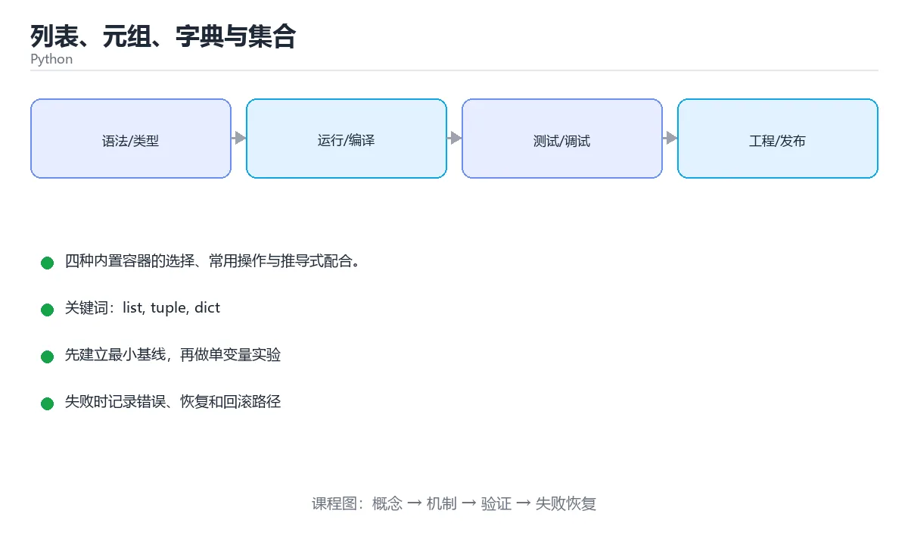

# 列表、元组、字典与集合

> 内容更新时间：2026-10-06 · 学习阶段：入门 · 预计用时：50 分钟



> 学习阶段：基础 · 预计用时：50 分钟
> 先修：《控制流与推导式》 · 后续：《类与对象》

---

## 本节知识框架

本课我们会认识 Python 里最常用的几种数据结构。你可以把它们想象成不同种类的"收纳工具"——有的像抽屉柜（列表），有的像刻了字的石板（元组），有的像通讯录（字典），还有的像一筐不重复的球（集合）。除此之外，我们还会学习用列表模拟栈和队列，以及更灵活的推导式写法。

学完本课，你应该能够：

- 说清元组、集合、字典各自适合什么场景
- 用列表的 `append` / `pop` 模拟栈和队列
- 写出嵌套推导式和带条件的推导式
- 避免新手最常踩的容器使用陷阱

---

## 核心概念定义

### 元组（tuple）——"刻好的石板"

元组一旦创建就不能修改。你可以把它理解成一块刻好字的石板：内容固定、不会被人偷偷改。它适合保存一组"不应该被改变"的数据，比如坐标 `(3, 4)`、配置项、或者函数返回的多个值。

```python
point = (3, 4)
# point[0] = 99  # 这行会报错！元组不能修改
```

### 集合（set）——"不重复的球筐"

集合里的元素不会重复，而且没有固定顺序。最常见的用途就是去重和判断"有没有"。

```python
colors = {"红", "绿", "蓝"}
colors.add("红")       # 不会重复添加
print(len(colors))     # 3，因为"红"已经存在了
```

### 字典进阶——"更聪明的通讯录"

前面我们学过字典的基本用法（`d[key] = value`）。进阶部分主要关注两点：安全取值和常用扩展工具。

- **安全取值**：用 `d.get(key, 默认值)` 代替 `d[key]`，键不存在时不会报错。
- **collections 三件套**：`Counter`（计数器）、`defaultdict`（带默认值的字典）、`OrderedDict`（老版本需要时用）。

### 栈与队列——"用列表模拟"

- **栈（Stack）**：后进先出（LIFO）。想象一摞盘子——最后放上去的最先拿走。用列表的 `append` 和 `pop` 就能模拟。
- **队列（Queue）**：先进先出（FIFO）。想象排队买奶茶——先来的先买。用 `collections.deque` 效率更高，因为它两端操作都是 O(1)。

### 推导式进阶——"一行搞定新序列"

基础推导式我们已经见过：`[x*2 for x in nums]`。进阶内容包括：

- **带条件过滤**：`[x for x in nums if x > 0]`
- **嵌套推导式**：`[(x, y) for x in range(3) for y in range(3)]`
- **字典推导式**：`{k: v for k, v in pairs}`
- **集合推导式**：`{x for x in nums if x > 0}`

---

## 原理与运行机制

### 四种内置容器速查

| 类型 | 写法 | 有序？ | 可变？ | 允许重复？ | 典型用途 |
| --- | --- | --- | --- | --- | --- |
| `list` | `[1, 2]` | 是 | 是 | 是 | 有序集合、栈、队列 |
| `tuple` | `(1, 2)` | 是 | 否 | 是 | 固定数据、函数多返回值、字典键 |
| `dict` | `{"a": 1}` | 是（3.7+） | 是 | 键唯一 | 映射、缓存、计数 |
| `set` | `{1, 2}` | 否 | 是 | 否 | 去重、集合运算、快速判断存在 |

### 字典底层：哈希表

字典和集合的底层都是哈希表。当你写 `d["name"]` 时，Python 先对键 `"name"` 算一个哈希值，然后用这个值直接定位到内存中的位置——所以查找速度是 O(1)，跟字典大小无关。

这也解释了为什么字典的键必须是"可哈希的"（immutable + 实现了 `__hash__`）。列表是可变的不可以当键，但元组如果元素都是不可变的，就可以。

### 栈的工作原理

```python
stack = []
stack.append("第一本书")   # 放上去
stack.append("第二本书")
stack.pop()                # 拿走最上面的 → "第二本书"
```

`append` 在末尾加，`pop` 从末尾拿——后进先出，这就是栈。

### 队列与 deque

如果用列表的 `pop(0)` 来模拟队列，每次都要把后面所有元素往前挪一位，数据量大时非常慢。`collections.deque`（双端队列）两端操作都是 O(1)：

```python
from collections import deque

queue = deque()
queue.append("顾客A")      # 队尾加入
queue.append("顾客B")
queue.popleft()            # 队头取出 → "顾客A"
```

### 推导式是怎么工作的

推导式本质上是一个 `for` 循环的语法糖。Python 在内部会创建一个新列表，逐次把循环变量代入表达式，如果带了 `if` 条件就只保留满足条件的项。

```python
# 这两种写法等价
squares = [x**2 for x in range(5)]

squares = []
for x in range(5):
    squares.append(x**2)
```

推导式通常更快，因为 `append` 的调用在 C 层面完成，省去了每次循环的属性查找开销。

---

## 典型应用场景

### 场景一：用元组返回多个值

```python
def min_max(nums):
    return min(nums), max(nums)   # 其实返回的是元组

low, high = min_max([4, 1, 9, 2])
print(f"最小值：{low}，最大值：{high}")
```

### 场景二：用集合去重

```python
names = ["小明", "小红", "小明", "小刚", "小红"]
unique = list(set(names))
print(unique)   # 顺序可能不同，但只有三个名字
```

如果需要保持原始顺序：

```python
unique_ordered = list(dict.fromkeys(names))
```

### 场景三：用字典做词频统计

```python
text = "the cat the dog the cat"
counts = {}
for word in text.split():
    counts[word] = counts.get(word, 0) + 1
print(counts)   # {'the': 3, 'cat': 2, 'dog': 1}
```

用 `Counter` 更简洁：

```python
from collections import Counter
print(Counter(text.split()).most_common(2))   # [('the', 3), ('cat', 2)]
```

### 场景四：用栈检查括号匹配

```python
def is_balanced(s):
    stack = []
    for ch in s:
        if ch == '(':
            stack.append(ch)
        elif ch == ')':
            if not stack:
                return False
            stack.pop()
    return len(stack) == 0

print(is_balanced("(a+b)*(c-d)"))   # True
print(is_balanced("((abc)"))        # False
```

### 场景五：用推导式做数据变换

```python
# 过滤正数
nums = [-3, -1, 0, 2, 5, -7]
positives = [x for x in nums if x > 0]   # [2, 5]

# 嵌套：展平二维列表
matrix = [[1, 2], [3, 4], [5, 6]]
flat = [x for row in matrix for x in row]   # [1, 2, 3, 4, 5, 6]

# 字典推导式：键值互换
d = {"a": 1, "b": 2}
swapped = {v: k for k, v in d.items()}   # {1: 'a', 2: 'b'}
```

---

## 代码/协议/SQL 示例

### 综合示例：列表、元组、字典与集合

```python
nums = [3, 1, 2]
nums.append(4)          # 末尾追加
nums.insert(0, 9)       # 指定位置插入
nums.sort()             # 原地排序
print(nums[1:3])        # 切片，左闭右开
print(sorted(nums, reverse=True))   # 返回新列表

def min_max(nums):
    return min(nums), max(nums)   # 实际返回元组

low, high = min_max([4, 1, 9])
print(f"最小：{low}，最大：{high}")

user = {"name": "小明", "age": 18}
user["city"] = "上海"
print(user.get("email", "未填写"))   # 取不到时用默认值，不会报错

a = {1, 2, 3}
b = {3, 4}
print(a & b)   # 交集 {3}
print(a | b)   # 并集 {1, 2, 3, 4}
print(a - b)   # 差集 {1, 2}
```

### 推导式进阶示例

```python
# 带条件的列表推导式
words = ["hello", "world", "hi", "python"]
long_words = [w.upper() for w in words if len(w) > 3]
print(long_words)   # ['HELLO', 'WORLD', 'PYTHON']

# 字典推导式：统计每个字母出现的次数
text = "hello"
char_count = {c: text.count(c) for c in set(text)}
print(char_count)   # {'h': 1, 'e': 1, 'l': 2, 'o': 1}

# 集合推导式：提取不重复的元音
vowels = {ch for ch in "programming" if ch in "aeiou"}
print(vowels)   # {'o', 'a', 'i'}

# 嵌套推导式：生成坐标对
coords = [(x, y) for x in range(3) for y in range(3) if x != y]
print(coords)   # [(0,1),(0,2),(1,0),(1,2),(2,0),(2,1)]
```

### 栈与队列完整示例

```python
# 栈：浏览器的前进后退
history = []
history.append("https://google.com")    # 访问 Google
history.append("https://github.com")    # 访问 GitHub
history.append("https://docs.python.org")

last_page = history.pop()   # 后退 → python.org
print(f"后退到：{history[-1]}")   # github.com

# 队列：模拟排队
from collections import deque
queue = deque(["顾客A", "顾客B", "顾客C"])
queue.append("顾客D")       # 新来的排到队尾
next_customer = queue.popleft()   # 叫号 → 顾客A
print(f"下一位：{next_customer}")
print(f"队列剩余：{list(queue)}")
```

---

## 复杂度

理解复杂度能帮你选对容器。下面是最常用的操作对照：

| 操作 | list | tuple | dict / set | deque |
| --- | --- | --- | --- | --- |
| 按下标访问 | O(1) | O(1) | 不适用 | O(n) |
| 按值查找 `in` | O(n) | O(n) | 平均 O(1) | O(n) |
| 尾部追加 | 均摊 O(1) | 不可变 | 平均 O(1) | O(1) |
| 头部插入/删除 | O(n) | 不可变 | 不适用 | O(1) |
| 中间插入/删除 | O(n) | 不可变 | 不适用 | O(n) |

**直觉理解**：

- 数据量一万时，O(n) 和 O(1) 的差别可能不明显。
- 数据量一百万时，O(n) 可能要等几秒，O(1) 还是瞬间完成。
- 所以判断"有没有"时，用 `set` 或 `dict` 远比 `list` 快。

---

## 与其他知识点关系

### 先修

- **控制流与推导式**：本课的推导式进阶建立在基础推导式之上。如果你还不太熟悉 `for` 循环和基础列表推导式，建议先复习。

### 后续衔接

- **类与对象**：字典的 `__hash__` 和 `__eq__` 方法会在面向对象章节详细讲解。当你定义自己的类想放进 `set` 或当字典键时，就需要理解这两个方法。
- **异常处理与文件操作**：`KeyError`、`TypeError: unhashable` 等异常会频繁出现。
- **模块与标准库**：`collections` 模块的 `Counter`、`defaultdict`、`deque` 都是本课内容的延伸。

### 概念关联图

```text
列表(list) ──切片──→ 新列表
    │
    ├── append/pop ──→ 栈（LIFO）
    │
    └── deque ──→ 队列（FIFO）

元组(tuple) ──不可变──→ 可作字典键

字典(dict) ──哈希表──→ O(1) 查找
    │
    ├── get(key, default) ──→ 安全取值
    │
    └── Counter/defaultdict ──→ 统计/默认值

集合(set) ──去重 + 集合运算──→ & | - ^

推导式 ──带条件/嵌套──→ 列表/字典/集合推导式
```

---

## 自测题

完成下面 5 道小题，检验你是否掌握了本课内容。答案就在正文里，先自己想想再往下看。

### 自测 1

说出 `list`、`tuple`、`dict`、`set` 各自最适合的场景（一句话即可）。

**参考答案**：
- `list`：需要顺序和下标的有序数据。
- `tuple`：固定不变的数据，或需要当字典键。
- `dict`：按键查找的映射关系。
- `set`：去重或快速判断存在。

### 自测 2

为什么判断存在性要用 `set` 而不是 `list`？

**参考答案**：`list` 的 `in` 操作是 O(n)，要逐个比较；`set` 的 `in` 是平均 O(1)，通过哈希直接定位。数据量越大，差距越明显。

### 自测 3

写出"去重且保持原顺序"的一行代码。

**参考答案**：`list(dict.fromkeys(names))`

### 自测 4

`a = [0, 1, 2, 3, 4]`，`a[1:4]` 的结果是什么？

**参考答案**：`[1, 2, 3]`。切片左闭右开，取索引 1、2、3 对应的元素。

### 自测 5

`{}` 是什么类型？怎么创建空集合？

**参考答案**：`{}` 是空字典。空集合要写 `set()`。

---

## 时间/空间复杂度或性能分析

（本节内容详见正文各章节的对应说明。）

## 常见误区与易错点

（本节内容详见正文各章节的对应说明。）

## 与其他知识点的关系

（本节内容详见正文各章节的对应说明。）

## 自测题与参考答案

（本节内容详见正文各章节的对应说明。）

## 复习清单

- [ ] 能不看正文复述本课核心术语，并指出一个边界或反例
- [ ] 能默写本课最重要的代码示例，并解释每一行的作用
- [ ] 能说出本课内容和前后两课的联系

## 延伸阅读

想更直观地理解本课概念？推荐参阅以下图解专题：

- [图解内存布局：栈、堆与引用](visual_memory_layout.md)

## 术语速查

| 术语 | 一句话说明 |
| --- | --- |
| 元组（tuple） | 不可变的有序序列，适合保存固定数据和充当字典键 |
| 集合（set） | 无序、不重复的可变容器，用于去重和快速判断存在 |
| 哈希表 | 字典和集合的底层结构，通过哈希值实现 O(1) 查找 |
| 可哈希 | 对象不可变且实现了 `__hash__` 和 `__eq__`，才能当字典键或放进集合 |
| 栈（Stack） | 后进先出（LIFO），用 `list.append` + `list.pop` 模拟 |
| 队列（Queue） | 先进先出（FIFO），用 `deque.append` + `deque.popleft` 模拟 |
| 推导式 | 一行表达式生成新序列，包括列表、字典、集合推导式 |
| 切片 | 用 `nums[a:b]` 取子序列，左闭右开；`nums[:]` 是浅拷贝 |
| `Counter` | `collections` 模块的计数器，自带 `most_common` 方法 |
| `defaultdict` | 带默认值的字典，省去 `setdefault` 或 `get` 的初始化判断 |
| `deque` | 双端队列，两端追加和弹出都是 O(1) |

---

## 考点精讲

下面 6 道题来自本课题库。先自己作答，再核对答案。

### 考点 1

**题目**：这段 `python` 代码对应 `列表、元组、字典与集合` 的 `切片`。课程要解决的是四种内置容器的选择、常用操作与推导式配合。关于代码内容，哪一项说法准确？

- A. 出现字面量 `hello from Python`
- B. 调用了 `min_max()`
- C. 出现字面量 `hello, {name}`
- D. 出现字面量 `列表为空`

**正确项**：B

**解析**：本课综合示例中定义了 `min_max(nums)` 函数，它返回 `(min(nums), max(nums))` 元组。代码中调用了 `min_max()` 来同时获取最小值和最大值。

### 考点 2

**题目**：读取字典中可能不存在的键，且不想抛异常，应该用？

- A. `user[key]`
- B. `user.get`
- C. `user.setdefault`
- D. `user.pop`

**正确项**：B

**解析**：`user.get(key, default)` 在键不存在时返回默认值而不是抛 `KeyError`。`user[key]` 会抛异常；`setdefault` 虽然也不报错但会修改字典；`pop` 会删除键。

### 考点 3

**题目**：围绕“列表、元组、字典与集合”中的 list、tuple、dict，下列哪两项是本课强调的实践判断？

- A. 学习 list 时要同时说明输入、输出和失败路径，不能只看正常流程
- B. 所有容器操作在任何规模下性能都一样
- C. 验证 tuple 时要固定版本并覆盖边界输入，结论才可复现
- D. 字典不需要考虑键的类型

**正确项**：A、C

**解析**：本课反复强调两个实践原则：一是学习任何容器都要同时关注正常路径和失败路径（比如 `KeyError`、`TypeError: unhashable`）；二是验证结论时要固定 Python 版本并覆盖边界输入，这样结论才可复现。

### 考点 4

**题目**：a = [0, 1, 2, 3, 4] 时 a[1:4] 的结果是？

- A. `[0, 1, 2, 3]`
- B. `[1, 2, 3]`
- C. `[1, 2, 3, 4]`
- D. `[0, 1, 2, 3, 4]`

**正确项**：B

**解析**：切片 `a[1:4]` 取索引 1、2、3（左闭右开），对应元素 1、2、3。

### 考点 5

**题目**：作为字典键的对象必须满足？

- A. 必须是字符串
- B. 可哈希
- C. 必须是元组
- D. 必须是不可变类型

**正确项**：B

**解析**：字典键必须是可哈希的（hashable），即不可变且实现了 `__hash__` 和 `__eq__`。字符串、数字、元组（元素也要不可变）都可以当键，但列表不行。注意"不可变"不等于"可哈希"——自定义类即使不可变，如果没有实现 `__hash__` 也不行（虽然默认会提供）。最准确的说法是"可哈希"。

### 考点 6

**题目**：填空：补齐下面这段术语说明中的空缺。课程 `四种内置容器的选择、常用操作与推导式配合。`，这段说明是：`____`会产生新列表：nums[:] 是浅拷贝，nums2 = nums 只是多了一个名字。空缺处应填哪个术语？

**正确项**：切片

**解析**：`nums[:]` 就是切片操作，它会创建一个新列表（浅拷贝）。而 `nums2 = nums` 只是给同一个对象多取了一个名字，修改 `nums2` 也会影响 `nums`。

---

## 内容元数据

- 内容版本：v2.0
- 最后更新：2026-10-19
- 学习阶段：基础
- 适用环境：Python 3.12+
- 课程主题：列表、元组、字典与集合
- 主线：四种内置容器的选择、常用操作与推导式配合
- 相关主题：list、tuple、dict、set、切片、Counter、deque、推导式

---

## 参考资料与复核

- [本课资料锚点 python_data_structures](https://zh.wikipedia.org/w/index.php?search=python_data_structures)

- 最后复核：2026-10-04
- 下次复核：2026-11-10
- 复核范围：列表、元组、字典、集合、切片

| 参考资料 | 本课用途 |
| --- | --- |
| [数据结构](https://docs.python.org/3/tutorial/datastructures.html) | 列表、元组、字典、集合 |
| [切片说明](https://docs.python.org/3/reference/expressions.html#slicings) | 切片语法与语义 |
| [collections 模块](https://docs.python.org/3/library/collections.html) | 高级容器类型 |
