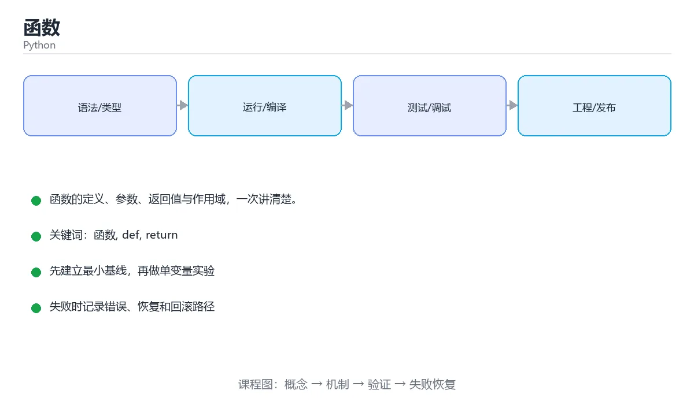

# 函数

> 内容更新时间：2026-10-06 · 学习阶段：基础 · 预计用时：50 分钟



> 学习阶段：基础 · 预计用时：50 分钟 · 更新时间：2026-10-19

## 本节知识框架

本课是 Python 基础系列的第 8 课。在这之前你已经学过了变量、数据类型、条件判断和循环。现在我们要学一个让代码「可复用」的核心工具——**函数**。

本课主线：**函数的定义、参数、返回值与作用域，一次讲清楚。**

学完本课你将能够：

- 用 `def` 定义自己的函数，说清 `def` 和 `return` 各自的角色
- 理解位置参数、默认参数、`*args`、`**kwargs` 的区别
- 解释为什么函数内部的变量不会影响外部同名变量
- 用 `lambda` 写一行就能搞定的小函数

先修内容：《变量与数据类型》。后续衔接：《控制流与推导式》、《类与对象》。

### 复习清单
- [ ] 能用自己的话说明「函数」里的 函数，再举一个它不成立的场景。
- [ ] 能默写本课最重要的代码示例，并解释每一行的作用
- [ ] 能说出本课内容和前后两课的联系

## 核心概念定义

在正式开始之前，先把四个核心术语搞清楚。后面的所有内容都围绕它们展开。

| 术语 | 一句话定义 | 新手常见坑 |
| --- | --- | --- |
| **函数** | 接收输入、执行确定逻辑并返回结果的代码单元 | 函数名和内置函数同名（比如 `list`、`sum`），导致覆盖 |
| **def** | Python 用 `def` 关键字定义函数，函数体必须缩进 | 用可变对象（如 `[]`）作默认参数，多次调用共享同一个对象 |
| **return** | 把结果交回调用方；没有 `return` 时函数返回 `None` | 忘记写 `return`，结果拿到的是 `None` |
| **作用域** | 变量能被访问的范围，函数内部创建的变量走不出去 | 在函数里直接给全局变量赋值，以为能改到外面 |

## 原理与运行机制

### 函数是什么？用生活比喻来理解

想象你每天早上做早餐。你有一套固定的流程：拿面包、打鸡蛋、煎三分钟、装盘。这个过程你可以把它想象成一个**函数**：

| 概念 | 比喻 | 代码 |
| --- | --- | --- |
| 定义函数 | 写一张食谱 | `def make_breakfast():` |
| 调用函数 | 照着食谱做一次 | `make_breakfast()` |
| 参数 | 食谱里可以替换的食材 | `def make_breakfast(egg_type):` |
| 返回值 | 做好的那盘早餐 | `return breakfast` |
| 默认参数 | 没人说就用默认食材 | `def make_breakfast(egg_type="煎蛋"):` |

函数就像**食谱**，参数就像**食材**，返回值就像**做好的菜**。你只需要知道食谱的名字和要准备什么食材，不需要每次都重新想怎么做。

### 为什么需要函数？

不用函数时，同一段代码可能要复制粘贴好几遍：

```python
# 不用函数：重复、容易改漏
print("你好，小明，欢迎回来")
print("你好，小红，欢迎回来")
print("你好，小刚，欢迎回来")
```

用函数后，改一处就够了：

```python
# 用函数：改一次就够了
def greet(name):
    return f"你好，{name}，欢迎回来"

print(greet("小明"))
print(greet("小红"))
print(greet("小刚"))
```

函数带来三个好处：**减少重复、便于测试、方便修改**。

### 用 def 定义函数

定义函数的语法很简单：`def` + 函数名 + 括号里的参数 + 冒号，然后是缩进的函数体。

```python
def greet(name):
    """返回一句问候语。"""
    return f"你好，{name}！"

message = greet("小明")
print(message)  # 你好，小明！
```

几个要点：

- 函数名遵循变量命名规则，建议用**小写+下划线**
- 函数体第一行可以写**文档字符串**（docstring），说明函数做什么
- `return` 把结果交给调用者；遇到 `return` 函数立即结束

### 参数与返回值

#### 形参 vs 实参

| 概念 | 含义 | 例子 |
| --- | --- | --- |
| 形参 | 定义函数时写的占位名 | `def add(a, b)` 里的 `a`、`b` |
| 实参 | 调用函数时传进去的值 | `add(1, 2)` 里的 `1`、`2` |
| 返回值 | 函数交给调用者的结果 | `return a + b` |
| 副作用 | 除了返回值之外做的事 | 打印、写文件、改全局变量 |

#### print 和 return 的区别（新手第一大坑）

`print` 只是把内容显示给人看，`return` 才是把结果交给程序继续用。

```python
def bad_add(a, b):
    print(a + b)      # 只显示，调用者拿不到值

def good_add(a, b):
    return a + b      # 调用者可以继续计算

result = good_add(1, 2)
print(result * 10)    # 30 —— 可以继续运算

result = bad_add(1, 2)  # 输出 3
print(result * 10)      # TypeError! result 是 None
```

记住：**print 是给人看的，return 是给程序用的。**

#### 多返回值

Python 用元组实现「多返回值」，本质仍是一个返回值：

```python
def divide(a, b):
    if b == 0:
        return None, "除数不能为 0"
    return a / b, None

result, error = divide(10, 2)
print(result)  # 5.0
print(error)   # None
```

### 参数的五种写法

参数是函数最灵活的部分，我们从简单到复杂逐一来看。

#### 1. 必填位置参数

```python
def area(width, height):
    return width * height

print(area(3, 4))  # 12
```

#### 2. 默认参数

```python
def area(width, height=1):
    return width * height

print(area(3, 4))    # 12 —— 传了两个参数
print(area(5))       # 5  —— 只传一个，height 默认是 1
```

**重要**：默认值只在函数**定义时**求值一次，不是每次调用都重新算。所以绝对不要用可变对象（列表、字典）当默认值：

```python
# 错误示范：多次调用共享同一个列表
def bad(items=[]):
    items.append(1)
    return items

print(bad())  # [1]
print(bad())  # [1, 1] —— 第二次调用居然多了！

# 正确写法：用 None 做占位
def good(items=None):
    if items is None:
        items = []
    items.append(1)
    return items

print(good())  # [1]
print(good())  # [1] —— 每次都是新列表
```

#### 3. *args：收集任意多个位置参数

```python
def total(*args):
    return sum(args)

print(total(1, 2, 3))     # 6
print(total(10, 20))      # 30
```

`*args` 把所有位置参数收集成一个**元组**。

#### 4. **kwargs：收集任意多个关键字参数

```python
def info(**kwargs):
    for key, value in kwargs.items():
        print(f"{key}: {value}")

info(name="小明", age=18)
# name: 小明
# age: 18
```

`**kwargs` 把所有关键字参数收集成一个**字典**。

#### 5. 关键字限定参数

在 `*` 后面的参数必须用关键字传参，不能按位置传：

```python
def connect(host, port, *, timeout=30):
    print(f"连接 {host}:{port}，超时 {timeout}s")

connect("localhost", 8080)              # OK
connect("localhost", 8080, timeout=5)   # OK
# connect("localhost", 8080, 5)         # TypeError! timeout 必须用关键字
```

参数顺序的固定规则：**位置参数 → 默认参数 → `*args` → 仅关键字参数 → `**kwargs`**。

### 作用域：函数里的变量走不出去

作用域是新手容易困惑的地方，但规则其实很简单：

**函数内部赋值的变量，默认是局部的，函数结束就消失。**

```python
count = 1

def increase():
    count = 2      # 这是新的局部变量，不是外面的 count

increase()
print(count)       # 仍然输出 1 —— 外面的 count 没变
```

如果你确实需要在函数内部修改外部的变量，可以用 `global` 声明：

```python
count = 1

def increase():
    global count    # 声明：我要用的是外面的 count
    count += 1

increase()
print(count)        # 2
```

但是，**更好的做法是通过参数传入、用返回值传出**，尽量避免使用全局变量：

```python
# 推荐写法：不依赖全局变量
def increase(count):
    return count + 1

count = 1
count = increase(count)
print(count)  # 2
```

作用域规则速查：

| 规则 | 说明 |
| --- | --- |
| 函数内新赋值的名字 | 默认是局部的，函数结束就销毁 |
| 读取外层变量 | 可以直接读，不需要特殊声明 |
| 修改外层（非全局）变量 | 用 `nonlocal`（嵌套函数场景） |
| 修改模块级全局变量 | 用 `global`（能不用就不用） |

### lambda：一行搞定小函数

有时候你需要一个很简单的小函数，简单到只有一行表达式，而且只用一次。这时候可以用 `lambda`：

```python
# 普通写法
def square(x):
    return x ** 2

# lambda 写法
square = lambda x: x ** 2

print(square(3))  # 9
```

lambda 最典型的使用场景是作为 `sorted(key=...)` 、`map` 等只需要一次的小函数：

```python
students = [("小明", 88), ("小红", 95), ("小刚", 72)]

# 按成绩排序
students.sort(key=lambda s: s[1])
print(students)  # [('小刚', 72), ('小明', 88), ('小红', 95)]

# 用 map 对每个数求平方
nums = [1, 2, 3, 4]
squared = list(map(lambda x: x ** 2, nums))
print(squared)  # [1, 4, 9, 16]
```

lambda 的限制：只能写一个表达式，不能写多行逻辑，不能有 `if` 语句（但可以用三元表达式），不能有 `return`（表达式本身就是返回值）。如果逻辑复杂，还是老老实实用 `def`。

## 典型应用场景

| 场景 | 说明 | 示例 |
| --- | --- | --- |
| 代码复用 | 同一段逻辑要在多处使用 | 封装一个格式化日期的函数 |
| 逻辑拆分 | 把大段代码拆成小块，每块做一件事 | 主程序调用 `读取数据()`、`清洗数据()`、`输出报告()` |
| 回调函数 | 把函数作为参数传给另一个函数 | `sorted(key=lambda x: x[1])` |
| 闭包与工厂 | 根据参数生成不同行为的函数 | `make_multiplier(n)` 返回 `lambda x: x * n` |

### 闭包简介：函数记住了定义时的环境

闭包就是一个内层函数，它引用了外层函数的变量，即使外层函数已经返回，这些变量仍然可以被访问：

```python
def make_multiplier(n):
    """返回一个乘以 n 的函数。"""
    return lambda x: x * n

double = make_multiplier(2)
triple = make_multiplier(3)

print(double(5))   # 10
print(triple(5))   # 15
```

注意闭包的**延迟绑定**陷阱：在循环里创建闭包并在之后调用，取到的会是最后一次的值。解决办法是用默认参数立即绑定：

```python
# 陷阱
funcs = [lambda: i for i in range(3)]
print([f() for f in funcs])  # [2, 2, 2] —— 全是 2！

# 修复
funcs = [lambda i=i: i for i in range(3)]
print([f() for f in funcs])  # [0, 1, 2] —— 正确
```

## 代码/协议/SQL 示例

### 示例 1：基础函数定义与调用

```python
def greet(name):
    """返回一句问候语。"""
    return f"你好，{name}！"

message = greet("小明")
print(message)  # 你好，小明！
```

### 示例 2：位置参数、关键字参数与默认参数

```python
def area(width, height=1):
    return width * height

print(area(3, 4))              # 位置参数：12
print(area(width=3, height=4)) # 关键字参数：12
print(area(5))                 # 使用默认值 height=1：5
```

### 示例 3：避免可变默认值陷阱

```python
def bad(items=[]):     # 错误示范
    items.append(1)
    return items

def good(items=None):  # 正确写法
    if items is None:
        items = []
    items.append(1)
    return items

print(bad())   # [1]
print(bad())   # [1, 1] —— 共享了同一个列表！

print(good())  # [1]
print(good())  # [1] —— 每次都是新列表
```

### 示例 4：多返回值

```python
def stats(nums):
    """返回最小值、最大值、平均值。"""
    if not nums:
        return None, None, None
    return min(nums), max(nums), sum(nums) / len(nums)

low, high, avg = stats([3, 5, 9])
print(f"最小 {low}，最大 {high}，平均 {avg}")
# 最小 3，最大 9，平均 5.666666666666667
```

### 示例 5：作用域演示

```python
count = 1

def increase():
    count = 2      # 这是新的局部变量

increase()
print(count)       # 仍然输出 1
```

### 示例 6：*args 与 **kwargs

```python
def demo(*args, **kwargs):
    print(f"位置参数: {args}")
    print(f"关键字参数: {kwargs}")

demo(1, 2, 3, name="小明", age=18)
# 位置参数: (1, 2, 3)
# 关键字参数: {'name': '小明', 'age': 18}
```

### 示例 7：lambda 实战

```python
students = [("小明", 88), ("小红", 95), ("小刚", 72)]
students.sort(key=lambda s: s[1])
print(students)
# [('小刚', 72), ('小明', 88), ('小红', 95)]
```

### 示例 8：综合练习——成绩统计函数

```python
def summarize(scores):
    """返回总分、平均分与等级。"""
    if not scores:
        return 0, 0.0, "无数据"

    total = sum(scores)
    average = total / len(scores)
    if average >= 90:
        level = "优秀"
    elif average >= 60:
        level = "及格"
    else:
        level = "不及格"
    return total, round(average, 1), level

total, avg, level = summarize([88, 92, 79])
print(f"总分 {total}，平均 {avg}，等级 {level}")
# 总分 259，平均 86.3，等级 及格
```

## 时间/空间复杂度或性能分析

（本节内容详见正文各章节的对应说明。）

### 补充性能分析
函数的时间复杂度取决于函数体内部的逻辑。这里我们关注的是函数调用本身的开销：

| 操作 | 开销 | 说明 |
| --- | --- | --- |
| 函数调用 | 极低 | Python 创建帧对象、绑定参数，通常在纳秒级 |
| 默认参数求值 | 只在定义时一次 | 所以可变默认值才会在多次调用间共享 |
| `*args` 打包 | O(n) | n 是传入的位置参数个数 |
| `**kwargs` 打包 | O(k) | k 是传入的关键字参数个数 |
| lambda 创建 | 极低 | 和普通函数一样，只是语法更紧凑 |

性能建议：

- 不要在循环里反复创建函数（尤其是 lambda），能提到循环外就提
- 需要缓存计算结果时，用 `functools.lru_cache`
- 函数调用的开销通常可以忽略，先保证代码可读性

## 常见误区与易错点

（本节内容详见正文各章节的对应说明。）

## 与其他知识点的关系

（本节内容详见正文各章节的对应说明。）

### 补充关联
- **先修**：《变量与数据类型》——变量、类型、运算符是写函数体的基础
- **直接后续**：《控制流与推导式》——函数体里经常用到 if、for、推导式
- **深入衔接**：《类与对象》——类的方法本质上就是绑定到对象上的函数
- **高级主题**：《装饰器与生成器》——装饰器接收函数返回新函数，生成器是特殊的函数
- **相关课程**：《C 控制流、函数与作用域》、《函数、作用域与 this》——其他语言中的函数和作用域对比

容易混淆的概念对比：

| 概念 A | 概念 B | 区别 |
| --- | --- | --- |
| `def` | `return` | `def` 负责定义函数，`return` 负责把结果交出去 |
| `print` | `return` | `print` 显示给人看，`return` 交给程序继续用 |
| `*args` | `**kwargs` | `*args` 收集位置参数成元组，`**kwargs` 收集关键字参数成字典 |
| `global` | `nonlocal` | `global` 改模块级变量，`nonlocal` 改嵌套函数的外层变量 |

## 自测题与参考答案

（本节内容详见正文各章节的对应说明。）

## 考点精讲

围绕“函数”中的函数、def、return，以下是考试常考的题目。先自己作答，再核对答案。

### 考点 1

- **题目**：阅读 `函数` 的 `def` 示例。它服务于函数的定义、参数、返回值与作用域，一次讲清楚。代码中实际包含下列哪一项？
- **正确项**：出现字面量 `你好，{name}！`
- **提示**：回顾本课示例 1 中 `greet` 函数的返回值，注意 f-string 里的内容。

### 考点 2

- **题目**：围绕“函数”中的 函数、def、return，下列哪两项是本课强调的实践判断？
- **正确项**：验证 def 时要固定版本并覆盖边界输入，结论才可复现；学习 函数 时要同时说明输入、输出和失败路径，不能只看正常流程
- **提示**：函数既要验证正常流程，也要验证失败路径（如空输入、类型错误）。

### 考点 3

- **题目**：函数内部给外部同名变量赋值，会发生什么？
- **正确项**：创建局部变量，外部变量不变
- **提示**：回顾作用域部分——函数内赋值默认创建局部变量，不影响外部。

### 考点 4

- **题目**：*args 与 **kwargs 的区别是？
- **正确项**：*args 收集位置参数成元组
- **提示**：`*args` 对应元组，`**kwargs` 对应字典。

### 考点 5

- **题目**：lambda 最典型的使用场景是？
- **正确项**：作为 sorted(key=...)、map 等只需要一次的小函数
- **提示**：lambda 适合简短的、只用一次的回调逻辑。

### 考点 6

- **题目**：填空：补齐下面这段术语说明中的空缺。课程 `函数的定义、参数、返回值与作用域，一次讲清楚。`，这段说明是：`____`：接收输入、执行确定逻辑并返回结果的代码单元。空缺处应填哪个术语？
- **正确项**：函数
- **提示**：这个术语是本课的核心概念。

## 术语速查

| 术语 | 一句话说明 |
| --- | --- |
| `def` | 定义函数的关键字，函数体必须缩进 |
| `return` | 把结果交回调用方；没有 `return` 时函数返回 `None` |
| 参数 | 函数接收的输入，分为位置参数和关键字参数 |
| 默认参数 | 调用时可以不传的参数，定义时求值一次 |
| `*args` | 收集任意多个位置参数为元组 |
| `**kwargs` | 收集任意多个关键字参数为字典 |
| 作用域 | 变量能被访问的范围 |
| `global` | 声明函数内使用的是模块级全局变量 |
| `nonlocal` | 在嵌套函数中修改外层的非全局变量 |
| `lambda` | 匿名函数，只能写一个表达式 |
| 闭包 | 内层函数记住外层函数的变量 |
| 文档字符串 | 函数第一行的字符串，用 `help(f)` 查看 |

## 参考资料与复核

- 最后复核：2026-10-04
- 下次复核：2026-11-10
- 复核范围：函数定义、参数、返回值、作用域

| 参考资料 | 本课用途 |
| --- | --- |
| [函数定义](https://docs.python.org/3/tutorial/controlflow.html#defining-functions) | def 语法与用法 |
| [参数传递](https://docs.python.org/3/faq/programming.html#how-do-i-write-a-function-with-output-parameters) | 位置参数、关键字参数 |
| [作用域与 LEGB](https://docs.python.org/3/tutorial/classes.html#python-scopes-and-namespaces) | 名字查找规则 |

### 进阶学习资源
想更直观地理解本课概念？推荐参阅以下图解专题：

- [图解调用栈与递归](visual_call_stack.md)

## 内容元数据

- 内容版本：v2.0
- 最后更新：2026-10-19
- 学习阶段：基础
- 适用环境：Python 3.12+；本课聚焦 函数。
- 内容来源：内置结构化课程与工程实践整理
- 相关主题：函数、def、return、参数、作用域、lambda
