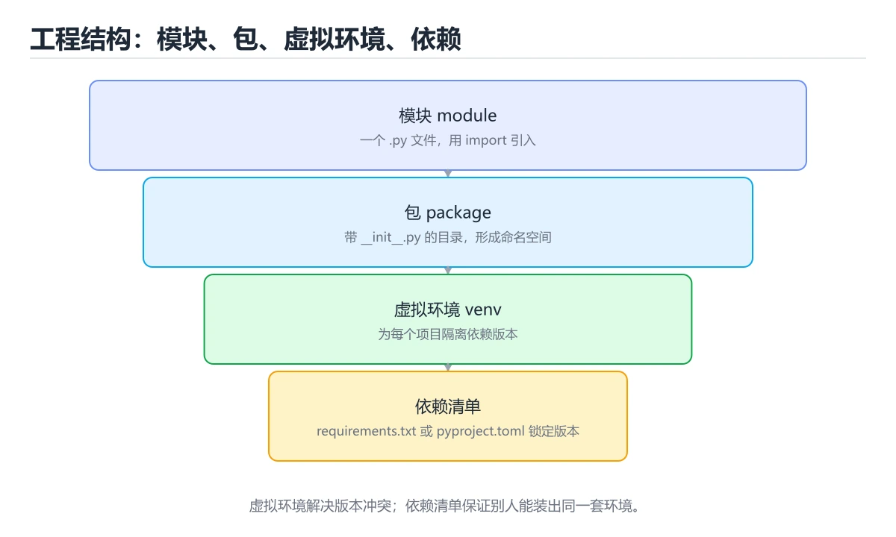
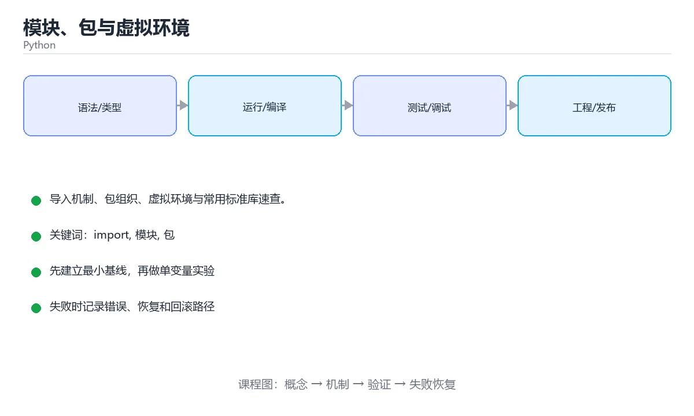

# 模块、包与虚拟环境

> 内容更新时间：2026-10-06 · 学习阶段：进阶 · 预计用时：45 分钟





> 学习阶段：进阶 · 预计用时：45 分钟 · 适用环境：Python 3.12+

---

## 本节知识框架

想象你搬进了一间新厨房。厨房里有各种工具——刀、锅、搅拌机——但你不需要自己制造它们，只需要知道"在哪里拿、怎么用"就行了。Python 的**模块**和**标准库**就是你编程厨房里的工具箱：Python 出厂就帮你准备好了，拿来即用。

本课主线：**导入机制、包组织、虚拟环境与常用标准库速查**。

**学完本课你应当能够**
- 说清 `from .text import slugify` 与“模块”的含义与区别，并各举一个正例和一个反例。
- 用本课示例验证"包"的行为，记录输入、输出与失败条件。
- 遇到"文件名与标准库重名"这类问题时，能说出触发条件与修复顺序。

## 核心概念定义

| 术语 | 一句话解释（类比） | 操作性定义 | 常见边界与风险 |
| --- | --- | --- | --- |
| 模块 | 一本工具手册 | 把相关代码、资源和接口封装成可独立复用与维护的单元。 | 易错：`ImportError` 或半初始化模块；正确做法是拆出公共模块或用函数内导入。 |
| 包 | 一排书柜 | 把一组相关类型、函数或模块组织在一起的命名空间单元。 | 静态检查只在编译期成立，运行期输入仍需校验。 |
| 相对导入 | 在书柜里说"旁边那本" | 用点号表示包内层级，只在包被导入时可用，直接运行脚本会失败。 | 易错：`ImportError: attempted relative import`；正确做法是用 `python -m 包名.模块` 运行。 |
| `from .text import slugify` | 从旁边的手册里取一个工具 | 包内推荐使用绝对导入；相对导入（`from .text import slugify`）只在包内部使用。 | 这行只在包被导入时才生效，把 `text.py` 本身当脚本运行就取不到；点号还要数准层级，一个点和两个点取到的是不同目录下的同名文件。 |
| 虚拟环境 | 独立工作间 | 每个项目有自己的依赖副本，互不干扰。 | 忘记激活虚拟环境会导致包装到全局。 |
| 标准库 | 出厂自带工具箱 | Python 安装后自带的模块集合，无需额外安装。 | 不同 Python 版本可能包含的模块不同。 |

---

## 原理与运行机制

### 用"图书馆"类比理解导入机制

把 Python 想象成一座大图书馆：

- **模块** = 一本书（一个 `.py` 文件）
- **包** = 一个书架（一个目录，里面有多个模块）
- **`import`** = 你去书架上取书（告诉 Python 你需要哪个模块）
- **标准库** = 图书馆的"常备参考书区"（Python 自带的模块）
- **虚拟环境** = 你租了一间私人书房，里面的书只属于你，不会跟别人的藏书混在一起

### 导入的四个阶段

| 阶段 | 发生了什么 | 失败时应检查 |
| --- | --- | --- |
| 查找 | Python 在 `sys.path` 里搜索模块文件 | 路径是否正确？是否在虚拟环境中？ |
| 加载 | 读取 `.py` 文件并执行其中的代码 | 文件是否有语法错误？是否有依赖缺失？ |
| 绑定 | 把模块中的名字绑定到当前命名空间 | 名字是否拼写正确？大小写是否一致？ |
| 使用 | 通过模块名或导入的名字调用功能 | 是否传入了正确类型的参数？ |

### `if __name__ == "__main__"` 是怎么回事？

这行代码就像一个"门禁卡"：

```python
def main():
    print("程序入口")

if __name__ == "__main__":
    main()
```

- 当你**直接运行**这个文件时（`python script.py`），Python 把 `__name__` 设为 `"__main__"`，门禁通过，`main()` 执行。
- 当别的文件**导入**这个文件时，`__name__` 是模块名（比如 `"script"`），门禁不通过，`main()` 不执行。

这就好比你写了一封信（函数定义），信里夹了一个"仅限本人拆封"的标签（`if __name__ == "__main__"`）。别人帮你转交时不会拆，只有你自己收到时才拆。

### 虚拟环境与依赖速查

| 目的 | 命令 |
| --- | --- |
| 创建虚拟环境 | `python -m venv .venv` |
| 激活（Windows） | `.venv\Scripts\activate` |
| 激活（macOS / Linux） | `source .venv/bin/activate` |
| 退出 | `deactivate` |
| 导出依赖 | `pip freeze > requirements.txt` |
| 安装依赖 | `pip install -r requirements.txt` |
| 以脚本方式运行模块 | `python -m http.server 8000` |

---

## 典型应用场景

### 场景一：日常脚本开发

你需要写一个脚本，批量重命名文件夹里的图片。这时 `pathlib` 和 `os` 就是你的好帮手——不用装任何第三方包，Python 自带就能搞定。

### 场景二：数据处理小工具

老板让你统计一份 CSV 里的词频。`collections.Counter` 一行代码搞定，不用引入 pandas 这种"重型武器"。

### 场景三：项目工程化

项目越写越大，你需要把代码拆成多个文件。这时"包"的概念就派上用场了——用目录和 `__init__.py` 把相关模块组织在一起。

### 依赖管理工具对比

| 工具 | 定位 | 特点 |
| --- | --- | --- |
| venv + pip | 标准库方案 | 无额外依赖，requirements.txt 记录版本 |
| pip-tools | 编译式依赖管理 | 从 requirements.in 生成锁定版本 |
| Poetry | 一体化工具 | 依赖解析 + 打包 + 发布 |
| uv | 极快的现代工具 | Rust 实现，兼容 pip 生态 |

### 推荐项目布局

```text
project/
├── main.py
├── pyproject.toml
├── src/
│   └── mypackage/
│       ├── __init__.py
│       ├── text.py
│       └── math_utils.py
└── tests/
    └── test_text.py
```

把源码放 `src/` 可避免"本地能导入、安装后不能"的问题。

### 常见坑一览

| 坑 | 现象 | 正确做法 |
| --- | --- | --- |
| 文件名与标准库重名 | `random.py` 导致导入错乱 | 别用 `json.py`、`re.py` 这类名字 |
| 循环导入 | `ImportError` 或半初始化模块 | 拆出公共模块或用函数内导入 |
| 忘了 `encoding="utf-8"` | 中文乱码 | 读写文本一律指定 |
| 用 `os.path` 拼字符串 | 跨平台出错 | 用 `pathlib` |
| 不用虚拟环境 | 依赖冲突 | 每项目独立 `.venv` |
| 用 `eval` 解析 JSON | 安全漏洞 | 用 `json.loads` |
| 用 `datetime.now()` 存时间 | 时区混乱 | 存 UTC，展示再转本地 |
| 把密码写进代码 | 泄露 | 用环境变量或配置外置 |

---

## 代码/协议/SQL 示例

### 第一步：最简单的导入（像从工具箱拿工具）

```python
import math                     # 导入整个模块——把工具箱全搬过来
from math import sqrt, pi       # 只拿需要的工具
from pathlib import Path as P   # 拿工具并起个别名

print(math.floor(3.7), sqrt(16), pi)
# 输出：3 4.0 3.141592653589793
```

**类比**：`import math` 就像把整个工具箱搬到桌上；`from math import sqrt` 就像只从工具箱里拿出一把螺丝刀。

### 第二步：理解 `__name__ == "__main__"`

```python
def greet(name):
    return f"你好，{name}！"

def main():
    print("程序入口")
    print(greet("小明"))

if __name__ == "__main__":
    main()
```

这就像一台自动贩卖机：投币（直接运行）才能出货，但别人看到机器结构（导入时）不会自动出货。

### 第三步：组织成包

```text
project/
├── main.py
└── utils/
    ├── __init__.py      # 这个文件让 Python 把 utils 识别为包
    ├── text.py          # 文本处理工具
    └── math_utils.py    # 数学工具
```

```python
# main.py —— 从包里导入
from utils.text import slugify

print(slugify("Hello World"))  # 输出：hello-world
```

```python
# utils/text.py
def slugify(text: str) -> str:
    return text.lower().replace(" ", "-")
```

包内推荐使用绝对导入；相对导入（`from .text import slugify`）只在包内部使用。

### 第四步：虚拟环境操作

```bash
python -m venv .venv                  # 创建虚拟环境——搭建独立工作间

# Windows
.venv\Scripts\activate
# macOS / Linux
source .venv/bin/activate

pip install requests                  # 安装第三方依赖
pip freeze > requirements.txt         # 导出依赖清单——拍一张工具清单的照片
pip install -r requirements.txt       # 还原环境——按清单重新采购
deactivate                            # 退出工作间
```

### 第五步：标准库实战——综合示例

```python
import json
import re
from collections import Counter, defaultdict
from datetime import datetime, timezone
from functools import lru_cache
from pathlib import Path

# 1. pathlib：路径操作不再是字符串拼接
base = Path("data")
base.mkdir(exist_ok=True)
(base / "note.txt").write_text("你好", encoding="utf-8")

# 2. json：序列化与反序列化
payload = {"id": 1, "tags": ["py", "db"]}
(base / "config.json").write_text(
    json.dumps(payload, ensure_ascii=False, indent=2), encoding="utf-8"
)

# 3. Counter：一行做词频——就像数苹果，看哪种最多
words = "a b a c a".split()
print(Counter(words).most_common(2))          # [('a', 3), ('b', 1)]

# 4. defaultdict：免去判空——自动准备空容器
groups = defaultdict(list)
for name in ["小明", "小红", "小刚"]:
    groups[name[0]].append(name)

# 5. re：提取与校验——用模式匹配找文字
print(re.findall(r"\d+", "订单 12 号，金额 88 元"))  # ['12', '88']

# 6. datetime：带时区的时间
print(datetime.now(timezone.utc).isoformat())

# 7. lru_cache：把重复计算缓存起来——像把算过的答案贴在墙上
@lru_cache(maxsize=None)
def fib(n: int) -> int:
    return n if n < 2 else fib(n - 1) + fib(n - 2)

print(fib(100))  # 瞬间出结果，没有缓存会算到天荒地老
```

### 第六步：日志统计实战

```python
import json
import re
from collections import Counter
from pathlib import Path

def summarize(log_dir: str) -> dict:
    """统计日志目录中所有 .log 文件的日志级别分布。"""
    levels = Counter()
    total_lines = 0
    for file in Path(log_dir).glob("*.log"):
        for line in file.read_text(encoding="utf-8").splitlines():
            total_lines += 1
            match = re.search(r"\b(INFO|WARN|ERROR)\b", line)
            if match:
                levels[match.group(1)] += 1
    return {"files": len(list(Path(log_dir).glob("*.log"))),
            "lines": total_lines,
            "levels": dict(levels)}

if __name__ == "__main__":
    print(json.dumps(summarize("logs"), ensure_ascii=False, indent=2))
```

### 常用标准库速查表

| 模块 | 用途 | 高频 API |
| --- | --- | --- |
| `pathlib` | 路径与文件 | `Path("a") / "b"`、`read_text`、`write_text`、`exists` |
| `os` | 环境与目录 | `os.environ`、`os.getenv`、`os.makedirs` |
| `sys` | 解释器信息 | `sys.argv`、`sys.exit`、`sys.path` |
| `json` | JSON 读写 | `json.loads`、`json.dumps(ensure_ascii=False)` |
| `datetime` | 日期时间 | `datetime.now()`、`timedelta`、`strftime` |
| `collections` | 专用容器 | `Counter`、`defaultdict`、`deque`、`namedtuple` |
| `itertools` | 迭代工具 | `chain`、`groupby`、`combinations`、`islice` |
| `functools` | 函数工具 | `lru_cache`、`partial`、`reduce` |
| `re` | 正则表达式 | `re.findall`、`re.sub`、`re.compile` |
| `random` | 随机 | `random.choice`、`shuffle`、`randint` |
| `statistics` | 统计 | `mean`、`median`、`stdev` |
| `csv` | CSV 读写 | `csv.reader`、`DictReader`、`DictWriter` |
| `logging` | 日志 | `logging.basicConfig`、`logger.exception` |
| `subprocess` | 调用外部命令 | `subprocess.run([...], check=True)` |
| `timeit` | 计时 | `timeit.timeit`、`-m timeit` 命令行 |

---

## 时间/空间复杂度或性能分析

### 导入的性能开销

**类比**：第一次 `import` 一个模块就像第一次去图书馆借书——你要找到书、翻开、读完。但 Python 很聪明，**同一个模块只会被加载一次**，之后再 `import` 只是从缓存里取（就像记住书在哪个架子上了）。

| 操作 | 时间开销 | 空间开销 | 说明 |
| --- | --- | --- | --- |
| 首次 `import` 一个小模块 | ~1ms | 几十 KB | 读取文件 + 执行顶层代码 |
| 首次 `import` 一个大模块（如 `numpy`） | ~100ms+ | 几十 MB | 包含大量 C 扩展 |
| 重复 `import` 同一模块 | ~0.001ms | 0 | 直接从 `sys.modules` 缓存取 |
| `from module import name` | 与 `import module` 相同 | 略少 | 模块仍然全部加载，只是绑定了一个名字 |

### 性能测量方法

```python
import timeit

# 测量导入耗时
print(timeit.timeit("import json", number=1000))

# 测量标准库函数调用耗时
print(timeit.timeit("json.dumps({'a': 1})", setup="import json", number=10000))
```

### 需要注意的性能陷阱

- **不要在循环里反复导入**：虽然重复导入很快，但完全没必要。
- **`from module import *`** 会把模块里所有公开名字都注入当前命名空间，既慢又容易冲突。
- **大项目里包太深**：层级过深的包结构会增加导入路径解析的时间，但通常可以忽略不计。

---

## 常见误区与易错点

| 容易写错的做法 | 实际现象 | 原因与正确做法 |
| --- | --- | --- |
| 文件名与标准库重名 | `random.py` 导致导入错乱 | 别用 `json.py`、`re.py` 这类名字 |
| 循环导入 | `ImportError` 或半初始化模块 | 拆出公共模块或用函数内导入 |
| 忘了 `encoding="utf-8"` | 中文乱码 | 读写文本一律指定 |
| 用 `os.path` 拼字符串 | 跨平台出错 | 用 `pathlib` |
| 不用虚拟环境 | 依赖冲突 | 每项目独立 `.venv` |
| 用 `eval` 解析 JSON | 安全漏洞 | 用 `json.loads` |
| `from os import *` | 名字冲突，来源不清 | 显式导入需要的名字 |
| `import json` 后写 `loads(...)` | `NameError` | 要写 `json.loads(...)`，或用 `from json import loads` |
| 在包内使用相对导入直接运行文件 | `ImportError: attempted relative import` | 用 `python -m 包名.模块` 运行 |
| `json.dumps` 中文变 `\uXXXX` | 输出难以阅读 | 加 `ensure_ascii=False` |
| `subprocess.run("ls -l")` | `FileNotFoundError` | 传参数列表：`subprocess.run(["ls", "-l"])` |
| 用 `re.match` 想匹配任意位置 | 匹配不到 | `match` 只从开头匹配，任意位置用 `re.search` |
| 在循环里用 `+=` 拼字符串 | 数据量大时变慢 | 收集到列表后用 `"".join()` |

### 现场排错 1：文件名与标准库重名

**症状**：你写了一个 `random.py`，运行时报错或行为诡异。

**根因**：Python 先在你当前目录找模块，找到了你的 `random.py`，而不是标准库的 `random`。就像你给朋友打电话，结果打给了同名同姓的陌生人。

**修复**：别用 `json.py`、`re.py`、`random.py`、`math.py` 这类名字。

### 现场排错 2：循环导入

**症状**：`ImportError` 或模块里某些名字是 `None`。

**根因**：A 导入 B，B 又导入 A，就像两个人互相等对方先走，结果谁都走不了。

**修复**：拆出公共模块 C，让 A 和 B 都导入 C；或者在函数内部导入（延迟导入）。

### 现场排错 3：相对导入直接运行

**症状**：`ImportError: attempted relative import`。

**根因**：相对导入只在包被导入时有效。直接运行文件时，Python 不知道这个文件属于哪个包。

**修复**：用 `python -m 包名.模块` 运行，而不是 `python 包名/模块.py`。

---

## 与其他知识点的关系

- **先修**：`异常处理与文件操作`。本课默认你已经会处理 `ValueError`、读写文件。
- **相关或后续**：`类型注解与测试`。本课术语会在这些课程里继续使用。
- **术语归属**：`from .text import slugify`、`模块`、`包` 的定义以本课"核心概念定义"为准。

## 自测题与参考答案

> 先独立作答，再对照参考答案。

### 自测 1（概念复述）

不看正文，写出"模块"和"包"各自的定义，并说明它们的区别。

**参考答案**：模块是把相关代码、资源和接口封装成可独立复用与维护的单元（一个 `.py` 文件）。包是把一组相关类型、函数或模块组织在一起的命名空间单元（一个目录）。区别：模块是单个文件，包是包含多个模块的目录。

### 自测 2（排错）

如果你的脚本名叫 `json.py`，运行后可能出现什么问题？怎么修复？

**参考答案**：现象是导入错乱——你的脚本"遮蔽"了标准库的 `json` 模块。根因是 Python 优先在当前目录查找模块。修复：把文件改名，别用 `json.py`、`re.py` 这类名字。

### 自测 3（动手验证）

运行本课的 `collections.Counter` 示例，把 `"a b a c a"` 换成 `"hello world hello"` 后重新运行，记录输出。

**参考答案**：`Counter("hello world hello".split()).most_common(2)` 输出 `[('hello', 2), ('world', 1)]`。

### 自测 4（代码阅读）

阅读本课的 `if __name__ == "__main__"` 示例，说明如果这个文件被别的文件导入，`main()` 会不会执行。

**参考答案**：不会。被导入时 `__name__` 等于模块名而不是 `"__main__"`，所以条件不满足，`main()` 不执行。

### 自测 5（迁移）

你需要在项目中读写 JSON 配置文件。请写出使用 `pathlib` 和 `json` 完成读写的代码。

**参考答案**：
```python
import json
from pathlib import Path

config_path = Path("config.json")
# 写入
config_path.write_text(
    json.dumps({"debug": True}, ensure_ascii=False, indent=2),
    encoding="utf-8"
)
# 读取
data = json.loads(config_path.read_text(encoding="utf-8"))
```

### 自测 6（对比）

用一个表格对比 `import json` 和 `from json import loads` 的区别。

**参考答案**：

| 写法 | 使用方式 | 命名空间影响 |
| --- | --- | --- |
| `import json` | `json.loads(...)` | 只引入 `json` 一个名字 |
| `from json import loads` | `loads(...)` | 引入 `loads`，代码更简洁但来源不直观 |

---

## 复习清单

- [ ] 能不看正文复述本课核心术语，并指出一个边界或反例
- [ ] 能默写本课最重要的代码示例，并解释每一行的作用
- [ ] 能说出本课内容和前后两课的联系

## 延伸阅读

想更直观地理解本课概念？推荐参阅以下图解专题：

- [图解调用栈与递归](visual_call_stack.md)

## 术语速查

| 术语 | 一句话说明 |
| --- | --- |
| 模块 | 一个 `.py` 文件，把相关代码封装成可复用的单元。 |
| 包 | 一个包含 `__init__.py` 的目录，组织多个模块。 |
| `import` | 告诉 Python 你需要某个模块，就像从书架上取书。 |
| 相对导入 | 包内部用点号表示层级关系，如 `from .text import slugify`。 |
| 虚拟环境 | 每个项目独立的依赖空间，避免版本冲突。 |
| 标准库 | Python 自带的模块集合，无需 `pip install`。 |
| `__name__` | 模块的内置属性，直接运行时为 `"__main__"`，被导入时为模块名。 |
| `sys.path` | Python 查找模块的路径列表。 |

---

## 考点精讲

本课题库共 6 道题，下面逐题给出题干、正确项与判断依据。先自己作答，再核对正确项，最后回到正文对应小节复核。

### 考点 1：第 1 题

- **题目**：围绕“模块、包与虚拟环境”中的 import、模块、包，下列哪两项是本课强调的实践判断？
- **正确项**：学习 import 时要同时说明输入、输出和失败路径，不能只看正常流程；验证 模块 时要固定版本并覆盖边界输入，结论才可复现
- **判断依据**：按《模块、包与虚拟环境》的正文口径，本题要同时选中「学习 import 时要同时说明输入、输出和失败路径，不能只看正常流程」、「验证 模块 时要固定版本并覆盖边界输入，结论才可复现」，漏掉任一项都算没答全。术语 模块（模块、包与虚拟环境）：把相关代码、资源和接口封装成可独立复用与维护的单元。易错点是文件名与标准库重名，会造成`random.py` 导致导入错乱，改法是别用 `json.py`、`re.py` 这类名字。

### 考点 2：第 2 题

- **题目**：为每个项目创建虚拟环境的主要目的是？
- **正确项**：隔离项目依赖，避免版本冲突
- **判断依据**：本题正确项是「隔离项目依赖，避免版本冲突」。术语 from .text import slugify（模块、包与虚拟环境）：包内推荐使用绝对导入，相对导入（`from .text import slugify`）只在包内部使用，本题取「隔离项目依赖，避免版本冲突」这条。易错点是循环导入，会造成`ImportError` 或半初始化模块，改法是拆出公共模块或用函数内导入。

### 考点 3：第 3 题

- **题目**：统计词频最方便的标准库是？
- **正确项**：collections.Counter
- **判断依据**：本题正确项是「collections.Counter」。术语 from .text import slugify（模块、包与虚拟环境）：包内推荐使用绝对导入，相对导入（`from .text import slugify`）只在包内部使用，本题取「collections.Counter」这条。易错点是忘了 `encoding="utf-8"`，会造成中文乱码，改法是读写文本一律指定。

### 考点 4：第 4 题

- **题目**：下面这段 `python` 代码来自 `模块、包与虚拟环境`。课程主线是导入机制、包组织、虚拟环境与常用标准库速查。代码与 `from .text import slugify` 有关。哪一项是代码里真实出现的内容？
- **正确项**：调用了 `floor()`
- **判断依据**：本题正确项是「调用了 `floor()`」。术语 from .text import slugify（模块、包与虚拟环境）：包内推荐使用绝对导入，相对导入（`from .text import slugify`）只在包内部使用，本题取「调用了 `floor()`」这条。易错点是用 `os.path` 拼字符串，会造成跨平台出错，改法是用 `pathlib`。本题干扰项「调用了 `fillMaxSize()`」不成立：展示代码里找不到 `fillMaxSize()`。

### 考点 5：第 5 题

- **题目**：pathlib.Path 相比手写字符串拼接路径的优势是？
- **正确项**：跨平台分隔符自动处理
- **判断依据**：本题正确项是「跨平台分隔符自动处理」。术语 from .text import slugify（模块、包与虚拟环境）：包内推荐使用绝对导入，相对导入（`from .text import slugify`）只在包内部使用，本题取「跨平台分隔符自动处理」这条。易错点是不用虚拟环境，会造成依赖冲突，改法是每项目独立 `.venv`。

### 考点 6：第 6 题

- **题目**：填空：补齐下面这段术语说明中的空缺。课程 `导入机制、包组织、虚拟环境与常用标准库速查。`，这段说明是：`____`：把一组相关类型、函数或模块组织在一起的命名空间单元。空缺处应填哪个术语？
- **正确项**：包
- **判断依据**：涉及术语 模块：把相关代码、资源和接口封装成可独立复用与维护的单元。易错点：文件名与标准库重名会造成`random.py` 导致导入错乱。正确做法：别用 `json.py`、`re.py` 这类名字。判断时先确认输入和适用范围，对照 `import`、`模块`、`包`、`venv` 复现一次，最后把错误表现与正确做法逐项对照。

---

## 内容元数据

- 内容版本：v2.0
- 最后更新：2026-10-06
- 学习阶段：进阶
- 适用环境：Python 3.12+
- 内容来源：内置结构化课程与工程实践整理
- 相关主题：import、模块、包、venv、pip、标准库
- 质量版本：P0 测验标准 + P1 覆盖扩展 + P2 体验补全

---

## 参考资料与复核

- 最后复核：2026-10-04
- 下次复核：2026-12-10
- 复核范围：版本兼容、API 行为、安全建议与工程实践
- 来源性质：官方文档、标准或权威教材；本课核对关键词：import、模块、包、venv、pip、标准库。

| 参考资料 | 本课用途 |
| --- | --- |
| [Python Modules and Packages – Real Python](https://realpython.com/python-modules-packages/) | 模块与包的入门讲解，含导入机制详解 |
| [The Python Standard Library – docs.python.org](https://docs.python.org/3/library/) | 标准库全部模块的官方 API 文档 |
| [Python import statement – Python Documentation](https://docs.python.org/3/reference/import.html) | 导入机制的官方规范，含 `sys.path` 和包导入细节 |
| [venv — Creation of virtual environments](https://docs.python.org/3/library/venv.html) | 虚拟环境的官方文档 |
| [Python Packaging User Guide](https://packaging.python.org/) | 依赖管理、打包与发布的最佳实践 |
| [collections — Container datatypes](https://docs.python.org/3/library/collections.html) | Counter、defaultdict、deque 等容器的官方文档 |
| [pathlib — Object-oriented filesystem paths](https://docs.python.org/3/library/pathlib.html) | 路径操作的官方文档 |
