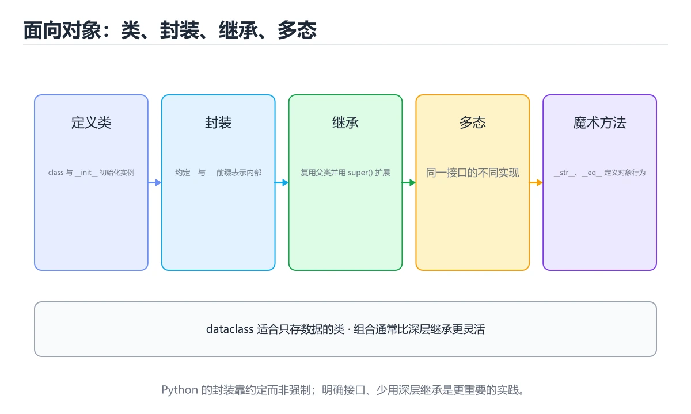
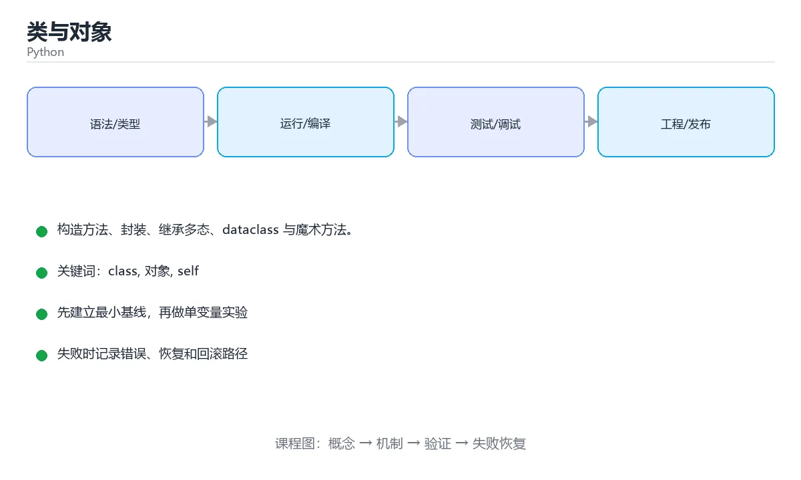

# 类与对象

> 内容更新时间：2026-10-06 · 学习阶段：进阶 · 预计用时：30 分钟





## 本节知识框架

想象你开了一家蛋糕店。你有一张"蛋糕配方"（类），上面写着需要什么原料、怎么烘烤；而每一位顾客拿到的蛋糕（对象），都是按这张配方做出来的具体成品。Python 的面向对象编程（OOP）就是这套"配方→成品"的思维工具。

**本课主线**：构造方法、封装、继承多态、dataclass 与魔术方法。

**学完本课你应当能够**
- 用自己的话解释 `__init__` 和 `class` 分别是什么，并各举一个正例和一个反例。
- 运行本课示例，观察对象的行为，记录输入、输出与出错情况。
- 遇到"忘了写 `self`"这类报错时，能快速定位并修复。

**先修与衔接**：本课是 Python 分类的第 12 课。先修内容为《列表、元组、字典与集合》。后续课程包括《异常处理与文件操作》、《类与面向对象》、《继承、接口与多态》、《对象、原型与类》。

## 核心概念定义

下面这些术语是理解面向对象的基础。别急着一口气全记住——先混个脸熟，后面每节都会反复出现。

| 术语 | 一句话解释（类比） | 常见坑 |
| --- | --- | --- |
| 类（class） | 一张"图纸"或"模具"，定义了对象长什么样、能做什么。就像蛋糕配方。 | 静态检查只在编译期成立，运行期输入仍需校验。 |
| 对象（实例） | 按图纸造出来的"实物"。就像按配方做出的那块蛋糕。 | 用可变对象作类属性会导致所有实例共享同一个列表。 |
| `__init__` | 构造方法——对象"出生"时自动执行的初始化流程。就像蛋糕出炉后自动涂奶油。 | 忘记在 `__init__` 里创建实例属性，会导致共享状态。 |
| self | 指向"对象自己"。就像每块蛋糕知道自己叫什么名字。 | 忘了写 self 会报 TypeError。 |
| 实例属性 | 每个对象独有的数据。就像每块蛋糕有自己的口味和重量。 | 可变默认值应放在 `__init__` 里。 |
| 类属性 | 所有对象共享的数据。就像配方上写的"品牌名"，所有蛋糕都一样。 | 可变的类属性最容易被误改。 |
| 封装 | 把数据藏起来，只通过方法访问。就像把保险箱锁上，只留一个取钱口。 | 直接改 `_` 属性会绕过校验。 |
| 继承 | 在已有图纸基础上做修改，不用从零画起。就像在基础蛋糕上加水果变水果蛋糕。 | 继承层次过深会改一处牵动全身。 |
| 多态 | 同一个指令，不同对象有不同反应。就像你说"叫！"，狗汪汪叫，猫喵喵叫。 | 需要配合继承使用。 |
| 魔术方法 | Python 内置的"暗号"方法，如 `__str__`、`__eq__`，让对象支持内置操作。 | 实现了 `__eq__` 后 `__hash__` 会被置空。 |

## 原理与运行机制

### 从配方到蛋糕：面向对象的运行流程

让我们用"开蛋糕店"的类比来理解整个过程：

**第一步：设计图纸（定义类）**

你先在纸上写下蛋糕的配方——需要什么原料（属性），怎么加工（方法）。在 Python 里，这就是用 `class` 关键字定义一个类。

**第二步：开工生产（实例化对象）**

每当有顾客下单，你就按配方做一块蛋糕。`Dog("旺财", 3)` 这样的调用就像下了一张订单——Python 会先创建一块"空白蛋糕"，然后自动调用 `__init__` 给它"涂奶油"（初始化属性）。

**第三步：使用成品（调用方法与属性）**

蛋糕做好了，你可以查看它的信息（访问属性），也可以让它执行动作（调用方法）。当你 `print(dog)` 时，Python 会自动调用 `__str__` 方法，就像给蛋糕贴上一张可读的标签。

### 三条设计建议

1. **一个类只做一件事**——方法围绕同一份数据，就像一把瑞士军刀不如专用工具可靠。
2. **优先组合而不是深层继承**——把对象作为属性嵌入，就像乐高积木拼接，而不是俄罗斯套娃层层嵌套。继承不超过两层。
3. **数据简单时用 `@dataclass`**——不要手写一堆样板代码，就像有现成模板就不用每次从头写邮件。

### 魔术方法速查表

| 魔术方法 | 什么时候被触发 | 常见用途 |
| --- | --- | --- |
| `__init__` | 创建实例后 | 初始化属性 |
| `__repr__` | `repr()`、调试器、容器展示 | 给开发者看的精确描述 |
| `__str__` | `print()`、`str()` | 给用户看的友好文本 |
| `__eq__` | `==` | 定义相等语义 |
| `__hash__` | `hash()`、放进 `set`/`dict` 键 | 不可变对象才适合哈希 |
| `__len__` | `len(obj)` | 容器类语义 |
| `__getitem__` | `obj[key]` | 支持下标与切片 |
| `__iter__` | `for x in obj` | 定义可迭代行为 |
| `__enter__` / `__exit__` | `with obj:` | 上下文管理（自动释放资源） |
| `__call__` | `obj()` | 让实例像函数一样被调用 |

## 典型应用场景

面向对象几乎在 every Python 项目里都会用到。下面列举几个最典型的场景，帮你建立直觉。

**场景 1：用类组织相关数据和行为**
当你发现一组函数总是在操作同一份数据时，就该把它们打包成一个类。比如一个银行账户——余额（数据）和存款、取款（行为）天然属于同一个类。

**场景 2：用继承减少重复代码**
如果你有"猫"和"狗"两个类，它们都需要"吃"和"睡"的方法，那就抽出一个"动物"父类，让猫和狗继承它。就像连锁店的各个分店共享总店的运营手册，但可以有各自的特色。

**场景 3：用封装保护数据安全**
银行账户的余额不应该被直接修改——必须通过"存款"和"取款"方法，这样才能检查金额是否合法。封装就像给数据加了一把锁。

**场景 4：用 dataclass 快速创建数据容器**
当你只需要一个"数据包裹"（比如坐标点、配置项），用 `@dataclass` 可以省掉大量样板代码。就像用现成的快递盒，不用自己裁纸板。

### 选择与边界

- 使用 `__init__` 时，先确保 `self` 作为第一个参数，并在其中创建实例属性（而不是用可变对象作类属性）。
- 使用 `class` 时，记住它只是模板——静态检查只在编译期成立，运行期输入仍需校验。
- 使用继承时，优先组合，继承不超过两层，并确保调用 `super().__init__(...)`。

## 代码/协议/SQL 示例

### 示例 1：最小可验证示例——定义一只狗

```python
class Dog:
    species = "犬科"          # 类属性，所有实例共享——就像所有狗都属于犬科

    def __init__(self, name, age):
        self.name = name      # 实例属性——每只狗有自己的名字
        self.age = age        # 实例属性——每只狗有自己的年龄

    def bark(self):
        return f"{self.name} 在叫"

    def __str__(self):        # 打印对象时的显示内容
        return f"Dog({self.name}, {self.age})"

dog = Dog("旺财", 3)
print(dog.bark(), dog.species)  # 输出：旺财 在叫 犬科
```

**逐行解读**：
- `class Dog:` —— 画出图纸
- `species = "犬科"` —— 所有狗共享的信息，写在类里
- `def __init__(self, name, age):` —— 每只狗"出生"时要填的信息
- `self.name = name` —— 把名字记到这只狗自己的档案里
- `dog = Dog("旺财", 3)` —— 按图纸造一只叫旺财、3岁的狗

### 示例 2：封装——保护银行账户

```python
class Account:
    def __init__(self, balance=0):
        self._balance = balance      # 单下划线：约定内部使用，别直接碰

    @property
    def balance(self):               # 只读属性——只能看，不能直接改
        return self._balance

    def deposit(self, amount):
        if amount <= 0:
            raise ValueError("金额必须为正")
        self._balance += amount

account = Account()
account.deposit(100)
print(account.balance)               # 输出：100，像属性一样访问，实际调用方法
```

**类比**：`_balance` 就像保险箱里的钱，`@property` 就像保险箱上的透明窗口——你能看到余额，但想改钱必须通过存款/取款方法。

### 示例 3：继承与多态——动物说话

```python
class Animal:
    def speak(self):
        raise NotImplementedError

class Cat(Animal):
    def speak(self):
        return "喵"

class Duck(Animal):
    def speak(self):
        return "嘎"

for animal in [Cat(), Duck()]:
    print(animal.speak())     # 输出：喵 \n 嘎 —— 同一个方法名，行为不同
```

**类比**：你对一群动物说"叫！"——猫喵喵叫，鸭子嘎嘎叫。指令相同，反应各异，这就是多态。

子类用 `super().__init__(...)` 调用父类构造方法，就像分店开业时先执行总店的标准化流程，再添加自己的特色。

### 示例 4：数据类——简洁的坐标点

```python
from dataclasses import dataclass

@dataclass
class Point:
    x: int
    y: int

a = Point(1, 2)
b = Point(1, 2)
print(a == b)          # True，dataclass 自动生成 __eq__
```

**类比**：`@dataclass` 就像自动填表——你只需要声明"我有 x 和 y 两个字段"，Python 自动帮你生成 `__init__`、`__repr__`、`__eq__` 等方法。

**运行方式**：保存为 `.py` 文件后用 `python 文件名.py` 运行；第三方依赖先在虚拟环境里安装。

## 时间/空间复杂度或性能分析

### 性能关注点

面向对象的主要开销来自解释执行与对象分配。创建大量小对象时，内存和 GC（垃圾回收）压力是需要关注的重点。

**本课特有开销**：
- **类定义**：类本身的定义在模块加载时执行一次，开销可忽略。
- **实例创建**：每次 `Dog("旺财", 3)` 都会分配内存并调用 `__init__`，小规模使用几乎无感；大规模创建（如百万级对象）时需要测量。
- **属性查找**：`dog.name` 会触发属性查找链（实例 → 类 → 父类），比局部变量访问稍慢。

### 测量方法

以本课的 `Dog` 类为例，固定输入跑一遍记录基线，再把对象数量提高一个数量级复测；两次结果的差值才是结论依据。

```text
# 测量示例（使用 timeit）
python -m timeit "Dog('旺财', 3)" "from mymodule import Dog"
```

### 优化手段

| 手段 | 适用场景 | 效果 |
| --- | --- | --- |
| `__slots__` | 需要创建大量实例 | 减少内存，阻止动态添加属性 |
| `@dataclass` | 数据容器 | 减少手写样板，性能与普通类相当 |
| 类属性缓存 | 不变的计算结果 | 避免重复计算 |
| 组合替代继承 | 继承层次过深 | 减少方法解析链长度 |

### 需要控制的变量

- 固定 Python 版本（3.12+），不同版本的对象分配策略可能不同。
- 固定输入规模，分别记录创建时间、内存峰值与 GC 次数。
- 达到边界时不要外推，必须重新测量。

## 常见误区与易错点

| 容易写错的做法 | 实际现象 | 原因与正确做法 |
| --- | --- | --- |
| 忘了写 `self` | `TypeError: takes 1 positional argument but 2 were given` | 实例方法第一个参数必须是 `self` |
| 用可变对象作类属性 | 所有实例共享同一个列表 | 在 `__init__` 里创建实例属性 |
| 直接改 `_` 属性 | 绕过校验，数据不一致 | 提供方法或 `@property` |
| 继承层次过深 | 改一处牵动全身 | 优先组合，继承不超过两层 |
| 忘了调用 `super()` | 父类初始化没执行 | `super().__init__(...)` |
| 用 `is` 比较对象值 | 结果不符预期 | 实现 `__eq__` 并用 `==` |
| 把类当函数用 | 忘了加括号 | `Dog("旺财")` 才是实例 |
| 只用 `__eq__` 不写 `__hash__` | 类变成不可哈希，无法放进 `set` | 定义了 `__eq__` 后 `__hash__` 会被置空 |
| 直接访问 `self.__x` | `AttributeError` | 双下划线会被改名成 `_类名__x` |
| `@property` 里写耗时 IO | 访问属性变慢且难察觉 | 属性应是廉价操作 |

### 现场排错 1：忘了写 `self`

**症状**：`TypeError: takes 1 positional argument but 2 were given`。

**根因**：Python 调用实例方法时会自动把对象本身作为第一个参数传入。如果你没在定义时写 `self`，Python 还是会传一个参数进来，方法就会"多收一个参数"而报错。

**修复**：实例方法第一个参数必须是 `self`。

### 现场排错 2：用可变对象作类属性

**症状**：所有实例共享同一个列表。

**根因**：类属性在类定义时只创建一次。如果你写 `items = []` 在类里，所有实例会共享同一个列表。

**修复**：在 `__init__` 里创建实例属性：`self.items = []`。

### 现场排错 3：把类当函数用

**症状**：忘了加括号，拿到的是类本身而不是实例。

**根因**：`Dog` 是类（图纸），`Dog("旺财")` 才是实例（蛋糕）。

**修复**：`Dog("旺财")` 才是实例。

## 与其他知识点的关系

| 关系 | 课程 | 为什么相关 |
| --- | --- | --- |
| 先修 | 《列表、元组、字典与集合》 | 本课会直接使用字典来理解属性存储。 |
| 关联 | 《异常处理与文件操作》 | 类的方法中经常需要处理异常和读写文件。 |
| 关联 | 《类与面向对象》 | 本课是 OOP 的基础篇，后续课程会深入继承与接口。 |
| 关联 | 《继承、接口与多态》 | 本课介绍了继承基础，后续课程会讲多重继承和 MRO。 |
| 关联 | 《对象、原型与类》 | 本课从 class 角度讲，后续课程会对比原型式编程。 |
| 前置顺序 | 《Python 字符串、Unicode 与格式化》 | 同分类中安排在本课之前，f-string 在本课大量使用。 |
| 后续顺序 | 《异常处理与文件操作》 | 同分类中安排在本课之后，会继续使用本课术语。 |

**术语归属**：`__init__`、`class`、`对象` 的定义以本课"核心概念定义"为准，换到其他课程时先确认定义是否被改写。

## 自测题与参考答案

> 先独立作答，再对照参考答案；答案都能在本课正文、术语表或错误表里找到依据。

### 自测 1（概念复述）

不看正文，写出 `__init__` 的操作性定义，并说明它与 `class` 的区别。

**参考答案**：`__init__` 是构造方法，`self` 指向实例本身，必须作为第一个参数。`class` 是定义对象属性与行为的类型模板，实例化后得到具体对象。两者的差别：`class` 是整张图纸，`__init__` 是图纸中"开工第一步"的指令。

### 自测 2（排错）

本课错误表记录了"忘了写 `self`"这类做法。请写出它会出现的现象、根因，以及修复顺序。

**参考答案**：现象是 `TypeError: takes 1 positional argument but 2 were given`；根因是实例方法第一个参数必须是 `self`。修复时先复现现象并保留证据，再改动一处假设重跑，确认现象消失。

### 自测 3（动手验证）

运行本课的 Python 示例，把其中的 `"犬科"` 换成空字符串后重新运行，记录输出与错误信息。

**参考答案**：正常输入下示例应当复现正文给出的结果；把 `"犬科"` 换成空字符串后，程序不会报错（因为 Python 不限制类属性的类型），但输出会变成 `旺财 在叫`（species 为空）。这说明类属性可以是任意字符串，需要根据业务需求做校验。

### 自测 4（代码阅读）

阅读本课的 Python 示例，说明它体现了 `__init__` 的哪一条性质，并指出改动哪个输入会让这条性质不再成立。

**参考答案**：`__init__` 的定义是构造方法，`self` 指向实例本身，必须作为第一个参数。示例中 `Dog("旺财", 3)` 自动调用了 `__init__`，把 name 和 age 绑定到这个具体实例上。如果去掉 `self` 参数，这条性质就不再成立，会报 TypeError。

### 自测 5（迁移）

把本课的方法迁移到自己的项目：围绕 `__init__` 写出一个与错误表同类的风险点，并说明触发条件和检验方式。

**参考答案**：例如"在类里写 `def __init__(self, name)` 却用 `Dog()` 调用"，它会导致 `TypeError: missing 1 required positional argument`；检验方式是按"构造函数需要参数，或给默认值"改一处再复现，确认现象消失且没有引入新的失败分支。

### 自测 6（对比）

用一个表格对比 `__init__` 与 `class`：各写一行适用场景、一行失败表现。

**参考答案**：`__init__` 的定义是构造方法，`self` 指向实例本身，必须作为第一个参数；适用场景是对象初始化。`class` 的定义是定义对象属性与行为的类型模板；适用场景是定义类型。两者的失败表现分别对应本课错误表里与本术语相关的行。

## 复习清单

- [ ] 能不看正文复述本课核心术语，并指出一个边界或反例
- [ ] 能默写本课最重要的代码示例，并解释每一行的作用
- [ ] 能说出本课内容和前后两课的联系

## 延伸阅读

想更直观地理解本课概念？推荐参阅以下图解专题：

- [图解内存布局：栈、堆与引用](visual_memory_layout.md)

## 术语速查

| 术语 | 一句话说明 |
| --- | --- |
| `class` | 图纸——定义对象长什么样、能做什么。 |
| `对象` | 按图纸造出来的实物，每个对象有自己独立的属性。 |
| `__init__` | 构造方法，对象"出生"时自动执行，`self` 必须是第一个参数。 |
| `self` | 指向当前实例，调用方法时不用手动传。 |
| 实例属性 | 每个对象独有的数据，在 `__init__` 里创建。 |
| 类属性 | 所有对象共享的数据，直接写在类里。 |
| 封装 | 通过命名约定和 `@property` 保护数据。 |
| 继承 | 子类在父类基础上扩展，用 `super()` 调用父类。 |
| 多态 | 同一个方法名，不同对象有不同行为。 |
| 魔术方法 | `__str__`、`__eq__`、`__len__` 等，让对象支持 Python 内置操作。 |

**术语关系链**：`class`（图纸）→ `__init__`（开工指令）→ `对象`（成品）→ `实例属性`（成品上的具体信息）。

## 考点精讲

本课题库共有 6 道题，下面逐题给出题干、正确项与判断依据。建议先自己作答，再核对正确项，最后回到正文对应小节复核。

### 考点 1：第 1 题

- **题目**：围绕“类与对象”中的 class、对象、self，下列哪两项是本课强调的实践判断？
- **正确项**：学习 class 时要同时说明输入、输出和失败路径，不能只看正常流程；验证 对象 时要固定版本并覆盖边界输入，结论才可复现
- **判断依据**：按《类与对象》的正文口径，本题要同时选中「学习 class 时要同时说明输入、输出和失败路径，不能只看正常流程」、「验证 对象 时要固定版本并覆盖边界输入，结论才可复现」，漏掉任一项都算没答全。术语 class（类与对象）：定义对象属性与行为的类型模板，实例化后得到具体对象。易错点是忘了写 `self`，改法是实例方法第一个参数必须是 `self`。

### 考点 2：第 2 题

- **题目**：子类构造方法中调用父类构造方法的写法是？
- **正确项**：super.__init__
- **判断依据**：本题正确项是「super.__init__」。术语 __init__（类与对象）：`__init__` 是构造方法，`self` 指向实例本身，必须作为第一个参数，本题取「super.__init__」这条。易错点是用可变对象作类属性，会造成所有实例共享同一个列表，改法是在 `__init__` 里创建实例属性。

### 考点 3：第 3 题

- **题目**：@property 装饰器的作用是？
- **正确项**：让方法可以像属性一样访问
- **判断依据**：本题正确项是「让方法可以像属性一样访问」。术语 __init__（类与对象）：`__init__` 是构造方法，`self` 指向实例本身，必须作为第一个参数，本题取「让方法可以像属性一样访问」这条。易错点是直接改 `_` 属性，会造成绕过校验，数据不一致，改法是提供方法或 `@property`。

### 考点 4：第 4 题

- **题目**：下面这段 `python` 代码来自 `类与对象`。课程主线是构造方法、封装、继承多态、dataclass 与魔术方法。代码与 `__init__` 有关。哪一项是代码里真实出现的内容？
- **正确项**：代码里出现了 `__init__` 这个名字
- **判断依据**：本题正确项是「代码里出现了 `__init__` 这个名字」。术语 __init__（类与对象）：`__init__` 是构造方法，`self` 指向实例本身，必须作为第一个参数，本题取「代码里出现了 `__init__` 这个名字」这条。易错点是继承层次过深，会造成改一处牵动全身，改法是优先组合，继承不超过两层。本题干扰项「出现字面量 `: true, `」不成立：展示代码里找不到 `true`。

### 考点 5：第 5 题

- **题目**：@classmethod 与 @staticmethod 的区别是？
- **正确项**：classmethod 第一个参数是 cls 可访问类本身，staticmethod 不接收自动参数
- **判断依据**：本题正确项是「classmethod 第一个参数是 cls 可访问类本身，staticmethod 不接收自动参数」。术语 class（类与对象）：定义对象属性与行为的类型模板，实例化后得到具体对象，本题取「classmethod 第一个参数是 cls 可访问类本身，staticmethod 不接收自动参数」这条。易错点是忘了调用 `super()`，会造成父类初始化没执行，改法是`super().__init__(...)`。

### 考点 6：第 6 题

- **题目**：填空：补齐下面这段术语说明中的空缺。课程 `构造方法、封装、继承多态、dataclass 与魔术方法。`，这段说明是：类是一张模板，`____`是按模板造出来的实例。空缺处应填哪个术语？
- **正确项**：对象
- **判断依据**：涉及术语 class：定义对象属性与行为的类型模板，实例化后得到具体对象。易错点：忘了写 `self`会造成`TypeError: takes 1 positional argument but 2 were given`。正确做法：实例方法第一个参数必须是 `self`。

## 内容元数据

- 内容版本：v2.0
- 最后更新：2026-10-06
- 学习阶段：进阶
- 适用环境：Python 3.12+
- 内容来源：内置结构化课程与工程实践整理
- 相关主题：class、对象、self、继承、多态、dataclass
- 质量版本：P0 测验标准 + P1 覆盖扩展 + P2 体验补全

## 参考资料与复核

- 最后复核：2026-10-04
- 下次复核：2026-12-10
- 复核范围：版本兼容、API 行为、安全建议与工程实践
- 来源性质：官方文档、标准或权威教材；本课核对关键词：class、对象、self、继承、多态、dataclass。

| 参考资料 | 本课用途 |
| --- | --- |
| [Python 官方教程 - 类](https://docs.python.org/3/tutorial/classes.html) | Python 类与对象的官方入门教程，涵盖 class 语法、继承、作用域 |
| [Python 语言参考 - 数据模型](https://docs.python.org/3/reference/datamodel.html) | 魔术方法（`__init__`、`__str__`、`__eq__` 等）的权威定义 |
| [Python 标准库 - dataclasses](https://docs.python.org/3/library/dataclasses.html) | `@dataclass` 装饰器的完整用法与 field 参数说明 |
| [Real Python: Object-Oriented Programming in Python 3](https://realpython.com/python3-object-oriented-programming/) | 面向初学者的 OOP 概念讲解与实战示例 |
| [Python 官方 HOWTO - 描述符协议](https://docs.python.org/3/howto/descriptor.html) | `@property` 底层原理，理解属性访问机制 |

> 本课的链接用于离线阅读后的延伸核对；App 不会自动联网。
