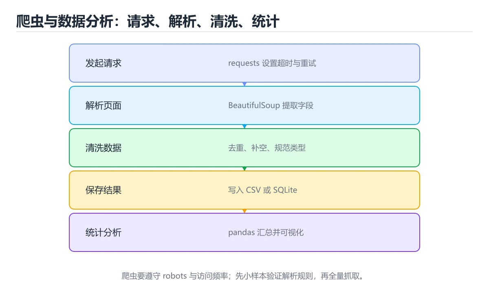
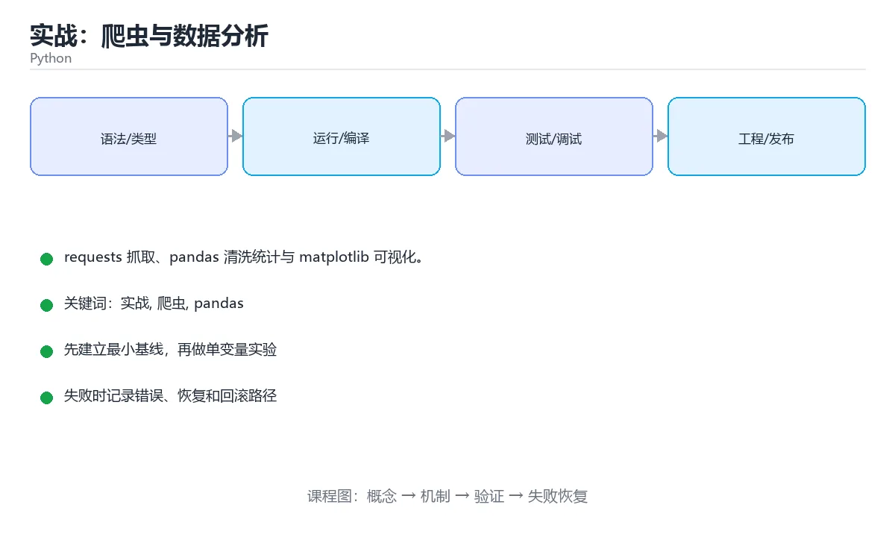

# 实战：爬虫与数据分析





> 内容更新时间：2026-10-06 · 学习阶段：高级 · 预计用时：80 分钟

嗨，欢迎来到这堂课！你有没有想过，怎么从网上自动收集一堆数据，然后把它整理成漂亮的图表？比如你想知道"豆瓣上评分最高的 100 部电影都是什么类型"，或者"某个电商网站上最便宜的蓝牙耳机有哪些"——手动一条条复制粘贴太累了，但用 Python 写几行代码就能搞定。

这就是本课要做的事：**用 Python 从网上抓取数据，清洗整理，再做统计和可视化**。整个过程就像做菜：先去市场买菜（抓取），然后洗菜切菜（清洗），最后下锅烹饪摆盘（分析与可视化）。

## 本节知识框架

在正式动手之前，我们先看看这堂课的知识地图。你可以把它想象成一张旅行路线图——我们一共要经过四个站点：

**第一站：网络请求（requests）** —— 学会让 Python 帮你"打开网页"
**第二站：数据清洗（pandas）** —— 把抓回来的"原材料"洗干净、整理好
**第三站：统计分析** —— 算出你想要的数字，比如平均值、排名
**第四站：可视化（matplotlib）** —— 把数字变成图表，一眼就能看明白

**学完本课你应当能够**
- 说清 `timeout` 与 `fillna` 的含义与区别，并各举一个正例和一个反例。
- 用本课示例验证 `User-Agent` 的行为，记录输入、输出与失败条件。
- 遇到「代码放在仓库根目录」这类问题时，能说出触发条件与修复顺序。

## 核心概念定义

别被术语吓到——每个概念我都会先用大白话解释，再给一个生活中的类比。

| 术语 | 一句话大白话 | 生活类比 | 常见边界与风险 |
| --- | --- | --- | --- |
| timeout | 你给快递小哥设的"最等多久"的闹钟。要点：`timeout` 必填，`raise_for_status()` 检查状态码，选择器优先用稳定的 class 或 data 属性。 | 去餐厅吃饭，你跟服务员说"超过 20 分钟没上菜我就走"——这就是 timeout。 | 易错：不设 timeout，请求可能永久挂起；正确做法是一律设置 `timeout=(连接, 读取)`。 |
| fillna | 表格里的"空白格"怎么填——用默认值补上，或者干脆删掉那一行。常见清洗动作：去空白、统一大小写、类型转换、缺失值处理（`fillna` / `dropna`）、去重（`drop_duplicates`）。 | 老师收上来 30 份试卷，发现有两份名字没写——你可以给它们填上"未知"（fillna），也可以直接退回去（dropna）。 | 易错：没先用 `df.isna().sum()` 摸底就 `fillna(0)`，缺失被当成真实数值参与统计，后续汇总口径出错。 |
| User-Agent | 你寄快递时填的"寄件人名字"——告诉对方你是谁。抓取遵守 robots.txt 与服务条款，控制频率、加 `User-Agent`。 | 去别人家拜访要先敲门报上名来，不能偷偷摸摸——User-Agent 就是你的"自我介绍"。 | 易错：以为换个 `User-Agent` 就能绕过限制；正文要求的是遵守 robots.txt、加延时并控制并发上限。 |
| 实战 | 把前面学的零件组装成一辆能开的车。实战：爬虫与数据分析解决了什么问题，而不是只背术语。 | 学了方向盘、油门、刹车的知识后，真正上路开一圈——这就是实战。 | 易错：脚本能跑就算完；整车还包括分层、日志与依赖版本锁定，缺了这些换台机器就复现不出来。 |

## 原理与运行机制

### 整体流程：像做菜一样的四步法

让我们用一个完整的类比来理解整个流程。想象你要做一道"数据沙拉"：

```text
第一步（抓取）  →  去超市买菜：用 requests 打开网页，把 HTML "搬"回来
第二步（解析）  →  择菜洗菜：用 BeautifulSoup 从 HTML 里挑出你要的数据
第三步（清洗）  →  切菜配菜：用 pandas 去空白、补缺失、去重、转换类型
第四步（分析）  →  拌沙拉装盘：用 pandas 统计 + matplotlib 画图
```

### requests 抓取：让 Python 帮你打开网页

你平时打开浏览器访问网页，其实是浏览器向服务器发了一个"请求"。Python 的 `requests` 库能做同样的事——只不过它不需要你点鼠标。

```python
import requests

# 就像你在浏览器地址栏输入网址然后按回车
response = requests.get("https://quotes.toscrape.com/page/1/", timeout=10)

# 检查服务器有没有报错（就像检查快递有没有破损）
response.raise_for_status()

# 拿到网页的 HTML 内容
html = response.text
```

**为什么要设 timeout？** 想象你打电话给朋友，铃声响了很久没人接——你总不能一直举着电话等下去吧？`timeout=10` 就是说"等 10 秒没人接我就挂掉"。

### BeautifulSoup 解析：从网页里"挑"数据

HTML 就像一本没有目录的书，内容都在里面，但你需要一个"索引"才能快速找到你要的段落。BeautifulSoup 就是这个索引工具。

```python
from bs4 import BeautifulSoup

soup = BeautifulSoup(html, "html.parser")

# 用 CSS 选择器找到所有 class="quote" 的元素
for quote in soup.select(".quote"):
    text = quote.select_one(".text").get_text(strip=True)
    author = quote.select_one(".author").get_text(strip=True)
    print(f"{author} 说：{text}")
```

### pandas 清洗：把"脏数据"变干净

抓回来的数据往往不完美——可能有空行、多余的空格、重复的记录。pandas 就像一个超级强大的 Excel，专门处理这种"脏数据"。

```python
import pandas as pd

# 把抓到的数据变成一张表格
df = pd.DataFrame([
    {"text": "名言1", "author": "  鲁迅  ", "tags": ["文学", "思想"]},
    {"text": "名言2", "author": "鲁迅", "tags": ["文学"]},
    {"text": None, "author": "", "tags": []},  # 缺失数据
])

# 清洗：去空白
df["author"] = df["author"].str.strip()

# 清洗：填补缺失值
df["text"] = df["text"].fillna("未知内容")

# 清洗：去重
df = df.drop_duplicates(subset=["text"])
```

### matplotlib 可视化：让数据"说话"

数字看多了容易眼花，但一张图就能让人秒懂。matplotlib 就是 Python 里最常用的画图工具。

```python
import matplotlib.pyplot as plt

# 统计每个标签出现的次数
tag_counts = df["tags"].explode().value_counts().head(5)

# 画一张横向柱状图
tag_counts.plot(kind="barh")
plt.title("出现最多的标签 Top 5")
plt.tight_layout()
plt.savefig("tags.png", dpi=120)
```

### 工程化建议：写好代码的四个习惯

1. 抓取遵守 robots.txt 与服务条款，控制频率、加 `User-Agent`。
2. 把「抓取 / 清洗 / 分析 / 输出」拆成独立函数，便于测试与复用。
3. 长任务加日志与断点续跑（把已抓数据落盘）。
4. 用 Jupyter Notebook 探索，定型后沉淀为 `.py` 模块。

### pandas 速查表

| 目的 | 写法 | 类比 |
| --- | --- | --- |
| 读 CSV / Excel | `pd.read_csv("a.csv")` / `pd.read_excel("a.xlsx")` | 打开一个文件 |
| 查看概览 | `df.head()`、`df.info()`、`df.describe()` | 快速翻一翻这本书 |
| 选列 | `df[["name", "price"]]` | 只看某一栏 |
| 条件过滤 | `df[df["price"] > 100]` | 筛掉不满足条件的行 |
| 分组聚合 | `df.groupby("category")["price"].mean()` | 按类别算平均 |
| 排序 | `df.sort_values("price", ascending=False)` | 从高到低排 |
| 去重 | `df.drop_duplicates(subset=["id"])` | 删掉重复的 |
| 缺失值 | `df.isna().sum()`、`df.fillna(0)`、`df.dropna()` | 处理空白格 |
| 导出 | `df.to_csv("out.csv", index=False, encoding="utf-8-sig")` | 保存成文件 |

**教材衔接：项目专属规格**
## 典型应用场景

### 场景一：电商比价

你想知道某个商品在不同平台的价格——用爬虫分别抓取各平台的价格页面，用 pandas 整理成表格对比，用 matplotlib 画一张价格趋势图。

### 场景二：舆情分析

你想追踪某个话题在微博上的讨论——抓取相关帖子，清洗掉广告和重复内容，统计每天的情感倾向变化，画成折线图。

### 场景三：学术论文调研

你想了解某个领域近五年的研究热点——从学术网站抓取论文标题和关键词，统计高频关键词，画成词云或柱状图。

### 用生活比喻理解项目结构

| 目录 | 比喻 | 说明 |
| --- | --- | --- |
| `src/` | 车间 | 真正的代码都在这里 |
| `tests/` | 验收区 | 自动化测试，确保代码没出 bug |
| `pyproject.toml` | 产品说明书 | 依赖、脚本、构建配置都写在这里 |
| `.env.example` | 样例表单 | 告诉别人要配哪些变量 |
| `README.md` | 使用手册 | 怎么装、怎么跑 |

## 代码/协议/SQL 示例

### 第一步：搭建环境

```bash
python -m venv .venv
.venv\Scripts\activate
pip install requests beautifulsoup4 pandas matplotlib
pip freeze > requirements.txt
```

这就像做菜前先把锅碗瓢盆准备好——`requests` 负责抓取，`beautifulsoup4` 负责解析 HTML，`pandas` 负责清洗和统计，`matplotlib` 负责画图。

### 第二步：抓取与解析

```python
import requests
from bs4 import BeautifulSoup

def fetch_quotes(page=1):
    url = f"https://quotes.toscrape.com/page/{page}/"
    response = requests.get(url, timeout=10)
    response.raise_for_status()               # 4xx/5xx 直接抛异常
    soup = BeautifulSoup(response.text, "html.parser")
    items = []
    for quote in soup.select(".quote"):
        items.append({
            "text": quote.select_one(".text").get_text(strip=True),
            "author": quote.select_one(".author").get_text(strip=True),
            "tags": [tag.get_text(strip=True) for tag in quote.select(".tag")],
        })
    return items
```

要点：`timeout` 必填，`raise_for_status()` 检查状态码，选择器优先用稳定的 class 或 data 属性。

### 第三步：清洗与统计

```python
import pandas as pd

rows = [item for page in range(1, 4) for item in fetch_quotes(page)]
df = pd.DataFrame(rows)
df["quote_length"] = df["text"].str.len()
df["author"] = df["author"].str.strip()

print(df.head())
print(df.groupby("author")["quote_length"].mean().sort_values(ascending=False).head())

tags = df.explode("tags")
print(tags["tags"].value_counts().head(10))

df.to_csv("quotes.csv", index=False, encoding="utf-8-sig")   # Excel 友好
```

常见清洗动作：去空白、统一大小写、类型转换、缺失值处理（`fillna` / `dropna`）、去重（`drop_duplicates`）。

### 第四步：可视化

```python
import matplotlib.pyplot as plt

plt.rcParams["font.sans-serif"] = ["SimHei"]
plt.rcParams["axes.unicode_minus"] = False

top = tags["tags"].value_counts().head(10)
top.plot(kind="barh")
plt.title("出现最多的标签")
plt.tight_layout()
plt.savefig("tags.png", dpi=120)
```

### 进阶：使用 Session 复用连接与自动重试

```python
import requests
from requests.adapters import HTTPAdapter
from urllib3.util.retry import Retry

session = requests.Session()
session.mount("https://", HTTPAdapter(max_retries=Retry(
    total=3, backoff_factor=0.5,
    status_forcelist=[429, 500, 502, 503, 504],
)))

try:
    resp = session.get("https://example.com/api/items",
                       params={"page": 1}, timeout=(3, 10))
    resp.raise_for_status()
    items = resp.json()["data"]
except requests.RequestException as exc:
    print("请求失败：", exc)
```

### 项目结构示例

```text
loganalyzer/
  pyproject.toml
  README.md
  .env.example
  src/loganalyzer/
    __init__.py
    cli.py           命令行入口
    config.py        配置读取与校验
    parser.py        纯函数：解析日志行
    report.py        生成报表
  tests/
    test_parser.py
    test_report.py
```

## 时间/空间复杂度或性能分析

### 爬虫的性能关注点

爬虫程序的性能瓶颈通常不在 CPU，而在网络 I/O。就像你同时点了 10 家外卖，瓶颈不是你的嘴，而是骑手送来的速度。

| 关注点 | 说明 | 优化建议 |
| --- | --- | --- |
| 网络延迟 | 每次请求都要等服务端响应 | 设置合理的 `timeout`，使用连接池复用 TCP 连接 |
| 内存占用 | 一次性抓太多页可能撑爆内存 | 分批抓取，边抓边存，不要把所有数据都堆在内存里 |
| 被限流/封 IP | 请求太频繁会被网站拒绝 | 加延时（`time.sleep`），控制并发上限，遵守 robots.txt |
| DataFrame 膨胀 | pandas 处理百万行数据会变慢 | 用 `chunksize` 分块读取，或考虑 Polars 替代 |

### 测量方法

以 `实战：爬虫与数据分析` 的抓取场景为对象，固定输入跑一遍记录基线，再把页数提高一个数量级复测；两次结果的差值与波动范围才是结论依据。

### 需要控制的变量

- `requests` 版本与超时设置：固定 timeout 值，分别记录速度、内存与失败率的变化。
- `pandas` 版本与数据规模：固定 DataFrame 大小，观察清洗与统计的耗时变化。
- 并发度提高后要观察是否出现拐点：延迟上升而吞吐不增，说明瓶颈已转移。
- 达到边界时不要外推，必须重新测量。

## 常见误区与易错点

### 新手最容易踩的坑

| 容易写错的做法 | 实际现象 | 原因与正确做法 |
| --- | --- | --- |
| 代码放在仓库根目录 | 导入混乱 | 用 `src/` 布局 |
| 逻辑与 IO 混在一起 | 无法单测 | 抽出纯函数 |
| 依赖写在 requirements 但没版本 | 环境不可复现 | 用 pyproject 或锁定版本 |
| 用 print 当日志 | 无法分级与开关 | 用 logging |
| `requests.get` 不设超时 | 请求可能永久挂起 | 一律设置 `timeout=(连接, 读取)` |
| 忽略 `raise_for_status()` | 4xx/5xx 当成正常数据处理 | 显式检查状态码 |
| 频繁创建新连接 | 慢且容易被限流 | 复用 `Session` 并配置重试 |
| 高频请求不控制速率 | 被封 IP | 加延时与并发上限，遵守 robots 与条款 |
| `df["a"] > 1 and df["b"] == 2` | `ValueError: truth value is ambiguous` | 用 `&` 并给每个条件加括号 |
| 链式赋值 `df[df.a > 1]["b"] = 0` | `SettingWithCopyWarning`，改动可能丢失 | 用 `.loc[df.a > 1, "b"] = 0` |
| 逐行 `for` 遍历 DataFrame | 慢几十倍 | 用向量化或 `apply`，必要时 `numpy` |
| 忘记 `index=False` 导出 | CSV 多出一列索引 | 导出时显式指定 |
| 日期字段当字符串比较 | 排序与筛选结果错误 | 先 `pd.to_datetime` |
| 中文 CSV 在 Excel 打开乱码 | 编码不匹配 | 导出用 `utf-8-sig` |

### 排错现场 1：代码放在仓库根目录

**症状**：导入混乱。
**根因与修复**：用 `src/` 布局。
**自检**：在本课示例里复现「代码放在仓库根目录」，改成用 `src/` 布局后重跑；如果症状消失且失败路径按预期变化，说明定位正确。

### 排错现场 2：requests.get 不设超时

**症状**：请求可能永久挂起。
**根因与修复**：一律设置 `timeout=(连接, 读取)`。
**自检**：在本课示例里复现「`requests.get` 不设超时」，改成一律设置 `timeout=(连接, 读取)` 后重跑；如果症状消失且失败路径按预期变化，说明定位正确。

### 排错现场 3：逻辑与 IO 混在一起

**症状**：无法单测。
**根因与修复**：抽出纯函数。
**自检**：在本课示例里复现「逻辑与 IO 混在一起」，改成抽出纯函数后重跑；如果症状消失且失败路径按预期变化，说明定位正确。

## 与其他知识点的关系

- **先修**：`并发与异步`。本课默认这些内容已经掌握。
- **相关或后续**：`实战：FastAPI 订单服务`。本课术语会在这些课程里继续使用。
- **术语归属**：`timeout`、`fillna`、`User-Agent` 的定义以本课「核心概念定义」为准，换到其他课程时先确认定义是否被改写。
- 同一分类的《Python 数据处理：NumPy、pandas 与 Polars》也涉及 `pandas`；两课衔接时先确认这个术语的定义是否一致。

## 自测题与参考答案

> 先独立作答，再对照参考答案；答案都能在本课正文、术语表或错误表里找到依据。

### 自测 1（概念复述）

不看正文，写出 `timeout` 的操作性定义，并说明它与 `fillna` 的区别。

**参考答案**：`timeout` 是网络请求的超时设置，就像给快递小哥设的等待闹钟——超过指定时间没收到响应就放弃等待。要点：`timeout` 必填，`raise_for_status()` 检查状态码，选择器优先用稳定的 class 或 data 属性。`fillna` 是 pandas 中处理缺失值的方法——空白格用默认值补上。两者的差别：一个管网络等待时间，一个管数据空白格。

### 自测 2（排错）

本课错误表记录了「代码放在仓库根目录」这类做法。请写出它会出现的现象、根因，以及修复顺序。

**参考答案**：现象是导入混乱；正确做法是用 `src/` 布局。修复时先复现现象并保留证据，再改动一处假设重跑，确认现象消失。

### 自测 3（动手验证）

运行本课的抓取示例，改动其中一个输入后重新运行，记录输出与错误信息。

**参考答案**：正常输入下示例应当返回名言列表；如果把 timeout 改成 0.001，会触发超时异常，说明 timeout 确实在起作用。

### 自测 4（代码阅读）

阅读本课的 `fetch_quotes` 函数，说明它体现了 `timeout` 的哪一条性质，并指出改动哪个输入会让这条性质不再成立。

**参考答案**：函数中 `requests.get(url, timeout=10)` 体现了 timeout 必填的原则。如果把 timeout 参数去掉，在网络异常时请求会无限期挂起。

### 自测 5（迁移）

把 `实战：爬虫与数据分析` 的方法迁移到自己的项目：围绕 `timeout` 写出一个与错误表同类的风险点，并说明触发条件和检验方式。

**参考答案**：例如「忽略 raise_for_status()」，它会导致 4xx/5xx 当成正常数据处理；检验方式是按显式检查状态码改一处再复现，确认现象消失且没有引入新的失败分支。

### 自测 6（对比）

用一个表格对比 `timeout` 与 `fillna`：各写一行适用场景、一行失败表现。

**参考答案**：`timeout` 适用于网络请求阶段，失败表现是请求永久挂起；`fillna` 适用于数据清洗阶段，失败表现是缺失值导致后续统计出错。

## 复习清单

- [ ] 能不看正文复述本课核心术语，并指出一个边界或反例
- [ ] 能默写本课最重要的代码示例，并解释每一行的作用
- [ ] 能说出本课内容和前后两课的联系

### 验证命令与预期输出

完成本项目后，用以下命令验证结果是否符合预期：

```text
# 运行全部测试并查看覆盖率
python -m pytest --tb=short -q
```

预期输出应显示所有测试通过，无报错或警告。如果有失败，根据错误信息定位问题并修复。

### 项目交付物

完成本项目后，应交付以下内容：

1. **可运行的代码**：所有功能模块已实现并通过测试
2. **测试报告**：单元测试和集成测试全部通过
3. **文档**：README 说明使用方法，关键函数有注释
4. **复盘总结**：记录遇到的问题和解决方案

## 延伸阅读

想更直观地理解本课概念？推荐参阅以下图解专题：

- [图解一次网页请求的完整链路](visual_http_timeline.md)
- [图解 RAG 检索增强生成流程](visual_rag_pipeline.md)

## 术语速查

| 术语 | 一句话说明 |
| --- | --- |
| `timeout` | 网络请求的超时设置。要点：`timeout` 必填，`raise_for_status()` 检查状态码，选择器优先用稳定的 class 或 data 属性。 |
| `fillna` | pandas 中填补缺失值的方法。常见清洗动作：去空白、统一大小写、类型转换、缺失值处理（`fillna` / `dropna`）、去重（`drop_duplicates`）。 |
| `User-Agent` | HTTP 请求头中的身份标识。抓取遵守 robots.txt 与服务条款，控制频率、加 `User-Agent`。 |
| `实战` | 把所有技能组合完成一个完整项目。实战：爬虫与数据分析解决了什么问题，而不是只背术语。 |

## 考点精讲

`实战：爬虫与数据分析` 的题库有 6 道题，下面逐题给出题干、正确项与判断依据。先自己作答，再核对正确项，最后回到正文对应小节复核。

### 考点 1：第 1 题

- **题目**：这段 `python` 代码对应 `实战：爬虫与数据分析` 的 `timeout`。课程要解决的是requests 抓取、pandas 清洗统计与 matplotlib 可视化。关于代码内容，哪一项说法准确？
- **正确项**：调用了 `quote.select_one()`
- **判断依据**：本题正确项是「调用了 `quote.select_one()`」。术语 timeout（实战：爬虫与数据分析）：要点：`timeout` 必填，`raise_for_status()` 检查状态码，选择器优先用稳定的 class 或 data 属性，本题取「调用了 `quote.select_one()`」这条。易错点是代码放在仓库根目录，会造成导入混乱，改法是用 `src/` 布局。本题干扰项「出现字面量 `你好，{name}！`」不成立：展示代码里找不到 `你好，{name}！`。

### 考点 2：第 2 题

- **题目**：pandas 中按作者分组求均值应使用？
- **正确项**：df.groupby('author')['x'].mean
- **判断依据**：本题正确项是「df.groupby('author')['x'].mean」。术语 timeout（实战：爬虫与数据分析）：要点：`timeout` 必填，`raise_for_status()` 检查状态码，选择器优先用稳定的 class 或 data 属性，本题取「df.groupby('author')['x'].mean」这条。易错点是逻辑与 IO 混在一起，会造成无法单测，改法是抽出纯函数。

### 考点 3：第 3 题

- **题目**：围绕“实战：爬虫与数据分析”中的 实战、爬虫、pandas，下列哪两项是本课强调的实践判断？
- **正确项**：学习 实战 时要同时说明输入、输出和失败路径，不能只看正常流程；验证 爬虫 时要固定版本并覆盖边界输入，结论才可复现
- **判断依据**：按《实战：爬虫与数据分析》的正文口径，本题要同时选中「学习 实战 时要同时说明输入、输出和失败路径，不能只看正常流程」、「验证 爬虫 时要固定版本并覆盖边界输入，结论才可复现」，漏掉任一项都算没答全。《实战：爬虫与数据分析》整课的主线是requests 抓取、pandas 清洗统计与 matplotlib 可视化，本题按这条主线判定。常见错法是代码放在仓库根目录，其后果是导入混乱。正确做法是用 `src/` 布局。干扰项「只要 实战 的常规示例通过，就可以跳过边界与异常路径」与题干「围绕实战：爬虫与数据分析中的 实战、爬虫、pandas，下列哪两项是本课强调的实践判断？」的要求对不上，应排除。

### 考点 4：第 4 题

- **题目**：给 requests 请求设置 timeout 的意义是？
- **正确项**：避免网络异常时请求无限期挂起
- **判断依据**：本题正确项是「避免网络异常时请求无限期挂起」。术语 timeout（实战：爬虫与数据分析）：要点：`timeout` 必填，`raise_for_status()` 检查状态码，选择器优先用稳定的 class 或 data 属性，本题取「避免网络异常时请求无限期挂起」这条。易错点是用 print 当日志，会造成无法分级与开关，改法是用 logging。

### 考点 5：第 5 题

- **题目**：pandas 中把 DataFrame 保存成 CSV 的方法是？
- **正确项**：df.to_csv('out.csv')
- **判断依据**：本题正确项是「df.to_csv('out.csv')」。术语 timeout（实战：爬虫与数据分析）：要点：`timeout` 必填，`raise_for_status()` 检查状态码，选择器优先用稳定的 class 或 data 属性，本题取「df.to_csv('out.csv')」这条。易错点是`requests.get` 不设超时，会造成请求可能永久挂起，改法是一律设置 `timeout=(连接, 读取)`。

### 考点 6：第 6 题

- **题目**：填空：补齐下面这段术语说明中的空缺。课程 `requests 抓取、pandas 清洗统计与 matplotlib 可视化。`，这段说明是：要点：``____`` 必填，`raise_for_status()` 检查状态码，选择器优先用稳定的 class 或 data 属性。空缺处应填哪个术语？
- **正确项**：timeout
- **判断依据**：正确项：「timeout」。涉及术语 timeout：要点：`timeout` 必填，`raise_for_status()` 检查状态码，选择器优先用稳定的 class 或 data 属性。易错点：代码放在仓库根目录会造成导入混乱。正确做法：用 `src/` 布局。本课《实战：爬虫与数据分析》要解决的是requests 抓取、pandas 清洗统计与 matplotlib 可视化

## 内容元数据

- 内容版本：v2.0
- 最后更新：2026-10-06
- 学习阶段：高级
- 适用环境：Python 3.12+
- 内容来源：内置结构化课程与工程实践整理
- 相关主题：实战、爬虫、pandas、requests、可视化
- 质量版本：P0 测验标准 + P1 覆盖扩展 + P2 体验补全

## 参考资料与复核

- 最后复核：2026-10-04
- 下次复核：2026-12-10
- 复核范围：版本兼容、API 行为、安全建议与工程实践
- 来源性质：官方文档、标准或权威教材；本课核对关键词：实战、爬虫、pandas、requests、可视化。

| 参考资料 | 本课用途 |
| --- | --- |
| [requests 官方文档](https://requests.readthedocs.io/) | HTTP 请求库的完整 API 参考与使用指南 |
| [BeautifulSoup 文档](https://www.crummy.com/software/BeautifulSoup/bs4/doc/) | HTML 解析与数据提取 |
| [pandas 用户指南](https://pandas.pydata.org/docs/user_guide/index.html) | 数据清洗、统计与导出 |
| [matplotlib 教程](https://matplotlib.org/stable/tutorials/index.html) | 数据可视化与图表绘制 |
| [Quotes to Scrape](https://quotes.toscrape.com/) | 本课抓取练习专用沙箱网站 |

> 「实战：爬虫与数据分析」的链接用于离线阅读后的延伸核对；App 不会自动联网。

<!-- p1-project-review:start -->
