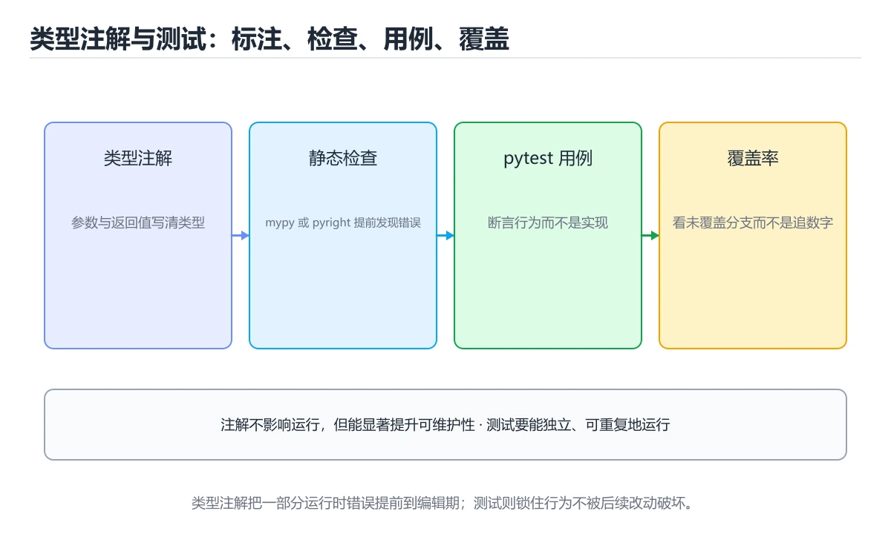
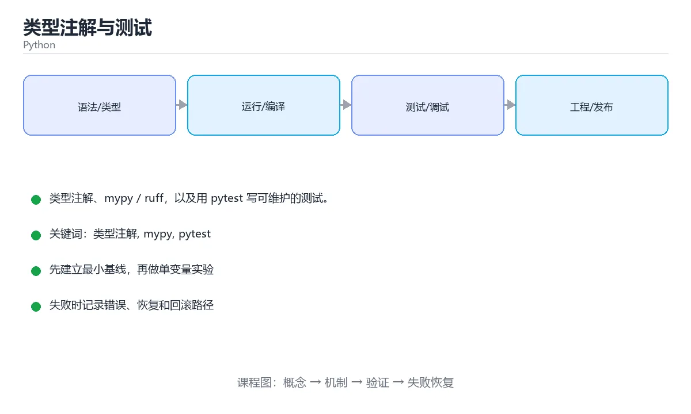

# 类型注解与测试

> 内容更新时间：2026-10-06 · 学习阶段：进阶 · 预计用时：55 分钟





## 本节知识框架

想象你开了一家快递站。每个包裹上都贴着标签——"易碎品""生鲜""普通货物"。标签本身不会改变包裹里的东西，但搬运工看到标签就知道该轻拿轻放还是冷藏保存。**类型注解就是给 Python 代码贴的"快递标签"**，而 **pytest 就是仓库里的"质检流水线"**——帮你自动检查每一件货物是否合格。

**本课主线**：学会给变量和函数贴类型标签（`typing`），用 mypy / ruff 做静态质检，再用 pytest 写自动化测试。

**学完本课你能做到**：
- 给函数参数和返回值加上类型注解，让编辑器帮你提前发现错误
- 用 pytest 写出清晰的测试用例，告别"手动 print 调试"
- 在 `pyproject.toml` 里统一管理工具配置，团队协作不踩坑

**先修内容**：《模块、包与虚拟环境》——你需要知道 `import` 怎么用、虚拟环境怎么建。

## 核心概念定义

别被术语吓到，我们用生活场景来理解它们。

### 类型注解相关

| 术语 | 一句话解释（大白话） | 类比 |
| --- | --- | --- |
| 类型注解 | 写在代码里的"说明书"，告诉工具和同事这个变量是什么类型 | 快递包裹上的标签 |
| `typing` 模块 | Python 自带的"高级标签工具箱"，提供列表、字典、可选值等复杂标签 | 标签打印机里的特殊模板 |
| `def f(x: int) -> str:` | 参数标注为整数、返回值标注为字符串 | "收件要求：整数；寄出要求：字符串" |
| `list[int]` / `dict[str, int]` | Python 3.9+ 直接写的泛型标签 | "一箱苹果""编号→数量的清单" |
| `int \| None` | 可以是整数，也可以是空值（Python 3.10+ 写法） | "包裹里可能是书，也可能什么都没装" |
| `Optional[int]` | 和 `int \| None` 等价，老版本写法 | 同上，只是旧版标签机的格式 |
| `Union[int, str]` | 可以是整数或字符串 | "包裹里可能是书或衣服" |
| `Literal["a", "b"]` | 只能是给定的几个值之一 | "只接受 A 类和 B 类快递" |
| `TypedDict` | 描述字典里每个键的类型 | "表格模板：姓名列是文字，年龄列是数字" |
| `Protocol` | 结构化子类型——不看你继承谁，只看你会什么方法（鸭子类型检查） | "不管你是不是鸭子，会嘎嘎叫就行" |
| `TypeVar` | 泛型占位符，让一个函数适配多种类型 | "万能快递箱——放进去什么类型，出来就是什么类型" |
| `Callable[[int], str]` | 描述一个函数的类型：接收 int，返回 str | "这台机器的入口放整数，出口出字符串" |
| `Any` | 关闭类型检查——相当于不贴标签 | "随便装，不管了"——尽量少用！ |
| `cast(int, x)` | 告诉工具"我确定这是 int"，但运行时不检查 | 你自己手写一张标签贴上去，质检员信不信另说 |

### 测试相关

| 术语 | 一句话解释（大白话） | 类比 |
| --- | --- | --- |
| `pytest` | 自动化测试框架——帮你批量运行测试、报告结果 | 仓库里的质检流水线 |
| `fixture` | 测试前自动运行的准备工作（比如创建测试数据） | 质检前先摆好待检样品 |
| `parametrize` | 一份测试逻辑自动跑多组数据 | 同一种质检方法，换不同样品跑 |
| `raises` | 断言某段代码一定会抛出指定异常 | "我赌这个包裹一定会碎" |
| `assert` | 断言某个条件为真，否则测试失败 | "如果重量不对，整条线停下来报警" |
| `unittest` | Python 标准库自带的测试框架，语法较啰嗦但不需要额外安装 | 自带的简易质检工具 |
| `pyproject.toml` | 项目配置文件，统一管理 mypy、ruff、pytest 等工具的设置 | 仓库的管理手册 |

## 原理与运行机制

### 类型注解到底怎么工作？

让我们用一个快递站的完整流程来理解：

**第一步：贴标签（写类型注解）**

```python
def greet(name: str, times: int = 1) -> str:
    """给某人发送问候，重复指定次数。"""
    return f"你好，{name}！" * times
```

这里的 `name: str` 和 `-> str` 就是标签。注意：**Python 运行时完全忽略这些标签**——它们不是强制约束，而是给工具和人看的。就像快递标签不会阻止你往箱子里装错东西，但搬运工看到标签就知道该怎么处理。

**第二步：质检员检查（mypy 静态检查）**

```python
# 错误示例：标签和实际内容不符
result: int = greet("小明")  # mypy 会报错：greet 返回 str，你却标注为 int
```

mypy 就像一个认真的质检员，在你运行代码之前就扫描所有标签，发现不一致立刻报告。

**第三步：自动化测试（pytest）**

```python
# test_greet.py
from my_module import greet

def test_greet_default():
    assert greet("小明") == "你好，小明！"

def test_greet_repeat():
    assert greet("小明", 2) == "你好，小明！你好，小明！"
```

pytest 就像质检流水线：你告诉它"这些是合格品的标准"，它自动帮你逐个检查。

### 从简单到复杂的渐进示例

**Level 1：基础变量注解**

```python
age: int = 18
scores: list[float] = [90.5, 88.0]
user: dict[str, str] = {"name": "小明"}
maybe: str | None = None      # Python 3.10+ 的联合类型写法
```

**Level 2：函数注解**

```python
def find_user(user_id: int) -> dict[str, str] | None:
    """根据 ID 查找用户，找不到返回 None。"""
    users = {1: {"name": "小明"}, 2: {"name": "小红"}}
    return users.get(user_id)
```

**Level 3：用 typing 模块处理复杂类型**

```python
from typing import Sequence, Callable, TypeVar

T = TypeVar("T")

def apply(func: Callable[[T], T], items: Sequence[T]) -> list[T]:
    """把函数应用到序列的每个元素上。"""
    return [func(item) for item in items]
```

**Level 4：Protocol——鸭子类型的正式表达**

```python
from typing import Protocol

class Reader(Protocol):
    def read(self) -> str:
        ...

def process(r: Reader) -> str:
    return r.read().upper()

# 任何有 read() 方法的对象都能传进来，不需要继承特定基类
class FileLike:
    def read(self) -> str:
        return "hello from file"

result = process(FileLike())  # mypy 认为这完全合法
```

### 工具链配置

安装和运行静态检查工具：

```bash
pip install mypy
mypy app.py                    # 类型检查

pip install ruff
ruff check .                   # 代码检查 + 导入排序
ruff format .                  # 格式化（也可用 black）
```

在 `pyproject.toml` 中统一配置（推荐做法）：

```toml
[tool.ruff]
line-length = 100
target-version = "py311"

[tool.mypy]
python_version = "3.11"
strict = true
```

### 用 pytest 写测试

**被测代码：**

```python
# calculator.py
def divide(a: float, b: float) -> float:
    if b == 0:
        raise ZeroDivisionError("除数不能为 0")
    return a / b
```

**测试代码：**

```python
# test_calculator.py
import pytest
from calculator import divide

def test_divide():
    assert divide(10, 2) == 5

def test_divide_by_zero():
    with pytest.raises(ZeroDivisionError):
        divide(1, 0)

@pytest.mark.parametrize("a, b, expected", [(6, 3, 2), (5, 2, 2.5)])
def test_divide_cases(a, b, expected):
    assert divide(a, b) == expected
```

**运行测试：**

```bash
pip install pytest
pytest -q                      # 运行测试
pytest --cov=. --cov-report=term    # 覆盖率
```

### pytest 速查表

| 目的 | 写法 |
| --- | --- |
| 断言 | `assert result == expected` |
| 断言异常 | `with pytest.raises(ValueError): ...` |
| 断言近似相等 | `assert value == pytest.approx(0.1 + 0.2)` |
| 参数化 | `@pytest.mark.parametrize("a,b,expected", [(1, 2, 3)])` |
| 夹具 | `@pytest.fixture` + 测试函数同名参数 |
| 夹具清理 | 夹具内 `yield` 之后写清理逻辑 |
| 临时目录 | 使用内置夹具 `tmp_path` |
| 跳过用例 | `@pytest.mark.skip(reason="待实现")` |
| 条件跳过 | `@pytest.mark.skipif(sys.version_info < (3, 11), ...)` |
| 预期失败 | `@pytest.mark.xfail(reason="已知问题")` |
| 分组标记 | `@pytest.mark.slow`，运行 `pytest -m slow` |
| 只看失败 | `pytest -x` 或 `pytest --lf` |
| 覆盖率 | `pytest --cov=myapp --cov-report=term-missing` |

### fixture 进阶示例

```python
import pytest

@pytest.fixture
def users(tmp_path):
    # 准备阶段：创建测试数据
    db = {"u1": {"name": "小明"}}
    yield db
    # 清理阶段：测试结束后清理
    db.clear()

@pytest.mark.parametrize(
    "raw,expected",
    [("1", 1), (" 42 ", 42), ("0", 0)],
)
def test_parse_int(raw, expected):
    assert int(raw) == expected

def test_missing_key_raises(users):
    with pytest.raises(KeyError):
        users["nobody"]
```

## 典型应用场景

### 场景 1：团队协作——统一类型规范

想象你和三个同事一起写代码。没有类型注解时，你调用同事的函数，不知道参数该传什么类型，只能翻遍代码找例子。有了类型注解后：

```python
# 一看就知道该怎么调用
def process_order(order_id: int, items: list[dict[str, int]]) -> dict[str, float]:
    ...
```

编辑器会自动提示参数类型，mypy 会在你传错类型时立刻标红。

### 场景 2：重构代码——有测试保驾护航

当你修改了一个函数的内部实现，只要测试还在，你就知道没有破坏已有功能：

```python
# 重构前
def calculate_total(items: list[dict[str, float]]) -> float:
    return sum(item["price"] for item in items)

# 重构后（加了折扣逻辑）
def calculate_total(items: list[dict[str, float]], discount: float = 0.0) -> float:
    subtotal = sum(item["price"] for item in items)
    return subtotal * (1 - discount)

# 只要原来的测试还通过，你就知道基础功能没被破坏
```

### 场景 3：API 开发——类型即文档

FastAPI 等框架直接利用类型注解生成 API 文档和参数校验：

```python
from pydantic import BaseModel

class User(BaseModel):
    name: str
    age: int
    email: str | None = None
```

## 代码/协议/SQL 示例

### 完整示例：从类型注解到测试的全流程

```python
# app.py —— 一个带类型注解的小模块
from dataclasses import dataclass, field

@dataclass
class Student:
    name: str
    scores: list[float] = field(default_factory=list)

    @property
    def average(self) -> float:
        if not self.scores:
            return 0.0
        return sum(self.scores) / len(self.scores)

def grade(student: Student) -> str:
    avg = student.average
    if avg >= 90:
        return "优秀"
    elif avg >= 70:
        return "良好"
    elif avg >= 60:
        return "及格"
    else:
        return "不及格"
```

```python
# test_app.py —— 对应的测试
import pytest
from app import Student, grade

def test_average_empty():
    s = Student(name="小明")
    assert s.average == 0.0

def test_average_normal():
    s = Student(name="小明", scores=[90.0, 80.0, 70.0])
    assert s.average == pytest.approx(80.0)

def test_grade_excellent():
    s = Student(name="小红", scores=[95.0, 92.0])
    assert grade(s) == "优秀"

def test_grade_fail():
    s = Student(name="小刚", scores=[50.0, 40.0])
    assert grade(s) == "不及格"

@pytest.mark.parametrize(
    "scores,expected",
    [
        ([95.0], "优秀"),
        ([75.0], "良好"),
        ([65.0], "及格"),
        ([30.0], "不及格"),
    ],
)
def test_grade_parametrize(scores, expected):
    s = Student(name="测试", scores=scores)
    assert grade(s) == expected
```

**运行方式**：保存为 `.py` 文件后用 `python 文件名.py` 运行；测试用 `pytest test_app.py` 运行；第三方依赖先在虚拟环境里安装。

### Protocol 与泛型示例

```python
from typing import Protocol, TypeVar, Generic

class Drawable(Protocol):
    def draw(self) -> str:
        ...

T = TypeVar("T")

class Container(Generic[T]):
    def __init__(self, item: T) -> None:
        self.item = item

    def get(self) -> T:
        return self.item

class Circle:
    def draw(self) -> str:
        return "画了一个圆"

class Square:
    def draw(self) -> str:
        return "画了一个方"

def render(d: Drawable) -> None:
    print(d.draw())

# Circle 和 Square 都没有继承 Drawable，但都通过了 Protocol 检查
render(Circle())   # 输出：画了一个圆
render(Square())   # 输出：画了一个方

# 泛型容器
c: Container[int] = Container(42)
print(c.get())     # 输出：42
```

## 时间/空间复杂度或性能分析

### 类型注解对性能的影响

好消息：**类型注解对运行时性能几乎没有影响**。因为 Python 在运行时根本不看这些注解——它们只是"贴在包裹上的标签"，搬运工（Python 解释器）不会去读标签内容。

真正有性能开销的是**静态检查工具**（mypy）和**测试框架**（pytest），但它们都在开发阶段运行，不影响生产环境。

### 各工具的时间开销参考

| 工具 | 典型耗时（1000 行代码） | 说明 |
| --- | --- | --- |
| mypy 首次检查 | 约 1-3 秒 | 需要分析所有导入链 |
| mypy 增量检查 | 约 0.5-1 秒 | 使用 `.mypy_cache` 缓存 |
| ruff check | 约 0.05 秒 | Rust 实现，极快 |
| pytest（10 个用例） | 约 0.2-0.5 秒 | 含启动开销 |
| pytest --cov | 约 0.5-1.5 秒 | 覆盖率收集有额外开销 |

### 性能优化建议

- **大型项目**：用 `mypy --daemon` 或 mypyc 加速检查
- **CI 集成**：把 mypy 和 pytest 放在 CI 流水线里，每次提交自动运行
- **缓存**：mypy 默认缓存到 `.mypy_cache`，pytest 可用 `pytest-cache` 只跑上次失败的用例
- **并行**：`pytest -n auto`（需 pytest-xdist）并行跑测试

## 常见误区与易错点

### 误区一览表

| 容易犯的错误 | 实际现象 | 正确做法 |
| --- | --- | --- |
| 注解与实现不一致 | 工具报错 | 让 mypy 在 CI 里跑 |
| 忘记 `from __future__ import annotations` | 老版本语法受限 | 3.10+ 可直接用 `X \| None` |
| dataclass 用可变默认值 | `ValueError` | 用 `field(default_factory=list)` |
| 用 `Any` 图省事 | 类型检查失效 | 用 `object` 加收窄 |
| 测试依赖执行顺序 | 单独跑就失败 | 每个用例自带准备与清理 |
| 只测正常路径 | 异常分支无人管 | 补 `raises` 与边界用例 |
| 断言太弱 | 出错也通过 | 断言具体值而不是"不为 None" |
| 用 `print` 调试测试 | 输出难读 | 用 `pytest -vv` 或断点 |

### 误区详解 1：注解与实现不一致

**生活类比**：快递标签写着"易碎品"，但你往里面塞了铁块。标签没骗人，但搬运方式错了。

```python
# 错误示例
def get_name(user_id: int) -> int:  # 注解说返回 int
    return "小明"                     # 实际返回 str！mypy 会报错
```

**修复**：让注解和实际返回类型一致，或者在 CI 里配置 mypy 自动检查。

### 误区详解 2：dataclass 用可变默认值

**生活类比**：如果所有快递箱共用同一个填充物，一个箱子被打开后填充物就没了。

```python
from dataclasses import dataclass, field

# 错误！会抛 ValueError
@dataclass
class Task:
    tags: list[str] = []  # 可变默认值——所有实例共享同一个列表！

# 正确做法
@dataclass
class Task:
    tags: list[str] = field(default_factory=list)  # 每个实例各自创建新列表
```

### 误区详解 3：用 Any 图省事

**生活类比**：给所有包裹都贴"普通货物"标签——确实省事了，但易碎品可能被粗暴搬运。

```python
from typing import Any

def process(data: Any) -> Any:  # 类型检查完全失效
    return data["name"]          # mypy 不会报错，但运行时可能 KeyError

# 更好的做法：用 object + isinstance 收窄
def process(data: object) -> str:
    if isinstance(data, dict) and "name" in data:
        return str(data["name"])
    return "unknown"
```

### 误区详解 4：测试依赖执行顺序

**生活类比**：如果质检员依赖"上一个样品还在传送带上"才能工作，那单独检查一个样品就会失败。

```python
# 错误：依赖全局状态和执行顺序
shared_data = {}

def test_add():
    shared_data["key"] = "value"

def test_read():
    assert shared_data["key"] == "value"  # 单独跑就失败！

# 正确：每个测试自带准备
import pytest

@pytest.fixture
def shared_data():
    return {"key": "value"}

def test_read(shared_data):
    assert shared_data["key"] == "value"  # 独立运行，永远可靠
```

## 与其他知识点的关系

### 知识图谱

```text
《模块、包与虚拟环境》
        ↓ （先修：你需要知道怎么 import、怎么建虚拟环境）
《类型注解与测试》 ← 你在这里
        ↓ （后续：这些知识在下面的课程中继续深化）
《并发与异步》
```

### 与前后课程的衔接

- **先修**：《模块、包与虚拟环境》——本课示例中用到的 `from typing import ...`、`import pytest` 都依赖模块和虚拟环境的基础知识。
- **后续**：《并发与异步》——在异步代码中，类型注解同样重要，比如 `async def` 的返回值要用 `Coroutine` 或 `Awaitable` 标注。
- **相关课程**：《Python pytest 测试实战》和《实战：FastAPI 订单服务》也大量使用 `pytest`，本课打好基础后那些课程会更顺畅。

### 容易混淆的概念对比

| 概念 A | 概念 B | 区别要点 |
| --- | --- | --- |
| `typing` | `pyproject.toml` | typing 是写类型标签的模块；pyproject.toml 是配置工具的文件 |
| `mypy` | `pytest` | mypy 在运行前检查类型（静态）；pytest 在运行时检查行为（动态） |
| `Optional[X]` | `X \| None` | 功能完全相同，只是新旧写法不同（3.10+ 推荐后者） |
| `Any` | `object` | Any 关闭检查（危险）；object 保留检查但需要收窄（安全） |
| `fixture` | `parametrize` | fixture 准备共享数据；parametrize 用多组数据跑同一个测试 |

## 自测题与参考答案

> 先独立作答，再对照参考答案。答案都能在本课正文中找到依据。

### 自测 1（概念复述）

不看正文，用自己的话解释什么是类型注解，并给出一个使用场景。

**参考答案**：类型注解是写在变量、参数、返回值旁边的类型说明，Python 运行时不强制检查，但 mypy 等工具和编辑器可以提前发现类型错误。场景：函数 `def greet(name: str) -> str:` 让调用者知道该传字符串。

### 自测 2（排错）

如果你发现 mypy 报了一堆类型错误，但你确定代码能正常运行，应该怎么做？

**参考答案**：mypy 是静态检查工具，它检查的是类型一致性而不是运行时行为。应该逐个查看 mypy 的报错，修正注解或实现使其一致，而不是忽略报错。可以在 CI 里配置 mypy 自动运行，防止新的不一致被引入。

### 自测 3（动手验证）

运行本课的 calculator 示例，把 `divide(10, 2)` 改成 `divide(10, 0)`，观察 pytest 的输出。

**参考答案**：`test_divide_by_zero` 应该通过（因为它用 `pytest.raises` 断言了异常），而如果你新增一个 `test_divide_normal` 调用 `divide(10, 0)` 却没有处理异常，pytest 会报告该用例失败并显示 `ZeroDivisionError`。

### 自测 4（代码阅读）

阅读 Protocol 示例，说明为什么 `Circle` 类没有继承 `Drawable` 却能通过 mypy 检查。

**参考答案**：Protocol 实现的是结构化子类型（structural subtyping），也叫鸭子类型检查。只要对象拥有 Protocol 要求的方法（这里是 `read()` 或 `draw()`），不管它继承自谁，mypy 都认为它满足该 Protocol。

### 自测 5（迁移）

在你自己的项目中，选一个函数加上类型注解，再为它写一个 pytest 测试用例。

**参考答案**：答案因项目而异。关键是：注解要与实际类型一致；测试要覆盖正常路径和至少一个异常/边界路径。

## 复习清单

- [ ] 能不看正文复述本课核心术语，并指出一个边界或反例
- [ ] 能默写本课最重要的代码示例，并解释每一行的作用
- [ ] 能说出本课内容和前后两课的联系

## 延伸阅读

想更直观地理解本课概念？推荐参阅以下图解专题：

- [图解内存布局：栈、堆与引用](visual_memory_layout.md)

## 术语速查

| 术语 | 一句话说明 |
| --- | --- |
| 类型注解 | 给代码贴的标签，运行时不强制，但工具和同事能看懂 |
| `typing` | Python 的高级标签工具箱，提供泛型、联合类型等复杂标签 |
| `mypy` | 静态类型检查工具，运行前扫描类型是否一致 |
| `pytest` | 自动化测试框架，批量运行测试并报告结果 |
| `fixture` | 测试前的自动准备工作，比如创建测试数据 |
| `Protocol` | 鸭子类型的正式表达——会嘎嘎叫就是鸭子 |
| `pyproject.toml` | 项目配置中心，统一管理所有工具的设置 |
| `dataclass` | 自动生成 `__init__`、`__repr__` 等方法的装饰器 |

**术语关系链**：`typing`（写标签）→ `mypy`（检查标签）→ `pytest`（测试行为）→ `pyproject.toml`（统一管理）

## 考点精讲

`类型注解与测试` 的题库有 6 道题，下面逐题给出题干、正确项与判断依据。先自己作答，再核对正确项，最后回到正文对应小节复核。

### 考点 1：第 1 题

- **题目**：Python 的类型注解在运行时的作用是？
- **正确项**：不影响运行，只供工具和阅读使用
- **判断依据**：这道题落在术语"类型注解"上。类型注解是写给工具和同事看的说明书，运行时不强制，但能让编辑器提前报错。记住核心类比：标签不会改变包裹里的东西，但搬运工看到标签就知道该怎么处理。Python 解释器在运行时完全忽略注解，它们只存在于 `__annotations__` 属性中供工具读取。

### 考点 2：第 2 题

- **题目**：围绕“类型注解与测试”中的 类型注解、mypy、pytest，下列哪两项是本课强调的实践判断？
- **正确项**：验证 mypy 时要固定版本并覆盖边界输入，结论才可复现；学习 类型注解 时要同时说明输入、输出和失败路径，不能只看正常流程
- **判断依据**：这道题检验你对工具链实践的理解。mypy 的版本不同，检查规则和报错信息可能不同，所以要固定版本；类型注解不只是"写个 str 或 int"，还要考虑边界情况（比如 `None`、空列表）和失败路径（比如类型不匹配时 mypy 怎么报错）。

### 考点 3：第 3 题

- **题目**：str | None 这种写法表示？
- **正确项**：字符串或空值
- **判断依据**：`str | None` 是 Python 3.10+ 的联合类型写法，等价于老版本的 `Optional[str]`。它表示这个变量可以是字符串，也可以是 `None`（空值）。生活类比：快递标签写着"书或空"——箱子里可能是一本书，也可能什么都没装。

### 考点 4：第 4 题

- **题目**：下面这段 `python` 代码来自 `类型注解与测试`。课程主线是类型注解、mypy / ruff，以及用 pytest 写可维护的测试。代码与 `typing` 有关。哪一项是代码里真实出现的内容？
- **正确项**：调用了 `read()`
- **判断依据**：这道题检验你是否认真阅读了本课的 Protocol 示例。在 Protocol 示例中，`Reader` 协议定义了 `read()` 方法，`process()` 函数内部调用了 `r.read()`，`FileLike` 类实现了 `read()` 方法。这些都是代码中真实出现的内容。

### 考点 5：第 5 题

- **题目**：pytest 中 fixture 的主要用途是？
- **正确项**：提供可复用的测试前置准备与清理逻辑
- **判断依据**：fixture 就像质检流水线上的"准备工作台"——在测试运行前自动准备好需要的数据和环境（比如创建临时文件、连接测试数据库），测试结束后还可以执行清理逻辑（比如删除临时文件、关闭连接）。用 `yield` 关键字可以优雅地分隔准备和清理两个阶段。

### 考点 6：第 6 题

- **题目**：填空：补齐下面这段术语说明中的空缺。课程 `类型注解、mypy / ruff，以及用 pytest 写可维护的测试。`，这段说明是：标准库的 ``____`` 也能用，语法更啰嗦但无需第三方依赖；`doctest` 则可以直接运行文档字符串里的示例。空缺处应填哪个术语？
- **正确项**：unittest
- **判断依据**：`unittest` 是 Python 标准库自带的测试框架，功能与 pytest 类似但语法更啰嗦（需要写类、继承 `unittest.TestCase`、用 `self.assertEqual` 等）。它最大的优势是不需要 `pip install` 任何第三方包。`doctest` 则是另一种测试方式，直接从文档字符串中提取示例代码并运行验证。

## 内容元数据

- 内容版本：v2.0
- 最后更新：2026-10-06
- 学习阶段：进阶
- 适用环境：Python 3.12+
- 内容来源：内置结构化课程与工程实践整理
- 相关主题：类型注解、mypy、pytest、ruff、单元测试、unittest
- 质量版本：P0 测验标准 + P1 覆盖扩展 + P2 体验补全

## 参考资料与复核

- [本课资料锚点 python_typing_testing](https://zh.wikipedia.org/w/index.php?search=python_typing_testing)

- 最后复核：2026-10-04
- 下次复核：2026-12-10
- 复核范围：版本兼容、API 行为、安全建议与工程实践
- 来源性质：官方文档、标准或权威教材；本课核对关键词：类型注解、mypy、pytest、ruff、单元测试、unittest

| 参考资料 | 本课用途 |
| --- | --- |
| [typing 模块官方文档](https://docs.python.org/3/library/typing.html) | 类型标注、泛型、Protocol、TypeVar 等所有 typing 用法的权威参考 |
| [mypy 官方文档](https://mypy.readthedocs.io/en/stable/) | 静态类型检查工具的配置、用法和常见报错解释 |
| [pytest 官方文档](https://docs.pytest.org/en/stable/) | fixture、parametrize、raises 等测试功能的完整说明 |
| [ruff 官方文档](https://docs.astral.sh/ruff/) | 代码检查与格式化工具的配置和规则参考 |
| [Python 类型注解入门教程](https://docs.python.org/3/tutorial/annotations.html) | 官方入门级注解教程，适合初学者 |
| [PEP 484 -- Type Hints](https://peps.python.org/pep-0484/) | 类型注解的 Python 增强提案，理解设计初衷 |
| [PEP 604 -- Allow writing union types as X \| Y](https://peps.python.org/pep-0604/) | `X \| Y` 联合类型写法的提案原文 |
| [Real Python: Type Checking](https://realpython.com/python-type-checking/) | 面向实战的类型检查教程，含大量示例 |

> 提示：以上链接用于离线阅读后的延伸核对；App 不会自动联网。
