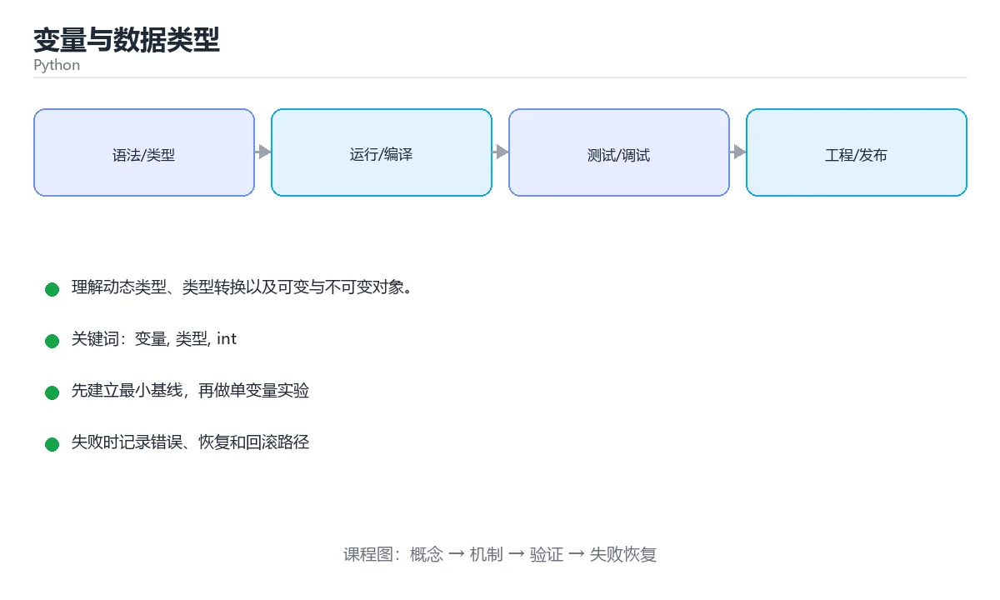

# 变量与数据类型

> 内容更新时间：2026-10-06 · 学习阶段：基础 · 预计用时：40 分钟



> 学习阶段：基础 · 预计用时：40 分钟 · Python 3.12+

---

## 本节知识框架

本课我们会搞懂 Python 里最基础也最重要的几件事：**变量是什么**、**类型有哪些**、**怎么查看和转换类型**。你可以把这一课想象成学做菜的"认识食材和锅碗"环节——后面不管写什么程序，都离不开这些基本功。

```text
变量与类型
├── 变量赋值 —— 给数据贴标签
├── 动态类型 —— 标签可以换，数据可以变
├── 四种基本类型
│   ├── int   整数
│   ├── float 浮点数（小数）
│   ├── str   字符串（文本）
│   └── bool  布尔值（真/假）
├── type() —— 查看类型的小工具
└── 类型转换 —— 在不同类型之间切换
```

学完这一课，你应该能回答：
- 变量到底是什么？它和"盒子"有什么关系？
- 为什么 Python 叫"动态类型"？
- `int("abc")` 会发生什么？
- `is` 和 `==` 有什么不同？

---

### 复习清单
- [ ] 能不看正文复述本课核心术语，并指出一个边界或反例
- [ ] 能默写本课最重要的代码示例，并解释每一行的作用
- [ ] 能说出本课内容和前后两课的联系

## 核心概念定义

### 变量：贴了标签的盒子

想象你有一堆东西要整理。你拿出一个盒子，把东西放进去，然后在盒子外面贴一张标签写上名字——这样你下次找东西时，喊一声名字就行了。

**变量就是这个"贴了标签的盒子"。** 在 Python 里，你写 `name = "小明"`，意思是：创建一个盒子，里面装着 `"小明"` 这段文字，然后在盒子外面贴上标签 `name`。以后你想用这段文字，只要喊 `name` 就行了。

> 注意：Python 的变量和 C/Java 不一样。Python 的变量**本身没有类型**，是盒子里装的东西才有类型。你可以把同一个标签从"装苹果的盒子"挪到"装数字的盒子"上——这就是所谓的**动态类型**。

### 类型：盒子里装的东西的种类

盒子可以装各种东西：整数、小数、文字、真假值……**"种类"就是类型。**

| 类型 | 说明 | 例子 |
|------|------|------|
| `int` | 整数，多大都行 | `42`、`-7`、`0` |
| `float` | 浮点数（小数） | `3.14`、`-0.5`、`1e3` |
| `str` | 字符串，用引号包裹 | `"你好"`、`'world'` |
| `bool` | 布尔值，只有真和假 | `True`、`False` |
| `NoneType` | 只有一个值 `None`，表示"这里现在没有东西" | `None` |
| `tuple` | 只读序列，创建后不能改，因此可以当字典的键 | `(1, 2)`、`("a",)` |
| `list` | 可变序列，能原地增删 | `[1, 2, 3]` |
| `dict` | 键到值的映射，键必须是不可变对象 | `{"name": "小明"}` |

### 动态类型：同一个标签可以贴在不同种类的盒子上

```python
x = 42        # x 现在指向一个整数
x = "hello"   # x 现在指向一个字符串——完全合法！
x = 3.14      # x 又指向了一个浮点数
```

这就是 Python 的**动态类型**：变量不挑类型，同一个变量可以先后装不同种类的数据。

### type()：看看盒子里装的是什么

想知道一个变量当前是什么类型？用 `type()` 就行：

```python
x = 42
print(type(x))   # <class 'int'>

x = "hello"
print(type(x))   # <class 'str'>
```

`type()` 就像一个"透视眼镜"，戴上它就能看到盒子里装的东西到底是什么种类。

### 类型转换：给东西换个包装

有时候你拿到的数据类型不是你想要的，需要转换一下。比如用户输入的内容永远是字符串，但你想拿它做数学运算，就得先把它"变成"数字。

```python
text = "123"
num = int(text)      # 把字符串 "123" 转成整数 123
print(num + 1)       # 124
```

常见的转换函数：
- `int(x)` —— 转成整数（小数会被**截断**，不是四舍五入！）
- `float(x)` —— 转成浮点数
- `str(x)` —— 转成字符串
- `bool(x)` —— 转成布尔值

---

## 原理与运行机制

### 变量赋值的本质

当你在 Python 里写 `a = 123`，实际上发生了三件事：

1. Python 在内存里创建了一个整数对象 `123`
2. Python 创建了一个名字 `a`
3. Python 把名字 `a` 和对象 `123` 之间建立了一个**引用关系**（可以理解为"贴标签"）

所以变量不是"装着数据的盒子"，更准确地说，变量是**贴在数据上的标签**。同一个数据可以有多个标签，一个标签也可以在不同时间贴在不同的数据上。

### 动态类型的机制

```python
x = 123       # 标签 x 贴在整数 123 上
x = "abc"     # 标签 x 从 123 上撕下来，贴在字符串 "abc" 上
```

Python 不关心 `x` 之前是什么类型，它只关心"现在 `x` 指向谁"。这就是为什么 Python 叫动态类型语言——**类型跟着值走，不跟着变量走**。

### 可变与不可变

Python 里的类型分为两大类：

**不可变类型**（创建后不能修改内容）：
- `int`、`float`、`str`、`bool`、`tuple`

**可变类型**（可以原地修改内容）：
- `list`、`dict`、`set`

这个区别非常重要，因为它直接影响你写代码时会不会踩到"改了 B 结果 A 也变了"这种坑。

```python
# 字符串是不可变的——你不能修改它的某个字符
text = "hello"
# text[0] = "H"   # 这行会报错！

# 列表是可变的——你可以原地添加、删除、修改
nums = [1, 2, 3]
nums[0] = 99       # 没问题，nums 现在是 [99, 2, 3]
```

### is 与 == 的区别

这是一个初学者特别容易搞混的点：

- `==` 比较的是**值**——两个盒子里装的东西一不一样
- `is` 比较的是**身份**——两个标签是不是贴在同一个盒子上

```python
a = [1, 2]
b = [1, 2]
print(a == b)   # True  —— 内容一样
print(a is b)   # False —— 它们是两个不同的列表对象

c = a
print(a is c)   # True  —— c 和 a 指向同一个对象
```

> 经验法则：比较值用 `==`，判断是不是 `None` 才用 `is`。

### 名字、对象与引用计数

每个 Python 对象都带着一个"有几个名字在指我"的计数器。写 `b = a` 时没有新列表产生，只是那个列表的计数从 1 变成 2；`del b` 或 `b` 出了作用域，计数减回去，减到 0 时内存才被回收。

```python
import sys
a = [1, 2]
b = a
print(sys.getrefcount(a) >= 3)  # True：a、b 和临时参数都在指它
```

理解这条链，"改了 b 结果 a 也变了"就不再是玄学：`a` 和 `b` 从来不是两个盒子，而是同一只盒子上的两张标签。想真正得到一份独立副本，得显式 `a.copy()` 或 `list(a)`，并且注意它们是浅拷贝——嵌套的列表仍然共享。

### 变量到哪儿去找：LEGB 作用域规则

一个名字出现在代码里，Python 按固定顺序去四层范围找它：

1. **L**ocal——当前函数内部
2. **E**nclosing——外层嵌套函数的局部名字
3. **G**lobal——模块顶层
4. **B**uilt-in——内置命名空间，比如 `len`、`print`

只读的时候这条链会自动往上走；但要"写"外层变量就必须明说：函数里赋值默认创建的是本地新名字，想改全局的要 `global`，想改闭包外层变量的要 `nonlocal`。这也是后面学函数时会反复撞上的规则，现在只要记住：查找顺序是 L→E→G→B，写入则要显式声明归属。

### 类型该不该显式检查

调试时 `type(x)` 很直观，但业务分支里更推荐 `isinstance(x, (int, float))`：它认继承关系，`isinstance(True, int)` 会是 `True`，而 `type(True) is int` 是 `False`。判断 `None` 用 `x is None`，不要用 `x == None`；要判"空"就用真值性 `if not x:`，它同时覆盖 `None`、`0`、`""`、`[]`。

---

## 典型应用场景

### 场景 1：接收用户输入并做计算

用户输入的内容永远是字符串，你必须手动转成数字才能做运算：

```python
age_text = input("请输入你的年龄：")  # 用户输入 "25"
age = int(age_text)                   # 转成整数 25
print(f"明年你就 {age + 1} 岁了")
```

如果用户输入的不是数字（比如 `"abc"`），`int()` 就会报错——这就是为什么程序要做输入校验。

### 场景 2：用 type() 调试

写代码时不确定一个变量到底是什么类型？`type()` 是你的好帮手：

```python
result = get_data()
print(type(result))  # 看看返回的是 list、dict 还是别的
```

### 场景 3：格式化输出时拼接不同类型

```python
name = "小明"
score = 95.5
print(name + " 的成绩是 " + str(score))  # 必须先把 float 转成 str
# 更推荐用 f-string：
print(f"{name} 的成绩是 {score}")         # 自动处理类型转换
```

### 场景 4：判断真假

Python 里很多东西都可以当布尔值用：

```python
if "hello":     # 非空字符串 → True
    print("有内容")

if 0:           # 0 → False
    print("不会执行")

if []:          # 空列表 → False
    print("不会执行")
```

---

## 代码/协议/SQL 示例

### 示例 1：认识四种基本类型

```python
# 整数 int
age = 25
print(type(age))      # <class 'int'>

# 浮点数 float
price = 19.9
print(type(price))    # <class 'float'>

# 字符串 str
name = "小明"
print(type(name))     # <class 'str'>

# 布尔值 bool
is_ok = True
print(type(is_ok))    # <class 'bool'>
```

### 示例 2：动态类型演示

```python
x = 123
print(type(x))   # <class 'int'>

x = "hello"
print(type(x))   # <class 'str'>

x = 3.14
print(type(x))   # <class 'float'>

# 同一个变量 x 先后指向了不同类型的值——这就是动态类型
```

### 示例 3：类型转换

```python
# 字符串 → 整数
num = int("123")
print(num + 1)         # 124

# 字符串 → 浮点数
pi = float("3.14")
print(pi * 2)          # 6.28

# 数字 → 字符串
age = 25
text = str(age)
print("年龄是" + text)  # 年龄是25

# 转成布尔值
print(bool(0))         # False
print(bool(42))        # True
print(bool(""))        # False
print(bool("hello"))   # True
```

### 示例 4：类型转换的坑

```python
# int("abc") 会怎样？
# 答案：抛出 ValueError！因为 "abc" 不是合法的数字

# int("3.5") 会怎样？
# 答案：也会抛出 ValueError！
# 正确做法：先 float 再 int
result = int(float("3.5"))  # 3（截断，不是四舍五入）

# 浮点数精度问题
print(0.1 + 0.2 == 0.3)    # False！
print(0.1 + 0.2)            # 0.30000000000000004
# 正确做法：用 math.isclose() 或者换算成整数
import math
print(math.isclose(0.1 + 0.2, 0.3))  # True
```

### 示例 5：可变对象的"共享"问题

```python
a = [1, 2]
b = a           # b 和 a 指向同一个列表
b.append(3)     # 修改了 b，但其实也修改了 a

print(a)        # [1, 2, 3] —— a 也跟着变了！
print(b)        # [1, 2, 3]

# 如果想要独立的副本：
c = [1, 2]
d = c[:]        # 或者 c.copy()
d.append(3)
print(c)        # [1, 2] —— 互不影响
print(d)        # [1, 2, 3]
```

### 示例 6：把边界输入挨个试一遍

只试 `"25"` 就宣布代码没问题是不够的。下面这张"输入清单"是练动态类型时最该养成的习惯：正常值、空值、带空格、小数文本、纯文本、超大数，各跑一遍，把成功和失败都记下来。

```python
def to_int_or_none(text):
    """把用户文本转成整数；失败就返回 None，别让异常跑到主流程里。"""
    if text is None:                  # 先挡住"压根没有值"这一类
        return None
    try:
        return int(text.strip())      # 再去掉首尾空白后转换
    except ValueError:                # ""、"abc"、"3.5" 都会走到这里
        return None

cases = ["25", "  25  ", "", "3.5", "abc", None, "9" * 40]
for raw in cases:
    print(repr(raw), "->", to_int_or_none(raw))

# 输出要点："" 与 "abc" 与 None 都得到 None；"3.5" 也是 None（它得先走 float）；
# 那串 40 个 9 会正常得到一个大整数——Python 的 int 不会溢出。
```

练习：把 `to_int_or_none` 改成"失败时抛出自家异常并说明原因"的版本，再用同样的清单验证一次。能顺手写出失败路径，才算真的会用类型转换。

---

## 时间/空间复杂度或性能分析

（本节内容详见正文各章节的对应说明。）

### 补充性能分析
对于初学者来说，变量的创建和赋值基本都是"瞬间完成"的操作，不需要担心性能。但有两点值得了解：

- **小整数缓存**：Python 会预先创建 `-5` 到 `256` 的整数对象。所以 `a = 100; b = 100; a is b` 可能是 `True`，但 `a = 1000; b = 1000; a is b` 可能是 `False`。这就是为什么不能用 `is` 来比较值。
- **字符串拼接**：用 `+` 拼接大量字符串会很慢（因为字符串不可变，每次都要创建新对象）。大量拼接请用 `"".join(parts)`。

再加三条和"类型"直接相关的量度直觉：

- **整数是按需变长的**。`int` 没有 32 位溢出的概念，代价是数值越大占的字节越多、运算越慢；`sys.getsizeof(7)` 与 `sys.getsizeof(2**70)` 差好几倍。要对性能有感觉，就得固定 Python 版本再测，换个版本结论可能变。
- **名字查找有远近**。函数里读局部变量最快，往上每跨一层作用域都要多查一张表；把循环里反复使用的全局值先取成本地变量，是零成本的微优化，更重要的是别把 `print`、`list` 这类内置名字重新赋值。
- **转换不是免费的**。`int("123")` 要做字符校验，`float(x)` 可能抛出 `ValueError` 也可能得到一个近似值。热路径上把同一段文本反复转成数字，比存下来复用要贵得多。

---

## 常见误区与易错点

（本节内容详见正文各章节的对应说明。）

| 容易写错的做法 | 会出现什么现象 | 原因与正确做法 |
| --- | --- | --- |
| 用 `is` 比较两个数字或字符串是否相等 | 小数字时对、大数字时错，结果像掷骰子 | 解释器只缓存部分对象；值比较一律用 `==` |
| 用 `input()` 拿到值就直接做加法 | 报 `TypeError`，或者变成字符串拼接的怪结果 | 输入永远是 `str`，先 `int()`/`float()` 转换再运算 |
| 以为 `b = a` 复制了一份列表 | 改了 `b`，`a` 也跟着变 | 赋值只是贴标签；要副本用 `a.copy()`，嵌套还要深拷贝 |
| 拿 `int("3.5")` 转小数文本 | 抛 `ValueError` 而不是返回 3 | 小数文本必须先 `float()` 再 `int()`，`int()` 是截断不是四舍五入 |
| 直接写 `if x == None:` | 对象重载了 `__eq__` 时判断被带偏 | 判空用 `x is None`；判"没有内容"用 `if not x:` |
| 只看正常输入就宣布结论成立 | 空字符串、`None`、超大整数进来当场崩溃 | 每个转换都补一条失败路径：`try/except ValueError` 并给用户提示 |

## 与其他知识点的关系

（本节内容详见正文各章节的对应说明。）

### 补充关联
- **先修**：[Python 基础语法](programming_python_basics.md) —— 你需要知道怎么写 `print()`、怎么缩进、什么是注释。
- **后续**：[函数](programming_python_functions.md) —— 函数里会用到变量、参数类型、作用域等概念。
- **平行**：[列表与字典入门](python_list_dict_basics.md) —— 会深入讲解可变类型 `list` 和 `dict` 的用法。

简单来说：本课是 Python 世界的"认字课"，后面的每一课都会用到这里学到的东西。

---

## 自测题与参考答案

（本节内容详见正文各章节的对应说明。）

## 考点精讲

本课题库共有 6 道题，下面逐题列出题干与正确答案。先自己作答，再核对答案。

### 考点 1

**题目**：`变量与数据类型` 的示例代码用于验证 `变量`，其背景是理解动态类型、类型转换以及可变与不可变对象。代码的真实内容是下面哪一项？

**正确答案**：出现字面量 `123`

**复习提示**：回顾本课代码示例，找到出现 `123` 的位置，理解它演示了变量赋值和整数类型。

### 考点 2

**题目**：围绕“变量与数据类型”中的 变量、类型、int，下列哪两项是本课强调的实践判断？

**正确答案**：
- 验证 类型 时要固定版本并覆盖边界输入，结论才可复现
- 学习 变量 时要同时说明输入、输出和失败路径，不能只看正常流程

**复习提示**：学变量不能只试正常情况，还要试边界值（比如空字符串、None、超大整数），并且要记录失败路径。

### 考点 3

**题目**：执行 int("abc") 会发生什么？

**正确答案**：抛出 ValueError

**复习提示**：`int()` 只能转换格式合法的字符串（比如 `"123"`、`"-5"`），遇到 `"abc"` 这种不是数字的字符串就会报 `ValueError`。

### 考点 4

**题目**：Python 中 is 与 == 的区别是？

**正确答案**：== 比较值是否相等

**复习提示**：`==` 比较的是内容，`is` 比较的是对象身份。比较值永远用 `==`，只有判断 `is None` 时才用 `is`。

### 考点 5

**题目**：a = [1, 2]; b = a; b.append(3) 之后 a 是？

**正确答案**：[1, 2, 3]

**复习提示**：`b = a` 让 b 和 a 指向同一个列表对象。对列表做原地修改（append），两个名字都能看到变化，因为只有一个列表。

### 考点 6

**题目**：填空：补齐下面这段术语说明中的空缺。课程 `理解动态类型、类型转换以及可变与不可变对象。`，这段说明是：`____`：LEGB 规则决定名字从局部、闭包、全局到内置的查找顺序，global 与 nonlocal 用来写外层变量。空缺处应填哪个术语？

**正确答案**：作用域

**复习提示**：作用域是 Python 查找变量名的规则。LEGB 代表 Local（局部）→ Enclosing（闭包）→ Global（全局）→ Built-in（内置）。

---

## 术语速查

| 术语 | 一句话说明 |
|------|-----------|
| 变量 | 给数据贴的标签，Python 里变量本身没有类型，值才有类型 |
| 动态类型 | 同一个变量可以先后指向不同类型的值 |
| int | 整数类型，长度不限 |
| float | 浮点数类型，存在精度误差 |
| str | 字符串类型，不可变，用引号包裹 |
| bool | 布尔类型，只有 `True` 和 `False` |
| type() | 内置函数，查看对象的类型 |
| 类型转换 | 用 `int()`、`float()`、`str()`、`bool()` 在不同类型之间切换 |
| 可变类型 | 创建后可以原地修改（list、dict、set） |
| 不可变类型 | 创建后不能修改内容（int、float、str、bool、tuple） |
| `==` | 比较两个对象的值是否相等 |
| `is` | 判断两个变量是否指向同一个对象 |
| `None` | `NoneType` 唯一的值，表示"这里暂时没有东西"，用 `is None` 判断 |
| 引用计数 | 对象记录有多少名字指向自己，计数归零才释放内存 |
| LEGB | 名字查找的四层顺序：本地、闭包、全局、内置 |
| 浅拷贝 | `a.copy()` 只复制外层容器，里面的嵌套对象仍然共享 |
| isinstance() | 带继承关系的类型检查，比 `type(x) is T` 更稳 |
| 作用域 | LEGB 规则决定名字从局部、闭包、全局到内置的查找顺序，global 与 nonlocal 用来写外层变量 |

---

## 参考资料与复核

- 最后复核：2026-10-04
- 下次复核：2026-12-10
- 复核范围：变量、类型、转换、可变与不可变对象

| 参考资料 | 本课用途 |
| --- | --- |
| [Python 数据模型](https://docs.python.org/3/reference/datamodel.html) | 对象、值与类型 |
| [内置类型](https://docs.python.org/3/library/stdtypes.html) | 标准类型说明 |
| [类型转换函数](https://docs.python.org/3/library/functions.html) | int()、float() 等 |

### 进阶学习资源
想更直观地理解本课概念？推荐参阅以下图解专题：

- [图解内存布局：栈、堆与引用](visual_memory_layout.md)

## 内容元数据

- 课程 ID：python_variables
- 课程标题：Python 变量与类型
- 内容版本：v2.0
- 最后更新：2026-10-19
- 学习阶段：基础
- 适用环境：Python 3.12+
- 先修课程：Python 基础语法
- 后续课程：函数、列表与字典入门
- 相关主题：变量、类型、int、float、str、bool、转换、动态类型

---
