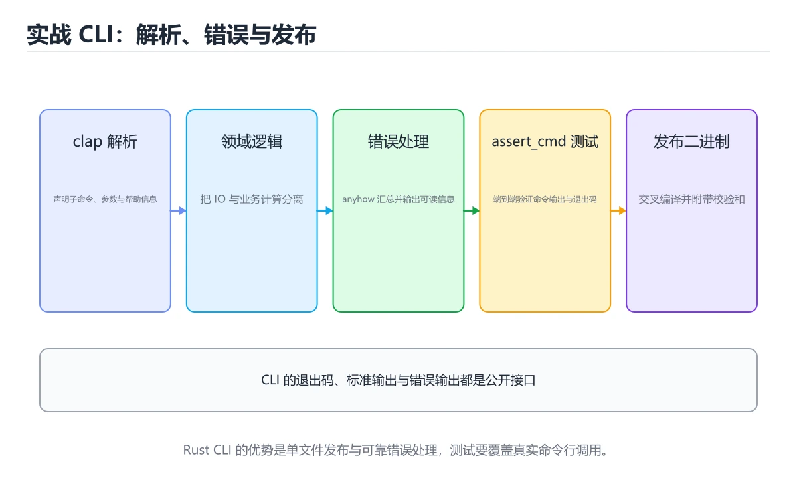
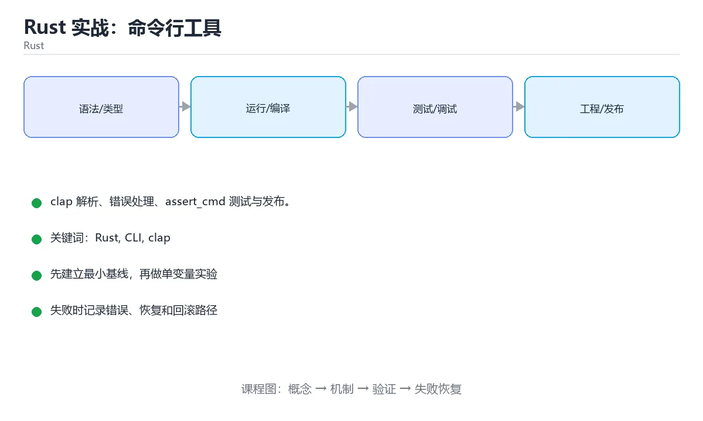

# Rust 实战：命令行工具

> 内容更新时间：2026-10-06 · 学习阶段：高级 · 预计用时：80 分钟





## 本节知识框架

**课程定位**：所属分类 `rust`（Rust），课程主题 `Rust 实战：命令行工具`，学习阶段 高级，建议用时 100 分钟。

本课主线：clap 解析、错误处理、assert_cmd 测试与发布。

**学完本课应当能够**
- 说清 `Rust` 与 `Cargo` 的含义与区别，并各举一个正例和一个反例。
- 用本课示例验证 `命令解析` 的行为，记录输入、输出与失败条件。
- 遇到「用 `unwrap()` 处理输入」这类问题时，能说出触发条件与修复顺序。

### 复习清单

- [ ] 能不看正文复述 Rust，并指出 CLI 的一个边界或反例。
- [ ] 能推演 Rust 的示例：先写预期输出，再运行并记录差异与失败现象。
- [ ] 能完成一次自测，并把错题对照错误表定位原因。

## 核心概念定义

| 术语 | 操作性定义 | 常见边界与风险 |
| --- | --- | --- |
| Rust | Rust CLI 的标准配方：clap 解析 + anyhow/thiserror 错误 + serde 序列化 + assertcmd 测试 + 多平台发布；类型系统让这类工具几乎"发布即稳定"。 | 类型系统保证不了运行期输入：用 `unwrap()` 处理用户传入的路径或文件时，用户看到的仍是 panic，应改用 `?` 加 context。 |
| Cargo | Rust 的构建与包管理工具，用 Cargo.toml 声明依赖，提供 build、test、run 等子命令。 | Cargo.toml 里的依赖版本与 edition 一改，产物行为就可能漂移；升级前先用原输入复现当前输出，再对照发布说明核对。 |
| 命令解析 | clap 用派生宏把结构体变成参数定义，自动生成帮助信息与输入校验。 | 它只校验结构体上声明过的约束；字段漏写约束时非法输入照样进得来，要靠 `assert_cmd` 断言 stdout 与退出码兜住。 |
| 错误传播 | 用问号运算符把底层错误向上抛出，配合 anyhow 与 thiserror 保留上下文。 | 易错：一路 `?` 却不补 context，出错时不知道是哪个文件失败；库层应交给 thiserror 判定，而不是 `unwrap` 把 panic 抛给用户。 |

## 原理与运行机制

### 机制总览

**教材衔接：目标与结构**

做一个能读文件、过滤、统计并输出 JSON/表格的 CLI。结构：`main.rs`（解析参数与调度）、`lib.rs`（可测试的业务逻辑）、`tests/`（集成测试）。

**教材衔接：参数解析：clap**

用 derive 声明式定义参数：结构体加 `#[derive(Parser)]`，字段用 `#[arg(short, long, default_value_t)]`，子命令用 `#[derive(Subcommand)]`。clap 自动生成 `--help`、补全与参数校验，比手写解析可靠得多。

**教材衔接：错误处理与输出**

应用层用 `anyhow::Result` 一路 `?` 传播，并在 `main` 用 `fn main() -> anyhow::Result<()>` 统一打印错误与退出码；库层用 thiserror 定义可判定的错误。输出遵循 Unix 习惯：正常结果到 stdout，日志与错误到 stderr，便于管道组合。

**教材衔接：读写与序列化**

serde + serde_json 处理配置与输出；大文件用 BufReader 逐行处理，避免一次性读入内存。注意处理 CRLF、BOM 与无效 UTF-8（必要时按字节处理或使用 lossy 转换）。

**教材衔接：发布**

用 `cargo build --release` 产出单文件二进制；交叉编译可用 cross 或 GitHub Actions 的矩阵构建多平台产物；发布到 crates.io 需完善 README、许可证与版本语义（SemVer）。

**教材衔接：CLI 习惯速查**

| 习惯 | 说明 |
| --- | --- |
| 正常输出走 stdout | 便于管道与其他程序消费 |
| 错误与进度走 stderr | 不污染 stdout |
| 退出码 0 表示成功 | 失败返回非零（`std::process::ExitCode`） |
| 支持 `-h` / `--help` | clap 自动生成 |
| 支持 `--version` | 从 Cargo.toml 读取 |
| 不覆盖已有文件 | 默认拒绝或要求 `--force` |
| 尊重环境变量 | 代理、配置目录（`XDG_*` / `%APPDATA%`） |
| 可被管道中断 | 处理 `SIGPIPE`（Rust 默认忽略，需显式处理） |

**教材衔接：版本与时效**

- 版本提示：Rust 的行为在最近几个大版本里有过调整，升级「Rust 实战：命令行工具」前先用 read_to_string 复现当前输出，再对照官方发布说明逐条核对。
- 把 CLI 的编译告警当作错误处理，升级后才能避免行为漂移。
- 升级前确认 Rust 的兼容范围，把不可回退的改动单独拆成一次提交。
- 官方发布说明：https://blog.rust-lang.org/

### 三、「Rust 实战：命令行工具」的交付证据链

本课未给出可执行命令，用下面的最小证据集代替：

### 五、评审记录模板

| 记录项 | 填写要求 |
| --- | --- |
| 项目标识 | `rust_cli_project` |
| 本次范围 | 说明这一轮交付了「Rust 实战：命令行工具」的哪些部分 |
| 未完成项 | 列出与 Rust 相关但本轮未做的内容 |
| 证据位置 | 指向 evidence/ 目录下的具体文件 |
| 风险与回滚 | 写清剩余风险、回滚步骤和验证方式 |
| 结论 | 通过 / 有条件通过 / 不通过，三者选一 |

## 典型应用场景

**课程内置实验入口**：`sandbox:rust`，用于动手验证《Rust 实战：命令行工具》的机制；实验结论不替代概念定义与复杂度分析。

**教材衔接：项目专属规格：Rust 实战：命令行工具**

### 核心场景

clap 解析、错误处理、assert_cmd 测试与发布。 项目目标是把「Rust、CLI、clap、anyhow、发布」落实为可运行、可测试、可回滚的交付物。

### 验收场景

1. 正常路径：最小输入得到预期输出，并留下日志与指标。
2. 边界路径：CLI 在重复提交与超长输入下不产生额外副作用。
3. 失败路径：依赖超时或不可用时能快速失败、重试或降级。
4. 幂等路径：同一请求执行两次不会产生重复副作用。
5. 回滚路径：Rust 回滚后数据一致，且能说明恢复时间和影响范围。

**教材衔接：项目交付物**

### 建议仓库结构

```text
src/main.rs
src/domain/
src/infra/
tests/
Cargo.toml
```

### 验收数据

```json
{
  "project": "rust_cli_project",
  "scenario": "Rust的正常路径",
  "input": {"case": "normal", "value": "rust_cli_project"},
  "expected": {"ok": true, "checks": ["Rust可复现", "CLI有记录"]},
  "failure_case": {"case": "CLI越界或缺失", "error": "validation_error"},
  "idempotency_key": "rust_cli_project-001"
}
```

### 复盘模板

- **用 `unwrap()` 处理输入**：典型现象是用户看到 panic；正确做法是用 `?` 加 context。
- **手写参数解析**：典型现象是帮助信息不全；正确做法是用 clap derive。
- **错误信息没上下文**：典型现象是不知道哪个文件出错；正确做法是用 `with_context`。
- **配置不校验**：典型现象是运行到一半才崩；正确做法是加载后立即校验。

### 最小验证场景

- 准备：保留 `text` 示例的原始输入，先记录 `Rust 实战：命令行工具` 的基线输出和完整运行命令。
- 观察：先核对 出现字面量 `project`，再改变一个与 `Rust` 相关的条件。
- 判定：新结果与 `Rust 实战：命令行工具` 的基线不同不等于错误；只有当差异破坏了 `Rust` 的定义或错误表中的约束，才判定为失败。

### 选择与边界

- 使用 `Rust` 时，Rust CLI 的标准配方：clap 解析 + anyhow/thiserror 错误 + serde 序列化 + assertcmd 测试 + 多平台发布；类型系统让这类工具几乎"发布即稳定"；静态检查只在编译期成立，运行期输入仍需校验。
- 使用 `Cargo` 时，Rust 的构建与包管理工具，用 Cargo.toml 声明依赖，提供 build、test、run 等子命令；不同版本与依赖组合的行为可能不同，升级或换环境前要按官方变更说明重新验证。
- 使用 `命令解析` 时，clap 用派生宏把结构体变成参数定义，自动生成帮助信息与输入校验；结果依赖数据分布、模型版本与算力预算，换数据集或换硬件都要重新评估。
- 使用 `错误传播` 时，用问号运算符把底层错误向上抛出，配合 anyhow 与 thiserror 保留上下文。

## 代码/协议/SQL 示例

### 最小可验证示例

```rust
use clap::Parser;
use std::path::PathBuf;

/// 统计文件行数
#[derive(Parser, Debug)]
#[command(name = "linecount", version, about)]
struct Args {
    /// 要统计的文件路径
    #[arg(value_name = "FILE")]
    path: PathBuf,

    /// 只统计非空行
    #[arg(short, long)]
    non_empty: bool,

    /// 显示每行长度
    #[arg(short = 'l', long, default_value_t = false)]
    lengths: bool,
}

fn main() -> anyhow::Result<()> {
    let args = Args::parse();
    let content = std::fs::read_to_string(&args.path)
        .map_err(|e| anyhow::anyhow!("读取 {} 失败: {e}", args.path.display()))?;

    let count = content
        .lines()
        .filter(|line| !args.non_empty || !line.trim().is_empty())
        .count();

    println!("{count}");
    Ok(())
}
```

**教材衔接：测试**

单元测试覆盖解析与统计函数；集成测试用 `assert_cmd` 调用二进制并断言 stdout、stderr 与退出码。再加 `cargo clippy -- -D warnings` 与 `cargo fmt --check` 进 CI。

**教材衔接：常用 crate 速查**

| 目的 | crate | 说明 |
| --- | --- | --- |
| 参数解析 | `clap`（derive） | 生成帮助与补全 |
| 彩色输出 | `owo-colors`、`colored` | 终端着色 |
| 进度条 | `indicatif` | 下载与批处理进度 |
| 交互提示 | `dialoguer` | 选择、确认、输入 |
| 配置读取 | `figment`、`config` | 多来源合并 |
| 序列化 | `serde` + `serde_json` / `toml` | 结构化数据 |
| 日志 | `tracing` + `tracing-subscriber` | 结构化日志 |
| 错误 | `anyhow` / `thiserror` | 应用与库分别使用 |
| 测试 CLI | `assert_cmd` + `predicates` | 断言 stdout 与退出码 |
| 临时文件 | `tempfile` | 测试与中间产物 |

**教材衔接：测试速查**

```rust
#[test]
fn counts_lines() {
    use assert_cmd::Command;
    use predicates::prelude::*;

    let mut cmd = Command::cargo_bin("linecount").unwrap();
    cmd.write_stdin("a\n\nb\n")
        .arg("--non-empty")
        .arg("-")
        .assert()
        .success()
        .stdout(predicate::str::contains("2"));
}
```

**教材衔接：零基础详解：写一个 Rust 命令行工具**

### 一句话说清它是什么

Rust 非常适合写 CLI：编译成单个二进制、启动快、无运行时依赖。
一个完整的 CLI 需要四件套：**参数解析、错误处理、配置读取、日志输出**。

### 用生活比喻理解

| 库 | 比喻 | 作用 |
| --- | --- | --- |
| `clap` | 前台登记 | 解析参数与子命令 |
| `anyhow` | 通用报错卡 | 应用层错误，带上下文 |
| `thiserror` | 分类报错卡 | 库层错误，区分类型 |
| `serde` | 通用翻译 | 读写 JSON 或 TOML |
| `tracing` | 记录仪 | 分级日志 |

### 项目结构

```text
mycli/
  Cargo.toml
  src/
    main.rs        入口：解析参数、调用、退出
    cli.rs         参数定义
    config.rs      配置读取与校验
    commands/      各子命令实现
  tests/
    cli.rs         集成测试
```

```toml
[package]
name = "mycli"
version = "0.1.0"
edition = "2021"

[dependencies]
clap = { version = "4", features = ["derive"] }
anyhow = "1"
serde = { version = "1", features = ["derive"] }
serde_json = "1"
toml = "0.8"
tracing = "0.1"
tracing-subscriber = "0.3"

[dev-dependencies]
assert_cmd = "2"
predicates = "3"
```

### 参数定义：derive 风格

```rust
use clap::{Parser, Subcommand};
use std::path::PathBuf;

#[derive(Parser)]
#[command(name = "mycli", version, about = "示例命令行工具")]
struct Cli {
    /// 输出详细日志
    #[arg(short, long, global = true)]
    verbose: bool,

    #[command(subcommand)]
    command: Command,
}

#[derive(Subcommand)]
enum Command {
    /// 处理指定文件
    Process {
        /// 输入文件路径
        input: PathBuf,
        /// 输出路径，省略则打印到屏幕
        #[arg(short, long)]
        output: Option<PathBuf>,
    },
    /// 显示统计信息
    Stats {
        #[arg(default_value = "data.json")]
        file: PathBuf,
    },
}
```

`clap` 会自动生成 `--help` 与 `--version`，还会校验必填参数。

### 入口：一行解析，一处处理

```rust
fn main() -> anyhow::Result<()> {
    let cli = Cli::parse();

    let level = if cli.verbose {
        tracing::Level::DEBUG
    } else {
        tracing::Level::INFO
    };
    tracing_subscriber::fmt().with_max_level(level).init();

    match cli.command {
        Command::Process { input, output } => process(&input, output.as_deref())?,
        Command::Stats { file } => stats(&file)?,
    }
    Ok(())
}
```

`main` 返回 `Result` 时，出错会自动打印错误并以非 0 退出。

### 错误处理：加 context 而不丢原因

```rust
use anyhow::{bail, Context, Result};
use std::path::Path;

fn process(input: &Path, output: Option<&Path>) -> Result<()> {
    if !input.exists() {
        bail!("输入文件不存在：{}", input.display());
    }

    let text = std::fs::read_to_string(input)
        .with_context(|| format!("读取 {} 失败", input.display()))?;

    let result = transform(&text).context("处理内容失败")?;

    match output {
        Some(path) => {
            std::fs::write(path, &result)
                .with_context(|| format!("写入 {} 失败", path.display()))?;
            tracing::info!(path = %path.display(), "已写出结果");
        }
        None => println!("{result}"),
    }
    Ok(())
}
```

**要点**：`bail!` 提前返回错误，`with_context` 保留原因链，日志用结构化字段。

### 配置读取与校验

```rust
use anyhow::{bail, Context, Result};
use serde::Deserialize;
use std::path::Path;

#[derive(Debug, Deserialize)]
struct Config {
    #[serde(default = "default_threads")]
    threads: usize,
    #[serde(default)]
    dry_run: bool,
}

fn default_threads() -> usize {
    4
}

impl Config {
    fn load(path: &Path) -> Result<Self> {
        let text = std::fs::read_to_string(path)
            .with_context(|| format!("读取配置 {} 失败", path.display()))?;
        let cfg: Config = toml::from_str(&text).context("配置格式不正确")?;

        if cfg.threads == 0 || cfg.threads > 256 {
            bail!("threads 必须在 1 到 256 之间，实际为 {}", cfg.threads);
        }
        Ok(cfg)
    }
}
```

### 集成测试：直接跑二进制

```rust
// tests/cli.rs
use assert_cmd::Command;
use predicates::prelude::*;

#[test]
fn prints_help() {
    Command::cargo_bin("mycli")
        .unwrap()
        .arg("--help")
        .assert()
        .success()
        .stdout(predicate::str::contains("Usage"));
}

#[test]
fn fails_on_missing_file() {
    Command::cargo_bin("mycli")
        .unwrap()
        .args(["process", "/definitely/missing.txt"])
        .assert()
        .failure()
        .stderr(predicate::str::contains("不存在"));
}
```

### 发布

```bash
cargo fmt
cargo clippy -- -D warnings
cargo test
cargo build --release

# 交叉编译到其他平台（静态二进制）
cargo install cross
cross build --release --target x86_64-unknown-linux-musl
```

产物在 `target/release/mycli`，可直接分发。

### 新手最容易踩的八个坑

| 坑 | 现象 | 正确做法 |
| --- | --- | --- |
| 用 `unwrap()` 处理输入 | 用户看到 panic | 用 `?` 加 context |
| 手写参数解析 | 帮助信息不全 | 用 clap derive |
| 错误信息没上下文 | 不知道哪个文件出错 | 用 `with_context` |
| 配置不校验 | 运行到一半才崩 | 加载后立即校验 |
| 日志用 println | 无法分级与关闭 | 用 tracing |
| 输出直接覆盖源文件 | 出错丢数据 | 写临时文件再重命名 |
| 忘记处理管道关闭 | 报 Broken pipe | 处理 `ErrorKind::BrokenPipe` |
| 只测函数不测 CLI | 参数解析出错没人发现 | 加 assert_cmd 集成测试 |

### 学完自测

- [ ] 能说出 clap、anyhow、thiserror 各自的分工。
- [ ] 知道 `main` 返回 `Result` 会带来什么行为。
- [ ] 能说出 `bail!` 与 `with_context` 的用途。
- [ ] 知道配置加载后应该立刻做什么。
- [ ] 能用 assert_cmd 写一个 CLI 集成测试。

**教材衔接：验证命令与预期输出**

「Rust 实战：命令行工具」不能只看「能编译」，还要能按固定命令复现结果。下表给出最低验证集：

| 阶段 | 命令 | 预期输出 |
| --- | --- | --- |
| 格式检查 | `cargo fmt --check` | 没有格式差异 |
| 静态检查 | `cargo clippy -- -D warnings` | 没有 clippy 警告 |
| 运行测试 | `cargo test` | 所有测试通过 |

### 验收证据

- [ ] 保存依赖安装和启动命令的完整输出。
- [ ] 至少运行 3 条 Rust 相关测试，其中一条是非法输入或失败路径。
- [ ] 重复执行 Rust 的操作两次，确认没有重复写入或副作用。
- [ ] 记录一次失败状态码、错误日志和恢复步骤。
- [ ] 交付说明包含版本、启动、验证与回滚四部分。

### 回归与回滚

1. 用临时环境验证 read_to_string，确认无误后再对真实数据执行。
2. 修改一处逻辑后重跑全部验证命令，确认没有回归。
3. 若失败，回滚到上一个可运行版本并保留失败日志。
4. 定位原因后补一条自动化测试，再重新执行发布流程。
5. 把教训写入项目复盘或本课笔记，形成下一次的检查项。

## 时间/空间复杂度或性能分析

**性能关注点（Rust 实战：命令行工具）**：零成本抽象不等于零开销：记录运行时间、内存峰值与编译时间。

**本课特有开销（Rust 实战：命令行工具 · Rust）**：序列化开销随对象规模增长，记录编解码耗时与报文体积。

**测量方法**：以 `Rust 实战：命令行工具` 的 `Rust` 场景为对象，固定输入跑一遍记录基线，再把规模或并发度提高一个数量级复测；两次结果的差值与波动范围才是结论依据。

## 常见误区与易错点

| 容易写错的做法 | 实际现象 | 原因与正确做法 |
| --- | --- | --- |
| 用 `unwrap()` 处理输入 | 用户看到 panic | 用 `?` 加 context |
| 手写参数解析 | 帮助信息不全 | 用 clap derive |
| 错误信息没上下文 | 不知道哪个文件出错 | 用 `with_context` |
| 配置不校验 | 运行到一半才崩 | 加载后立即校验 |
| 日志用 println | 无法分级与关闭 | 用 tracing |
| 输出直接覆盖源文件 | 出错丢数据 | 写临时文件再重命名 |
| 忘记处理管道关闭 | 报 Broken pipe | 处理 `ErrorKind::BrokenPipe` |
| 只测函数不测 CLI | 参数解析出错没人发现 | 加 assert_cmd 集成测试 |
| 用 `unwrap()` 处理用户输入 | 报错时直接 panic，堆栈难看 | 返回 `anyhow::Result` 并输出可读错误 |
| 把日志打到 stdout | 管道结果被污染 | 日志与进度打 stderr |
| 手动解析 `args()` | 帮助信息缺失、边界遗漏 | 用 clap derive |
| 失败仍返回退出码 0 | 脚本无法判断失败 | 返回 `Err` 或非零 `ExitCode` |
| 不处理大文件 | 一次性读入内存导致 OOM | 用 `BufReader` 流式处理 |
| 覆盖用户文件 | 数据丢失 | 默认拒绝，提供 `--force` |
| 硬编码路径分隔符 | 跨平台失败 | 用 `PathBuf` 与 `join` |
| 忽略非 UTF-8 输入 | `read_to_string` 报错 | 用 `read` + `String::from_utf8_lossy` |
| 不写集成测试 | 参数解析改动无人发现 | 用 `assert_cmd` 测 stdout / 退出码 |
| 发布未加 `--release` | 运行速度慢 | 发布用 `cargo build --release` |
| 用 unwrap() 处理用户输入 | 报错时直接 panic，堆栈难看。 | 返回 anyhow::Result 并输出可读错误。 |
| 手动解析 args() | 帮助信息缺失、边界遗漏。 | 用 clap derive。 |

### 现场 1：用 `unwrap()` 处理输入

**症状**：用户看到 panic。

**根因与修复**：用 `?` 加 context。

**自检**：在本课示例里复现「用 `unwrap()` 处理输入」，改成用 `?` 加 context后重跑；如果症状消失且失败路径按预期变化，说明定位正确。

### 现场 2：手写参数解析

**症状**：帮助信息不全。

**根因与修复**：用 clap derive。

**自检**：在本课示例里复现「手写参数解析」，改成用 clap derive后重跑；如果症状消失且失败路径按预期变化，说明定位正确。

### 现场 3：错误信息没上下文

**症状**：不知道哪个文件出错。

**根因与修复**：用 `with_context`。

**自检**：在本课示例里复现「错误信息没上下文」，改成用 `with_context`后重跑；如果症状消失且失败路径按预期变化，说明定位正确。

### 现场 4：配置不校验

**症状**：运行到一半才崩。

**根因与修复**：加载后立即校验。

**自检**：在本课示例里复现「配置不校验」，改成加载后立即校验后重跑；如果症状消失且失败路径按预期变化，说明定位正确。

### 现场 5：日志用 println

**症状**：无法分级与关闭。

**根因与修复**：用 tracing。

**自检**：在本课示例里复现「日志用 println」，改成用 tracing后重跑；如果症状消失且失败路径按预期变化，说明定位正确。

### 现场 6：输出直接覆盖源文件

**症状**：出错丢数据。

**根因与修复**：写临时文件再重命名。

**自检**：在本课示例里复现「输出直接覆盖源文件」，改成写临时文件再重命名后重跑；如果症状消失且失败路径按预期变化，说明定位正确。

### 现场 7：忘记处理管道关闭

**症状**：报 Broken pipe。

**根因与修复**：处理 `ErrorKind::BrokenPipe`。

**自检**：在本课示例里复现「忘记处理管道关闭」，改成处理 `ErrorKind::BrokenPipe`后重跑；如果症状消失且失败路径按预期变化，说明定位正确。

### 现场 8：只测函数不测 CLI

**症状**：参数解析出错没人发现。

**根因与修复**：加 assert_cmd 集成测试。

**自检**：在本课示例里复现「只测函数不测 CLI」，改成加 assert_cmd 集成测试后重跑；如果症状消失且失败路径按预期变化，说明定位正确。

### 现场 9：用 `unwrap()` 处理用户输入

**症状**：报错时直接 panic，堆栈难看。

**根因与修复**：返回 `anyhow::Result` 并输出可读错误。

**自检**：在本课示例里复现「用 `unwrap()` 处理用户输入」，改成返回 `anyhow::Result` 并输出可读错误后重跑；如果症状消失且失败路径按预期变化，说明定位正确。

## 与其他知识点的关系

- **先修**：`Rust unsafe、FFI 与生态`。本课默认这些内容已经掌握。
- **相关或后续**：`Rust 异步编程与 tokio`。本课术语会在这些课程里继续使用。
- **术语归属**：`Rust`、`Cargo`、`命令解析` 的定义以本课「核心概念定义」为准，换到其他课程时先确认定义是否被改写。
- 同一分类的《Rust Cargo 第一个程序》也涉及 `Rust`；两课衔接时先确认这个术语的定义是否一致。
- 同一分类的《Rust 变量与可变性》也涉及 `Rust`；两课衔接时先确认这个术语的定义是否一致。

## 自测题与参考答案

> 先独立作答，再对照参考答案；答案都能在本课正文、术语表或错误表里找到依据。

### 自测 1（概念复述）

不看正文，写出 `Rust` 的操作性定义，并说明它与 `Cargo` 的区别。

**参考答案**：Rust CLI 的标准配方：clap 解析 + anyhow/thiserror 错误 + serde 序列化 + assertcmd 测试 + 多平台发布；类型系统让这类工具几乎"发布即稳定"。

`Cargo` 的定位是：Rust 的构建与包管理工具，用 Cargo.toml 声明依赖，提供 build、test、run 等子命令；两者的差别要从适用对象与失败模式上说明。

### 自测 2（排错）

本课错误表记录了「用 `unwrap()` 处理输入」这类做法。请写出它会出现的现象、根因，以及修复顺序。

**参考答案**：现象是用户看到 panic；正确做法是用 `?` 加 context。修复时先复现现象并保留证据，再改动一处假设重跑，确认现象消失。

### 自测 3（动手验证）

运行本课的 `text` 示例，把 CLI 相关的一个值换成边界值，记录输出差异与错误信息。

**参考答案**：正常输入下 `text` 示例应当复现正文给出的结果；改动输入后，如果结果改变或报错，先核对它是否满足 `Rust 实战：命令行工具` 中`Rust` 的适用范围，再检查错误表里是否有同类现象。

### 自测 4（代码阅读）

阅读本课开头的 `text` 示例，说明它体现了`Rust` 的哪一条性质，并指出改动哪个输入会让这条性质不再成立。

**参考答案**：`Rust` 的定义是 Rust CLI 的标准配方：clap 解析 + anyhow/thiserror 错误 + serde 序列化 + assertcmd 测试 + 多平台发布，类型系统让这类工具几乎"发布即稳定"，示例正是在实现这条定义。改动与 `Rust` 有关的一个输入后，如果结果不再符合 `Rust 实战：命令行工具` 的正文描述，就说明该性质只在当前前提成立。

### 自测 5（迁移）

把 `Rust 实战：命令行工具` 的方法迁移到自己的项目：围绕 `Rust` 写出一个与错误表同类的风险点，并说明触发条件和检验方式。

**参考答案**：例如「手动解析 args()」，它会导致帮助信息缺失、边界遗漏；检验方式是按用 clap derive改一处再复现，确认现象消失且没有引入新的失败分支。

### 自测 6（对比）

用一个表格对比 `Rust` 与 `Cargo`：各写一行适用场景、一行失败表现。

**参考答案**：`Rust` 的定义是Rust CLI 的标准配方：clap 解析 + anyhow/thiserror 错误 + serde 序列化 + assertcmd 测试 + 多平台发布；类型系统让这类工具几乎"发布即稳定"；`Cargo` 的定义是Rust 的构建与包管理工具，用 Cargo.toml 声明依赖，提供 build、test、run 等子命令。两者的失败表现分别对应本课错误表里与本术语相关的行。

### 自测 7（排错顺序）

面对「用 `unwrap()` 处理输入」引发的问题，请把“复现 用户看到 panic → 保留证据 → 用 `?` 加 context → 回归验证”四步写成可执行的检查清单。

**参考答案**：第一步按用户看到 panic复现；第二步记录输入、版本与完整报错；第三步按用 `?` 加 context只改一处；第四步重跑并确认失败路径也按预期变化。

### 自测 8（边界判断）

针对 `错误传播`，分别写出“可以使用”的条件和“结论不再成立”的条件。

**参考答案**：要把 `错误传播` 的定义 用问号运算符把底层错误向上抛出，配合 anyhow 与 thiserror 保留上下文 与实际输入逐项对照。

### 自测 9（机制重建）

不看正文，按输入、转换、输出、验证四段重建 `Rust` → `Cargo` → `命令解析` → `错误传播` 的作用链。

**参考答案**：起点是 `Rust` 的定义 Rust CLI 的标准配方：clap 解析 + anyhow/thiserror 错误 + serde 序列化 + assertcmd 测试 + 多平台发布；类型系统让这类工具几乎"发布即稳定"；中间每一步都保留可观察状态；终点由 `错误传播` 检查，失败时回到错误表定位第一个偏离定义的步骤。

### 自测 10（综合排错）

在 `Rust 实战：命令行工具` 中，现象是 帮助信息缺失、边界遗漏。请围绕 手动解析 args() 写出最小复现、关键证据、修复动作和回归验证，并说明为什么不能只凭一次运行下结论。

**参考答案**：先复现 手动解析 args()，记录输入与完整错误；再按 用 clap derive 只改一处。回归时同时跑正常路径和边界路径，只有两次结果都可解释，才把修复视为完成。

### 自测 11（一分钟复述）

用每分钟约 200 字的速度复述 `Rust 实战：命令行工具`：先给主问题，再按顺序说出 `Rust`、`Cargo`、`命令解析`、`错误传播`，最后给一个失败案例。

**自评标准**：主问题必须对应 clap 解析、错误处理、assert_cmd 测试与发布；每个术语都要能接上一句定义或边界；失败案例必须写成可观察现象，不能用“可能有风险”代替证据。

## 术语速查

| 术语 | 一句话说明 |
| --- | --- |
| `Rust` | Rust CLI 的标准配方：clap 解析 + anyhow/thiserror 错误 + serde 序列化 + assertcmd 测试 + 多平台发布；类型系统让这类工具几乎"发布即稳定"。 |
| `Cargo` | Rust 的构建与包管理工具，用 Cargo.toml 声明依赖，提供 build、test、run 等子命令。 |
| `命令解析` | clap 用派生宏把结构体变成参数定义，自动生成帮助信息与输入校验。 |
| `错误传播` | 用问号运算符把底层错误向上抛出，配合 anyhow 与 thiserror 保留上下文。 |

**术语关系**：`Rust`（Rust CLI 的标准配方：clap 解析 + anyhow/thiserror 错误 + serde 序列化 + assertcmd 测试 + 多平台发布） → `Cargo`（Rust 的构建与包管理工具） → `命令解析`（clap 用派生宏把结构体变成参数定义） → `错误传播`（用问号运算符把底层错误向上抛出）。

## 考点精讲

`Rust 实战：命令行工具` 的题库有 6 道题，下面逐题给出题干、正确项与判断依据：先自己作答，再核对正确项，最后回到正文对应小节复核。

### 考点 1：第 1 题

- **题目**：Rust CLI 最常用的参数解析库是？
- **正确项**：clap
- **判断依据**：术语 Rust（Rust 实战：命令行工具）：Rust CLI 的标准配方：clap 解析 + anyhow/thiserror 错误 + serde 序列化 + assertcmd 测试 + 多平台发布，类型系统让这类工具几乎"发布即稳定"，本题取「clap」这条。易错点是用 `unwrap()` 处理输入，会造成用户看到 panic，改法是用 `?` 加 context。

### 考点 2：第 2 题

- **题目**：符合 Unix 习惯的输出方式是？
- **正确项**：正常结果进 stdout
- **判断依据**：本题正确项是「正常结果进 stdout」。术语 Rust（Rust 实战：命令行工具）：Rust CLI 的标准配方：clap 解析 + anyhow/thiserror 错误 + serde 序列化 + assertcmd 测试 + 多平台发布，类型系统让这类工具几乎"发布即稳定"，本题取「正常结果进 stdout」这条。易错点是手写参数解析，会造成帮助信息不全，改法是用 clap derive。

### 考点 3：第 3 题

- **题目**：测试二进制行为（stdout/退出码）常用？
- **正确项**：assert_cmd
- **判断依据**：本题正确项是「assert_cmd」。术语 Rust（Rust 实战：命令行工具）：Rust CLI 的标准配方：clap 解析 + anyhow/thiserror 错误 + serde 序列化 + assertcmd 测试 + 多平台发布，类型系统让这类工具几乎"发布即稳定"，本题取「assert_cmd」这条。易错点是错误信息没上下文，会造成不知道哪个文件出错，改法是用 `with_context`。

### 考点 4：第 4 题

- **题目**：下面这段 `rust` 代码来自 `Rust 实战：命令行工具`。课程主线是clap 解析、错误处理、assert_cmd 测试与发布。代码与 `Rust` 有关。哪一项是代码里真实出现的内容？
- **正确项**：出现字面量 `Rust的正常路径`
- **判断依据**：本题正确项是「出现字面量 `Rust的正常路径`」。术语 Rust（Rust 实战：命令行工具）：Rust CLI 的标准配方：clap 解析 + anyhow/thiserror 错误 + serde 序列化 + assertcmd 测试 + 多平台发布，类型系统让这类工具几乎"发布即稳定"，本题取「出现字面量 `Rust的正常路径`」这条。易错点是配置不校验，会造成运行到一半才崩，改法是加载后立即校验。本题干扰项「出现字面量 `标题不能为空`」不成立：展示代码里找不到 `标题不能为空`。

### 考点 5：第 5 题

- **题目**：围绕“Rust 实战：命令行工具”中的 Rust、CLI、clap，下列哪两项是本课强调的实践判断？
- **正确项**：验证 CLI 时要固定版本并覆盖边界输入，结论才可复现；学习 Rust 时要同时说明输入、输出和失败路径，不能只看正常流程
- **判断依据**：按《Rust 实战：命令行工具》的正文口径，本题要同时选中「验证 CLI 时要固定版本并覆盖边界输入，结论才可复现」、「学习 Rust 时要同时说明输入、输出和失败路径，不能只看正常流程」，漏掉任一项都算没答全。术语 Rust（Rust 实战：命令行工具）：Rust CLI 的标准配方：clap 解析 + anyhow/thiserror 错误 + serde 序列化 + assertcmd 测试 + 多平台发布，类型系统让这类工具几乎"发布即稳定"。易错点是日志用 println，会造成无法分级与关闭，改法是用 tracing。

### 考点 6：第 6 题

- **题目**：填空：补齐下面这段术语说明中的空缺。课程 `clap 解析、错误处理、assert_cmd 测试与发布。`，这段说明是：`____`：用问号运算符把底层错误向上抛出，配合 anyhow 与 thiserror 保留上下文。空缺处应填哪个术语？
- **正确项**：错误传播
- **判断依据**：涉及术语 错误传播：用问号运算符把底层错误向上抛出，配合 anyhow 与 thiserror 保留上下文。易错点：用 `unwrap()` 处理输入会造成用户看到 panic。正确做法：用 `?` 加 context。判断时先确认输入和适用范围，对照 `Rust`、`CLI`、`clap`、`anyhow` 复现一次，最后把错误表现与正确做法逐项对照。

### 考点 7：`Rust`

- **要点**：Rust CLI 的标准配方：clap 解析 + anyhow/thiserror 错误 + serde 序列化 + assertcmd 测试 + 多平台发布；类型系统让这类工具几乎"发布即稳定"。
- **Rust 的边界**：静态检查只在编译期成立，运行期输入仍需校验。

### 考点 8：`Cargo`

- **要点**：Rust 的构建与包管理工具，用 Cargo.toml 声明依赖，提供 build、test、run 等子命令。
- **Cargo 的边界**：不同版本与依赖组合的行为可能不同，升级或换环境前要按官方变更说明重新验证。

### 考点 9：`命令解析`

- **要点**：clap 用派生宏把结构体变成参数定义，自动生成帮助信息与输入校验。
- **命令解析 的边界**：结果依赖数据分布、模型版本与算力预算，换数据集或换硬件都要重新评估。

### 考点 10：`错误传播`

- **要点**：用问号运算符把底层错误向上抛出，配合 anyhow 与 thiserror 保留上下文。

### 考点 11：排错——用 `unwrap()` 处理输入

- **现象**：用户看到 panic。
- **处理**：用 `?` 加 context。

### 考点 12：排错——手写参数解析

- **现象**：帮助信息不全。
- **处理**：用 clap derive。

### 考点 13：综合辨析——`Rust` 与 `错误传播`

- **辨析点**：`Rust` 的定义是 Rust CLI 的标准配方：clap 解析 + anyhow/thiserror 错误 + serde 序列化 + assertcmd 测试 + 多平台发布；类型系统让这类工具几乎"发布即稳定"；`错误传播` 的定义是 用问号运算符把底层错误向上抛出，配合 anyhow 与 thiserror 保留上下文。
- **答题要求**：面对 `Rust 实战：命令行工具` 的题目，先判断描述的是 `Rust` 还是 `错误传播`，再归到对应定义，最后写出一个会让该定义失效的边界输入。

### 考点 14：排错评分点

- **现象分**：能写出 用户看到 panic，而不是只写“程序有错”。
- **证据分**：保留触发 用 `unwrap()` 处理输入 的输入、版本和错误原文。
- **修复分**：按 用 `?` 加 context 只改一处，并同时回归正常路径与边界路径。

## 内容元数据

- 内容版本：v2.0
- 最后更新：2026-10-06
- 学习阶段：高级
- 适用环境：Rust 1.85+ / Cargo；本课聚焦 Rust。
；本课聚焦 Rust。
- 内容来源：内置结构化课程与工程实践整理
- 相关主题：Rust、CLI、clap、anyhow、发布
- 质量版本：P0 测验标准 + P1 覆盖扩展 + P2 体验补全

## 参考资料与复核

- 最后复核：2026-10-04
- 下次复核：2027-06-10
- 复核范围：版本兼容、API 行为、安全建议与工程实践
- 来源性质：官方文档、标准或权威教材；本课核对关键词：Rust、CLI、clap、anyhow、发布。

| 参考资料 | 本课用途 |
| --- | --- |
| [Cargo Book](https://doc.rust-lang.org/cargo/) | 依赖、工作区与发布 |
| [Rust 测试](https://doc.rust-lang.org/book/ch11-00-testing.html) | 单元测试与集成测试 |
| [Tokio 文档](https://tokio.rs/tokio/tutorial) | 异步运行时与任务 |

| [本课术语索引：Rust 实战：命令行工具](#核心概念定义) | 按本课输入、术语边界和错误表现逐项核对 |
> 「Rust 实战：命令行工具」的链接用于离线阅读后的延伸核对；App 不会自动联网。

<!-- p1-project-review:start -->