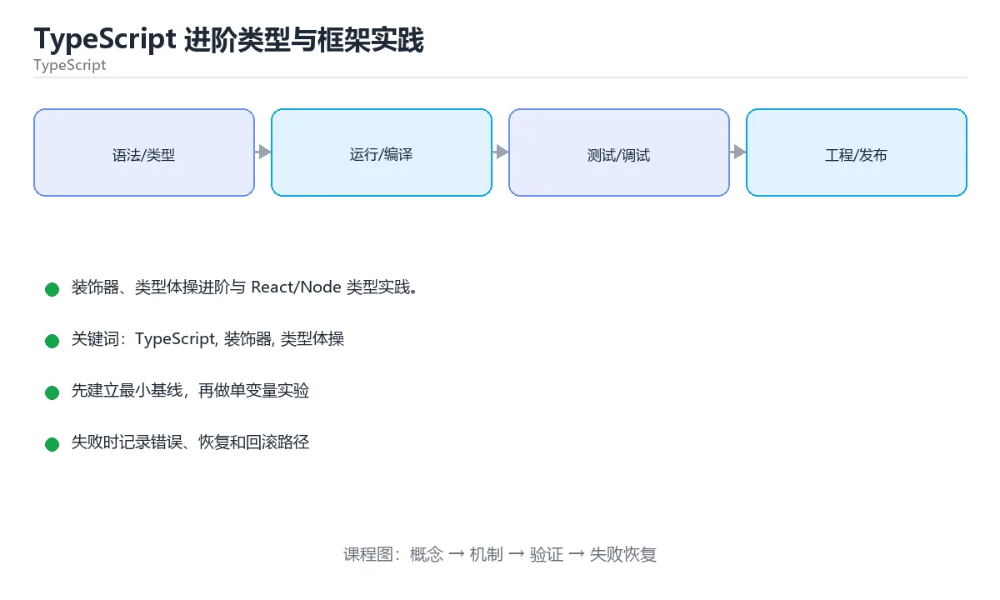

# TypeScript 进阶类型与框架实践

> 内容更新时间：2026-10-06 · 学习阶段：进阶 · 预计用时：40 分钟




## 本节知识框架

**课程定位**：所属分类 `typescript`（TypeScript），课程主题 `TypeScript 进阶类型与框架实践`，学习阶段 进阶，建议用时 50 分钟。

本课主线：装饰器、类型体操进阶与 React/Node 类型实践。

**学完本课应当能够**
- 说清 `React.FC` 与 `TypeScript` 的含义与区别，并各举一个正例和一个反例。
- 用本课示例验证 `装饰器` 的行为，记录输入、输出与失败条件。
- 遇到「以为装饰器能做运行时类型检查」这类问题时，能说出触发条件与修复顺序。

### 复习清单

- [ ] 能不看正文复述本课核心术语，并指出一个边界或反例。
- [ ] 能运行或推演本课示例，记录输入、输出与失败现象。
- [ ] 能完成一次自测，并把错题对照错误表定位原因。

## 核心概念定义

| 术语 | 操作性定义 | 常见边界与风险 |
| --- | --- | --- |
| React.FC | 组件 props 显式声明接口，避免 React.FC（隐式 children 已不推荐）。 | 换成显式接口后 children 不再自动可用，父组件要塞子内容就得自己在 props 里声明这个字段。 |
| TypeScript | 在 JavaScript 上增加静态类型系统的语言，编译后可运行在浏览器或 Node.js。 | 易错：`TypeScript` 的类型只是编译期合同，产物里运行时不存在；接口返回的数据仍要靠 zod 这类 `parse` 真正验一遍。 |
| 装饰器 | 在不修改原函数主体的情况下包装或增强其行为的语法结构。 | 易错：数据照样出错；正确做法是用 zod 等显式校验。 |
| 类型守卫 | 用 is 或断言函数把运行时校验的结果告诉编译器，替代不安全的 as 断言。 | 易错：`is` 谓词是你向编译器的保证，它不校验实现本身；守卫误判返回 true 时脏值仍带着窄化后的类型流进运行期。 |
| 递归条件类型 | 深层 Readonly、路径类型、数组转联合 | 易错：递归条件类型在编译期逐层展开深层 `Readonly`、路径类型，结构一深就难推断也难读，要拆开别做类型体操。 |
| 分布式条件类型 | 对联合类型逐项处理 | 易错：分布式条件类型把联合拆成逐项计算再合并，写成非裸类型参数时不分发，`string \| number` 会被当成一整个类型处理。 |
| 模板字面量类型 | 生成事件名、CSS 属性、路由参数类型 | 易错：模板字面量类型能约束事件名、路由参数这类字符串格式，但运行时真实字符串仍要窄化或校验，拼错来源不受约束。 |
| 协变/逆变位置 | 理解函数参数为何是逆变的 | 易错：函数参数处于逆变位置，别照返回值协变的直觉赋值；只有能处理更宽参数的函数才可安全替换，反过来会让运行期收到没准备好的实参。 |
| 组件 props | `type Props = { id: string; onSelect?: (id: string) => void }` | 带问号的 onSelect 是可选字段，父组件没传就直接调用会在运行期拿到 undefined，要先判空或给默认值。 |
| 函数组件 | `function Card({ id }: Props) { ... }` | 解构出来的字段仍受 Props 约束，字段名写错当场报错；把 props 类型退化成 any 就等于放弃这层检查。 |
| 子节点 | `children: React.ReactNode` | 要把可选性也一并声明清楚，否则要么传不进内容，要么不传时编译不过，隐式 children 已经靠不住。 |
| 事件处理 | `(e: React.ChangeEvent<HTMLInputElement>) => void` | 换个元素就得换成对应的事件类型，写成 any 会丢掉自动补全，也丢掉 target 上的字段类型。 |
| 泛型组件 | `function List<T>({ items }: { items: T[] }) { ... }` | 易错：丢失元素类型；正确做法是用 `<T,>` 泛型语法。 |
| 状态 | `useState<User \| null>(null)` | 初始值给 null 之后取出来的仍是可空类型，用字段前要先判空收窄，别用 as 断言把这一步混过去。 |
| Ref | `useRef<HTMLInputElement>(null)` | 元素类型要写进泛型参数里，取 current 之前仍要判空，类型检查不会替你做这一步。 |
| 上下文 | `createContext<Auth \| null>(null)` | 易错：忘记 Provider 导致运行时报错；正确做法是自定义 hook 在为空时抛错。 |
| 前端读取 | 仅 `VITE_` 前缀会暴露给浏览器 | 带这个前缀的值一定会被打包进产物给浏览器看到，密钥类变量绝不能挂这个前缀。 |
| Node 读取 | `process.env.NODE_ENV`，缺省需判空 | 用感叹号强断言非空只骗过编译期，真缺失时仍是 undefined 静默出错，要在启动时统一校验。 |
| 校验必填 | 启动时集中校验，缺失直接抛错 | 这一次只兜住进程内的环境变量，接口返回等运行期数据仍要各自 parse，出参也要一起校验。 |
| 类型声明 | `declare global { namespace NodeJS { interface ProcessEnv { DATABASE_URL: string } } }` | 声明成 string 只是编译期承诺，实际缺失时照样是 undefined，还得配 schema 校验才靠得住。 |
| 禁止 | 把密钥放前端环境变量（会被打包进产物） | 易错：这条禁止针对 `VITE_` 前缀——它一定被打进产物对浏览器可见，密钥放这里等于公开，密钥只能留在服务端校验。 |

## 原理与运行机制

### 机制总览

**教材衔接：装饰器**

装饰器是函数，用于在类、方法、属性、参数上附加行为：`@Component`、`@Injectable`、`@Get('/users')`。经典用途是依赖注入、路由注册与元数据标注。

注意：装饰器曾是实验特性（experimentalDecorators），TC39 标准装饰器语义不同。使用 Angular/NestJS 时按框架要求配置；新项目若不依赖框架，优先用高阶函数或组合替代。

**教材衔接：零基础详解：装饰器、运行时校验与工程实践**

### 一句话说清它是什么

装饰器是「贴在类或方法上的元数据标签」，本身不干活，真正干活的是读取标签的框架。
而**运行时校验**解决类型系统管不到的那一半：接口返回的数据到底长什么样。

### 用生活比喻理解

| 概念 | 比喻 | 说明 |
| --- | --- | --- |
| 装饰器 | 贴在箱子上的标签 | 只描述信息，不改变内容 |
| 框架 | 读标签的人 | 启动或请求时读取并执行 |
| 类型系统 | 编译期合同 | 运行时完全不存在 |
| 运行时校验 | 开箱验货 | 真的检查数据是否符合合同 |
| schema 优先 | 一份图纸两用 | 校验规则反推出类型 |

### 装饰器的三种写法

```typescript
// 1. 类装饰器
function Injectable(): ClassDecorator {
  return (target) => {
    Reflect.defineMetadata("injectable", true, target);
  };
}

// 2. 方法装饰器
function Log(): MethodDecorator {
  return (target, key, descriptor: PropertyDescriptor) => {
    const original = descriptor.value;
    descriptor.value = function (...args: unknown[]) {
      console.log(`调用 ${String(key)}`, args);
      return original.apply(this, args);
    };
  };
}

// 3. 参数装饰器
function Body(): ParameterDecorator {
  return (target, key, index) => {
    Reflect.defineMetadata("body", index, target, key!);
  };
}

@Injectable()
class UserService {
  @Log()
  find(@Body() id: number) {
    return { id };
  }
}
```

**注意**：传统装饰器需要 `experimentalDecorators: true`；新标准装饰器的语义不同，混用会踩坑。

### 什么时候该用装饰器

| 场景 | 适合用装饰器 | 建议 |
| --- | --- | --- |
| 声明路由 | ✅ | NestJS 风格，元数据驱动 |
| 依赖注入 | ✅ | 框架统一读取 |
| 参数校验 | ✅ | 需要配合校验库 |
| 简单日志 | ⚠️ | 显式包装函数更易调试 |
| 业务逻辑 | ❌ | 藏在装饰器里最难排查 |

### 运行时校验：类型管不到的地方

```typescript
import { z } from "zod";

const UserSchema = z.object({
  id: z.number().int().positive(),
  name: z.string().min(1).max(50),
  email: z.string().email().optional(),
  role: z.enum(["admin", "user"]).default("user"),
});

type User = z.infer<typeof UserSchema>;      // 类型由 schema 推导，永不漂移

function parseUser(input: unknown): User {
  return UserSchema.parse(input);             // 失败会抛 ZodError
}

// 安全解析：不抛异常，返回结果对象
const result = UserSchema.safeParse(payload);
if (!result.success) {
  console.error(result.error.issues);
} else {
  console.log(result.data.role);              // 已应用默认值
}
```

**好处**：一份 schema 同时提供运行时校验和静态类型，不会出现「类型写对了但数据不对」。

### 环境变量必须校验

```typescript
const EnvSchema = z.object({
  NODE_ENV: z.enum(["development", "test", "production"]),
  PORT: z.coerce.number().int().min(1).max(65535),
  DATABASE_URL: z.string().url(),
  JWT_SECRET: z.string().min(32),
});

export const env = EnvSchema.parse(process.env);
// 缺失或格式错误会在启动时立刻失败，而不是运行到一半才崩
```

### NestJS 里的四类装饰器

| 装饰器 | 挂在哪 | 作用 |
| --- | --- | --- |
| `@Controller("/users")` | 类 | 声明路由前缀 |
| `@Get(":id")` | 方法 | 声明 HTTP 方法与路径 |
| `@Injectable()` | 类 | 允许被依赖注入 |
| `@Body()` / `@Param()` | 参数 | 从请求中取值 |

### 新手最容易踩的八个坑

| 坑 | 现象 | 正确做法 |
| --- | --- | --- |
| 以为装饰器能做运行时类型检查 | 数据照样出错 | 用 zod 等显式校验 |
| 把业务逻辑写进装饰器 | 排查困难 | 只做横切关注点 |
| 忘记开 `experimentalDecorators` | 编译报错 | 按框架要求配置 |
| 装饰器执行顺序搞混 | 元数据被覆盖 | 记住：由下往上、由内往外 |
| 只校验入参不校验出参 | 脏数据流向下游 | 两端都校验 |
| 用 `as User` 代替校验 | 运行时崩溃 | 用 `parse` 或 `safeParse` |
| 环境变量直接用 `process.env.X!` | 缺失时静默出错 | 启动时统一校验 |
| 校验错误直接抛给用户 | 泄露内部结构 | 转成统一错误响应 |

### 手把手练习：带校验的创建接口

```typescript
import { z } from "zod";

const CreateUserSchema = z.object({
  name: z.string().min(1, "姓名不能为空"),
  email: z.string().email("邮箱格式不正确"),
  age: z.number().int().min(0).max(150).optional(),
});

type CreateUserInput = z.infer<typeof CreateUserSchema>;

function createUser(raw: unknown): { ok: true; data: CreateUserInput } | { ok: false; errors: string[] } {
  const parsed = CreateUserSchema.safeParse(raw);
  if (!parsed.success) {
    return {
      ok: false,
      errors: parsed.error.issues.map((i) => `${i.path.join(".")}: ${i.message}`),
    };
  }
  return { ok: true, data: parsed.data };
}

console.log(createUser({ name: "小明", email: "a@b.com" }));
console.log(createUser({ name: "", email: "bad" }));
```

### 学完自测

- [ ] 能说出装饰器与框架的分工。
- [ ] 知道传统装饰器需要哪个编译选项。
- [ ] 能解释为什么类型系统不能替代运行时校验。
- [ ] 能用 zod 推导出 TypeScript 类型。
- [ ] 知道环境变量应该在什么时候校验。

**教材衔接：版本与时效**

- 版本提示：TypeScript 的行为在最近几个大版本里有过调整，升级「TypeScript 进阶类型与框架实践」前先用 ClassMethodDecoratorContext 复现当前输出，再对照官方发布说明逐条核对。
- 升级前先用 ClassMethodDecoratorContext 建立基线：记录版本、命令和输出，升级后只比较这些可观察量。

## 典型应用场景

- **以为装饰器能做运行时类型检查**：典型现象是数据照样出错；正确做法是用 zod 等显式校验。
- **把业务逻辑写进装饰器**：典型现象是排查困难；正确做法是只做横切关注点。
- **忘记开 `experimentalDecorators`**：典型现象是编译报错；正确做法是按框架要求配置。
- **装饰器执行顺序搞混**：典型现象是元数据被覆盖；正确做法是记住：由下往上、由内往外。

### 最小验证场景

- 准备：保留 `typescript` 示例的原始输入，先记录 `TypeScript 进阶类型与框架实践` 的基线输出和完整运行命令。
- 观察：先核对 调用了 `Injectable()`，再改变一个与 `React.FC` 相关的条件。
- 判定：新结果与 `TypeScript 进阶类型与框架实践` 的基线不同不等于错误；只有当差异破坏了 `React.FC` 的定义或错误表中的约束，才判定为失败。

### 选择与边界

- 使用 `React.FC` 时，先满足它的定义：组件 props 显式声明接口，避免 `React.FC`（隐式 children 已不推荐）。
- 使用 `TypeScript` 时，先满足它的定义：在 JavaScript 上增加静态类型系统的语言，编译后可运行在浏览器或 Node.js；静态检查只在编译期成立，运行期输入仍需校验。
- 使用 `装饰器` 时，先满足它的定义：在不修改原函数主体的情况下包装或增强其行为的语法结构；易错：数据照样出错；正确做法是用 zod 等显式校验。
- 使用 `类型守卫` 时，先满足它的定义：用 is 或断言函数把运行时校验的结果告诉编译器，替代不安全的 as 断言；静态检查只在编译期成立，运行期输入仍需校验。

## 代码/协议/SQL 示例

### 最小可验证示例

```ts
// 方法装饰器：记录耗时（标准装饰器语法）
function timed(
  target: unknown,
  context: ClassMethodDecoratorContext,
) {
  const name = String(context.name);
  return function (this: unknown, ...args: unknown[]) {
    const start = performance.now();
    try {
      return (this as Record<string, Function>)[name](...args);
    } finally {
      console.log(`${name} 耗时 ${(performance.now() - start).toFixed(1)}ms`);
    }
  };
}

class Service {
  @timed
  handle(id: string) {
    return `handled ${id}`;
  }
}
```

**教材衔接：装饰器速查**

| 类型 | 作用位置 | 典型用途 |
| --- | --- | --- |
| 类装饰器 | 类声明 | 注册、注入元数据 |
| 方法装饰器 | 方法 | 日志、缓存、权限校验 |
| 属性装饰器 | 属性 | 校验规则、序列化映射 |
| 参数装饰器 | 方法参数 | 依赖注入、参数校验 |
| 访问器装饰器 | getter / setter | 拦截读取与赋值 |

注意：TypeScript 有两套装饰器语义。旧版「实验性装饰器」需要 `experimentalDecorators: true`（NestJS、TypeORM 使用）；TC39 标准装饰器在新版 TS 中默认可用。两者不能混用，取决于框架要求。

**运行方式**：运行 `TypeScript 进阶类型与框架实践` 的示例时，保存为 `.ts` 后先编译或用 `ts-node` 运行；类型报错先解决再运行。

## 时间/空间复杂度或性能分析

**性能关注点（TypeScript 进阶类型与框架实践）**：编译期类型检查与运行期代码是两套开销：分别记录构建时间与运行时耗时。

**测量方法**：以 `TypeScript 进阶类型与框架实践` 的 `TypeScript` 场景为对象，固定输入跑一遍记录基线，再把规模或并发度提高一个数量级复测；两次结果的差值与波动范围才是结论依据。

## 常见误区与易错点

| 容易写错的做法 | 实际现象 | 原因与正确做法 |
| --- | --- | --- |
| 以为装饰器能做运行时类型检查 | 数据照样出错 | 用 zod 等显式校验 |
| 把业务逻辑写进装饰器 | 排查困难 | 只做横切关注点 |
| 忘记开 `experimentalDecorators` | 编译报错 | 按框架要求配置 |
| 装饰器执行顺序搞混 | 元数据被覆盖 | 记住：由下往上、由内往外 |
| 只校验入参不校验出参 | 脏数据流向下游 | 两端都校验 |
| 用 `as User` 代替校验 | 运行时崩溃 | 用 `parse` 或 `safeParse` |
| 环境变量直接用 `process.env.X!` | 缺失时静默出错 | 启动时统一校验 |
| 校验错误直接抛给用户 | 泄露内部结构 | 转成统一错误响应 |
| 装饰器两套语义混用 | 编译错误或行为异常 | 按框架要求统一开启或关闭 `experimentalDecorators` |
| 装饰器做重业务逻辑 | 行为隐蔽、难以调试 | 只做元数据与横切关注点 |
| props 类型用 `any` | 失去检查 | 明确字段类型，可选字段用 `?` |
| 可选 props 不设默认值 | 运行时 `undefined` 报错 | 用默认参数或判空 |
| 直接把 `process.env` 传给前端 | 值为 undefined | 用构建工具的注入机制 |
| 上下文类型不校验 | 忘记 Provider 导致运行时报错 | 自定义 hook 在为空时抛错 |
| 事件类型写 `any` | 失去自动补全 | 用 React 提供的具体事件类型 |
| 泛型组件写成 `any[]` | 丢失元素类型 | 用 `<T,>` 泛型语法 |
| 用装饰器替代依赖注入显式声明 | 依赖关系不可见 | 显式构造或框架标准写法 |
| 忘记给环境变量声明类型 | `Property 'X' does not exist` | 补 `ProcessEnv` 声明 |

### 现场 1：以为装饰器能做运行时类型检查

**症状**：数据照样出错。

**根因与修复**：用 zod 等显式校验。

**自检**：在本课示例里复现「以为装饰器能做运行时类型检查」，改成用 zod 等显式校验后重跑；如果症状消失且失败路径按预期变化，说明定位正确。

### 现场 2：把业务逻辑写进装饰器

**症状**：排查困难。

**根因与修复**：只做横切关注点。

**自检**：在本课示例里复现「把业务逻辑写进装饰器」，改成只做横切关注点后重跑；如果症状消失且失败路径按预期变化，说明定位正确。

### 现场 3：忘记开 `experimentalDecorators`

**症状**：编译报错。

**根因与修复**：按框架要求配置。

**自检**：在本课示例里复现「忘记开 `experimentalDecorators`」，改成按框架要求配置后重跑；如果症状消失且失败路径按预期变化，说明定位正确。

### 现场 4：装饰器执行顺序搞混

**症状**：元数据被覆盖。

**根因与修复**：记住：由下往上、由内往外。

**自检**：在本课示例里复现「装饰器执行顺序搞混」，改成记住：由下往上、由内往外后重跑；如果症状消失且失败路径按预期变化，说明定位正确。

### 现场 5：只校验入参不校验出参

**症状**：脏数据流向下游。

**根因与修复**：两端都校验。

**自检**：在本课示例里复现「只校验入参不校验出参」，改成两端都校验后重跑；如果症状消失且失败路径按预期变化，说明定位正确。

### 现场 6：用 `as User` 代替校验

**症状**：运行时崩溃。

**根因与修复**：用 `parse` 或 `safeParse`。

**自检**：在本课示例里复现「用 `as User` 代替校验」，改成用 `parse` 或 `safeParse`后重跑；如果症状消失且失败路径按预期变化，说明定位正确。

### 现场 7：环境变量直接用 `process.env.X!`

**症状**：缺失时静默出错。

**根因与修复**：启动时统一校验。

**自检**：在本课示例里复现「环境变量直接用 `process.env.X!`」，改成启动时统一校验后重跑；如果症状消失且失败路径按预期变化，说明定位正确。

### 现场 8：校验错误直接抛给用户

**症状**：泄露内部结构。

**根因与修复**：转成统一错误响应。

**自检**：在本课示例里复现「校验错误直接抛给用户」，改成转成统一错误响应后重跑；如果症状消失且失败路径按预期变化，说明定位正确。

### 现场 9：装饰器两套语义混用

**症状**：编译错误或行为异常。

**根因与修复**：按框架要求统一开启或关闭 `experimentalDecorators`。

**自检**：在本课示例里复现「装饰器两套语义混用」，改成按框架要求统一开启或关闭 `experimentalDecorators`后重跑；如果症状消失且失败路径按预期变化，说明定位正确。

## 与其他知识点的关系

- **先修**：`TypeScript 工程配置与实践`。本课默认这些内容已经掌握。
- **相关或后续**：`TypeScript 构建工具链与测试`。本课术语会在这些课程里继续使用。
- **术语归属**：`React.FC`、`TypeScript`、`装饰器` 的定义以本课「核心概念定义」为准，换到其他课程时先确认定义是否被改写。
- 同一分类的《TypeScript 第一个类型》也涉及 `TypeScript`；两课衔接时先确认这个术语的定义是否一致。
- 同一分类的《TypeScript 基础类型》也涉及 `TypeScript`；两课衔接时先确认这个术语的定义是否一致。

## 自测题与参考答案

> 先独立作答，再对照参考答案；答案都能在本课正文、术语表或错误表里找到依据。

### 自测 1（概念复述）

不看正文，写出 `React.FC` 的操作性定义，并说明它与 `TypeScript` 的区别。

**参考答案**：组件 props 显式声明接口，避免 `React.FC`（隐式 children 已不推荐）。

`TypeScript` 的定位是：在 JavaScript 上增加静态类型系统的语言，编译后可运行在浏览器或 Node.js；两者的差别要从适用对象与失败模式上说明。

### 自测 2（排错）

本课错误表记录了「以为装饰器能做运行时类型检查」这类做法。请写出它会出现的现象、根因，以及修复顺序。

**参考答案**：现象是数据照样出错；正确做法是用 zod 等显式校验。修复时先复现现象并保留证据，再改动一处假设重跑，确认现象消失。

### 自测 3（动手验证）

运行本课的 `typescript` 示例，把其中的 `"injectable"` 换成一个边界值后重新运行，记录输出与错误信息。

**参考答案**：正常输入下 `typescript` 示例应当复现正文给出的结果；把 `"injectable"` 换成边界值后，如果结果改变或报错，先核对它是否满足 `TypeScript 进阶类型与框架实践` 中`React.FC` 的适用范围，再检查错误表里是否有同类现象。

### 自测 4（代码阅读）

阅读本课开头的 `typescript` 示例，说明它体现了`React.FC` 的哪一条性质，并指出改动哪个输入会让这条性质不再成立。

**参考答案**：`React.FC` 的定义是 组件 props 显式声明接口，避免 `React.FC`（隐式 children 已不推荐），示例正是在实现这条定义。改动与 `React.FC` 有关的一个输入后，如果结果不再符合 `TypeScript 进阶类型与框架实践` 的正文描述，就说明该性质只在当前前提成立。

### 自测 5（迁移）

把 `TypeScript 进阶类型与框架实践` 的方法迁移到自己的项目：围绕 `React.FC` 写出一个与错误表同类的风险点，并说明触发条件和检验方式。

**参考答案**：例如「忘记给环境变量声明类型」，它会导致`Property 'X' does not exist`；检验方式是按补 `ProcessEnv` 声明改一处再复现，确认现象消失且没有引入新的失败分支。

### 自测 6（对比）

用一个表格对比 `React.FC` 与 `TypeScript`：各写一行适用场景、一行失败表现。

**参考答案**：`React.FC` 的定义是组件 props 显式声明接口，避免 `React.FC`（隐式 children 已不推荐）；`TypeScript` 的定义是在 JavaScript 上增加静态类型系统的语言，编译后可运行在浏览器或 Node.js。两者的失败表现分别对应本课错误表里与本术语相关的行。

### 自测 7（排错顺序）

面对「以为装饰器能做运行时类型检查」引发的问题，请把“复现 数据照样出错 → 保留证据 → 用 zod 等显式校验 → 回归验证”四步写成可执行的检查清单。

**参考答案**：第一步按数据照样出错复现；第二步记录输入、版本与完整报错；第三步按用 zod 等显式校验只改一处；第四步重跑并确认失败路径也按预期变化。

### 自测 8（边界判断）

针对 `类型守卫`，分别写出“可以使用”的条件和“结论不再成立”的条件。

**参考答案**：静态检查只在编译期成立，运行期输入仍需校验。 同时要把 `类型守卫` 的定义 用 is 或断言函数把运行时校验的结果告诉编译器，替代不安全的 as 断言 与实际输入逐项对照。

### 自测 9（机制重建）

不看正文，按输入、转换、输出、验证四段重建 `React.FC` → `TypeScript` → `装饰器` → `类型守卫` 的作用链。

**参考答案**：起点是 `React.FC` 的定义 组件 props 显式声明接口，避免 `React.FC`（隐式 children 已不推荐）；中间每一步都保留可观察状态；终点由 `类型守卫` 检查，失败时回到错误表定位第一个偏离定义的步骤。

### 自测 10（综合排错）

在 `TypeScript 进阶类型与框架实践` 中，现象是 `Property 'X' does not exist`。请围绕 忘记给环境变量声明类型 写出最小复现、关键证据、修复动作和回归验证，并说明为什么不能只凭一次运行下结论。

**参考答案**：先复现 忘记给环境变量声明类型，记录输入与完整错误；再按 补 `ProcessEnv` 声明 只改一处。回归时同时跑正常路径和边界路径，只有两次结果都可解释，才把修复视为完成。

### 自测 11（一分钟复述）

用每分钟约 200 字的速度复述 `TypeScript 进阶类型与框架实践`：先给主问题，再按顺序说出 `React.FC`、`TypeScript`、`装饰器`、`类型守卫`，最后给一个失败案例。

**自评标准**：主问题必须对应 装饰器、类型体操进阶与 React/Node 类型实践；每个术语都要能接上一句定义或边界；失败案例必须写成可观察现象，不能用“可能有风险”代替证据。

## 延伸阅读

想更直观地理解本课概念？推荐参阅以下图解专题：

- [图解调用栈与递归](visual_call_stack.md)

## 术语速查

| 术语 | 一句话说明 |
| --- | --- |
| `React.FC` | 组件 props 显式声明接口，避免 `React.FC`（隐式 children 已不推荐）。 |
| `TypeScript` | 在 JavaScript 上增加静态类型系统的语言，编译后可运行在浏览器或 Node.js。 |
| `装饰器` | 在不修改原函数主体的情况下包装或增强其行为的语法结构。 |
| `类型守卫` | 用 is 或断言函数把运行时校验的结果告诉编译器，替代不安全的 as 断言。 |

**术语关系**：`React.FC`（组件 props 显式声明接口） → `TypeScript`（在 JavaScript 上增加静态类型系统的语言） → `装饰器`（在不修改原函数主体的情况下包装或增强其行为的语法结构） → `类型守卫`（用 is 或断言函数把运行时校验的结果告诉编译器）。

## 考点精讲

`TypeScript 进阶类型与框架实践` 的题库有 6 道题，下面逐题给出题干、正确项与判断依据：先自己作答，再核对正确项，最后回到正文对应小节复核。

### 考点 1：第 1 题

- **题目**：围绕“TypeScript 进阶类型与框架实践”中的 TypeScript、装饰器、类型体操，下列哪两项是本课强调的实践判断？
- **正确项**：学习 TypeScript 时要同时说明输入、输出和失败路径，不能只看正常流程；验证 装饰器 时要固定版本并覆盖边界输入，结论才可复现
- **判断依据**：按《TypeScript 进阶类型与框架实践》的正文口径，本题要同时选中「学习 TypeScript 时要同时说明输入、输出和失败路径，不能只看正常流程」、「验证 装饰器 时要固定版本并覆盖边界输入，结论才可复现」，漏掉任一项都算没答全。术语 TypeScript（TypeScript 进阶类型与框架实践）：在 JavaScript 上增加静态类型系统的语言，编译后可运行在浏览器或 Node.js。易错点是以为装饰器能做运行时类型检查，会造成数据照样出错，改法是用 zod 等显式校验。

### 考点 2：第 2 题

- **题目**：下面这段 `typescript` 代码来自 `TypeScript 进阶类型与框架实践`。课程主线是装饰器、类型体操进阶与 React/Node 类型实践。代码与 `React.FC` 有关。哪一项是代码里真实出现的内容？
- **正确项**：调用了 `parseUser()`
- **判断依据**：本题正确项是「调用了 `parseUser()`」。术语 React.FC（TypeScript 进阶类型与框架实践）：组件 props 显式声明接口，避免 `React.FC`（隐式 children 已不推荐），本题取「调用了 `parseUser()`」这条。易错点是把业务逻辑写进装饰器，会造成排查困难，改法是只做横切关注点。本题干扰项「调用了 `hexdigest()`」不成立：展示代码里找不到 `hexdigest()`。

### 考点 3：第 3 题

- **题目**：Node 中读取环境变量的推荐做法是？
- **正确项**：先用 zod 等校验再使用
- **判断依据**：按《TypeScript 进阶类型与框架实践》的正文口径，本题正确项是「先用 zod 等校验再使用」。术语「React.FC」在本课里的界定是组件 props 显式声明接口，避免 `React.FC`（隐式 children 已不推荐），题干「Node 中读取环境变量的推荐做法是」问的就是这一条。常见错法是以为装饰器能做运行时类型检查，其后果是数据照样出错。正确做法是用 zod 等显式校验。干扰项「用 any 转换」与题干「Node 中读取环境变量的推荐做法是」的要求对不上，应排除。

### 考点 4：第 4 题

- **题目**：zod 与 class-validator 的差别是？
- **正确项**：zod 是 schema 优先，可从校验规则反推类型
- **判断依据**：本题正确项是「zod 是 schema 优先，可从校验规则反推类型」。术语 React.FC（TypeScript 进阶类型与框架实践）：组件 props 显式声明接口，避免 `React.FC`（隐式 children 已不推荐），本题取「zod 是 schema 优先，可从校验规则反推类型」这条。易错点是装饰器执行顺序搞混，会造成元数据被覆盖，改法是记住：由下往上、由内往外。

### 考点 5：第 5 题

- **题目**：NestJS 中装饰器主要承载什么职责？
- **正确项**：声明式地标注路由
- **判断依据**：本题正确项是「声明式地标注路由」。术语 装饰器（TypeScript 进阶类型与框架实践）：在不修改原函数主体的情况下包装或增强其行为的语法结构，本题取「声明式地标注路由」这条。易错点是只校验入参不校验出参，会造成脏数据流向下游，改法是两端都校验。

### 考点 6：第 6 题

- **题目**：填空：补齐下面这段术语说明中的空缺。课程 `装饰器、类型体操进阶与 React/Node 类型实践。`，这段说明是：组件 props 显式声明接口，避免 ``____``（隐式 children 已不推荐）。空缺处应填哪个术语？
- **正确项**：React.FC
- **判断依据**：《TypeScript 进阶类型与框架实践》这题的填空口径是「React.FC」或「react.fc」，正文写法与其中任一项一致即可。术语「React.FC」在本课里的界定是组件 props 显式声明接口，避免 `React.FC`（隐式 children 已不推荐），题干问的就是这一条。常见错法是以为装饰器能做运行时类型检查，其后果是数据照样出错。正确做法是用 zod 等显式校验。

### 考点 7：`React.FC`

- **要点**：组件 props 显式声明接口，避免 `React.FC`（隐式 children 已不推荐）。

### 考点 8：`TypeScript`

- **要点**：在 JavaScript 上增加静态类型系统的语言，编译后可运行在浏览器或 Node.js。
- **TypeScript 的边界**：静态检查只在编译期成立，运行期输入仍需校验。

### 考点 9：`装饰器`

- **要点**：在不修改原函数主体的情况下包装或增强其行为的语法结构。
- **装饰器 的边界**：易错：数据照样出错；正确做法是用 zod 等显式校验。

### 考点 10：`类型守卫`

- **要点**：用 is 或断言函数把运行时校验的结果告诉编译器，替代不安全的 as 断言。
- **类型守卫 的边界**：静态检查只在编译期成立，运行期输入仍需校验。

### 考点 11：排错——以为装饰器能做运行时类型检查

- **现象**：数据照样出错。
- **处理**：用 zod 等显式校验。

### 考点 12：排错——把业务逻辑写进装饰器

- **现象**：排查困难。
- **处理**：只做横切关注点。

### 考点 13：综合辨析——`React.FC` 与 `类型守卫`

- **辨析点**：`React.FC` 的定义是 组件 props 显式声明接口，避免 `React.FC`（隐式 children 已不推荐）；`类型守卫` 的定义是 用 is 或断言函数把运行时校验的结果告诉编译器，替代不安全的 as 断言。
- **答题要求**：面对 `TypeScript 进阶类型与框架实践` 的题目，先判断描述的是 `React.FC` 还是 `类型守卫`，再归到对应定义，最后写出一个会让该定义失效的边界输入。

### 考点 14：排错评分点

- **现象分**：能写出 数据照样出错，而不是只写“程序有错”。
- **证据分**：保留触发 以为装饰器能做运行时类型检查 的输入、版本和错误原文。
- **修复分**：按 用 zod 等显式校验 只改一处，并同时回归正常路径与边界路径。

## 内容元数据

- 内容版本：v2.0
- 最后更新：2026-10-06
- 学习阶段：进阶
- 适用环境：TypeScript 5.x / Node.js 22+
；本课聚焦 TypeScript。
- 内容来源：内置结构化课程与工程实践整理
- 相关主题：TypeScript、装饰器、类型体操、React、Node
- 质量版本：P0 测验标准 + P1 覆盖扩展 + P2 体验补全

## 参考资料与复核

- 最后复核：2026-10-04
- 下次复核：2027-03-17
- 复核范围：版本兼容、API 行为、安全建议与工程实践
- 来源性质：官方文档、标准或权威教材；本课核对关键词：TypeScript、装饰器、类型体操、React、Node。

| 参考资料 | 本课用途 |
| --- | --- |
| [TypeScript Node 指南](https://nodejs.org/en/learn/typescript) | Node 中的 TypeScript |
| [Everyday Types](https://www.typescriptlang.org/docs/handbook/2/everyday-types.html) | 常用类型与收窄 |
| [装饰器文档](https://www.typescriptlang.org/docs/handbook/decorators.html) | 装饰器与元数据 |

| [本课术语索引：TypeScript 进阶类型与框架实践](#核心概念定义) | 按本课输入、术语边界和错误表现逐项核对 |
> 「TypeScript 进阶类型与框架实践」的链接用于离线阅读后的延伸核对；App 不会自动联网。