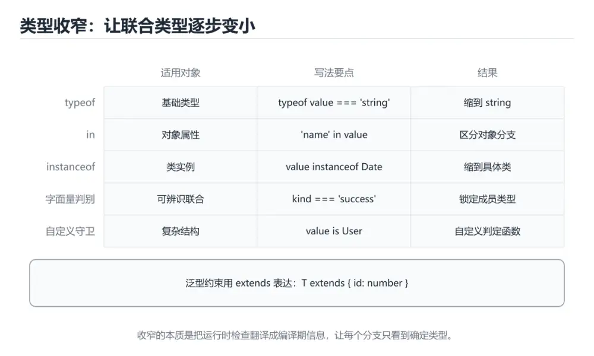
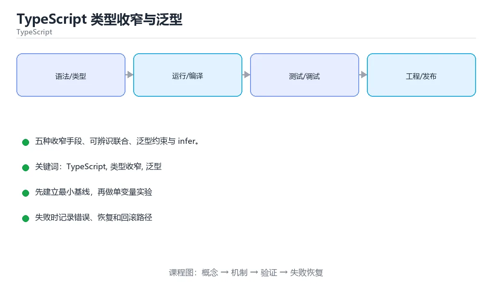

# TypeScript 类型收窄与泛型





> 内容更新时间：2026-10-06 · 学习阶段：进阶 · 预计用时：35 分钟

## 本节知识框架

**课程定位**：所属分类 `typescript`（TypeScript），课程主题 `TypeScript 类型收窄与泛型`，学习阶段 进阶，建议用时 50 分钟。

本课主线：五种收窄手段、可辨识联合、泛型约束与 infer。

**学完本课应当能够**
- 说清 `TypeScript` 与 `类型收窄` 的含义与区别，并各举一个正例和一个反例。
- 用本课示例验证 `泛型` 的行为，记录输入、输出与失败条件。
- 遇到「用 `as` 强行断言」这类问题时，能说出触发条件与修复顺序。

### 复习清单

- [ ] 能不看正文复述本课核心术语，并指出一个边界或反例。
- [ ] 能运行或推演本课示例，记录输入、输出与失败现象。
- [ ] 能完成一次自测，并把错题对照错误表定位原因。

## 核心概念定义

| 术语 | 操作性定义 | 常见边界与风险 |
| --- | --- | --- |
| TypeScript | 在 JavaScript 上增加静态类型系统的语言，编译后可运行在浏览器或 Node.js。 | 静态检查只在编译期成立，运行期输入仍需校验。 |
| 类型收窄 | 在条件判断后让编译器知道变量属于更具体的类型。 | 静态检查只在编译期成立，运行期输入仍需校验。 |
| 泛型 | TypeScript 的类型能力集中在两处：收窄（把宽类型变窄） 与 泛型（让类型随输入变化）；掌握这两点，就能用类型把业务约束表达清楚。 | 易错：推断成 unknown；正确做法是让 T 出现在参数位置。 |
| 可辨识联合 | 可辨识联合 + switch 是建模业务状态最实用的模式：订单状态、请求结果、表单校验结果都可以这样写，新增一种状态时编译器会提示所有需要处理的位置。 | 网络延迟、超时与版本协商会改变行为，只在真实链路或多版本客户端上验证才算数。 |
| infer | TypeScript 在条件类型里声明待推断类型变量的关键字。 | 静态检查只在编译期成立，运行期输入仍需校验。 |
| 条件类型 | TypeScript 根据类型关系在编译期选择结果类型的类型运算 | 静态检查只在编译期成立，运行期输入仍需校验。 |
| typeof | 区分 string/number/boolean 等原始类型 | 静态检查只在编译期成立，运行期输入仍需校验。 |
| instanceof | 区分类实例 | 只在「区分类实例」这一前提下成立，换输入或换环境要重新验证。 |
| in | 判断属性是否存在 | 只在「判断属性是否存在」这一前提下成立，换输入或换环境要重新验证。 |
| 可辨识联合 | 用共同字段（如 `type`）区分成员，配合 switch 穷尽检查 | 只在「用共同字段（如 `type`）区分成员，配合 switch 穷尽检查」这一前提下成立，换输入或换环境要重新验证。 |
| 类型守卫 | 自定义 `x is T` 函数或断言函数 `asserts x is T` | 易错：运行时照样出错；正确做法是用类型守卫真校验。 |
| typeof | `if (typeof v === "string")` | 只在「`if (typeof v === "string")`」这一前提下成立，换输入或换环境要重新验证。 |
| 真值判断 | `if (v) {}` | 只在「`if (v) {}`」这一前提下成立，换输入或换环境要重新验证。 |
| 空值判断 | `if (v != null)` | 只在「`if (v != null)`」这一前提下成立，换输入或换环境要重新验证。 |
| in 运算符 | `if ("id" in v)` | 只在「`if ("id" in v)`」这一前提下成立，换输入或换环境要重新验证。 |
| instanceof | `if (e instanceof Error)` | 只在「`if (e instanceof Error)`」这一前提下成立，换输入或换环境要重新验证。 |
| 字面量判别 | `if (r.status === "ok")` | 只在「`if (r.status === "ok")`」这一前提下成立，换输入或换环境要重新验证。 |
| 自定义类型守卫 | `function isUser(v: unknown): v is User` | 只在「`function isUser(v: unknown): v is User`」这一前提下成立，换输入或换环境要重新验证。 |
| 断言函数 | `function assert(cond: unknown): asserts cond` | 只在「`function assert(cond: unknown): asserts cond`」这一前提下成立，换输入或换环境要重新验证。 |
| Array.isArray | `if (Array.isArray(v))` | 只在「`if (Array.isArray(v))`」这一前提下成立，换输入或换环境要重新验证。 |
| 穷尽检查 | `default: const _x: never = v;` | 易错：新增状态漏处理；正确做法是用穷尽检查兜底。 |
| 联合类型 A \ | B` | 只在「B`」这一前提下成立，换输入或换环境要重新验证。 |
| 收窄 | 开箱验货 | 易错：类型检查失效，错误延后到线上；正确做法是用 unknown + 类型守卫逐层收窄。 |
| 泛型 | 可调模具 | 易错：推断成 unknown；正确做法是让 T 出现在参数位置。 |
| 约束 extends | 模具的尺寸范围 | 只在「模具的尺寸范围」这一前提下成立，换输入或换环境要重新验证。 |
| 类型守卫 | 贴标签 | 易错：运行时照样出错；正确做法是用类型守卫真校验。 |
| typeof | 原始类型判断 | 静态检查只在编译期成立，运行期输入仍需校验。 |
| instanceof | 类实例判断 | 只在「类实例判断」这一前提下成立，换输入或换环境要重新验证。 |
| in | 判断某个属性是否存在 | 只在「判断某个属性是否存在」这一前提下成立，换输入或换环境要重新验证。 |
| 字面量字段（可辨识联合） | 状态机、事件对象 | 缓存与状态残留会让结果过期，先明确失效策略再判断正确性。 |
| 自定义类型守卫 | 外部数据校验 | 只在「外部数据校验」这一前提下成立，换输入或换环境要重新验证。 |
| 用 as 强行断言 | 运行时照样出错 | 只在「运行时照样出错」这一前提下成立，换输入或换环境要重新验证。 |
| 泛型没用上参数 | 推断成 unknown | 易错：推断成 unknown；正确做法是让 T 出现在参数位置。 |
| 约束写太死 | 调用方传不进去 | 易错：调用方传不进去；正确做法是用 `keyof` 等结构性约束。 |
| 忘了处理 null | `strictNullChecks` 报错 | 只在「`strictNullChecks` 报错」这一前提下成立，换输入或换环境要重新验证。 |
| 类型守卫只判一层 | 嵌套字段仍报错 | 易错：嵌套字段仍报错；正确做法是逐层校验。 |
| 用 any 绕过报错 | 类型安全全丢 | 静态检查只在编译期成立，运行期输入仍需校验。 |
| 默认分支不写 assertNever | 新增状态漏处理 | 缓存与状态残留会让结果过期，先明确失效策略再判断正确性。 |
| 泛型嵌套太深 | 没人看得懂 | 易错：没人看得懂；正确做法是拆成命名类型。 |

## 原理与运行机制

### 机制总览

**教材衔接：泛型与约束**

泛型让函数与组件在保持类型安全的前提下复用：`function first<T>(list: T[]): T | undefined`。约束用 `extends`：`<T extends { id: number }>` 要求必须有 id；默认类型参数 `<T = string>` 提供缺省。

**教材衔接：版本与时效**

- 版本提示：TypeScript 的行为在最近几个大版本里有过调整，升级「TypeScript 类型收窄与泛型」前先用 message 复现当前输出，再对照官方发布说明逐条核对。
- 升级「TypeScript 类型收窄与泛型」涉及的依赖前，先用 message 复现当前行为，再逐项核对版本说明与破坏性变更。

## 典型应用场景

- **用 `as` 强行断言**：典型现象是运行时照样出错；正确做法是用类型守卫真校验。
- **泛型没用上参数**：典型现象是推断成 unknown；正确做法是让 T 出现在参数位置。
- **约束写太死**：典型现象是调用方传不进去；正确做法是用 `keyof` 等结构性约束。
- **忘了处理 `null`**：典型现象是`strictNullChecks` 报错；正确做法是先判空或用 `?.`。

### 最小验证场景

- 准备：保留 `ts` 示例的原始输入，先记录 `TypeScript 类型收窄与泛型` 的基线输出和完整运行命令。
- 观察：先核对 调用了 `render()`，再改变一个与 `TypeScript` 相关的条件。
- 判定：新结果与 `TypeScript 类型收窄与泛型` 的基线不同不等于错误；只有当差异破坏了 `TypeScript` 的定义或错误表中的约束，才判定为失败。

### 选择与边界

- 使用 `TypeScript` 时，先满足它的定义：在 JavaScript 上增加静态类型系统的语言，编译后可运行在浏览器或 Node.js；静态检查只在编译期成立，运行期输入仍需校验。
- 使用 `类型收窄` 时，先满足它的定义：在条件判断后让编译器知道变量属于更具体的类型；静态检查只在编译期成立，运行期输入仍需校验。
- 使用 `泛型` 时，先满足它的定义：TypeScript 的类型能力集中在两处：收窄（把宽类型变窄） 与 泛型（让类型随输入变化）；掌握这两点，就能用类型把业务约束表达清楚；易错：推断成 unknown；正确做法是让 T 出现在参数位置。
- 使用 `可辨识联合` 时，先满足它的定义：可辨识联合 + switch 是建模业务状态最实用的模式：订单状态、请求结果、表单校验结果都可以这样写，新增一种状态时编译器会提示所有需要处理的位置；网络延迟、超时与版本协商会改变行为，只在真实链路或多版本客户端上验证才算数。
- 使用 `infer` 时，先满足它的定义：TypeScript 在条件类型里声明待推断类型变量的关键字；静态检查只在编译期成立，运行期输入仍需校验。

## 代码/协议/SQL 示例

### 最小可验证示例

```ts
type Result =
  | { status: "ok"; data: string }
  | { status: "error"; message: string };

function render(result: Result): string {
  switch (result.status) {
    case "ok":
      return result.data;        // 自动收窄到 ok 分支
    case "error":
      return result.message;
    default: {
      const never: never = result;   // 新增成员时这里会编译报错
      return never;
    }
  }
}
```

**教材衔接：泛型约束速查**

| 写法 | 含义 |
| --- | --- |
| `<T>` | 任意类型 |
| `<T extends object>` | 必须是对象类型 |
| `<T extends { id: string }>` | 至少具备该形状 |
| `<T extends keyof U>` | 只能是 U 的键 |
| `<T = string>` | 提供默认类型参数 |
| `<T extends string \| number>` | 联合约束 |
| `function f<T>(x: T): T` | 返回值与入参类型联动 |
| `ReturnType<typeof f>` | 取函数返回值类型 |
| `Parameters<typeof f>[0]` | 取第一个参数类型 |
| `as const` | 让字面量推断变窄 |

```ts
// 约束 + keyof：安全地按字段取值
function pluck<T, K extends keyof T>(items: T[], key: K): T[K][] {
  return items.map((item) => item[key]);
}

const users = [{ id: 1, name: "小明" }];
const names = pluck(users, "name");   // string[]
// pluck(users, "age");               // 编译报错，及时发现问题
```

## 时间/空间复杂度或性能分析

**性能关注点（TypeScript 类型收窄与泛型）**：编译期类型检查与运行期代码是两套开销：分别记录构建时间与运行时耗时。

**测量方法**：以 `TypeScript 类型收窄与泛型` 的 `TypeScript` 场景为对象，固定输入跑一遍记录基线，再把规模或并发度提高一个数量级复测；两次结果的差值与波动范围才是结论依据。

## 常见误区与易错点

| 容易写错的做法 | 实际现象 | 原因与正确做法 |
| --- | --- | --- |
| 用 `as` 强行断言 | 运行时照样出错 | 用类型守卫真校验 |
| 泛型没用上参数 | 推断成 unknown | 让 T 出现在参数位置 |
| 约束写太死 | 调用方传不进去 | 用 `keyof` 等结构性约束 |
| 忘了处理 `null` | `strictNullChecks` 报错 | 先判空或用 `?.` |
| 类型守卫只判一层 | 嵌套字段仍报错 | 逐层校验 |
| 用 `any` 绕过报错 | 类型安全全丢 | 用 `unknown` 加守卫 |
| 默认分支不写 `assertNever` | 新增状态漏处理 | 用穷尽检查兜底 |
| 泛型嵌套太深 | 没人看得懂 | 拆成命名类型 |
| JSON.parse(text) as User | 编译通过，运行时字段缺失报错。 | 断言不校验数据，外部输入要用 zod 等做运行时校验。 |
| 到处写 any | 类型检查失效，错误延后到线上。 | 用 unknown + 类型守卫逐层收窄。 |
| obj!.field 滥用非空断言 | 运行时 TypeError。 | 用 if (!obj) return; 先收窄。 |

### 现场 1：用 `as` 强行断言

**症状**：运行时照样出错。

**根因与修复**：用类型守卫真校验。

**自检**：在本课示例里复现「用 `as` 强行断言」，改成用类型守卫真校验后重跑；如果症状消失且失败路径按预期变化，说明定位正确。

### 现场 2：泛型没用上参数

**症状**：推断成 unknown。

**根因与修复**：让 T 出现在参数位置。

**自检**：在本课示例里复现「泛型没用上参数」，改成让 T 出现在参数位置后重跑；如果症状消失且失败路径按预期变化，说明定位正确。

### 现场 3：约束写太死

**症状**：调用方传不进去。

**根因与修复**：用 `keyof` 等结构性约束。

**自检**：在本课示例里复现「约束写太死」，改成用 `keyof` 等结构性约束后重跑；如果症状消失且失败路径按预期变化，说明定位正确。

### 现场 4：忘了处理 `null`

**症状**：`strictNullChecks` 报错。

**根因与修复**：先判空或用 `?.`。

**自检**：在本课示例里复现「忘了处理 `null`」，改成先判空或用 `?.`后重跑；如果症状消失且失败路径按预期变化，说明定位正确。

### 现场 5：类型守卫只判一层

**症状**：嵌套字段仍报错。

**根因与修复**：逐层校验。

**自检**：在本课示例里复现「类型守卫只判一层」，改成逐层校验后重跑；如果症状消失且失败路径按预期变化，说明定位正确。

### 现场 6：用 `any` 绕过报错

**症状**：类型安全全丢。

**根因与修复**：用 `unknown` 加守卫。

**自检**：在本课示例里复现「用 `any` 绕过报错」，改成用 `unknown` 加守卫后重跑；如果症状消失且失败路径按预期变化，说明定位正确。

### 现场 7：默认分支不写 `assertNever`

**症状**：新增状态漏处理。

**根因与修复**：用穷尽检查兜底。

**自检**：在本课示例里复现「默认分支不写 `assertNever`」，改成用穷尽检查兜底后重跑；如果症状消失且失败路径按预期变化，说明定位正确。

### 现场 8：泛型嵌套太深

**症状**：没人看得懂。

**根因与修复**：拆成命名类型。

**自检**：在本课示例里复现「泛型嵌套太深」，改成拆成命名类型后重跑；如果症状消失且失败路径按预期变化，说明定位正确。

### 现场 9：JSON.parse(text) as User

**症状**：编译通过，运行时字段缺失报错。

**根因与修复**：断言不校验数据，外部输入要用 zod 等做运行时校验。

**自检**：在本课示例里复现「JSON.parse(text) as User」，改成断言不校验数据，外部输入要用 zod 等做运行时校验后重跑；如果症状消失且失败路径按预期变化，说明定位正确。

## 与其他知识点的关系

- **先修**：`TypeScript 类型系统`。本课默认这些内容已经掌握。
- **相关或后续**：`TypeScript 工具类型与声明文件`。本课术语会在这些课程里继续使用。
- **术语归属**：`TypeScript`、`类型收窄`、`泛型` 的定义以本课「核心概念定义」为准，换到其他课程时先确认定义是否被改写。
- 同一分类的《TypeScript 第一个类型》也涉及 `TypeScript`；两课衔接时先确认这个术语的定义是否一致。
- 同一分类的《TypeScript 基础类型》也涉及 `TypeScript`；两课衔接时先确认这个术语的定义是否一致。

## 自测题与参考答案

> 先独立作答，再对照参考答案；答案都能在本课正文、术语表或错误表里找到依据。

### 自测 1（概念复述）

不看正文，写出 `TypeScript` 的操作性定义，并说明它与 `类型收窄` 的区别。

**参考答案**：在 JavaScript 上增加静态类型系统的语言，编译后可运行在浏览器或 Node.js。

`类型收窄` 的定位是：在条件判断后让编译器知道变量属于更具体的类型；两者的差别要从适用对象与失败模式上说明。

### 自测 2（排错）

本课错误表记录了「用 `as` 强行断言」这类做法。请写出它会出现的现象、根因，以及修复顺序。

**参考答案**：现象是运行时照样出错；正确做法是用类型守卫真校验。修复时先复现现象并保留证据，再改动一处假设重跑，确认现象消失。

### 自测 3（动手验证）

运行本课的 `ts` 示例，把其中的 `"ok"` 换成一个边界值后重新运行，记录输出与错误信息。

**参考答案**：正常输入下 `ts` 示例应当复现正文给出的结果；把 `"ok"` 换成边界值后，如果结果改变或报错，先核对它是否满足 `TypeScript 类型收窄与泛型` 中`TypeScript` 的适用范围，再检查错误表里是否有同类现象。

### 自测 4（代码阅读）

阅读本课开头的 `ts` 示例，说明它体现了`TypeScript` 的哪一条性质，并指出改动哪个输入会让这条性质不再成立。

**参考答案**：`TypeScript` 的定义是 在 JavaScript 上增加静态类型系统的语言，编译后可运行在浏览器或 Node.js，示例正是在实现这条定义。改动与 `TypeScript` 有关的一个输入后，如果结果不再符合 `TypeScript 类型收窄与泛型` 的正文描述，就说明该性质只在当前前提成立。

### 自测 5（迁移）

把 `TypeScript 类型收窄与泛型` 的方法迁移到自己的项目：围绕 `TypeScript` 写出一个与错误表同类的风险点，并说明触发条件和检验方式。

**参考答案**：例如「obj!.field 滥用非空断言」，它会导致运行时 TypeError；检验方式是按用 if (!obj) return; 先收窄改一处再复现，确认现象消失且没有引入新的失败分支。

### 自测 6（对比）

用一个表格对比 `TypeScript` 与 `类型收窄`：各写一行适用场景、一行失败表现。

**参考答案**：`TypeScript` 的定义是在 JavaScript 上增加静态类型系统的语言，编译后可运行在浏览器或 Node.js；`类型收窄` 的定义是在条件判断后让编译器知道变量属于更具体的类型。两者的失败表现分别对应本课错误表里与本术语相关的行。

### 自测 7（排错顺序）

面对「用 `as` 强行断言」引发的问题，请把“复现 运行时照样出错 → 保留证据 → 用类型守卫真校验 → 回归验证”四步写成可执行的检查清单。

**参考答案**：第一步按运行时照样出错复现；第二步记录输入、版本与完整报错；第三步按用类型守卫真校验只改一处；第四步重跑并确认失败路径也按预期变化。

### 自测 8（边界判断）

针对 `条件类型`，分别写出“可以使用”的条件和“结论不再成立”的条件。

**参考答案**：静态检查只在编译期成立，运行期输入仍需校验。 同时要把 `条件类型` 的定义 TypeScript 根据类型关系在编译期选择结果类型的类型运算 与实际输入逐项对照。

### 自测 9（机制重建）

不看正文，按输入、转换、输出、验证四段重建 `TypeScript` → `类型收窄` → `泛型` → `可辨识联合` 的作用链。

**参考答案**：起点是 `TypeScript` 的定义 在 JavaScript 上增加静态类型系统的语言，编译后可运行在浏览器或 Node.js；中间每一步都保留可观察状态；终点由 `条件类型` 检查，失败时回到错误表定位第一个偏离定义的步骤。

### 自测 10（综合排错）

在 `TypeScript 类型收窄与泛型` 中，现象是 运行时 TypeError。请围绕 obj!.field 滥用非空断言 写出最小复现、关键证据、修复动作和回归验证，并说明为什么不能只凭一次运行下结论。

**参考答案**：先复现 obj!.field 滥用非空断言，记录输入与完整错误；再按 用 if (!obj) return; 先收窄 只改一处。回归时同时跑正常路径和边界路径，只有两次结果都可解释，才把修复视为完成。

### 自测 11（一分钟复述）

用每分钟约 200 字的速度复述 `TypeScript 类型收窄与泛型`：先给主问题，再按顺序说出 `TypeScript`、`类型收窄`、`泛型`、`可辨识联合`，最后给一个失败案例。

**自评标准**：主问题必须对应 五种收窄手段、可辨识联合、泛型约束与 infer；每个术语都要能接上一句定义或边界；失败案例必须写成可观察现象，不能用“可能有风险”代替证据。

## 延伸阅读

想更直观地理解本课概念？推荐参阅以下图解专题：

- [图解内存布局：栈、堆与引用](visual_memory_layout.md)

## 术语速查

| 术语 | 一句话说明 |
| --- | --- |
| `TypeScript` | 在 JavaScript 上增加静态类型系统的语言，编译后可运行在浏览器或 Node.js。 |
| `类型收窄` | 在条件判断后让编译器知道变量属于更具体的类型。 |
| `泛型` | TypeScript 的类型能力集中在两处：收窄（把宽类型变窄） 与 泛型（让类型随输入变化）；掌握这两点，就能用类型把业务约束表达清楚。 |
| `可辨识联合` | 可辨识联合 + switch 是建模业务状态最实用的模式：订单状态、请求结果、表单校验结果都可以这样写，新增一种状态时编译器会提示所有需要处理的位置。 |
| `infer` | TypeScript 在条件类型里声明待推断类型变量的关键字。 |
| `条件类型` | TypeScript 根据类型关系在编译期选择结果类型的类型运算。 |

**术语关系**：`TypeScript`（在 JavaScript 上增加静态类型系统的语言） → `类型收窄`（在条件判断后让编译器知道变量属于更具体的类型） → `泛型`（TypeScript 的类型能力集中在两处：收窄（把宽类型变窄） 与 泛型（让类型随输入变化）） → `可辨识联合`（可辨识联合 + switch 是建模业务状态最实用的模式：订单状态、请求结果、表单校验结果都可以这样写）。

## 考点精讲

`TypeScript 类型收窄与泛型` 的题库有 6 道题，下面逐题给出题干、正确项与判断依据：先自己作答，再核对正确项，最后回到正文对应小节复核。

### 考点 1：第 1 题

- **题目**：围绕“TypeScript 类型收窄与泛型”中的 TypeScript、类型收窄、泛型，下列哪两项是本课强调的实践判断？
- **正确项**：验证 类型收窄 时要固定版本并覆盖边界输入，结论才可复现；学习 TypeScript 时要同时说明输入、输出和失败路径，不能只看正常流程
- **判断依据**：本题正确项是验证 类型收窄 时要固定版本并覆盖边界输入，结论才可复现。术语 TypeScript（TypeScript 类型收窄与泛型）：在 JavaScript 上增加静态类型系统的语言，编译后可运行在浏览器或 Node.js，本题取验证 类型收窄 时要固定版本并覆盖边界输入，结论才可复现这条。易错点是用 `as` 强行断言会造成运行时照样出错，改法是用类型守卫真校验，干扰项把 类型收窄 的单次运行结果当成所有版本和规模都成立正踩在这条上。

### 考点 2：第 2 题

- **题目**：这段 `typescript` 代码对应 `TypeScript 类型收窄与泛型` 的 `TypeScript`。课程要解决的是五种收窄手段、可辨识联合、泛型约束与 infer。关于代码内容，哪一项说法准确？
- **正确项**：出现字面量 `等待中`
- **判断依据**：本题正确项是出现字面量 `等待中`。术语 TypeScript（TypeScript 类型收窄与泛型）：在 JavaScript 上增加静态类型系统的语言，编译后可运行在浏览器或 Node.js，本题取出现字面量 `等待中`这条。易错点是用 `as` 强行断言会造成运行时照样出错，改法是用类型守卫真校验，干扰项出现字面量 `: true, `正踩在这条上。

### 考点 3：第 3 题

- **题目**：infer 关键字用于？
- **正确项**：在条件类型中提取类型片段
- **判断依据**：本题正确项是在条件类型中提取类型片段。术语 infer（TypeScript 类型收窄与泛型）：TypeScript 在条件类型里声明待推断类型变量的关键字，本题取在条件类型中提取类型片段这条。易错点是用 `as` 强行断言会造成运行时照样出错，改法是用类型守卫真校验，干扰项声明常量正踩在这条上。

### 考点 4：第 4 题

- **题目**：自定义类型守卫的返回类型应该写成？
- **正确项**：value is Foo
- **判断依据**：本题正确项是value is Foo。术语 TypeScript（TypeScript 类型收窄与泛型）：在 JavaScript 上增加静态类型系统的语言，编译后可运行在浏览器或 Node.js，本题取value is Foo这条。易错点是用 `as` 强行断言会造成运行时照样出错，改法是用类型守卫真校验，干扰项boolean正踩在这条上。

### 考点 5：第 5 题

- **题目**：泛型约束 T extends { id: string } 的作用是？
- **正确项**：要求类型参数至少具备该形状
- **判断依据**：本题正确项是要求类型参数至少具备该形状。术语 泛型（TypeScript 类型收窄与泛型）：TypeScript 的类型能力集中在两处：收窄（把宽类型变窄） 与 泛型（让类型随输入变化），掌握这两点，就能用类型把业务约束表达清楚，本题取要求类型参数至少具备该形状这条。易错点是用 `as` 强行断言会造成运行时照样出错，改法是用类型守卫真校验，干扰项给 T 设置默认值正踩在这条上。

### 考点 6：第 6 题

- **题目**：填空：补齐下面这段术语说明中的空缺。课程 `五种收窄手段、可辨识联合、泛型约束与 infer。`，这段说明是：`____`：TypeScript 根据类型关系在编译期选择结果类型的类型运算。空缺处应填哪个术语？
- **正确项**：条件类型
- **判断依据**：《TypeScript 类型收窄与泛型》这题的填空口径是「条件类型」，正文写法与其中任一项一致即可。术语「TypeScript」在本课里的界定是在 JavaScript 上增加静态类型系统的语言，编译后可运行在浏览器或 Node.js（TypeScript 类型收窄与泛型），题干「填空：补齐下面这段术语说明中的空缺，课程 `五种收窄手段、可辨识联合」问的就是这一条。常见错法是用 `as` 强行断言，其后果是运行时照样出错。正确做法是用类型守卫真校验。

### 考点 7：`TypeScript`

- **要点**：在 JavaScript 上增加静态类型系统的语言，编译后可运行在浏览器或 Node.js。
- **TypeScript 的边界**：静态检查只在编译期成立，运行期输入仍需校验。

### 考点 8：`类型收窄`

- **要点**：在条件判断后让编译器知道变量属于更具体的类型。
- **类型收窄 的边界**：静态检查只在编译期成立，运行期输入仍需校验。

### 考点 9：`泛型`

- **要点**：TypeScript 的类型能力集中在两处：收窄（把宽类型变窄） 与 泛型（让类型随输入变化）；掌握这两点，就能用类型把业务约束表达清楚。
- **泛型 的边界**：易错：推断成 unknown；正确做法是让 T 出现在参数位置。

### 考点 10：`可辨识联合`

- **要点**：可辨识联合 + switch 是建模业务状态最实用的模式：订单状态、请求结果、表单校验结果都可以这样写，新增一种状态时编译器会提示所有需要处理的位置。
- **可辨识联合 的边界**：网络延迟、超时与版本协商会改变行为，只在真实链路或多版本客户端上验证才算数。

### 考点 11：`infer`

- **要点**：TypeScript 在条件类型里声明待推断类型变量的关键字。
- **infer 的边界**：静态检查只在编译期成立，运行期输入仍需校验。

### 考点 12：`条件类型`

- **要点**：TypeScript 根据类型关系在编译期选择结果类型的类型运算
- **条件类型 的边界**：静态检查只在编译期成立，运行期输入仍需校验。

### 考点 13：排错——用 `as` 强行断言

- **现象**：运行时照样出错。
- **处理**：用类型守卫真校验。

### 考点 14：排错——泛型没用上参数

- **现象**：推断成 unknown。
- **处理**：让 T 出现在参数位置。

### 考点 15：综合辨析——`TypeScript` 与 `条件类型`

- **辨析点**：`TypeScript` 的定义是 在 JavaScript 上增加静态类型系统的语言，编译后可运行在浏览器或 Node.js；`条件类型` 的定义是 TypeScript 根据类型关系在编译期选择结果类型的类型运算。
- **答题要求**：面对 `TypeScript 类型收窄与泛型` 的题目，先判断描述的是 `TypeScript` 还是 `条件类型`，再归到对应定义，最后写出一个会让该定义失效的边界输入。

### 考点 16：排错评分点

- **现象分**：能写出 运行时照样出错，而不是只写“程序有错”。
- **证据分**：保留触发 用 `as` 强行断言 的输入、版本和错误原文。
- **修复分**：按 用类型守卫真校验 只改一处，并同时回归正常路径与边界路径。

## 内容元数据

- 内容版本：v2.0
- 最后更新：2026-10-06
- 学习阶段：进阶
- 适用环境：TypeScript 5.x / Node.js 22+；本课聚焦 TypeScript。
- 内容来源：内置结构化课程与工程实践整理
- 相关主题：TypeScript、类型收窄、泛型、可辨识联合、infer
- 质量版本：P0 测验标准 + P1 覆盖扩展 + P2 体验补全

## 参考资料与复核

- [本课资料锚点 ts_narrowing_generics](https://zh.wikipedia.org/w/index.php?search=ts_narrowing_generics)

- 最后复核：2026-10-04
- 下次复核：2027-03-17
- 复核范围：版本兼容、API 行为、安全建议与工程实践
- 来源性质：官方文档、标准或权威教材；本课核对关键词：TypeScript、类型收窄、泛型、可辨识联合、infer。

| 参考资料 | 本课用途 |
| --- | --- |
| [Everyday Types](https://www.typescriptlang.org/docs/handbook/2/everyday-types.html) | 常用类型与收窄 |
| [TypeScript Handbook](https://www.typescriptlang.org/docs/handbook/intro.html) | 类型系统与语言指南 |
| [声明文件](https://www.typescriptlang.org/docs/handbook/declaration-files/introduction.html) | 类型声明与发布 |

| [本课术语索引：TypeScript 类型收窄与泛型](#核心概念定义) | 按本课输入、术语边界和错误表现逐项核对 |
> 「TypeScript 类型收窄与泛型」的链接用于离线阅读后的延伸核对；App 不会自动联网。