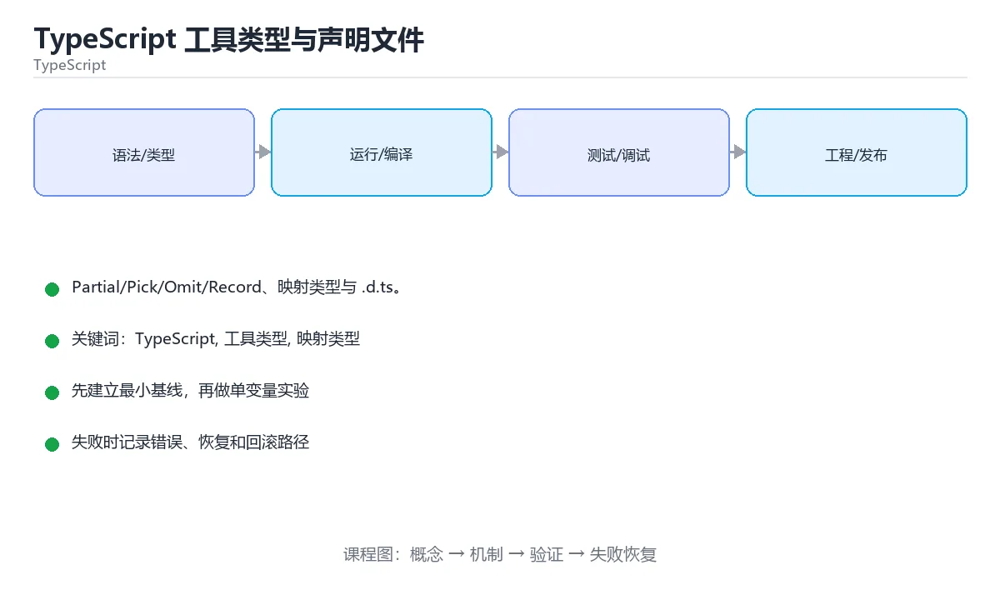

# TypeScript 工具类型与声明文件

> 内容更新时间：2026-10-06 · 学习阶段：入门 · 预计用时：35 分钟




## 本节知识框架

**课程定位**：所属分类 `typescript`（TypeScript），课程主题 `TypeScript 工具类型与声明文件`，学习阶段 入门，建议用时 50 分钟。

本课主线：Partial/Pick/Omit/Record、映射类型与 .d.ts。

**学完本课应当能够**
- 说清 `TypeScript` 与 `工具类型` 的含义与区别，并各举一个正例和一个反例。
- 用本课示例验证 `映射类型` 的行为，记录输入、输出与失败条件。
- 遇到「到处复制字段」这类问题时，能说出触发条件与修复顺序。

### 复习清单

- [ ] 能不看正文复述本课核心术语，并指出一个边界或反例。
- [ ] 能运行或推演本课示例，记录输入、输出与失败现象。
- [ ] 能完成一次自测，并把错题对照错误表定位原因。

## 核心概念定义

| 术语 | 操作性定义 | 常见边界与风险 |
| --- | --- | --- |
| TypeScript | 在 JavaScript 上增加静态类型系统的语言，编译后可运行在浏览器或 Node.js。 | TypeScript 的类型编译后即擦除，浏览器或 Node 里进来的 JSON 字段不受它约束，边界输入要靠 zod 等运行时校验。 |
| 工具类型 | 工具类型让你从已有类型派生新类型，而不是重复声明。 | 工具类型派生的是类型，接口加字段时派生结果自动跟着变，但运行时数据不会补上；手写展开就丢了这层同步。 |
| 映射类型 | TypeScript 根据已有类型批量生成属性变换后的新类型。 | 映射类型只在编译期把 T 的属性逐个做变换，运行时的对象值不会因此改变，深层结构也不会自动递归。 |
| 声明文件 | .d.ts 为无类型的第三方库补类型：declare module 'legacy-lib' { export function run(x: string): void }。 | 易错：编译错误或语义混乱；正确做法是声明文件只放类型与签名。 |
| Partial<T> / Required<T> | 全部可选 / 全部必填 | 易错：Partial 把关键字段也变可空导致漏校验，Required 又强制全部补齐，应改用 Pick / Omit 精确表达。 |
| Pick<T, K> / Omit<T, K> | 挑选字段 / 排除字段 | 易错：K 用字符串写，键名拼错时编译不报错，要用 satisfies 或常量联合约束键。 |
| Record<K, V> | 构造键值映射类型 | `Record<K, V>` 要求 K 是能当对象键的类型，值类型写宽（如 `any`）就等于放弃检查，运行时也不会替你补齐缺失的键。 |
| Readonly<T> | 全部只读 | 只锁顶层属性，内层对象仍可改写，深层只读得自定义递归类型。 |
| ReturnType<F> / Parameters<F> | 提取函数返回值 / 参数类型 | `ReturnType` 与 `Parameters` 取的是声明层面的签名，函数运行时真实返回什么、参数有没有传错，它们一概不管。 |
| Awaited<T> | 提取 Promise 的结果类型 | `Awaited` 解的是类型里的 Promise 外壳（`Awaited<Promise<number>>` 得 `number`），既不等待真实异步，也不拆嵌套层。 |
| Exclude / Extract / NonNullable | 联合类型的筛选 | 三者都在类型层做筛选：Exclude、Extract 只对联合有意义，NonNullable 去掉可空后运行时的 null 值照样可能炸。 |
| Partial<T> | 全部属性可选 | `Partial<T>` 给每个属性都加上可选标记，读出来逐个变 `undefined`；用它表达入参等于默认允许漏填关键字段。 |
| Required<T> | 全部属性必填 | 把源类型中本就可选的属性一律变必填，数据确实缺项时调用方被迫补占位值。 |
| Readonly<T> | 全部属性只读 | 只读约束只在顶层属性生效，数组或对象值内部仍可增删改。 |
| Pick<T, K> | 只保留指定字段 | Pick 只留下列出的几项，丢掉的字段在结果类型中不存在，别把它当完整对象用。 |
| Omit<T, K> | 排除指定字段 | 要排除的键名拼错时不报错，字段其实没被去掉；键用常量联合或 satisfies 兜住。 |
| Record<K, V> | 键值映射 | 图省事写 Record<string, any> 等于放弃检查，值类型要按实际收窄。 |
| Exclude<T, U> | 从联合中排除 | 只在 T 是联合类型时有意义，传入单个非联合类型时等于没变化。 |
| Extract<T, U> | 取联合交集 | 只对联合类型做成员筛选，拿它去筛对象或函数的结构不会得到想要结果。 |
| NonNullable<T> | 去掉 null 与 undefined | NonNullable 只在类型层去掉可空，运行期值仍可能是 null，需 strictNullChecks 与运行时校验。 |
| ReturnType<F> | 取函数返回值类型 | `ReturnType<F>` 取的是签名里声明的返回类型，函数运行时真返回 `null` 或抛异常，它给不出任何预警。 |
| Parameters<F> | 取参数元组 | `Parameters<F>` 取到的是形参元组，可选参数会体现为元组里的可选项；它无法校验调用时真实传进来的参数值。 |
| Awaited<T> | 解开 Promise | Awaited 只还原类型层面的结果，不等待真实 Promise，同步或异步都要另测。 |
| T[K] | 索引访问类型 | `T[K]` 里的 K 必须是 `keyof T` 的键，取不存在的键编译就报错；它拿到的是属性类型，运行时对象有没有这个键不保证。 |
| keyof T | 键的联合 | keyof 得到的是编译期键联合，类型擦除后运行时拿不到它来校验真实对象键。 |
| Partial<T> | 全部选项变成「可填可不填」 | `Partial<T>` 让每个属性都可填可不填，当返回值时调用方读每个字段都得判 `undefined`，必填项应改用 `Pick` 单列出来。 |
| Required<T> | 全部变成必填 | 把可选标记全抹平成必填，若源数据本就允许缺省，调用方会被迫补上假值。 |
| Pick<T, K> | 只保留几项 | Pick 结果只含列出的几项，缺的字段不在类型里，误当完整对象传参会报错。 |
| Omit<T, K> | 去掉几项 | 去掉的项用字符串列举，写错键名不报错，原字段悄悄留着，键要固定成常量联合。 |
| Record<K, V> | 建一张映射表 | Record 建的映射表只约束形状，运行时对象少几个键也不会报错，需自行补校验。 |
| Readonly<T> | 全部只读 | Readonly 只作用到第一层属性，嵌套对象照样能改，深层只读需自定义递归类型。 |
| Extract<T, U> | 取出 T 中属于 U 的部分 | 按可赋值取属于 U 的成员，两个联合不相交时选不出任何一项，别拿来筛字段。 |
| Exclude<T, U> | 从 T 中排除 U | 只从联合 T 里删掉属于 U 的成员，对非联合类型起不了筛选作用。 |
| NonNullable<T> | 去掉 null 与 undefined | 它擦除的是类型上的 null 与 undefined，不保证真实数据非空，取到空值照样炸。 |
| ReturnType<F> | 取函数返回值类型 | `ReturnType<F>` 与上一行取的是同一件事，但遇到重载或泛型函数时只匹配到最后一条签名，未必是你想要的那个返回类型。 |
| Parameters<F> | 取函数参数类型元组 | `Parameters<F>` 取函数参数元组，但遇到重载函数时只匹配到最后一条签名，参数列表可能与实际调用的那条不符。 |
| Awaited<T> | 解开 Promise 的包裹 | 它拆的是类型上的 Promise 层，传进来的若不是 Promise 就只能原样返回。 |
| 到处复制字段 | 加字段时漏改 | 到处复制字段就是手写多份几乎相同的接口，给 User 加一个字段时另一份忘了同步，两套类型当场对不上。 |
| 用 Omit 去掉必填字段后忘了补 | 结构不完整 | Omit 删掉的字段若下游仍需要，类型会缺项；正确做法是 Omit 叠加 Partial 明确补回。 |
| 索引签名写成 any | 失去检查 | 索引签名写成 any 让任意值蒙混过关，改成 Record<string, T> 明确值类型才保留检查。 |
| 误以为 Readonly 是深层的 | 内层仍可改 | Readonly 只锁第一层，内层对象仍可改写；要深层只读得自定义递归只读类型。 |
| 用 Partial 当返回值 | 调用方到处判 undefined | 返回值用 Partial 会让每个字段都可能是 undefined，调用方被迫到处判空，只在输入侧用。 |
| 模板字面量类型滥用 | 类型报错难读 | 易错：类型报错难读；正确做法是复杂场景退回普通联合。 |
| 忘了 as const | 推断成 string 而不是字面量 | 忘了 as const 时字面量被推成 string 而非具体字面量，需要字面量类型的键或联合就匹配不上；给常量补 as const 即可。 |

## 原理与运行机制

### 机制总览

**教材衔接：声明文件**

`.d.ts` 为无类型的第三方库补类型：`declare module 'legacy-lib' { export function run(x: string): void }`。全局类型放 `global.d.ts`，通过 `tsconfig` 的 `types`/`include` 引入。

**教材衔接：工程实践**

1. 类型放在 `types/` 或与实现同文件，避免全局污染。
2. 用 `type` 定义联合与工具类型，`interface` 定义对象契约（可扩展、可合并）。
3. 生成类型而非手写：从后端 OpenAPI/GraphQL schema 生成客户端类型，避免契约漂移。
4. 类型也要测试：用 `expectType` 或 `tsd` 校验类型行为。

**教材衔接：.d.ts 声明速查**

| 场景 | 写法 |
| --- | --- |
| 声明全局函数 | `declare function greet(name: string): void;` |
| 声明模块 | `declare module "my-lib" { export const version: string; }` |
| 声明命名空间 | `declare namespace NodeJS { interface ProcessEnv { ... } }` |
| 扩展第三方类型 | 新建 `types/xxx.d.ts` 用 `declare module` 增强 |
| 只声明类型 | `export type { Foo };` |
| 声明资源模块 | `declare module "*.svg" { const url: string; export default url; }` |
| 全局类型 | `declare global { interface Window { __APP__: AppConfig } }` |

**教材衔接：版本与时效**

- 版本提示：TypeScript 的行为在最近几个大版本里有过调整，升级「TypeScript 工具类型与声明文件」前先用 CreateUserInput 复现当前输出，再对照官方发布说明逐条核对。
- 升级「TypeScript 工具类型与声明文件」涉及的依赖前，先用 CreateUserInput 复现当前行为，再逐项核对版本说明与破坏性变更。

## 典型应用场景

- **到处复制字段**：典型现象是加字段时漏改；正确做法是用工具类型派生。
- **用 `Omit` 去掉必填字段后忘了补**：典型现象是结构不完整；正确做法是明确组合，如 `Omit` 加 `Partial`。
- **索引签名写成 `any`**：典型现象是失去检查；正确做法是用 `Record<string, T>`。
- **误以为 `Readonly` 是深层的**：典型现象是内层仍可改；正确做法是深层只读需自定义递归类型。

### 最小验证场景

- 准备：保留 `ts` 示例的原始输入，先记录 `TypeScript 工具类型与声明文件` 的基线输出和完整运行命令。
- 观察：先核对 出现字面量 `password`，再改变一个与 `TypeScript` 相关的条件。
- 判定：新结果与 `TypeScript 工具类型与声明文件` 的基线不同不等于错误；只有当差异破坏了 `TypeScript` 的定义或错误表中的约束，才判定为失败。

### 选择与边界

- 使用 `TypeScript` 时，先满足它的定义：在 JavaScript 上增加静态类型系统的语言，编译后可运行在浏览器或 Node.js；静态检查只在编译期成立，运行期输入仍需校验。
- 使用 `工具类型` 时，先满足它的定义：工具类型让你从已有类型派生新类型，而不是重复声明；易错：加字段时漏改；正确做法是用工具类型派生。
- 使用 `映射类型` 时，先满足它的定义：TypeScript 根据已有类型批量生成属性变换后的新类型；静态检查只在编译期成立，运行期输入仍需校验。
- 使用 `声明文件` 时，先满足它的定义：.d.ts 为无类型的第三方库补类型：declare module 'legacy-lib' { export function run(x: string): void }；易错：编译错误或语义混乱；正确做法是声明文件只放类型与签名。

## 代码/协议/SQL 示例

### 最小可验证示例

```ts
interface User {
  id: string;
  name: string;
  password: string;
  createdAt: Date;
}

// 对外返回去掉密码，创建时不需要 id 与时间
type UserDto = Omit<User, "password">;
type CreateUserInput = Omit<User, "id" | "createdAt" | "password"> & {
  password: string;
};

// 补丁更新：只允许传需要改的字段
type UserPatch = Partial<Pick<User, "name" | "password">>;

// 用映射类型批量转换：把字段都变成可空的
type Nullable<T> = { [K in keyof T]: T[K] | null };

// 条件类型 + infer：取 Promise 内部类型
type Unwrap<T> = T extends Promise<infer U> ? U : T;
type Value = Awaited<Promise<number>>;   // number
```

**教材衔接：原文最小示例**

## 时间/空间复杂度或性能分析

**性能关注点（TypeScript 工具类型与声明文件）**：编译期类型检查与运行期代码是两套开销：分别记录构建时间与运行时耗时。

**本课特有开销（TypeScript 工具类型与声明文件 · TypeScript）**：小文件看元数据开销，大文件看吞吐，两者要分别测量。

**测量方法**：以 `TypeScript 工具类型与声明文件` 的 `TypeScript` 场景为对象，固定输入跑一遍记录基线，再把规模或并发度提高一个数量级复测；两次结果的差值与波动范围才是结论依据。

## 常见误区与易错点

| 容易写错的做法 | 实际现象 | 原因与正确做法 |
| --- | --- | --- |
| 到处复制字段 | 加字段时漏改 | 用工具类型派生 |
| 用 `Omit` 去掉必填字段后忘了补 | 结构不完整 | 明确组合，如 `Omit` 加 `Partial` |
| 索引签名写成 `any` | 失去检查 | 用 `Record<string, T>` |
| 误以为 `Readonly` 是深层的 | 内层仍可改 | 深层只读需自定义递归类型 |
| 用 `Partial` 当返回值 | 调用方到处判 undefined | 只在输入侧用 |
| 模板字面量类型滥用 | 类型报错难读 | 复杂场景退回普通联合 |
| 忘了 `as const` | 推断成 string 而不是字面量 | 常量数组加 `as const` |
| 全用 `Partial<T>` 表达入参 | 关键字段变成可空，校验缺失 | 用 `Pick` / `Omit` 精确表达必填项 |
| `Omit` 的键拼错 | 编译不报错（键类型不匹配会报，但字符串自由） | 用 `satisfies` 或常量联合约束键 |
| `.d.ts` 里写实现代码 | 编译错误或语义混乱 | 声明文件只放类型与签名 |
| 修改 node_modules 里的类型 | 重新安装即丢失 | 用模块增强写在项目内 |
| 用 `any` 绕过工具类型 | 失去检查能力 | 用 `unknown` + 收窄 |
| 深层嵌套类型硬写 | 难维护 | 组合工具类型或抽公共类型 |
| `Record<string, any>` 到处用 | 任意键任意值，无检查 | 明确键与值类型 |
| 忽略 `strictNullChecks` | 运行时空值错误 | 开启严格模式并处理 `null` |
| 类型断言覆盖不兼容类型 | 运行时报错 | 先校验再断言 |
| 在运行时依赖类型 | 类型在编译后被擦除 | 需要运行时校验时用 zod 等 |
| 全用 Partial<T> 表达入参 | 关键字段变成可空，校验缺失。 | 用 Pick / Omit 精确表达必填项。 |
| Omit 的键拼错 | 编译不报错（键类型不匹配会报，但字符串自由）。 | 用 satisfies 或常量联合约束键。 |
| .d.ts 里写实现代码 | 编译错误或语义混乱。 | 声明文件只放类型与签名。 |

### 现场 1：到处复制字段

**症状**：加字段时漏改。

**根因与修复**：用工具类型派生。

**自检**：在本课示例里复现「到处复制字段」，改成用工具类型派生后重跑；如果症状消失且失败路径按预期变化，说明定位正确。

### 现场 2：用 `Omit` 去掉必填字段后忘了补

**症状**：结构不完整。

**根因与修复**：明确组合，如 `Omit` 加 `Partial`。

**自检**：在本课示例里复现「用 `Omit` 去掉必填字段后忘了补」，改成明确组合，如 `Omit` 加 `Partial`后重跑；如果症状消失且失败路径按预期变化，说明定位正确。

### 现场 3：索引签名写成 `any`

**症状**：失去检查。

**根因与修复**：用 `Record<string, T>`。

**自检**：在本课示例里复现「索引签名写成 `any`」，改成用 `Record<string, T>`后重跑；如果症状消失且失败路径按预期变化，说明定位正确。

### 现场 4：误以为 `Readonly` 是深层的

**症状**：内层仍可改。

**根因与修复**：深层只读需自定义递归类型。

**自检**：在本课示例里复现「误以为 `Readonly` 是深层的」，改成深层只读需自定义递归类型后重跑；如果症状消失且失败路径按预期变化，说明定位正确。

### 现场 5：用 `Partial` 当返回值

**症状**：调用方到处判 undefined。

**根因与修复**：只在输入侧用。

**自检**：在本课示例里复现「用 `Partial` 当返回值」，改成只在输入侧用后重跑；如果症状消失且失败路径按预期变化，说明定位正确。

### 现场 6：模板字面量类型滥用

**症状**：类型报错难读。

**根因与修复**：复杂场景退回普通联合。

**自检**：在本课示例里复现「模板字面量类型滥用」，改成复杂场景退回普通联合后重跑；如果症状消失且失败路径按预期变化，说明定位正确。

### 现场 7：忘了 `as const`

**症状**：推断成 string 而不是字面量。

**根因与修复**：常量数组加 `as const`。

**自检**：在本课示例里复现「忘了 `as const`」，改成常量数组加 `as const`后重跑；如果症状消失且失败路径按预期变化，说明定位正确。

### 现场 8：全用 `Partial<T>` 表达入参

**症状**：关键字段变成可空，校验缺失。

**根因与修复**：用 `Pick` / `Omit` 精确表达必填项。

**自检**：在本课示例里复现「全用 `Partial<T>` 表达入参」，改成用 `Pick` / `Omit` 精确表达必填项后重跑；如果症状消失且失败路径按预期变化，说明定位正确。

### 现场 9：`Omit` 的键拼错

**症状**：编译不报错（键类型不匹配会报，但字符串自由）。

**根因与修复**：用 `satisfies` 或常量联合约束键。

**自检**：在本课示例里复现「`Omit` 的键拼错」，改成用 `satisfies` 或常量联合约束键后重跑；如果症状消失且失败路径按预期变化，说明定位正确。

## 与其他知识点的关系

- **相关或后续**：`TypeScript 工程配置与实践`。本课术语会在这些课程里继续使用。
- **术语归属**：`TypeScript`、`工具类型`、`映射类型` 的定义以本课「核心概念定义」为准，换到其他课程时先确认定义是否被改写。
- 同一分类的《TypeScript 第一个类型》也涉及 `TypeScript`；两课衔接时先确认这个术语的定义是否一致。
- 同一分类的《TypeScript 基础类型》也涉及 `TypeScript`；两课衔接时先确认这个术语的定义是否一致。

## 自测题与参考答案

> 先独立作答，再对照参考答案；答案都能在本课正文、术语表或错误表里找到依据。

### 自测 1（概念复述）

不看正文，写出 `TypeScript` 的操作性定义，并说明它与 `工具类型` 的区别。

**参考答案**：在 JavaScript 上增加静态类型系统的语言，编译后可运行在浏览器或 Node.js。

`工具类型` 的定位是：工具类型让你从已有类型派生新类型，而不是重复声明；两者的差别要从适用对象与失败模式上说明。

### 自测 2（排错）

本课错误表记录了「到处复制字段」这类做法。请写出它会出现的现象、根因，以及修复顺序。

**参考答案**：现象是加字段时漏改；正确做法是用工具类型派生。修复时先复现现象并保留证据，再改动一处假设重跑，确认现象消失。

### 自测 3（动手验证）

运行本课的 `ts` 示例，把其中的 `"password"` 换成一个边界值后重新运行，记录输出与错误信息。

**参考答案**：正常输入下 `ts` 示例应当复现正文给出的结果；把 `"password"` 换成边界值后，如果结果改变或报错，先核对它是否满足 `TypeScript 工具类型与声明文件` 中`TypeScript` 的适用范围，再检查错误表里是否有同类现象。

### 自测 4（代码阅读）

阅读本课开头的 `ts` 示例，说明它体现了`TypeScript` 的哪一条性质，并指出改动哪个输入会让这条性质不再成立。

**参考答案**：`TypeScript` 的定义是 在 JavaScript 上增加静态类型系统的语言，编译后可运行在浏览器或 Node.js，示例正是在实现这条定义。改动与 `TypeScript` 有关的一个输入后，如果结果不再符合 `TypeScript 工具类型与声明文件` 的正文描述，就说明该性质只在当前前提成立。

### 自测 5（迁移）

把 `TypeScript 工具类型与声明文件` 的方法迁移到自己的项目：围绕 `TypeScript` 写出一个与错误表同类的风险点，并说明触发条件和检验方式。

**参考答案**：例如「.d.ts 里写实现代码」，它会导致编译错误或语义混乱；检验方式是按声明文件只放类型与签名改一处再复现，确认现象消失且没有引入新的失败分支。

### 自测 6（对比）

用一个表格对比 `TypeScript` 与 `工具类型`：各写一行适用场景、一行失败表现。

**参考答案**：`TypeScript` 的定义是在 JavaScript 上增加静态类型系统的语言，编译后可运行在浏览器或 Node.js；`工具类型` 的定义是工具类型让你从已有类型派生新类型，而不是重复声明。两者的失败表现分别对应本课错误表里与本术语相关的行。

### 自测 7（排错顺序）

面对「到处复制字段」引发的问题，请把“复现 加字段时漏改 → 保留证据 → 用工具类型派生 → 回归验证”四步写成可执行的检查清单。

**参考答案**：第一步按加字段时漏改复现；第二步记录输入、版本与完整报错；第三步按用工具类型派生只改一处；第四步重跑并确认失败路径也按预期变化。

### 自测 8（边界判断）

针对 `声明文件`，分别写出“可以使用”的条件和“结论不再成立”的条件。

**参考答案**：易错：编译错误或语义混乱；正确做法是声明文件只放类型与签名。 同时要把 `声明文件` 的定义 .d.ts 为无类型的第三方库补类型：declare module 'legacy-lib' { export function run(x: string): void } 与实际输入逐项对照。

### 自测 9（机制重建）

不看正文，按输入、转换、输出、验证四段重建 `TypeScript` → `工具类型` → `映射类型` → `声明文件` 的作用链。

**参考答案**：起点是 `TypeScript` 的定义 在 JavaScript 上增加静态类型系统的语言，编译后可运行在浏览器或 Node.js；中间每一步都保留可观察状态；终点由 `声明文件` 检查，失败时回到错误表定位第一个偏离定义的步骤。

### 自测 10（综合排错）

在 `TypeScript 工具类型与声明文件` 中，现象是 编译错误或语义混乱。请围绕 .d.ts 里写实现代码 写出最小复现、关键证据、修复动作和回归验证，并说明为什么不能只凭一次运行下结论。

**参考答案**：先复现 .d.ts 里写实现代码，记录输入与完整错误；再按 声明文件只放类型与签名 只改一处。回归时同时跑正常路径和边界路径，只有两次结果都可解释，才把修复视为完成。

### 自测 11（一分钟复述）

用每分钟约 200 字的速度复述 `TypeScript 工具类型与声明文件`：先给主问题，再按顺序说出 `TypeScript`、`工具类型`、`映射类型`、`声明文件`，最后给一个失败案例。

**自评标准**：主问题必须对应 Partial/Pick/Omit/Record、映射类型与 .d.ts；每个术语都要能接上一句定义或边界；失败案例必须写成可观察现象，不能用“可能有风险”代替证据。

## 术语速查

| 术语 | 一句话说明 |
| --- | --- |
| `TypeScript` | 在 JavaScript 上增加静态类型系统的语言，编译后可运行在浏览器或 Node.js。 |
| `工具类型` | 工具类型让你从已有类型派生新类型，而不是重复声明。 |
| `映射类型` | TypeScript 根据已有类型批量生成属性变换后的新类型。 |
| `声明文件` | .d.ts 为无类型的第三方库补类型：declare module 'legacy-lib' { export function run(x: string): void }。 |

**术语关系**：`TypeScript`（在 JavaScript 上增加静态类型系统的语言） → `工具类型`（工具类型让你从已有类型派生新类型） → `映射类型`（TypeScript 根据已有类型批量生成属性变换后的新类型） → `声明文件`（.d.ts 为无类型的第三方库补类型：declare module 'legacy-lib' { export function run(x: string): void }）。

## 考点精讲

`TypeScript 工具类型与声明文件` 的题库有 6 道题，下面逐题给出题干、正确项与判断依据：先自己作答，再核对正确项，最后回到正文对应小节复核。

### 考点 1：第 1 题

- **题目**：围绕“TypeScript 工具类型与声明文件”中的 TypeScript、工具类型、映射类型，下列哪两项是本课强调的实践判断？
- **正确项**：学习 TypeScript 时要同时说明输入、输出和失败路径，不能只看正常流程；验证 工具类型 时要固定版本并覆盖边界输入，结论才可复现
- **判断依据**：按《TypeScript 工具类型与声明文件》的正文口径，本题要同时选中「学习 TypeScript 时要同时说明输入、输出和失败路径，不能只看正常流程」、「验证 工具类型 时要固定版本并覆盖边界输入，结论才可复现」，漏掉任一项都算没答全。术语 TypeScript（TypeScript 工具类型与声明文件）：在 JavaScript 上增加静态类型系统的语言，编译后可运行在浏览器或 Node.js。易错点是到处复制字段，会造成加字段时漏改，改法是用工具类型派生。

### 考点 2：第 2 题

- **题目**：`TypeScript 工具类型与声明文件` 的示例代码用于验证 `TypeScript`，其背景是Partial/Pick/Omit/Record、映射类型与 .d.ts。代码的真实内容是下面哪一项？
- **正确项**：出现字面量 `name`
- **判断依据**：本题正确项是「出现字面量 `name`」。术语 TypeScript（TypeScript 工具类型与声明文件）：在 JavaScript 上增加静态类型系统的语言，编译后可运行在浏览器或 Node.js，本题取「出现字面量 `name`」这条。易错点是用 `Omit` 去掉必填字段后忘了补，会造成结构不完整，改法是明确组合，如 `Omit` 加 `Partial`。本题干扰项「出现字面量 `工具名`」不成立：展示代码里找不到 `工具名`。

### 考点 3：第 3 题

- **题目**：.d.ts 文件的作用是？
- **正确项**：为无类型的第三方库补充类型声明
- **判断依据**：本题正确项是「为无类型的第三方库补充类型声明」。术语 TypeScript（TypeScript 工具类型与声明文件）：在 JavaScript 上增加静态类型系统的语言，编译后可运行在浏览器或 Node.js，本题取「为无类型的第三方库补充类型声明」这条。易错点是索引签名写成 `any`，会造成失去检查，改法是用 `Record<string, T>`。

### 考点 4：第 4 题

- **题目**：Pick<T, K> 与 Omit<T, K> 的区别是？
- **正确项**：Pick 只保留 K 指定的字段
- **判断依据**：按《TypeScript 工具类型与声明文件》的正文口径，本题正确项是「Pick 只保留 K 指定的字段」。术语「TypeScript」在本课里的界定是在 JavaScript 上增加静态类型系统的语言，编译后可运行在浏览器或 Node.js，题干「Pick<T, K> 与 Omit<T, K> 的区别是」问的就是这一条。常见错法是到处复制字段，其后果是加字段时漏改。正确做法是用工具类型派生。干扰项「Pick 用于数组，Omit 用于对象」与题干「Pick<T, K> 与 Omit<T, K> 的区别是」的要求对不上，应排除。

### 考点 5：第 5 题

- **题目**：Record<string, number> 表示？
- **正确项**：键为 string、值为 number 的对象类型
- **判断依据**：按《TypeScript 工具类型与声明文件》的正文口径，本题正确项是「键为 string、值为 number 的对象类型」。术语「TypeScript」在本课里的界定是在 JavaScript 上增加静态类型系统的语言，编译后可运行在浏览器或 Node.js，题干「Record<string, number> 表示」问的就是这一条。常见错法是到处复制字段，其后果是加字段时漏改。正确做法是用工具类型派生。干扰项「一个函数类型」与题干「Record<string, number> 表示」的要求对不上，应排除。

### 考点 6：第 6 题

- **题目**：填空：补齐下面这段术语说明中的空缺。课程 `Partial/Pick/Omit/Record、映射类型与 .d.ts。`，这段说明是：`____`：TypeScript 根据已有类型批量生成属性变换后的新类型。空缺处应填哪个术语？
- **正确项**：映射类型
- **判断依据**：涉及术语 TypeScript：在 JavaScript 上增加静态类型系统的语言，编译后可运行在浏览器或 Node.js（TypeScript 工具类型与声明文件）。易错点：到处复制字段会造成加字段时漏改。正确做法：用工具类型派生。判断时先确认输入和适用范围，对照 `TypeScript`、`工具类型`、`映射类型`、`声明文件` 复现一次，最后把错误表现与正确做法逐项对照。

### 考点 7：`TypeScript`

- **要点**：在 JavaScript 上增加静态类型系统的语言，编译后可运行在浏览器或 Node.js。
- **TypeScript 的边界**：静态检查只在编译期成立，运行期输入仍需校验。

### 考点 8：`工具类型`

- **要点**：工具类型让你从已有类型派生新类型，而不是重复声明。
- **工具类型 的边界**：易错：加字段时漏改；正确做法是用工具类型派生。

### 考点 9：`映射类型`

- **要点**：TypeScript 根据已有类型批量生成属性变换后的新类型。
- **映射类型 的边界**：静态检查只在编译期成立，运行期输入仍需校验。

### 考点 10：`声明文件`

- **要点**：.d.ts 为无类型的第三方库补类型：declare module 'legacy-lib' { export function run(x: string): void }。
- **声明文件 的边界**：易错：编译错误或语义混乱；正确做法是声明文件只放类型与签名。

### 考点 11：排错——到处复制字段

- **现象**：加字段时漏改。
- **处理**：用工具类型派生。

### 考点 12：排错——用 `Omit` 去掉必填字段后忘了补

- **现象**：结构不完整。
- **处理**：明确组合，如 `Omit` 加 `Partial`。

### 考点 13：综合辨析——`TypeScript` 与 `声明文件`

- **辨析点**：`TypeScript` 的定义是 在 JavaScript 上增加静态类型系统的语言，编译后可运行在浏览器或 Node.js；`声明文件` 的定义是 .d.ts 为无类型的第三方库补类型：declare module 'legacy-lib' { export function run(x: string): void }。
- **答题要求**：面对 `TypeScript 工具类型与声明文件` 的题目，先判断描述的是 `TypeScript` 还是 `声明文件`，再归到对应定义，最后写出一个会让该定义失效的边界输入。

### 考点 14：排错评分点

- **现象分**：能写出 加字段时漏改，而不是只写“程序有错”。
- **证据分**：保留触发 到处复制字段 的输入、版本和错误原文。
- **修复分**：按 用工具类型派生 只改一处，并同时回归正常路径与边界路径。

## 内容元数据

- 内容版本：v2.0
- 最后更新：2026-10-06
- 学习阶段：入门
- 适用环境：TypeScript 5.x / Node.js 22+
；本课聚焦 TypeScript。
- 内容来源：内置结构化课程与工程实践整理
- 相关主题：TypeScript、工具类型、映射类型、声明文件
- 质量版本：P0 测验标准 + P1 覆盖扩展 + P2 体验补全

## 参考资料与复核

- 最后复核：2026-10-04
- 下次复核：2027-03-17
- 复核范围：版本兼容、API 行为、安全建议与工程实践
- 来源性质：官方文档、标准或权威教材；本课核对关键词：TypeScript、工具类型、映射类型、声明文件。

| 参考资料 | 本课用途 |
| --- | --- |
| [声明文件](https://www.typescriptlang.org/docs/handbook/declaration-files/introduction.html) | 类型声明与发布 |
| [Utility Types](https://www.typescriptlang.org/docs/handbook/utility-types.html) | 内置类型变换 |
| [TypeScript Node 指南](https://nodejs.org/en/learn/typescript) | Node 中的 TypeScript |

| [本课术语索引：TypeScript 工具类型与声明文件](#核心概念定义) | 按本课输入、术语边界和错误表现逐项核对 |
> 「TypeScript 工具类型与声明文件」的链接用于离线阅读后的延伸核对；App 不会自动联网。