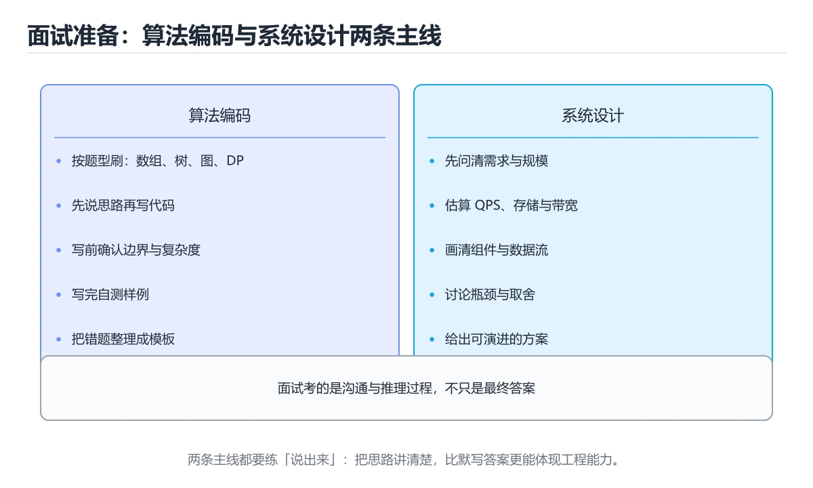
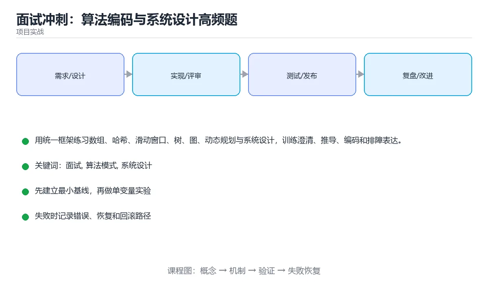

# 面试冲刺：算法编码与系统设计高频题





> 内容更新时间：2026-10-06 · 学习阶段：高级 · 预计用时：60 分钟

## 本节知识框架

**课程定位**：所属分类 `project_practice`（项目实战），课程主题 `面试冲刺：算法编码与系统设计高频题`，学习阶段 高级，建议用时 65 分钟。

本课主线：用统一框架练习数组、哈希、滑动窗口、树、图、动态规划与系统设计，训练澄清、推导、编码和排障表达。

**学完本课应当能够**
- 说清 `面试` 与 `算法模式` 的含义与区别，并各举一个正例和一个反例。
- 用本课示例验证 `系统设计` 的行为，记录输入、输出与失败条件。
- 遇到「拿到题就直接写代码」这类问题时，能说出触发条件与修复顺序。

### 复习清单

- [ ] 能不看正文复述本课核心术语，并指出一个边界或反例。
- [ ] 能运行或推演本课示例，记录输入、输出与失败现象。
- [ ] 能完成一次自测，并把错题对照错误表定位原因。

## 核心概念定义

| 术语 | 操作性定义 | 常见边界与风险 |
| --- | --- | --- |
| 面试 | 通过问题、编码和系统设计交流候选人的知识、推理与合作能力。 | 易错：面试官无法判断思路来源；正确做法是从暴力法逐步优化。 |
| 算法模式 | 在大量题目中反复出现的解题结构，如双指针、滑动窗口、回溯与动态规划。 | 模式套对还要守住不变量：滑动窗口的左边界不能倒退，空串、单字符、全重复这些输入漏验就会边界出错。 |
| 系统设计 | 用统一框架练习数组、哈希、滑动窗口、树、图、动态规划与系统设计，训练澄清、推导、编码和排障表达。 | 易错：没有数据流、容量和故障取舍；正确做法是按六步模板补充量化依据。 |
| 复杂度 | 描述输入规模增长时时间或空间消耗的变化趋势。 | 结论要靠基线复测支撑：把规模提高一个数量级重跑，还要证明优化解不比暴力解慢且结果一致。 |

## 原理与运行机制

### 机制总览

**教材衔接：技术栈**

- Python 3.12
- pytest
- 复杂度分析
- 容量估算
- 系统设计模板

**教材衔接：架构与数据流**

- 查询 算法模式 时限定字段与分页范围，把全表扫描留作最后手段。
- 写路径要明确 面试 的事务边界、幂等键和失败补偿，不能留下半完成状态。
- 外部调用要设置超时、重试上限和降级策略。
- 每个关键阶段都要留下日志、指标或测试证据。

**教材衔接：功能范围**

- [ ] 数组与哈希的前缀和与频率统计
- [ ] 双指针、滑动窗口和二分答案模式
- [ ] 树的遍历、递归边界与迭代改写
- [ ] 图的最短路、拓扑排序与并查集
- [ ] 动态规划的状态、转移、初始化和空间优化
- [ ] 系统设计的容量估算与故障演练

**教材衔接：实施步骤**

### 步骤 1：复述问题并写出 2 到 3 个澄清问题

- 先列出 project_interview_coding_system_design 这一步的输入、输出与中间产物，再动手实现。
- 用一条最小输入验证 project_interview_coding_system_design，断言输出符合预期。
- 出错时先记录 算法模式 的错误信息与回滚结果，再决定是否重试。
- 证据留存：保留命令、输出、日志或截图，方便评审与复盘。

### 步骤 2：用最小例子手动推导正确结果

- 定位：这一节说明步骤 2：用最小例子手动推导正确结果在「面试冲刺：算法编码与系统设计高频题」知识体系里的位置。
- 要点：能用输入规模、数据特征和失败边界选择合适的算法模式。
- 自检：能否用一个最小例子解释步骤 2：用最小例子手动推导正确结果？

### 步骤 3：先给出可运行暴力解和复杂度

- 定位：这一节说明步骤 3：先给出可运行暴力解和复杂度在「面试冲刺：算法编码与系统设计高频题」知识体系里的位置。
- 要点：能用需求、接口、数据、容量、可靠性、监控六步完成系统设计。
- 自检：能否用一个最小例子解释步骤 3：先给出可运行暴力解和复杂度？

### 步骤 4：识别可复用模式并优化关键步骤

- 定位：这一节说明步骤 4：识别可复用模式并优化关键步骤在「面试冲刺：算法编码与系统设计高频题」知识体系里的位置。
- 要点：本课涉及：面试、算法模式、系统设计、复杂度、排障。
- 自检：能否用一个最小例子解释步骤 4：识别可复用模式并优化关键步骤？

### 步骤 5：编码后逐项验证空值、重复、边界和规模

- 定位：这一节说明步骤 5：编码后逐项验证空值、重复、边界和规模在「面试冲刺：算法编码与系统设计高频题」知识体系里的位置。
- 要点：你需要在有限时间内完成一轮算法编码和一轮系统设计。目标不是背题，而是稳定执行同一套流程：澄清输入输出与约束，写出最小例子，说明暴力法与优化方向，编码后验证边界，再用容量、可靠性和取舍回答设计追问。
- 自检：能否用一个最小例子解释步骤 5：编码后逐项验证空值、重复、边界和规模？

### 步骤 6：用六步模板完成一次系统设计表达

- 定位：这一节说明步骤 6：用六步模板完成一次系统设计表达在「面试冲刺：算法编码与系统设计高频题」知识体系里的位置。
- 要点：一句话摘要：用统一框架练习数组、哈希、滑动窗口、树、图、动态规划与系统设计，训练澄清、推导、编码和排障表达。
- 自检：能否用一个最小例子解释步骤 6：用六步模板完成一次系统设计表达？

**教材衔接：建议目录结构**

**教材衔接：质量门禁**

- [ ] 格式化和静态检查通过，不遗留明显警告。
- [ ] 单元测试覆盖 面试 的核心规则，集成测试覆盖数据库或外部边界。
- [ ] 错误响应不泄露堆栈、SQL 和密钥。
- [ ] 配置来自环境变量或配置文件，不硬编码敏感信息。
- [ ] README 写清启动、测试、配置和回滚步骤。

**教材衔接：安全、成本与可观测性**

- 权限遵循最小授权：面试 用到的数据库账号、云资源和令牌都不能使用管理员默认权限。
- 所有进入 面试 的外部输入都要校验、限长并转义，错误信息不能泄露内部路径。
- 密钥通过环境变量或密钥管理服务注入，并记录轮换方式。
- project_interview_coding_system_design 的并发度要有上限，并在达到上限时给出可解释的拒绝。
- 监控 算法模式 的延迟与成本，出现拐点时能追溯到具体变更。
- 把 算法模式 的日志与指标对齐到同一时间轴，便于事后复盘。

**教材衔接：扩展任务**

- 用同一模式各完成 3 道变体题并总结差异
- 把系统设计答案写成 10 分钟白板稿
- 录制自己的讲解并检查遗漏的澄清与验证步骤

**教材衔接：实施记录与复盘**

每完成一步，记录以下内容：

1. 本步的输入、命令和输出是什么？
2. 遇到的最小失败是什么，如何定位和修复？
3. 哪个假设被验证或推翻？
4. 下一步的风险是什么，如何回滚？
5. 如果 面试 的数据量或并发扩大 10 倍，最先出现的瓶颈在哪里？

**教材衔接：完成标准**

- [ ] 能从干净环境按 README 启动项目。
- [ ] 为 project_interview_coding_system_design 补三条测试：正常、边界、失败各一条。
- [ ] 能演示一次错误、一次恢复和一次回滚。
- [ ] 有一份资源或性能基线，能说明瓶颈在哪里。
- [ ] 能说清一个尚未解决的问题和下一步验证方法。

**教材衔接：交付评审：评分表、决策记录与证据链**

### 二、需要写下来的决策（ADR）

| 决策点 | 本课给出的做法 | 备选方案 | 代价与回滚 |
| --- | --- | --- | --- |
| 步骤 5：编码后逐项验证空值、重复、边界和规模 | 「面试冲刺：算法编码与系统设计高频题」的「步骤 5：编码后逐项验证空值、重复、边界和规模」一节补全如下： | 不做「步骤 5：编码后逐项验证空值、重复、边界和规模」，沿用最朴素的实现（需要额外补一次对照实验） | 若「步骤 5：编码后逐项验证空值、重复、边界和规模」出问题，回到上一版本并按本课验收场景重跑 |
| 步骤 6：用六步模板完成一次系统设计表达 | 「面试冲刺：算法编码与系统设计高频题」的「步骤 6：用六步模板完成一次系统设计表达」一节补全如下： | 不做「步骤 6：用六步模板完成一次系统设计表达」，沿用最朴素的实现（需要额外补一次对照实验） | 若「步骤 6：用六步模板完成一次系统设计表达」出问题，回到上一版本并按本课验收场景重跑 |
| 架构与数据流 | 用户/输入 → 接口或命令 → 领域逻辑 → 存储/外部依赖 → 输出与监控 | 不做「架构与数据流」，沿用最朴素的实现（需要额外补一次对照实验） | 若「架构与数据流」出问题，回到上一版本并按本课验收场景重跑 |

### 四、「面试冲刺：算法编码与系统设计高频题」的验收指标

| 指标 | 目标值 | 测量方式 | 不达标时的动作 |
| --- | --- | --- | --- |
| 接口尾延迟 | 本轮只记录 P50/P95/P99 基线，下轮不劣于该基线 | 用固定数据集逐步增加并发并记录分位延迟 | P99 持续上升或超时率增加时回到故障演练小节，先定位瓶颈再复测 |
| 存储与容量 | 本轮记录数据增长与索引大小基线，导入 10 倍后仍可解释 | 导入 10 倍数据并观察查询与容量增长 | 磁盘、连接或锁等待成为瓶颈时按容量估算重做分片与归档取舍 |
| 编码正确性 | 暴力解与优化解在空值、重复、边界用例上结果一致且复杂度不劣于暴力 | 为前缀和、滑动窗口、动态规划与并查集各写边界用例并用 pytest 对拍 | 结果不一致就回到最小例子手动推导，修正状态转移或边界后重测 |

### 五、评审记录模板

| 记录项 | 填写要求 |
| --- | --- |
| 项目标识 | `project_interview_coding_system_design` |
| 本次范围 | 说明这一轮交付了「面试冲刺：算法编码与系统设计高频题」的哪些部分 |
| 未完成项 | 列出与 面试 相关但本轮未做的内容 |
| 证据位置 | 指向 evidence/ 目录下的具体文件 |
| 风险与回滚 | 写清剩余风险、回滚步骤和验证方式 |
| 结论 | 通过 / 有条件通过 / 不通过，三者选一 |

## 典型应用场景

**教材衔接：项目背景**

你需要在有限时间内完成一轮算法编码和一轮系统设计。目标不是背题，而是稳定执行同一套流程：澄清输入输出与约束，写出最小例子，说明暴力法与优化方向，编码后验证边界，再用容量、可靠性和取舍回答设计追问。

一句话摘要：用统一框架练习数组、哈希、滑动窗口、树、图、动态规划与系统设计，训练澄清、推导、编码和排障表达。

**教材衔接：项目专属规格：面试冲刺：算法编码与系统设计高频题**

### 核心场景

用统一框架练习数组、哈希、滑动窗口、树、图、动态规划与系统设计，训练澄清、推导、编码和排障表达。 项目目标是把「面试、算法模式、系统设计、复杂度、排障」落实为可运行、可测试、可回滚的交付物。

### 验收场景

1. 正常路径：最小输入得到预期输出，并留下日志与指标。
2. 边界路径：面试 的空值、最大值、重复数据和超长内容都得到明确处理。
3. 失败路径：依赖超时或不可用时能快速失败、重试或降级。
4. 幂等路径：同一请求执行两次不会产生重复副作用。
5. 回滚路径：面试 回滚后数据一致，且能说明恢复时间和影响范围。

**教材衔接：项目交付物**

### 建议仓库结构

```text
src/
tests/
docs/
README.md
```

### 验收数据

```json
{
  "project": "project_interview_coding_system_design",
  "scenario": "面试的正常路径",
  "input": {"case": "normal", "value": "project_interview_coding_system_design"},
  "expected": {"ok": true, "checks": ["面试可复现", "算法模式有记录"]},
  "failure_case": {"case": "算法模式越界或缺失", "error": "validation_error"},
  "idempotency_key": "project_interview_coding_system_design-001"
}
```

### 复盘模板

- **拿到题就直接写代码**：典型现象是忽略范围、重复值和空输入导致返工；正确做法是先澄清再编码。
- **只说最优解不说推导**：典型现象是面试官无法判断思路来源；正确做法是从暴力法逐步优化。
- **编码后不主动测试**：典型现象是边界错误无法及时发现；正确做法是用正常、边界和反例逐项验证。
- **系统设计只画组件**：典型现象是没有数据流、容量和故障取舍；正确做法是按六步模板补充量化依据。

### 最小验证场景

- 准备：保留 `text` 示例的原始输入，先记录 `面试冲刺：算法编码与系统设计高频题` 的基线输出和完整运行命令。
- 判定：新结果与 `面试冲刺：算法编码与系统设计高频题` 的基线不同不等于错误；只有当差异破坏了 `面试` 的定义或错误表中的约束，才判定为失败。

### 选择与边界

- 使用 `面试` 时，通过问题、编码和系统设计交流候选人的知识、推理与合作能力；易错：面试官无法判断思路来源；正确做法是从暴力法逐步优化。
- 使用 `算法模式` 时，在大量题目中反复出现的解题结构，如双指针、滑动窗口、回溯与动态规划；越界、悬垂引用与释放顺序会破坏结论，必须在边界输入下复验。
- 使用 `系统设计` 时，用统一框架练习数组、哈希、滑动窗口、树、图、动态规划与系统设计，训练澄清、推导、编码和排障表达；易错：没有数据流、容量和故障取舍；正确做法是按六步模板补充量化依据。
- 使用 `复杂度` 时，描述输入规模增长时时间或空间消耗的变化趋势；结论随输入规模变化，小规模成立不代表大规模成立，需要重新测量。

## 代码/协议/SQL 示例

**教材衔接：示例数据与边界**

**教材衔接：关键代码**

```python
def longest_unique_substring(text: str) -> int:
    last_seen: dict[str, int] = {}
    left = 0
    best = 0
    for right, char in enumerate(text):
        if char in last_seen and last_seen[char] >= left:
            left = last_seen[char] + 1
        last_seen[char] = right
        best = max(best, right - left + 1)
    return best

# 关键不变量：窗口 [left, right] 内始终没有重复字符。
assert longest_unique_substring('abcabcbb') == 3
assert longest_unique_substring('') == 0
```

**教材衔接：验证命令与预期输出**

**教材衔接：测试与验收**

- 空字符串、单字符和全部重复字符返回正确长度
- 窗口左边界不会倒退且复杂度保持线性
- 树与图练习覆盖空结构、环和不可达节点
- 系统设计包含容量估算、失败路径和监控指标

## 时间/空间复杂度或性能分析

**复杂度证据**：「面试冲刺：算法编码与系统设计高频题」的现有材料没有给出渐近时间或空间复杂度的明确结论，本课只做定性检查，不补写未经验证的 $O$ 记号。

**测量方法**：以 `面试冲刺：算法编码与系统设计高频题` 的 `面试` 场景为对象，固定输入跑一遍记录基线，再把规模或并发度提高一个数量级复测；两次结果的差值与波动范围才是结论依据。

## 常见误区与易错点

| 容易写错的做法 | 实际现象 | 原因与正确做法 |
| --- | --- | --- |
| 拿到题就直接写代码 | 忽略范围、重复值和空输入导致返工 | 先澄清再编码 |
| 只说最优解不说推导 | 面试官无法判断思路来源 | 从暴力法逐步优化 |
| 编码后不主动测试 | 边界错误无法及时发现 | 用正常、边界和反例逐项验证 |
| 系统设计只画组件 | 没有数据流、容量和故障取舍 | 按六步模板补充量化依据 |

### 现场 1：拿到题就直接写代码

**症状**：忽略范围、重复值和空输入导致返工。

**根因与修复**：先澄清再编码。

**自检**：在本课示例里复现「拿到题就直接写代码」，改成先澄清再编码后重跑；如果症状消失且失败路径按预期变化，说明定位正确。

### 现场 2：只说最优解不说推导

**症状**：面试官无法判断思路来源。

**根因与修复**：从暴力法逐步优化。

**自检**：在本课示例里复现「只说最优解不说推导」，改成从暴力法逐步优化后重跑；如果症状消失且失败路径按预期变化，说明定位正确。

### 现场 3：编码后不主动测试

**症状**：边界错误无法及时发现。

**根因与修复**：用正常、边界和反例逐项验证。

**自检**：在本课示例里复现「编码后不主动测试」，改成用正常、边界和反例逐项验证后重跑；如果症状消失且失败路径按预期变化，说明定位正确。

### 现场 4：系统设计只画组件

**症状**：没有数据流、容量和故障取舍。

**根因与修复**：按六步模板补充量化依据。

**自检**：在本课示例里复现「系统设计只画组件」，改成按六步模板补充量化依据后重跑；如果症状消失且失败路径按预期变化，说明定位正确。

## 与其他知识点的关系

把「面试冲刺：算法编码与系统设计高频题」放回知识体系时，不只要记住“前面学过什么”，还要说明两个主题在输入、机制、资源边界和失败模式上的差异。这样才能把单课知识迁移到项目、排障和后续课程。

- **先修**：`实战：慢接口调试与性能定位`。本课默认这些内容已经掌握。
- **术语归属**：`面试`、`算法模式`、`系统设计` 的定义以本课「核心概念定义」为准，换到其他课程时先确认定义是否被改写。
- 同一分类的《算法工程化与性能验证实战》也涉及 `复杂度`；两课衔接时先确认这个术语的定义是否一致。

## 自测题与参考答案

> 先独立作答，再对照参考答案；答案都能在本课正文、术语表或错误表里找到依据。

### 自测 1（概念复述）

不看正文，写出 `面试` 的操作性定义，并说明它与 `算法模式` 的区别。

**参考答案**：通过问题、编码和系统设计交流候选人的知识、推理与合作能力。

`算法模式` 的定位是：在大量题目中反复出现的解题结构，如双指针、滑动窗口、回溯与动态规划；两者的差别要从适用对象与失败模式上说明。

### 自测 2（排错）

本课错误表记录了「拿到题就直接写代码」这类做法。请写出它会出现的现象、根因，以及修复顺序。

**参考答案**：现象是忽略范围、重复值和空输入导致返工；正确做法是先澄清再编码。修复时先复现现象并保留证据，再改动一处假设重跑，确认现象消失。

### 自测 3（动手验证）

运行本课的 `text` 示例，改动其中一个输入后重新运行，记录输出与错误信息。

**参考答案**：正常输入下 `text` 示例应当复现正文给出的结果；改动输入后，如果结果改变或报错，先核对它是否满足 `面试冲刺：算法编码与系统设计高频题` 中`面试` 的适用范围，再检查错误表里是否有同类现象。

### 自测 4（代码阅读）

阅读本课开头的 `text` 示例，说明它体现了`面试` 的哪一条性质，并指出改动哪个输入会让这条性质不再成立。

**参考答案**：`面试` 的定义是 通过问题、编码和系统设计交流候选人的知识、推理与合作能力，示例正是在实现这条定义。改动与 `面试` 有关的一个输入后，如果结果不再符合 `面试冲刺：算法编码与系统设计高频题` 的正文描述，就说明该性质只在当前前提成立。

### 自测 5（迁移）

把 `面试冲刺：算法编码与系统设计高频题` 的方法迁移到自己的项目：围绕 `面试` 写出一个与错误表同类的风险点，并说明触发条件和检验方式。

**参考答案**：例如「系统设计只画组件」，它会导致没有数据流、容量和故障取舍；检验方式是按六步模板补充量化依据改一处再复现，确认现象消失且没有引入新的失败分支。

### 自测 6（对比）

用一个表格对比 `面试` 与 `算法模式`：各写一行适用场景、一行失败表现。

**参考答案**：`面试` 的定义是通过问题、编码和系统设计交流候选人的知识、推理与合作能力；`算法模式` 的定义是在大量题目中反复出现的解题结构，如双指针、滑动窗口、回溯与动态规划。两者的失败表现分别对应本课错误表里与本术语相关的行。

### 自测 7（排错顺序）

面对「拿到题就直接写代码」引发的问题，请把“复现 忽略范围、重复值和空输入导致返工 → 保留证据 → 先澄清再编码 → 回归验证”四步写成可执行的检查清单。

**参考答案**：第一步按忽略范围、重复值和空输入导致返工复现；第二步记录输入、版本与完整报错；第三步按先澄清再编码只改一处；第四步重跑并确认失败路径也按预期变化。

### 自测 8（边界判断）

针对 `复杂度`，分别写出“可以使用”的条件和“结论不再成立”的条件。

**参考答案**：结论随输入规模变化，小规模成立不代表大规模成立，需要重新测量。 同时要把 `复杂度` 的定义 描述输入规模增长时时间或空间消耗的变化趋势 与实际输入逐项对照。

### 自测 9（机制重建）

不看正文，按输入、转换、输出、验证四段重建 `面试` → `算法模式` → `系统设计` → `复杂度` 的作用链。

**参考答案**：起点是 `面试` 的定义 通过问题、编码和系统设计交流候选人的知识、推理与合作能力；中间每一步都保留可观察状态；终点由 `复杂度` 检查，失败时回到错误表定位第一个偏离定义的步骤。

### 自测 10（综合排错）

在 `面试冲刺：算法编码与系统设计高频题` 中，现象是 没有数据流、容量和故障取舍。请围绕 系统设计只画组件 写出最小复现、关键证据、修复动作和回归验证，并说明为什么不能只凭一次运行下结论。

**参考答案**：先复现 系统设计只画组件，记录输入与完整错误；再按 按六步模板补充量化依据 只改一处。回归时同时跑正常路径和边界路径，只有两次结果都可解释，才把修复视为完成。

### 自测 11（一分钟复述）

用每分钟约 200 字的速度复述 `面试冲刺：算法编码与系统设计高频题`：先给主问题，再按顺序说出 `面试`、`算法模式`、`系统设计`、`复杂度`，最后给一个失败案例。

**自评标准**：主问题必须对应 用统一框架练习数组、哈希、滑动窗口、树、图、动态规划与系统设计，训练澄清、推导、编码和排障表达；每个术语都要能接上一句定义或边界；失败案例必须写成可观察现象，不能用“可能有风险”代替证据。

## 术语速查

| 术语 | 一句话说明 |
| --- | --- |
| `面试` | 通过问题、编码和系统设计交流候选人的知识、推理与合作能力。 |
| `算法模式` | 在大量题目中反复出现的解题结构，如双指针、滑动窗口、回溯与动态规划。 |
| `系统设计` | 用统一框架练习数组、哈希、滑动窗口、树、图、动态规划与系统设计，训练澄清、推导、编码和排障表达。 |
| `复杂度` | 描述输入规模增长时时间或空间消耗的变化趋势。 |

**术语关系**：`面试`（通过问题、编码和系统设计交流候选人的知识、推理与合作能力） → `算法模式`（在大量题目中反复出现的解题结构） → `系统设计`（用统一框架练习数组、哈希、滑动窗口、树、图、动态规划与系统设计） → `复杂度`（描述输入规模增长时时间或空间消耗的变化趋势）。

## 考点精讲

`面试冲刺：算法编码与系统设计高频题` 的题库有 5 道题，下面逐题给出题干、正确项与判断依据：先自己作答，再核对正确项，最后回到正文对应小节复核。

### 考点 1：第 1 题

- **题目**：按“面试冲刺：算法编码与系统设计高频题”中 面试、算法模式、系统设计 的实践顺序，把四个步骤排成从准备到复盘的合理顺序。
- **正确项**：先明确 面试 的输入、输出与约束 → 写出最小示例并核对 算法模式 的基线结果 → 只改一个变量，记录边界与失败路径的变化 → 固定版本与证据，把“面试冲刺：算法编码与系统设计高频题”的结论写成可复现记录
- **判断依据**：按《面试冲刺：算法编码与系统设计高频题》正文的先后，本题顺序是「先明确 面试 的输入、输出与约束」 → 「写出最小示例并核对 算法模式 的基线结果」 → 「只改一个变量，记录边界与失败路径的变化」 → 「固定版本与证据，把“面试冲刺：算法编码与系统设计高频题”的结论写成可复现记录」。术语 面试（面试冲刺：算法编码与系统设计高频题）：通过问题、编码和系统设计交流候选人的知识、推理与合作能力。易错点是拿到题就直接写代码会造成忽略范围、重复值和空输入导致返工，改法是先澄清再编码。

### 考点 2：第 2 题

- **题目**：面试中先给出暴力解再优化，最主要的价值是什么？
- **正确项**：先建立正确基线
- **判断依据**：本题正确项是「先建立正确基线」。术语 面试（面试冲刺：算法编码与系统设计高频题）：通过问题、编码和系统设计交流候选人的知识、推理与合作能力，本题取「先建立正确基线」这条。易错点是只说最优解不说推导，会造成面试官无法判断思路来源，改法是从暴力法逐步优化。

### 考点 3：第 3 题

- **题目**：代码语言为 `python`，选自 `面试冲刺：算法编码与系统设计高频题` 的 `面试` 部分。课程问题为用统一框架练习数组、哈希、滑动窗口、树、图、动态规划与系统设计，训练澄清、推导、编码和排障表达。哪一项描述与代码一致？
- **正确项**：这段示例用于说明本课术语 `复杂度` 的行为
- **判断依据**：本题正确项是「这段示例用于说明本课术语 `复杂度` 的行为」。术语 `复杂度` 的行为（面试冲刺：算法编码与系统设计高频题）。术语 `复杂度` 的行为（面试冲刺：算法编码与系统设计高频题）。术语 `复杂度` 的行为（面试冲刺：算法编码与系统设计高频题）。术语 面试（面试冲刺：算法编码与系统设计高频题）：通过问题、编码和系统设计交流候选人的知识、推理与合作能力，本题取「这段示例用于说明本课术语 `复杂度` 的行为」这条。易错点是编码后不主动测试，会造成边界错误无法及时发现，改法是用正常、边界和反例逐项验证。本题干扰项「代码里出现了 `StatefulWidget` 这个名字」不成立：展示代码里找不到 `StatefulWidget`。

### 考点 4：第 4 题

- **题目**：系统设计回答中，哪种内容最能体现工程成熟度？
- **正确项**：说明数据流，容量估算
- **判断依据**：本题正确项是「说明数据流，容量估算」。术语 系统设计（面试冲刺：算法编码与系统设计高频题）：用统一框架练习数组、哈希、滑动窗口、树、图、动态规划与系统设计，训练澄清、推导、编码和排障表达，本题取「说明数据流，容量估算」这条。易错点是系统设计只画组件，会造成没有数据流、容量和故障取舍，改法是按六步模板补充量化依据。

### 考点 5：第 5 题

- **题目**：课程 `用统一框架练习数组、哈希、滑动窗口、树、图、动态规划与系统设计，训练澄清、推导、编码和排障表达。`。在 `面试冲刺：算法编码与系统设计高频题` 里，`面试`、`算法模式` 与下面哪些选项属于同一层概念？（多选）
- **正确项**：面试；算法模式
- **判断依据**：按《面试冲刺：算法编码与系统设计高频题》的正文口径，本题要同时选中「面试」、「算法模式」，漏掉任一项都算没答全。术语 面试（面试冲刺：算法编码与系统设计高频题）：通过问题、编码和系统设计交流候选人的知识、推理与合作能力。易错点是拿到题就直接写代码，会造成忽略范围、重复值和空输入导致返工，改法是先澄清再编码。本课《面试冲刺：算法编码与系统设计高频题》要解决的是用统一框架练习数组、哈希、滑动窗口、树、图、动态规划与系统设计，训练澄清、推导、编码和排障表达。

### 考点 6：`面试`

- **要点**：通过问题、编码和系统设计交流候选人的知识、推理与合作能力。
- **面试 的边界**：易错：面试官无法判断思路来源；正确做法是从暴力法逐步优化。

### 考点 7：`算法模式`

- **要点**：在大量题目中反复出现的解题结构，如双指针、滑动窗口、回溯与动态规划。
- **算法模式 的边界**：越界、悬垂引用与释放顺序会破坏结论，必须在边界输入下复验。

### 考点 8：`系统设计`

- **要点**：用统一框架练习数组、哈希、滑动窗口、树、图、动态规划与系统设计，训练澄清、推导、编码和排障表达。
- **系统设计 的边界**：易错：没有数据流、容量和故障取舍；正确做法是按六步模板补充量化依据。

### 考点 9：`复杂度`

- **要点**：描述输入规模增长时时间或空间消耗的变化趋势。
- **复杂度 的边界**：结论随输入规模变化，小规模成立不代表大规模成立，需要重新测量。

### 考点 10：排错——拿到题就直接写代码

- **现象**：忽略范围、重复值和空输入导致返工。
- **处理**：先澄清再编码。

### 考点 11：排错——只说最优解不说推导

- **现象**：面试官无法判断思路来源。
- **处理**：从暴力法逐步优化。

### 考点 12：综合辨析——`面试` 与 `复杂度`

- **辨析点**：`面试` 的定义是 通过问题、编码和系统设计交流候选人的知识、推理与合作能力；`复杂度` 的定义是 描述输入规模增长时时间或空间消耗的变化趋势。
- **答题要求**：面对 `面试冲刺：算法编码与系统设计高频题` 的题目，先判断描述的是 `面试` 还是 `复杂度`，再归到对应定义，最后写出一个会让该定义失效的边界输入。

### 考点 13：排错评分点

- **现象分**：能写出 忽略范围、重复值和空输入导致返工，而不是只写“程序有错”。
- **证据分**：保留触发 拿到题就直接写代码 的输入、版本和错误原文。
- **修复分**：按 先澄清再编码 只改一处，并同时回归正常路径与边界路径。

## 内容元数据

- 内容版本：v2.0
- 最后更新：2026-10-06
- 学习阶段：高级
- 适用环境：通用项目交付流程；本课聚焦 面试。
- 内容来源：内置结构化课程与工程实践整理
- 相关主题：面试、算法模式、系统设计、复杂度、排障
- 质量版本：P0 测验标准 + P1 覆盖扩展 + P2 体验补全

## 参考资料与复核

- 最后复核：2026-10-04
- 下次复核：2027-10-10
- 复核范围：版本兼容、API 行为、安全建议与工程实践
- 来源性质：官方文档、标准或权威教材；本课核对关键词：面试、算法模式、系统设计、复杂度、排障。

| 参考资料 | 本课用途 |
| --- | --- |
| [Docker 入门](https://docs.docker.com/get-started/) | 容器化与 Compose |
| [GitHub Actions 文档](https://docs.github.com/actions) | 自动构建、测试与发布 |
| [OpenTelemetry 文档](https://opentelemetry.io/docs/) | 日志、指标与链路追踪 |

| [本课术语索引：面试冲刺：算法编码与系统设计高频题](#核心概念定义) | 按本课输入、术语边界和错误表现逐项核对 |
> 「面试冲刺：算法编码与系统设计高频题」的链接用于离线阅读后的延伸核对；App 不会自动联网。