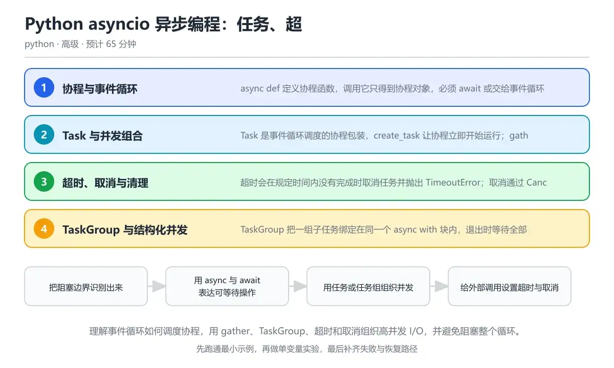
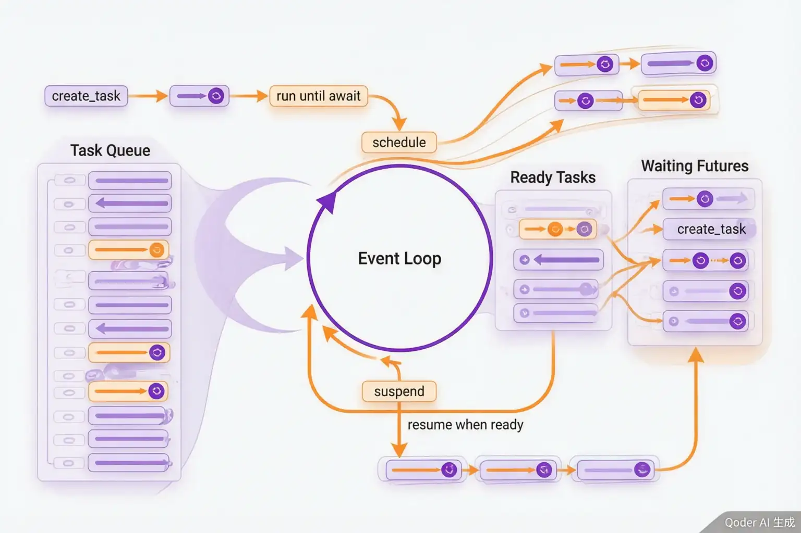

# Python asyncio 异步编程：任务、超时与取消

> 内容更新时间：2026-10-06 · 学习阶段：高级 · 预计用时：50 分钟

分类：python。关键词：asyncio、协程、TaskGroup、取消、超时。理解事件循环如何调度协程，用 gather、TaskGroup、超时和取消组织高并发 I/O，并避免阻塞整个循环。



---

## 本节知识框架

想象你是一家餐厅的厨师长。传统做法是"一个厨师从头做到尾"——切菜、炒菜、装盘，全程不离开灶台。但如果你同时接了 10 桌订单，这种"死等"模式就崩了。asyncio 的做法相当于：厨师长把菜放进锅里后，**不傻等**，而是转身去切下一桌的菜；等锅里传来"滋滋"声（I/O 就绪），再回来翻炒。这就是**异步**的核心思想——**等待的时候去做别的事**。

**本课主线**：理解事件循环如何调度协程，用 gather、TaskGroup、超时和取消组织高并发 I/O，并避免阻塞整个循环。

**学完本课你应当能够**：
- 用"厨师长"类比说清 `协程` 与 `事件循环` 的含义与区别
- 用本课示例验证 `可等待对象` 的行为，记录输入、输出与失败条件
- 遇到「在事件循环里调用 time.sleep」这类问题时，能说出触发条件与修复顺序

## 核心概念定义

下面这张表是你的"速查卡片"。每个术语都有一句话定义和一个容易踩的坑。建议先遮住右列，看自己能不能说出来。

| 术语 | 操作性定义 | 生活类比 | 常见边界与风险 |
| --- | --- | --- | --- |
| 协程 | async def 定义的可在 await 处暂停和恢复的函数调用形式。 | 一位可以"暂停手头活、去干别的、再回来继续"的厨师。 | 易错：调用协程却不 await——就像喊了厨师做菜但没人去拿食材，菜永远不会上桌。正确做法是显式 await，或把任务收集到列表并用 TaskGroup 管理生命周期。 |
| 事件循环 | 调度协程、回调和 I/O 事件的核心循环。 | 厨师长手里的调度本，记录谁在做什么、谁做完了该叫谁。 | 易错：在事件循环里调用 time.sleep——就像让厨师长去仓库搬货，整个厨房停摆。正确做法是改用 asyncio.sleep，阻塞函数用 asyncio.to_thread 或线程池桥接。 |
| 可等待对象 | 可以在 await 表达式后使用的对象，包括协程、Task 和 Future。 | 厨房里所有"需要等一会儿"的工序：等水烧开、等烤箱预热。 | 易错：在 `async def` 之外写 `await` 是语法错误，同步入口要用 `asyncio.run` 起循环；普通函数返回的数值得先包成任务才可等待。 |
| Task | 事件循环调度的协程包装，可查询状态、取消和获取结果。 | 被厨师长正式登记在调度本上的一道菜——你可以查它做到哪了、取消它、或等它做完。 | 易错：create_task 后不保存引用——就像登记了菜名但把单子丢了，任务可能被垃圾回收。正确做法是把任务收集到列表并用 TaskGroup 管理生命周期。 |
| TaskGroup | 绑定一组子任务生命周期的结构化并发上下文管理器。 | 一桌菜的管理规则：所有菜必须上齐才能收桌；如果有一道菜搞砸了，整桌一起取消。 | 易错：TaskGroup 不能跨越作用域保存任务，不能与未等待的裸任务混用。 |
| 结构化并发 | 要求并发子任务在确定的父作用域内启动、等待和结束的组织方式。 | "一桌菜必须在同一时间段、同一个厨房完成"的管理哲学——不允许菜跑到别的厨房去做。 | 共享状态与调度顺序会改变结论，单线程或串行测试通过不等于并发下成立。 |

---

## 原理与运行机制



### 1. 协程与事件循环——"厨师"与"厨师长"

**类比**：想象一个只有一位厨师长的厨房（单线程）。厨师长不会亲自炒菜，但他决定"现在轮到谁干活"。

- **协程**（async def 函数）就像一位厨师：他做到"等水烧开"这一步时，会说"我先暂停，等水开了叫我"——这就是 `await`。
- **事件循环**就是厨师长：他看到厨师 A 在等水开，就转身让厨师 B 去切菜。等水开的"滋滋"声一响（I/O 就绪），厨师长就叫厨师 A 回来继续。

关键规则：**事件循环是单线程的**。如果厨师长自己去搬货（time.sleep），整个厨房就停摆了。

```python
import asyncio

async def boil_water():
    print("开始烧水...")
    await asyncio.sleep(2)  # 等 2 秒——这段时间厨师长可以去安排别的菜
    print("水开了！")

async def chop_vegetables():
    print("开始切菜...")
    await asyncio.sleep(1)  # 等 1 秒
    print("菜切好了！")

async def main():
    # 两道"菜"同时开始做，总耗时约 2 秒（取最长的那个），而不是 3 秒
    await asyncio.gather(boil_water(), chop_vegetables())

asyncio.run(main())
```

**边界提醒**：CPU 密集计算（比如算圆周率）不应直接放进协程——这相当于让厨师长去算数学题，整个厨房等着。需要移到进程池或原生扩展。

### 2. Task 与并发组合——"登记在调度本上的菜"

**类比**：你喊了一声"做一道番茄炒蛋"（调用协程），但没人去登记。只有厨师长把它写进调度本（create_task），这道菜才会真正开始做。

- `create_task`：把协程登记到调度本，立即开始执行。
- `gather`：同时点一组菜，等全部做完后**按点菜顺序**上菜（不是按做完顺序）。
- `as_completed`：谁先做完先上谁——适合"哪个快先用哪个"的场景。

```python
import asyncio

async def fetch(name: str, delay: float) -> str:
    await asyncio.sleep(delay)
    return f"{name}:ok"

async def main():
    # gather：按输入顺序返回结果
    results = await asyncio.gather(
        fetch("fast", 0.05),
        fetch("slow", 0.10),
    )
    print("gather 结果:", results)  # ['fast:ok', 'slow:ok']——顺序与输入一致

    # as_completed：按完成先后处理
    tasks = [
        asyncio.create_task(fetch(f"task{i}", 0.05 * (3 - i)))
        for i in range(3)
    ]
    for done in asyncio.as_completed(tasks):
        result = await done
        print(f"最先完成: {result}")

asyncio.run(main())
```

**边界提醒**：只创建任务而不保存引用可能被垃圾回收——就像写了菜名但把单子扔了，任务可能悄悄消失。

### 3. 超时、取消与清理——"给每道菜设个闹钟"

**类比**：你给每道菜设了闹钟（超时）。闹钟响了菜还没好？取消这道菜。但取消时要把锅洗干净（清理资源），不能把脏锅留给下一道菜。

- `asyncio.timeout` / `wait_for`：在规定时间内没完成就取消任务并抛出 TimeoutError。
- 取消通过 `CancelledError` 在协程的暂停点（await 处）注入。
- `finally` 和 `async with` 负责释放资源（关文件、关连接）。
- `shield` 可以保护关键清理不被外层取消。

```python
import asyncio

async def slow_fetch():
    try:
        await asyncio.sleep(10)  # 模拟很慢的网络请求
    finally:
        print("清理资源：关闭连接...")  # 即使被取消也会执行

async def main():
    try:
        async with asyncio.timeout(0.5):  # 只等 0.5 秒
            await slow_fetch()
    except TimeoutError:
        print("超时了！任务被取消。")

asyncio.run(main())
```

**关键规则**：捕获 CancelledError 后**必须重新抛出**，否则上层超时机制会失效——就像厨师把取消单藏起来，厨师长以为菜还在做。

### 4. TaskGroup 与结构化并发——"一桌菜必须上齐"

**类比**：一桌客人点了 3 道菜。TaskGroup 保证：要么 3 道菜全部上桌，要么其中一道搞砸了就把整桌退掉。你不需要手动"等每道菜"——退出 async with 块时自动等待。

```python
import asyncio

async def fetch(i: int) -> str:
    await asyncio.sleep(0.01 * i)
    return f"result-{i}"

async def main():
    async with asyncio.TaskGroup() as group:
        tasks = [group.create_task(fetch(i)) for i in range(1, 4)]
    # 退出 async with 时，所有任务已完成
    print([task.result() for task in tasks])
    # 输出: ['result-1', 'result-2', 'result-3']

asyncio.run(main())
```

**如果其中一个任务失败**：TaskGroup 会取消其余任务，并把多个异常汇总为 ExceptionGroup。

### 5. 异步 I/O 生态与桥接——"请外援帮忙"

**类比**：有些活（比如手洗大件衣物）不适合在快节奏厨房里做。你把它交给洗衣房（线程池），自己继续炒菜。等洗衣房洗好了，再送回来。

- `httpx`、`aiofiles` 等库提供异步客户端。
- `asyncio.to_thread` 把阻塞函数移到线程池，避免阻塞事件循环。

```python
import asyncio
import time

def blocking_read_file(path: str) -> str:
    time.sleep(1)  # 模拟慢速磁盘读取
    return f"content of {path}"

async def main():
    # 把阻塞操作扔到线程池，事件循环不被卡住
    content = await asyncio.to_thread(blocking_read_file, "data.txt")
    print(content)

asyncio.run(main())
```

### 关键流程总结

```text
把阻塞边界识别出来 → 用 async 与 await 表达可等待操作 → 用任务或任务组组织并发 → 给外部调用设置超时与取消 → 验证异常传播和资源清理
```

---

## 典型应用场景

### 场景 1：并发抓取多个网页

你要同时下载 100 个网页。用同步 requests 需要串行等待 100 次网络延迟；用 asyncio + httpx 可以同时发出请求，总耗时接近最慢的那一个。

```python
import asyncio
import httpx

async def download(client: httpx.AsyncClient, url: str) -> str:
    resp = await client.get(url)
    return resp.text

async def main():
    urls = [f"https://example.com/page/{i}" for i in range(100)]
    async with httpx.AsyncClient() as client:
        async with asyncio.TaskGroup() as group:
            tasks = [group.create_task(download(client, url)) for url in urls]
    print(f"完成 {len(tasks)} 个页面下载")

asyncio.run(main())
```

### 场景 2：带超时的 API 调用

调用外部 API 时，必须设置超时。否则一个慢请求可以拖垮整个服务。

```python
import asyncio

async def call_api(url: str) -> dict:
    async with asyncio.timeout(5.0):  # 5 秒超时
        # 模拟 HTTP 请求
        await asyncio.sleep(0.1)
        return {"status": "ok"}

async def main():
    try:
        result = await call_api("https://api.example.com/data")
        print(result)
    except TimeoutError:
        print("API 调用超时，执行降级逻辑")

asyncio.run(main())
```

### 场景 3：混合阻塞与异步——桥接同步库

你有一个同步的数据库驱动，不想换异步版本。用 `asyncio.to_thread` 桥接。

```python
import asyncio

def sync_db_query(sql: str) -> list:
    # 模拟同步数据库查询（阻塞）
    import time
    time.sleep(0.5)
    return [{"id": 1, "name": "Alice"}]

async def main():
    # 在线程池中执行阻塞操作，事件循环保持运转
    rows = await asyncio.to_thread(sync_db_query, "SELECT * FROM users")
    print(rows)

asyncio.run(main())
```

### 机制对照表

| 概念 | 解决什么问题 | 关键前提 | 失败信号 |
| --- | --- | --- | --- |
| 协程与事件循环 | async def 定义协程函数，调用它只得到协程对象，必须 await 或交给事件循环才会执行 | CPU 密集计算不应直接放进协程；同步库的阻塞调用要用 run_in_executor 桥接 | 异步入口保持窄边界，业务逻辑尽量写成同步纯函数 |
| Task 与并发组合 | create_task 让协程立即开始运行；gather 收集一组结果 | 只创建任务而不保存引用可能被垃圾回收 | 任务集合集中管理，退出前等待或取消 |
| 超时、取消与清理 | 超时会在规定时间内没有完成时取消任务并抛出 TimeoutError | 捕获 CancelledError 后如果不重新抛出，会破坏上层取消语义 | 每个外部调用设置预算，超时错误与业务失败分开处理 |
| TaskGroup 与结构化并发 | 把一组子任务绑定在同一个 async with 块内 | TaskGroup 不能跨越作用域保存任务 | 并发边界使用 TaskGroup 表达生命周期 |
| 异步 I/O 生态与桥接 | 异步库把网络和文件操作暴露为可等待对象 | 把同步函数直接放进 async def 仍然会阻塞 | 统一使用异步客户端并限制并发数量 |

---

## 代码/协议/SQL 示例

### 完整可运行示例

这个示例把本课的 5 个核心机制串在一起：gather、超时、TaskGroup、取消、桥接。

```python
import asyncio

async def fetch(name: str, delay: float) -> str:
    """模拟一个网络请求：等待 delay 秒后返回结果。"""
    await asyncio.sleep(delay)
    return f"{name}:ok"

async def main() -> None:
    # ---- 1. gather：按输入顺序收集结果 ----
    results = await asyncio.gather(
        fetch("fast", 0.05),
        fetch("slow", 0.10),
    )
    print("gather 结果:", results)
    # 输出: ['fast:ok', 'slow:ok']

    # ---- 2. 超时：0.03 秒内等不到 0.5 秒的任务 ----
    try:
        async with asyncio.timeout(0.03):
            await fetch("timeout", 0.5)
    except TimeoutError:
        print("超时: TimeoutError")
    # 输出: 超时: TimeoutError

    # ---- 3. TaskGroup：绑定一组任务的生命周期 ----
    async with asyncio.TaskGroup() as group:
        tasks = [
            group.create_task(fetch(f"task{i}", 0.01 * i))
            for i in range(1, 4)
        ]
    print("TaskGroup 结果:", [task.result() for task in tasks])
    # 输出: ['task1:ok', 'task2:ok', 'task3:ok']

    # ---- 4. 取消：手动取消一个任务 ----
    task = asyncio.create_task(fetch("cancel_me", 10.0))
    await asyncio.sleep(0.01)  # 让任务开始运行
    task.cancel()
    try:
        await task
    except asyncio.CancelledError:
        print("任务已被取消")
    # 输出: 任务已被取消

    # ---- 5. 桥接：把阻塞操作扔到线程池 ----
    def blocking_work() -> str:
        import time
        time.sleep(0.1)
        return "线程池结果"
    result = await asyncio.to_thread(blocking_work)
    print("桥接结果:", result)
    # 输出: 桥接结果: 线程池结果

asyncio.run(main())
```

### 最小 TaskGroup 示例（对应考点第 4 题）

```python
import asyncio

async def fetch(i: int) -> str:
    await asyncio.sleep(0.01)
    return f"result-{i}"

async def main():
    async with asyncio.TaskGroup() as group:
        tasks = [group.create_task(fetch(i)) for i in range(2)]
    print([task.result() for task in tasks])
    # 输出: ['result-0', 'result-1']

asyncio.run(main())
```

### 错误示例：在 async 函数中使用同步文件 I/O（对应考点第 5 题）

```python
import json

async def load(path):
    return json.load(open(path, encoding='utf-8'))
    # 问题：open() 和 json.load() 都是同步调用
    # 会阻塞事件循环，其他并发任务全部卡住
    # 修复：使用 aiofiles 或 asyncio.to_thread，并用 with 正确关闭文件
```

---

## 时间/空间复杂度或性能分析

### 核心性能特征

asyncio 的优势在于**I/O 并发**：当你有 N 个网络请求，每个延迟 L 秒时：
- **同步串行**：总耗时 = N × L
- **asyncio 并发**：总耗时 ≈ max(L)（接近最慢的那一个）

但 asyncio 不是魔法——它不能加速 CPU 密集计算。

### 需要关注的开销

| 开销来源 | 说明 | 测量方法 |
| --- | --- | --- |
| 协程对象创建 | 每次 async def 调用都会创建协程对象，大量创建时有内存开销 | 用 `tracemalloc` 跟踪峰值内存 |
| Task 包装 | create_task 会额外分配 Task 对象 | 对比 gather vs create_task 的内存差异 |
| 事件循环调度 | 循环本身的 tick 有固定开销，高并发时累积 | 用 `time.perf_counter` 测量空协程的调度延迟 |
| 信号量/限流 | 限制并发数会引入等待队列 | 测量不同并发上限下的吞吐量拐点 |

### 性能拐点检测方法

```python
import asyncio
import time

async def measure(concurrency: int):
    sem = asyncio.Semaphore(concurrency)
    async def worker():
        async with sem:
            await asyncio.sleep(0.01)
    start = time.perf_counter()
    await asyncio.gather(*(worker() for _ in range(1000)))
    return time.perf_counter() - start

async def main():
    for c in [10, 50, 100, 500, 1000]:
        elapsed = await measure(c)
        print(f"并发上限 {c}: {elapsed:.3f}s")

asyncio.run(main())
```

当并发度提高但延迟上升而吞吐不增时，说明瓶颈已转移（可能是网络、文件描述符或内存）。

---

## 常见误区与易错点

### 误区速查表

| 容易写错的做法 | 实际现象 | 原因与正确做法 |
| --- | --- | --- |
| 在事件循环里调用 time.sleep | async 函数中使用 time.sleep，所有并发任务一起卡住 | 改用 asyncio.sleep，阻塞函数用 asyncio.to_thread 或线程池桥接 |
| 调用协程却不 await | 直接写 fetch() 或 create_task 后不保存引用，代码没有执行或任务被回收 | 显式 await，或把任务收集到列表并用 TaskGroup 管理生命周期 |
| 吞掉 CancelledError | 捕获 CancelledError 后继续执行且不重新抛出，上层超时失效 | 在 finally 中清理资源，然后重新抛出取消异常 |
| 无界创建任务 | 对一万条数据同时 create_task，内存和连接瞬间打满 | 使用信号量或分批队列限制并发数量，形成背压 |

### 现场 1：在事件循环里调用 time.sleep

**症状**：async 函数中使用 time.sleep，所有并发任务一起卡住。

**类比**：厨师长自己去仓库搬货了——整个厨房没人调度，所有厨师都站着等。

**修复**：改用 asyncio.sleep，阻塞函数用 asyncio.to_thread 或线程池桥接。

### 现场 2：调用协程却不 await

**症状**：直接写 fetch() 或 create_task 后不保存引用，代码没有执行或任务被回收。

**类比**：你喊了一声"做道菜"，但既没有去登记（await），也没有把单子交给厨师长（create_task 后保存引用）。菜永远不会上桌。

**修复**：显式 await，或把任务收集到列表并用 TaskGroup 管理生命周期。

### 现场 3：吞掉 CancelledError

**症状**：捕获 CancelledError 后继续执行且不重新抛出，上层超时失效。

**类比**：厨师长说"这道菜取消"，厨师听到了但假装没听到，继续做菜。厨师长以为菜已经取消了，结果上了一道不该上的菜。

**修复**：在 finally 中清理资源，然后重新抛出取消异常。

### 现场 4：无界创建任务

**症状**：对一万条数据同时 create_task，内存和连接瞬间打满。

**类比**：厨师长同时接了 10000 桌订单，厨房瞬间堆满了食材，连站脚的地方都没有。

**修复**：使用信号量或分批队列限制并发数量，形成背压。

```python
import asyncio

async def fetch(url: str, sem: asyncio.Semaphore) -> str:
    async with sem:  # 限制同时只有 50 个请求
        await asyncio.sleep(0.01)
        return f"ok: {url}"

async def main():
    sem = asyncio.Semaphore(50)
    urls = [f"https://example.com/{i}" for i in range(10000)]
    tasks = [asyncio.create_task(fetch(url, sem)) for url in urls]
    results = await asyncio.gather(*tasks)
    print(f"完成 {len(results)} 个请求")

asyncio.run(main())
```

---

## 与其他知识点的关系

### 知识地图

```text
《并发与异步》（先修）
    ↓ 提供 ProcessPoolExecutor、await 基础
《Python asyncio 异步编程》（本课）
    ↓ 提供协程、TaskGroup、超时、取消
《Python 并发模型、GIL 与线程进程选型》（相关）
《Python HTTP 客户端工程：超时、重试与认证》（相关）
```

### 术语接口

- `并发与异步`：共同关键词 `asyncio`。
- `Python 并发模型、GIL 与线程进程选型`：通过本分类的学习顺序衔接。
- `Python HTTP 客户端工程：超时、重试与认证`：共同关键词 `超时`。

---

## 自测题与参考答案

> 先独立作答，再对照参考答案。答案都能在本课正文、术语表或错误表里找到依据。

### 自测 1（概念复述）

不看正文，写出 `协程` 的操作性定义，并说明它与 `事件循环` 的区别。

**参考答案**：async def 定义的可在 await 处暂停和恢复的函数调用形式。`事件循环` 的定位是：调度协程、回调和 I/O 事件的核心循环。类比：协程是厨师（干活的人），事件循环是厨师长（决定谁什么时候干活）。

### 自测 2（排错）

本课错误表记录了「在事件循环里调用 time.sleep」这类做法。请写出它会出现的现象、根因，以及修复顺序。

**参考答案**：现象是 async 函数中使用 time.sleep，所有并发任务一起卡住。根因是 time.sleep 阻塞了事件循环线程，其他任务无法被调度。修复：改用 asyncio.sleep，阻塞函数用 asyncio.to_thread 或线程池桥接。

### 自测 3（代码阅读）

阅读以下代码，说出输出结果：

```python
async def main():
    results = await asyncio.gather(
        fetch("A", 0.10),
        fetch("B", 0.05),
    )
    print(results)
```

**参考答案**：输出 `['A:ok', 'B:ok']`。虽然 B 先完成（0.05 < 0.10），但 gather 按输入顺序返回结果。

### 自测 4（动手验证）

运行本课的完整示例，改动其中一个输入后重新运行，记录输出与错误信息。

**参考答案**：正常输入下示例应当复现正文给出的结果；改动输入后，如果结果改变或报错，先核对它是否满足本课术语的适用范围，再检查错误表里是否有同类现象。

### 自测 5（迁移）

把本课的方法迁移到自己的项目：围绕 `协程` 写出一个与错误表同类的风险点，并说明触发条件和检验方式。

**参考答案**：例如"无界创建任务"——对一万条数据同时 create_task，内存和连接瞬间打满。检验方式：使用信号量或分批队列限制并发数量，形成背压，重跑确认现象消失。

---

## 复习清单

- [ ] 能不看正文复述本课核心术语，并指出一个边界或反例
- [ ] 能默写本课最重要的代码示例，并解释每一行的作用
- [ ] 能说出本课内容和前后两课的联系

## 延伸阅读

想更直观地理解本课概念？推荐参阅以下图解专题：

- [图解事件循环：同步、微任务与宏任务](visual_event_loop.md)

## 术语速查

| 术语 | 一句话说明 |
| --- | --- |
| `协程` | async def 定义的可在 await 处暂停和恢复的函数调用形式。（可以"暂停-恢复"的厨师） |
| `事件循环` | 调度协程、回调和 I/O 事件的核心循环。（厨师长的调度本） |
| `可等待对象` | 可以在 await 表达式后使用的对象，包括协程、Task 和 Future。（需要等待的工序（等水烧开）） |
| `Task` | 事件循环调度的协程包装，可查询状态、取消和获取结果。（登记在调度本上的一道菜） |
| `TaskGroup` | 绑定一组子任务生命周期的结构化并发上下文管理器。（一桌菜必须上齐才能收桌） |
| `结构化并发` | 要求并发子任务在确定的父作用域内启动、等待和结束的组织方式。（一桌菜必须在同一个厨房完成） |
| `CancelledError` | 取消任务时注入到协程暂停点的异常。（厨师长递来的"取消单"） |
| `TimeoutError` | 超时后抛出的异常。（闹钟响了菜还没好） |
| `gather` | 并发等待一组可等待对象，按输入顺序返回结果。（同时点菜，按点菜顺序上菜） |
| `asyncio.to_thread` | 把阻塞函数移到线程池执行。（把不适合快节奏厨房的活交给洗衣房） |

**术语关系链**：`协程` → `事件循环`（调度协程） → `可等待对象`（协程/Task/Future） → `Task`（协程的运行实例） → `TaskGroup`（管理一组 Task） → `结构化并发`（生命周期管理哲学）。

---

## 考点精讲

本课题库有 5 道题。下面逐题给出题干、正确项与判断依据。建议先自己作答，再核对正确项，最后回到正文对应小节复核。

### 考点 1：第 1 题

- **题目**：为什么在 async 函数中调用 time.sleep 会破坏并发？
- **正确项**：它会阻塞事件循环线程，其他任务无法被调度
- **判断依据**：本题正确项是「它会阻塞事件循环线程，其他任务无法被调度」。术语 事件循环（Python asyncio 异步编程：任务、超时与取消）：调度协程、回调和 I/O 事件的核心循环，本题取「它会阻塞事件循环线程，其他任务无法被调度」这条。易错点是在事件循环里调用 time.sleep，会造成async 函数中使用 time.sleep，所有并发任务一起卡住，改法是改用 asyncio.sleep，阻塞函数用 asyncio.to_thread 或线程池桥接。

### 考点 2：第 2 题

- **题目**：asyncio.gather 返回结果时的顺序是？
- **正确项**：与传入的等待对象顺序一致，而不是完成顺序
- **判断依据**：本题正确项是「与传入的等待对象顺序一致，而不是完成顺序」。术语 协程（Python asyncio 异步编程：任务、超时与取消）：async def 定义的可在 await 处暂停和恢复的函数调用形式，本题取「与传入的等待对象顺序一致，而不是完成顺序」这条。易错点是调用协程却不 await，会造成直接写 fetch() 或 create_task 后不保存引用，代码没有执行或任务被回收，改法是显式 await，或把任务收集到列表并用 TaskGroup 管理生命周期。

### 考点 3：第 3 题

- **题目**：关于取消与超时，哪些说法正确？（多选）
- **正确项**：取消通过 CancelledError 在协程暂停点传播；清理资源应放在 finally 或 async with 中；捕获 CancelledError 后不应静默忽略
- **判断依据**：按《Python asyncio 异步编程：任务、超时与取消》的正文口径，本题要同时选中「取消通过 CancelledError 在协程暂停点传播」、「清理资源应放在 finally 或 async with 中」、「捕获 CancelledError 后不应静默忽略」，漏掉任一项都算没答全。术语 协程（Python asyncio 异步编程：任务、超时与取消）：async def 定义的可在 await 处暂停和恢复的函数调用形式。易错点是吞掉 CancelledError，会造成捕获 CancelledError 后继续执行且不重新抛出，上层超时失效，改法是在 finally 中清理资源，然后重新抛出取消异常。

### 考点 4：第 4 题

- **题目**：阅读 TaskGroup 代码，正常完成后的输出是什么？  async with asyncio.TaskGroup() as group:     tasks = [group.create_task(fetch(i)) for i in range(2)] print([task.result() for task in tasks])

- **正确项**：按任务顺序输出两个结果
- **判断依据**：本题正确项是「按任务顺序输出两个结果」。术语 Task（Python asyncio 异步编程：任务、超时与取消）：事件循环调度的协程包装，可查询状态、取消和获取结果，本题取「按任务顺序输出两个结果」这条。易错点是无界创建任务，会造成对一万条数据同时 create_task，内存和连接瞬间打满，改法是使用信号量或分批队列限制并发数量，形成背压。

### 考点 5：第 5 题

- **题目**：这个异步函数有什么问题？

```python
async def load(path):
    return json.load(open(path, encoding='utf-8'))
```

- **正确项**：同步文件 I/O 会阻塞事件循环，应使用异步文件库或 to_thread，并正确关闭文件
- **判断依据**：这道题落在术语 `事件循环` 上。虽然函数声明为 async，但 open 和 json.load 都是同步调用，会在事件循环线程中阻塞其他任务。同时文件对象没有用 with 关闭。修复：改用 aiofiles 或 asyncio.to_thread，并保证资源释放。

---

## 内容元数据

- 内容版本：v2.0
- 最后更新：2026-10-06
- 学习阶段：高级

| 字段 | 值 |
| --- | --- |
| 课程 ID | `python_asyncio` |
| 所属分类 | `python` |
| 难度 | 高级 |
| 预计用时 | 65 分钟 |
| 关键词 | asyncio、协程、TaskGroup、取消、超时 |
| 配图 | `images/lesson_python_asyncio.webp` |
| 参考资料 | 4 条 |
| 内容更新时间 | 2026-10-06 |

---

## 参考资料与复核

- 来源性质：官方文档、标准或权威教材；本课核对关键词：asyncio、协程、TaskGroup、取消、超时。
- 最后复核：2026-10-04
- 下次复核：2026-11-10
- 复核范围：版本兼容、API 行为与工程实践

下面列出的资料用于核对本课结论，复习时可以对照阅读：
- [Python asyncio 官方文档](https://docs.python.org/3/library/asyncio.html)
- [asyncio TaskGroup 与任务管理文档](https://docs.python.org/3/library/asyncio-task.html)
- [Real Python: Async IO in Python](https://realpython.com/async-io-python/)
- [SuperFastPython: Python Asyncio Tutorial](https://superfastpython.com/python-asyncio/)

| [本课术语索引：Python asyncio 异步编程：任务、超时与取消](#核心概念定义) | 按本课输入、术语边界和错误表现逐项核对 |
> 复核提示：《Python asyncio 异步编程：任务、超时与取消》的结论如与资料冲突，以资料中的规范文本为准，并在笔记里记录差异与日期。
