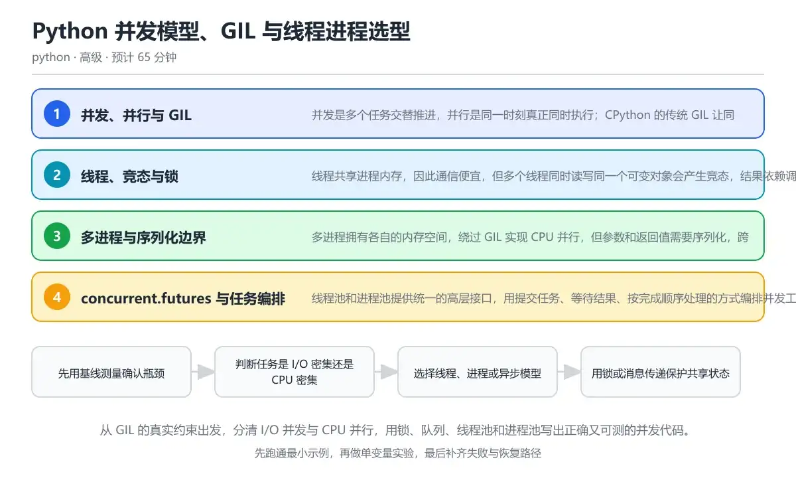
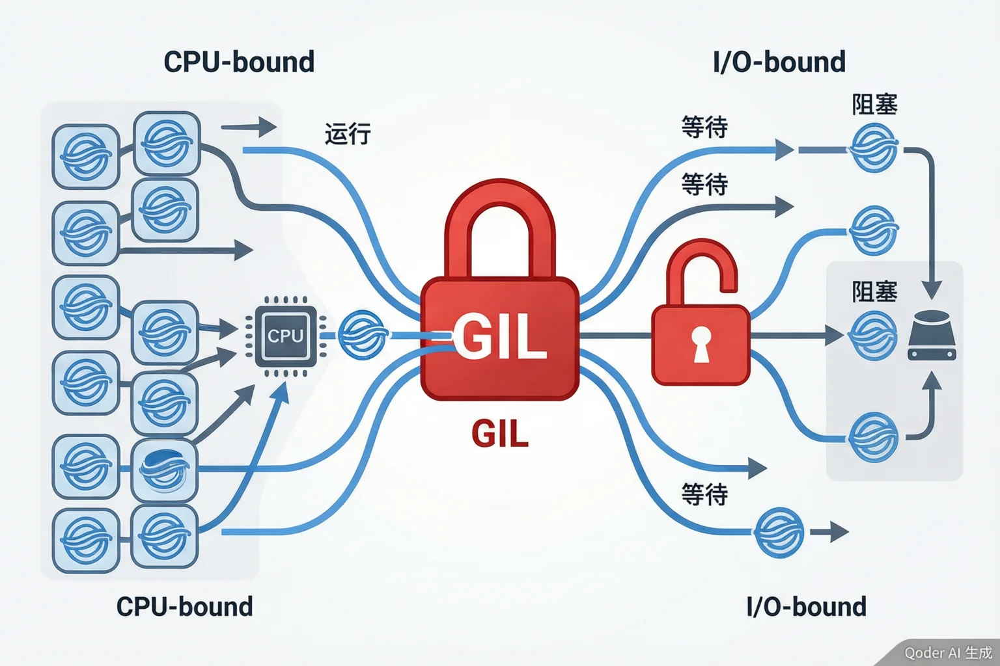

# Python 并发模型、GIL 与线程进程选型

> 内容更新时间：2026-10-06 · 学习阶段：高级 · 预计用时：55 分钟

分类：python。关键词：GIL、线程、进程、竞态条件、线程池。用厨房和餐厅的比喻，带你从零搞懂 Python 里"同时做多件事"到底是怎么回事，以及什么时候该用线程、什么时候该用进程。



## 本节知识框架

想象你是一家餐厅的老板，厨房里有厨师、服务员和收银员。这家餐厅的运营方式，恰好能帮我们理解 Python 的并发模型。

**本课主线**：从 GIL 的真实约束出发，分清 I/O 并发与 CPU 并行，用锁、队列、线程池和进程池写出正确又可测的并发代码。

**学完本课你将能够**
- 用"厨房只有一个灶台"的比喻解释 GIL 是什么，并说出它的限制在哪里。
- 理解为什么"多个厨师同时炒菜"在 Python 里并不总是更快。
- 遇到并发 bug 时，知道该加锁、用队列还是换多进程。

**知识链条（像搭积木一样一层一层来）**

1. **GIL**（全局解释器锁）—— 餐厅只有一个灶台，同一时刻只能有一个厨师炒菜。
2. **竞态条件** —— 两个厨师同时往同一盘菜里加盐，结果咸淡不可控。
3. **临界区** —— "加盐"这个动作必须独占灶台，别人不能同时操作。
4. **Future** —— 你点了一份外卖，拿到一张取餐号，未来某个时刻才能拿到真正的餐。
5. **背压** —— 厨房做不过来时，服务员不再接单，防止订单堆积如山。
6. **自由线程构建** —— 未来餐厅可能装多个灶台（实验性），让厨师真正同时炒菜。

**先修与衔接**：本课是「Python」分类的第 29 课。先修内容：《并发与异步》。相关或后续课程：《Python asyncio 异步编程：任务、超时与取消》、《Python 内存、性能与解释器原理》。

## 核心概念定义

别被术语吓到——每个概念背后都是一个日常场景。

| 术语 | 通俗解释（类比） | 技术定义 | 常见陷阱 |
| --- | --- | --- | --- |
| GIL | 餐厅只有一个灶台，厨师再多也得排队用 | CPython 传统构建中的全局解释器锁，同一时刻只允许一个线程执行 Python 字节码 | 以为多线程能加速所有任务；实际上 CPU 密集任务需要多进程 |
| 竞态条件 | 两个人同时编辑同一份文档，最后内容取决于谁最后保存 | 结果依赖多个线程或进程执行顺序，导致行为不确定的缺陷 | 不同版本与依赖组合的行为可能不同，升级或换环境前要重新验证 |
| 临界区 | 试衣间——同一时刻只能进一个人 | 必须保证同一时间只被一个执行单元进入的代码区域 | 锁的范围太小仍有竞态，太大则退化为串行 |
| Future | 外卖取餐号——现在拿不到，但将来能取到结果 | 表示异步任务未来结果的对象，可查询状态、等待结果或取消任务 | 忘记处理超时或异常，导致程序卡住 |
| 背压 | 厨房忙不过来时，服务员暂停接单 | 当消费者处理不过来时限制生产者速度，防止队列无限增长 | 只在消费者跟不上生产者时才有意义，换场景要重新评估 |
| 自由线程构建 | 餐厅终于装了多个灶台（实验阶段） | 移除 GIL 的 CPython 实验性构建，允许多线程并行执行 Python 代码 | 现有库的线程安全仍需逐项验证，不能假设所有库都安全 |

## 原理与运行机制



### 用厨房比喻理解 Python 并发

#### 第一层：GIL —— 唯一的灶台

想象一家餐厅只有一口灶。不管你有 1 个厨师还是 10 个厨师，同一时刻只能有一个人在炒菜。这就是 CPython 里的 **GIL（全局解释器锁）**。

GIL 的本质是 CPython 解释器内部的一把大锁。Python 对象的内存管理（引用计数）不是线程安全的，GIL 通过"同一时刻只让一个线程执行 Python 字节码"来保护解释器内部状态。

**关键区分：并发 vs 并行**
- **并发**（Concurrency）：多个任务交替推进。就像一个厨师轮流炒多道菜——每道菜炒一会儿，放一放，再回来炒。菜并没有同时被加热，但顾客感觉每道菜都在被处理。
- **并行**（Parallelism）：同一时刻真正同时执行。就像多口灶同时炒菜，每道菜真的在同时被加热。

在 Python 里，由于 GIL 的存在，同一个进程内的多个线程只能做到"并发"（交替执行），做不到"并行"（同时执行 Python 代码）。

**但是有个重要例外**：当线程在做 I/O 操作（读写文件、网络请求、等待用户输入）时，它会主动释放 GIL。这就像厨师把菜放进烤箱等它烤熟——灶台就空出来了，别的厨师可以用。所以 **I/O 密集任务**（大量等待操作）仍然能从多线程中获益。

#### 第二层：竞态条件 —— 两个人同时加盐

现在假设两个厨师同时拿到灶台使用权（虽然 GIL 不允许同时执行 Python 字节码，但字节码级别的切换仍然会导致问题），他们都要往同一锅汤里加一勺盐。

```python
# 看似简单的操作，实际上分三步：
counter += 1
# 1. 读取 counter 的当前值（比如读到 5）
# 2. 计算 5 + 1 = 6
# 3. 把 6 写回 counter
```

如果线程 A 读到 5，还没来得及写回，就被切换出去了；线程 B 也读到 5，也算出 6，写回 6。然后线程 A 回来也写回 6。两次加 1 操作，结果只增加了 1——这就是**竞态条件**。

**类比**：两个人同时打开同一份文档，各自修改后保存，最后保存的那个人会覆盖另一个人的修改。

#### 第三层：临界区与锁 —— 试衣间的门

解决竞态条件最直接的办法：给临界区加一把锁。就像试衣间门口有个红绿灯，进去的人把灯变红，出来再变绿。

```python
import threading

counter = 0
lock = threading.Lock()  # 这就是试衣间的门

def safe_increment():
    global counter
    for _ in range(10000):
        with lock:       # 进门，锁上
            counter += 1  # 临界区：只有我能在这里
                         # 出门，自动解锁
```

**锁的使用原则**：
- 临界区只包围必须原子的操作（不要锁太多代码）
- 统一锁获取顺序（防止死锁——两个人互相等对方出来）
- 优先用队列传递数据（减少共享状态）

#### 第四层：多进程 —— 开分店

如果一口灶真的不够用，最直接的方案：开分店。每家分店有自己的灶台、自己的厨房，互不干扰。这就是**多进程**。

每个进程拥有独立的内存空间，天然绕过 GIL。但代价是：
- 进程间通信需要"快递"（序列化/反序列化），比线程间直接共享内存慢
- 创建进程有开销（开一家新店不是瞬间的事）
- Windows 和 macOS 使用 `spawn` 方式创建子进程，需要 `if __name__ == '__main__'` 保护

```python
from concurrent.futures import ProcessPoolExecutor

def cpu_heavy_task(n):
    """纯 CPU 计算——适合交给进程池"""
    return sum(i * i for i in range(n))

if __name__ == "__main__":  # Windows 上必须有这行！
    with ProcessPoolExecutor(max_workers=4) as pool:
        results = list(pool.map(cpu_heavy_task, [100000, 200000, 300000]))
    print(results)
```

#### 第五层：线程池与进程池 —— 排班系统

手动创建和管理线程/进程很麻烦。`concurrent.futures` 模块提供了"排班系统"——你只需要把任务提交给池子，它会自动安排工人来做。

```python
from concurrent.futures import ThreadPoolExecutor, as_completed
import time

def fetch_data(url, delay):
    time.sleep(delay)  # 模拟网络等待（I/O 操作）
    return f"{url} 的数据"

urls = [("api/users", 2), ("api/orders", 1), ("api/products", 3)]

# 线程池：适合 I/O 密集任务
with ThreadPoolExecutor(max_workers=3) as pool:
    futures = [pool.submit(fetch_data, u, d) for u, d in urls]
    # as_completed 按完成顺序返回——谁先做完谁先上菜
    for future in as_completed(futures):
        print(future.result())
```

**Future 对象**就像外卖取餐号：提交任务后你拿到一个 Future，可以随时查看"做好了吗？"（`done()`），也可以等它做完拿结果（`result()`），甚至取消它（`cancel()`）。

#### 第六层：选型决策树

```text
任务来了 → 先测量瓶颈 → 是 I/O 等待多还是 CPU 计算多？
  ├── I/O 密集（网络请求、文件读写、数据库查询）
  │     ├── 已有 asyncio 框架？→ 用异步（asyncio）
  │     └── 没有？→ 用线程池（ThreadPoolExecutor）
  └── CPU 密集（数值计算、图像处理、加密）
        ├── 纯 Python 代码？→ 用进程池（ProcessPoolExecutor）
        └── 有 C 扩展（NumPy 等）？→ 扩展本身可能释放 GIL，先测量再决定
```

## 典型应用场景

### 场景 1：并发下载 100 张图片（I/O 密集）

**类比**：你要从 100 个网站下载图片。如果一个个下载，大部分时间都在等网络响应。用线程池就像请了 10 个助手同时下载——每个人都在等各自的网络响应，但等待是并行的。

```python
from concurrent.futures import ThreadPoolExecutor
import urllib.request

def download(url):
    data = urllib.request.urlopen(url).read()
    return len(data)

urls = ["https://example.com/image1.jpg"] * 100  # 示例 URL

with ThreadPoolExecutor(max_workers=10) as pool:
    sizes = list(pool.map(download, urls))
print(f"总共下载 {sum(sizes)} 字节")
```

### 场景 2：并行处理 100 万条数据（CPU 密集）

**类比**：你要手算 100 万道数学题。一个人算太慢，但请 10 个人坐在同一张桌子前共用一支笔（GIL）并不会更快。正确做法是给每个人一张独立的桌子和一支笔（独立进程）。

```python
from concurrent.futures import ProcessPoolExecutor
import math

def heavy_computation(n):
    return sum(math.sqrt(i) for i in range(n))

if __name__ == "__main__":
    chunks = [250000] * 4  # 把 100 万拆成 4 份
    with ProcessPoolExecutor(max_workers=4) as pool:
        results = list(pool.map(heavy_computation, chunks))
    print(f"总结果: {sum(results)}")
```

### 场景 3：生产者-消费者模式（用 Queue 避免竞态）

**类比**：厨房做好一道菜就放到传送带上，服务员从传送带取菜。不需要厨师和服务员直接沟通——传送带（Queue）就是中间人。

```python
import threading
import queue
import time

task_queue = queue.Queue()

def producer():
    for i in range(10):
        task_queue.put(f"任务 {i}")
        time.sleep(0.1)

def consumer():
    while True:
        item = task_queue.get()
        if item is None:  # 结束信号
            break
        print(f"处理了 {item}")
        task_queue.task_done()

threading.Thread(target=producer).start()
threading.Thread(target=consumer).start()
```

### 选型速查表

| 场景 | 推荐方案 | 原因 |
| --- | --- | --- |
| 并发请求 100 个 API | 线程池 / asyncio | I/O 等待时线程会释放 GIL |
| 大规模数值计算 | 进程池 | 绕过 GIL，真正并行 |
| 文件批量重命名 | 线程池 | I/O 密集，线程足够 |
| 图片批量压缩 | 进程池 | CPU 密集，需要真并行 |
| 实时聊天服务器 | asyncio | 海量连接，事件循环最高效 |
| 数据管道（生产-消费） | Queue + 线程 | 避免共享状态，消息传递 |

## 代码/协议/SQL 示例

### 示例 1：演示 GIL 对 CPU 密集任务无效

```python
import threading
import time

def cpu_task(n):
    """纯 CPU 计算"""
    return sum(i * i for i in range(n))

N = 10_000_000

# 单线程
start = time.perf_counter()
cpu_task(N)
cpu_task(N)
single_time = time.perf_counter() - start
print(f"单线程耗时: {single_time:.2f}s")

# 两个线程
start = time.perf_counter()
t1 = threading.Thread(target=cpu_task, args=(N,))
t2 = threading.Thread(target=cpu_task, args=(N,))
t1.start()
t2.start()
t1.join()
t2.join()
thread_time = time.perf_counter() - start
print(f"双线程耗时: {thread_time:.2f}s")
print(f"加速比: {single_time / thread_time:.2f}x（接近 1x，说明 GIL 限制了并行）")
```

**预期输出**（示例）：
```text
单线程耗时: 3.21s
双线程耗时: 3.15s
加速比: 1.02x（接近 1x，说明 GIL 限制了并行）
```

### 示例 2：演示竞态条件与锁的修复

```python
import threading

counter = 0
lock = threading.Lock()

def increment_no_lock():
    """不加锁——会有竞态"""
    global counter
    for _ in range(10000):
        counter += 1

def increment_with_lock():
    """加锁——结果确定"""
    global counter
    for _ in range(10000):
        with lock:
            counter += 1

# 不加锁的实验
counter = 0
threads = [threading.Thread(target=increment_no_lock) for _ in range(4)]
for t in threads:
    t.start()
for t in threads:
    t.join()
print(f"不加锁结果: {counter}（期望 40000，实际通常小于 40000）")

# 加锁的实验
counter = 0
threads = [threading.Thread(target=increment_with_lock) for _ in range(4)]
for t in threads:
    t.start()
for t in threads:
    t.join()
print(f"加锁结果: {counter}（一定是 40000）")
```

### 示例 3：进程池的正确用法（含 spawn 保护）

```python
from concurrent.futures import ProcessPoolExecutor

def square(x):
    return x * x

def cube(x):
    return x * x * x

if __name__ == "__main__":
    # 正确：只传可序列化的数据
    with ProcessPoolExecutor(max_workers=2) as pool:
        sq_results = list(pool.map(square, [1, 2, 3, 4, 5]))
        cb_results = list(pool.map(cube, [1, 2, 3, 4, 5]))

    print(f"平方: {sq_results}")
    print(f"立方: {cb_results}")

    # 错误示例（会报序列化错误）：
    # f = open("data.txt")
    # pool.submit(process_file, f)  # 文件对象不可序列化！
```

### 示例 4：语法陷阱——lambda 中不能用赋值语句

```python
from concurrent.futures import ThreadPoolExecutor

counter = 0

# 这段代码有语法错误，无法运行！
# lambda 中不能使用 += 这样的赋值语句
for _ in range(4):
    with ThreadPoolExecutor() as pool:
        pool.submit(lambda: counter += 1)  # SyntaxError!
```

**正确写法**：

```python
from concurrent.futures import ThreadPoolExecutor
import threading

counter = 0
lock = threading.Lock()

def increment():
    global counter
    with lock:
        counter += 1

if __name__ == "__main__":
    with ThreadPoolExecutor(max_workers=4) as pool:
        futures = [pool.submit(increment) for _ in range(4)]
        for f in futures:
            f.result()  # 等待所有任务完成
    print(f"counter = {counter}")
```

## 时间/空间复杂度或性能分析

### 不同并发模型的开销对比

| 模型 | 创建开销 | 内存开销 | 通信开销 | 适用场景 |
| --- | --- | --- | --- | --- |
| 线程 | 中等（约 1MB 栈空间/线程） | 共享内存，无需序列化 | 几乎为零（直接读写共享变量） | I/O 密集 |
| 进程 | 较大（需复制/加载解释器） | 独立内存空间 | 需要序列化（pickle） | CPU 密集 |
| asyncio 协程 | 极小（几 KB/协程） | 共享内存 | 通过事件循环调度 | 高并发 I/O |

### 性能测量的正确姿势

**原则：先测量，再优化。** 不要猜瓶颈在哪里。

```python
import time
from concurrent.futures import ThreadPoolExecutor, ProcessPoolExecutor

def benchmark(func, args_list, executor_class, max_workers):
    start = time.perf_counter()
    with executor_class(max_workers=max_workers) as pool:
        results = list(pool.map(func, args_list))
    elapsed = time.perf_counter() - start
    return elapsed, results
```

**关键指标**：
- **吞吐量**：单位时间处理的任务数
- **延迟**：单个任务从提交到完成的时间
- **CPU 利用率**：是否真的用上了多核
- **内存峰值**：进程池会显著增加内存使用

**常见拐点**：
- 线程数超过 CPU 核数太多 → 上下文切换开销增大，吞吐不升反降
- 进程池任务太小 → 序列化开销超过计算本身，得不偿失
- I/O 并发度太高 → 文件描述符耗尽或触发服务端限流

## 常见误区与易错点

### 误区 1："多线程能让所有程序变快"

**症状**：把 CPU 密集型计算放进线程池，耗时没有下降甚至更慢。

**真相**：GIL 让同一进程内同一时刻只有一个线程执行 Python 字节码。CPU 密集任务用多线程，就像请了 10 个厨师但只有一个灶台——大家排队等灶台的时间反而增加了。

**正确做法**：CPU 密集任务使用多进程或原生扩展（如 NumPy 的 C 实现），先测量再决定。

### 误区 2："counter += 1 是原子操作"

**症状**：多个线程同时执行 `counter += 1`，最终结果小于预期。

**真相**：`counter += 1` 在字节码层面包含三步——读取、加一、写回。线程可能在任何一步被切换，导致更新丢失。

**正确做法**：用锁保护临界区，或改成队列和单线程汇总。

### 误区 3："进程池什么都能传"

**症状**：把打开的文件、数据库连接或 lambda 提交给进程池，报序列化错误。

**真相**：进程间通信需要 pickle 序列化。文件对象、网络连接、lambda 函数都不可序列化。

**正确做法**：只传可序列化的普通数据（数字、字符串、列表、字典），在子进程内部重新创建资源。

### 误区 4："Windows 上进程池代码直接跑就行"

**症状**：Windows 上进程池无限创建子进程，程序崩溃。

**真相**：Windows 使用 `spawn` 启动子进程，子进程会重新导入主模块。如果创建进程池的代码在模块顶层，导入时又会创建新的子进程，形成无限递归。

**正确做法**：把入口放进 `if __name__ == '__main__':` 保护块，任务函数放在模块顶层。

### 误区 5："锁加得越多越安全"

**症状**：程序死锁，两个线程互相等待对方释放锁。

**真相**：多个锁的获取顺序不一致时，就会死锁。线程 A 持有锁 1 等待锁 2，线程 B 持有锁 2 等待锁 1——永远等不到。

**正确做法**：统一锁获取顺序，尽量只用一把锁，或使用 `queue.Queue` 避免共享状态。

## 与其他知识点的关系

### 知识图谱

```text
《并发与异步》（先修）
    ↓ 提供了 ProcessPoolExecutor 和 await 的基础
《Python 并发模型、GIL 与线程进程选型》（本课）
    ↓ 深入 GIL、锁、竞态和选型策略
    ├── → 《Python asyncio 异步编程》（后续：事件循环、TaskGroup、取消）
    └── → 《Python 内存、性能与解释器原理》（后续：GIL 的实现细节、自由线程构建）
```

### 术语在不同课程中的一致性

- `GIL`：本课定义为"CPython 传统构建中的全局解释器锁，同一时刻只允许一个线程执行 Python 字节码"。在《Python 内存、性能与解释器原理》中会深入其实现细节。
- `竞态条件`：本课定义为"结果依赖多个线程或进程执行顺序，导致行为不确定的缺陷"。这个定义在并发相关课程中通用。
- `临界区`：本课定义为"必须保证同一时间只被一个执行单元进入的代码区域"。

### 容易混淆的概念对

| 概念 A | 概念 B | 区别要点 |
| --- | --- | --- |
| 并发 | 并行 | 并发是交替推进（一个灶台轮流炒菜），并行是同时执行（多个灶台同时炒菜） |
| GIL | 竞态条件 | GIL 是解释器级别的锁（保护 Python 内部状态），竞态条件是应用级别的 bug（共享数据被意外覆盖） |
| Lock | Queue | Lock 是"保护共享资源"（给试衣间上锁），Queue 是"避免共享"（用传送带传递） |
| 线程 | 进程 | 线程共享内存但受 GIL 限制，进程独立内存可真正并行但通信成本高 |
| ThreadPoolExecutor | ProcessPoolExecutor | 前者适合 I/O 密集（共享内存、轻量），后者适合 CPU 密集（独立内存、可并行） |

## 自测题与参考答案

> 先独立作答，再对照参考答案。

### 自测 1（概念复述）

**题目**：不看正文，用自己的话解释 GIL 是什么，以及它为什么存在。

**参考答案**：GIL 是 CPython 解释器内部的一把全局锁，它保证同一时刻只有一个线程在执行 Python 字节码。它存在的原因是 CPython 的内存管理（引用计数）不是线程安全的，GIL 用最简单的方式保护了解释器内部状态。副作用是 CPU 密集的纯 Python 代码无法靠同进程多线程加速。

### 自测 2（场景判断）

**题目**：你需要同时向 50 个 API 发送请求并收集结果。应该用线程池还是进程池？为什么？

**参考答案**：应该用线程池。因为这是 I/O 密集任务——大部分时间在等待网络响应，线程在等待时会释放 GIL，所以多线程可以真正并发等待。进程池也可以工作，但创建进程的开销和序列化成本在这里没有收益。

### 自测 3（代码分析）

**题目**：以下代码有什么问题？如何修复？

```python
counter = 0
def worker():
    global counter
    for _ in range(100000):
        counter += 1
```

**参考答案**：多个线程调用 `worker()` 会产生竞态条件。`counter += 1` 不是原子操作，读取-修改-写回三步之间可能被线程切换打断，导致更新丢失。修复方法：用 `threading.Lock()` 保护 `counter += 1`，或让每个线程返回局部计数值，最后在主线程汇总。

### 自测 4（排错）

**题目**：在 Windows 上运行进程池代码时，程序不断创建新窗口并崩溃。最可能的原因是什么？

**参考答案**：缺少 `if __name__ == '__main__':` 保护。Windows 用 `spawn` 创建子进程，子进程会重新导入主模块。如果进程池创建代码在模块顶层，导入时又会触发创建子进程，形成无限递归。把所有入口代码放进 `if __name__ == '__main__':` 块即可修复。

### 自测 5（迁移）

**题目**：你的项目需要同时处理大量文件读写和大量数值计算。你会怎么设计并发方案？

**参考答案**：应该混合使用。文件读写是 I/O 密集任务，用线程池或 asyncio 处理；数值计算是 CPU 密集任务，用进程池处理。两者可以组合——比如主程序用线程池处理 I/O，把计算任务提交给进程池。关键原则：先测量瓶颈，再选模型。

## 复习清单

- [ ] 能不看正文复述本课核心术语，并指出一个边界或反例
- [ ] 能默写本课最重要的代码示例，并解释每一行的作用
- [ ] 能说出本课内容和前后两课的联系

## 延伸阅读

想更直观地理解本课概念？推荐参阅以下图解专题：

- [图解并发调度：线程、协程与 Goroutine](visual_concurrency_schedule.md)

## 术语速查

| 术语 | 一句话说明 |
| --- | --- | --- |
| GIL | Python 解释器的全局锁，同一时刻只允许一个线程执行字节码 | Global Interpreter Lock |
| 竞态条件 | 结果取决于线程执行顺序的 bug | Race Condition |
| 临界区 | 同一时刻只能有一个线程进入的代码段 | Critical Section |
| 互斥锁 | 保证同一时刻只有一个线程访问资源的锁 | Mutex / Lock |
| Future | 代表异步操作未来结果的对象 | Future |
| 线程池 | 预先创建一组线程，复用它们执行任务 | Thread Pool |
| 进程池 | 预先创建一组进程，绕过 GIL 实现并行 | Process Pool |
| 背压 | 消费者忙不过来时限制生产者的速度 | Backpressure |
| 序列化 | 把对象转换成可传输/存储的格式 | Serialization / Pickle |
| 自由线程构建 | 移除 GIL 的实验性 CPython 版本 | Free-threaded CPython |

## 考点精讲

本课题库共 5 道题，下面逐题给出题干、正确项与解析。建议先自己作答，再核对答案。

### 考点 1：第 1 题

- **题目**：传统 CPython 中，纯 Python CPU 密集任务为什么难以靠多线程加速？
- **正确项**：GIL 让同一进程内同一时刻只有一个线程执行 Python 字节码
- **解析**：这道题直接考查 GIL 的定义。GIL 是 CPython 实现层面的保护机制——它让解释器内部状态（主要是引用计数）保持线程安全。副作用是同一进程内的线程无法真正并行执行 Python 字节码。注意"纯 Python"这个限定词——如果调用的是释放了 GIL 的 C 扩展（如 NumPy），多线程仍然可以并行。

### 考点 2：第 2 题

- **题目**：四个线程各自执行 counter += 1 一万次，最终结果小于四万，最可能的原因是什么？
- **正确项**：读取、加一、写回不是原子操作，发生了竞态
- **解析**：`counter += 1` 在 Python 字节码层面至少包含三个操作：`LOAD`（读取当前值）、`BINARY_ADD`（加一）、`STORE`（写回）。线程可能在任意两个字节码之间被切换。两个线程同时读到同一个旧值，各自加一后写回，导致一次更新丢失。修复方法是用 `threading.Lock()` 保护临界区。

### 考点 3：第 3 题

- **题目**：哪些任务更适合使用进程池？（多选）
- **正确项**：大规模纯 Python 数值计算；需要隔离内存的批处理任务
- **解析**：进程池的核心优势是绕过 GIL 实现真正的 CPU 并行，以及通过独立内存空间提供隔离。"大规模纯 Python 数值计算"是典型的 CPU 密集任务，需要真并行。"需要隔离内存的批处理任务"利用了进程间内存独立的特点。而"需要频繁共享一个可变字典的短任务"跨进程共享状态成本太高；"只做网络等待的轻量请求"是 I/O 密集，用线程或异步更轻量。

### 考点 4：第 4 题

- **题目**：阅读代码，四个线程并发提交后 counter 的值最可能是多少？  counter = 0 for _ in range(4):     with ThreadPoolExecutor() as pool:         pool.submit(lambda: counter += 1)

- **正确项**：代码存在语法错误，无法运行
- **解析**：这道题的陷阱在于代码本身就有语法错误。Python 的 `lambda` 只能包含表达式，不能包含赋值语句（`+=` 是赋值）。所以这段代码在解析阶段就会报 `SyntaxError`，根本不会执行。即使改成普通函数，匿名函数与闭包捕获共享变量也需要加锁或使用局部结果汇总。

### 考点 5：第 5 题

- **题目**：Windows 上进程池出现无限创建子进程，最可能缺少什么？
- **正确项**：if __name__ == '__main__' 主模块保护
- **解析**：Windows 使用 `spawn` 方式创建子进程（不像 Linux 的 `fork` 会复制父进程内存）。`spawn` 会启动一个全新的 Python 解释器并重新导入主模块。如果创建进程池的代码在模块顶层（不在 `if __name__ == '__main__':` 保护块内），子进程导入主模块时又会执行到创建进程池的代码，导致无限递归。修复方法：把入口代码放进 `if __name__ == '__main__':` 块，并确保任务函数定义在模块顶层且可序列化。

## 内容元数据

- 内容版本：v2.0
- 最后更新：2026-10-06
- 学习阶段：高级

| 字段 | 值 |
| --- | --- |
| 课程 ID | `python_concurrency_model` |
| 所属分类 | `python` |
| 难度 | 高级 |
| 预计用时 | 55 分钟 |
| 关键词 | GIL、线程、进程、竞态条件、线程池 |
| 配图 | `images/lesson_python_concurrency_model.webp` |
| 参考资料 | 6 条 |
| 内容更新时间 | 2026-10-06 |

## 参考资料与复核

- [本课资料锚点 python_concurrency_model](https://zh.wikipedia.org/w/index.php?search=python_concurrency_model)

- 来源性质：官方文档、标准或权威教材；本课核对关键词：GIL、线程、进程、竞态条件、线程池。
- 最后复核：2026-10-04
- 下次复核：2026-11-10
- 复核范围：版本兼容、API 行为与工程实践

下面列出的资料用于核对本课结论，复习时可以对照阅读：
- [Python threading 文档](https://docs.python.org/3/library/threading.html)
- [Python multiprocessing 文档](https://docs.python.org/3/library/multiprocessing.html)
- [concurrent.futures 文档](https://docs.python.org/3/library/concurrent.futures.html)
- [PEP 703：自由线程 CPython](https://peps.python.org/pep-0703/)
- [Python GIL 官方说明](https://docs.python.org/3/glossary.html#term-global-interpreter-lock)
- [Real Python: Python Concurrency](https://realpython.com/python-concurrency/)

| [本课术语索引：Python 并发模型、GIL 与线程进程选型](#核心概念定义) | 按本课输入、术语边界和错误表现逐项核对 |
> 复核提示：《Python 并发模型、GIL 与线程进程选型》的结论如与资料冲突，以资料中的规范文本为准，并在笔记里记录差异与日期。
