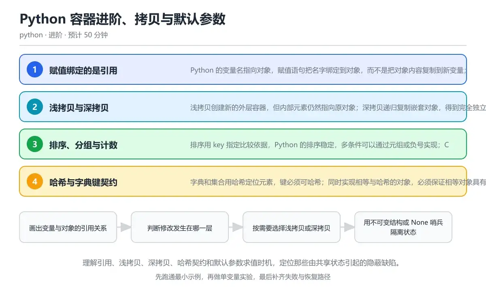
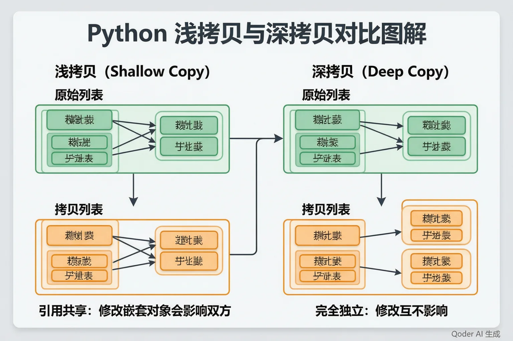

# Python 容器进阶、拷贝与默认参数

> 内容更新时间：2026-10-06 · 学习阶段：进阶 · 预计用时：50 分钟

分类：python。关键词：浅拷贝、深拷贝、哈希、默认参数、稳定排序。



---

你有没有遇到过这种"灵异事件"：明明只是改了一个变量，另一个变量却莫名其妙也跟着变了？或者一个函数明明只调用了一次，结果里面居然藏着上次调用的数据？别慌——这些并不是 Python 在跟你作对，而是它处理"容器"和"复制"的方式跟你直觉中想象的不太一样。

这节课，我们就来把这些让人踩坑的概念一个一个拆开，用生活中的比喻帮你建立直觉，再用代码亲手验证。

## 本节知识框架

这节课我们围绕一条主线展开：**理解引用、浅拷贝、深拷贝、哈希契约和默认参数求值时机，定位那些由共享状态引起的隐蔽缺陷。**

你可以把本课想象成一场"快递分拣"之旅：

1. **引用** —— 变量名就像快递单上的收件地址，同一个地址可以贴在不同包裹上。
2. **浅拷贝** —— 只换了外包装盒子，里面的东西还是原来那一批。
3. **深拷贝** —— 从外到里全部换一遍，得到一个完全独立的新包裹。
4. **可哈希** —— 每件物品有一个不变的"身份证号"，字典靠它快速查找。
5. **稳定排序** —— 排队时身高相同的人，保持原来的先后顺序。
6. **None 哨兵** —— 用"空盒子"占位，需要时再现场装东西，避免大家共用一个盒子。

**先修要求**：你需要已经了解列表、元组、字典和集合的基本用法（参见前课《列表、元组、字典与集合》）。后续会衔接《类与对象》和《Python 面向对象进阶》。

**学完本课你应当能够**：
- 说清"引用"和"浅拷贝"的区别，并各举一个例子。
- 用代码验证"深拷贝"的行为，记录输入、输出和失败条件。
- 遇到"用乘法构造嵌套容器"的问题时，能说出原因并修复。

## 核心概念定义

我们先用一张表把核心术语"翻译"成人话。每个术语都配了生活类比，帮你建立第一印象。

| 术语 | 操作性定义 | 生活类比 | 常见边界与风险 |
| --- | --- | --- | --- |
| 引用 | 变量名指向某个对象的绑定关系，赋值复制的是引用而不是对象内容。 | 两个人拿着同一张银行卡的卡号——他们看到的是同一个账户。 | 不可变对象也会被共享，但因为不能原地修改，看起来更安全；元组内部的列表仍然可变。 |
| 浅拷贝 | 只复制外层容器，内部元素仍与原对象共享的拷贝方式。 | 你把文件袋换了个新封面，但里面的文件还是原来那些。 | 修改嵌套列表后原对象也跟着变化——正确做法是按嵌套深度选择 deepcopy，或把嵌套结构改成不可变对象。 |
| 深拷贝 | 递归复制嵌套对象并保持内部关系独立的拷贝方式。 | 你把整份合同从头到尾复印了一份，连附件都是新的。 | 文件句柄、锁和数据库连接通常不应被复制；不可变对象也没必要复制。 |
| 可哈希 | 对象在其生命周期内哈希值稳定且可实现相等比较，因而能作为字典键或集合元素。 | 每个人的身份证号不变，派出所靠它快速查人。 | 自定义对象默认按身份哈希；重写 __eq__ 后必须同步重写 __hash__。 |
| 稳定排序 | 排序键相等的元素保持原来相对顺序的性质。 | 排队买奶茶时，两个人都是"大杯"，先来的还是先拿到。 | 排序对象必须能比较，混合类型会抛 TypeError。 |
| None 哨兵 | 用 None 表示未提供参数，并在函数体内创建真正的默认值，避免共享可变对象。 | 餐厅给你一张"空菜单"占位，点菜时再现场填写，而不是所有人共用一张预填好的菜单。 | 共享状态与调度顺序会改变结论，单线程通过不等于并发下成立。 |

## 原理与运行机制



### 1. 赋值绑定的是引用——"两个名字，同一个东西"

想象你在手机上给一张照片加了两个相册标签。你从"旅行"相册里删掉了这张照片，"美食"相册里也没了——因为它们本来就不是两份拷贝，而是同一张照片的两个入口。

Python 的变量名就是这样。`b = a` 并不会复制一份新对象，只是给同一个对象多贴了一个名字。

```python
a = [1, 2, 3]
b = a          # b 和 a 指向同一个列表
b.append(4)
print(a)       # 输出 [1, 2, 3, 4] —— a 也变了！
print(id(a) == id(b))  # True —— 它们是同一个对象
```

**关键观察**：用 `id()` 可以查看对象的"身份证号"，用 `is` 可以比较两个名字是否指向同一个对象。`==` 比较的是值，`is` 比较的是身份。

**边界提醒**：不可变对象（如元组）也会被共享，但因为不能原地修改，所以看起来更安全。不过，元组里面如果装了列表，那个列表仍然是可变的：

```python
t = (1, 2, [3, 4])
t[2].append(5)
print(t)  # 输出 (1, 2, [3, 4, 5]) —— 元组"不可变"只是表面
```

**工程建议**：函数返回容器前要明确"谁拥有这份数据"。调用方需要独立数据时，在边界处主动复制，不要靠约定猜测谁会修改。

### 2. 浅拷贝与深拷贝——"换封面 vs 全文复印"

**浅拷贝**就像你买了个新文件夹，把旧文件夹里的文件"引用"了一遍放进去。文件夹是新的，但文件本身还是原来的——你在新文件夹里改了某个文件的内容，旧文件夹里那个文件也变了。

**深拷贝**则是把整个文件夹连同每一份文件都复印一遍。从此两份资料完全独立，互不影响。

```python
import copy

original = {"name": "Ada", "scores": [90, 85]}

shallow = copy.copy(original)     # 浅拷贝：只复制外层字典
deep = copy.deepcopy(original)    # 深拷贝：递归复制所有层

shallow["scores"].append(100)     # 修改浅拷贝里的嵌套列表

print("原对象:", original["scores"])   # 输出 [90, 85, 100] —— 跟着变了！
print("深拷贝:", deep["scores"])       # 输出 [90, 85]     —— 完全独立
```

`copy.deepcopy` 内部用一个叫 `memo` 的字典记录已经复制过的对象，既能保持对象内部的共享关系，又能处理循环引用。但深度越大，时间和内存成本越高。

**工程建议**：状态需要在多处独立演化时，用不可变数据或显式复制函数；复制策略写进接口文档并用测试固定下来。

### 3. 排序、分组与计数——"排队、分类、点名"

排序用 `key` 指定比较依据。Python 的排序是**稳定的**——如果两个元素的排序键相同，它们在排序后的相对顺序和排序前一样。就像排队买奶茶，两个人都点"大杯"，先来的还是先拿到。

```python
records = [
    {"name": "Lin", "score": 88},
    {"name": "Ada", "score": 95},
    {"name": "Bo",  "score": 88},
]

# 先按分数从高到低，再按姓名排序
ordered = sorted(records, key=lambda item: (-item["score"], item["name"]))
print([(r["name"], r["score"]) for r in ordered])
# 输出 [('Ada', 95), ('Bo', 88), ('Lin', 88)]
# 注意 Bo 排在 Lin 前面——分数相同时按姓名字母序
```

`collections` 模块里的 `Counter`、`defaultdict` 和 `deque` 覆盖了常见的统计和队列需求：

```python
from collections import Counter, defaultdict, deque

# Counter：统计词频
words = ["apple", "banana", "apple", "cherry", "banana", "apple"]
print(Counter(words).most_common(2))  # [('apple', 3), ('banana', 2)]

# defaultdict：自动初始化默认值
groups = defaultdict(list)
for name, score in [("Ada", 95), ("Bo", 88), ("Lin", 88)]:
    groups[score].append(name)
print(dict(groups))  # {95: ['Ada'], 88: ['Bo', 'Lin']}

# deque：两端操作都是 O(1)
q = deque([1, 2, 3])
q.appendleft(0)
q.pop()
print(q)  # deque([0, 1, 2])
```

**工程建议**：统计口径和排序键集中定义，避免不同模块各自写一遍导致报表口径不一致。

### 4. 哈希与字典键契约——"身份证号必须不变"

字典和集合靠**哈希值**定位元素。你可以把哈希值想象成一个"储物柜编号"——Python 算出键的哈希值，就知道该去哪个柜子里找数据。

这就要求键的"身份证号"（哈希值）在整个生命周期内不能变。所以列表和字典不能当键——它们的内容随时会变，哈希值也会跟着变。

```python
# 可以当键的：整数、字符串、由不可变元素组成的元组、frozenset
valid_keys = {(1, 2): "坐标", frozenset({1, 2}): "集合键", "name": "字符串键"}

# 不能当键的：列表、字典 —— 会抛 TypeError
try:
    bad = {[1, 2]: "列表键"}
except TypeError as e:
    print(f"报错: {e}")  # unhashable type: 'list'
```

**边界提醒**：自定义对象默认按身份（`id`）哈希，即使内容相同也可能被当成两个键。如果你重写了 `__eq__`，就必须同步重写 `__hash__`，否则哈希契约就被破坏了。

**工程建议**：用作键的对象尽量不可变；需要以复合条件分组时，先转换成元组或规范字符串。

### 5. 默认参数在定义时求值——"菜单只在开业时印一次"

这是 Python 里最经典的"坑"之一。函数的默认参数只在 `def` 语句执行时求值**一次**，之后所有调用共享同一个默认对象。

想象一家餐厅，开业时印了一批菜单，每页都预填了"推荐菜：宫保鸡丁"。如果第一位顾客在这页菜单上加了一道菜，下一位顾客拿到的菜单上就已经有那道菜了——因为所有人共用的是同一张菜单。

```python
# 错误示范：可变默认参数会累积状态
def add_item(item, box=[]):
    box.append(item)
    return box

print(add_item("苹果"))   # ['苹果']
print(add_item("香蕉"))   # ['苹果', '香蕉'] —— 居然有苹果！
print(add_item("橘子"))   # ['苹果', '香蕉', '橘子'] —— 越积越多！
```

**正确做法**是用 `None` 做哨兵值，在函数体内创建新容器：

```python
# 正确做法：None 哨兵
def add_item(item, box=None):
    if box is None:
        box = []          # 每次调用都创建新列表
    box.append(item)
    return box

print(add_item("苹果"))   # ['苹果']
print(add_item("香蕉"))   # ['香蕉'] —— 独立了！
print(add_item("橘子"))   # ['橘子'] —— 干净！
```

**工程建议**：默认参数只放不可变值（数字、字符串、None），可变容器一律用 None 哨兵。代码评审时把可变默认值当成确定性缺陷处理。

### 关键流程总结

```text
画出变量与对象的引用关系
  → 判断修改发生在哪一层
    → 按需要选择浅拷贝或深拷贝
      → 用不可变结构或 None 哨兵隔离状态
        → 用测试覆盖共享与独立两种路径
```

## 典型应用场景

### 场景 1：函数返回内部容器——小心"泄漏"

```python
class ShoppingCart:
    def __init__(self):
        self._items = []

    def get_items(self):
        return self._items   # 危险！调用方可以直接修改内部状态

    def get_items_safe(self):
        return list(self._items)  # 返回浅拷贝，保护内部数据
```

**问题**：`get_items()` 返回了内部列表本身，调用方可以原地修改（append、clear 等），悄悄破坏对象状态。
**修复**：返回 `list(self._items)` 这样的浅拷贝，或者返回 `tuple(self._items)` 这样的只读视图。

### 场景 2：用乘法构造嵌套容器——"共享陷阱"

```python
# 错误：看起来像两行三列的表格，其实是两行指向同一个列表
rows = [[0] * 3] * 2
rows[0][0] = 1
print(rows)  # [[1, 0, 0], [1, 0, 0]] —— 两行都变了！

# 正确：列表推导式每次创建新列表
rows = [[0] * 3 for _ in range(2)]
rows[0][0] = 1
print(rows)  # [[1, 0, 0], [0, 0, 0]] —— 只有第一行变了
```

**类比**：`* 2` 就像复印了一张纸条然后撕成两半——但上面的字还是同一份。列表推导式才是真的重新写了两张纸条。

### 场景 3：配置合并——浅拷贝 vs 深拷贝

```python
import copy

default_config = {
    "database": {"host": "localhost", "port": 5432},
    "features": ["logging", "auth"],
}

# 浅拷贝：外层独立，内层共享
user_config = copy.copy(default_config)
user_config["features"].append("cache")
print(default_config["features"])  # ['logging', 'auth', 'cache'] —— 被污染了！

# 深拷贝：完全独立
user_config = copy.deepcopy(default_config)
user_config["features"].append("cache")
print(default_config["features"])  # ['logging', 'auth'] —— 安全
```

### 场景 4：以复合条件分组

```python
from collections import defaultdict

students = [
    {"name": "Alice", "grade": "A", "class": "Math"},
    {"name": "Bob",   "grade": "B", "class": "Math"},
    {"name": "Carol", "grade": "A", "class": "Math"},
]

# 用元组作为复合键
groups = defaultdict(list)
for s in students:
    groups[(s["grade"], s["class"])].append(s["name"])

print(dict(groups))
# {('A', 'Math'): ['Alice', 'Carol'], ('B', 'Math'): ['Bob']}
```

## 代码/协议/SQL 示例

### 最小可验证示例

下面这段代码覆盖了本课所有核心概念，建议你亲手跑一遍：

```python
import copy
from collections import Counter

# 1. 引用：两个名字指向同一个列表
a = [1, 2, 3]
b = a
b.append(4)
print("引用共享:", a is b, a)  # True [1, 2, 3, 4]

# 2. 浅拷贝 vs 深拷贝
row = {"name": "Ada", "scores": [90, 85]}
shallow = copy.copy(row)
deep = copy.deepcopy(row)
shallow["scores"].append(100)
print("浅拷贝共享:", row["scores"])   # [90, 85, 100]
print("深拷贝独立:", deep["scores"])   # [90, 85]

# 3. 排序与计数
records = [
    {"name": "Lin", "score": 88},
    {"name": "Ada", "score": 95},
    {"name": "Bo", "score": 88},
]
ordered = sorted(records, key=lambda item: (-item["score"], item["name"]))
print("排序:", [(item["name"], item["score"]) for item in ordered])
print("计数:", Counter([1, 1, 2, 3, 3, 3]).most_common(2))

# 4. None 哨兵
def add_tag(tag, tags=None):
    if tags is None:
        tags = []
    tags.append(tag)
    return tags

print("独立默认值:", add_tag("python"), add_tag("sql"))

# 5. 哈希：可哈希 vs 不可哈希
valid = {(1, 2): "元组键", frozenset({1, 2}): "冻结集合键"}
print("可哈希键:", valid)
try:
    bad = {[1, 2]: "列表键"}
except TypeError as e:
    print("不可哈希:", e)

# 6. 乘法陷阱
rows = [[0] * 3 for _ in range(2)]
rows[0][0] = 1
print("列表推导式:", rows)  # [[1, 0, 0], [0, 0, 0]]
```

## 时间/空间复杂度或性能分析

| 操作 | 时间复杂度 | 空间复杂度 | 说明 |
| --- | --- | --- | --- |
| 赋值（引用绑定） | O(1) | O(1) | 只是多了一个名字指向已有对象，不复制数据 |
| 浅拷贝 `copy.copy()` | O(n) | O(n) | n 为外层容器元素个数，内层对象不复制 |
| 深拷贝 `copy.deepcopy()` | O(N) | O(N) | N 为所有层级元素总数，递归复制全部 |
| 列表乘法 `lst * k` | O(n*k) | O(n*k) | 复制 n*k 个引用，不复制对象本身 |
| `sorted()` | O(n log n) | O(n) | Timsort 算法，稳定排序，需要额外空间 |
| 字典查找/插入 | O(1) 平均 | O(n) | 依赖哈希函数质量，冲突退化时 O(n) |
| `Counter.most_common(k)` | O(n log k) | O(k) | 内部用堆实现 |

**性能关注点**：

- **深拷贝的开销**：嵌套越深、对象越大，`deepcopy` 越慢。对于大型数据结构，考虑用不可变数据结构（如 `frozendict`）替代深拷贝。
- **排序的 key 函数**：`sorted` 会为每个元素调用一次 key 函数。如果 key 函数很复杂，可以先用"装饰-排序-去装饰"（DSU）模式预计算。
- **哈希冲突**：极端情况下所有键哈希到同一个桶，字典操作退化到 O(n)。Python 的哈希随机化（`PYTHONHASHSEED`）可以缓解恶意攻击。

## 常见误区与易错点

| 容易写错的做法 | 实际现象 | 原因与正确做法 |
| --- | --- | --- |
| 用乘法构造嵌套容器 | `[[0]*3]*2` 修改一行会影响所有行 | 改成 `[[0]*3 for _ in range(2)]`，让每次迭代创建新列表 |
| 可变默认参数累积状态 | `def push(item, box=[])` 连续调用后历史数据一直保留 | 默认值写 None，在函数体内判断并创建新容器 |
| 浅拷贝被当成完全独立的副本 | 复制字典后修改嵌套列表，原对象也跟着变化 | 按嵌套深度选择 deepcopy，或把嵌套结构改成不可变对象 |
| 用可变对象当字典键 | 把列表或字典放进 set 或作为 dict 的键，运行时抛 TypeError | 转换为元组、字符串或冻结集合后再作为键 |

### 误区 1：`b = a` 就是复制了一份

**错！** `b = a` 只是多贴了一个标签，并没有新对象。想要独立副本，用 `copy.copy()` 或 `copy.deepcopy()`。

### 误区 2：浅拷贝就够了

**不一定！** 如果容器里有嵌套的可变对象（列表里的列表、字典里的列表），浅拷贝后修改内层会影响原对象。要看你的数据有几层嵌套。

### 误区 3：默认参数 `[]` 只是"初始值"

**错！** `[]` 在 `def` 时只求值一次，之后所有调用共享同一个列表。用 `None` 哨兵代替。

### 误区 4：元组永远不可变

**不一定！** 元组本身不可变（不能增删元素），但如果元组里装了列表，列表的内容还是可以改的。只有元组里所有元素都不可变，这个元组才是"深度不可变"的。

## 与其他知识点的关系

### 知识图谱

```text
前修课：《列表、元组、字典与集合》
    ↓ 切片、列表推导式是前提
本课：《Python 容器、复制与默认参数》
    ↓ 引用、拷贝、哈希、默认参数
后续课：《类与对象》《Python 面向对象进阶》
    ↓ __copy__、__deepcopy__、__hash__、__eq__
```

### 先修衔接

- **《列表、元组、字典与集合》**：本课默认你已经掌握了列表的 `append`、字典的键值对、集合的去重等基本操作。前课里的"切片"和"列表推导式"是理解本课内容的基础。

### 后续衔接

- **《类与对象》**：在类中你会遇到 `__hash__` 和 `__eq__` 的自定义实现，这正是本课"哈希契约"的延伸。
- **《Python 面向对象进阶》**：`__copy__` 和 `__deepcopy__` 魔术方法让你控制类的拷贝行为。

## 自测题与参考答案

> 先独立作答，再对照参考答案。答案都能在本课正文中找到依据。

### 自测 1（概念复述）

不看正文，写出"引用"的操作性定义，并说明它与“浅拷贝”的区别。

**参考答案**：引用是变量名指向某个对象的绑定关系，赋值复制的是引用而不是对象内容。浅拷贝是只复制外层容器，内部元素仍与原对象共享的拷贝方式。区别在于：引用根本没有创建新对象，浅拷贝至少创建了新容器。

### 自测 2（排错）

本课错误表记录了"用乘法构造嵌套容器"这类做法。请写出它会出现的现象、根因，以及修复方法。

**参考答案**：现象是修改一行会影响所有行。根因是乘法只复制了引用，所有行指向同一个内层列表。修复方法是改成列表推导式 `[[0]*3 for _ in range(2)]`。

### 自测 3（动手验证）

运行本课的代码示例，改动其中一个输入后重新运行，记录输出变化。

**参考答案**：正常输入下示例应当复现正文给出的结果；改动输入后，先核对它是否满足各术语的适用范围，再检查错误表里是否有同类现象。

### 自测 4（代码阅读）

阅读本课代码示例，说明它体现了"引用"的哪一条性质。

**参考答案**：`b = a` 后 `a is b` 为 True，说明两个名字指向同一个对象。修改 `b` 会反映到 `a`，因为它们是同一个列表。

### 自测 5（迁移）

把本课的方法迁移到你的项目：围绕“引用”写出一个与错误表同类的风险点。

**参考答案**：例如"函数返回内部列表，调用方意外修改"。触发条件是函数直接返回了内部可变容器。检验方式是返回副本或不可变视图。

### 自测 6（对比）

用一个表格对比"引用"与"浅拷贝"：各写一行适用场景、一行失败表现。

**参考答案**：引用的适用场景是"多个名字需要操作同一数据"，失败表现是"意外共享导致数据被篡改"。浅拷贝的适用场景是"只需要外层独立"，失败表现是"修改嵌套对象时原对象也被修改"。

## 复习清单

- [ ] 能不看正文复述本课核心术语，并指出一个边界或反例
- [ ] 能默写本课最重要的代码示例，并解释每一行的作用
- [ ] 能说出本课内容和前后两课的联系

## 延伸阅读

想更直观地理解本课概念？推荐参阅以下图解专题：

- [图解内存布局：栈、堆与引用](visual_memory_layout.md)

## 术语速查

| 术语 | 一句话说明 |
| --- | --- | --- |
| `引用` | 变量名指向某个对象的绑定关系，赋值复制的是引用而不是对象内容。 | 两个人拿着同一张银行卡号 |
| `浅拷贝` | 只复制外层容器，内部元素仍与原对象共享的拷贝方式。 | 换了新文件夹，文件还是原来的 |
| `深拷贝` | 递归复制嵌套对象并保持内部关系独立的拷贝方式。 | 从头到尾复印整份合同 |
| `可哈希` | 对象在其生命周期内哈希值稳定且可实现相等比较，因而能作为字典键或集合元素。 | 身份证号不变，快速查人 |
| `稳定排序` | 排序键相等的元素保持原来相对顺序的性质。 | 身高相同的人保持原来顺序 |
| `None 哨兵` | 用 None 表示未提供参数，并在函数体内创建真正的默认值，避免共享可变对象。 | 空菜单占位，点菜时再填写 |

**术语关系链**：`引用` → `浅拷贝` → `深拷贝` → `可哈希` → `稳定排序` → `None 哨兵`

## 考点精讲

本课题库共有 6 道题，下面逐题给出题干、正确项与判断依据。建议先自己作答，再核对正确项，最后回到正文对应小节复核。

### 考点 1：第 1 题

- **题目**：对嵌套字典做浅拷贝后修改其中的列表，会发生什么？
- **正确项**：“原字典里的列表也会变化，因为内层对象仍然共享”
- **判断依据**：这道题落在术语"浅拷贝"上。浅拷贝只复制外层容器，内部元素仍与原对象共享。修改浅拷贝中的嵌套列表，实际上修改的就是原对象的那个列表。复习时把“浅拷贝”的定义、适用边界和一个反例一起说清楚，再回到"核心概念定义"核对原文。

### 考点 2：第 2 题

- **题目**：def add(item, box=[]) 连续调用两次会出现什么结果？
- **正确项**：“两次调用共享同一个列表，第二次结果包含第一次的元素”
- **判断依据**：这道题检验"默认参数在定义时求值"这一核心机制。默认参数 `[]` 在 `def` 语句执行时只求值一次，之后所有调用共享同一个列表对象。第一次调用往列表里加了元素，第二次调用拿到的就是已经包含第一次元素的列表。复习时先复述本课主问题，再举一个会让结论失效的输入。

### 考点 3：第 3 题

- **题目**：以下哪些对象可以直接作为字典的键？（多选）
- **正确项**：“由整数组成的元组 (1, 2)；冻结集合 frozenset({1, 2})”
- **判断依据**：这道题检验"哈希契约"。字典键必须是可哈希的——对象在其生命周期内哈希值稳定且可实现相等比较。整数元组 `(1, 2)` 和冻结集合 `frozenset({1, 2})` 都是不可变且可哈希的，可以作为字典键；普通列表和字典是可变对象，内容变化会破坏哈希定位，解释器会直接抛出 TypeError。复习时先复述本课主问题，再举一个会让结论失效的输入。

### 考点 4：第 4 题

- **题目**：阅读代码，输出是什么？  rows = [[]] * 2 rows[0].append(1) print(rows)
- **正确项**：“[[1], [1]]”
- **判断依据**：这道题检验"引用"和"乘法陷阱"。`[[]] * 2` 只复制了外层列表中的引用，两个位置指向同一个内层列表。`rows[0].append(1)` 修改了这个共享的内层列表，所以 `rows[1]` 也会看到变化。输出是 `[[1], [1]]`。要得到独立的两行，应写 `[[] for _ in range(2)]`。复习时先复述本课主问题，再举一个会让结论失效的输入。

### 考点 5：第 5 题

- **题目**：下面函数为什么会让调用方意外修改内部状态？  def get_items():     return self.items
- **正确项**：“返回了内部列表本身，调用方可以原地修改，应返回副本或不可变视图”
- **判断依据**：这道题检验"引用"在方法返回值中的影响。返回内部列表本身会让调用方拿到同一个可变对象，随后 `append` 或 `clear` 都会悄悄改变对象状态，破坏封装并制造难以复现的 bug。正确做法是返回 `list(self.items)` 这样的浅拷贝，或返回 `tuple(self.items)` 形式的只读视图。复习时先复述本课主问题，再举一个会让结论失效的输入。

### 考点 6：综合辨析——引用与 None 哨兵

- **辨析点**："引用"的定义是变量名指向某个对象的绑定关系，赋值复制的是引用而不是对象内容；"None 哨兵"的定义是用 None 表示未提供参数，并在函数体内创建真正的默认值，避免共享可变对象。
- **答题要求**：面对综合题，先判断描述的是"引用"还是"None 哨兵"，再归到对应定义，最后写出一个会让该定义失效的边界输入。

## 内容元数据

- 内容版本：v2.0
- 最后更新：2026-10-06
- 学习阶段：进阶

| 字段 | 值 |
| --- | --- |
| 课程 ID | `python_containers_copy` |
| 所属分类 | `python` |
| 难度 | 进阶 |
| 预计用时 | 50 分钟 |
| 关键词 | 浅拷贝、深拷贝、哈希、默认参数、稳定排序 |
| 配图 | `images/lesson_python_containers_copy.webp` |
| 参考资料 | 6 条 |
| 内容更新时间 | 2026-10-06 |

## 参考资料与复核

- [本课资料锚点 python_containers_copy](https://zh.wikipedia.org/w/index.php?search=python_containers_copy)

- 来源性质：官方文档、标准或权威教材；本课核对关键词：浅拷贝、深拷贝、哈希、默认参数、稳定排序。
- 最后复核：2026-10-04
- 下次复核：2026-11-10
- 复核范围：版本兼容、API 行为与工程实践

下面列出的资料用于核对本课结论，复习时可以对照阅读：

- [Python copy 模块官方文档](https://docs.python.org/3/library/copy.html) —— 浅拷贝与深拷贝的权威说明
- [Python 数据模型：对象、值与类型](https://docs.python.org/3/reference/datamodel.html) —— 引用、可变性与哈希契约的底层定义
- [Python Sorting HOWTO](https://docs.python.org/3/howto/sorting.html) —— 稳定排序、key 函数与 DSU 模式
- [Python collections 模块文档](https://docs.python.org/3/library/collections.html) —— Counter、defaultdict 与 deque 的用法
- [Python 语言参考：表达式求值](https://docs.python.org/3/reference/expressions.html) —— 默认参数求值时机的规范说明
- [Fluent Python, 2nd Edition](https://www.oreilly.com/library/view/fluent-python-2nd/9781492056348/) —— 深入讲解引用、可变性与哈希的权威教材

| [本课术语索引：Python 容器、复制与默认参数](#核心概念定义) | 按本课输入、术语边界和错误表现逐项核对 |
> 复核提示：《Python 容器、复制与默认参数》的结论如与资料冲突，以资料中的规范文本为准，并在笔记里记录差异与日期。
