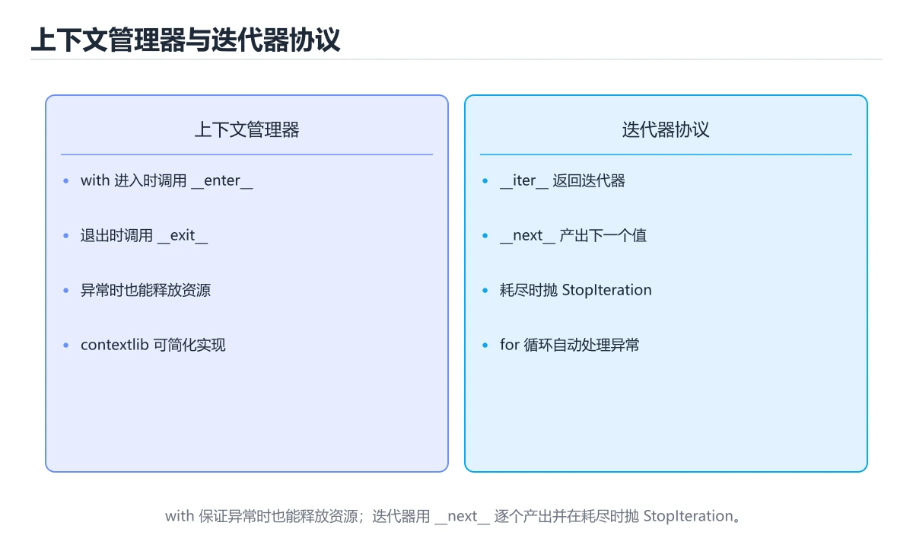
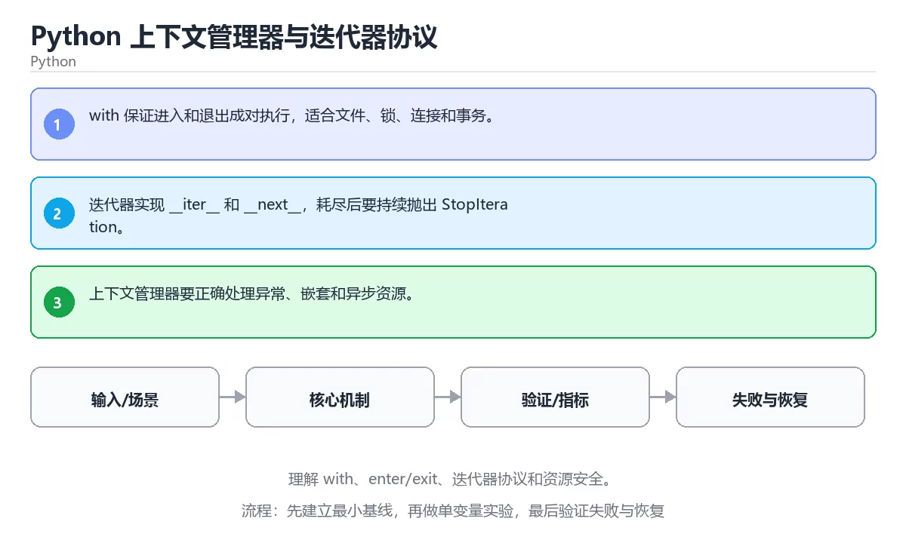

# Python 上下文管理器与迭代器协议





> 内容更新时间：2026-10-06 · 学习阶段：高级 · 预计用时：70 分钟

## 本节知识框架

想象一下：你每天出门要开门、回家要关门。如果忘了关门，空调就白开了，还可能进小偷。编程里的"资源管理"也是一样的道理——打开文件要关闭，获取锁要释放，连接数据库要断开。

**本课要解决的核心问题**：如何让 Python 自动帮你"开门"和"关门"，即使中途出错也不会忘记清理？

**学完本课后，你能够**：
- 用生活中的例子解释什么是上下文管理器和迭代器
- 写出自己的 `with` 语句和自定义迭代器
- 遇到"文件没关闭""迭代器用两次变空"这类问题时，知道怎么排查和修复

**知识地图**：
```text
上下文管理器（自动开关门）
    ↓ 使用
with 语句（语法糖）
    ↓ 管理
资源（文件、锁、连接）

迭代器（排队取号）
    ↓ 实现
__iter__ + __next__（协议）
    ↓ 遍历
可迭代对象（列表、字典等）
```

**先修知识**：本课是 Python 系列的第 33 课。在开始之前，你需要已经学过《Python 装饰器与生成器》，因为装饰器和生成器是本课的基础。后续会衔接《Python 打包、发布与性能》。

## 核心概念定义

让我们用生活中的例子来理解这些概念：

| 术语 | 生活类比 | 编程定义 | 常见错误 |
| --- | --- | --- | --- |
| **上下文管理器** | 像酒店房卡：进门时激活，退房时自动断电 | 用 `with` 语法在代码块前后自动执行获取与释放资源的协议 | 异常时忘记释放资源，导致资源泄漏 |
| **迭代器** | 像排队取号：每次叫一个号，叫过的不能再来 | 按顺序逐个访问集合元素并维护当前位置的协议或对象 | 第二次遍历得到空结果（号已经叫完了） |
| **with 语句** | 像自动门：你走过去它自动开，走后自动关 | 上下文管理器语法，`__enter__` 与 `__exit__` 保证退出时释放资源 | 嵌套顺序错误、异常处理不当 |
| **资源** | 像图书馆的书：借出来要还，别人才能用 | 可通过协议读取或操作的受控对象，访问范围必须经过授权 | 忘记释放、重复释放、越界访问 |

**关键区别**：
- **上下文管理器**关注"进入前准备"和"退出后清理"
- **迭代器**关注"按顺序逐个访问"和"记住当前位置"

## 原理与运行机制

### 像讲故事一样理解运行机制

让我们把这两个概念想象成两个故事：

**故事一：上下文管理器——酒店的自动化系统**

想象你入住一家智能酒店：
1. **入住（`__enter__`）**：刷房卡进门，房间自动开灯、开空调
2. **住宿（代码块）**：你在房间里做各种事情
3. **退房（`__exit__`）**：把房卡插回门口，房间自动关灯、关空调

关键是：**即使你中途生病被送医院（发生异常），系统也会在退房时自动清理**，不会让空调白开一整夜。

**故事二：迭代器——餐厅的排队叫号**

想象你去餐厅吃饭：
1. **取号（`iter()`）**：从取号机拿一张排队号
2. **叫号（`next()`）**：服务员依次叫号，每次叫一个
3. **叫完（`StopIteration`）**：所有号都叫完了，再问就说"没了"

关键是：**你拿的这张号只能用一次**，如果想重新排队，必须再取一张新号。

### 机制详解：with 语句的工作原理

```python
# 你以为的 with 语句
with open('data.txt', 'r') as f:
    content = f.read()

# Python 实际做的事情
f = open('data.txt', 'r')      # 1. 打开文件（获取资源）
try:
    content = f.read()          # 2. 执行代码块
finally:
    f.close()                   # 3. 关闭文件（释放资源），即使出错也会执行
```

**为什么 with 这么重要？**
- 文件、锁、数据库连接都是"借来的资源"
- 如果不归还，别人就用不了（资源泄漏）
- `with` 保证即使代码出错，也会自动归还

### 机制详解：迭代器协议

```python
# 你以为的 for 循环
for item in [1, 2, 3]:
    print(item)

# Python 实际做的事情
iterator = iter([1, 2, 3])     # 1. 获取迭代器
while True:
    try:
        item = next(iterator)  # 2. 逐个取值
        print(item)
    except StopIteration:      # 3. 取完了就退出
        break
```

**迭代器的两个核心方法**：
- `__iter__()`：返回迭代器自身
- `__next__()`：返回下一个值，没有更多时抛出 `StopIteration`

### 自定义上下文管理器：两种方法

**方法一：类实现（适合复杂逻辑）**

```python
class FileManager:
    def __init__(self, filename, mode):
        self.filename = filename
        self.mode = mode
    
    def __enter__(self):
        print(f"正在打开 {self.filename}...")
        self.file = open(self.filename, self.mode)
        return self.file
    
    def __exit__(self, exc_type, exc_value, traceback):
        print(f"正在关闭 {self.filename}...")
        self.file.close()
        # 如果有异常，返回 False 让异常继续传播
        return False

# 使用
with FileManager('data.txt', 'r') as f:
    content = f.read()
    print(f"读取了 {len(content)} 个字符")
```

**方法二：contextmanager 装饰器（适合简单场景）**

```python
from contextlib import contextmanager

@contextmanager
def file_manager(filename, mode):
    print(f"正在打开 {filename}...")
    f = open(filename, mode)
    try:
        yield f  # 把文件交给 with 块
    finally:
        print(f"正在关闭 {filename}...")
        f.close()

# 使用
with file_manager('data.txt', 'r') as f:
    content = f.read()
```

### 自定义迭代器：从零开始

```python
class Counter:
    """计数器迭代器：从 1 数到 limit"""
    
    def __init__(self, limit):
        self.limit = limit      # 上限
        self.value = 0          # 当前值
    
    def __iter__(self):
        return self             # 返回自身作为迭代器
    
    def __next__(self):
        if self.value >= self.limit:
            raise StopIteration # 没有更多值了
        self.value += 1
        return self.value       # 返回当前值

# 使用
counter = Counter(3)
print(list(counter))  # [1, 2, 3]

# 注意：迭代器只能用一次！
print(list(counter))  # [] 第二次就是空的了
```

**为什么第二次是空的？**
想象排队叫号：你已经叫过 1、2、3 号了，再叫当然没有了。如果想重新计数，必须创建新的 `Counter(3)`。

## 典型应用场景

### 场景一：文件操作（最常用）

```python
# 错误做法：容易忘记关闭文件
f = open('data.txt', 'r')
content = f.read()
# 如果这里出错，f.close() 就不会执行

# 正确做法：with 自动关闭
with open('data.txt', 'r') as f:
    content = f.read()
# 即使出错，文件也会自动关闭
```

### 场景二：数据库连接

```python
import sqlite3

class DatabaseConnection:
    def __init__(self, db_path):
        self.db_path = db_path
    
    def __enter__(self):
        self.conn = sqlite3.connect(self.db_path)
        return self.conn
    
    def __exit__(self, exc_type, exc_value, traceback):
        if exc_type is not None:
            self.conn.rollback()  # 出错时回滚
        else:
            self.conn.commit()    # 正常时提交
        self.conn.close()         # 关闭连接

# 使用
with DatabaseConnection('app.db') as conn:
    cursor = conn.cursor()
    cursor.execute("INSERT INTO users VALUES ('Alice', 25)")
# 自动提交或回滚，并关闭连接
```

### 场景三：计时器

```python
import time

class Timer:
    def __enter__(self):
        self.start = time.time()
        return self
    
    def __exit__(self, *args):
        self.end = time.time()
        self.elapsed = self.end - self.start
        print(f"耗时：{self.elapsed:.4f} 秒")

# 使用
with Timer() as t:
    # 做一些耗时操作
    sum(range(1000000))
# 自动打印耗时
```

### 场景四：自定义范围迭代器

```python
class CustomRange:
    """类似 range() 的迭代器"""
    
    def __init__(self, start, stop, step=1):
        self.start = start
        self.stop = stop
        self.step = step
    
    def __iter__(self):
        self.current = self.start
        return self
    
    def __next__(self):
        if (self.step > 0 and self.current >= self.stop) or \
           (self.step < 0 and self.current <= self.stop):
            raise StopIteration
        value = self.current
        self.current += self.step
        return value

# 使用
for i in CustomRange(1, 10, 2):
    print(i)  # 1, 3, 5, 7, 9
```

### 场景五：锁和事务

```python
import threading

class LockManager:
    def __init__(self, lock):
        self.lock = lock
    
    def __enter__(self):
        self.lock.acquire()
        return self
    
    def __exit__(self, *args):
        self.lock.release()

# 使用
lock = threading.Lock()
with LockManager(lock):
    # 临界区代码，同一时刻只有一个线程能执行
    print("安全操作共享资源")
```

## 代码/协议/SQL 示例

### 示例 1：最小可运行的迭代器

```python
class Counter:
    def __init__(self, limit):
        self.limit = limit
        self.value = 0

    def __iter__(self):
        return self

    def __next__(self):
        if self.value >= self.limit:
            raise StopIteration
        self.value += 1
        return self.value

print(list(Counter(3)))
```

**预期输出**：

```text
[1, 2, 3]
```

**代码解读**：
1. `__init__()`：初始化计数器，设置上限和当前值
2. `__iter__()`：返回自身作为迭代器
3. `__next__()`：每次调用返回下一个值，到达上限时抛出 `StopIteration`
4. `list()`：把迭代器转换成列表，会自动调用 `__next__()` 直到抛出异常

### 示例 2：上下文管理器处理异常

```python
class SafeFileWriter:
    def __init__(self, filename):
        self.filename = filename
    
    def __enter__(self):
        self.file = open(self.filename, 'w')
        return self.file
    
    def __exit__(self, exc_type, exc_value, traceback):
        self.file.close()
        if exc_type is not None:
            print(f"发生错误：{exc_value}")
            # 返回 False 让异常继续传播
            # 返回 True 会吞掉异常（通常不推荐）
        return False

# 正常使用
with SafeFileWriter('test.txt') as f:
    f.write("Hello, World!")

# 异常使用
with SafeFileWriter('test.txt') as f:
    f.write("Hello")
    raise ValueError("测试异常")
# 文件仍然会被关闭，异常会继续传播
```

### 示例 3：生成器作为迭代器

```python
def fibonacci(limit):
    """生成斐波那契数列"""
    a, b = 0, 1
    while a < limit:
        yield a
        a, b = b, a + b

# 使用
for num in fibonacci(10):
    print(num)  # 0, 1, 1, 2, 3, 5, 8

# 生成器也是迭代器，只能用一次
fib = fibonacci(10)
print(list(fib))  # [0, 1, 1, 2, 3, 5, 8]
print(list(fib))  # [] 第二次为空
```

### 示例 4：可迭代对象 vs 迭代器

```python
class NumberList:
    """可迭代对象：每次调用 iter() 返回新的迭代器"""
    
    def __init__(self, numbers):
        self.numbers = numbers
    
    def __iter__(self):
        return iter(self.numbers)  # 每次返回新迭代器

# 可以多次遍历
nums = NumberList([1, 2, 3])
print(list(nums))  # [1, 2, 3]
print(list(nums))  # [1, 2, 3] 还是可以！

# 对比：迭代器只能用一次
class NumberIterator:
    """迭代器：只能用一次"""
    
    def __init__(self, numbers):
        self.numbers = numbers
        self.index = 0
    
    def __iter__(self):
        return self
    
    def __next__(self):
        if self.index >= len(self.numbers):
            raise StopIteration
        value = self.numbers[self.index]
        self.index += 1
        return value

# 只能用一次
it = NumberIterator([1, 2, 3])
print(list(it))  # [1, 2, 3]
print(list(it))  # [] 第二次为空
```

## 时间/空间复杂度或性能分析

### 上下文管理器的性能

**时间复杂度**：
- `__enter__()` 和 `__exit__()` 各调用一次，开销取决于具体实现
- 文件操作：O(1)（系统调用）
- 数据库连接：O(1)（网络往返）

**空间复杂度**：
- 上下文管理器对象本身：O(1)
- 管理的资源：取决于资源类型（文件大小、连接数等）

**性能优化建议**：
- 避免在 `__enter__()` 和 `__exit__()` 中做耗时操作
- 长事务会放大锁等待，记录事务持续时间与锁冲突次数
- 使用 `contextlib` 的装饰器可以减少样板代码

### 迭代器的性能

**时间复杂度**：
- `__iter__()`：O(1)
- `__next__()`：O(1)（通常是）
- 遍历 n 个元素：O(n)

**空间复杂度**：
- 迭代器本身：O(1)（只保存当前状态）
- 对比列表：O(n)（需要存储所有元素）

**迭代器的优势**：
- 惰性求值：不需要一次性生成所有值
- 内存友好：处理大数据时不会爆内存
- 无限序列：可以表示无穷大的序列

**性能测量方法**：

```python
import time

# 测量迭代器性能
start = time.time()
for i in Counter(1000000):
    pass
end = time.time()
print(f"耗时：{end - start:.4f} 秒")

# 对比列表
start = time.time()
for i in list(range(1000000)):
    pass
end = time.time()
print(f"耗时：{end - start:.4f} 秒")
```

### 边界条件

**上下文管理器的边界**：
- 嵌套层数过多：可能导致资源泄漏或死锁
- 异常处理不当：可能吞掉异常或重复释放
- 异步资源：需要使用 `async with` 和 `__aenter__`/`__aexit__`

**迭代器的边界**：
- 耗尽后继续使用：会持续抛出 `StopIteration`
- 修改正在迭代的集合：可能导致意外行为
- 多线程访问：需要加锁保护

## 常见误区与易错点

### 误区 1：自定义上下文管理器不处理异常

**错误代码**：

```python
class BadFileManager:
    def __init__(self, filename):
        self.filename = filename
    
    def __enter__(self):
        self.file = open(self.filename, 'r')
        return self.file
    
    def __exit__(self, exc_type, exc_value, traceback):
        # 忘记关闭文件！
        pass
```

**问题**：如果代码块中发生异常，文件不会被关闭，导致资源泄漏。

**正确做法**：

```python
class GoodFileManager:
    def __init__(self, filename):
        self.filename = filename
    
    def __enter__(self):
        self.file = open(self.filename, 'r')
        return self.file
    
    def __exit__(self, exc_type, exc_value, traceback):
        self.file.close()  # 必须关闭
        return False  # 让异常继续传播
```

### 误区 2：混淆可迭代对象与迭代器

**错误代码**：

```python
class BadIterable:
    def __init__(self, data):
        self.data = data
        self.index = 0
    
    def __iter__(self):
        return self  # 返回自身
    
    def __next__(self):
        if self.index >= len(self.data):
            raise StopIteration
        value = self.data[self.index]
        self.index += 1
        return value

# 问题：只能用一次
obj = BadIterable([1, 2, 3])
print(list(obj))  # [1, 2, 3]
print(list(obj))  # [] 第二次为空！
```

**正确做法**：

```python
class GoodIterable:
    def __init__(self, data):
        self.data = data
    
    def __iter__(self):
        return iter(self.data)  # 每次返回新迭代器

# 可以多次遍历
obj = GoodIterable([1, 2, 3])
print(list(obj))  # [1, 2, 3]
print(list(obj))  # [1, 2, 3] 还是可以！
```

### 误区 3：生成器里忽略清理

**错误代码**：

```python
def bad_generator():
    f = open('data.txt', 'r')
    while True:
        line = f.readline()
        if not line:
            break
        yield line
    # 如果生成器被提前关闭，文件不会被关闭
```

**正确做法**：

```python
def good_generator():
    with open('data.txt', 'r') as f:
        while True:
            line = f.readline()
            if not line:
                break
            yield line
    # with 保证文件会被关闭

# 或者使用 try/finally
def another_good_generator():
    f = open('data.txt', 'r')
    try:
        while True:
            line = f.readline()
            if not line:
                break
            yield line
    finally:
        f.close()
```

### 误区 4：在迭代时修改集合

**错误代码**：

```python
numbers = [1, 2, 3, 4, 5]
for n in numbers:
    if n % 2 == 0:
        numbers.remove(n)  # 危险！
```

**正确做法**：

```python
# 方法一：遍历副本
numbers = [1, 2, 3, 4, 5]
for n in numbers[:]:  # 遍历副本
    if n % 2 == 0:
        numbers.remove(n)

# 方法二：列表推导式
numbers = [1, 2, 3, 4, 5]
numbers = [n for n in numbers if n % 2 != 0]
```

### 误区 5：忘记迭代器只能用一次

**错误代码**：

```python
data = map(lambda x: x * 2, [1, 2, 3])
print(list(data))  # [2, 4, 6]
print(list(data))  # [] 第二次为空！
```

**正确做法**：

```python
# 方法一：转换成列表
data = list(map(lambda x: x * 2, [1, 2, 3]))
print(data)  # [2, 4, 6]
print(data)  # [2, 4, 6]

# 方法二：重新创建迭代器
data = map(lambda x: x * 2, [1, 2, 3])
print(list(data))  # [2, 4, 6]
data = map(lambda x: x * 2, [1, 2, 3])  # 重新创建
print(list(data))  # [2, 4, 6]
```

## 与其他知识点的关系

### 知识图谱

```text
Python 装饰器与生成器（先修）
    ↓
Python 上下文管理器与迭代器协议（本课）
    ↓
Python 打包、发布与性能（后续）
```

### 与先修知识的关系

**与装饰器的关系**：
- 装饰器：修改函数行为（包装函数）
- 上下文管理器：管理资源生命周期（包装代码块）
- 共同点：都是"包装"思想的应用

**与生成器的关系**：
- 生成器是一种特殊的迭代器
- 生成器用 `yield` 实现迭代器协议
- 生成器函数每次调用 `next()` 时恢复执行

### 与后续知识的关系

**与打包发布的关系**：
- 上下文管理器常用于资源管理（文件、连接）
- 迭代器常用于数据处理管道
- 性能优化时需要分析迭代器的内存占用

### 容易混淆的概念对比

| 概念 A | 概念 B | 区别 |
| --- | --- | --- |
| 上下文管理器 | 迭代器 | 前者管理资源生命周期，后者逐个访问元素 |
| 可迭代对象 | 迭代器 | 前者可以多次遍历（每次返回新迭代器），后者只能用一次 |
| with 语句 | try/finally | with 更简洁，但 try/finally 更灵活 |
| 生成器 | 迭代器 | 生成器是迭代器的简化版本，用函数实现而非类 |

### 术语接口

- **上下文管理器**：本课定义是用 `with` 语法在代码块前后自动执行获取与释放资源的协议
- **迭代器**：本课定义是按顺序逐个访问集合元素并维护当前位置的协议或对象
- **with**：本课定义是上下文管理器语法，`__enter__` 与 `__exit__` 保证退出时释放资源
- **资源**：本课定义是可通过协议读取或操作的受控对象，访问范围必须经过授权

## 自测题与参考答案

### 自测 1：概念复述

**题目**：不看正文，写出上下文管理器的定义，并说明它与迭代器的区别。

**参考答案**：
- **上下文管理器**：用 `with` 语法在代码块前后自动执行获取与释放资源的协议
- **迭代器**：按顺序逐个访问集合元素并维护当前位置的协议或对象
- **区别**：上下文管理器管理资源的生命周期（进入和退出），迭代器管理元素的访问顺序（逐个遍历）

### 自测 2：排错

**题目**：本课错误表记录了"自定义上下文管理器不处理异常"这类做法。请写出它会出现的现象、根因，以及修复顺序。

**参考答案**：
- **现象**：异常路径资源泄漏（文件没关闭、锁没释放）
- **根因**：`__exit__()` 中没有正确释放资源
- **修复**：在 `__exit__()` 中必须释放资源，异常要继续向外传播（返回 `False`）

### 自测 3：动手验证

**题目**：运行本课的迭代器示例，改动其中一个输入后重新运行，记录输出与错误信息。

**参考答案**：
```python
# 原始代码
print(list(Counter(3)))  # [1, 2, 3]

# 改动输入
print(list(Counter(5)))  # [1, 2, 3, 4, 5]
print(list(Counter(0)))  # []

# 改动逻辑
class CounterV2:
    def __init__(self, limit):
        self.limit = limit
        self.value = 0

    def __iter__(self):
        return self

    def __next__(self):
        if self.value > self.limit:  # 改成 >
            raise StopIteration
        self.value += 1
        return self.value

print(list(CounterV2(3)))  # [1, 2, 3, 4] 多了一个！
```

### 自测 4：代码阅读

**题目**：阅读本课开头的迭代器示例，说明它体现了上下文管理器的哪一条性质，并指出改动哪个输入会让这条性质不再成立。

**参考答案**：
- 这个示例体现的是**迭代器协议**，不是上下文管理器
- 如果改成上下文管理器，需要实现 `__enter__()` 和 `__exit__()`
- 改动 `limit` 为负数会导致逻辑错误

### 自测 5：迁移

**题目**：把本课的方法迁移到自己的项目：围绕上下文管理器写出一个与错误表同类的风险点，并说明触发条件和检验方式。

**参考答案**：
- **风险点**：数据库连接没有正确关闭
- **触发条件**：`__exit__()` 中没有调用 `conn.close()`
- **检验方式**：运行后检查数据库连接数是否增加

### 自测 6：对比

**题目**：用一个表格对比上下文管理器与迭代器：各写一行适用场景、一行失败表现。

**参考答案**：

| | 上下文管理器 | 迭代器 |
| --- | --- | --- |
| **适用场景** | 文件、锁、数据库连接 | 列表、字典、自定义序列 |
| **失败表现** | 资源泄漏（文件没关闭） | 第二次遍历为空（迭代器耗尽） |

### 自测 7：排错顺序

**题目**：面对"自定义上下文管理器不处理异常"引发的问题，请把"复现 → 保留证据 → 修复 → 回归验证"四步写成可执行的检查清单。

**参考答案**：
1. **复现**：编写代码触发异常，观察资源是否泄漏
2. **保留证据**：记录输入、版本、错误信息、资源状态
3. **修复**：在 `__exit__()` 中添加资源释放代码，只改一处
4. **回归验证**：重新运行，确认资源正常释放，异常正常传播

### 自测 8：边界判断

**题目**：针对资源，分别写出"可以使用"的条件和"结论不再成立"的条件。

**参考答案**：
- **可以使用**：在 `with` 块内正常访问资源，`__exit__()` 正确释放
- **结论不再成立**：
  - `__exit__()` 没有释放资源
  - 在 `with` 块外访问资源
  - 多个上下文管理器嵌套顺序错误

### 自测 9：机制重建

**题目**：不看正文，按输入、转换、输出、验证四段重建上下文管理器 → 迭代器 → with → 资源的作用链。

**参考答案**：
- **输入**：上下文管理器（获取资源）
- **转换**：with 语句（执行代码块）
- **输出**：迭代器（处理数据）
- **验证**：资源（释放资源，检查状态）

### 自测 10：综合排错

**题目**：在本课中，现象是"资源没有释放"。请围绕“生成器里忽略清理”写出最小复现、关键证据、修复动作和回归验证。

**参考答案**：
- **最小复现**：
```python
def bad_gen():
    f = open('test.txt')
    yield f.readline()
    # 没有关闭文件

gen = bad_gen()
next(gen)
# 文件没有关闭
```
- **关键证据**：检查打开的文件描述符数量
- **修复动作**：使用 `with` 或 `try/finally`
- **回归验证**：重新运行，确认文件描述符正常释放

### 自测 11：一分钟复述

**题目**：用每分钟约 200 字的速度复述本课内容：先给主问题，再按顺序说出上下文管理器、迭代器、with、资源，最后给一个失败案例。

**自评标准**：
- 主问题：如何让 Python 自动管理资源和逐个访问元素
- 上下文管理器：用 `with` 语法自动获取和释放资源
- 迭代器：按顺序逐个访问元素，维护当前位置
- with：上下文管理器的语法糖，保证退出时释放资源
- 资源：文件、锁、连接等需要释放的对象
- 失败案例：自定义上下文管理器不处理异常，导致资源泄漏

## 复习清单

- [ ] 能不看正文复述本课核心术语，并指出一个边界或反例
- [ ] 能默写本课最重要的代码示例，并解释每一行的作用
- [ ] 能说出本课内容和前后两课的联系

## 延伸阅读

想更直观地理解本课概念？推荐参阅以下图解专题：

- [图解调用栈与递归](visual_call_stack.md)

## 术语速查

| 术语 | 一句话说明 |
| --- | --- |
| `上下文管理器` | 用 with 语法在代码块前后自动执行获取与释放资源的协议（酒店房卡：进门激活，退房断电） |
| `迭代器` | 按顺序逐个访问集合元素并维护当前位置的协议或对象（排队叫号：每次叫一个，叫过的不能再来） |
| `with` | 上下文管理器语法，`__enter__` 与 `__exit__` 保证退出时释放资源（自动门：走过去自动开，走后自动关） |
| `资源` | 可通过协议读取或操作的受控对象，访问范围必须经过授权（图书馆的书：借出来要还） |
| `__enter__()` | 上下文管理器的进入方法，返回资源（刷房卡进门） |
| `__exit__()` | 上下文管理器的退出方法，释放资源（插回房卡退房） |
| `__iter__()` | 迭代器协议方法，返回迭代器自身（取号机取号） |
| `__next__()` | 迭代器协议方法，返回下一个值（服务员叫号） |
| `StopIteration` | 迭代器耗尽时抛出的异常（所有号都叫完了） |

**术语关系**：
- 上下文管理器（管理资源） → with（语法糖） → 资源（被管理的对象）
- 迭代器（逐个访问） → `__iter__` + `__next__`（协议） → 可迭代对象（数据来源）

## 考点精讲

本课共有 6 道考点，下面逐题给出题干、正确项与判断依据。先自己作答，再核对正确项，最后回到正文对应小节复核。

### 考点 1：第 1 题

**题目**：在 `Python 上下文管理器与迭代器协议` 里，与 `上下文管理器` 有关的说法中，哪一项最符合理解 with、enter/exit、迭代器协议和资源安全。？

**选项**：
- A. pyproject.toml 统一声明构建、依赖和工具配置，锁文件保证可复现。
- B. 只要小数据能跑通，大规模和异常情况也一定正确。
- C. with 保证进入和退出成对执行，适合文件、锁、连接和事务。
- D. 装饰器本质是接收函数并返回新函数的高阶函数，常用于日志、缓存、权限和重试。

**正确答案**：C

**判断依据**：这道题考查上下文管理器的核心作用。`with` 语句保证进入（`__enter__`）和退出（`__exit__`）成对执行，即使发生异常也会执行清理。典型应用场景包括文件操作、锁管理、数据库连接和事务处理。

### 考点 2：第 2 题

**题目**：围绕“Python 上下文管理器与迭代器协议”中的 上下文管理器、迭代器、with，下列哪两项是本课强调的实践判断？

**选项**：
- A. 学习 上下文管理器 时要同时说明输入、输出和失败路径，不能只看正常流程
- B. 只要 上下文管理器 的常规示例通过，就可以跳过边界与异常路径
- C. 验证 迭代器 时要固定版本并覆盖边界输入，结论才可复现
- D. 把 迭代器 的单次运行结果当成所有版本和规模都成立

**正确答案**：A、C

**判断依据**：这道题强调全面验证的重要性。学习上下文管理器时不能只看正常流程，还要考虑异常路径（资源是否正确释放）。验证迭代器时要固定版本并覆盖边界输入（空序列、单元素、大数据量），结论才可复现。

### 考点 3：第 3 题

**题目**：在 `Python 上下文管理器与迭代器协议` 里，与 `上下文管理器` 有关的说法中，哪一项最符合理解 with、enter/exit、迭代器协议和资源安全。？（Python 上下文管理器与迭代器协议·Python 第 3 题）

**选项**：
- A. 只要小数据能跑通，大规模和异常情况也一定正确。
- B. 上下文管理器要正确处理异常、嵌套和异步资源。
- C. 装饰器要保留原函数元数据，生成器要处理关闭、异常和资源释放。
- D. 性能优化先用 cProfile、py-spy 和基准测试定位，再考虑算法、缓存或原生扩展。

**正确答案**：B

**判断依据**：这道题考查上下文管理器的高级主题。上下文管理器需要正确处理三种复杂情况：异常（在 `__exit__` 中决定是否传播）、嵌套（多个 `with` 语句的释放顺序）、异步资源（使用 `async with` 和 `__aenter__`/`__aexit__`）。

### 考点 4：第 4 题

**题目**：`Python 上下文管理器与迭代器协议` 的主线是：理解 with、enter/exit、迭代器协议和资源安全。下面哪一项与这条主线一致？

**选项**：
- A. 用 pyproject、锁文件和构建工具发布包，并做性能剖析。
- B. 只要小数据能跑通，大规模和异常情况也一定正确。
- C. 理解 with、enter/exit、迭代器协议和资源安全。
- D. 掌握闭包、装饰器、yield、惰性序列和生成器性能。

**正确答案**：C

**判断依据**：这道题考查本课的核心主线。本课围绕四个核心概念展开：`with` 语句的语法、`__enter__`/`__exit__` 协议、迭代器协议（`__iter__`/`__next__`）、资源安全管理。

### 考点 5：第 5 题

**题目**：填空：补齐下面这段术语说明中的空缺。课程 `理解 with、enter/exit、迭代器协议和资源安全。`，这段说明是：`____`：按顺序逐个访问集合元素并维护当前位置的协议或对象。空缺处应填哪个术语？

**正确答案**：迭代器

**判断依据**：涉及术语 迭代器：按顺序逐个访问集合元素并维护当前位置的协议或对象。易错点：自定义上下文管理器不处理异常会造成异常路径资源泄漏。正确做法：进入与退出成对处理，异常要继续向外传播。判断时先确认输入和适用范围，对照 `上下文管理器`、`迭代器`、`with`、`资源` 复现一次，最后把错误表现与正确做法逐项对照。

### 考点 6：第 6 题

**题目**：`Python 上下文管理器与迭代器协议` 的示例代码服务于“理解 with、enter/exit、迭代器协议和资源安全。”。哪一条判断是正确的？

**选项**：
- A. 只要小数据能跑通，大规模和异常情况也一定正确。
- B. pyproject.toml 统一声明构建、依赖和工具配置，锁文件保证可复现。
- C. with 保证进入和退出成对执行，适合文件、锁、连接和事务。
- D. 装饰器本质是接收函数并返回新函数的高阶函数，常用于日志、缓存、权限和重试。

**正确答案**：C

**判断依据**：这道题考查示例代码的核心思想。示例代码展示了 `with` 语句的工作原理：进入时获取资源（`__enter__`），退出时释放资源（`__exit__`），即使发生异常也会执行清理。这种机制适合管理文件、锁、数据库连接和事务。

## 内容元数据

- 内容版本：v2.0
- 最后更新：2026-10-06
- 学习阶段：高级
- 适用环境：Python 3.12+；本课聚焦 上下文管理器。
- 内容来源：内置结构化课程与工程实践整理
- 相关主题：上下文管理器、迭代器、with、资源
- 质量版本：P0 测验标准 + P1 覆盖扩展 + P2 体验补全

## 参考资料与复核

- [本课资料锚点 python_context_iterators](https://zh.wikipedia.org/w/index.php?search=python_context_iterators)

- 最后复核：2026-10-04
- 下次复核：2026-11-10
- 复核范围：版本兼容、API 行为、安全建议与工程实践
- 来源性质：官方文档、标准或权威教材；本课核对关键词：上下文管理器、迭代器、with、资源。

| 参考资料 | 本课用途 |
| --- | --- |
| [Python 官方文档 - 上下文管理器](https://docs.python.org/3/reference/datamodel.html#context-managers) | 上下文管理器协议详解 |
| [Python 官方文档 - 迭代器类型](https://docs.python.org/3/library/stdtypes.html#iterator-types) | 迭代器协议规范 |
| [Python 官方文档 - contextlib](https://docs.python.org/3/library/contextlib.html) | contextmanager 装饰器用法 |
| [Python 官方文档 - with 语句](https://docs.python.org/3/reference/compound_stmts.html#the-with-statement) | with 语句语法规范 |
| [PEP 343 - The "with" Statement](https://peps.python.org/pep-0343/) | with 语句的设计文档 |
| [Python 教程 - 迭代器](https://docs.python.org/3/tutorial/classes.html#iterators) | 迭代器入门教程 |

| [本课术语索引：Python 上下文管理器与迭代器协议](#核心概念定义) | 按本课输入、术语边界和错误表现逐项核对 |
> 「Python 上下文管理器与迭代器协议」的链接用于离线阅读后的延伸核对；App 不会自动联网。
