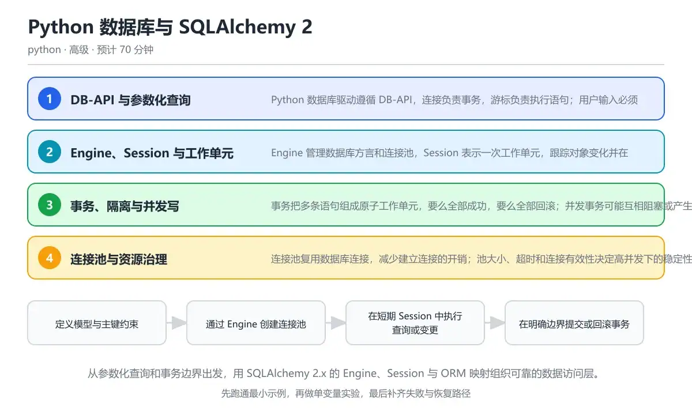
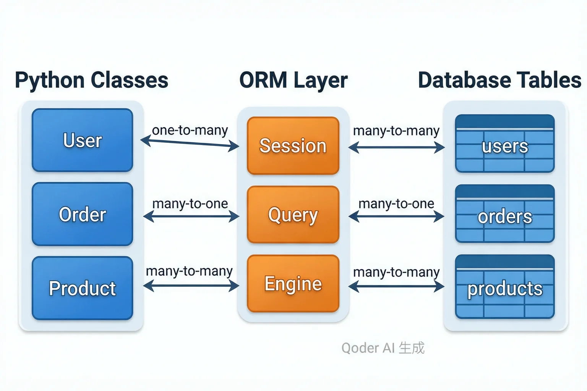

# Python 数据库与 SQLAlchemy 2.x

> 内容更新时间：2026-10-06 · 学习阶段：高级 · 预计用时：60 分钟

分类：python。关键词：SQLAlchemy、SQLite、事务、连接池、Alembic。从参数化查询和事务边界出发，用 SQLAlchemy 2.x 的 Engine、Session 与 ORM 映射组织可靠的数据访问层。



## 本节知识框架

想象你开了一家银行——客户来存钱、取钱、转账，你需要一套系统来安全地管理这些数据。本课就是教你如何用 Python 搭建这套"数据管理系统"。

**本课用一个比喻串起来**：

| 比喻 | 对应的技术概念 | 一句话说明 |
| --- | --- | --- |
| 银行总行调度中心 | Engine | 管理所有数据库连接、方言翻译和连接池 |
| 柜台窗口 | Session | 你办理业务的那段"工作会话"，结束时要结账 |
| 一笔不可拆分的业务 | 事务 | 转账要么全成功，要么全撤回，没有中间态 |
| 填表而不是口述 | 参数化查询 | 把用户输入和 SQL 指令分开，防止"注入"攻击 |
| 窗口排队叫号系统 | 连接池 | 复用有限的数据库连接，控制并发 |
| 银行系统升级方案 | Alembic | 管理数据库表结构的版本演进 |

**学完本课你应当能够**：
- 说清 `Engine` 与 `Session` 的含义与区别，并各举一个正例和一个反例。
- 用本课示例验证 `事务` 的行为，记录输入、输出与失败条件。
- 遇到「用字符串拼接 SQL」这类问题时，能说出触发条件与修复顺序。

**先修与衔接**：本课是「Python」分类的第 31 课。先修内容：《Python 异常、日志与文件 I/O 进阶》中的 `异常链` 和 `上下文管理器`。相关后续课程：《实战：CSV 到 SQLite 的 ETL 流水线》、《Python 项目架构：分层、配置与依赖注入》。

## 核心概念定义

下面每个概念都配了一个"大白话"解释，帮你快速建立直觉。

| 术语 | 大白话 | 操作性定义 | 常见边界与风险 |
| --- | --- | --- | --- |
| Engine | 银行的"总调度中心"，负责管理所有连接和方言 | SQLAlchemy 管理数据库方言、连接池与执行策略的核心对象。 | 索引命中与数据分布决定实际开销，判断前先看执行计划而不是只看结果是否正确。 |
| Session | 你在柜台办理业务的那段"会话" | 跟踪对象变化、管理身份映射并在提交时形成工作单元的事务边界。 | 易错：在《Python 数据库与 SQLAlchemy 2.x》里采用「Session 中更新对象后直接关闭，数据没有写入且异常状态被丢给后续请求」时，修改后忘记提交或回滚会表现为错误结果、异常中断或状态不一致；正确做法是在明确的工作单元中提交，异常路径回滚并重新抛出。 |
| 事务 | 一笔不可拆分的业务，要么全做要么全撤 | 把多条数据库操作组成原子工作单元，成功时提交、失败时回滚。 | 易错：在《Python 数据库与 SQLAlchemy 2.x》里采用「在事务中调用远程接口、等待用户输入，连接池很快被占满」时，长期占用连接或事务会表现为错误结果、异常中断或状态不一致；正确做法是事务只包围数据库操作，外部调用放到事务之外，Session 用上下文管理器及时释放。 |
| 参数化查询 | 填表格而不是口述——输入和指令分开处理 | 把 SQL 模板与输入值分开绑定，避免输入被当成代码执行的查询方式。 | 索引命中与数据分布决定实际开销，判断前先看执行计划而不是只看结果是否正确。 |
| 连接池 | 窗口排队叫号，复用有限的柜台资源 | 复用数据库连接的资源池，控制并发连接数量与等待行为。 | 易错：在《Python 数据库与 SQLAlchemy 2.x》里采用「在事务中调用远程接口、等待用户输入，连接池很快被占满」时，长期占用连接或事务会表现为错误结果、异常中断或状态不一致；正确做法是事务只包围数据库操作，外部调用放到事务之外，Session 用上下文管理器及时释放。 |
| Alembic | 银行系统升级的"变更方案"，记录每一步结构变化 | SQLAlchemy 生态的数据库 schema 迁移工具，用版本脚本记录结构演进。 | 不同版本与依赖组合的行为可能不同，升级或换环境前要按官方变更说明重新验证。 |

## 原理与运行机制

### 从零开始理解：为什么需要 SQLAlchemy？

**场景**：你想用 Python 操作数据库。最简单的方式是直接写 SQL 字符串——但这样很容易出错（比如 SQL 注入），而且代码和 SQL 混在一起很难维护。

**SQLAlchemy 的解决方案**：它像一个"翻译官"，让你用 Python 对象来操作数据库，而不需要手写 SQL 字符串。它帮你处理连接管理、安全防护和结构迁移。

### 机制总览

| 阶段 | 关注对象 | 类比 | 失败时应检查 |
| --- | --- | --- | --- |
| 输入 | Engine | 银行开门营业，调度中心准备就绪 | 类型、范围、编码、版本或前置状态是否满足定义。 |
| 处理 | Session | 柜台开始办理业务 | 顺序、可见性、锁、路由、事务或调度规则是否被破坏。 |
| 输出 | 事务 | 业务办完，盖章确认 | 结果是否可复现，错误是否被正确传播而不是被吞掉。 |



### 1. DB-API 与参数化查询——为什么不能拼接 SQL？

**生活类比**：想象你去餐厅点餐。如果你直接对服务员说"把菜单上第3行改成宫保鸡丁"，这就好比 SQL 注入——你改变了菜单本身！正确做法是：你只负责说"我要宫保鸡丁"（填表），厨房负责执行（处理指令）。

参数化查询就是这个"填表"的过程：SQL 模板和输入值分开传递，数据库永远不会把用户输入当成 SQL 代码来执行。

```python
# 错误示范：字符串拼接，用户输入可以改变 SQL 结构
name = "Alice'; DROP TABLE users; --"
sql = f"SELECT * FROM users WHERE name = '{name}'"
# 最终执行的 SQL 变成了: SELECT * FROM users WHERE name = 'Alice'; DROP TABLE users; --'

# 正确做法：参数化查询，输入和指令分离
from sqlalchemy import text
result = session.execute(text("SELECT * FROM users WHERE name = :name"), {"name": name})
# 数据库把 name 的值当作纯数据，永远不会执行它
```

**边界提醒**：表名、列名和排序方向通常不能作为普通值参数，需要从允许列表中映射，不能直接接受用户输入。

### 2. Engine 与 Session——银行调度中心与柜台窗口

**Engine 类比**：Engine 就像银行的总调度中心。它知道怎么跟数据库"说话"（方言），管理着所有可用的连接（连接池），决定请求怎么分配。你只需要创建一次 Engine，整个应用共享它。

**Session 类比**：Session 就像你走到柜台前的那一次"业务办理"。你在这个窗口里查余额、转账、存钱，所有操作都在这个会话里进行。办完事后，你要"结账离开"（commit 或 close），把窗口让给下一个人。

```python
from sqlalchemy import create_engine
from sqlalchemy.orm import Session

# Engine：创建一次，全局共享——相当于银行开门
engine = create_engine("sqlite:///bank.db")

# Session：每次业务创建一个——相当于走到柜台前
with Session(engine) as session:
    # 在这个会话里做操作...
    session.add(some_account)
    session.commit()  # 结账确认
# with 块结束，Session 自动关闭，连接归还给连接池
```

**关键区别**：Engine 是全局的、长期的；Session 是临时的、一次性的。Session 不是线程安全的，不能跨线程共享。

### 3. 事务——要么全做，要么全撤

**生活类比**：你在 ATM 转账 100 元给朋友。这个操作分两步：(1) 你的账户扣 100 元，(2) 朋友账户加 100 元。如果第一步成功了但第二步失败了（比如网络断了），怎么办？事务保证：要么两步都成功，要么两步都撤销——你的钱不会凭空消失。

```python
with Session(engine) as session:
    try:
        sender = session.get(Account, 1)
        receiver = session.get(Account, 2)
        sender.balance -= 100
        receiver.balance += 100
        session.commit()  # 两步都成功，提交
    except Exception:
        session.rollback()  # 任何一步失败，全部撤销
        raise
```

**边界提醒**：事务要保持短小。不要在事务里调用远程接口或等待用户输入，否则会长期占用连接，导致连接池被耗尽。

### 4. 连接池——窗口排队叫号系统

**生活类比**：银行只有 10 个柜台窗口，但有 100 个客户。连接池就是"叫号系统"——客户来了分配一个窗口，办完事窗口归还给下一个人。如果 10 个窗口都满了，后来的客户就排队等待。

```python
engine = create_engine(
    "sqlite:///bank.db",
    pool_size=10,        # 最多 10 个并发连接
    pool_timeout=30,     # 等待超过 30 秒就报错
    pool_pre_ping=True,  # 借出连接前先检测是否还活着
)
```

**关键认知**：池越大不代表性能越好——数据库本身也有连接上限。连接泄漏（忘了关闭 Session）会让池永久耗尽，最终拖垮整个服务。

### 5. 迁移与模型演进——系统升级方案

**生活类比**：银行一开始只有"活期账户"表。后来业务扩展，要加一个"信用评分"列；再后来要加"定期存款"表。这些结构变化不能直接去生产数据库手动改，需要有版本记录、可以回退的"升级方案"——这就是 Alembic。

```text
版本 001：创建 accounts 表（id, name, balance）
版本 002：给 accounts 表加 status 列（先可空，回填默认值，再加约束）
版本 003：创建 deposits 表
```

**关键原则**：数据回填必须与结构变更分开——先加列（可空），再回填数据，最后加约束（不可空）。一步到位会锁表或丢数据。

```text
定义模型与主键约束 → 通过 Engine 创建连接池 → 在短期 Session 中执行查询或变更 → 在明确边界提交或回滚事务 → 用迁移管理 schema 并验证性能
```

## 典型应用场景

### 场景 1：Web 应用的用户注册与登录

你正在开发一个 Web 应用，用户提交注册信息后需要存入数据库。这里涉及：
- **参数化查询**：用户名和密码必须通过绑定参数传递，绝不能拼进 SQL 字符串
- **Session 管理**：每个 HTTP 请求创建独立的 Session，请求结束后关闭
- **事务**：创建用户和创建默认配置必须在同一个事务中完成

### 场景 2：电商订单的转账与支付

用户下单后需要扣减库存、扣减余额、生成订单记录。这三步必须在一个事务中完成：
- 如果扣减库存成功但扣余额失败，事务回滚，库存恢复
- 事务要保持短小，不要把"调用支付网关"放在事务里面

### 场景 3：数据分析的批量导入

把 CSV 文件里的 10 万条记录导入数据库：
- 使用连接池控制并发，避免一次打开太多连接
- 每 1000 条提交一次事务，而不是全部提交（减少回滚代价）
- 用 `selectinload` 批量加载关联数据，避免 N+1 查询

### 场景 4：项目迭代中的数据库升级

产品从 v1 升级到 v2，需要给表加新列：
- 用 Alembic 生成迁移脚本
- 先在测试环境验证升级和降级
- 生产环境执行前在数据副本上演练

## 代码/协议/SQL 示例

### 完整示例：银行账户管理系统

下面是一个完整的最小可验证示例，覆盖了 Engine、Session、事务和 ORM 映射：

```python
from sqlalchemy import create_engine, select
from sqlalchemy.orm import DeclarativeBase, Mapped, Session, mapped_column

# 第一步：定义模型（相当于设计银行表格的格式）
class Base(DeclarativeBase):
    pass

class Account(Base):
    __tablename__ = "accounts"

    id: Mapped[int] = mapped_column(primary_key=True)
    name: Mapped[str] = mapped_column(unique=True)
    balance: Mapped[int] = mapped_column(default=0)

# 第二步：创建 Engine（银行开门）
engine = create_engine("sqlite+pysqlite:///:memory:")
Base.metadata.create_all(engine)

# 第三步：在 Session 中操作数据（柜台办理业务）
with Session(engine) as session:
    # 新增两个账户
    session.add_all([
        Account(name="Ada", balance=100),
        Account(name="Lin", balance=50),
    ])
    session.commit()  # 提交——数据真正写入数据库

    # 查询：按余额从高到低排序
    statement = select(Account).order_by(Account.balance.desc())
    for account in session.scalars(statement):
        print(account.name, account.balance)
    # 输出: Ada 100 然后 Lin 50

    # 修改：给 Ada 加 10 元
    account = session.get(Account, 1)
    account.balance += 10
    session.commit()
    print("新余额:", session.get(Account, 1).balance)
    # 输出: 新余额: 110
```

### 安全查询示例：参数化 vs 拼接

```python
# 危险！字符串拼接——SQL 注入的温床
name = "Alice'; DROP TABLE users; --"
bad_sql = f"SELECT * FROM users WHERE name = '{name}'"
# 数据库会执行: SELECT * FROM users WHERE name = 'Alice'; DROP TABLE users; --'

# 安全！参数化查询——输入永远不会被当成 SQL 代码
from sqlalchemy import text
safe_result = session.execute(
    text("SELECT * FROM users WHERE name = :name"),
    {"name": name}
)
# 数据库把 name 的值当作纯文本数据，注入无效
```

### 避免 N+1 查询示例

```python
# 错误示范：N+1 查询——查 100 个订单，再循环查 100 次客户
orders = session.scalars(select(Order)).all()
for order in orders:
    print(order.customer.name)  # 每次访问都触发一条新查询！

# 正确做法：用 selectinload 一次性加载关联数据
from sqlalchemy.orm import selectinload
orders = session.scalars(
    select(Order).options(selectinload(Order.customer))
).all()
for order in orders:
    print(order.customer.name)  # 关联数据已经在内存里，不再发查询
```

## 时间/空间复杂度或性能分析

### 主要性能开销来源

| 开销来源 | 类比 | 优化方向 |
| --- | --- | --- |
| 数据库连接建立 | 每次去银行都重新办一张会员卡 | 连接池复用连接 |
| ORM 对象创建 | 每笔业务都填一份新表格 | 批量操作减少对象数 |
| 长事务持锁 | 在柜台前打电话商量，后面的人全等着 | 事务保持短小 |
| N+1 查询 | 查 100 个订单，每次都要跑回档案室查客户信息 | selectinload / join 批量加载 |

### 测量方法

1. **基线测量**：固定输入跑一遍，记录执行时间、内存峰值和数据库查询次数
2. **压力测试**：把数据量提高一个数量级（100 条变 10000 条），观察性能变化
3. **关键指标**：
   - 连接等待时间（pool_timeout 是否触发）
   - 事务持续时间（长事务 = 高风险）
   - 查询次数（N+1 问题会让查询数 = 1 + N）

### 各组件的性能边界

- `Engine` 的 pool_size 要与数据库的 max_connections 协调，超过数据库承载会导致连接被拒绝
- `Session` 不适合长期持有，用完就关；detached 对象访问延迟属性会报错
- `事务` 持续时间越长，锁冲突概率越高；SQLite 写入时锁定整个数据库
- `连接池` 不是越大越好——超过数据库承载反而降低吞吐
- `Alembic` 在大表上加索引可能锁表，生产环境要先演练

## 常见误区与易错点

| 容易写错的做法 | 实际现象 | 原因与正确做法 |
| --- | --- | --- |
| 用字符串拼接 SQL | 在《Python 数据库与 SQLAlchemy 2.x》里采用「写 f'SELECT * FROM users WHERE name = {name}'，用户输入可以改变语句结构」时，用字符串拼接 SQL会表现为错误结果、异常中断或状态不一致。 | 使用绑定参数 select(...).where(User.name == name)，让数据库区分代码与数据 |
| 修改后忘记提交或回滚 | 在《Python 数据库与 SQLAlchemy 2.x》里采用「Session 中更新对象后直接关闭，数据没有写入且异常状态被丢给后续请求」时，修改后忘记提交或回滚会表现为错误结果、异常中断或状态不一致。 | 在明确的工作单元中提交，异常路径回滚并重新抛出 |
| 循环中逐条查询关联对象 | 在《Python 数据库与 SQLAlchemy 2.x》里采用「查询一百个订单后又在一百次循环里查询用户，产生 N+1 查询」时，循环中逐条查询关联对象会表现为错误结果、异常中断或状态不一致。 | 用 join 或 selectinload 批量加载关联数据，再用查询计数验证 |
| 长期占用连接或事务 | 在《Python 数据库与 SQLAlchemy 2.x》里采用「在事务中调用远程接口、等待用户输入，连接池很快被占满」时，长期占用连接或事务会表现为错误结果、异常中断或状态不一致。 | 事务只包围数据库操作，外部调用放到事务之外，Session 用上下文管理器及时释放 |

### 误区详解 1：字符串拼接 SQL

**症状**：写 `f"SELECT * FROM users WHERE name = '{name}'"`，用户输入包含引号或分号时改变了 SQL 结构。

**根因**：用户的输入被数据库当成了 SQL 代码来执行。

**修复**：使用绑定参数，让数据库区分"指令"和"数据"。

### 误区详解 2：忘记 commit

**症状**：Session 里修改了对象，关闭 Session 后发现数据库里数据没变。

**根因**：Session 的修改只在内存中，必须调用 `commit()` 才会写入数据库。

**修复**：在明确的工作单元边界调用 `session.commit()`，异常时调用 `session.rollback()`。

### 误区详解 3：N+1 查询

**症状**：查询 100 个订单，然后循环访问每个订单的客户名——结果产生了 101 条 SQL 查询。

**根因**：ORM 默认延迟加载关联对象，每次访问 `order.customer` 都触发一条新查询。

**修复**：使用 `selectinload(Order.customer)` 或 `join` 一次性加载。

### 误区详解 4：事务中做耗时操作

**症状**：在事务里调用外部 API、等待用户确认，连接池很快被占满。

**根因**：事务持有期间一直占用数据库连接和锁，其他请求无法获取连接。

**修复**：事务只包含数据库操作，外部调用放到事务之外。

## 与其他知识点的关系

### 知识图谱

```text
Python 异常、日志与文件 I/O 进阶（先修）
    ↓ 异常链、上下文管理器
Python 数据库与 SQLAlchemy 2.x（本课）
    ↓ Engine、Session、事务、连接池
    ├──→ 实战：CSV 到 SQLite 的 ETL 流水线（后续，共用 SQLite）
    ├──→ Python 项目架构：分层、配置与依赖注入（后续，数据访问层设计）
    └──→ 实战：FastAPI 订单服务（后续，共用 SQLite）
```

## 自测题与参考答案

> 先独立作答，再对照参考答案；答案都能在本课正文、术语表或错误表里找到依据。

### 自测 1（概念复述）

不看正文，写出 `Engine` 的操作性定义，并说明它与 `Session` 的区别。

**参考答案**：SQLAlchemy 管理数据库方言、连接池与执行策略的核心对象。Engine 是全局的，创建一次后整个应用共享；Session 是临时的，每个请求或工作单元创建一个，用完就关闭。Engine 管"连接"，Session 管"业务"。

### 自测 2（排错）

本课错误表记录了「用字符串拼接 SQL」这类做法。请写出它会出现的现象、根因，以及修复顺序。

**参考答案**：现象是在《Python 数据库与 SQLAlchemy 2.x》里采用「写 f'SELECT * FROM users WHERE name = {name}'，用户输入可以改变语句结构」时，用字符串拼接 SQL会表现为错误结果、异常中断或状态不一致；正确做法是使用绑定参数 select(...).where(User.name == name)，让数据库区分代码与数据。修复时先复现现象并保留证据，再改动一处假设重跑，确认现象消失。

### 自测 3（动手验证）

运行本课的完整银行账户示例，改动其中一个输入后重新运行，记录输出与错误信息。

**参考答案**：正常输入下示例应当输出 "Ada 100" 然后 "Lin 50"，新余额为 110。改动输入后（比如把 balance 改成负数），观察输出是否变化或报错，先核对是否满足 Engine 的适用范围，再检查错误表里是否有同类现象。

### 自测 4（代码阅读）

阅读本课的参数化查询示例，说明它体现了参数化查询的哪一条性质，并指出改动哪个输入会让这条性质不再成立。

**参考答案**：参数化查询的核心性质是"输入永远不会被当成 SQL 代码执行"。如果把 `:name` 改成直接拼接表名（如 `:tablename`），这条性质就不再成立——因为表名和列名不能作为绑定参数。

### 自测 5（迁移）

把本课的方法迁移到自己的项目：围绕 Engine 写出一个与错误表同类的风险点，并说明触发条件和检验方式。

**参考答案**：例如「长期占用连接或事务」，它会导致在《Python 数据库与 SQLAlchemy 2.x》里采用「在事务中调用远程接口、等待用户输入，连接池很快被占满」时，长期占用连接或事务会表现为错误结果、异常中断或状态不一致；检验方式是按事务只包围数据库操作，外部调用放到事务之外，Session 用上下文管理器及时释放改一处再复现，确认现象消失且没有引入新的失败分支。

### 自测 6（对比）

用一个表格对比 `Engine` 与 `Session`：各写一行适用场景、一行失败表现。

**参考答案**：

| | Engine | Session |
| --- | --- | --- |
| 适用场景 | 全局创建一次，管理连接池和方言 | 每个请求创建，执行查询和变更 |
| 失败表现 | 连接池配置不当导致连接被拒绝 | 忘记 commit 导致数据丢失 |

## 复习清单

- [ ] 能不看正文复述本课核心术语，并指出一个边界或反例
- [ ] 能默写本课最重要的代码示例，并解释每一行的作用
- [ ] 能说出本课内容和前后两课的联系

## 延伸阅读

想更直观地理解本课概念？推荐参阅以下图解专题：

- [图解 B+ 树与数据库索引](visual_btree_index.md)

## 术语速查

| 术语 | 一句话说明 |
| --- | --- | --- |
| `Engine` | SQLAlchemy 管理数据库方言、连接池与执行策略的核心对象。 | 银行总调度中心 |
| `Session` | 跟踪对象变化、管理身份映射并在提交时形成工作单元的事务边界。 | 柜台业务窗口 |
| `事务` | 把多条数据库操作组成原子工作单元，成功时提交、失败时回滚。 | 不可拆分的业务 |
| `参数化查询` | 把 SQL 模板与输入值分开绑定，避免输入被当成代码执行的查询方式。 | 填表而不是口述 |
| `连接池` | 复用数据库连接的资源池，控制并发连接数量与等待行为。 | 窗口排队叫号 |
| `Alembic` | SQLAlchemy 生态的数据库 schema 迁移工具，用版本脚本记录结构演进。 | 系统升级方案 |

**术语关系链**：`Engine`（创建连接） → `Session`（借出连接，执行业务） → `事务`（保证原子性） → `参数化查询`（保证安全性）。`连接池` 在 Engine 层面复用连接。`Alembic` 独立管理结构演进。

## 考点精讲

本课题库共 5 道题，下面逐题给出题干、正确项与判断依据。建议先自己作答，再核对正确项，最后回到正文对应小节复核。

### 考点 1：第 1 题

- **题目**：防止 SQL 注入最核心的做法是什么？
- **正确项**：使用绑定参数让数据库区分 SQL 模板与输入值
- **判断依据**：这道题检验本课主问题：从参数化查询和事务边界出发，用 SQLAlchemy 2.x 的 Engine、Session 与 ORM 映射组织可靠的数据访问层。参数化查询把 SQL 模板和输入值分开发送给数据库，输入永远被当作数据而非代码，从根本上杜绝了注入攻击。复习时先复述本课主问题，再举一个会让结论失效的输入。

### 考点 2：第 2 题

- **题目**：SQLAlchemy 中修改 ORM 对象后，数据什么时候真正写入数据库？
- **正确项**：调用 commit 提交事务时
- **判断依据**：这道题落在术语 `事务` 上：把多条数据库操作组成原子工作单元，成功时提交、失败时回滚。Session 跟踪对象的修改，flush 可以提前发送 SQL，但只有 commit 才会提交事务并使变更对其他连接可见。复习时把 `事务` 的定义、适用边界和一个反例一起说清楚，再回到「核心概念定义」核对原文。

### 考点 3：第 3 题

- **题目**：关于连接池与事务，哪些说法正确？（多选）
- **正确项**：池大小必须与数据库连接上限匹配；连接泄漏会让池最终耗尽；Session 应在使用后及时关闭并归还连接
- **判断依据**：这道题落在术语 `Session` 上：跟踪对象变化、管理身份映射并在提交时形成工作单元的事务边界。连接池是有限资源，未关闭的 Session 会泄漏连接，最终让所有请求排队超时。复习时把 `Session` 的定义、适用边界和一个反例一起说清楚，再回到「核心概念定义」核对原文。

### 考点 4：第 4 题

- **题目**：阅读代码，哪一项能避免 N+1 查询？  orders = session.scalars(select(Order)).all() for order in orders:     print(order.customer.name)
- **正确项**：用 selectinload 或 join 一次性加载 customer 关联
- **判断依据**：这道题检验本课主问题：从参数化查询和事务边界出发，用 SQLAlchemy 2.x 的 Engine、Session 与 ORM 映射组织可靠的数据访问层。默认延迟加载会在每次访问 order.customer 时再发一条查询，使用 selectinload 批量加载关联对象可以减少数据库往返。复习时先复述本课主问题，再举一个会让结论失效的输入。

### 考点 5：第 5 题

- **题目**：这段数据访问代码的主要风险是什么？
- **正确项**：缺少余额校验与显式回滚，异常时可能部分修改或产生负余额
- **判断依据**：这道题检验本课主问题：从参数化查询和事务边界出发，用 SQLAlchemy 2.x 的 Engine、Session 与 ORM 映射组织可靠的数据访问层。转账操作必须在同一事务中完成余额校验、更新和提交，异常时要 rollback。复习时先复述本课主问题，再举一个会让结论失效的输入。

## 内容元数据

- 内容版本：v2.0
- 最后更新：2026-10-06
- 学习阶段：高级

| 字段 | 值 |
| --- | --- |
| 课程 ID | `python_database_sqlalchemy` |
| 所属分类 | `python` |
| 难度 | 高级 |
| 预计用时 | 70 分钟 |
| 关键词 | SQLAlchemy、SQLite、事务、连接池、Alembic |
| 配图 | `images/lesson_python_database_sqlalchemy.webp` |
| 参考资料 | 4 条 |
| 内容更新时间 | 2026-10-06 |

## 参考资料与复核

- [本课资料锚点 python_database_sqlalchemy](https://zh.wikipedia.org/w/index.php?search=python_database_sqlalchemy)

- 来源性质：官方文档、标准或权威教材；本课核对关键词：SQLAlchemy、SQLite、事务、连接池、Alembic。
- 最后复核：2026-10-04
- 下次复核：2026-11-10
- 复核范围：版本兼容、API 行为与工程实践

下面列出的资料用于核对本课结论，复习时可以对照阅读：
- [SQLAlchemy 2.0 统一教程](https://docs.sqlalchemy.org/en/20/tutorial/)
- [SQLAlchemy ORM Session 文档](https://docs.sqlalchemy.org/en/20/orm/session.html)
- [Python sqlite3 文档](https://docs.python.org/3/library/sqlite3.html)
- [Alembic 迁移文档](https://alembic.sqlalchemy.org/en/latest/)

> 复核提示：《Python 数据库与 SQLAlchemy 2.x》的结论如与资料冲突，以资料中的规范文本为准，并在笔记里记录差异与日期。
