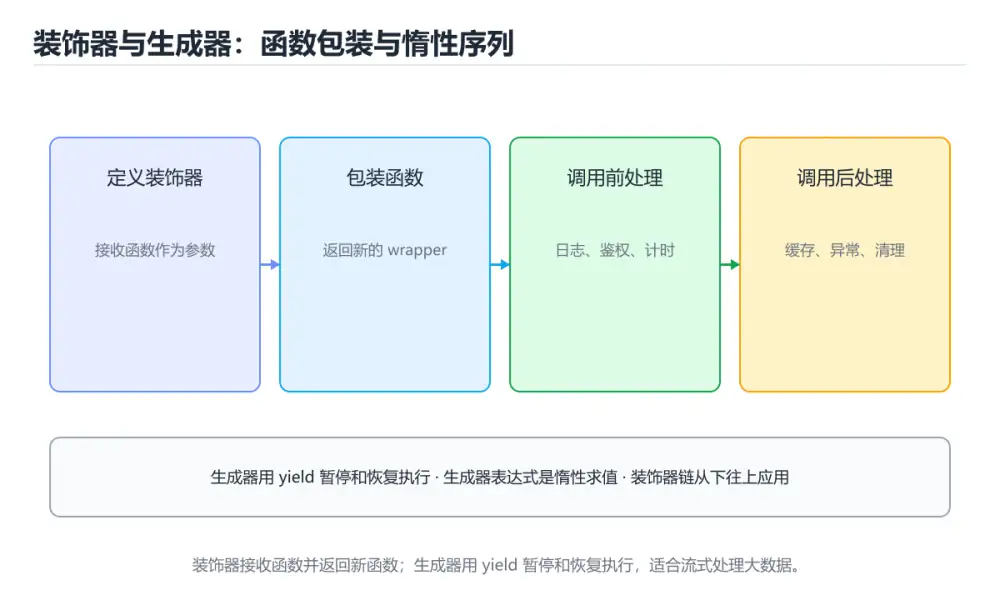
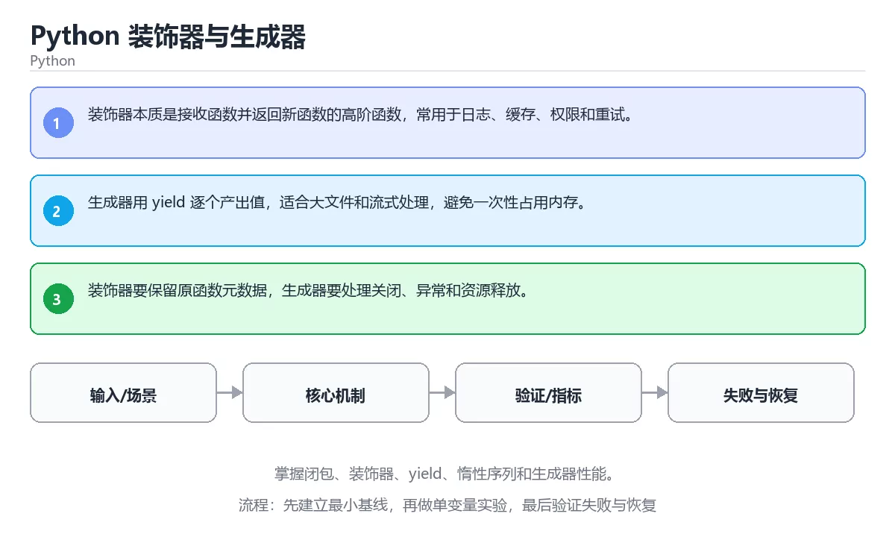

# Python 装饰器与生成器

> 内容更新时间：2026-10-06 · 学习阶段：高级 · 预计用时：45 分钟





## 本节知识框架

欢迎来到 Python 最"优雅"的两个特性！你可以把本课想象成学习两种高级工具：

- **装饰器** —— 像一个"函数包装纸"，不拆开礼物就能在外面加一层丝带。
- **生成器** —— 像一台"自动售货机"，你按一次按钮，它吐出一个值，不会一次性把所有货都倒出来。

**学完本课你应当能够**
- 用自己的话解释"装饰器"和"生成器"分别解决什么问题，并各举一个正例和一个反例。
- 运行本课的 `yield` 示例，记录输入、输出与失败条件。
- 遇到"装饰器不保留原函数信息"这类问题时，能说出触发条件与修复顺序。

### 复习清单

- [ ] 能不看正文复述本课核心术语，并指出一个边界或反例。
- [ ] 能运行或推演本课示例，记录输入、输出与失败现象。
- [ ] 能完成一次自测，并把错题对照错误表定位原因。

## 核心概念定义

想象你在一家咖啡店工作。装饰器就像给咖啡加糖浆——咖啡本身不变，但味道增强了。生成器就像一台自动售货机——你投币一次，它掉出一瓶饮料，而不是一次性把所有饮料都倒在地上。

| 术语 | 一句话定义（类比） | 操作性定义 | 常见边界与风险 |
| --- | --- | --- | --- |
| 装饰器 | 像"包装纸"——不拆礼物就能加丝带 | 在不修改原函数主体的情况下包装或增强其行为的语法结构。 | 易错：文档与签名丢失，调试困难；正确做法是用 `functools.wraps` 保留元信息。 |
| 生成器 | 像"自动售货机"——按一次出一个 | 按需逐个产出值并暂停执行的函数或对象，节省内存并支持流式处理。 | 易错：第二次遍历为空；正确做法是明确一次性语义，需要复用就重新创建或转成列表。 |
| yield | 像"暂停键"——按一下停一下 | 生成器关键字：函数执行到 yield 暂停并返回值，下次继续，适合流式处理大数据。 | 只在生成器函数内部有效，普通函数里使用会报错。 |
| 闭包 | 像"背包"——函数带着出生地的变量走 | 函数与其定义时词法环境的组合，使函数离开原作用域后仍能访问捕获的变量。 | 注意可变对象的引用共享问题，默认参数绑定时机容易踩坑。 |

## 原理与运行机制

### 装饰器到底在做什么？

**类比时间！** 想象你有一台普通的烤面包机（原函数）。你想在每次烤完面包后自动记录"几点烤的"。你有两种做法：

1. **笨办法**：拆开烤面包机，在里面装一个计时器。（修改原函数——不推荐！）
2. **聪明办法**：在烤面包机外面套一个"智能外壳"，面包从里面出来时自动记录时间。（装饰器！）

装饰器的本质就是那个"智能外壳"。它是一个**接收函数并返回新函数的高阶函数**。Python 用 `@` 语法让你一行代码就能套上外壳：

```python
@timer          # 这一行等于 say_hello = timer(say_hello)
def say_hello():
    print("Hello!")
```

### 生成器到底在做什么？

**再来讲个故事。** 假设你要数 1 到 100 万。笨办法是把 100 万个数字全写在一块白板上（列表），占满整面墙。聪明办法是拿一个小计数器，每次数一个、报一个、擦掉再数下一个（生成器）。

生成器的核心是 `yield` 关键字。函数遇到 `yield` 就**暂停**，把值交出来；下次调用时从暂停的地方**继续**。

```python
def count_up(n):
    i = 0
    while i < n:
        yield i    # 暂停，交出 i
        i += 1     # 下次从这里继续
```

### 闭包——装饰器的"幕后英雄"

装饰器之所以能工作，靠的是**闭包**。闭包就像一个函数背着一个小背包，背包里装着它出生时周围的变量。即使函数离开了原来的作用域，背包里的变量还在。

```python
def make_adder(x):          # x 被装进"背包"
    def adder(y):
        return x + y        # 这里还能访问 x
    return adder

add5 = make_adder(5)
print(add5(3))  # 输出 8 —— x=5 还在背包里
```

### 机制总览：三条核心结论

1. **装饰器本质是接收函数并返回新函数的高阶函数，常用于日志、缓存、权限和重试。**
2. **生成器用 yield 逐个产出值，适合大文件和流式处理，避免一次性占用内存。**
3. **装饰器要保留原函数元数据，生成器要处理关闭、异常和资源释放。**

## 典型应用场景

### 装饰器的真实世界场景

| 场景 | 类比 | 代码思路 |
| --- | --- | --- |
| 日志记录 | 快递签收单——每次收货自动登记 | 在函数调用前后打印信息 |
| 缓存/记忆化 | 小抄本——算过的答案记下来 | 用字典存储已计算的结果 |
| 权限检查 | 门禁卡——刷卡才能进 | 调用前检查用户角色 |
| 重试机制 | 自动重拨——挂了再打 | 捕获异常后自动重试 N 次 |
| 计时器 | 秒表——自动记录函数耗时 | 记录调用前后的时间差 |

### 生成器的真实世界场景

| 场景 | 类比 | 代码思路 |
| --- | --- | --- |
| 读取大文件 | 一页一页翻书 | 每次 yield 一行，不一次性读入内存 |
| 无限序列 | 自然数——数不完 | while True + yield |
| 数据管道 | 流水线——一步一步加工 | 多个生成器串联 |
| 状态机 | 棋盘游戏——每回合推进一步 | yield 返回当前状态 |

### 考点 1 解读

关于"装饰器本质是接收函数并返回新函数的高阶函数，常用于日志、缓存、权限和重试"——这是本课最核心的结论之一。记住：装饰器**不修改原函数**，它只是在外面包了一层。

### 考点 2 解读

关于"生成器用 yield 逐个产出值，适合大文件和流式处理，避免一次性占用内存"——这是生成器存在的最大理由：省内存。当你处理 10GB 的日志文件时，列表会撑爆内存，生成器不会。

## 代码/协议/SQL 示例

### 示例 1：最小装饰器（带追踪功能）

这个示例展示了装饰器的基本结构。`trace` 就是一个装饰器，它在 `square` 函数执行前后打印追踪信息。

```python
def trace(func):
    def wrapper(*args):
        print(f"call {func.__name__}")
        return func(*args)
    return wrapper

@trace
def square(n):
    return n * n

print(square(7))
```

运行结果：

```text
call square
49
```

**逐行解读**：
- `trace(func)` 接收一个函数作为参数。
- `wrapper(*args)` 是新的包装函数，它先打印函数名，再调用原函数。
- `@trace` 等于 `square = trace(square)`。
- 调用 `square(7)` 实际上调用的是 `wrapper(7)`。

### 示例 2：用 functools.wraps 保留元信息

这是示例 1 的"正确版本"。加上 `@wraps(func)` 后，被装饰函数的名字和文档不会丢失。

```python
from functools import wraps

def trace(func):
    @wraps(func)  # 关键！保留原函数的 __name__ 和 __doc__
    def wrapper(*args):
        print(f"call {func.__name__}")
        return func(*args)
    return wrapper

@trace
def square(n):
    """计算 n 的平方"""
    return n * n

print(square.__name__)  # 输出 "square"，不是 "wrapper"
print(square.__doc__)   # 输出 "计算 n 的平方"
```

### 示例 3：生成器函数——逐个产出斐波那契数

```python
def fibonacci():
    a, b = 0, 1
    while True:
        yield a
        a, b = b, a + b

# 取前 10 个斐波那契数
fib = fibonacci()
for _ in range(10):
    print(next(fib), end=" ")
```

运行结果：

```text
0 1 1 2 3 5 8 13 21 34
```

### 示例 4：生成器表达式——一行代码搞定

```python
# 列表推导式：一次性创建全部，占内存
squares_list = [x*x for x in range(1000000)]

# 生成器表达式：按需产出，几乎不占内存
squares_gen = (x*x for x in range(1000000))
```

### 示例 5：闭包——带记忆的计数器

```python
def make_counter(start=0):
    count = start
    def counter():
        nonlocal count
        count += 1
        return count
    return counter

c = make_counter(10)
print(c())  # 11
print(c())  # 12
print(c())  # 13
```

## 时间/空间复杂度或性能分析

### 装饰器的性能开销

装饰器的开销主要来自**函数调用**。每次调用被装饰的函数时，实际经过了 wrapper 这一层额外的调用。

| 维度 | 分析 |
| --- | --- |
| 时间开销 | 每次调用多一层函数调用，约增加 100ns-1μs。对于 I/O 密集任务可忽略，对于百万次循环的热点代码需注意。 |
| 空间开销 | 闭包会持有对外层变量的引用，增加少量内存。缓存装饰器（如 `@lru_cache`）的内存随缓存条目增长。 |

### 生成器的性能优势

生成器最大的优势是**内存**。对比如下：

```python
import sys

# 列表：一次性占用内存
big_list = list(range(10_000_000))
print(sys.getsizeof(big_list))  # 约 80 MB

# 生成器：几乎不占内存
big_gen = (x for x in range(10_000_000))
print(sys.getsizeof(big_gen))   # 约 200 字节
```

| 维度 | 列表 | 生成器 |
| --- | --- | --- |
| 内存 | O(n)，一次性分配 | O(1)，只保存当前状态 |
| 时间 | 创建慢（全部计算） | 首次快（惰性计算） |
| 可重复遍历 | 可以 | 不可以（一次性消费） |
| 支持索引 | 支持 | 不支持 |

### 测量方法

以本课的装饰器场景为对象，固定输入跑一遍记录基线，再把规模提高一个数量级复测；两次结果的差值与波动范围才是结论依据。

```python
import time

def benchmark(func, *args, repeats=100000):
    start = time.perf_counter()
    for _ in range(repeats):
        func(*args)
    return time.perf_counter() - start
```

## 常见误区与易错点

| 容易写错的做法 | 实际现象 | 原因与正确做法 |
| --- | --- | --- |
| 装饰器不保留原函数信息 | 文档与签名丢失，调试困难。 | 用 `functools.wraps` 保留元信息。 |
| 生成器被多次消费 | 第二次遍历为空。 | 明确一次性语义，需要复用就重新创建或转成列表。 |
| 生成器里修改外部状态 | 惰性执行让状态变化难以预测。 | 保持生成器纯净，把副作用放到外部处理。 |

### 现场 1：装饰器不保留原函数信息

**症状**：用 `help()` 查看被装饰的函数，看到的是 `wrapper` 的信息而不是原函数的。

**根因**：装饰器返回的 `wrapper` 函数没有复制原函数的 `__name__`、`__doc__` 等属性。

**修复**：在 `wrapper` 上加 `@wraps(func)`。

```python
# 错误示范
def my_decorator(func):
    def wrapper(*args):
        return func(*args)
    return wrapper

@my_decorator
def greet():
    """打招呼"""
    print("Hi!")

print(greet.__name__)  # 输出 "wrapper" —— 信息丢失了！
```

```python
# 正确做法
from functools import wraps

def my_decorator(func):
    @wraps(func)
    def wrapper(*args):
        return func(*args)
    return wrapper

@my_decorator
def greet():
    """打招呼"""
    print("Hi!")

print(greet.__name__)  # 输出 "greet" —— 信息保留了
```

### 现场 2：生成器被多次消费

**症状**：第一次 for 循环能拿到数据，第二次 for 循环什么都没有。

**根因**：生成器是一次性的"消耗品"，遍历完就耗尽了。

**修复**：如果需要多次遍历，要么重新创建生成器，要么一开始就转成列表。

```python
gen = (x for x in range(5))
print(list(gen))  # [0, 1, 2, 3, 4]
print(list(gen))  # [] —— 空了！
```

### 现场 3：生成器里修改外部状态

**症状**：生成器的惰性执行让外部变量的变化时机难以预测。

**根因**：生成器在被消费时才执行代码，而不是在定义时。

**修复**：保持生成器纯净，避免在生成器内部修改外部可变对象。

## 与其他知识点的关系

### 先修与后续

- **先修**：`实战：CSV 到 SQLite 的 ETL 流水线`。本课默认这些内容已经掌握。
- **相关或后续**：`Python 上下文管理器与迭代器协议`。本课术语会在这些课程里继续使用。
- **术语归属**：`装饰器`、`生成器`、`yield` 的定义以本课「核心概念定义」为准。

## 自测题与参考答案

> 先独立作答，再对照参考答案；答案都能在本课正文、术语表或错误表里找到依据。

### 自测 1（概念复述）

不看正文，写出 `装饰器` 的操作性定义，并说明它与 `生成器` 的区别。

**参考答案**：在不修改原函数主体的情况下包装或增强其行为的语法结构。`生成器` 的定位是按需逐个产出值并暂停执行的函数或对象，节省内存并支持流式处理；两者的差别要从适用对象与失败模式上说明。

### 自测 2（排错）

本课错误表记录了"装饰器不保留原函数信息"这类做法。请写出它会出现的现象、根因，以及修复顺序。

**参考答案**：现象是文档与签名丢失，调试困难；正确做法是用 `functools.wraps` 保留元信息。修复时先复现现象并保留证据，再改动一处假设重跑，确认现象消失。

### 自测 3（动手验证）

运行本课的 `text` 示例，改动其中一个输入后重新运行，记录输出与错误信息。

**参考答案**：正常输入下示例应当复现正文给出的结果；改动输入后，如果结果改变或报错，先核对它是否满足装饰器的适用范围，再检查错误表里是否有同类现象。

### 自测 4（代码阅读）

阅读本课的装饰器示例，说明它体现了装饰器的哪一条性质，并指出改动哪个输入会让这条性质不再成立。

**参考答案**：装饰器的定义是在不修改原函数主体的情况下包装或增强其行为的语法结构，示例正是在实现这条定义。改动与装饰器有关的一个输入后，如果结果不再符合正文描述，就说明该性质只在当前前提成立。

### 自测 5（迁移）

把本课的方法迁移到自己的项目：围绕 `装饰器` 写出一个与错误表同类的风险点，并说明触发条件和检验方式。

**参考答案**：例如"生成器里修改外部状态"，它会导致惰性执行让状态变化难以预测；检验方式是按"保持生成器纯净，把副作用放到外部处理"改一处再复现，确认现象消失且没有引入新的失败分支。

### 自测 6（对比）

用一个表格对比 `装饰器` 与 `生成器`：各写一行适用场景、一行失败表现。

**参考答案**：`装饰器` 用于不修改原函数地增强行为；`生成器` 用于惰性产出值节省内存。两者的失败表现分别对应本课错误表里与本术语相关的行。

### 自测 7（排错顺序）

面对"装饰器不保留原函数信息"引发的问题，请把"复现 → 保留证据 → 修复 → 回归验证"四步写成可执行的检查清单。

**参考答案**：第一步按"文档与签名丢失，调试困难"复现；第二步记录输入、版本与完整报错；第三步加 `@wraps(func)` 只改一处；第四步重跑并确认失败路径也按预期变化。

### 自测 8（边界判断）

针对 `闭包`，分别写出"可以使用"的条件和"结论不再成立"的条件。

**参考答案**：闭包在函数嵌套定义且内部函数引用外部变量时成立。注意可变对象的引用共享和默认参数绑定时机可能导致意外行为。

### 自测 9（机制重建）

不看正文，按输入、转换、输出、验证四段重建 `装饰器` → `生成器` → `yield` → `闭包` 的作用链。

**参考答案**：起点是装饰器的定义；中间每一步都保留可观察状态；终点由闭包检查，失败时回到错误表定位第一个偏离定义的步骤。

### 自测 10（综合排错）

现象是"惰性执行让状态变化难以预测"。请围绕“生成器里修改外部状态”写出最小复现、关键证据、修复动作和回归验证。

**参考答案**：先复现问题，记录输入与完整错误；再按"保持生成器纯净，把副作用放到外部处理"只改一处。回归时同时跑正常路径和边界路径，只有两次结果都可解释，才把修复视为完成。

### 自测 11（一分钟复述）

用每分钟约 200 字的速度复述 `Python 装饰器与生成器`：先给主问题，再按顺序说出 `装饰器`、`生成器`、`yield`、`闭包`，最后给一个失败案例。

**自评标准**：主问题必须对应"掌握闭包、装饰器、yield、惰性序列和生成器性能"；每个术语都要能接上一句定义或边界；失败案例必须写成可观察现象。

## 延伸阅读

想更直观地理解本课概念？推荐参阅以下图解专题：

- [图解调用栈与递归](visual_call_stack.md)

## 术语速查

| 术语 | 一句话说明 |
| --- | --- |
| `装饰器` | 在不修改原函数主体的情况下包装或增强其行为的语法结构。 |
| `生成器` | 按需逐个产出值并暂停执行的函数或对象，节省内存并支持流式处理。 |
| `yield` | 生成器关键字：函数执行到 yield 暂停并返回值，下次继续，适合流式处理大数据。 |
| `闭包` | 函数与其定义时词法环境的组合，使函数离开原作用域后仍能访问捕获的变量。 |
| `functools.wraps` | 标准库工具，用于在装饰器中保留原函数的元信息（`__name__`、`__doc__` 等）。 |
| `高阶函数` | 接收函数作为参数或返回函数的函数，装饰器就是高阶函数的典型应用。 |
| `惰性求值` | 不在定义时立即计算所有值，而是在需要时才逐个计算，生成器的核心思想。 |

**术语关系**：`装饰器`（包装函数） → `生成器`（惰性产出） → `yield`（暂停关键字） → `闭包`（变量背包）。

## 考点精讲

`Python 装饰器与生成器` 的题库有 6 道题，下面逐题给出题干、正确项与判断依据：先自己作答，再核对正确项，最后回到正文对应小节复核。

### 考点 1：第 1 题

- **题目**：在 `Python 装饰器与生成器` 里，与 `装饰器` 有关的说法中，哪一项最符合掌握闭包、装饰器、yield、惰性序列和生成器性能？
- **正确项**：装饰器本质是接收函数并返回新函数的高阶函数，常用于日志、缓存、权限和重试。
- **判断依据**：本题正确项是「装饰器本质是接收函数并返回新函数的高阶函数，常用于日志、缓存、权限和重试」。术语 装饰器（Python 装饰器与生成器）：在不修改原函数主体的情况下包装或增强其行为的语法结构，本题取「装饰器本质是接收函数并返回新函数的高阶函数，常用于日志、缓存、权限和重试」这条。易错点是装饰器不保留原函数信息，会造成文档与签名丢失，调试困难，改法是用 `functools.wraps` 保留元信息。

### 考点 2：第 2 题

- **题目**：在 `Python 装饰器与生成器` 里，与 `装饰器` 有关的说法中，哪一项最符合掌握闭包、装饰器、yield、惰性序列和生成器性能？（Python 装饰器与生成器·Python 第 2 题）
- **正确项**：生成器用 yield 逐个产出值，适合大文件和流式处理，避免一次性占用内存。
- **判断依据**：本题正确项是「生成器用 yield 逐个产出值，适合大文件和流式处理，避免一次性占用内存」。术语 装饰器（Python 装饰器与生成器）：在不修改原函数主体的情况下包装或增强其行为的语法结构，本题取「生成器用 yield 逐个产出值，适合大文件和流式处理，避免一次性占用内存」这条。易错点是生成器被多次消费，会造成第二次遍历为空，改法是明确一次性语义，需要复用就重新创建或转成列表。

### 考点 3：第 3 题

- **题目**：代码语言为 `python`，选自 `Python 装饰器与生成器` 的 `装饰器` 部分。课程问题为掌握闭包、装饰器、yield、惰性序列和生成器性能。哪一项描述与代码一致？
- **正确项**：调用了 `trace()`
- **判断依据**：本题正确项是「调用了 `trace()`」。术语 装饰器（Python 装饰器与生成器）：在不修改原函数主体的情况下包装或增强其行为的语法结构，本题取「调用了 `trace()`」这条。易错点是生成器里修改外部状态，会造成惰性执行让状态变化难以预测，改法是保持生成器纯净，把副作用放到外部处理。本题干扰项「调用了 `greet()`」不成立：展示代码里找不到 `greet()`。

### 考点 4：第 4 题

- **题目**：`Python 装饰器与生成器` 的主线是：掌握闭包、装饰器、yield、惰性序列和生成器性能。下面哪一项与这条主线一致？
- **正确项**：掌握闭包、装饰器、yield、惰性序列和生成器性能。
- **判断依据**：本题正确项是「掌握闭包、装饰器、yield、惰性序列和生成器性能」。术语 装饰器（Python 装饰器与生成器）：在不修改原函数主体的情况下包装或增强其行为的语法结构，本题取「掌握闭包、装饰器、yield、惰性序列和生成器性能」这条。易错点是装饰器不保留原函数信息，会造成文档与签名丢失，调试困难，改法是用 `functools.wraps` 保留元信息。

### 考点 5：第 5 题

- **题目**：课程 `掌握闭包、装饰器、yield、惰性序列和生成器性能。`。在 `Python 装饰器与生成器` 里，`装饰器`、`生成器` 与下面哪些选项属于同一层概念？（多选）
- **正确项**：装饰器；生成器
- **判断依据**：按《Python 装饰器与生成器》的正文口径，本题要同时选中「装饰器」、「生成器」，漏掉任一项都算没答全。术语 装饰器（Python 装饰器与生成器）：在不修改原函数主体的情况下包装或增强其行为的语法结构。易错点是装饰器不保留原函数信息会造成文档与签名丢失，调试困难，改法是用包装工具的保留元信息。本课Python 装饰器与生成器要解决的是掌握闭包、装饰器、yield、惰性序列和生成器性能。

### 考点 6：第 6 题

- **题目**：下面几项都与 `装饰器` 有关，请按 `Python 装饰器与生成器` 的正文顺序排列；该课主线是掌握闭包、装饰器、yield、惰性序列和生成器性能。
- **正确项**：核心知识 → 关键流程 → 实践路径 → 常见误区
- **判断依据**：按《Python 装饰器与生成器》正文的先后，本题顺序是「核心知识」 → 「关键流程」 → 「实践路径」 → 「常见误区」。术语「装饰器」在本课里的界定是在不修改原函数主体的情况下包装或增强其行为的语法结构，题干问的就是这一条。常见错法是装饰器不保留原函数信息，其后果是文档与签名丢失，调试困难。正确做法是用包装工具的保留元信息。

### 考点 7：`装饰器`

- **要点**：在不修改原函数主体的情况下包装或增强其行为的语法结构。
- **装饰器 的边界**：易错：文档与签名丢失，调试困难；正确做法是用包装工具的保留元信息。

### 考点 8：`生成器`

- **要点**：按需逐个产出值并暂停执行的函数或对象，节省内存并支持流式处理。
- **生成器 的边界**：易错：第二次遍历为空；正确做法是明确一次性语义，需要复用就重新创建或转成列表。

### 考点 9：`yield`

- **要点**：生成器关键字：函数执行到 yield 暂停并返回值，下次继续，适合流式处理大数据。
- **yield 的边界**：只在「生成器关键字：函数执行到 yield 暂停并返回值，下次继续，适合流式处理大数据」这一前提下成立，换输入或换环境要重新验证。

### 考点 10：`闭包`

- **要点**：函数与其定义时词法环境的组合，使函数离开原作用域后仍能访问捕获的变量。
- **闭包 的边界**：只在「函数与其定义时词法环境的组合，使函数离开原作用域后仍能访问捕获的变量」这一前提下成立，换输入或换环境要重新验证。

### 考点 11：排错——装饰器不保留原函数信息

- **现象**：文档与签名丢失，调试困难。
- **处理**：用包装工具的保留元信息。

### 考点 12：排错——生成器被多次消费

- **现象**：第二次遍历为空。
- **处理**：明确一次性语义，需要复用就重新创建或转成列表。

### 考点 13：综合辨析——`装饰器` 与 `闭包`

- **辨析点**：`装饰器` 的定义是 在不修改原函数主体的情况下包装或增强其行为的语法结构；`闭包` 的定义是 函数与其定义时词法环境的组合，使函数离开原作用域后仍能访问捕获的变量。
- **答题要求**：面对 `Python 装饰器与生成器` 的题目，先判断描述的是 `装饰器` 还是 `闭包`，再归到对应定义，最后写出一个会让该定义失效的边界输入。

### 考点 14：排错评分点

- **现象分**：能写出 文档与签名丢失，调试困难，而不是只写"程序有错"。
- **证据分**：保留触发 装饰器不保留原函数信息 的输入、版本和错误原文。
- **修复分**：按 用包装工具的保留元信息 只改一处，并同时回归正常路径与边界路径。

## 内容元数据

- 内容版本：v2.0
- 最后更新：2026-10-06
- 学习阶段：高级
- 适用环境：Python 3.12+；本课聚焦 装饰器。
- 内容来源：内置结构化课程与工程实践整理
- 相关主题：装饰器、生成器、yield、闭包
- 质量版本：P0 测验标准 + P1 覆盖扩展 + P2 体验补全

## 参考资料与复核

- 最后复核：2026-10-04
- 下次复核：2026-11-10
- 复核范围：版本兼容、API 行为、安全建议与工程实践
- 来源性质：官方文档、标准或权威教材；本课核对关键词：装饰器、生成器、yield、闭包。

| 参考资料 | 本课用途 |
| --- | --- |
| [Python 装饰器官方文档](https://docs.python.org/3/glossary.html#term-decorator) | 装饰器的官方定义与语法说明 |
| [PEP 318 -- Decorators for Functions and Methods](https://peps.python.org/pep-0318/) | 装饰器语法的提案原文 |
| [PEP 255 -- Simple Generators](https://peps.python.org/pep-0255/) | yield 与生成器的提案原文 |
| [Python 生成器教程](https://docs.python.org/3/howto/functional.html#generators) | 函数式编程中的生成器与 yield |
| [functools.wraps 文档](https://docs.python.org/3/library/functools.html#functools.wraps) | 保留被装饰函数元信息的标准工具 |
| [Python 性能分析](https://docs.python.org/3/library/profile.html) | cProfile 与性能分析 |

| [本课术语索引：Python 装饰器与生成器](#核心概念定义) | 按本课输入、术语边界和错误表现逐项核对 |
> 「Python 装饰器与生成器」的链接用于离线阅读后的延伸核对；App 不会自动联网。
