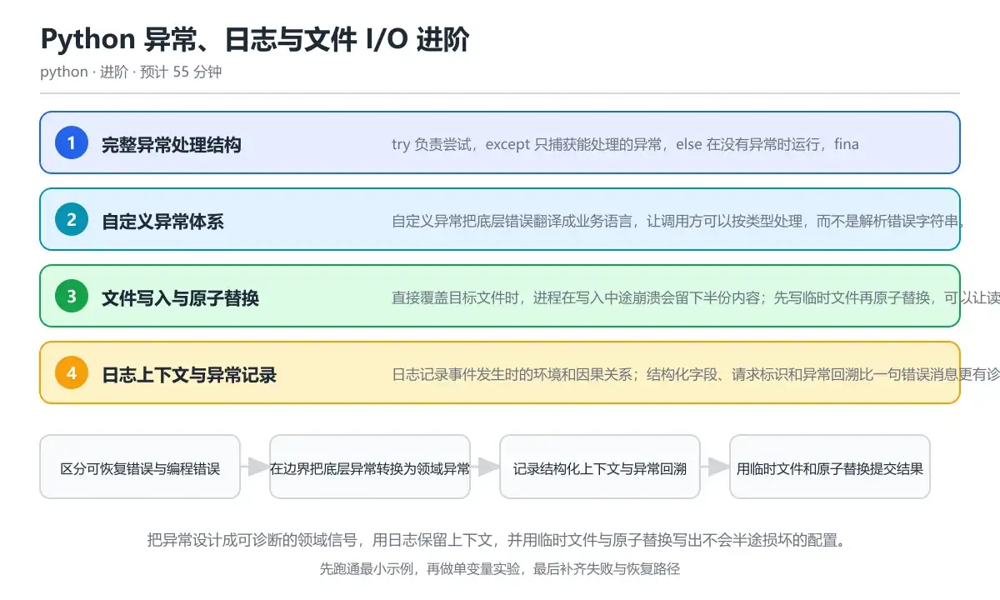
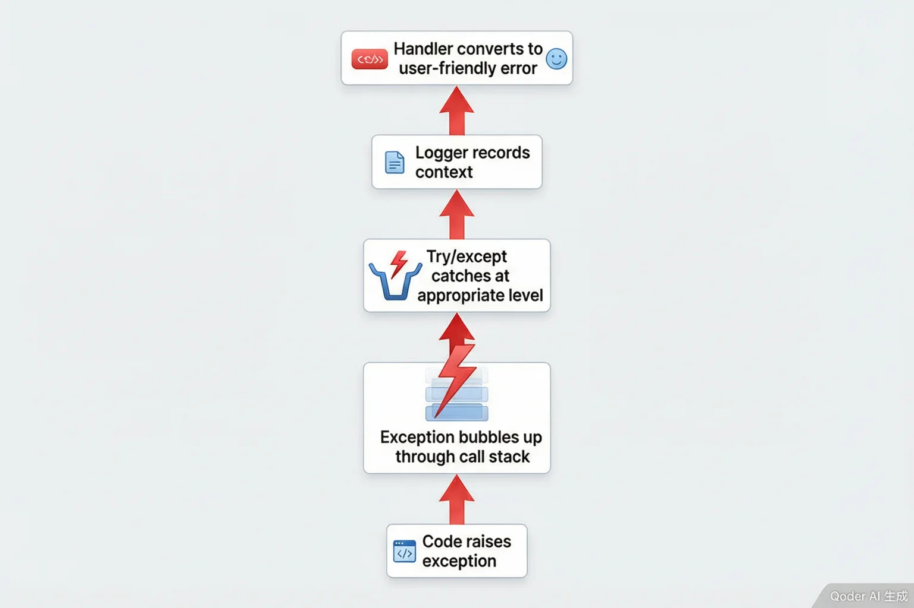

# Python 异常、日志与文件 I/O 进阶

> 内容更新时间：2026-10-06 · 学习阶段：进阶 · 预计用时：40 分钟

分类：python。关键词：异常链、自定义异常、日志、原子写、ExceptionGroup。把异常设计成可诊断的领域信号，用日志保留上下文，并用临时文件与原子替换写出不会半途损坏的配置。



## 本节知识框架

想象你开了一家餐厅。厨房里可能出各种状况——停水、断电、食材过期。你需要一套"应急手册"：谁负责处理什么问题、怎么记录事故、怎么保证端给客人的菜不会做了一半就上桌。本课教的正是这件事，只不过"厨房"换成了 Python 程序。

**课程定位**：所属分类 `python`（Python），课程主题 `Python 异常、日志与文件 I/O 进阶`，学习阶段 进阶，建议用时 45 分钟。

本课主线：把异常设计成可诊断的领域信号，用日志保留上下文，并用临时文件与原子替换写出不会半途损坏的配置。

**学完本课你能够做到**：
- 用自己的话解释"异常链"和"上下文管理器"是什么意思，并各举一个正确例子和一个错误例子。
- 运行本课的原子写入示例，记录输入、输出和失败条件。
- 遇到"程序吞掉了错误、什么提示都没有"这类问题时，能说出原因和修复步骤。

### 复习清单

- [ ] 能不看正文复述本课核心术语，并指出一个边界或反例。
- [ ] 能运行或推演本课示例，记录输入、输出与失败现象。
- [ ] 能完成一次自测，并把错题对照错误表定位原因。

## 核心概念定义

下面这张表就像一本"速查字典"。每个术语都有精确的定义和容易踩的坑。初学者可以先通读一遍，遇到不懂的再回来查。

| 术语 | 操作性定义 | 常见边界与风险 |
| --- | --- | --- |
| 异常链 | 通过 raise from 或隐式上下文把新异常与原始异常关联起来的因果结构。 | 易错：在《Python 异常、日志与文件 I/O 进阶》里采用「捕获底层异常后直接 raise ConfigError('失败')，原始回溯和原因全部消失」时，重新抛异常时丢失原因会表现为错误结果、异常中断或状态不一致；正确做法是使用 raise ConfigError('...') from exc 建立异常链。 |
| 上下文管理器 | 实现 __enter__ 与 __exit__ 的对象，可保证代码块结束后自动释放资源。 | 越界、悬垂引用与释放顺序会破坏结论，必须在边界输入下复验。 |
| 原子替换 | 通过重命名操作把完整的新文件一次性替换到目标路径，让读者看不到中间状态。 | 易错：在《Python 异常、日志与文件 I/O 进阶》里采用「打开目标文件反复写入，中途崩溃后留下不完整内容」时，直接覆盖重要文件会表现为错误结果、异常中断或状态不一致；正确做法是写临时文件并 fsync，成功后用 os.replace 原子替换，失败时清理临时文件。 |
| fsync | 要求操作系统把文件缓冲区写入持久存储的系统调用。 | 易错：在《Python 异常、日志与文件 I/O 进阶》里采用「打开目标文件反复写入，中途崩溃后留下不完整内容」时，直接覆盖重要文件会表现为错误结果、异常中断或状态不一致；正确做法是写临时文件并 fsync，成功后用 os.replace 原子替换，失败时清理临时文件。 |
| 领域异常 | 用业务语言描述失败原因的异常类型，通常由底层技术异常转换而来。 | 静态检查只在编译期成立，运行期输入仍需校验。 |
| ExceptionGroup | 把多个子异常打包在一起的异常类型，适合表示并发任务的部分失败。 | 共享状态与调度顺序会改变结论，单线程或串行测试通过不等于并发下成立。 |

## 原理与运行机制

### 机制总览

**教材衔接：核心知识**

### 1. 完整异常处理结构 —— 像餐厅的"应急四步法"

想象你在餐厅遇到一位过敏的客人。你的处理流程是：

1. **try（尝试）**：先看看能不能正常上菜。
2. **except（捕获）**：如果客人过敏了，只处理"过敏"这种情况——别把"客人觉得菜太咸"也当过敏处理。
3. **else（无异常时）**：如果一切顺利，记录"本次服务正常完成"。
4. **finally（无论如何）**：最后一定要清理桌面，不管刚才发生了什么。

异常会沿着调用栈向上传播，就像问题从服务员传到经理、再传到老板。除非中途有人"接住"了它。你可以用裸 `raise` 把异常原样丢给上级，也可以用 `raise 新异常 from 原异常` 建立一个"因果链"——就像在事故报告里写"这次停电是因为昨天的雷击"。

**EAFP vs LBYL**：EAFP（先做了再说，出了问题再处理）像先做菜再调整口味；LBYL（先检查再做）像做菜前先把所有食材检查一遍。Python 社区更偏爱 EAFP。

在 Python 异常、日志与文件 I/O 进阶里可以这样验证：读取配置时把文件不存在与 JSON 格式错误分别转换为领域异常，再用 from 保留原始回溯。

**边界**：捕获范围过宽会把编程错误也吞掉；except 块里的 return 会覆盖异常语义，finally 里的 return 甚至会吞掉未处理异常。

**工程视角**：只在能恢复或能补充上下文的地方捕获异常，边界层统一转换成对外错误，内部保留完整异常链。

### 2. 自定义异常体系 —— 用"业务语言"说错误

想象你叫了一辆网约车，司机告诉你"发动机控制单元第 3 号传感器信号异常"。你完全听不懂。但如果他说"车坏了，需要换一辆"，你就明白了。

自定义异常就是把底层的技术错误"翻译"成调用方能听懂的业务语言。领域模块定义统一根异常，再按失败原因派生子类；异常对象可以携带字段、错误码和原始输入，抛出时用 `from` 关联底层异常，既方便程序判断也方便人阅读。

在 Python 异常、日志与文件 I/O 进阶里可以这样验证：定义 ConfigError，把 FileNotFoundError 与 JSONDecodeError 都转换成该异常，同时在消息中保留路径。

**边界**：不要为每个小分支都建异常类，也不要滥用异常做正常流程控制；异常要能回答"发生了什么、在哪里、如何恢复"三个问题。

**工程视角**：异常层级作为模块公开接口的一部分，版本升级时保持兼容；上层只捕获真正理解的类型，其他异常继续向外传播。



### 3. 文件写入与原子替换 —— 像换菜单一样换文件

想象餐厅要更新菜单。如果你把旧菜单拿走，然后花 10 分钟手写新菜单，这 10 分钟里客人看到的是一张白纸。正确做法是：在后台写好新菜单，然后一瞬间把旧菜单替换掉。

直接覆盖目标文件时，进程在写入中途崩溃会留下半份内容；先写临时文件再原子替换，可以让读者只看到旧版本或新版本。

`tempfile.mkstemp` 在同一目录创建唯一临时文件，写入后 `flush` 并 `fsync` 落盘，再用 `os.replace` 原子替换目标；失败路径负责删除临时文件。

在 Python 异常、日志与文件 I/O 进阶里可以这样验证：实现 write_atomic 函数写入 JSON 配置，并在异常时清理临时文件，验证目标文件始终是合法 JSON。

**边界**：原子替换只能保证单机单文件语义，跨多个文件或分布式系统仍需事务或版本标记；fsync 会带来性能成本，要按数据重要性选择。

**工程视角**：配置、索引和状态文件使用原子写，临时文件与目标放在同一文件系统；为崩溃恢复写测试，而不只测试正常路径。

### 4. 日志上下文与异常记录 —— 像飞机的"黑匣子"

飞机出事后，调查员第一件事就是找黑匣子。黑匣子记录了飞行数据、对话、时间——这些"上下文"比一句"飞机坠毁了"有用得多。

日志记录事件发生时的环境和因果关系；结构化字段、请求标识和异常回溯比一句错误消息更有诊断价值。

`logger.exception` 在异常处理块中同时记录消息和回溯，`extra` 可以附加请求编号与用户标识，handler 决定输出位置，formatter 决定字段布局。

在 Python 异常、日志与文件 I/O 进阶里可以这样验证：在捕获异常后用 logger.exception 记录一次失败，并在结构化字段里带上配置路径，避免只打印一句"失败"的字符串。

**边界**：日志不能记录密码、令牌和完整个人信息；高频路径大量记录调试日志会带来磁盘与性能开销。

**工程视角**：日志级别按环境配置，关键事件带稳定字段名，错误日志附带可检索的请求标识与版本号。

### 5. ExceptionGroup 与 except* —— 像"批量订单的问题汇总"

想象餐厅同时接了 5 个外卖订单，其中 2 个出了问题：一个超时了，一个地址写错了。你可以分别报告这两个问题，也可以把它们打包成一份"问题汇总报告"。

并发任务可能同时产生多个错误，`ExceptionGroup` 把它们打包成一个异常，`except*` 星号语法可以按类型拆分处理。

`ExceptionGroup` 保存子异常列表和统一消息，`except*` 会匹配组内每个分支并重新组合未处理的异常；普通 `except` 只能整体捕获，无法分别处理不同子类型。

在 Python 异常、日志与文件 I/O 进阶里可以这样验证：用 ExceptionGroup 同时承载超时与格式错误，再用 except* 分别记录两类问题，观察剩余异常如何继续抛出。

**边界**：异常组适合天然并行的任务集合，不应为了炫技把互不相关的错误强行打包；异常组不能与普通 except 混用于同一 try 块。

**工程视角**：每个子任务在异常中带上任务标识，处理端按类别汇总并保证未处理异常不会被悄悄丢失。

**教材衔接：关键流程**

```text
区分可恢复错误与编程错误 → 在边界把底层异常转换为领域异常 → 记录结构化上下文与异常回溯 → 用临时文件和原子替换提交结果 → 为失败路径与部分成功补测试
```

1. 区分可恢复错误与编程错误
2. 在边界把底层异常转换为领域异常
3. 记录结构化上下文与异常回溯
4. 用临时文件和原子替换提交结果
5. 为失败路径与部分成功补测试

## 典型应用场景

### 场景 1：捕获后静默跳过 —— "鸵鸟式错误处理"

**比喻**：就像汽车仪表盘亮了故障灯，你直接把灯泡拧下来——问题确实"看不见"了，但发动机随时可能报废。

**典型现象**：在《Python 异常、日志与文件 I/O 进阶》里采用「写 except Exception: pass，把真正的程序错误和外部故障一起吞掉」时，捕获后静默跳过会表现为错误结果、异常中断或状态不一致。

**正确做法**：只捕获预期异常并记录上下文，其他异常继续向外传播。

### 场景 2：重新抛异常时丢失原因 —— "断了线的风筝"

**比喻**：你发现水管漏水，叫了维修工。维修工跟物业报告时只说"有问题"，却不说是哪根管子、在几楼。物业来了完全不知道该带什么工具。

**典型现象**：在《Python 异常、日志与文件 I/O 进阶》里采用「捕获底层异常后直接 raise ConfigError('失败')，原始回溯和原因全部消失」时，重新抛异常时丢失原因会表现为错误结果、异常中断或状态不一致。

**正确做法**：使用 raise ConfigError('...') from exc 建立异常链。

### 场景 3：直接覆盖重要文件 —— "边拆桥边修桥"

**比喻**：你要替换一座桥，如果先把旧桥拆了再建新桥，施工期间所有人都过不去。正确做法是在旁边建好新桥，然后一瞬间切换交通。

**典型现象**：在《Python 异常、日志与文件 I/O 进阶》里采用「打开目标文件反复写入，中途崩溃后留下不完整内容」时，直接覆盖重要文件会表现为错误结果、异常中断或状态不一致。

**正确做法**：写临时文件并 fsync，成功后用 os.replace 原子替换，失败时清理临时文件。

### 场景 4：日志泄露敏感信息 —— "在广场上喊密码"

**比喻**：就像在广场上拿着大喇叭喊"张三的密码是 123456，请确认"——所有人都听到了。日志一旦写出去，运维、监控系统、甚至日志聚合平台都能看到。

**典型现象**：在《Python 异常、日志与文件 I/O 进阶》里采用「把令牌、密码和完整身份证号写进日志，或在调试级别记录请求体全文」时，日志泄露敏感信息会表现为错误结果、异常中断或状态不一致。

**正确做法**：脱敏后再记录，使用稳定字段与摘要，敏感值只保留不可逆标识。

### 最小验证场景

- 准备：保留 `text` 示例的原始输入，先记录 `Python 异常、日志与文件 I/O 进阶` 的基线输出和完整运行命令。
- 判定：新结果与 `Python 异常、日志与文件 I/O 进阶` 的基线不同不等于错误；只有当差异破坏了 `异常链` 的定义或错误表中的约束，才判定为失败。

### 选择与边界

- 使用 `异常链` 时，先满足它的定义：通过 raise from 或隐式上下文把新异常与原始异常关联起来的因果结构；易错：在《Python 异常、日志与文件 I/O 进阶》里采用「捕获底层异常后直接 raise ConfigError('失败')，原始回溯和原因全部消失」时，重新抛异常时丢失原因会表现为错误结果、异常中断或状态不一致；正确做法是使用 raise ConfigError('...') from exc 建立异常链。
- 使用 `上下文管理器` 时，先满足它的定义：实现 __enter__ 与 __exit__ 的对象，可保证代码块结束后自动释放资源；越界、悬垂引用与释放顺序会破坏结论，必须在边界输入下复验。
- 使用 `原子替换` 时，先满足它的定义：通过重命名操作把完整的新文件一次性替换到目标路径，让读者看不到中间状态；易错：在《Python 异常、日志与文件 I/O 进阶》里采用「打开目标文件反复写入，中途崩溃后留下不完整内容」时，直接覆盖重要文件会表现为错误结果、异常中断或状态不一致；正确做法是写临时文件并 fsync，成功后用 os.replace 原子替换，失败时清理临时文件。
- 使用 `fsync` 时，先满足它的定义：要求操作系统把文件缓冲区写入持久存储的系统调用；易错：在《Python 异常、日志与文件 I/O 进阶》里采用「打开目标文件反复写入，中途崩溃后留下不完整内容」时，直接覆盖重要文件会表现为错误结果、异常中断或状态不一致；正确做法是写临时文件并 fsync，成功后用 os.replace 原子替换，失败时清理临时文件。
- 使用 `领域异常` 时，先满足它的定义：用业务语言描述失败原因的异常类型，通常由底层技术异常转换而来；静态检查只在编译期成立，运行期输入仍需校验。

## 代码/协议/SQL 示例

### 最小可验证示例

**教材衔接：原文最小示例**

先看一个最简单的异常链例子——就像在事故报告里写"这次故障的根本原因是XXX"：

```python
try:
    open('missing.json')
except FileNotFoundError as exc:
    try:
        raise RuntimeError('加载失败') from exc
    except RuntimeError as error:
        print(type(error.__cause__).__name__)
```

运行结果会输出 `FileNotFoundError`，因为 `from exc` 把原始的 `FileNotFoundError` 保存为了 `__cause__`。

接下来看一个完整的实战示例，把异常链、自定义异常、原子写入全部串起来：

```python
import json
import os
import tempfile
from pathlib import Path

class ConfigError(Exception):
    """配置读取失败的领域异常。"""

def load_config(path: Path):
    try:
        text = path.read_text(encoding="utf-8")
        return json.loads(text)
    except FileNotFoundError as exc:
        raise ConfigError(f"找不到配置文件: {path}") from exc
    except json.JSONDecodeError as exc:
        raise ConfigError(f"配置不是合法 JSON: {path}") from exc

def write_atomic(path: Path, payload: dict) -> None:
    path.parent.mkdir(parents=True, exist_ok=True)
    fd, temp_name = tempfile.mkstemp(dir=path.parent, prefix=path.name, suffix=".tmp")
    try:
        with os.fdopen(fd, "w", encoding="utf-8") as handle:
            json.dump(payload, handle, ensure_ascii=False)
            handle.flush()
            os.fsync(handle.fileno())
        os.replace(temp_name, path)
    except BaseException:
        Path(temp_name).unlink(missing_ok=True)
        raise

target = Path("demo_config.json")
write_atomic(target, {"name": "学习助手", "version": 2})
print("写入成功:", load_config(target))
try:
    load_config(Path("missing.json"))
except ConfigError as exc:
    print("领域异常:", type(exc).__name__, "原因:", type(exc.__cause__).__name__)
```

**逐行解读**：
- `ConfigError` 是我们的"领域异常"——用业务语言说"配置出问题了"。
- `load_config` 里用 `from exc` 保留原始异常，这样调试时能看到完整的因果链。
- `write_atomic` 先写临时文件，`fsync` 确保数据落盘，最后用 `os.replace` 一步到位替换。如果中途出错，`except BaseException` 负责清理临时文件。

## 时间/空间复杂度或性能分析

**性能关注点（Python 异常、日志与文件 I/O 进阶）**：解释执行与对象分配是主要成本：记录执行时间、内存峰值与 GC 次数，必要时对比其他实现。

**本课特有开销（Python 异常、日志与文件 I/O 进阶 · 异常链）**：小文件看元数据开销，大文件看吞吐，两者要分别测量。

**测量方法**：以 `Python 异常、日志与文件 I/O 进阶` 的 `异常链` 场景为对象，固定输入跑一遍记录基线，再把规模或并发度提高一个数量级复测；两次结果的差值与波动范围才是结论依据。

## 常见误区与易错点

| 容易写错的做法 | 实际现象 | 原因与正确做法 |
| --- | --- | --- |
| 捕获后静默跳过 | 在《Python 异常、日志与文件 I/O 进阶》里采用「写 except Exception: pass，把真正的程序错误和外部故障一起吞掉」时，捕获后静默跳过会表现为错误结果、异常中断或状态不一致。 | 只捕获预期异常并记录上下文，其他异常继续向外传播 |
| 重新抛异常时丢失原因 | 在《Python 异常、日志与文件 I/O 进阶》里采用「捕获底层异常后直接 raise ConfigError('失败')，原始回溯和原因全部消失」时，重新抛异常时丢失原因会表现为错误结果、异常中断或状态不一致。 | 使用 raise ConfigError('...') from exc 建立异常链 |
| 直接覆盖重要文件 | 在《Python 异常、日志与文件 I/O 进阶》里采用「打开目标文件反复写入，中途崩溃后留下不完整内容」时，直接覆盖重要文件会表现为错误结果、异常中断或状态不一致。 | 写临时文件并 fsync，成功后用 os.replace 原子替换，失败时清理临时文件 |
| 日志泄露敏感信息 | 在《Python 异常、日志与文件 I/O 进阶》里采用「把令牌、密码和完整身份证号写进日志，或在调试级别记录请求体全文」时，日志泄露敏感信息会表现为错误结果、异常中断或状态不一致。 | 脱敏后再记录，使用稳定字段与摘要，敏感值只保留不可逆标识 |

### 现场 1：捕获后静默跳过

**症状**：在《Python 异常、日志与文件 I/O 进阶》里采用「写 except Exception: pass，把真正的程序错误和外部故障一起吞掉」时，捕获后静默跳过会表现为错误结果、异常中断或状态不一致。

**根因与修复**：只捕获预期异常并记录上下文，其他异常继续向外传播。

**自检**：在本课示例里复现「捕获后静默跳过」，改成只捕获预期异常并记录上下文，其他异常继续向外传播后重跑；如果症状消失且失败路径按预期变化，说明定位正确。

### 现场 2：重新抛异常时丢失原因

**症状**：在《Python 异常、日志与文件 I/O 进阶》里采用「捕获底层异常后直接 raise ConfigError('失败')，原始回溯和原因全部消失」时，重新抛异常时丢失原因会表现为错误结果、异常中断或状态不一致。

**根因与修复**：使用 raise ConfigError('...') from exc 建立异常链。

**自检**：在本课示例里复现「重新抛异常时丢失原因」，改成使用 raise ConfigError('...') from exc 建立异常链后重跑；如果症状消失且失败路径按预期变化，说明定位正确。

### 现场 3：直接覆盖重要文件

**症状**：在《Python 异常、日志与文件 I/O 进阶》里采用「打开目标文件反复写入，中途崩溃后留下不完整内容」时，直接覆盖重要文件会表现为错误结果、异常中断或状态不一致。

**根因与修复**：写临时文件并 fsync，成功后用 os.replace 原子替换，失败时清理临时文件。

**自检**：在本课示例里复现「直接覆盖重要文件」，改成写临时文件并 fsync，成功后用 os.replace 原子替换，失败时清理临时文件后重跑；如果症状消失且失败路径按预期变化，说明定位正确。

### 现场 4：日志泄露敏感信息

**症状**：在《Python 异常、日志与文件 I/O 进阶》里采用「把令牌、密码和完整身份证号写进日志，或在调试级别记录请求体全文」时，日志泄露敏感信息会表现为错误结果、异常中断或状态不一致。

**根因与修复**：脱敏后再记录，使用稳定字段与摘要，敏感值只保留不可逆标识。

**自检**：在本课示例里复现「日志泄露敏感信息」，改成脱敏后再记录，使用稳定字段与摘要，敏感值只保留不可逆标识后重跑；如果症状消失且失败路径按预期变化，说明定位正确。

## 与其他知识点的关系

**教材衔接：复习与迁移**

## 自测题与参考答案

> 先独立作答，再对照参考答案；答案都能在本课正文、术语表或错误表里找到依据。

### 自测 1（概念复述）

不看正文，写出 `异常链` 的操作性定义，并说明它与 `上下文管理器` 的区别。

**参考答案**：通过 raise from 或隐式上下文把新异常与原始异常关联起来的因果结构。

`上下文管理器` 的定位是：实现 __enter__ 与 __exit__ 的对象，可保证代码块结束后自动释放资源；两者的差别要从适用对象与失败模式上说明。

### 自测 2（排错）

本课错误表记录了「捕获后静默跳过」这类做法。请写出它会出现的现象、根因，以及修复顺序。

**参考答案**：现象是在《Python 异常、日志与文件 I/O 进阶》里采用「写 except Exception: pass，把真正的程序错误和外部故障一起吞掉」时，捕获后静默跳过会表现为错误结果、异常中断或状态不一致；正确做法是只捕获预期异常并记录上下文，其他异常继续向外传播。修复时先复现现象并保留证据，再改动一处假设重跑，确认现象消失。

### 自测 3（动手验证）

运行本课的 `text` 示例，改动其中一个输入后重新运行，记录输出与错误信息。

**参考答案**：正常输入下 `text` 示例应当复现正文给出的结果；改动输入后，如果结果改变或报错，先核对它是否满足 `Python 异常、日志与文件 I/O 进阶` 中`异常链` 的适用范围，再检查错误表里是否有同类现象。

### 自测 4（代码阅读）

阅读本课开头的 `text` 示例，说明它体现了`异常链` 的哪一条性质，并指出改动哪个输入会让这条性质不再成立。

**参考答案**：`异常链` 的定义是 通过 raise from 或隐式上下文把新异常与原始异常关联起来的因果结构，示例正是在实现这条定义。改动与 `异常链` 有关的一个输入后，如果结果不再符合 `Python 异常、日志与文件 I/O 进阶` 的正文描述，就说明该性质只在当前前提成立。

### 自测 5（迁移）

把 `Python 异常、日志与文件 I/O 进阶` 的方法迁移到自己的项目：围绕 `异常链` 写出一个与错误表同类的风险点，并说明触发条件和检验方式。

**参考答案**：例如「日志泄露敏感信息」，它会导致在《Python 异常、日志与文件 I/O 进阶》里采用「把令牌、密码和完整身份证号写进日志，或在调试级别记录请求体全文」时，日志泄露敏感信息会表现为错误结果、异常中断或状态不一致；检验方式是按脱敏后再记录，使用稳定字段与摘要，敏感值只保留不可逆标识改一处再复现，确认现象消失且没有引入新的失败分支。

### 自测 6（对比）

用一个表格对比 `异常链` 与 `上下文管理器`：各写一行适用场景、一行失败表现。

**参考答案**：`异常链` 的定义是通过 raise from 或隐式上下文把新异常与原始异常关联起来的因果结构；`上下文管理器` 的定义是实现 __enter__ 与 __exit__ 的对象，可保证代码块结束后自动释放资源。两者的失败表现分别对应本课错误表里与本术语相关的行。

### 自测 7（排错顺序）

面对「捕获后静默跳过」引发的问题，请把"复现 在《Python 异常、日志与文件 I/O 进阶》里采用「写 except Exception: pass，把真正的程序错误和外部故障一起吞掉」时，捕获后静默跳过会表现为错误结果、异常中断或状态不一致 → 保留证据 → 只捕获预期异常并记录上下文，其他异常继续向外传播 → 回归验证"四步写成可执行的检查清单。

**参考答案**：第一步按在《Python 异常、日志与文件 I/O 进阶》里采用「写 except Exception: pass，把真正的程序错误和外部故障一起吞掉」时，捕获后静默跳过会表现为错误结果、异常中断或状态不一致复现；第二步记录输入、版本与完整报错；第三步按只捕获预期异常并记录上下文，其他异常继续向外传播只改一处；第四步重跑并确认失败路径也按预期变化。

### 自测 8（边界判断）

针对 `ExceptionGroup`，分别写出"可以使用"的条件和"结论不再成立"的条件。

**参考答案**：共享状态与调度顺序会改变结论，单线程或串行测试通过不等于并发下成立。 同时要把 `ExceptionGroup` 的定义 把多个子异常打包在一起的异常类型，适合表示并发任务的部分失败 与实际输入逐项对照。

### 自测 9（机制重建）

不看正文，按输入、转换、输出、验证四段重建 `异常链` → `上下文管理器` → `原子替换` → `fsync` 的作用链。

**参考答案**：起点是 `异常链` 的定义 通过 raise from 或隐式上下文把新异常与原始异常关联起来的因果结构；中间每一步都保留可观察状态；终点由 `ExceptionGroup` 检查，失败时回到错误表定位第一个偏离定义的步骤。

### 自测 10（综合排错）

在 `Python 异常、日志与文件 I/O 进阶` 中，现象是 在《Python 异常、日志与文件 I/O 进阶》里采用「把令牌、密码和完整身份证号写进日志，或在调试级别记录请求体全文」时，日志泄露敏感信息会表现为错误结果、异常中断或状态不一致。请围绕 日志泄露敏感信息 写出最小复现、关键证据、修复动作和回归验证，并说明为什么不能只凭一次运行下结论。

**参考答案**：先复现 日志泄露敏感信息，记录输入与完整错误；再按 脱敏后再记录，使用稳定字段与摘要，敏感值只保留不可逆标识 只改一处。回归时同时跑正常路径和边界路径，只有两次结果都可解释，才把修复视为完成。

### 自测 11（一分钟复述）

用每分钟约 200 字的速度复述 `Python 异常、日志与文件 I/O 进阶`：先给主问题，再按顺序说出 `异常链`、`上下文管理器`、`原子替换`、`fsync`，最后给一个失败案例。

**自评标准**：主问题必须对应 把异常设计成可诊断的领域信号，用日志保留上下文，并用临时文件与原子替换写出不会半途损坏的配置；每个术语都要能接上一句定义或边界；失败案例必须写成可观察现象，不能用"可能有风险"代替证据。

## 延伸阅读

想更直观地理解本课概念？推荐参阅以下图解专题：

- [图解调用栈与递归](visual_call_stack.md)

## 术语速查

| 术语 | 一句话说明 |
| --- | --- |
| `异常链` | 通过 raise from 或隐式上下文把新异常与原始异常关联起来的因果结构。 |
| `上下文管理器` | 实现 __enter__ 与 __exit__ 的对象，可保证代码块结束后自动释放资源。 |
| `原子替换` | 通过重命名操作把完整的新文件一次性替换到目标路径，让读者看不到中间状态。 |
| `fsync` | 要求操作系统把文件缓冲区写入持久存储的系统调用。 |
| `领域异常` | 用业务语言描述失败原因的异常类型，通常由底层技术异常转换而来。 |
| `ExceptionGroup` | 把多个子异常打包在一起的异常类型，适合表示并发任务的部分失败。 |

**术语关系**：`异常链`（通过 raise from 或隐式上下文把新异常与原始异常关联起来的因果结构） → `上下文管理器`（实现 __enter__ 与 __exit__ 的对象） → `原子替换`（通过重命名操作把完整的新文件一次性替换到目标路径） → `fsync`（要求操作系统把文件缓冲区写入持久存储的系统调用）。

## 考点精讲

`Python 异常、日志与文件 I/O 进阶` 的题库有 5 道题，下面逐题给出题干、正确项与判断依据：先自己作答，再核对正确项，最后回到正文对应小节复核。

### 考点 1：第 1 题

- **题目**：raise ConfigError('找不到配置') from exc 的作用是什么？
- **正确项**：把原始异常保存为 __cause__，异常链保留完整因果
- **判断依据**：本题正确项是把原始异常保存为 __cause__，异常链保留完整因果。术语 异常链（Python 异常、日志与文件 I/O 进阶）：通过 raise from 或隐式上下文把新异常与原始异常关联起来的因果结构，本题取把原始异常保存为 __cause__，异常链保留完整因果这条。易错点是在《Python 异常、日志与文件 I/O 进阶》里的典型做法是写 except Exception: pass，把真正的程序错误和外部故障一起吞掉，这样捕获后静默跳过会表现为结果错误、异常中断或状态不一致，改法是只捕获预期异常并记录上下文，其他异常继续向外传播，干扰项隐藏所有异常信息正踩在这条上。

### 考点 2：第 2 题

- **题目**：为什么写入重要配置时先写临时文件再 os.replace？
- **正确项**：读者只会看到完整的旧版本或新版本，不会读到半写内容
- **判断依据**：本题正确项是读者只会看到完整的旧版本或新版本，不会读到半写内容。术语 异常链（Python 异常、日志与文件 I/O 进阶）：通过 raise from 或隐式上下文把新异常与原始异常关联起来的因果结构，本题取读者只会看到完整的旧版本或新版本，不会读到半写内容这条。易错点是在《Python 异常、日志与文件 I/O 进阶》里的典型做法是写 except Exception: pass，把真正的程序错误和外部故障一起吞掉，这样捕获后静默跳过会表现为结果错误、异常中断或状态不一致，改法是只捕获预期异常并记录上下文，其他异常继续向外传播，干扰项临时文件写入速度总是更快正踩在这条上。

### 考点 3：第 3 题

- **题目**：日志中应该避免出现哪些内容？（多选）
- **正确项**：用户密码与访问令牌；完整身份证号或银行卡号；未脱敏的完整请求体
- **判断依据**：本题正确项是用户密码与访问令牌。术语 异常链（Python 异常、日志与文件 I/O 进阶）：通过 raise from 或隐式上下文把新异常与原始异常关联起来的因果结构，本题取用户密码与访问令牌这条。易错点是在《Python 异常、日志与文件 I/O 进阶》里的典型做法是写 except Exception: pass，把真正的程序错误和外部故障一起吞掉，这样捕获后静默跳过会表现为结果错误、异常中断或状态不一致，改法是只捕获预期异常并记录上下文，其他异常继续向外传播，干扰项完整身份证号或银行卡号正踩在这条上。

### 考点 4：第 4 题

- **题目**：阅读代码，输出中 __cause__ 的类型是什么？  try:     open('missing.json') except FileNotFoundError as exc:     try:         raise RuntimeError('加载失败') from exc     except RuntimeError as error:         print(type(error.__cause__).__name__)
- **正确项**：FileNotFoundError
- **判断依据**：本题正确项是FileNotFoundError。术语 异常链（Python 异常、日志与文件 I/O 进阶）：通过 raise from 或隐式上下文把新异常与原始异常关联起来的因果结构，本题取FileNotFoundError这条。易错点是在《Python 异常、日志与文件 I/O 进阶》里的典型做法是写 except Exception: pass，把真正的程序错误和外部故障一起吞掉，这样捕获后静默跳过会表现为结果错误、异常中断或状态不一致，改法是只捕获预期异常并记录上下文，其他异常继续向外传播，干扰项RuntimeError正踩在这条上。

### 考点 5：第 5 题

- **题目**：下面异常处理有什么缺陷？  try:     value = int(text) except Exception:     pass
- **正确项**：捕获范围过宽且静默忽略，会掩盖输入错误和真正的程序缺陷
- **判断依据**：本题正确项是捕获范围过宽且静默忽略，会掩盖输入错误和真正的程序缺陷。术语 异常链（Python 异常、日志与文件 I/O 进阶）：通过 raise from 或隐式上下文把新异常与原始异常关联起来的因果结构，本题取捕获范围过宽且静默忽略，会掩盖输入错误和真正的程序缺陷这条。易错点是在《Python 异常、日志与文件 I/O 进阶》里的典型做法是写 except Exception: pass，把真正的程序错误和外部故障一起吞掉，这样捕获后静默跳过会表现为结果错误、异常中断或状态不一致，改法是只捕获预期异常并记录上下文，其他异常继续向外传播，干扰项int 不能转换字符串正踩在这条上。

### 考点 6：`异常链`

- **要点**：通过 raise from 或隐式上下文把新异常与原始异常关联起来的因果结构。
- **异常链 的边界**：易错：在《Python 异常、日志与文件 I/O 进阶》里采用「捕获底层异常后直接 raise ConfigError('失败')，原始回溯和原因全部消失」时，重新抛异常时丢失原因会表现为错误结果、异常中断或状态不一致；正确做法是使用 raise ConfigError('...') from exc 建立异常链。

### 考点 7：`上下文管理器`

- **要点**：实现 __enter__ 与 __exit__ 的对象，可保证代码块结束后自动释放资源。
- **上下文管理器 的边界**：越界、悬垂引用与释放顺序会破坏结论，必须在边界输入下复验。

### 考点 8：`原子替换`

- **要点**：通过重命名操作把完整的新文件一次性替换到目标路径，让读者看不到中间状态。
- **原子替换 的边界**：易错：在《Python 异常、日志与文件 I/O 进阶》里采用「打开目标文件反复写入，中途崩溃后留下不完整内容」时，直接覆盖重要文件会表现为错误结果、异常中断或状态不一致；正确做法是写临时文件并 fsync，成功后用 os.replace 原子替换，失败时清理临时文件。

### 考点 9：`fsync`

- **要点**：要求操作系统把文件缓冲区写入持久存储的系统调用。
- **fsync 的边界**：易错：在《Python 异常、日志与文件 I/O 进阶》里采用「打开目标文件反复写入，中途崩溃后留下不完整内容」时，直接覆盖重要文件会表现为错误结果、异常中断或状态不一致；正确做法是写临时文件并 fsync，成功后用 os.replace 原子替换，失败时清理临时文件。

### 考点 10：`领域异常`

- **要点**：用业务语言描述失败原因的异常类型，通常由底层技术异常转换而来。
- **领域异常 的边界**：静态检查只在编译期成立，运行期输入仍需校验。

### 考点 11：`ExceptionGroup`

- **要点**：把多个子异常打包在一起的异常类型，适合表示并发任务的部分失败。
- **ExceptionGroup 的边界**：共享状态与调度顺序会改变结论，单线程或串行测试通过不等于并发下成立。

### 考点 12：排错——捕获后静默跳过

- **现象**：在《Python 异常、日志与文件 I/O 进阶》里采用「写 except Exception: pass，把真正的程序错误和外部故障一起吞掉」时，捕获后静默跳过会表现为错误结果、异常中断或状态不一致。
- **处理**：只捕获预期异常并记录上下文，其他异常继续向外传播。

### 考点 13：排错——重新抛异常时丢失原因

- **现象**：在《Python 异常、日志与文件 I/O 进阶》里采用「捕获底层异常后直接 raise ConfigError('失败')，原始回溯和原因全部消失」时，重新抛异常时丢失原因会表现为错误结果、异常中断或状态不一致。
- **处理**：使用 raise ConfigError('...') from exc 建立异常链。

### 考点 14：综合辨析——`异常链` 与 `ExceptionGroup`

- **辨析点**：`异常链` 的定义是 通过 raise from 或隐式上下文把新异常与原始异常关联起来的因果结构；`ExceptionGroup` 的定义是 把多个子异常打包在一起的异常类型，适合表示并发任务的部分失败。
- **答题要求**：面对 `Python 异常、日志与文件 I/O 进阶` 的题目，先判断描述的是 `异常链` 还是 `ExceptionGroup`，再归到对应定义，最后写出一个会让该定义失效的边界输入。

### 考点 15：排错评分点

- **现象分**：能写出 在《Python 异常、日志与文件 I/O 进阶》里采用「写 except Exception: pass，把真正的程序错误和外部故障一起吞掉」时，捕获后静默跳过会表现为错误结果、异常中断或状态不一致，而不是只写"程序有错"。
- **证据分**：保留触发 捕获后静默跳过 的输入、版本和错误原文。
- **修复分**：按 只捕获预期异常并记录上下文，其他异常继续向外传播 只改一处，并同时回归正常路径与边界路径。

## 内容元数据

- 内容版本：v2.0
- 最后更新：2026-10-06
- 学习阶段：进阶

| 字段 | 值 |
| --- | --- |
| 课程 ID | `python_errors_logging_files` |
| 所属分类 | `python` |
| 难度 | 进阶 |
| 预计用时 | 55 分钟 |
| 关键词 | 异常链、自定义异常、日志、原子写、ExceptionGroup |
| 配图 | `images/lesson_python_errors_logging_files.webp` |
| 参考资料 | 6 条 |
| 内容更新时间 | 2026-10-06 |

## 参考资料与复核

- [本课资料锚点 python_errors_logging_files](https://zh.wikipedia.org/w/index.php?search=python_errors_logging_files)

- 来源性质：官方文档、标准或权威教材；本课核对关键词：异常链、自定义异常、日志、原子写、ExceptionGroup。
- 最后复核：2026-10-04
- 下次复核：2026-11-10
- 复核范围：版本兼容、API 行为与工程实践

下面列出的资料用于核对本课结论，复习时可以对照阅读：
- [Python 错误与异常教程](https://docs.python.org/3/tutorial/errors.html)
- [Python logging 使用手册](https://docs.python.org/3/howto/logging.html)
- [PEP 654：Exception Groups](https://peps.python.org/pep-0654/)
- [Python os.replace 文档](https://docs.python.org/3/library/os.html#os.replace)
- [Python with 语句与上下文管理器](https://docs.python.org/3/reference/compound_stmts.html#with)
- [Python tempfile 模块文档](https://docs.python.org/3/library/tempfile.html)

| [本课术语索引：Python 异常、日志与文件 I/O 进阶](#核心概念定义) | 按本课输入、术语边界和错误表现逐项核对 |
> 复核提示：《Python 异常、日志与文件 I/O 进阶》的结论如与资料冲突，以资料中的规范文本为准，并在笔记里记录差异与日期。
