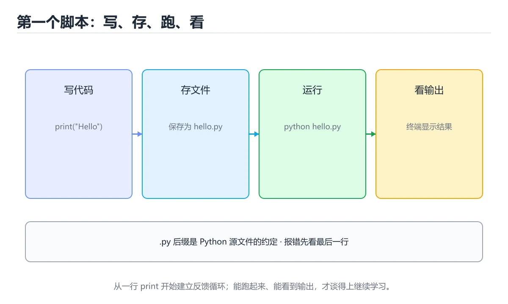

# Python 第一个脚本

> 内容更新时间：2026-10-06 · 学习阶段：入门 · 预计用时：25 分钟




## 本节知识框架

今天的目标很简单：**写一个 Python 文件，运行它，看到屏幕上出现你写的文字。**

学完这一课，你会：
- 知道 Python 是什么、解释器是什么
- 会创建 `.py` 文件并用命令行运行它
- 能用 `print()` 让屏幕显示内容
- 遇到常见报错时知道怎么修

**先修与衔接**：本课是 Python 分类的第 1 课，不需要任何编程基础。下一课：《Python 输入与输出》。

### 复习清单

- [ ] 能独立创建一个 `.py` 文件并运行它
- [ ] 能用 `print()` 输出文字和计算结果
- [ ] 能看懂 `SyntaxError` 并修好引号问题

## 核心概念定义

先认识几个名词，后面会反复遇到：

| 术语 | 一句话说明 |
| --- | --- |
| Python | 一种编程语言，写法接近英语，适合入门。你用键盘写的文字、做的计算，它都能处理。 |
| 解释器 | 帮你"翻译"并运行 Python 代码的程序。在命令行输入 `python` 就能启动它。 |
| 脚本文件 | 以 `.py` 结尾的文本文件，里面写着你让 Python 执行的命令。 |
| print | Python 内置的命令，作用是把内容显示到屏幕上。学编程的第一行代码几乎总是它。 |
| 缩进 | Python 用行首的空格来表示代码的层级关系。同一层代码必须对齐，否则报错。 |
| 虚拟环境 | 给每个项目创建一个独立的 Python 空间，避免不同项目的依赖互相冲突。初学阶段可以先不管它。 |

## 原理与运行机制

### 你的代码是怎么跑起来的

```text
你写的代码（hello.py）
    ↓
解释器读取文件，从上到下一行行执行
    ↓
遇到 print() → 把内容送到屏幕
    ↓
你看到输出结果
```

整个过程就像你把一张便条交给厨师：你写"先洗菜、再切菜、最后下锅"，厨师就照顺序做一遍。解释器就是那个厨师，它按顺序读你的代码，一行行执行。

### 为什么用缩进而不用大括号

很多语言用 `{}` 表示代码块，Python 选择了缩进。好处是代码天然整齐，坏处是少一个空格就会报错。习惯就好——用 4 个空格作为一级缩进，保持统一就行。

### 变量就是贴了标签的盒子

```python
name = "小明"
```

这行的意思是：创建一个字符串 `"小明"`，给它贴上 `name` 这个标签。之后你用 `name`，Python 就知道你在说 `"小明"`。等号 `=` 在这里读作"把右边装进左边的盒子"，不是数学里的"相等"。

### 字符串拼接：把两段文字连起来

```python
greeting = "你好，"
name = "小明"
print(greeting + name)  # 输出：你好，小明
```

用 `+` 可以把两个字符串首尾相连。这在需要动态组合输出时非常有用——比如欢迎信息里包含用户的名字。

### 数字也能 print

```python
print(1 + 2)      # 输出：3
print(10 * 5)     # 输出：50
print(10 / 3)     # 输出：3.3333333333333335
```

`print` 不仅能输出文字，还能直接输出计算结果。Python 支持加减乘除，写法跟数学差不多。

### 注释：写给自己和别人看的笔记

```python
# 这行是注释，Python 会跳过它
print("这行会执行")  # 这行末尾的注释也会被跳过
```

以 `#` 开头的文字是注释，用来解释代码在做什么。好的注释能帮你在一周后回头看代码时快速理解当时的思路。

## 典型应用场景

Python 脚本能做很多事情，这里列几个初学者马上能用的：

- **自动化重复操作**：批量重命名文件、整理下载文件夹、把一堆照片按日期归类
- **数据处理**：读取 CSV 表格，统计某列数据的总和、找出最大值
- **写小工具**：计算器、密码生成器、倒计时提醒、单位转换器
- **爬虫入门**：从网页抓取天气、新闻标题、商品价格
- **文本处理**：统计文章字数、替换敏感信息、提取邮件地址

这些都不需要复杂的基础，学完前几课就能开始做。

### 一个实际的小例子

假设你想把一段文字重复打印 5 次：

```python
for i in range(5):
    print("Python 真有趣！")
```

`for` 是循环语句，`range(5)` 生成 0 到 4 共 5 个数字，每次循环 `print` 执行一次。注意 `print` 前面有 4 个空格的缩进——这告诉 Python 这行代码属于循环体。

## 代码/协议/SQL 示例

### 最小可运行示例

```python
print("hello from Python")
```

运行方式：把这段代码保存为 `hello.py`，在终端执行：

```bash
python hello.py
```

输出：

```text
hello from Python
```

### 完整示例：打招呼

```python
# 把这一行保存成 hello.py，然后在终端执行：python hello.py
print("你好，Python")

name = "小明"
print("欢迎，" + name)
```

逐行解释：

- `# 把这一行保存成...`：以 `#` 开头的是注释，写给人看的，Python 会跳过。
- `print("你好，Python")`：调用 `print` 把引号里的文字原样输出到屏幕，末尾自动换行。
- `name = "小明"`：把字符串 `"小明"` 存进变量 `name`。
- `print("欢迎，" + name)`：用 `+` 把两段文字拼起来，再输出。屏幕上会出现 `欢迎，小明`。

### 运行过程

1. 打开终端，进入脚本所在目录
2. 输入 `python hello.py`，回车
3. 第一行 `print` 执行 → 屏幕显示 `你好，Python`
4. 第二行赋值 → 内存里多了一个 `name`，屏幕无变化
5. 第三行拼接并输出 → 屏幕显示 `欢迎，小明`

### 动手练一练

- 把 `"小明"` 换成你自己的名字，保存后重新运行，确认输出跟着变
- 新加一行 `print(1 + 2)`，先在心里算结果再看屏幕——`print` 既能输出文字也能输出计算结果
- 故意删掉一个右引号，运行一次，把完整的报错信息抄下来

### 本课速查卡

| 复习项 | 本课要点 |
| --- | --- |
| 核心结论 | Python 脚本就是 `.py` 文件，从上往下执行；`print()` 把结果显示到屏幕 |
| 最少要写的代码 | `print("你好，Python")` |
| 运行方式 | 保存为 `.py` 文件，终端输入 `python 文件名.py` |
| 最常见的错误 | 文件后缀写成 `.txt`；引号只用一半；用了中文全角引号 |
| 出错先查什么 | 读第一条报错信息，回到最小示例只改一个地方 |
| 怎么确认学会了 | 把文字换成自己的名字，重新运行，输出跟着变 |
| 接下来做什么 | 合上教程，凭记忆把最小代码重写一遍再运行 |

## 时间/空间复杂度或性能分析

第一课的代码只有一行 `print`，暂时不需要关心性能。

等你写到处理大文件或循环几万次时，再回来关注：
- **时间**：代码跑了多久？用 `time` 模块可以测量
- **内存**：占了多少内存？列表装 100 万条数据时会明显增加

现在记住一点就好：**先让代码跑对，再让它跑快。**

## 常见误区与易错点

| 容易犯的错误 | 会出现什么 | 怎么修 |
| --- | --- | --- |
| 文件存成 `hello.txt` | 终端报「找不到文件」 | 确认后缀是 `.py`，不是 `.txt` |
| 引号只用一半 `print("你好)` | 报 `SyntaxError: EOL while scanning string literal` | 补上缺失的右引号 |
| 用了中文引号 `"你好"` | 报 `SyntaxError` | 切换到英文输入法，用半角引号 `""` |
| `Name` 和 `name` 混用 | 报 `NameError: name 'Name' is not defined` | Python 区分大小写，统一用同一个名字 |
| 在编辑器里改了代码没保存 | 运行的还是旧版本 | 运行前先按 Ctrl+S 保存 |

### 遇到报错怎么办

1. **读第一行报错信息**——它会告诉你错在哪一行、什么类型的错
2. **回到最小示例**——先确认最小示例能跑通
3. **只改一个地方**——每次只改一处，再运行看结果
4. **搜索报错信息**——把报错信息复制到搜索引擎，通常第一条结果就是答案

## 与其他知识点的关系

本课学到的东西会被后面每一课反复用到：

- **下一课《Python 输入与输出》**：你会学到 `input()` 让用户输入内容，以及更灵活的输出格式
- **《Python 变量与类型》**：深入讲解变量、字符串、数字等数据类型
- **《Python 条件判断》**：学会用 `if/else` 让代码做选择

现在你只需要记住一件事：**Python 脚本就是一个 `.py` 文件，从上往下执行，`print()` 让你看到结果。**

## 自测题与参考答案

> 先独立作答，再对照答案。

### 自测 1

把代码保存为 `hello.py` 后，在命令行运行它的正确方式是？

**答案**：执行 `python hello.py`，由解释器读取并运行脚本。

### 自测 2

`print("hello from Python")` 这行代码执行后，屏幕上会出现什么？

**答案**：`hello from Python`

### 自测 3

填空：`____`：把内容输出到屏幕，是 Python 中最常用的内置函数。

**答案**：print

### 自测 4

填空：`____`：一种解释型编程语言，用缩进划分代码块。

**答案**：Python

### 自测 5

运行 `print(1 + 2)` 后，屏幕上显示什么？

**答案**：`3`。`print` 会先计算括号里的表达式，再输出结果。

## 术语速查

| 术语 | 一句话说明 |
| --- | --- |
| `Python` | 一种编程语言，写法接近英语，适合入门 |
| `解释器` | 读取并运行 Python 代码的程序，命令行输入 `python` 启动 |
| `脚本文件` | 以 `.py` 结尾的文本文件，保存你的代码 |
| `print` | 把内容显示到屏幕上的内置命令 |
| `缩进` | 用行首空格表示代码层级，同一层必须对齐 |
| `虚拟环境` | 给项目创建独立的 Python 空间，初学可先不管 |

## 考点精讲

`Python 第一个脚本` 的题库有 5 道题，下面逐题给出题干、正确项与判断依据：先自己作答，再核对正确项，最后回到正文对应小节复核。

### 考点 1：第 1 题

- **题目**：围绕“Python 第一个脚本”中的 Python 第一个脚本、Python、入门练习，下列哪两项是本课强调的实践判断？
- **正确项**：学习 Python 第一个脚本时要同时说明输入、输出和失败路径，不能只看正常流程；验证 Python 时要固定版本并覆盖边界输入，结论才可复现
- **判断依据**：这道题落在术语 `Python` 上：一种解释型通用编程语言，用缩进划分代码块，标准库覆盖面广。编程不只是写对代码，还要知道错了会怎样、怎么修。

### 考点 2：第 2 题

- **题目**：把代码保存为 hello.py 后，在命令行运行它的正确方式是？
- **正确项**：执行 python hello.py，由解释器读取并运行脚本
- **判断依据**：这道题落在术语 `解释器` 上：逐行执行 Python 源码的程序，命令行输入 python 启动的就是它。解释器是运行 Python 代码的唯一途径。

### 考点 3：第 3 题

- **题目**：`Python 第一个脚本` 的示例代码用于验证 `Python`，其背景是从安装、运行到输出第一行结果。代码的真实内容是下面哪一项？
- **正确项**：出现字面量 `hello from Python`
- **判断依据**：这道题落在术语 `Python` 上：一种解释型通用编程语言，用缩进划分代码块，标准库覆盖面广。最小示例就是 `print("hello from Python")`。

### 考点 4：第 4 题

- **题目**：填空：补齐下面这段术语说明中的空缺。课程 `从安装、运行到输出第一行结果。`，这段说明是：`____`：把内容输出到标准输出，是观察程序状态最直接的工具。空缺处应填哪个术语？
- **正确项**：print
- **判断依据**：这道题落在术语 `print` 上：把内容输出到标准输出，是观察程序状态最直接的工具。`print` 是 Python 最基本的输出方式。

### 考点 5：第 5 题

- **题目**：填空：补齐下面这段术语说明中的空缺。课程 `从安装、运行到输出第一行结果。`，这段说明是：`____`：一种解释型通用编程语言，用缩进划分代码块，标准库覆盖面广。空缺处应填哪个术语？
- **正确项**：Python
- **判断依据**：这道题落在术语 `Python` 上：一种解释型通用编程语言，用缩进划分代码块，标准库覆盖面广。这是 Python 的核心特征。

## 内容元数据

- 内容版本：v2.0
- 最后更新：2026-10-06
- 学习阶段：入门
- 适用环境：Python 3.12+
- 内容来源：内置结构化课程与工程实践整理
- 相关主题：Python 第一个脚本、Python、入门练习

## 参考资料与复核

- [本课资料锚点 python_first_script](https://zh.wikipedia.org/w/index.php?search=python_first_script)

- 最后复核：2026-10-04
- 下次复核：2026-11-10

| 参考资料 | 本课用途 |
| --- | --- |
| [Python 官方教程](https://docs.python.org/3/tutorial/) | 官方入门指南 |
| [Python 标准库](https://docs.python.org/3/library/) | 内置模块和函数查阅 |
