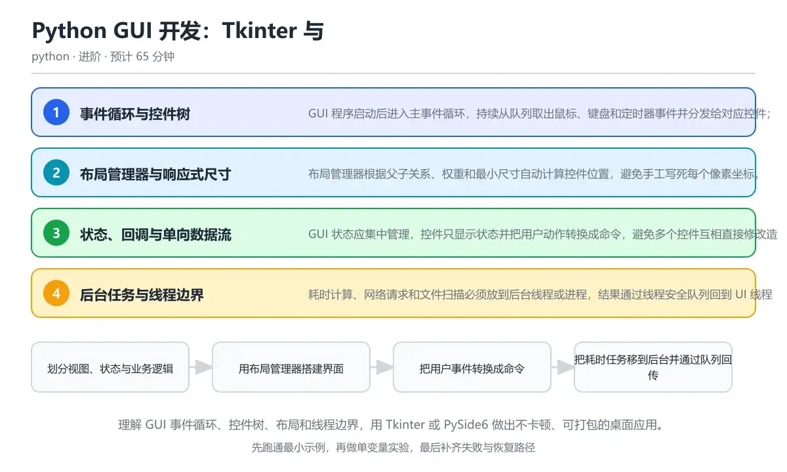
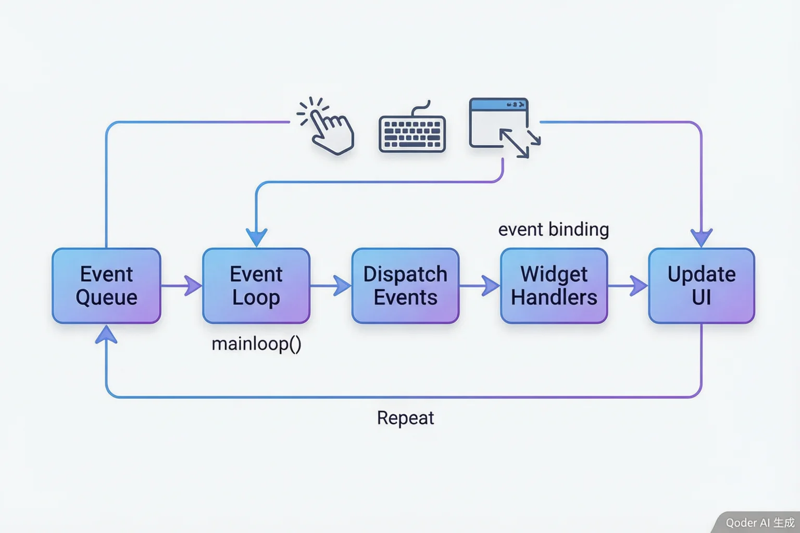

# Python GUI 开发：Tkinter 与 PySide6

> 内容更新时间：2026-10-06 · 学习阶段：进阶 · 预计用时：40 分钟

分类：python。关键词：Tkinter、PySide6、事件循环、布局、后台线程。理解 GUI 事件循环、控件树、布局和线程边界，用 Tkinter 或 PySide6 做出不卡顿、可打包的桌面应用。



## 本节知识框架

想象你正在开一家餐厅——厨房负责做菜（业务逻辑），服务员负责端菜和记录顾客需求（控件），而大堂经理负责协调一切、确保每位顾客的需求都被及时响应（事件循环）。这就是 Python GUI 开发的核心思路：你不需要从零造轮子，只需要理解"谁负责什么"，然后把各个角色安排到位。

**课程定位**：所属分类 `python`（Python），课程主题 `Python GUI 开发：Tkinter 与 PySide6`，学习阶段 进阶，建议用时 50 分钟。

**学完本课你能够做到**：
- 用自己的话解释"事件循环"和"控件树"是什么，并能举出生活中的类比。
- 用 Tkinter 或 PySide6 搭建一个带工具栏、列表和状态栏的完整界面。
- 遇到"界面卡死"问题时，能准确说出原因并一步步修复。

### 知识链条：从"前台"到"打包上桌"

我们用一个餐厅的比喻把六个核心概念串起来：

1. **事件循环**（大堂经理）——持续获取并分发用户输入、定时器和系统消息的 GUI 主循环。经理不停地在餐厅里巡视：有人点菜就去记，有人结账就去处理，定时器响了就去检查备餐进度。
2. **控件树**（组织架构）——窗口、容器和子控件组成的父子层次结构。就像餐厅有总经理→大堂经理→服务员→桌号的层级关系，GUI 里窗口包含面板，面板包含按钮，层层嵌套。
3. **布局管理器**（座位安排表）——根据权重、边距和最小尺寸自动计算控件位置的机制。不是把每把椅子钉死在地板上，而是用"按比例分配"的方式，让餐厅换了更大的房间后桌椅也能自动摆好。
4. **主线程**（唯一的大堂经理）——运行 GUI 事件循环并允许修改控件的线程。餐厅只能有一个大堂经理在现场调度，GUI 也只能有一个主线程负责更新界面。
5. **DPI**（视觉清晰度）——屏幕每英寸像素数，影响字体与控件的实际显示尺寸。就像同一张菜单在不同灯光下看起来大小不同，同一款软件在不同屏幕上显示效果也会不同。
6. **PyInstaller**（打包外带）——把 Python 程序和依赖打包成桌面可执行文件的常用工具。相当于把整间餐厅的配方、食材、厨具一起打包成"移动餐车"，让顾客在任何地方都能享用。

**先修与衔接**：本课是「Python」分类的第 23 课。先修内容：《Python 面向对象进阶：继承、组合与魔术方法》。相关或后续课程：《Python CLI 与自动化实战》、《Python 打包、发布与性能》。

## 核心概念定义

下面这张表就像一本"迷你词典"，每个术语都有一句通俗解释和一个"容易踩坑"的提醒。建议先通读一遍，遇到不懂的再回来查。

| 术语 | 通俗定义（一句话） | 常见边界与风险 |
| --- | --- | --- |
| 事件循环 | 持续获取并分发用户输入、定时器和系统消息的 GUI 主循环。就像餐厅大堂经理不停巡视、处理需求。 | 只在「持续获取并分发用户输入、定时器和系统消息的 GUI 主循环」这一前提下成立，换输入或换环境要重新验证。 |
| 控件树 | 窗口、容器和子控件组成的父子层次结构。就像公司的组织架构图。 | 容器与集群环境差异会改变行为，本地通过后仍需在目标编排环境复验。 |
| 布局管理器 | 根据权重、边距和最小尺寸自动计算控件位置的机制。就像弹性座位安排，不钉死坐标。 | 易错：在《Python GUI 开发：Tkinter 与 PySide6》里采用「按固定分辨率写死窗口和控件坐标，高分屏字体放大后内容被截断」时，硬编码像素尺寸会表现为错误结果、异常中断或状态不一致；正确做法是使用布局管理器和相对权重，设置最小尺寸并验证不同 DPI。 |
| 主线程 | 运行 GUI 事件循环并允许修改控件的线程。只有一个"大堂经理"在现场。 | 易错：在《Python GUI 开发：Tkinter 与 PySide6》里采用「工作线程调用 label.setText 或修改 Tk 控件，运行时随机崩溃」时，后台线程直接修改控件会表现为错误结果、异常中断或状态不一致；正确做法是后台线程只写线程安全队列，所有控件更新回到 UI 主线程执行。 |
| DPI | 屏幕每英寸像素数，影响字体与控件的实际显示尺寸。 | 易错：在《Python GUI 开发：Tkinter 与 PySide6》里采用「按固定分辨率写死窗口和控件坐标，高分屏字体放大后内容被截断」时，硬编码像素尺寸会表现为错误结果、异常中断或状态不一致；正确做法是使用布局管理器和相对权重，设置最小尺寸并验证不同 DPI。 |
| PyInstaller | 把 Python 程序和依赖打包成桌面可执行文件的常用工具。 | 不同版本与依赖组合的行为可能不同，升级或换环境前要按官方变更说明重新验证。 |

## 原理与运行机制



### 1. 事件循环——永不下班的大堂经理

**类比**：想象一个永远不休息的大堂经理。他站在餐厅门口，手里拿着一个排队号码牌（消息队列）。每当有顾客举手（点击按钮）、有人按铃（定时器触发）、或者厨房喊"菜好了"（系统消息），他就把这个需求记下来，然后按顺序一个个处理。

**关键机制**：
- GUI 程序启动后进入 `mainloop()`，这就是事件循环的入口。
- 每个窗口有自己的消息队列，事件循环按先进先出（FIFO）的顺序处理。
- 回调函数执行期间，界面无法重绘——就像经理在处理一位顾客的投诉时，没法同时去招呼其他客人。

**生活实例**：你在微信里点了一个按钮，如果这个按钮背后要下载一个大文件，整个微信就"冻住"了——这就是事件循环被堵住了。

**工程做法**：回调只做"记个笔记"的轻量工作（比如设置一个标志位），真正耗时的任务交给后台线程去做。

### 2. 控件树——从窗口到按钮的家族谱系

**类比**：你家有一棵家族树——爷爷奶奶→爸爸妈妈→你→你的孩子。GUI 里也有类似的层级：

```text
主窗口 (Tk/QMainWindow)
├── 顶部工具栏 (Frame/QToolBar)
│   ├── 新建按钮 (Button/QPushButton)
│   └── 保存按钮 (Button/QPushButton)
├── 中间内容区 (Text/QTextEdit)
└── 底部状态栏 (Label/QStatusBar)
```

控件树决定了三件事：
- **生命周期**：父控件销毁时，子控件也跟着消失（就像公司倒闭了，部门也不存在了）。
- **坐标系统**：子控件的位置是相对于父控件计算的，不是相对于整个屏幕。
- **事件冒泡**：点击一个按钮，事件会先传给按钮的父容器，再往上传递。

### 3. 布局管理器——弹性座位安排

**类比**：想象你在布置一间多功能会议室。你可以把椅子钉死在地上（硬编码坐标），但一旦房间换了大小或者需要加椅子，就得全部重来。更聪明的做法是用"弹性轨道"——告诉系统"这排桌子占 70% 宽度，那排椅子占 30%"，系统会自动计算。

**Tkinter 的三种布局方式**：

| 布局方式 | 类比 | 适用场景 |
| --- | --- | --- |
| `pack()` | 像叠盘子一样从上到下或从左到右依次摆放 | 简单的线性排列，比如工具栏按钮 |
| `grid()` | 像棋盘一样按行列摆放 | 表单、设置界面等规则排列 |
| `place()` | 像用尺子量好坐标精确放置 | 极少数需要绝对定位的场景 |

**黄金法则**：同一个父容器里不要混用 `pack` 和 `grid`！就像不要在同一张桌子上既放圆盘子又放方盘子——会打架。

### 4. 后台任务与线程边界——厨房和前台的分工

**类比**：餐厅里，前台服务员（主线程）负责接待客人、下单、端菜；厨房厨师（后台线程）负责炒菜。如果服务员跑到厨房里亲自炒菜，外面的客人就没人管了。

**核心规则**：
- 只有主线程能修改控件（只有大堂经理能调整座位）。
- 后台线程完成任务后，把结果放进一个"传菜窗口"（线程安全队列），主线程定时去取。
- 退出程序时，要先通知后台线程停止，等它们结束再关闭——不能直接"拉闸"。

### 5. 打包发布——把餐厅变成移动餐车

**类比**：你的餐厅在自己家楼下生意很好（开发环境正常），但要把同样的体验搬到另一个城市（目标机器），你需要把厨师、食材、厨具、菜单、甚至装修风格全部打包带走。

**PyInstaller 的工作**：
- 分析你的代码，找出所有导入的模块（厨师团队）。
- 把 Python 解释器也打包进去（厨房设备）。
- 处理图标、资源文件的路径（装修风格）。

**常见翻车**：开发机上跑得好好的，打包后在别的电脑上一打开就崩溃——通常是因为漏掉了某个动态导入的模块，或者资源文件的路径写死了。

```text
划分视图、状态与业务逻辑 → 用布局管理器搭建界面 → 把用户事件转换成命令 → 把耗时任务移到后台并通过队列回传 → 在目标平台打包并冒烟测试
```

## 典型应用场景

### 场景 1：个人工具箱

很多开发者会给自己写一个小工具——批量重命名文件、转换图片格式、查询数据库。用 Tkinter 几十行代码就能搞定，不需要学复杂的框架。

**类比**：就像你在家 DIY 一个小书架，不需要请专业木匠，自己用锤子和钉子就能做出来。

### 场景 2：数据可视化仪表盘

公司需要一个实时显示销售数据的桌面应用。用 PySide6 可以做出专业的图表界面，后台线程定时从数据库拉取最新数据。

**类比**：就像机场的航班信息大屏——数据不断更新，界面始终流畅。

### 场景 3：嵌入式设备界面

树莓派、工业触摸屏等设备需要轻量级的 GUI。Tkinter 因为内置在 Python 里，不需要额外安装，非常适合这类场景。

**类比**：就像自动售货机的操作面板——不需要花哨，但必须稳定可靠。

### 场景 4：科学实验控制台

实验室里需要用 Python 控制仪器、采集数据、实时绘图。PySide6 的信号槽机制非常适合这种"数据来了就更新图表"的场景。

**类比**：就像医院的监护仪——传感器数据源源不断地送来，屏幕上的波形实时更新。

## 代码/协议/SQL 示例

### 示例 1：最简单的 Tkinter 窗口（"Hello GUI"）

先看一个最简单的例子，就像学编程时的第一句 `print("Hello World")`：

```python
import tkinter as tk

# 创建主窗口（相当于开一家餐厅）
root = tk.Tk()
root.title("我的第一个 GUI")
root.geometry("300x200")

# 添加一个按钮（相当于放了一个服务台）
def on_click():
    label.config(text="你点过了！")

label = tk.Label(root, text="欢迎！")
label.pack(pady=10)

button = tk.Button(root, text="点我", command=on_click)
button.pack()

# 启动事件循环（大堂经理上岗）
root.mainloop()
```

### 示例 2：事件队列模拟（理解事件循环的核心）

这段代码模拟了事件循环的工作原理——就像大堂经理手里的排队系统：

```python
from collections import deque
from dataclasses import dataclass

@dataclass
class Click:
    x: int
    y: int

class EventQueue:
    def __init__(self):
        self._items = deque()

    def push(self, event):
        self._items.append(event)

    def drain(self):
        while self._items:
            yield self._items.popleft()

# 模拟用户点击了两次
queue = EventQueue()
queue.push(Click(10, 20))
queue.push(Click(30, 40))

# 事件循环按顺序处理
for event in queue.drain():
    print("处理点击:", event.x, event.y)
```

运行结果：

```text
处理点击: 10 20
处理点击: 30 40
```

### 示例 3：后台线程 + 线程安全队列（解决界面卡死）

这是最实用的模式——把耗时任务丢给后台，界面保持流畅：

```python
import tkinter as tk
import threading
import queue
import time

class App:
    def __init__(self):
        self.root = tk.Tk()
        self.root.title("后台任务演示")
        self.result_queue = queue.Queue()

        self.label = tk.Label(self.root, text="准备就绪")
        self.label.pack(pady=20)

        self.btn = tk.Button(
            self.root, text="开始耗时任务",
            command=self.start_task
        )
        self.btn.pack()

        # 定时检查队列（每 100ms 轮询一次）
        self.root.after(100, self.check_queue)

    def start_task(self):
        """按钮回调：只负责启动后台线程，自己不干活"""
        self.btn.config(state="disabled")
        self.label.config(text="任务进行中...")
        thread = threading.Thread(target=self.heavy_work)
        thread.daemon = True
        thread.start()

    def heavy_work(self):
        """后台线程：做耗时计算，结果放进队列"""
        time.sleep(3)  # 模拟耗时操作
        self.result_queue.put("任务完成！共处理 1000 条数据")

    def check_queue(self):
        """主线程：定时从队列取结果并更新界面"""
        try:
            result = self.result_queue.get_nowait()
            self.label.config(text=result)
            self.btn.config(state="normal")
        except queue.Empty:
            pass
        self.root.after(100, self.check_queue)

    def run(self):
        self.root.mainloop()

App().run()
```

### 示例 4：PySide6 布局示例（工具栏 + 列表 + 状态栏）

```python
import sys
from PySide6.QtWidgets import (
    QApplication, QMainWindow, QWidget,
    QVBoxLayout, QHBoxLayout, QPushButton,
    QListWidget, QLabel, QToolBar
)

class MainWindow(QMainWindow):
    def __init__(self):
        super().__init__()
        self.setWindowTitle("布局演示")
        self.setMinimumSize(400, 300)

        # 工具栏
        toolbar = QToolBar("主工具栏")
        toolbar.addAction("新建")
        toolbar.addAction("保存")
        self.addToolBar(toolbar)

        # 中央区域：列表 + 状态栏
        central = QWidget()
        layout = QVBoxLayout(central)

        self.list_widget = QListWidget()
        for i in range(10):
            self.list_widget.addItem(f"项目 {i + 1}")
        layout.addWidget(self.list_widget)

        self.status_label = QLabel("就绪")
        layout.addWidget(self.status_label)

        self.setCentralWidget(central)

app = QApplication(sys.argv)
window = MainWindow()
window.show()
app.exec()
```

## 时间/空间复杂度或性能分析

### GUI 程序的性能关注点

GUI 程序和后端服务不同，它的"性能"不是看每秒处理多少请求，而是看"用户感觉卡不卡"。

| 性能指标 | 类比 | 健康值 | 危险信号 |
| --- | --- | --- | --- |
| 事件循环延迟 | 大堂经理处理每个需求的速度 | < 16ms（60fps） | > 100ms 用户就会感觉"卡" |
| 内存占用 | 餐厅占用的面积 | 通常 30-100MB | 持续增长说明有内存泄漏 |
| 启动时间 | 餐厅开门准备的时间 | < 2 秒 | > 5 秒用户会失去耐心 |

### 常见性能陷阱

**陷阱 1：在回调里做重活**
- 时间复杂度：O(n)，n 是任务耗时。如果 n 很大，事件循环就被堵住了。
- 修复：把任务移到后台线程，回调只负责"发号"。

**陷阱 2：控件数量爆炸**
- 空间复杂度：O(n)，n 是控件数量。一万个 Label 会占用大量内存和渲染时间。
- 修复：使用列表虚拟化（只渲染可见区域的控件）。

**陷阱 3：频繁刷新界面**
- 每次 `label.config(text=...)` 都会触发重绘。如果在循环里连续更新 1000 次，界面会疯狂闪烁。
- 修复：用定时器批量刷新，或者用 `after` 控制刷新频率。

### 测量方法

```python
import time

# 测量回调执行时间
def timed_callback():
    start = time.perf_counter()
    # ... 你的逻辑 ...
    elapsed = time.perf_counter() - start
    if elapsed > 0.016:  # 超过 16ms
        print(f"警告：回调耗时 {elapsed:.3f}s，可能卡界面")
```

## 常见误区与易错点

### 误区 1：在 UI 回调中执行耗时任务

| 错误做法 | 实际现象 | 正确做法 |
| --- | --- | --- |
| 在《Python GUI 开发：Tkinter 与 PySide6》里采用「按钮回调里直接下载大文件或训练模型，窗口长时间无响应」 | 在 UI 回调中执行耗时任务会表现为错误结果、异常中断或状态不一致 | 把任务移到线程池或进程，回调只负责启动、显示进度和处理完成事件 |

**类比**：让大堂经理亲自去厨房炒菜——外面的客人全等着，没人招呼。

### 误区 2：后台线程直接修改控件

| 错误做法 | 实际现象 | 正确做法 |
| --- | --- | --- |
| 在《Python GUI 开发：Tkinter 与 PySide6》里采用「工作线程调用 label.setText 或修改 Tk 控件，运行时随机崩溃」 | 后台线程直接修改控件会表现为错误结果、异常中断或状态不一致 | 后台线程只写线程安全队列，所有控件更新回到 UI 主线程执行 |

**类比**：厨师直接跑到前台 rearrange 座位——和大堂经理的安排冲突，整个餐厅乱套。

### 误区 3：硬编码像素尺寸

| 错误做法 | 实际现象 | 正确做法 |
| --- | --- | --- |
| 在《Python GUI 开发：Tkinter 与 PySide6》里采用「按固定分辨率写死窗口和控件坐标，高分屏字体放大后内容被截断」 | 硬编码像素尺寸会表现为错误结果、异常中断或状态不一致 | 使用布局管理器和相对权重，设置最小尺寸并验证不同 DPI |

**类比**：把所有家具的尺寸都钉死在地板上——换了更大的房子，家具还是那么小。

### 误区 4：打包时遗漏资源与动态模块

| 错误做法 | 实际现象 | 正确做法 |
| --- | --- | --- |
| 在《Python GUI 开发：Tkinter 与 PySide6》里采用「开发环境正常，打包后图标、模板或插件缺失导致启动失败」 | 打包时遗漏资源与动态模块会表现为错误结果、异常中断或状态不一致 | 显式声明数据文件和隐藏导入，在干净目标系统运行冒烟测试 |

**类比**：移动餐车忘了带调料包——到了新地方，菜做不出原来的味道。

## 与其他知识点的关系

### 先修知识

- **《Python 面向对象进阶：继承、组合与魔术方法》**：本课大量使用面向对象的概念。比如控件树就是"组合"模式的体现——窗口"包含"面板，面板"包含"按钮。`super().__init__()` 在创建自定义控件时必不可少。

### 后续衔接

- **《Python CLI 与自动化实战》**：GUI 和 CLI 是两种不同的用户交互方式。很多工具既提供命令行接口，也提供 GUI 界面——底层逻辑是共享的。
- **《Python 打包、发布与性能》**：本课介绍的 PyInstaller 只是打包的起点。后续课程会深入讲解 wheel 格式、PyPI 发布和性能优化。

### 容易混淆的概念对比

| 概念 A | 概念 B | 区别要点 |
| --- | --- | --- |
| 事件循环 | 控件树 | 事件循环是"时间维度"的——不断处理事件；控件树是"空间维度"的——描述界面结构 |
| 布局管理器 | 硬编码坐标 | 布局管理器是"弹性"的，能自动适应；硬编码是"刚性"的，换屏幕就崩 |
| 主线程 | 后台线程 | 主线程独占界面更新权；后台线程只能处理数据，不能碰控件 |
| Tkinter | PySide6 | Tkinter 轻量内置，适合小工具；PySide6 功能强大，适合专业应用 |

## 自测题与参考答案

> 先独立作答，再对照参考答案。答案都能在本课正文、术语表或错误表里找到依据。

### 自测 1（概念复述）

不看正文，用自己的话解释"事件循环"是什么，并举一个生活中的类比。

**参考答案**：事件循环是持续获取并分发用户输入、定时器和系统消息的 GUI 主循环。类比：餐厅的大堂经理不停巡视，有人点菜就记下来，有人结账就处理，永远不下班。

### 自测 2（排错）

你的 GUI 程序在点击按钮后界面完全卡住了，最可能的原因是什么？怎么修复？

**参考答案**：最可能是在按钮回调里执行了耗时操作。修复方法：把耗时任务移到后台线程，回调只负责启动任务和更新"进行中"的状态，任务完成后通过队列把结果送回主线程更新界面。

### 自测 3（代码阅读）

阅读下面的代码，说出输出结果：

```python
queue = EventQueue()
queue.push(Click(1, 2))
queue.push(Click(3, 4))
first_drain = list(queue.drain())
second_drain = list(queue.drain())
print(f"第一次: {len(first_drain)}, 第二次: {len(second_drain)}")
```

**参考答案**：输出 `第一次: 2, 第二次: 0`。第一次 drain 按先进先出顺序取出了所有事件，队列为空；第二次 drain 没有事件可取。

### 自测 4（动手验证）

运行本课的 Tkinter 示例，把 `root.geometry("300x200")` 改成 `root.geometry("100x50")`，观察发生了什么。

**参考答案**：窗口变得很小，按钮文字可能被截断。这说明硬编码尺寸在不同场景下不可靠，应该使用布局管理器的最小尺寸机制。

### 自测 5（迁移）

如果你要做一个"文件批量重命名"工具，应该选择 Tkinter 还是 PySide6？为什么？

**参考答案**：Tkinter 就够了。这是一个简单的工具，不需要复杂的图表或自定义样式，Tkinter 轻量、内置、学习成本低。如果未来需要支持拖拽文件到窗口、实时预览等高级功能，再考虑升级到 PySide6。

## 复习清单

- [ ] 能不看正文复述本课核心术语，并指出一个边界或反例
- [ ] 能默写本课最重要的代码示例，并解释每一行的作用
- [ ] 能说出本课内容和前后两课的联系

## 延伸阅读

想更直观地理解本课概念？推荐参阅以下图解专题：

- [图解内存布局：栈、堆与引用](visual_memory_layout.md)

## 术语速查

| 术语 | 一句话说明 |
| --- | --- |
| `事件循环` | 持续获取并分发用户输入、定时器和系统消息的 GUI 主循环（餐厅大堂经理） |
| `控件树` | 窗口、容器和子控件组成的父子层次结构（公司组织架构图） |
| `布局管理器` | 根据权重、边距和最小尺寸自动计算控件位置的机制（弹性座位安排表） |
| `主线程` | 运行 GUI 事件循环并允许修改控件的线程（唯一的大堂经理） |
| `DPI` | 屏幕每英寸像素数，影响字体与控件的实际显示尺寸（菜单在不同灯光下的大小） |
| `PyInstaller` | 把 Python 程序和依赖打包成桌面可执行文件的常用工具（把餐厅打包成移动餐车） |
| `信号槽` | PySide6 的事件通信机制，发送方发信号，接收方连槽函数（对讲机：按下说话键（信号），对方听到声音（槽）） |
| `回调函数` | 事件发生时被调用的函数（门铃响了就去开门的动作） |

## 考点精讲

`Python GUI 开发：Tkinter 与 PySide6` 的题库有 5 道题，下面逐题给出题干、正确项与判断依据。建议先自己作答，再核对正确项，最后回到正文对应小节复核。

### 考点 1：第 1 题

- **题目**：GUI 回调中执行点击按钮后的网络下载，最可能的后果是什么？
- **正确项**：事件循环被占用，窗口无响应且无法重绘
- **判断依据**：本题正确项是「事件循环被占用，窗口无响应且无法重绘」。术语 事件循环（Python GUI 开发：Tkinter 与 PySide6）：持续获取并分发用户输入、定时器和系统消息的 GUI 主循环，本题取「事件循环被占用，窗口无响应且无法重绘」这条。易错点是在《Python GUI 开发：Tkinter 与 PySide6》里采用「按钮回调里直接下载大文件或训练模型，窗口长时间无响应」，会造成在 UI 回调中执行耗时任务会表现为错误结果、异常中断或状态不一致，改法是把任务移到线程池或进程，回调只负责启动、显示进度和处理完成事件。

### 考点 2：第 2 题

- **题目**：后台线程完成计算后，正确更新控件的方式是？
- **正确项**：把结果放入线程安全队列，由 UI 线程取出后更新
- **判断依据**：本题正确项是「把结果放入线程安全队列，由 UI 线程取出后更新」。术语 事件循环（Python GUI 开发：Tkinter 与 PySide6）：持续获取并分发用户输入、定时器和系统消息的 GUI 主循环，本题取「把结果放入线程安全队列，由 UI 线程取出后更新」这条。易错点是错误做法，会造成实际现象，改法是正确做法。

### 考点 3：第 3 题

- **题目**：设计可缩放 GUI 布局时应该注意什么？（多选）
- **正确项**：使用布局权重分配额外空间；设置合理的最小尺寸；支持字体放大和键盘访问
- **判断依据**：按《Python GUI 开发：Tkinter 与 PySide6》的正文口径，本题要同时选中「使用布局权重分配额外空间」、「设置合理的最小尺寸」、「支持字体放大和键盘访问」，漏掉任一项都算没答全。术语 事件循环（Python GUI 开发：Tkinter 与 PySide6）：持续获取并分发用户输入、定时器和系统消息的 GUI 主循环。易错点是在《Python GUI 开发：Tkinter 与 PySide6》里采用「工作线程调用 label.setText 或修改 Tk 控件，运行时随机崩溃」，会造成后台线程直接修改控件会表现为错误结果、异常中断或状态不一致，改法是后台线程只写线程安全队列，所有控件更新回到 UI 主线程执行。

### 考点 4：第 4 题

- **题目**：阅读事件队列代码，两次 drain 之间不清空队列会发生什么？
- **正确项**：每次 drain 会按先进先出顺序产出剩余事件，直到队列为空
- **判断依据**：本题正确项是「每次 drain 会按先进先出顺序产出剩余事件，直到队列为空」。术语 事件循环（Python GUI 开发：Tkinter 与 PySide6）：持续获取并分发用户输入、定时器和系统消息的 GUI 主循环，本题取「每次 drain 会按先进先出顺序产出剩余事件，直到队列为空」这条。易错点是错误做法，会造成实际现象，改法是正确做法。

### 考点 5：第 5 题

- **题目**：桌面应用打包后在开发机正常、目标机器启动即崩溃，优先检查什么？
- **正确项**：目标系统缺少运行库、资源路径或动态导入模块
- **判断依据**：本题正确项是「目标系统缺少运行库、资源路径或动态导入模块」。术语 事件循环（Python GUI 开发：Tkinter 与 PySide6）：持续获取并分发用户输入、定时器和系统消息的 GUI 主循环，本题取「目标系统缺少运行库、资源路径或动态导入模块」这条。易错点是在《Python GUI 开发：Tkinter 与 PySide6》里采用「按固定分辨率写死窗口和控件坐标，高分屏字体放大后内容被截断」，会造成硬编码像素尺寸会表现为错误结果、异常中断或状态不一致，改法是使用布局管理器和相对权重，设置最小尺寸并验证不同 DPI。

### 考点 6：核心术语辨析

- **`事件循环` vs `控件树`**：事件循环是"时间维度"的——它关注的是"什么时候处理什么事件"；控件树是"空间维度"的——它关注的是"界面上有什么东西、谁包含谁"。两者配合工作：事件循环根据控件树决定把事件分发给谁。
- **`布局管理器` vs `主线程`**：布局管理器负责"控件放在哪里"，主线程负责"谁来更新控件"。前者是空间问题，后者是并发问题。
- **`DPI` vs `PyInstaller`**：DPI 影响界面显示效果，PyInstaller 影响程序分发方式。一个管"看起来怎么样"，一个管"能不能在别人电脑上跑"。

## 内容元数据

- 内容版本：v2.0
- 最后更新：2026-10-06
- 学习阶段：进阶

| 字段 | 值 |
| --- | --- |
| 课程 ID | `python_gui` |
| 所属分类 | `python` |
| 难度 | 进阶 |
| 预计用时 | 65 分钟 |
| 关键词 | Tkinter、PySide6、事件循环、布局、后台线程 |
| 配图 | `images/lesson_python_gui.webp` |
| 参考资料 | 6 条 |
| 内容更新时间 | 2026-10-06 |

## 参考资料与复核

- 来源性质：官方文档、标准或权威教材；本课核对关键词：Tkinter、PySide6、事件循环、布局、后台线程。
- 最后复核：2026-10-04
- 下次复核：2026-11-10
- 复核范围：版本兼容、API 行为与工程实践

下面列出的资料用于核对本课结论，复习时可以对照阅读：
- [Python Tkinter 官方文档](https://docs.python.org/3/library/tkinter.html)
- [PySide6 官方文档](https://doc.qt.io/qtforpython-6/)
- [Python threading 文档](https://docs.python.org/3/library/threading.html)
- [PyInstaller 官方文档](https://pyinstaller.org/en/stable/)
- [Tkinter 布局教程 - Grid, Pack, Place](https://www.pythontutorial.net/tkinter/tkinter-geometry-managers/)
- [Real Python - GUI Programming with Tkinter](https://realpython.com/python-gui-with-tkinter/)

| [本课术语索引：Python GUI 开发：Tkinter 与 PySide6](#核心概念定义) | 按本课输入、术语边界和错误表现逐项核对 |
> 复核提示：《Python GUI 开发：Tkinter 与 PySide6》的结论如与资料冲突，以资料中的规范文本为准，并在笔记里记录差异与日期。
