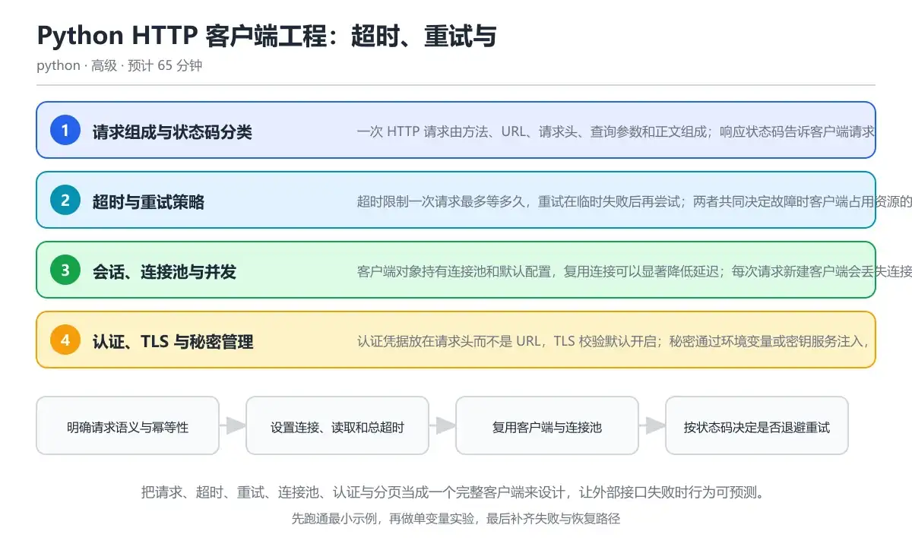
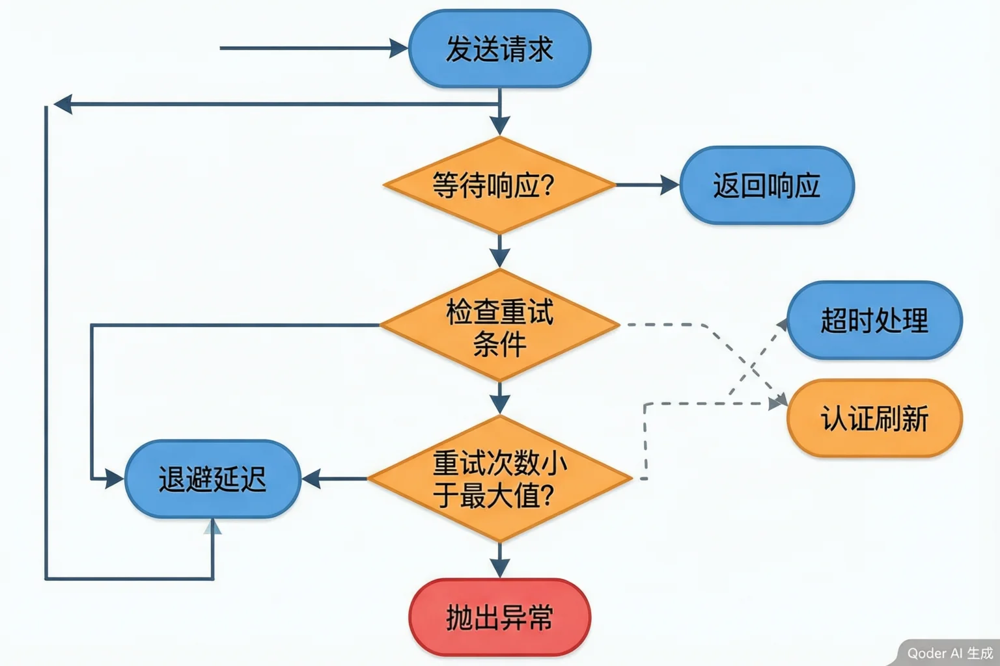

# Python HTTP 客户端工程：超时、重试与认证

> 内容更新时间：2026-10-06 · 学习阶段：高级 · 预计用时：40 分钟

> 学习阶段：高级 · 预计用时：40 分钟 · 分类：python

想象你是一个外卖平台的调度员——你要给骑手下单、等骑手回报结果、遇到骑手忙线要决定等多久、要不要换人重新派单。如果骑手永远不回复，你的电话线就会被占满，后面的订单全堵死。Python 调用外部 API 的过程一模一样：发请求、等响应、处理超时、决定重试、管理连接。本课就带你一步步搭建一个"靠谱的外卖调度系统"，让外部接口出故障时你的程序也能从容应对。

关键词：httpx、超时、重试、幂等性、限流



## 本节知识框架

**课程定位**：所属分类 `python`（Python），课程主题 `Python HTTP 客户端工程：超时、重试与认证`，学习阶段 高级，建议用时 50 分钟。

本课主线：把请求、超时、重试、连接池、认证与分页当成一个完整客户端来设计，让外部接口失败时行为可预测。

**学完本课应当能够**
- 说清 `连接超时` 与 `读取超时` 的含义与区别，并各举一个正例和一个反例。
- 用本课示例验证 `幂等性` 的行为，记录输入、输出与失败条件。
- 遇到「请求不设置超时」这类问题时，能说出触发条件与修复顺序。

### 复习清单

- [ ] 能不看正文复述本课核心术语，并指出一个边界或反例。
- [ ] 能运行或推演本课示例，记录输入、输出与失败现象。
- [ ] 能完成一次自测，并把错题对照错误表定位原因。

## 核心概念定义

想象你在学开车——先认识仪表盘上的各种指示灯，再上路才不会慌。下面这些术语就是你写 HTTP 客户端时的"仪表盘"。

| 术语 | 通俗类比 | 操作性定义 | 常见边界与风险 |
| --- | --- | --- | --- |
| 连接超时 | 就像打电话等对方接听的秒数——你不能永远等下去 | 客户端等待与目标建立连接的最长时间。 | 易错：以为设了它就能管住整个请求；连接建好之后的等待归读取超时，写入和池等待还要各自设预算。 |
| 读取超时 | 接通电话后，等对方说话的最长时间——沉默太久就挂断 | 连接建立后等待响应数据的单次最长时间。 | 它只管单次等待响应数据的时间；正文要求超时预算从用户请求总时长反推，另设一个总超时兜住整次请求。 |
| 幂等性 | 就像按电梯按钮——按一次和按十次，电梯只来一趟 | 同一请求执行多次产生与执行一次相同结果的语义。 | 语义上幂等不等于服务端真能去重：下单超时后重复提交会扣款两次，写操作必须由服务端提供幂等键保证。 |
| 连接池 | 像共享单车站点——车骑完放回站点，下个人直接骑走，不用每次造新车 | 复用已建立连接并限制并发数量的资源池。 | 易错：在《Python HTTP 客户端工程：超时、重试与认证》里采用「调用外部接口不传 timeout，连接或读取一直等待，线程和连接池被占满」时，请求不设置超时会表现为错误结果、异常中断或状态不一致；正确做法是为连接、读取、写入和池等待设置明确预算，并设置总超时。 |
| 指数退避 | 像给忙碌的朋友打电话——第一次等 1 分钟再打，第二次等 2 分钟，第三次等 4 分钟……别一直狂轰滥炸 | 每次重试按指数增长等待时间，并常加入随机抖动避免同时重试。 | 示例用 `min` 把增长封顶在 5.0 秒；不设次数与上限、又对非幂等请求退避重试，只会放大故障。 |
| 限流 | 像餐厅门口叫号——一小时只放 60 桌进去，超了就得排队等 | 服务端按时间窗口限制请求速率或并发量，客户端需要识别并配合等待。 | 429 通常带 Retry-After，客户端要按它等待而不是立刻重发；把限流状态接进监控，才能看出配额有没有被反复撞满。 |

## 原理与运行机制

### 机制总览

**教材衔接：核心知识**

### 1. 请求组成与状态码分类

一次 HTTP 请求就像寄一封快递信——你需要写收件地址（URL）、选寄送方式（方法）、在信封上贴标签（请求头）、塞进信件内容（正文）。对方收到后回你一个编号（状态码），告诉你结果如何。

2xx 表示成功（快递已签收），3xx 表示重定向（地址改了，帮你转寄），4xx 通常是客户端错误（地址写错了），5xx 表示服务端错误（快递站着火了）；429 表示被限流（快递站今天收件满了，明天再来），具体语义还要结合响应体和接口文档。

在Python HTTP 客户端工程：超时、重试与认证里可以这样验证：用 MockTransport 返回 503 和 200，打印每次请求的状态码与响应体，观察分支逻辑。

边界：不能只看状态码判断业务结果，很多接口在 200 中返回错误码；也不能把 404 当成可重试错误无限请求。

工程视角：状态码分类集中在客户端层，业务层只处理解析后的结果或领域异常；每个错误附带请求编号和时间戳。

### 2. 超时与重试策略

超时就像给每次外卖订单设定"最长等待时间"——超过 30 分钟没到就取消；重试就是取消后重新下一单。两者共同决定故障时你浪费多少时间。

连接超时针对建立连接（打电话等接通），读取超时针对等待响应数据（等对方说话），写入超时针对发送正文（你说话的时间），池超时针对等待空闲连接（等电话线路空出来）；指数退避让等待时间逐次增长，抖动避免大量客户端同时重试。

在Python HTTP 客户端工程：超时、重试与认证里可以这样验证：对返回 503 的模拟接口只在 429 与 5xx 时重试，最多三次，并打印每次退避时间。

边界：只应重试幂等或带幂等键的操作；重试次数过多会放大故障，银行扣款、下单等操作必须有服务端幂等保证。

工程视角：超时预算从用户请求总时长反推，重试次数与退避上限写进配置，记录每次尝试和最终结果。



### 3. 会话、连接池与并发

客户端对象就像一个专属快递员——他认识所有常去地址的路，效率越来越高。如果每次寄信都换一个全新快递员，他就永远记不住路。复用连接可以显著降低延迟。

连接池按主机复用 TCP 连接，池大小限制并发请求；会话还能统一管理请求头、认证、Cookie 和重定向策略。

在Python HTTP 客户端工程：超时、重试与认证里可以这样验证：在 with 语句中创建一个客户端并连续发送多次请求，确认退出时连接被关闭。

边界：同一个客户端可以被多个线程共享，但配置不可在请求期间随意修改；异步客户端要放在异步上下文中使用。

工程视角：应用生命周期内复用一个客户端，按依赖注入传入业务服务；关闭钩子负责释放连接池。

### 4. 认证、TLS 与秘密管理

认证就像进大楼刷门禁卡——你要证明"我是谁"。把凭据放在请求头里（像把门禁卡挂在脖子上），而不是放在 URL 里（像把密码写在明信片上）。TLS 校验就像检查门禁系统有没有被改装过。

Bearer 令牌放入 Authorization 头，Basic 认证把用户名密码编码后放入头部；OAuth2 需要获取、刷新和过期处理，TLS 证书验证防止中间人攻击。

在Python HTTP 客户端工程：超时、重试与认证里可以这样验证：创建带默认 Authorization 头的客户端，并让日志只记录令牌前缀和哈希，不输出完整值。

边界：关闭证书校验会让 HTTPS 失去防篡改能力；把令牌放在查询参数会进入代理和访问日志。

工程视角：凭据轮换有明确流程，测试使用假令牌，生产日志脱敏；重定向到其他域时避免自动携带敏感头部。

### 5. 分页、限流与流式响应

分页就像翻字典——一次看一页，翻到看完为止。限流就像餐厅叫号——别催太急。流式响应就像水管放水——不要等整个游泳池灌满再开始喝，边灌边喝。

游标分页使用下一页标记，页码分页依赖页大小和总数；429 响应通常带 Retry-After，客户端应尊重等待时间；流式响应按块读取，避免把大文件全部放进内存。

在Python HTTP 客户端工程：超时、重试与认证里可以这样验证：读取分页响应直到下一页为空，并在收到 429 时根据 Retry-After 暂停。

边界：分页期间数据可能变化，结果不一定是一致快照；无限循环的分页接口要有最大页数和总大小保护。

工程视角：分页器封装成生成器，下载设置大小上限和校验和，限流状态纳入监控。

**教材衔接：关键流程**

```text
明确请求语义与幂等性 → 设置连接、读取和总超时 → 复用客户端与连接池 → 按状态码决定是否退避重试 → 解析响应并处理分页与限流
```

1. 明确请求语义与幂等性
2. 设置连接、读取和总超时
3. 复用客户端与连接池
4. 按状态码决定是否退避重试
5. 解析响应并处理分页与限流

## 典型应用场景

**教材衔接：深度拓展与实战**

### 场景 1：调用第三方天气 API

你的 App 需要显示天气信息，调用了某天气服务商的 API。这个服务偶尔会"打盹"——返回 503。你需要：设置超时（不能永远等）、遇到 503 自动重试（带退避）、复用连接（提高速度）。

### 场景 2：向支付网关提交订单

用户点击"付款"按钮，你的后端调用支付网关。这里最关键的是幂等性——如果超时后自动重试，不能扣两次钱。必须使用幂等键。

### 场景 3：批量拉取用户列表

API 每次只返回 50 条数据，你需要循环翻页。要防止游标异常导致死循环，也要在收到 429 时停下来等一等。

### 机制对照表

| 概念 | 解决什么问题 | 关键前提 | 失败信号 |
| --- | --- | --- | --- |
| 请求组成与状态码分类 | 一次 HTTP 请求由方法、URL、请求头、查询参数和正文组成；响应状态码告诉客户端请求是否成功以及是否值得重试 | 不能只看状态码判断业务结果，很多接口在 200 中返回错误码；也不能把 404 当成可重试错误无限请求 | 状态码分类集中在客户端层，业务层只处理解析后的结果或领域异常；每个错误附带请求编号和时间戳 |
| 超时与重试策略 | 超时限制一次请求最多等多久，重试在临时失败后再尝试；两者共同决定故障时客户端占用资源的时间上限 | 只应重试幂等或带幂等键的操作；重试次数过多会放大故障，银行扣款、下单等操作必须有服务端幂等保证 | 超时预算从用户请求总时长反推，重试次数与退避上限写进配置，记录每次尝试和最终结果 |
| 会话、连接池与并发 | 客户端对象持有连接池和默认配置，复用连接可以显著降低延迟；每次请求新建客户端会丢失连接复用优势 | 同一个客户端可以被多个线程共享，但配置不可在请求期间随意修改；异步客户端要放在异步上下文中使用 | 应用生命周期内复用一个客户端，按依赖注入传入业务服务；关闭钩子负责释放连接池 |
| 认证、TLS 与秘密管理 | 认证凭据放在请求头而不是 URL，TLS 校验默认开启；秘密通过环境变量或密钥服务注入，不能写进代码和日志 | 关闭证书校验会让 HTTPS 失去防篡改能力；把令牌放在查询参数会进入代理和访问日志 | 凭据轮换有明确流程，测试使用假令牌，生产日志脱敏；重定向到其他域时避免自动携带敏感头部 |
| 分页、限流与流式响应 | 列表接口通常分页返回，客户端要按游标或页码持续请求；限流和流式响应要求客户端控制速率与内存 | 分页期间数据可能变化，结果不一定是一致快照；无限循环的分页接口要有最大页数和总大小保护 | 分页器封装成生成器，下载设置大小上限和校验和，限流状态纳入监控 |

## 代码/协议/SQL 示例

### 最小可验证示例

```text
明确请求语义与幂等性 → 设置连接、读取和总超时 → 复用客户端与连接池 → 按状态码决定是否退避重试 → 解析响应并处理分页与限流
```

### 渐进式示例 1：指数退避计算

先来一个简单的——计算第 5 次重试时应该等多久：

```python
def delay(attempt):
    return min(0.2 * (2 ** attempt), 5.0)
print(delay(5))
```

运行结果：`5.0`。为什么？0.2 × 2⁵ = 6.4，但上限是 5.0，所以取 5.0。就像你等朋友回电话，最多等 5 秒就不等了。

### 渐进式示例 2：带重试的 HTTP 请求

下面用 httpx 的 MockTransport 模拟一个"前两次失败、第三次成功"的服务：

```python
import httpx

calls = {"count": 0}

def handler(request: httpx.Request) -> httpx.Response:
    calls["count"] += 1
    if calls["count"] < 3:
        return httpx.Response(503, text="busy", request=request)
    return httpx.Response(200, json={"ok": True}, request=request)

transport = httpx.MockTransport(handler)
with httpx.Client(transport=transport, base_url="https://api.test") as client:
    for attempt in range(3):
        response = client.get("/health", timeout=2.0)
        print("尝试", attempt + 1, "状态", response.status_code)
        if response.status_code == 200:
            print("结果:", response.json())
            break
    else:
        print("三次后仍失败")

print("请求次数:", calls["count"])
```

输出：
```text
尝试 1 状态 503
尝试 2 状态 503
尝试 3 状态 200
结果: {'ok': True}
请求次数: 3
```

### 渐进式示例 3：安全的分页循环

```python
import httpx

def fetch_all_pages(client, max_pages=100):
    cursor = None
    all_items = []
    for _ in range(max_pages):
        params = {"cursor": cursor} if cursor else {}
        resp = client.get("/items", params=params, timeout=5.0)
        data = resp.json()
        all_items.extend(data.get("items", []))
        cursor = data.get("next")
        if not cursor:
            break
    return all_items
```

这段代码设置了 `max_pages` 保护，即使服务端游标异常也不会无限请求。

## 时间/空间复杂度或性能分析

**性能关注点（Python HTTP 客户端工程：超时、重试与认证）**：解释执行与对象分配是主要成本：记录执行时间、内存峰值与 GC 次数，必要时对比其他实现。

**本课特有开销（Python HTTP 客户端工程：超时、重试与认证 · httpx）**：并发度提高后要观察是否出现拐点：延迟上升而吞吐不增，说明瓶颈已转移。

**测量方法**：以 `Python HTTP 客户端工程：超时、重试与认证` 的 `httpx` 场景为对象，固定输入跑一遍记录基线，再把规模或并发度提高一个数量级复测；两次结果的差值与波动范围才是结论依据。

## 常见误区与易错点

| 容易写错的做法 | 实际现象 | 原因与正确做法 |
| --- | --- | --- |
| 请求不设置超时 | 在《Python HTTP 客户端工程：超时、重试与认证》里采用「调用外部接口不传 timeout，连接或读取一直等待，线程和连接池被占满」时，请求不设置超时会表现为错误结果、异常中断或状态不一致。 | 为连接、读取、写入和池等待设置明确预算，并设置总超时 |
| 对非幂等操作盲目重试 | 在《Python HTTP 客户端工程：超时、重试与认证》里采用「下单请求超时后自动重复提交，用户被扣款两次」时，对非幂等操作盲目重试会表现为错误结果、异常中断或状态不一致。 | 只重试安全方法，写操作要求服务端支持幂等键并保证幂等 |
| 每次请求新建客户端 | 在《Python HTTP 客户端工程：超时、重试与认证》里采用「在循环里创建新 Client 或 Session，连接无法复用且资源反复建立」时，每次请求新建客户端会表现为错误结果、异常中断或状态不一致。 | 应用级复用一个客户端，通过依赖注入传入业务层，退出时关闭 |
| 把令牌放在 URL 中 | 在《Python HTTP 客户端工程：超时、重试与认证》里采用「用查询参数传递访问令牌，令牌进入代理、浏览器历史和访问日志」时，把令牌放在 URL 中会表现为错误结果、异常中断或状态不一致。 | 使用 Authorization 请求头，日志只保留脱敏后的凭据标识 |

### 现场 1：请求不设置超时

**症状**：在《Python HTTP 客户端工程：超时、重试与认证》里采用「调用外部接口不传 timeout，连接或读取一直等待，线程和连接池被占满」时，请求不设置超时会表现为错误结果、异常中断或状态不一致。

**根因与修复**：为连接、读取、写入和池等待设置明确预算，并设置总超时。

**自检**：在本课示例里复现「请求不设置超时」，改成为连接、读取、写入和池等待设置明确预算，并设置总超时后重跑；如果症状消失且失败路径按预期变化，说明定位正确。

### 现场 2：对非幂等操作盲目重试

**症状**：在《Python HTTP 客户端工程：超时、重试与认证》里采用「下单请求超时后自动重复提交，用户被扣款两次」时，对非幂等操作盲目重试会表现为错误结果、异常中断或状态不一致。

**根因与修复**：只重试安全方法，写操作要求服务端支持幂等键并保证幂等。

**自检**：在本课示例里复现「对非幂等操作盲目重试」，改成只重试安全方法，写操作要求服务端支持幂等键并保证幂等后重跑；如果症状消失且失败路径按预期变化，说明定位正确。

### 现场 3：每次请求新建客户端

**症状**：在《Python HTTP 客户端工程：超时、重试与认证》里采用「在循环里创建新 Client 或 Session，连接无法复用且资源反复建立」时，每次请求新建客户端会表现为错误结果、异常中断或状态不一致。

**根因与修复**：应用级复用一个客户端，通过依赖注入传入业务层，退出时关闭。

**自检**：在本课示例里复现「每次请求新建客户端」，改成应用级复用一个客户端，通过依赖注入传入业务层，退出时关闭后重跑；如果症状消失且失败路径按预期变化，说明定位正确。

### 现场 4：把令牌放在 URL 中

**症状**：在《Python HTTP 客户端工程：超时、重试与认证》里采用「用查询参数传递访问令牌，令牌进入代理、浏览器历史和访问日志」时，把令牌放在 URL 中会表现为错误结果、异常中断或状态不一致。

**根因与修复**：使用 Authorization 请求头，日志只保留脱敏后的凭据标识。

**自检**：在本课示例里复现「把令牌放在 URL 中」，改成使用 Authorization 请求头，日志只保留脱敏后的凭据标识后重跑；如果症状消失且失败路径按预期变化，说明定位正确。

## 与其他知识点的关系

**教材衔接：复习与迁移**

## 自测题与参考答案

> 先独立作答，再对照参考答案；答案都能在本课正文、术语表或错误表里找到依据。

### 自测 1（概念复述）

不看正文，写出 `连接超时` 的操作性定义，并说明它与 `读取超时` 的区别。

**参考答案**：客户端等待与目标建立连接的最长时间。

`读取超时` 的定位是：连接建立后等待响应数据的单次最长时间；两者的差别要从适用对象与失败模式上说明。

### 自测 2（排错）

本课错误表记录了「请求不设置超时」这类做法。请写出它会出现的现象、根因，以及修复顺序。

**参考答案**：现象是在《Python HTTP 客户端工程：超时、重试与认证》里采用「调用外部接口不传 timeout，连接或读取一直等待，线程和连接池被占满」时，请求不设置超时会表现为错误结果、异常中断或状态不一致；正确做法是为连接、读取、写入和池等待设置明确预算，并设置总超时。修复时先复现现象并保留证据，再改动一处假设重跑，确认现象消失。

### 自测 3（动手验证）

运行本课的 `text` 示例，改动其中一个输入后重新运行，记录输出与错误信息。

**参考答案**：正常输入下 `text` 示例应当复现正文给出的结果；改动输入后，如果结果改变或报错，先核对它是否满足 `Python HTTP 客户端工程：超时、重试与认证` 中`连接超时` 的适用范围，再检查错误表里是否有同类现象。

### 自测 4（代码阅读）

阅读本课开头的 `text` 示例，说明它体现了`连接超时` 的哪一条性质，并指出改动哪个输入会让这条性质不再成立。

**参考答案**：`连接超时` 的定义是 客户端等待与目标建立连接的最长时间，示例正是在实现这条定义。改动与 `连接超时` 有关的一个输入后，如果结果不再符合 `Python HTTP 客户端工程：超时、重试与认证` 的正文描述，就说明该性质只在当前前提成立。

### 自测 5（迁移）

把 `Python HTTP 客户端工程：超时、重试与认证` 的方法迁移到自己的项目：围绕 `连接超时` 写出一个与错误表同类的风险点，并说明触发条件和检验方式。

**参考答案**：例如「把令牌放在 URL 中」，它会导致在《Python HTTP 客户端工程：超时、重试与认证》里采用「用查询参数传递访问令牌，令牌进入代理、浏览器历史和访问日志」时，把令牌放在 URL 中会表现为错误结果、异常中断或状态不一致；检验方式是按使用 Authorization 请求头，日志只保留脱敏后的凭据标识改一处再复现，确认现象消失且没有引入新的失败分支。

### 自测 6（对比）

用一个表格对比 `连接超时` 与 `读取超时`：各写一行适用场景、一行失败表现。

**参考答案**：`连接超时` 的定义是客户端等待与目标建立连接的最长时间；`读取超时` 的定义是连接建立后等待响应数据的单次最长时间。两者的失败表现分别对应本课错误表里与本术语相关的行。

### 自测 7（排错顺序）

面对「请求不设置超时」引发的问题，请把"复现 在《Python HTTP 客户端工程：超时、重试与认证》里采用「调用外部接口不传 timeout，连接或读取一直等待，线程和连接池被占满」时，请求不设置超时会表现为错误结果、异常中断或状态不一致 → 保留证据 → 为连接、读取、写入和池等待设置明确预算，并设置总超时 → 回归验证"四步写成可执行的检查清单。

**参考答案**：第一步按在《Python HTTP 客户端工程：超时、重试与认证》里采用「调用外部接口不传 timeout，连接或读取一直等待，线程和连接池被占满」时，请求不设置超时会表现为错误结果、异常中断或状态不一致复现；第二步记录输入、版本与完整报错；第三步按为连接、读取、写入和池等待设置明确预算，并设置总超时只改一处；第四步重跑并确认失败路径也按预期变化。

### 自测 8（边界判断）

针对 `限流`，分别写出"可以使用"的条件和"结论不再成立"的条件。

**参考答案**：共享状态与调度顺序会改变结论，单线程或串行测试通过不等于并发下成立。 同时要把 `限流` 的定义 服务端按时间窗口限制请求速率或并发量，客户端需要识别并配合等待 与实际输入逐项对照。

### 自测 9（机制重建）

不看正文，按输入、转换、输出、验证四段重建 `连接超时` → `读取超时` → `幂等性` → `连接池` 的作用链。

**参考答案**：起点是 `连接超时` 的定义 客户端等待与目标建立连接的最长时间；中间每一步都保留可观察状态；终点由 `限流` 检查，失败时回到错误表定位第一个偏离定义的步骤。

### 自测 10（综合排错）

在 `Python HTTP 客户端工程：超时、重试与认证` 中，现象是 在《Python HTTP 客户端工程：超时、重试与认证》里采用「用查询参数传递访问令牌，令牌进入代理、浏览器历史和访问日志」时，把令牌放在 URL 中会表现为错误结果、异常中断或状态不一致。请围绕 把令牌放在 URL 中 写出最小复现、关键证据、修复动作和回归验证，并说明为什么不能只凭一次运行下结论。

**参考答案**：先复现 把令牌放在 URL 中，记录输入与完整错误；再按 使用 Authorization 请求头，日志只保留脱敏后的凭据标识 只改一处。回归时同时跑正常路径和边界路径，只有两次结果都可解释，才把修复视为完成。

### 自测 11（一分钟复述）

用每分钟约 200 字的速度复述 `Python HTTP 客户端工程：超时、重试与认证`：先给主问题，再按顺序说出 `连接超时`、`读取超时`、`幂等性`、`连接池`，最后给一个失败案例。

**自评标准**：主问题必须对应 把请求、超时、重试、连接池、认证与分页当成一个完整客户端来设计，让外部接口失败时行为可预测；每个术语都要能接上一句定义或边界；失败案例必须写成可观察现象，不能用"可能有风险"代替证据。

## 延伸阅读

想更直观地理解本课概念？推荐参阅以下图解专题：

- [图解一次网页请求的完整链路](visual_http_timeline.md)

## 术语速查

| 术语 | 一句话说明 |
| --- | --- |
| `连接超时` | 客户端等待与目标建立连接的最长时间。 |
| `读取超时` | 连接建立后等待响应数据的单次最长时间。 |
| `幂等性` | 同一请求执行多次产生与执行一次相同结果的语义。 |
| `连接池` | 复用已建立连接并限制并发数量的资源池。 |
| `指数退避` | 每次重试按指数增长等待时间，并常加入随机抖动避免同时重试。 |
| `限流` | 服务端按时间窗口限制请求速率或并发量，客户端需要识别并配合等待。 |

**术语关系**：`连接超时`（客户端等待与目标建立连接的最长时间） → `读取超时`（连接建立后等待响应数据的单次最长时间） → `幂等性`（同一请求执行多次产生与执行一次相同结果的语义） → `连接池`（复用已建立连接并限制并发数量的资源池）。

## 考点精讲

`Python HTTP 客户端工程：超时、重试与认证` 的题库有 5 道题，下面逐题给出题干、正确项与判断依据：先自己作答，再核对正确项，最后回到正文对应小节复核。

### 考点 1：第 1 题

- **题目**：为什么 HTTP 请求必须设置超时？
- **正确项**：防止连接或读取无限等待，避免线程和连接池被耗尽
- **判断依据**：本题正确项是「防止连接或读取无限等待，避免线程和连接池被耗尽」。术语 连接池（Python HTTP 客户端工程：超时、重试与认证）：复用已建立连接并限制并发数量的资源池，本题取「防止连接或读取无限等待，避免线程和连接池被耗尽」这条。易错点是请求不设置超时，会造成在《Python HTTP 客户端工程：超时、重试与认证》里采用「调用外部接口不传 timeout，连接或读取一直等待，线程和连接池被占满」时，请求不设置超时会表现为错误结果、异常中断或状态不一致，改法是为连接、读取、写入和池等待设置明确预算，并设置总超时。

### 考点 2：第 2 题

- **题目**：以下哪种请求最适合自动重试？
- **正确项**：幂等的 GET 查询在 503 后重试
- **判断依据**：本题正确项是「幂等的 GET 查询在 503 后重试」。术语 连接超时（Python HTTP 客户端工程：超时、重试与认证）：客户端等待与目标建立连接的最长时间，本题取「幂等的 GET 查询在 503 后重试」这条。易错点是对非幂等操作盲目重试，会造成在《Python HTTP 客户端工程：超时、重试与认证》里采用「下单请求超时后自动重复提交，用户被扣款两次」时，对非幂等操作盲目重试会表现为错误结果、异常中断或状态不一致，改法是只重试安全方法，写操作要求服务端支持幂等键并保证幂等。

### 考点 3：第 3 题

- **题目**：关于客户端与认证，哪些做法正确？（多选）
- **正确项**：应用级复用客户端以利用连接池；把访问令牌放在 Authorization 头；默认开启 TLS 证书校验
- **判断依据**：按《Python HTTP 客户端工程：超时、重试与认证》的正文口径，本题要同时选中「应用级复用客户端以利用连接池」、「把访问令牌放在 Authorization 头」、「默认开启 TLS 证书校验」，漏掉任一项都算没答全。术语 连接池（Python HTTP 客户端工程：超时、重试与认证）：复用已建立连接并限制并发数量的资源池。易错点是每次请求新建客户端，会造成在《Python HTTP 客户端工程：超时、重试与认证》里采用「在循环里创建新 Client 或 Session，连接无法复用且资源反复建立」时，每次请求新建客户端会表现为错误结果、异常中断或状态不一致，改法是应用级复用一个客户端，通过依赖注入传入业务层，退出时关闭。

### 考点 4：第 4 题

- **题目**：阅读重试片段，最大等待时间是多少秒？  def delay(attempt):     return min(0.2 * (2 ** attempt), 5.0) print(delay(5))
- **正确项**：5.0
- **判断依据**：术语 连接超时（Python HTTP 客户端工程：超时、重试与认证）：客户端等待与目标建立连接的最长时间，本题取「5.0」这条。易错点是在《Python HTTP 客户端工程：超时、重试与认证》里的典型做法是调用外部接口不传 timeout，连接或读取一直等待，线程和连接池被占满，这样请求不设置超时会表现为结果错误、异常中断或状态不一致，改法是为连接、读取、写入和池等待设置明确预算，并设置总超时。

### 考点 5：第 5 题

- **题目**：分页循环可能存在什么风险？
- **正确项**：没有最大页数和退出条件，服务端游标异常时可能无限请求
- **判断依据**：本题正确项是「没有最大页数和退出条件，服务端游标异常时可能无限请求」。术语 连接超时（Python HTTP 客户端工程：超时、重试与认证）：客户端等待与目标建立连接的最长时间，本题取「没有最大页数和退出条件，服务端游标异常时可能无限请求」这条。易错点是请求不设置超时，会造成在《Python HTTP 客户端工程：超时、重试与认证》里采用「调用外部接口不传 timeout，连接或读取一直等待，线程和连接池被占满」时，请求不设置超时会表现为错误结果、异常中断或状态不一致，改法是为连接、读取、写入和池等待设置明确预算，并设置总超时。

### 考点 6：`连接超时`

- **要点**：客户端等待与目标建立连接的最长时间。

### 考点 7：`读取超时`

- **要点**：连接建立后等待响应数据的单次最长时间。
- **读取超时 的边界**：网络延迟、超时与版本协商会改变行为，只在真实链路或多版本客户端上验证才算数。

### 考点 8：`幂等性`

- **要点**：同一请求执行多次产生与执行一次相同结果的语义。
- **幂等性 的边界**：网络延迟、超时与版本协商会改变行为，只在真实链路或多版本客户端上验证才算数。

### 考点 9：`连接池`

- **要点**：复用已建立连接并限制并发数量的资源池。
- **连接池 的边界**：易错：在《Python HTTP 客户端工程：超时、重试与认证》里采用「调用外部接口不传 timeout，连接或读取一直等待，线程和连接池被占满」时，请求不设置超时会表现为错误结果、异常中断或状态不一致；正确做法是为连接、读取、写入和池等待设置明确预算，并设置总超时。

### 考点 10：`指数退避`

- **要点**：每次重试按指数增长等待时间，并常加入随机抖动避免同时重试。

### 考点 11：`限流`

- **要点**：服务端按时间窗口限制请求速率或并发量，客户端需要识别并配合等待。
- **限流 的边界**：共享状态与调度顺序会改变结论，单线程或串行测试通过不等于并发下成立。

### 考点 12：排错——请求不设置超时

- **现象**：在《Python HTTP 客户端工程：超时、重试与认证》里采用「调用外部接口不传 timeout，连接或读取一直等待，线程和连接池被占满」时，请求不设置超时会表现为错误结果、异常中断或状态不一致。
- **处理**：为连接、读取、写入和池等待设置明确预算，并设置总超时。

### 考点 13：排错——对非幂等操作盲目重试

- **现象**：在《Python HTTP 客户端工程：超时、重试与认证》里采用「下单请求超时后自动重复提交，用户被扣款两次」时，对非幂等操作盲目重试会表现为错误结果、异常中断或状态不一致。
- **处理**：只重试安全方法，写操作要求服务端支持幂等键并保证幂等。

### 考点 14：综合辨析——`连接超时` 与 `限流`

- **辨析点**：`连接超时` 的定义是 客户端等待与目标建立连接的最长时间；`限流` 的定义是 服务端按时间窗口限制请求速率或并发量，客户端需要识别并配合等待。
- **答题要求**：面对 `Python HTTP 客户端工程：超时、重试与认证` 的题目，先判断描述的是 `连接超时` 还是 `限流`，再归到对应定义，最后写出一个会让该定义失效的边界输入。

### 考点 15：排错评分点

- **现象分**：能写出 在《Python HTTP 客户端工程：超时、重试与认证》里采用「调用外部接口不传 timeout，连接或读取一直等待，线程和连接池被占满」时，请求不设置超时会表现为错误结果、异常中断或状态不一致，而不是只写"程序有错"。
- **证据分**：保留触发 请求不设置超时 的输入、版本和错误原文。
- **修复分**：按 为连接、读取、写入和池等待设置明确预算，并设置总超时 只改一处，并同时回归正常路径与边界路径。

## 内容元数据

- 内容版本：v2.0
- 最后更新：2026-10-06
- 学习阶段：高级

| 字段 | 值 |
| --- | --- |
| 课程 ID | `python_http_clients` |
| 所属分类 | `python` |
| 难度 | 高级 |
| 预计用时 | 65 分钟 |
| 关键词 | httpx、超时、重试、幂等性、限流 |
| 配图 | `images/lesson_python_http_clients.webp` |
| 参考资料 | 5 条 |
| 内容更新时间 | 2026-10-06 |

## 参考资料与复核

- 来源性质：官方文档、标准或权威教材；本课核对关键词：httpx、超时、重试、幂等性、限流。
- 最后复核：2026-10-04
- 下次复核：2026-11-10
- 复核范围：版本兼容、API 行为与工程实践

下面列出的资料用于核对本课结论，复习时可以对照阅读：
- [HTTPX 官方文档 - 超时配置](https://www.python-httpx.org/timeouts/)
- [HTTPX 官方文档 - 高级客户端用法](https://www.python-httpx.org/advanced/)
- [RFC 9110：HTTP 语义与内容](https://www.rfc-editor.org/rfc/rfc9110.html)
- [MDN Web Docs - Retry-After 响应头](https://developer.mozilla.org/docs/Web/HTTP/Headers/Retry-After)
- [RFC 6585 - HTTP 429 Too Many Requests 状态码](https://www.rfc-editor.org/rfc/rfc6585.html)

| [本课术语索引：Python HTTP 客户端工程：超时、重试与认证](#核心概念定义) | 按本课输入、术语边界和错误表现逐项核对 |
> 复核提示：《Python HTTP 客户端工程：超时、重试与认证》的结论如与资料冲突，以资料中的规范文本为准，并在笔记里记录差异与日期。
