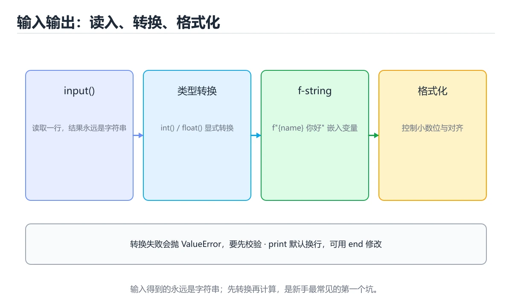
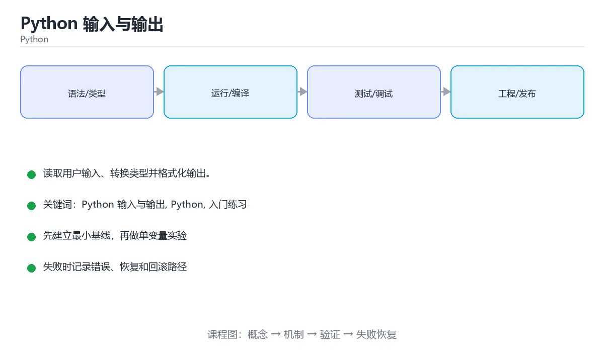

# Python 输入与输出

> 内容更新时间：2026-10-06 · 学习阶段：入门 · 预计用时：35 分钟





## 本节知识框架

今天的目标：**让你的程序能跟用户"对话"——接收输入、处理数据、输出结果。**

学完这一课，你会：
- 用 `input()` 让用户输入内容
- 理解为什么 `input()` 返回的是字符串，以及怎么转成数字
- 用 f-string 格式化输出，让结果更美观
- 处理用户输入时的常见错误

**先修与衔接**：本课是 Python 分类的第 2 课。先修：《Python 第一个脚本》。下一课：《Python 条件判断》。

### 复习清单

- [ ] 能用 `input()` 接收用户输入
- [ ] 能把字符串转成整数或浮点数
- [ ] 能用 f-string 格式化输出

## 核心概念定义

先认识几个名词，后面会反复遇到：

| 术语 | 一句话说明 |
| --- | --- |
| input | Python 内置函数，从键盘读取一行文字，返回值永远是字符串。 |
| 类型转换 | 用 `int()` 或 `float()` 把字符串转成数字，才能做数学运算。 |
| f-string | 格式化字符串，用 `f"..."` 在引号里直接嵌入变量，写法最简洁。 |
| strip | 字符串方法，去掉首尾的空格和换行符，避免用户多按空格导致判断出错。 |
| 标准输入输出 | 程序跟终端交换数据的通道：`input()` 读入，`print()` 输出。 |

## 原理与运行机制

### 你的程序怎么跟用户"对话"

```text
程序打印提示文字（print）
    ↓
用户在键盘输入内容，按回车
    ↓
input() 把输入的文字作为字符串返回
    ↓
程序处理数据（转换类型、计算）
    ↓
程序输出结果（print）
```

整个过程就像填表：程序问你一个问题（print 提示），你在表格里填答案（input 输入），程序拿到答案后处理并告诉你结果（print 输出）。

### input() 返回的永远是字符串

```python
age = input("请输入年龄：")
print(type(age))  # 输出：<class 'str'>
```

不管你输入的是 `18` 还是 `abc`，`input()` 都把它当字符串返回。这意味着你不能直接拿它做数学运算：

```python
age = input("年龄：")
print(age + 1)  # 报错！TypeError: can only concatenate str (not "int") to str
```

### 类型转换：把字符串变成数字

```python
age = input("年龄：")
age_num = int(age)  # 把字符串转成整数
print(age_num + 1)  # 现在可以做数学运算了
```

用 `int()` 把字符串转成整数，用 `float()` 转成浮点数。如果用户输入的不是数字，会报 `ValueError`：

```python
age = int(input("年龄："))  # 如果输入 abc，这里会报错
```

### 用 strip() 清理输入

```python
name = input("名字：").strip()
```

用户有时候会多按空格，比如输入 `" 小明  "`。`strip()` 去掉首尾的空白字符，得到 `"小明"`。这在判断用户是否输入了内容时特别有用：

```python
name = input("名字：").strip()
if not name:
    name = "匿名用户"
```

### f-string：最方便的格式化方式

```python
name = "小明"
age = 18
print(f"你好，{name}，你今年 {age} 岁")
```

在引号前加 `f`，就可以在引号里用 `{变量名}` 嵌入变量。这是 Python 3.6+ 推荐的格式化方式，写法最直观。

还能在 `{}` 里做简单的格式化：

```python
price = 99.5
print(f"价格：{price:.2f} 元")  # 保留 2 位小数，输出：价格：99.50 元
```

## 典型应用场景

`input()` 和 `print()` 组合起来能做很多事：

- **交互式小工具**：计算器、单位转换器、密码生成器
- **问卷调查**：收集用户信息并保存到文件
- **命令行游戏**：猜数字、文字冒险游戏
- **数据录入**：批量输入数据并处理

这些都不需要复杂的图形界面，在终端就能跑。

### 一个实际的小例子

让用户输入名字，打印欢迎信息：

```python
name = input("名字：").strip() or "world"
print(f"hello, {name}")
```

逐行解释：
- `input("名字：")`：打印提示文字，等待用户输入
- `.strip()`：去掉首尾空白
- `or "world"`：如果用户直接按回车（输入为空），就用 `"world"` 作为默认值
- `f"hello, {name}"`：把变量 `name` 嵌入字符串

运行效果：

```text
名字：小明
hello, 小明
```

## 代码/协议/SQL 示例

### 最小可运行示例

```python
name = input("名字：")
print(f"你好，{name}")
```

运行方式：保存为 `greet.py`，在终端执行：

```bash
python greet.py
```

输出：

```text
名字：小明
你好，小明
```

### 完整示例：简单的加法计算器

```python
# 让用户输入两个数字，打印它们的和
a = input("第一个数字：")
b = input("第二个数字：")

# 转换成数字
num_a = float(a)
num_b = float(b)

# 计算并输出
result = num_a + num_b
print(f"{a} + {b} = {result}")
```

逐行解释：

- `input("第一个数字：")`：提示用户输入，返回字符串
- `float(a)`：把字符串转成浮点数（支持小数）
- `num_a + num_b`：做加法运算
- `f"{a} + {b} = {result}"`：格式化输出，`{a}` 和 `{b}` 还是原来的字符串，`{result}` 是计算结果

运行效果：

```text
第一个数字：3.5
第二个数字：2
3.5 + 2 = 5.5
```

### 动手练一练

- 把加法计算器改成乘法、除法
- 让用户输入圆的半径，计算面积（公式：`3.14159 * r * r`）
- 故意输入字母而不是数字，看看报什么错，把报错信息抄下来

### 本课速查卡

| 复习项 | 本课要点 |
| --- | --- |
| 核心结论 | `input()` 返回字符串，需要转成数字才能运算；f-string 是最方便的格式化方式 |
| 最少要写的代码 | `name = input("名字："); print(f"你好，{name}")` |
| 怎么转成数字 | `int(字符串)` 转整数，`float(字符串)` 转浮点数 |
| 最常见的错误 | 忘记转换类型直接运算；用户输入非数字导致 `ValueError` |
| 出错先查什么 | 读报错信息，确认是不是类型问题 |
| 怎么确认学会了 | 写一个能接收输入并输出结果的程序 |

## 时间/空间复杂度或性能分析

本课的代码只是简单的输入输出，暂时不需要关心性能。

等你写到处理大量输入或文件时，再回来关注：
- **I/O 性能**：`input()` 是阻塞的，会等用户输入，不适合高频调用
- **内存**：一次性读入大量数据会占内存，可以用生成器逐行处理

现在记住一点就好：**先让程序能跑，再考虑优化。**

## 常见误区与易错点

| 容易犯的错误 | 会出现什么 | 怎么修 |
| --- | --- | --- |
| 直接用 `input()` 的结果做数学运算 | 报 `TypeError` | 先用 `int()` 或 `float()` 转换 |
| 用户输入非数字，转换时报错 | 报 `ValueError` | 用 `try/except` 捕获异常（后面会学） |
| 忘记 `strip()`，用户多按空格导致判断出错 | 条件判断不符合预期 | 在 `input()` 后加 `.strip()` |
| 用 `+` 拼接字符串和数字 | 报 `TypeError` | 用 f-string 或 `str()` 转换 |
| 用旧式格式化 `%` 或 `.format()` | 代码冗长，不易读 | 改用 f-string（Python 3.6+） |

### 遇到报错怎么办

1. **读报错信息**——`TypeError` 是类型问题，`ValueError` 是转换失败
2. **检查类型**——用 `type()` 看变量是什么类型
3. **转换类型**——用 `int()`、`float()` 或 `str()` 转换
4. **处理异常**——用 `try/except` 捕获转换失败的情况

## 与其他知识点的关系

本课学到的东西会被后面每一课反复用到：

- **下一课《Python 条件判断》**：你会学到 `if/else` 让代码做选择，结合 `input()` 可以做交互式程序
- **《Python 循环入门》**：用循环重复接收输入，处理批量数据
- **《Python 列表与字典》**：把用户输入的数据存到列表或字典里

现在你只需要记住一件事：**`input()` 接收输入返回字符串，转成数字才能运算，f-string 让输出更美观。**

## 自测题与参考答案

> 先独立作答，再对照答案。

### 自测 1

`input()` 函数的返回值默认是什么类型？

**答案**：字符串 `str`，需要手动转换成数字才能参与算术运算。

### 自测 2

在 `name = input("名字：").strip or "world"` 中，`strip` 的作用是？

**答案**：去掉输入首尾的空白字符，避免误判为空输入。

### 自测 3

围绕“Python 输入与输出”中的 Python 输入与输出、Python、入门练习，下列哪两项是本课强调的实践判断？

**答案**：学习 Python 输入与输出时要同时说明输入、输出和失败路径，不能只看正常流程；验证 Python 时要固定版本并覆盖边界输入，结论才可复现。

### 自测 4

下面这段 `python` 代码来自 `Python 输入与输出`。课程主线是读取用户输入、转换类型并格式化输出。代码与 `input` 有关。哪一项是代码里真实出现的内容？

```python
name = input("名字：").strip() or "world"
print(f"hello, {name}")
```

**答案**：出现字面量 `hello, {name}`。

### 自测 5

填空：`____`：从标准输入读入一行文本，返回值始终是字符串。

**答案**：input

## 术语速查

| 术语 | 一句话说明 |
| --- | --- |
| `input` | 从键盘读取一行文字，返回字符串 |
| `类型转换` | 用 `int()` 或 `float()` 把字符串转成数字 |
| `f-string` | 用 `f"..."` 在字符串里嵌入变量 |
| `strip` | 去掉字符串首尾的空白字符 |
| `标准输入输出` | `input()` 读入，`print()` 输出 |

## 考点精讲

`Python 输入与输出` 的题库有 5 道题，下面逐题给出题干、正确项与判断依据：先自己作答，再核对正确项，最后回到正文对应小节复核。

### 考点 1：第 1 题

- **题目**：input 函数的返回值默认是什么类型？
- **正确项**：字符串 str，需要手动转换成数字才能参与算术
- **判断依据**：本题正确项是字符串 str，需要手动转换成数字才能参与算术。术语 input（Python 输入与输出）：从标准输入读入一行文本，返回值始终是字符串，本题取字符串 str，需要手动转换成数字才能参与算术这条。易错点是忘记转换输入类型会造成字符串参与运算直接报错，改法是转换类型并处理转换失败，干扰项整数 int，输入小数时会自动截断取整正踩在这条上。

### 考点 2：第 2 题

- **题目**：在 name = input("名字：").strip or "world" 中，strip 的作用是？
- **正确项**：去掉输入首尾的空白字符，避免误判为空输入
- **判断依据**：本题正确项是去掉输入首尾的空白字符，避免误判为空输入。术语 input（Python 输入与输出）：从标准输入读入一行文本，返回值始终是字符串，本题取去掉输入首尾的空白字符，避免误判为空输入这条。易错点是忘记转换输入类型会造成字符串参与运算直接报错，改法是转换类型并处理转换失败，干扰项把输入中的英文单词拆成独立的列表项正踩在这条上。

### 考点 3：第 3 题

- **题目**：围绕“Python 输入与输出”中的 Python 输入与输出、Python、入门练习，下列哪两项是本课强调的实践判断？
- **正确项**：学习 Python 输入与输出 时要同时说明输入、输出和失败路径，不能只看正常流程；验证 Python 时要固定版本并覆盖边界输入，结论才可复现
- **判断依据**：本题正确项是学习 Python 输入与输出 时要同时说明输入、输出和失败路径，不能只看正常流程。术语 input（Python 输入与输出）：从标准输入读入一行文本，返回值始终是字符串，本题取学习 Python 输入与输出 时要同时说明输入、输出和失败路径，不能只看正常流程这条。易错点是忘记转换输入类型会造成字符串参与运算直接报错，改法是转换类型并处理转换失败，干扰项把 Python 的单次运行结果当成所有版本和规模都成立正踩在这条上。

### 考点 4：第 4 题

- **题目**：下面这段 `python` 代码来自 `Python 输入与输出`。课程主线是读取用户输入、转换类型并格式化输出。代码与 `input` 有关。哪一项是代码里真实出现的内容？
- **正确项**：出现字面量 `hello, {name}`
- **判断依据**：本题正确项是出现字面量 `hello, {name}`。术语 input（Python 输入与输出）：从标准输入读入一行文本，返回值始终是字符串，本题取出现字面量 `hello, {name}`这条。易错点是忘记转换输入类型会造成字符串参与运算直接报错，改法是转换类型并处理转换失败，干扰项出现字面量 `utf-8`正踩在这条上。

### 考点 5：第 5 题

- **题目**：填空：补齐下面这段术语说明中的空缺。课程 `读取用户输入、转换类型并格式化输出。`，这段说明是：`____`：从标准输入读入一行文本，返回值始终是字符串。空缺处应填哪个术语？
- **正确项**：input
- **判断依据**：涉及术语 input：从标准输入读入一行文本，返回值始终是字符串。易错点：忘记转换输入类型会造成字符串参与运算直接报错。正确做法：转换类型并处理转换失败。判断时先确认输入和适用范围，对照 `Python 输入与输出`、`Python`、`入门练习` 复现一次，最后把错误表现与正确做法逐项对照。

## 内容元数据

- 内容版本：v2.0
- 最后更新：2026-10-06
- 学习阶段：入门
- 适用环境：Python 3.12+
- 内容来源：内置结构化课程与工程实践整理
- 相关主题：Python 输入与输出、Python、入门练习

## 参考资料与复核

- 最后复核：2026-10-04
- 下次复核：2026-11-10

| 参考资料 | 本课用途 |
| --- | --- |
| [Python 官方教程 - 输入输出](https://docs.python.org/3/tutorial/inputoutput.html) | 官方输入输出指南 |
| [Python f-string 文档](https://docs.python.org/3/reference/lexical_analysis.html#f-strings) | f-string 语法参考 |
