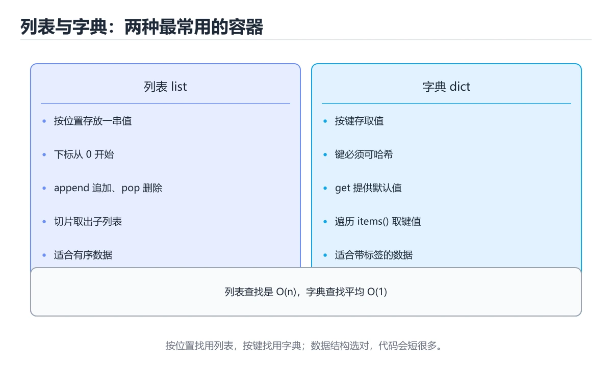
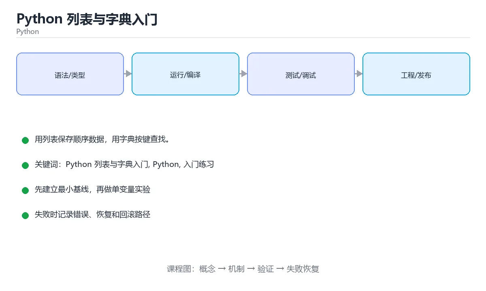

# Python 列表与字典入门

> 内容更新时间：2026-10-06 · 学习阶段：基础 · 预计用时：40 分钟





## 本节知识框架

前两课你学会了用 `for` 循环重复做事，用 `if` 做判断。但如果你要存一堆数据怎么办？总不可能给每个数据起一个变量名吧。

这节课解决的核心问题：**用列表保存顺序数据，用字典按键查找。**

学完这一课，你会：
- 会创建列表，用下标取出第几个元素
- 会往列表里添加、删除元素
- 会创建字典，用"键"直接找到对应的"值"
- 知道列表和字典各自适合什么场景

**先修与衔接**：本课是 Python 分类的第 5 课。先修内容：《Python 循环入门》——里面的 `for` 循环是遍历列表和字典的基础。下一课：《Python 字符串与编码》。

### 复习清单

- [ ] 能不看正文写出列表和字典的创建方式
- [ ] 能用下标和切片取出列表的一部分
- [ ] 能用 `dict.get()` 安全地读取字典

## 核心概念定义

先认识几个名词，后面会反复遇到：

| 术语 | 一句话说明 |
| --- | --- |
| 列表（list） | 一组按顺序排列的数据，像购物清单——每项有固定位置，可以随时加东西或删东西。 |
| 字典（dict） | 一组"名字-值"配对，像电话簿——你不需要记住第几页，只要知道名字就能找到电话号码。 |
| 索引 | 列表里每个元素的位置编号，从 0 开始。`fruits[0]` 就是取第一个元素。 |
| 切片 | 用 `list[a:b]` 截取列表的一段，区间左闭右开——包含第 a 个，但不包含第 b 个。 |
| 键值对 | 字典里的每一项，格式是 `键: 值`。键是唯一的名字，值是你想存的内容。 |
| 遍历 | 用 `for` 逐个访问容器里的元素。遍历列表时逐个拿到元素，遍历字典时默认拿到键。 |

## 原理与运行机制

### 列表像购物清单

想象你去超市之前写了一张购物清单：

```text
1. 苹果
2. 香蕉
3. 橘子
```

清单上的每一样东西都有固定位置（第 1 个、第 2 个……），你可以往末尾加新东西，也可以划掉某一项。Python 的列表就是这样——**有序、可变、按下标访问**。

```python
fruits = ["苹果", "香蕉", "橘子"]
print(fruits[0])   # 输出：苹果（第 0 个就是第一个）
print(fruits[-1])  # 输出：橘子（-1 表示最后一个）
```

注意：Python 的下标从 **0** 开始，不是从 1 开始。这跟很多语言一样，刚开始可能不习惯，多写几次就好了。

### 字典像电话簿

手机通讯录里，你不需要记住"张三排在第 37 个"，只要搜"张三"就能找到他的电话号码。Python 的字典就是这样——**按键查找，不靠位置**。

```python
phone = {
    "张三": "138-0000-1111",
    "李四": "139-0000-2222",
}
print(phone["张三"])  # 输出：138-0000-1111
```

字典里每一项都是 **键: 值** 的配对。键必须是唯一的，而且必须是"不可变"的类型（字符串、数字、元组都行，列表不行）。

### 列表和字典的核心区别

| 对比项 | 列表 list | 字典 dict |
| --- | --- | --- |
| 长什么样 | `[1, 2, 3]` | `{"name": "张三", "age": 20}` |
| 怎么取数据 | 按下标：`lst[0]` | 按键：`d["name"]` |
| 有没有顺序 | 有，元素按插入顺序排列 | Python 3.7+ 也保持插入顺序 |
| 适合什么场景 | 一堆同类型的东西排成一队 | 用名字找信息，像查表 |

### 列表的常用操作

```python
nums = [10, 20, 30]

# 增
nums.append(40)        # 末尾加一个 → [10, 20, 30, 40]
nums.insert(0, 5)      # 在位置 0 插入 → [5, 10, 20, 30, 40]

# 删
nums.pop()             # 删掉最后一个 → [5, 10, 20, 30]
nums.remove(10)        # 删掉第一个值为 10 的元素 → [5, 20, 30]

# 查
print(len(nums))       # 长度 → 3
print(20 in nums)      # 是否包含 → True

# 改
nums[0] = 99           # 把位置 0 改成 99 → [99, 20, 30]
```

### 字典的常用操作

```python
student = {"name": "小明", "age": 18}

# 增 / 改
student["score"] = 95         # 新增键值对
student["age"] = 19           # 已有键会被覆盖

# 查
print(student["name"])        # 直接取值，键不存在会报 KeyError
print(student.get("score"))   # 安全取值 → 95
print(student.get("phone", "无"))  # 键不存在时返回默认值 → "无"

# 删
del student["score"]          # 删除指定键值对

# 遍历
for key in student:
    print(key, student[key])

# 常用方法
print(student.keys())         # 所有键
print(student.values())       # 所有值
print(student.items())        # 所有键值对
```

### 切片：截取列表的一段

切片就像用剪刀从列表里剪出一截。语法是 `list[起始:结束]`，包含起始位置，不包含结束位置（左闭右开）。

```python
letters = ["a", "b", "c", "d", "e"]

print(letters[1:4])   # ["b", "c", "d"]  —— 位置 1 到 3
print(letters[:3])    # ["a", "b", "c"]  —— 从头到位置 2
print(letters[2:])    # ["c", "d", "e"]  —— 从位置 2 到末尾
print(letters[::2])   # ["a", "c", "e"]  —— 每隔一个取一个
```

记住口诀：**冒号左边包含，右边不包含**。

## 典型应用场景

列表和字典在实际编程中几乎无处不在，这里列几个初学者马上能用的：

- **存一组数据**：把用户输入的成绩、温度、价格存进列表，方便后续统计
- **查表**：用字典做中英文对照表、配置信息、商品价目表
- **统计词频**：遍历一段文字，用字典记录每个词出现了几次
- **批量处理**：把待办事项存成列表，用 `for` 循环逐个处理
- **数据组合**：列表里套字典，模拟一张简单的表格

### 一个实际的小例子

假设你要记录几种水果的价格，然后算出最贵的是多少：

```python
prices = {
    "苹果": 6,
    "香蕉": 3,
    "橘子": 5,
}

# 把所有价格取出来，放进列表
price_list = list(prices.values())
print(f"最贵的是 {max(price_list)} 元")
```

这段代码先建了一个字典，然后用 `.values()` 取出所有价格，转成列表后用 `max()` 找最大值。列表和字典经常这样配合使用。

## 代码/协议/SQL 示例

### 最小示例：创建列表和字典

```python
# 列表：方括号，逗号分隔
fruits = ["苹果", "香蕉", "橘子"]

# 字典：花括号，键:值
price = {"苹果": 6, "香蕉": 3}

print(fruits[0])      # 苹果
print(price["苹果"])   # 6
```

运行方式：保存为 `.py` 文件，在终端执行：

```bash
python 文件名.py
```

### 完整示例：水果店

```python
fruits = ["苹果", "香蕉", "橘子"]
fruits.append("葡萄")

price = {
    "苹果": 6,
    "香蕉": 3,
    "葡萄": 12,
}

for fruit in fruits:
    unit_price = price.get(fruit, 0)
    print(f"{fruit} 每斤 {unit_price} 元")

print(f"最贵的价格是 {max(price.values())} 元")
```

逐行解释：

- `fruits = ["苹果", "香蕉", "橘子"]`：创建列表，方括号包围，元素用逗号分开。
- `fruits.append("葡萄")`：在列表末尾加一项，列表变成 4 个元素。
- `price = {...}`：创建字典，每一项都是 `键: 值`，水果名是键，单价是值。
- `for fruit in fruits:`：逐个取出列表里的水果名。
- `price.get(fruit, 0)`：安全地查价格。如果键不存在，返回 0 而不是报错。
- `max(price.values())`：取出所有价格，找出最大值。

运行结果：

```text
苹果 每斤 6 元
香蕉 每斤 3 元
橘子 每斤 0 元
葡萄 每斤 12 元
最贵的价格是 12 元
```

注意"橘子"在列表里但不在字典里，用 `.get(fruit, 0)` 让它返回 0 而不是崩溃。如果直接用 `price[fruit]`，程序会在橘子这里报 `KeyError` 中断。

### 列表求和示例

```python
nums = [1, 2, 3]
total = sum(nums)
print(total)
```

输出：

```text
6
```

`sum()` 是内置函数，直接把列表里所有数字加起来。

### 动手练一练

- 给字典补上"橘子"的价格 `price["橘子"] = 5`，重新运行完整示例，观察输出变化
- 用 `price.get("西瓜", 0)` 查一个不存在的水果，确认返回的是默认值 0
- 创建一个列表 `scores = [88, 92, 75, 96]`，用 `sum(scores) / len(scores)` 算平均分
- 试试切片：`fruits[1:3]` 会取出哪几项？先猜再运行

### 本课速查卡

| 复习项 | 本课要点 |
| --- | --- |
| 核心结论 | 列表按顺序存放数据，用下标取用；字典按键存放键值对，用键直接查找 |
| 最少要写的代码 | `fruits = ["苹果", "香蕉", "橘子"]` |
| 列表取值 | `fruits[0]` 取第一个，`fruits[-1]` 取最后一个 |
| 字典安全取值 | `d.get(key, default)` 比 `d[key]` 更稳妥 |
| 最常见的错误 | 下标越界报 `IndexError`；键不存在报 `KeyError` |
| 出错先查什么 | 读第一条报错信息，确认是下标错了还是键写错了 |
| 怎么确认学会了 | 不看书，自己写一个列表和一个字典，完成增删查操作 |
| 接下来做什么 | 合上教程，凭记忆把水果店代码重写一遍再运行 |

## 时间/空间复杂度或性能分析

初学阶段不需要精确背数字，但了解大致开销有助于选对数据结构：

| 操作 | 列表 list | 字典 dict |
| --- | --- | --- |
| 按下标/键取值 | O(1) | O(1) 平均 |
| 在末尾添加 | O(1) 平均 | O(1) 平均 |
| 在开头插入 | O(n) 慢 | 不适用 |
| 检查"某值是否存在" | O(n) 逐个比 | O(1) 平均（检查键） |
| 遍历 | O(n) | O(n) |

简单记忆：**列表擅长按位置操作，字典擅长按名字查找。** 如果你经常需要"这个东西在不在"，用字典比用列表快得多。

## 常见误区与易错点

| 容易犯的错误 | 会出现什么 | 怎么修 |
| --- | --- | --- |
| `fruits[4]` 但列表只有 3 项 | 报 `IndexError: list index out of range` | 记住下标从 0 开始，最大下标是 `len-1` |
| `price["西瓜"]` 但字典里没有 | 报 `KeyError` | 用 `price.get("西瓜", 0)` 提供默认值 |
| 遍历列表时删除元素 | 漏掉元素或下标错乱 | 遍历副本 `for x in lst[:]`，或先收集要删的再处理 |
| `fruits["苹果"]` | 报 `TypeError`，列表下标必须是整数 | 列表用整数下标，字典才能用字符串键 |
| 用列表当字典的键 | 报 `TypeError: unhashable type: 'list'` | 字典的键必须是不可变类型（字符串、数字、元组） |
| `d = {}; d[key] = value` 之前没创建字典 | 报 `NameError` | 先写 `d = {}` 创建空字典 |

### 遇到报错怎么办

1. **读报错类型**：`IndexError` → 下标越界；`KeyError` → 键不存在；`TypeError` → 类型用错
2. **读报错指向的行号**：找到出问题的代码
3. **打印中间变量**：在出错之前加 `print()` 看看变量里到底是什么
4. **只改一处**：每次只修一个地方，重新运行看效果

## 与其他知识点的关系

本课学到的列表和字典是 Python 最基础的两个容器，后面几乎每一课都会用到它们：

- **《Python 字符串与编码》**：字符串可以看成"不可变的列表"，很多操作方式类似
- **《Python 控制流与推导式》**：会学到列表推导式，用一行代码生成新列表
- **《Python 数据结构进阶》**：深入讲解元组、集合，以及容器的拷贝与引用
- **《Python 函数》**：函数参数 `*args` 接收的就是元组，`**kwargs` 接收的就是字典

现在你只需要记住两件事：
- **要存一组有序的东西 → 用列表**
- **要用名字查信息 → 用字典**

## 自测题与参考答案

> 先独立作答，再对照答案。

### 自测 1

创建一个列表 `colors = ["红", "绿", "蓝"]`，写出取出第二个元素的代码。

**答案**：`colors[1]`，结果是 `"绿"`。下标从 0 开始，所以第二个元素的下标是 1。

### 自测 2

字典 `d = {"a": 1, "b": 2}`，写出不报错地取出键 `"c"` 的代码。

**答案**：`d.get("c", 0)` 或 `d.get("c")`（返回 None）。用 `.get()` 方法可以在键不存在时返回默认值，而不是抛出 `KeyError`。

### 自测 3

`nums = [10, 20, 30, 40, 50]`，写出 `nums[1:4]` 的结果。

**答案**：`[20, 30, 40]`。切片左闭右开，取位置 1、2、3 的元素。

### 自测 4

遍历列表时删除元素会怎样？应该怎么做？

**答案**：会漏掉元素或下标错乱。正确做法是遍历副本 `for item in lst[:]`，或者先收集要删的元素，遍历结束后再统一删除。

## 术语速查

| 术语 | 一句话说明 |
| --- | --- |
| `列表（list）` | 有序可变的数据集合，用方括号 `[]` 创建，按下标访问 |
| `字典（dict）` | 键值对集合，用花括号 `{}` 创建，按键查找 |
| `索引` | 元素在列表中的位置编号，从 0 开始，负数表示从末尾倒数 |
| `切片` | 用 `list[a:b]` 取出列表的一段，左闭右开 |
| `append` | 列表方法，在末尾添加一个元素 |
| `get` | 字典方法，安全取值，键不存在时返回默认值 |
| `遍历` | 用 `for` 逐个访问容器中的每个元素 |

## 考点精讲

`Python 列表与字典入门` 的题库有 5 道题，下面逐题给出题干、正确项与判断依据：先自己作答，再核对正确项，最后回到正文对应小节复核。

### 考点 1：第 1 题

- **题目**：围绕“Python 列表与字典入门”中的 Python 列表与字典入门、Python、入门练习，下列哪两项是本课强调的实践判断？
- **正确项**：验证 Python 时要固定版本并覆盖边界输入，结论才可复现；学习 Python 列表与字典入门 时要同时说明输入、输出和失败路径，不能只看正常流程
- **判断依据**：这道题检验本课的核心学习方法：不仅要会写列表和字典的正常用法，还要知道下标越界、键不存在这些失败路径怎么处理。

### 考点 2：第 2 题

- **题目**：按“Python 列表与字典入门”中 Python 列表与字典入门、Python、入门练习 的实践顺序，把四个步骤排成从准备到复盘的合理顺序。
- **正确项**：先明确 Python 列表与字典入门 的输入、输出与约束 → 写出最小示例并核对 Python 的基线结果 → 只改一个变量，记录边界与失败路径的变化 → 固定版本与证据，把“Python 列表与字典入门”的结论写成可复现记录
- **判断依据**：先建基线、再改一个变量、最后记录结论——这是验证列表和字典行为的通用流程。

### 考点 3：第 3 题

- **题目**：读取字典中可能不存在的键时，较稳妥的写法是？
- **正确项**：用 dict.get(key, default) 提供默认值
- **判断依据**：直接用 `d[key]` 在键不存在时会抛 `KeyError` 导致程序崩溃。`d.get(key, default)` 在键不存在时安静地返回默认值，是更稳妥的写法。

### 考点 4：第 4 题

- **题目**：运行下面的 Python 列表求和代码，控制台输出是什么？
- **正确项**：6
- **判断依据**：列表 `[1, 2, 3]` 用 `sum()` 求和，1 + 2 + 3 = 6。这是列表最基本的聚合操作。

### 考点 5：第 5 题

- **题目**：填空：补齐下面这段术语说明中的空缺。课程 `用列表保存顺序数据，用字典按键查找。`，这段说明是：`____`：用 list[a:b] 取出一段子序列，区间左闭右开。空缺处应填哪个术语？
- **正确项**：切片
- **判断依据**：这道题落在术语 `切片` 上：用 list[a:b] 取出一段子序列，区间左闭右开。切片是列表操作中最高频的技巧之一，记住"左闭右开"就够用。

## 内容元数据

- 内容版本：v2.0
- 最后更新：2026-10-06
- 学习阶段：基础
- 适用环境：Python 3.12+
- 内容来源：内置结构化课程与工程实践整理
- 相关主题：Python 列表与字典入门、Python、入门练习

## 参考资料与复核

- 最后复核：2026-10-04
- 下次复核：2026-11-10

| 参考资料 | 本课用途 |
| --- | --- |
| [Python 官方教程 - 数据结构](https://docs.python.org/3/tutorial/datastructures.html) | 列表与字典的官方入门指南 |
| [Python 标准库](https://docs.python.org/3/library/) | 内置模块和函数查阅 |
| [Python 教程](https://docs.python.org/3/tutorial/) | 语法、数据类型与控制流 |
