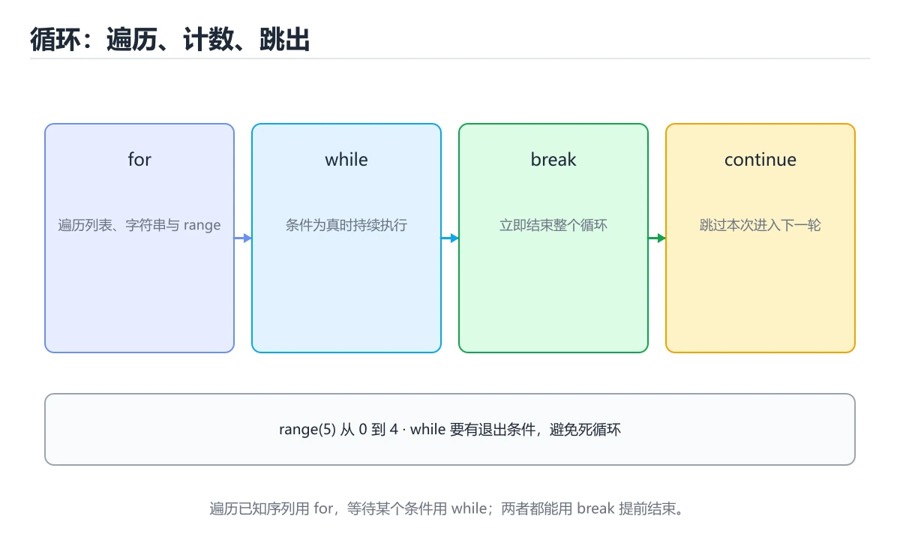
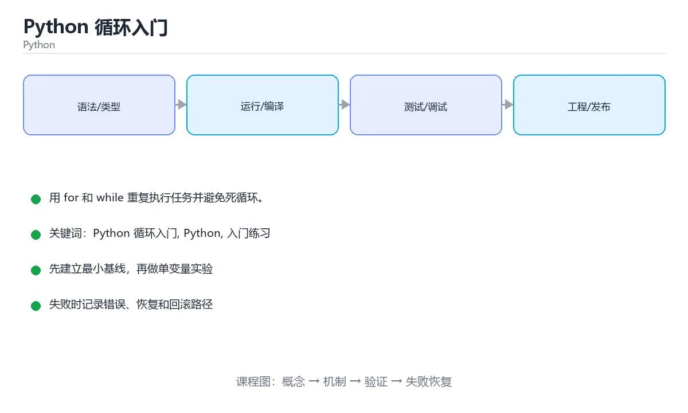

# Python 循环入门

> 内容更新时间：2026-10-06 · 学习阶段：入门 · 预计用时：40 分钟





## 本节知识框架

**本课目标**：掌握 `for` 循环、`while` 循环、`break` / `continue` 控制、`range()` 函数的用法，能写出正确的重复执行逻辑并避免死循环。

**先修**：《Python 输入与输出》——你需要会用 `print()` 和 `input()`，了解字符串与基本类型。
**下一课**：《Python 列表与字典入门》——循环会在那里用来遍历列表和字典。

学完本课你应当能够：

- 用 `for` 逐个处理列表或 `range()` 产生的数字序列
- 用 `while` 在条件满足时反复执行任务
- 用 `break` 提前退出循环，用 `continue` 跳过本轮
- 识别并修复死循环

## 核心概念定义

| 术语 | 一句话说明 |
| --- | --- |
| `for` 循环 | 把一组已知数量的东西逐个处理一遍（按点名册点名：名单上有几个人就点几次） |
| `while` 循环 | 只要条件为真就反复执行，直到条件变假（等水烧开：没开就继续等，开了就停） |
| `range()` | 生成一段整数序列，用来控制循环次数（像楼梯的台阶编号，从第几级到第几级） |
| `break` | 立即结束整个循环，跳到循环后面（找到东西就不找了，直接走人） |
| `continue` | 跳过本轮剩余语句，进入下一轮循环（翻到一页空白就跳过去，继续翻下一页） |
| 嵌套循环 | 循环里面再套一层循环（日历：外层是月，内层是日） |

## 原理与运行机制

### 循环就像重复做同一件事

想象你每天早上要刷牙。这件事的步骤是固定的：挤牙膏、刷 2 分钟、漱口。你不需要把"刷牙"这个动作写 365 遍——你只需要知道"每天都要做"，然后重复执行。

编程里的循环也是同样的道理。当你想让计算机重复做某件事时，不用把代码复制粘贴很多遍，而是用循环告诉它："把这段代码执行 N 遍"或者"一直做到条件不满足为止"。

### for 循环的执行流程

```text
开始
 ↓
取出序列中的下一个元素
 ↓
有元素吗？── 没有 → 结束循环，执行循环后面的代码
 ↓ 有
执行循环体（缩进的代码）
 ↓
回到"取出下一个元素"
```

`for` 循环的工作方式很简单：有一个序列（比如一组数字、一个列表），循环每次从里面拿出一个元素，交给循环体处理，拿完了就自动结束。

### while 循环的执行流程

```text
开始
 ↓
检查条件是否为真
 ↓
为假 → 结束循环
 ↓ 为真
执行循环体
 ↓
回到"检查条件"
```

`while` 循环不关心"有多少个元素"，它只关心"条件还成不成立"。所以你必须自己保证循环里有东西在改变条件，否则条件永远为真，程序就卡住了——这就是**死循环**。

### 从最简单的 for 开始

先看一个最基础的例子：

```python
for i in range(3):
    print(i)
```

输出：

```text
0
1
2
```

`range(3)` 产生 0、1、2 三个数字（注意不包含 3），`for` 依次把每个数字赋给变量 `i`，然后执行 `print(i)`。

### 加上累加逻辑

```python
total = 0
for i in range(1, 4):
    total = total + i
print(total)
```

执行过程拆解：

- 第一轮：`i = 1`，`total = 0 + 1 = 1`
- 第二轮：`i = 2`，`total = 1 + 2 = 3`
- 第三轮：`i = 3`，`total = 3 + 3 = 6`
- 循环结束，输出 `6`

### 用 while 实现同样的事

```python
total = 0
i = 1
while i <= 3:
    total = total + i
    i = i + 1      # 别忘了这行，否则 i 永远是 1
print(total)
```

对比 `for` 版本，`while` 需要你手动管理循环变量 `i`：先赋初值，再在循环体里更新它。好处是条件可以写得很灵活，坏处是忘了更新就会死循环。

### range() 的三种用法

```python
# Python 循环入门
range(5)          # 0, 1, 2, 3, 4

# 给两个参数：指定起点和终点（左闭右开）
range(1, 6)       # 1, 2, 3, 4, 5

# 给三个参数：加上步长
range(0, 10, 2)   # 0, 2, 4, 6, 8
```

记住一个口诀：**包含起点，不包含终点**。`range(1, 5)` 产生 1、2、3、4，不包含 5。这是新手最容易踩的坑。

### break 和 continue

`break` 用来提前退出循环——比如在一堆数据里找某个值，找到了就不用继续找了：

```python
for i in range(10):
    if i == 5:
        break
    print(i)
# 输出：0 1 2 3 4
```

`continue` 用来跳过本轮——比如遍历数字时跳过偶数：

```python
for i in range(6):
    if i % 2 == 0:
        continue
    print(i)
# 输出：1 3 5
```

### 嵌套循环

有时候你需要两层循环。比如打印一个 3×3 的坐标网格：

```python
for x in range(3):
    for y in range(3):
        print(f"({x},{y})", end=" ")
    print()
```

输出：

```text
(0,0) (0,1) (0,2)
(1,0) (1,1) (1,2)
(2,0) (2,1) (2,2)
```

外层循环每走一步，内层循环要完整跑一遍。所以 3×3 的嵌套循环，循环体总共执行 9 次。

## 典型应用场景

### 场景一：逐个打印列表中的元素

```python
fruits = ["苹果", "香蕉", "橘子"]
for fruit in fruits:
    print(fruit)
```

这是 `for` 循环最自然的用法——有一组东西，逐个处理。

### 场景二：计数 N 次

```python
for i in range(5):
    print(f"第 {i + 1} 次")
```

当你不关心具体的元素、只需要"重复 5 次"时，`range()` 是最好的搭档。

### 场景三：累加求和

```python
total = 0
for n in range(1, 101):
    total += n
print(total)  # 5050
```

准备一个累加器 `total`，每次循环把新值加进去。这是后续学数据处理的基础模式。

### 场景四：遍历文件每一行

```python
with open("data.txt", encoding="utf-8") as f:
    for line in f:
        print(line.strip())
```

文件对象本身是可迭代的，`for` 每次读一行，不需要手动管理读取位置。

## 代码/协议/SQL 示例

### 最小可运行示例

```python
for i in range(3):
    print(i)
```

预期输出：

```text
0
1
2
```

### 完整示例：for + while + break + continue

```python
# 用 for 循环累加 1 到 5
total = 0
for n in range(1, 6):
    total += n
print(f"1 到 5 的和：{total}")  # 15

# 用 while 循环倒计时
countdown = 5
while countdown > 0:
    print(countdown)
    countdown -= 1
print("出发！")

# break 示例：找到第一个大于 3 的数就停
for x in [1, 2, 4, 5, 6]:
    if x > 3:
        print(f"找到了：{x}")
        break

# continue 示例：只打印奇数
for x in range(1, 7):
    if x % 2 == 0:
        continue
    print(x)
```

### 动手练一练

1. 把 `range(1, 6)` 改成 `range(1, 11)`，先心算总和，再运行验证。
2. 在 `for` 循环里加判断：遇到 3 就跳过，看看 `continue` 的效果。
3. 写一个 `while` 循环，条件改成 `True` 但忘记更新变量，观察死循环现象，然后用 `Ctrl+C` 强制停止。

### 本课速查卡

| 复习项 | 本课要点 |
| --- | --- |
| for 循环 | 遍历已知序列，次数由元素个数决定 |
| while 循环 | 条件为真就执行，必须自己保证条件会变假 |
| range() | `range(n)` 从 0 到 n-1；`range(start, stop, step)` 自定义 |
| break | 结束整个循环 |
| continue | 跳过本轮，进入下一轮 |
| 最常见错误 | `range(1, 5)` 以为包含 5；while 忘记更新变量 |
| 出错先查什么 | 先看报错信息的最后一行，再检查循环变量有没有更新 |
| 怎么确认学会了 | 合上课本，自己写出累加 1 到 100 的代码并运行 |

## 时间/空间复杂度或性能分析

对初学者来说，先关心**跑对**，再关心**跑快**。

不过你可以建立一个直觉：

- 循环执行 N 次，循环体里是简单操作 → 时间大致与 N 成正比，记作 O(N)。
- 嵌套循环，外层 M 次、内层 N 次 → 循环体执行 M×N 次，记作 O(M×N)。
- `for item in list` 和 `for i in range(len(list))` 速度差不多，但前者更易读。
- 在循环里反复用 `+=` 拼接字符串会每次都创建新对象，数据量大时明显变慢；更好的做法是收集到列表里，最后用 `"".join()` 一次拼好。

一句话原则：**先让程序正确运行，遇到性能瓶颈再用工具测量，不要凭感觉优化。**

## 常见误区与易错点

| 误区 | 实际现象 | 正确做法 |
| --- | --- | --- |
| `range(1, 5)` 以为会到 5 | 只产生 1, 2, 3, 4，少算一个 | 记住"左闭右开"，要包含 5 就写 `range(1, 6)` |
| while 循环忘记更新条件变量 | 死循环，程序卡住不动 | 每次循环体里都要有让条件趋向结束的操作 |
| 用下标遍历列表 | `for i in range(len(lst))` 代码冗长又容易越界 | 直接 `for item in lst`；需要下标时用 `enumerate()` |
| 循环里用 `=` 覆盖而不是 `+=` 累加 | 每次冲掉之前的结果，最后只剩最后一个值 | 分清"赋值"和"累加"，累加用 `+=` |
| 混淆 break 和 continue | 该退出时只跳过了本轮，该跳过时却退出了整个循环 | `break` = 彻底结束；`continue` = 跳过本轮 |
| 嵌套循环里变量名冲突 | 内外层用了同一个变量名，逻辑混乱 | 内外层用不同的变量名，比如外层 `i`、内层 `j` |

## 与其他知识点的关系

**先修依赖**：

- 《Python 输入与输出》：你需要会 `print()` 来观察循环输出，会 `input()` 来在循环中读取用户输入。
- 《Python 条件判断》：`while` 的条件、`break` / `continue` 后面的 `if` 都用到了 `if-elif-else` 和布尔表达式。

**后续衔接**：

- 《Python 列表与字典入门》：用 `for` 遍历列表和字典是下一课的核心操作。
- 《Python 函数》：循环经常写在函数体里，返回值可以终止循环的效果。
- 《Python 异常处理与文件操作》：用 `for line in file` 逐行读文件，用 `while` 做重试逻辑。

**概念对比**：

- `for` vs `while`：已知次数或有序列用 `for`；不知道要循环多少次、只知退出条件用 `while`。
- `break` vs `continue`：`break` 跳出整个循环，`continue` 只跳出当前这一轮。

## 自测题与参考答案

> 先独立作答，再对照参考答案。

### 自测 1

写一段代码，用 `for` 循环打印列表 `["a", "b", "c"]` 的每个元素。

**参考答案**：

```python
items = ["a", "b", "c"]
for item in items:
    print(item)
```

### 自测 2

用 `while` 循环计算 1+2+3+4+5 的结果。

**参考答案**：

```python
total = 0
i = 1
while i <= 5:
    total += i
    i += 1
print(total)  # 15
```

### 自测 3

解释为什么下面这段代码会变成死循环，怎样修复？

```python
x = 10
while x > 0:
    print(x)
```

**参考答案**：循环体里没有修改 `x` 的值，`x` 永远是 10，条件永远为真。修复方法：在循环体里加上 `x -= 1`。

### 自测 4

`range(2, 10, 3)` 会产生哪些数字？

**参考答案**：2, 5, 8。起点是 2，步长是 3，下一个是 5，再下一个是 8，再加 3 就是 11 已经超出终点 10，所以停止。

## 复习清单

- [ ] 能不看正文复述本课核心术语，并指出一个边界或反例
- [ ] 能默写本课最重要的代码示例，并解释每一行的作用
- [ ] 能说出本课内容和前后两课的联系

## 术语速查

| 术语 | 一句话说明 |
| --- | --- |
| `for` 循环 | 遍历序列或可迭代对象，次数由元素个数决定 |
| `while` 循环 | 条件为真时反复执行循环体，需要自己保证条件最终会变假 |
| `range()` | 生成整数序列，常用 `range(n)` 或 `range(start, stop, step)` 控制次数 |
| `break` | 立即结束整个循环，跳到循环后面的代码 |
| `continue` | 跳过本轮剩余语句，进入下一轮循环 |
| 嵌套循环 | 循环内部再包含循环，总执行次数等于各层次数之积 |
| 死循环 | 条件永远为真导致循环无法结束，通常要检查更新语句是否被执行 |

## 考点精讲

本课题库有 5 道题，下面逐题给出题干、正确项与判断依据。先自己作答，再核对答案。

### 考点 1：第 1 题

- **题目**：围绕“Python 循环入门”中的 Python 循环入门、Python、入门练习，下列哪两项是本课强调的实践判断？
- **正确项**：验证 Python 时要固定版本并覆盖边界输入，结论才可复现；学习 Python 循环入门 时要同时说明输入、输出和失败路径，不能只看正常流程
- **判断依据**：本题正确项是验证 Python 时要固定版本并覆盖边界输入，结论才可复现。术语 for 循环（Python 循环入门）：遍历序列或可迭代对象，次数由元素个数决定，本题取验证 Python 时要固定版本并覆盖边界输入，结论才可复现这条。易错点是`range(1, 5)` 以为会到 5，会造成只产生 1, 2, 3, 4，少算一个，改法是记住"左闭右开"，要包含 5 就写 `range(1, 6)`。

### 考点 2：第 2 题

- **题目**：while 循环可能变成死循环，最直接的原因是？
- **正确项**：循环条件始终为真，循环体没有让它趋向结束
- **判断依据**：本题正确项是循环条件始终为真，循环体没有让它趋向结束。术语 while 循环（Python 循环入门）：条件为真时反复执行循环体，需要自己保证条件最终会变假，本题取循环条件始终为真，循环体没有让它趋向结束这条。易错点是while 循环忘记更新条件变量，会造成死循环，程序卡住不动，改法是每次循环体里都要有让条件趋向结束的操作。

### 考点 3：第 3 题

- **题目**：按“Python 循环入门”中 Python 循环入门、Python、入门练习 的实践顺序，把四个步骤排成从准备到复盘的合理顺序。
- **正确项**：先明确 Python 循环入门 的输入、输出与约束 → 写出最小示例并核对 Python 的基线结果 → 只改一个变量，记录边界与失败路径的变化 → 固定版本与证据，把“Python 循环入门”的结论写成可复现记录
- **判断依据**：本题正确项是写出最小示例并核对 Python 的基线结果。术语 for 循环（Python 循环入门）：遍历序列或可迭代对象，次数由元素个数决定，本题取写出最小示例并核对 Python 的基线结果这条。易错点是用下标遍历列表会造成代码冗长又容易越界，改法是直接遍历元素，需要位置时用带索引的遍历。

### 考点 4：第 4 题

- **题目**：运行下面的 Python 循环代码，控制台输出是什么？
- **正确项**：0 换行 1 换行 2
- **判断依据**：本题正确项是0 换行 1 换行 2。术语 for 循环（Python 循环入门）：遍历序列或可迭代对象，次数由元素个数决定，本题取0 换行 1 换行 2这条。易错点是循环里用 `=` 覆盖而不是 `+=` 累加，会造成每次冲掉之前的结果，最后只剩最后一个值，改法是分清"赋值"和"累加"，累加用 `+=`。

### 考点 5：第 5 题

- **题目**：填空：补齐下面这段术语说明中的空缺。课程 `用 for 和 while 重复执行任务并避免死循环。`，这段说明是：生成整数序列，常用 `____`(n) 或 `____`(start, stop, step) 控制次数。空缺处应填哪个术语？
- **正确项**：range
- **判断依据**：涉及术语 range：生成整数序列，常用 range(n) 或 range(start, stop, step) 控制次数。易错点：用下标遍历列表会造成代码冗长又容易越界。正确做法：直接遍历元素，需要位置时用带索引的遍历。判断时先确认输入和适用范围，对照 `Python 循环入门`、`Python`、`入门练习` 复现一次，最后把错误表现与正确做法逐项对照。

## 内容元数据

- 内容版本：v2.0
- 最后更新：2026-10-06
- 学习阶段：入门
- 适用环境：Python 3.12+
- 内容来源：内置结构化课程与工程实践整理
- 相关主题：Python 循环入门、Python、入门练习

## 参考资料与复核

- 最后复核：2026-10-04
- 下次复核：2026-11-10
- 来源性质：官方文档、权威教材

| 参考资料 | 本课用途 |
| --- | --- |
| [Python 官方教程 - 控制流](https://docs.python.org/3/tutorial/controlflow.html) | for、while、range、break、continue 的官方说明 |
| [Python 标准库 - builtins](https://docs.python.org/3/library/functions.html) | range()、enumerate() 等内置函数文档 |
| [Python 标准库](https://docs.python.org/3/library/) | 标准库 API 与模块 |
