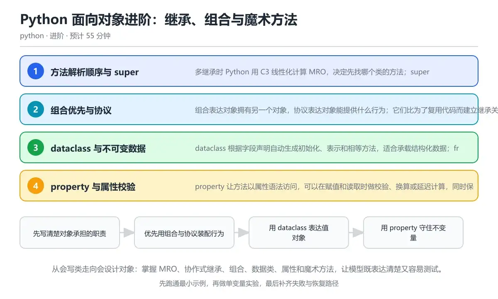
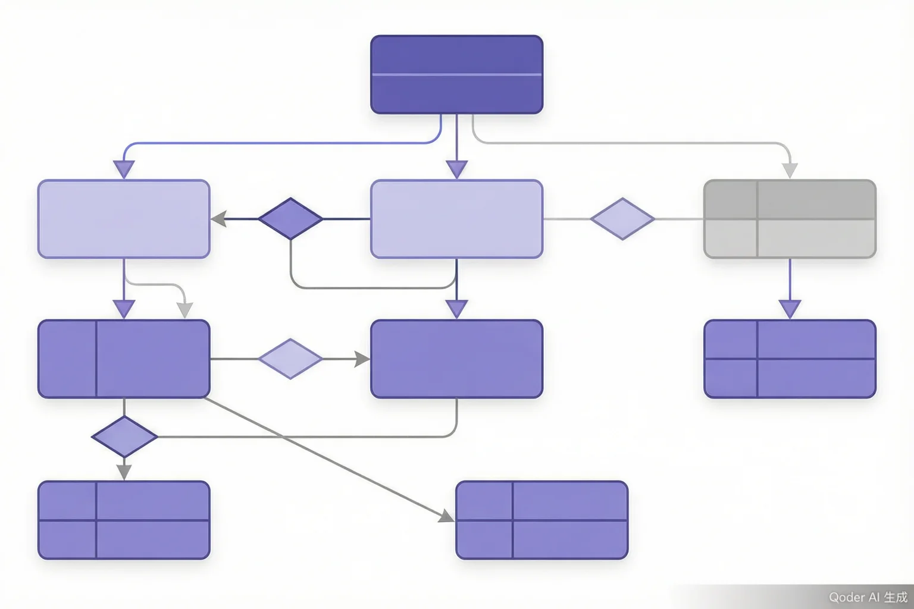

# Python 面向对象进阶：继承、组合与魔术方法

> 内容更新时间：2026-10-06 · 学习阶段：进阶 · 预计用时：60 分钟
>
> 欢迎来到 Python 面向对象进阶课堂！这节课我们会用生活中的类比，把"继承、多态、魔法方法"这些听起来高大上的概念，变成你一看就懂、一写就会的东西。



## 本节知识框架

**课程定位**：所属分类 `python`（Python），课程主题 `Python 面向对象进阶（继承、多态与魔法方法）`，学习阶段 进阶，建议用时 60 分钟。

**本课主线**：从"会写类"走向"会设计对象"——掌握 MRO、协作式继承、组合、数据类、属性和魔法方法，让你的模型既表达清楚又容易测试。

**打个比方**：想象你在开一家餐厅。"类与对象"教你怎么做一道菜（基本语法）；而本课要教你的是——怎么设计整个菜单体系（继承），怎么让同一句"上菜！"在不同窗口有不同含义（多态），以及怎么让你的菜品对象自动融入 Python 的内置操作（魔法方法）。

**学完本课应当能够**：
- 说清 `MRO` 与 `super` 的含义与区别，并各举一个正例和一个反例。
- 用本课示例验证 `Protocol` 的行为，记录输入、输出与失败条件。
- 遇到"用继承复用代码"这类问题时，能说出触发条件与修复顺序。

**先修与衔接**：本课是 Python 分类的第 17 课。先修内容：《类与对象》。相关或后续课程：《Python 容器进阶、拷贝与默认参数》、《Python 项目架构：分层、配置与依赖注入》。

## 核心概念定义

| 术语 | 通俗定义（一句话） | 类比 | 常见边界与风险 |
| --- | --- | --- | --- |
| MRO | 类的方法解析顺序元组，决定属性与方法按什么顺序查找。 | 就像家族族谱的"查人顺序"——找人办事时先问谁、再问谁。 | 只在"类的方法解析顺序元组，决定属性与方法按什么顺序查找"这一前提下成立，换输入或换环境要重新验证。 |
| super | 沿当前实例的 MRO 查找下一个实现的代理对象，用于协作式继承。 | 就像接力赛跑中"把棒交给下一个人"——不是交给爸妈，而是交给 MRO 队列中的下一位。 | 易错：在《Python 面向对象进阶（继承、多态与魔法方法）》里采用"某一层重写方法后完全不调用 super，后面的混入逻辑被跳过"时，super 调用链被中断会表现为错误结果、异常中断或状态不一致；正确做法是协作式继承中每一层都调用 super 并正确传递参数，用测试覆盖完整链。 |
| Protocol | typing 提供的结构化接口描述，只关心对象是否具备某些方法。 | 就像招聘要求"会游泳、会骑车"——不看你毕业证，只看你会什么。 | 只在"typing 提供的结构化接口描述，只关心对象是否具备某些方法"这一前提下成立，换输入或换环境要重新验证。 |
| dataclass | 根据字段声明自动生成常用方法的装饰器，适合表达结构化数据。 | 就像填表格——你只写"姓名、年龄、地址"，表格自动帮你生成打印格式和对比规则。 | 易错：在《Python 面向对象进阶（继承、多态与魔法方法）》里采用"在 dataclass 字段上直接写 tags: list = []，定义阶段就报错或产生共享"时，数据类使用可变默认值会表现为错误结果、异常中断或状态不一致；正确做法是使用 field(default_factory=list)，让每个实例创建独立容器。 |
| property | 把方法包装成属性访问的描述符，可分别定义读取、赋值和删除行为。 | 就像酒店保险箱——你看到的是"放进去、取出来"的简单操作，背后有身份验证和日志记录。 | 只在"把方法包装成属性访问的描述符，可分别定义读取、赋值和删除行为"这一前提下成立，换输入或换环境要重新验证。 |
| 魔法方法 | 以双下划线包围的方法，由 Python 语法或内置函数自动调用以接入通用协议。 | 就像"暗号"——你说"长度"，Python 自动去找 `__len__`；你说"打印"，Python 自动去找 `__str__`。 | 易错：在《Python 面向对象进阶（继承、多态与魔法方法）》里采用"为了复用几个工具函数，让业务类继承一个庞大的基类，耦合不断扩散"时，用继承复用代码会表现为错误结果、异常中断或状态不一致；正确做法是把行为拆成独立组件，通过组合或协议注入，只保留真正的是一种关系。 |

## 原理与运行机制

### 机制总览

本课涉及 5 个核心机制，我们一个个用生活场景来理解。



### 1. 方法解析顺序（MRO）与 super——"家族族谱与接力赛"

**生活类比**：想象一个大家族，爷爷、爸爸、妈妈和你住在一起。你要找一把螺丝刀，你会按什么顺序找？先问自己有没有，再问妈妈，再问爸爸，最后问爷爷。这个"查找顺序"就是 MRO。

**技术原理**：多继承时 Python 用 C3 线性化算法计算 MRO，决定先找哪个类的方法。`super()` 不是简单地找"父类"，而是沿着 MRO 队列找"下一个"类。

**验证方法**：定义 B 和 C 都继承 A，让 D 同时继承 B 和 C，每层方法拼接自己的标记，观察调用链按 MRO 展开。

```python
class A:
    def hello(self):
        return "A"

class B(A):
    def hello(self):
        return "B+" + super().hello()

class C(A):
    def hello(self):
        return "C+" + super().hello()

class D(B, C):
    pass

print(D().hello())      # 输出: B+C+A
print(D.__mro__)        # 查看方法解析顺序
```

**边界**：MRO 不能解决职责混乱；菱形继承中如果某一层不调用 super，后面的实现就被跳过。

**工程建议**：优先使用单继承加协议，多继承只用于混入小而正交的能力，并用测试固定协作链行为。

### 2. 组合优先与协议——"乐高积木比万能工具更灵活"

**生活类比**：你想做一杯"加冰的拿铁"。继承的思路是造一台"加冰拿铁机"；组合的思路是拿一台咖啡机 + 一个冰块盒，按需搭配。哪个更灵活？显然是后者。

**技术原理**：组合表达"对象拥有另一个对象"，协议表达"对象能提供什么行为"。把可变行为注入构造函数后，运行时可以替换实现，测试时可以传入假对象。`typing.Protocol` 用结构化类型描述接口，静态检查不需要真实继承。

```python
from typing import Protocol

class PriceRule(Protocol):
    def final_price(self, amount: float) -> float: ...

class Discount:
    def __init__(self, percent: float):
        self.percent = percent
    def final_price(self, amount: float) -> float:
        return round(amount * (1 - self.percent / 100), 2)

class Order:
    def __init__(self, rule: PriceRule, items=None):
        self.rule = rule
        self._items = list(items or [])
    def quote(self) -> float:
        return self.rule.final_price(sum(self._items))
```

**边界**：协议只描述形状，不会自动检查实现是否正确；运行时仍要处理方法缺失、返回值类型错误等边界。

### 3. dataclass 与不可变数据——"自动填表神器"

**生活类比**：你去银行开户，柜员给你一张表格，你只需要填"姓名、身份证号、地址"，其他信息（开户时间、客户编号）系统自动生成。`dataclass` 就是 Python 的"自动填表"。

**技术原理**：`dataclass` 根据字段声明自动生成 `__init__`、`__repr__`、`__eq__` 等方法。`frozen=True` 让对象不可变，`slots=True` 节省内存。

```python
from dataclasses import dataclass, field

@dataclass(frozen=True)
class Point:
    x: float
    y: float

@dataclass
class Order:
    items: list = field(default_factory=list)
    # 不要写 items: list = [] ！所有实例会共享同一个列表
```

**边界**：`frozen` 只阻止字段重新绑定，字段内部的列表仍然可变；需要深层不可变时要选择元组或专门的不可变容器。

### 4. property 与属性校验——"带门卫的属性"

**生活类比**：你家的温度调节器。你看到的是"设定温度"这个简单操作，但背后有传感器校验、安全保护、日志记录。`property` 就是给属性装上了"门卫"。

**技术原理**：`property` 是描述符，读操作调用 getter，写操作调用 setter，删除调用 deleter。把内部值放在带下划线的属性里可以避免无限递归。

```python
class Wallet:
    def __init__(self, cents: int):
        self._cents = cents

    @property
    def cents(self) -> int:
        return self._cents

    @cents.setter
    def cents(self, value: int):
        if value < 0:
            raise ValueError("金额不能为负数")
        self._cents = value
```

**边界**：属性不应隐藏昂贵的远程调用；setter 里做太多副作用会让赋值难以预测。

### 5. 魔法方法与语言协议——"让自定义对象说 Python 的语言"

**生活类比**：你去国外旅行，学会了当地语言的"你好""谢谢""多少钱"——这些"暗号"让你能融入当地生活。魔法方法就是 Python 世界的"暗号"：实现了 `__len__`，你的对象就能用 `len()`；实现了 `__iter__`，就能用 `for` 循环遍历。

**技术原理**：`len(obj)` 调用 `__len__`，`for` 循环调用 `__iter__`，`with` 调用 `__enter__` 和 `__exit__`，`print` 优先调用 `__str__`，调试显示调用 `__repr__`，运算符对应 `__add__`、`__eq__` 等方法。

```python
class ShoppingCart:
    def __init__(self):
        self._items = []

    def add(self, item):
        self._items.append(item)

    def __len__(self):
        return len(self._items)

    def __repr__(self):
        return f"ShoppingCart({self._items!r})"

    def __str__(self):
        return f"购物车里有 {len(self._items)} 件商品"
```

**边界**：实现 `__eq__` 后默认不再可哈希，需要时显式实现 `__hash__`；魔法方法应遵守 Python 的返回约定，否则其他库会工作异常。

```text
先写清楚对象承担的职责 → 优先用组合与协议装配行为 → 用 dataclass 表达值对象 → 用 property 守住不变量 → 按需实现魔法方法并补测试
```

## 典型应用场景

### 场景 1：MRO 与 super——多继承中的方法调用

**什么时候用**：当你需要让多个"混入类"（Mixin）协同工作时。比如一个类既要能序列化（JSONMixin），又要能日志记录（LogMixin），还要有基础业务逻辑。

```python
class LogMixin:
    def process(self):
        print(f"[LOG] 开始处理 {self.__class__.__name__}")
        return super().process()

class JsonMixin:
    def process(self):
        result = super().process()
        print(f"[JSON] 结果: {result}")
        return result

class BaseHandler:
    def process(self):
        return "处理完成"

class MyHandler(LogMixin, JsonMixin, BaseHandler):
    pass

handler = MyHandler()
handler.process()
# 输出:
# [LOG] 开始处理 MyHandler
# [JSON] 结果: 处理完成
```

### 场景 2：组合与协议——可替换的折扣策略

**什么时候用**：当你需要在运行时切换行为时。比如订单系统需要支持多种折扣策略。

```python
from typing import Protocol

class DiscountStrategy(Protocol):
    def calculate(self, total: float) -> float: ...

class NoDiscount:
    def calculate(self, total: float) -> float:
        return total

class TenPercentOff:
    def calculate(self, total: float) -> float:
        return round(total * 0.9, 2)

class Order:
    def __init__(self, items: list, strategy: DiscountStrategy):
        self.items = items
        self.strategy = strategy

    @property
    def total(self) -> float:
        return sum(self.items)

    def final_price(self) -> float:
        return self.strategy.calculate(self.total)

# 测试时可以轻松替换策略
order = Order([100, 50], NoDiscount())
assert order.final_price() == 150

order.strategy = TenPercentOff()
assert order.final_price() == 135.0
```

### 场景 3：dataclass——值对象的快速建模

**什么时候用**：当你需要一个主要用来"装数据"的对象时。比如坐标点、配置项、传输对象。

```python
from dataclasses import dataclass, field

@dataclass(frozen=True)
class Config:
    host: str
    port: int = 8080
    tags: list = field(default_factory=list)

# frozen=True 让对象不可变，适合做配置
config = Config("localhost")
# config.host = "new"  # 这会抛出 FrozenInstanceError
```

### 场景 4：property——属性校验与延迟计算

**什么时候用**：当你需要在赋值时做校验，或者需要延迟计算某个派生值时。

```python
class Student:
    def __init__(self, name: str, score: float):
        self.name = name
        self._score = score

    @property
    def score(self) -> float:
        return self._score

    @score.setter
    def score(self, value: float):
        if not 0 <= value <= 100:
            raise ValueError("成绩必须在 0-100 之间")
        self._score = value

    @property
    def grade(self) -> str:
        """延迟计算——每次读取时根据当前分数重新计算"""
        if self._score >= 90:
            return "A"
        elif self._score >= 80:
            return "B"
        elif self._score >= 60:
            return "C"
        return "D"
```

### 场景 5：魔法方法——让对象融入 Python 生态

**什么时候用**：当你希望自定义对象能像内置类型一样使用时。

```python
@dataclass
class Vector:
    x: float
    y: float

    def __add__(self, other):
        return Vector(self.x + other.x, self.y + other.y)

    def __eq__(self, other):
        return self.x == other.x and self.y == other.y

    def __hash__(self):
        return hash((self.x, self.y))

    def __abs__(self):
        return (self.x ** 2 + self.y ** 2) ** 0.5

    def __repr__(self):
        return f"Vector({self.x}, {self.y})"

v1 = Vector(1, 2)
v2 = Vector(3, 4)
print(v1 + v2)    # Vector(4, 6)
print(abs(v1))    # 2.236...
print(v1 == v2)   # False
```

## 代码/协议/SQL 示例

### 完整综合示例程

下面是一个把本课所有概念串在一起的综合示例。它展示了 MRO 调用链、Protocol 注入、dataclass 值对象、property 校验和魔法方法的协作。

```python
from dataclasses import dataclass, field
from typing import Protocol

# --- 1. Protocol：定义"折扣规则"的接口 ---
class PriceRule(Protocol):
    def final_price(self, amount: float) -> float: ...

# --- 2. dataclass：不可变的折扣数据对象 ---
@dataclass(frozen=True)
class Discount:
    percent: float

    def final_price(self, amount: float) -> float:
        return round(amount * (1 - self.percent / 100), 2)

# --- 3. 组合 + property：订单类 ---
class Order:
    def __init__(self, rule: PriceRule, items=None):
        self.rule = rule
        self._items = list(items or [])

    @property
    def total(self) -> float:
        return sum(self._items)

    def quote(self) -> float:
        return self.rule.final_price(self.total)

    # --- 4. 魔法方法 ---
    def __len__(self):
        return len(self._items)

    def __repr__(self):
        return f"Order(items={self._items!r})"

    def __str__(self):
        return f"订单({len(self)}件商品，合计{self.total}元)"

# --- 5. MRO 与 super：菱形继承演示 ---
class A:
    def hello(self):
        return "A"

class B(A):
    def hello(self):
        return "B+" + super().hello()

class C(A):
    def hello(self):
        return "C+" + super().hello()

class D(B, C):
    pass

# --- 运行验证 ---
print("MRO 调用链:", D().hello())
# 输出: MRO 调用链: B+C+A

order = Order(Discount(10), [100, 50])
print("报价:", order.quote())        # 输出: 报价: 135.0
print("对象表示:", repr(order))      # 输出: 对象表示: Order(items=[100, 50])
print("字符串:", str(order))         # 输出: 字符串: 订单(2件商品，合计150元)
print("长度:", len(order))           # 输出: 长度: 2
```

### 示例精读

- 在 MRO 示例中，`D().hello()` 的输出是 `B+C+A`，因为 MRO 顺序是 D → B → C → A，每一层都通过 `super()` 把控制权交给下一层。
- 在 Order 示例中，`Discount` 对象通过 Protocol 注入到 Order 中，测试时可以轻松替换为其他折扣规则。
- `__len__` 和 `__repr__` 让 Order 对象可以直接用 `len()` 和 `repr()` 操作，而不必暴露内部列表。

## 时间/空间复杂度或性能分析

### 性能关注点

Python 面向对象操作的主要成本来自：解释执行的开销、对象分配的内存、以及 MRO 查找的时间。

### 各项操作的性能特征

| 操作 | 时间复杂度 | 空间复杂度 | 说明 |
| --- | --- | --- | --- |
| MRO 计算 | O(N) | O(N) | 类创建时一次性计算，N 为继承链长度，后续查找直接查缓存 |
| 属性查找 | O(1) 均摊 | O(1) | 通过 `__dict__` 或 `__slots__` 查找，`__slots__` 更快更省内存 |
| `super()` 调用 | O(1) | O(1) | 基于 MRO 缓存直接定位下一个类 |
| `@property` 访问 | O(1) | O(1) | 描述符协议开销极小，但 getter/setter 内部逻辑可能更慢 |
| `dataclass` 生成 | O(K) | O(K) | 类定义时一次性生成，K 为字段数量 |
| 魔法方法调用 | O(1) | O(1) | 由 Python 解释器直接分派，无额外开销 |

### 测量方法

以本课的 MRO 场景为对象，固定输入跑一遍记录基线，再把继承深度或实例数量提高一个数量级复测；两次结果的差值与波动范围才是结论依据。

```python
import timeit

# 对比 __slots__ 与普通属性的内存和速度差异
setup = """
from dataclasses import dataclass

@dataclass
class PointNormal:
    x: float
    y: float

@dataclass(slots=True)
class PointSlots:
    x: float
    y: float
"""

print(timeit.timeit("PointNormal(1.0, 2.0)", setup=setup, number=100000))
print(timeit.timeit("PointSlots(1.0, 2.0)", setup=setup, number=100000))
```

**关键结论**：对于大量小对象（如坐标点、配置项），使用 `slots=True` 可以显著减少内存占用并提升创建速度。

## 常见误区与易错点

| 容易写错的做法 | 实际现象 | 原因与正确做法 |
| --- | --- | --- |
| 用继承复用代码 | 在《Python 面向对象进阶（继承、多态与魔法方法）》里采用"为了复用几个工具函数，让业务类继承一个庞大的基类，耦合不断扩散"时，用继承复用代码会表现为错误结果、异常中断或状态不一致。 | 把行为拆成独立组件，通过组合或协议注入，只保留真正的是一种关系 |
| 重写相等却不处理哈希 | 在《Python 面向对象进阶（继承、多态与魔法方法）》里采用"只实现 `__eq__`，随后对象放进集合或作为字典键时报 unhashable"时，重写相等却不处理哈希会表现为错误结果、异常中断或状态不一致。 | 按相等语义同步实现 `__hash__`，或把对象声明为不可变值对象 |
| 数据类使用可变默认值 | 在《Python 面向对象进阶（继承、多态与魔法方法）》里采用"在 dataclass 字段上直接写 tags: list = []，定义阶段就报错或产生共享"时，数据类使用可变默认值会表现为错误结果、异常中断或状态不一致。 | 使用 field(default_factory=list)，让每个实例创建独立容器 |
| super 调用链被中断 | 在《Python 面向对象进阶（继承、多态与魔法方法）》里采用"某一层重写方法后完全不调用 super，后面的混入逻辑被跳过"时，super 调用链被中断会表现为错误结果、异常中断或状态不一致。 | 协作式继承中每一层都调用 super 并正确传递参数，用测试覆盖完整链 |

### 误区 1：继承就是"复制粘贴代码"

**错在哪里**：很多人以为继承就是为了少写代码。其实继承表达的是"是一种"（is-a）关系。如果鸟"是一种"动物，那 Bird 继承 Animal 是对的；但如果 Order 只是"用到了"日志功能，那 Order 不应该继承 Logger。

**正确做法**：只在真正的"是一种"关系时使用继承，其他情况用组合。

### 误区 2：super 就是"调用父类"

**错在哪里**：`super()` 不是调用"父类"，而是沿 MRO 找"下一个类"。在菱形继承中，这个区别至关重要。

```python
# 错误理解：super() 调用父类
# 正确理解：super() 沿 MRO 找下一个实现

class Base:
    def method(self):
        print("Base")

class Left(Base):
    def method(self):
        print("Left 开始")
        super().method()  # 不是调用 Base！是沿 MRO 找下一个
        print("Left 结束")

class Right(Base):
    def method(self):
        print("Right 开始")
        super().method()
        print("Right 结束")

class Child(Left, Right):
    pass

Child().method()
# MRO: Child → Left → Right → Base
# 输出:
# Left 开始
# Right 开始
# Base
# Right 结束
# Left 结束
```

### 误区 3：实现了 `__eq__` 就万事大吉

**错在哪里**：实现了 `__eq__` 后，Python 会把 `__hash__` 设为 None。这意味着你的对象不能再放进 `set` 或作为 `dict` 的键。

```python
class Point:
    def __init__(self, x, y):
        self.x, self.y = x, y
    def __eq__(self, other):
        return (self.x, self.y) == (other.x, other.y)
    # 缺少 __hash__！

p = Point(1, 2)
# {p}  # TypeError: unhashable type: 'Point'

# 正确做法：同时实现 __hash__
class Point:
    def __init__(self, x, y):
        self.x, self.y = x, y
    def __eq__(self, other):
        return (self.x, self.y) == (other.x, other.y)
    def __hash__(self):
        return hash((self.x, self.y))
```

## 与其他知识点的关系

### 知识图谱

```text
类与对象（先修）
    ↓
本课：Python 面向对象进阶（继承、多态与魔法方法）
    ↓
Python 容器进阶、拷贝与默认参数（后续）
Python 项目架构：分层、配置与依赖注入（后续）
```

### 先修与后续

- **先修**：`类与对象`。本课默认你已经掌握了 `class`、`__init__`、实例属性等基本概念。
- **相关或后续**：`Python 容器进阶、拷贝与默认参数`、`Python 项目架构：分层、配置与依赖注入`。本课术语会在这些课程里继续使用。
- **术语归属**：`MRO`、`super`、`Protocol` 的定义以本课"核心概念定义"为准，换到其他课程时先确认定义是否被改写。

### 容易混淆的相邻概念

- **MRO 与 super**：MRO 是"查找顺序表"，super 是"沿这个表找下一个"的工具。一个静态，一个动态。
- **继承与组合**：继承是"是一种"（is-a），组合是"有一个"（has-a）。鸟"是一种"动物（继承），汽车"有一个"引擎（组合）。
- **Protocol 与 ABC**：Protocol 是"鸭子类型"的结构化版本（不需要显式继承），ABC 需要显式继承。
- **`__str__` 与 `__repr__`**：`__str__` 给用户看（友好），`__repr__` 给开发者看（精确）。

## 自测题与参考答案

> 先独立作答，再对照参考答案；答案都能在本课正文、术语表或错误表里找到依据。

### 自测 1（概念复述）

不看正文，写出 `MRO` 的操作性定义，并说明它与 `super` 的区别。

**参考答案**：MRO 是类的方法解析顺序元组，决定属性与方法按什么顺序查找。`super` 是沿当前实例的 MRO 查找下一个实现的代理对象，用于协作式继承。简单说，MRO 是"地图"，super 是"按地图走路的脚"。

### 自测 2（排错）

本课错误表记录了"用继承复用代码"这类做法。请写出它会出现的现象、根因，以及修复顺序。

**参考答案**：现象是"为了复用几个工具函数，让业务类继承一个庞大的基类，耦合不断扩散"；根因是把"工具复用"误当成了"是一种"关系；修复是把行为拆成独立组件，通过组合或协议注入，只保留真正的是一种关系。

### 自测 3（动手验证）

运行本课的综合示例，改动其中一个输入后重新运行，记录输出与错误信息。

**参考答案**：正常输入下示例应当复现正文给出的结果；改动输入后，如果结果改变或报错，先核对它是否满足 MRO 的适用范围，再检查错误表里是否有同类现象。

### 自测 4（代码阅读）

阅读本课的 MRO 示例，说明 D().hello() 为什么输出 "B+C+A" 而不是 "B+A"。

**参考答案**：因为 D 的 MRO 是 D → B → C → A。调用 D().hello() 进入 B.hello()，B 调用 super() 不是去找父类 A，而是沿 MRO 找下一个——也就是 C。C 再调用 super() 找到 A。所以结果是 B+C+A。

### 自测 5（迁移）

把本课的方法迁移到自己的项目：围绕 `MRO` 写出一个与错误表同类的风险点，并说明触发条件和检验方式。

**参考答案**：例如"super 调用链被中断"，它会导致"某一层重写方法后完全不调用 super，后面的混入逻辑被跳过"；检验方式是按"协作式继承中每一层都调用 super 并正确传递参数，用测试覆盖完整链"改一处再复现，确认现象消失且没有引入新的失败分支。

### 自测 6（对比）

用一个表格对比 `MRO` 与 `super`：各写一行适用场景、一行失败表现。

**参考答案**：

| 术语 | 适用场景 | 失败表现 |
| --- | --- | --- |
| MRO | 多继承时确定方法查找顺序 | 菱形继承中某层不调用 super，后续层被跳过 |
| super | 协作式继承中调用链上的下一个实现 | 调用链中断，后面的混入逻辑不执行 |

## 复习清单

- [ ] 能不看正文复述本课核心术语，并指出一个边界或反例
- [ ] 能默写本课最重要的代码示例，并解释每一行的作用
- [ ] 能说出本课内容和前后两课的联系


## 延伸阅读

想更直观地理解本课概念？推荐参阅以下图解专题：

- [图解内存布局：栈、堆与引用](visual_memory_layout.md)

## 术语速查

| 术语 | 一句话说明 |
| --- | --- | --- |
| `MRO` | 类的方法解析顺序元组，决定属性与方法按什么顺序查找。 | 家族族谱的查人顺序 |
| `super` | 沿当前实例的 MRO 查找下一个实现的代理对象，用于协作式继承。 | 接力赛跑交棒 |
| `Protocol` | typing 提供的结构化接口描述，只关心对象是否具备某些方法。 | 招聘要求"会什么" |
| `dataclass` | 根据字段声明自动生成常用方法的装饰器，适合表达结构化数据。 | 自动填表神器 |
| `property` | 把方法包装成属性访问的描述符，可分别定义读取、赋值和删除行为。 | 带门卫的属性 |
| `魔法方法` | 以双下划线包围的方法，由 Python 语法或内置函数自动调用以接入通用协议。 | Python 世界的"暗号" |

**术语关系**：`MRO`（方法解析顺序）→ `super`（沿 MRO 找下一个）→ `Protocol`（结构化接口）→ `dataclass`（自动数据类）→ `property`（属性描述符）→ `魔法方法`（语言协议接入）。

## 考点精讲

`Python 面向对象进阶（继承、多态与魔法方法）` 的题库有 6 道题，下面逐题给出题干、正确项与判断依据：先自己作答，再核对正确项，最后回到正文对应小节复核。

### 考点 1：第 1 题

- **题目**：D 继承 B 和 C，两者都继承 A 且每层调用 super，D().hello() 的输出是什么？
- **正确项**：B+C+A
- **判断依据**：这道题落在术语 `super` 上：沿当前实例的 MRO 查找下一个实现的代理对象，用于协作式继承。MRO 顺序为 D → B → C → A，每层通过 super() 把控制权交给下一个类，因此逐层拼接得到 B+C+A。复习时把 `super` 的定义、适用边界和一个反例一起说清楚，再回到"核心概念定义"核对原文。

### 考点 2：第 2 题

- **题目**：dataclass 中需要一个每个实例独立的列表字段，正确写法是？
- **正确项**：items: list = field(default_factory=list)
- **判断依据**：这道题落在术语 `dataclass` 上：根据字段声明自动生成常用方法的装饰器，适合表达结构化数据。列表是可变对象，直接写空列表会被所有实例共享，而且 dataclass 会阻止这种明显危险的默认值；默认工厂会在每次创建实例时调用一次，因此每个对象的列表互相独立。复习时把 `dataclass` 的定义、适用边界和一个反例一起说清楚，再回到"核心概念定义"核对原文。

### 考点 3：第 3 题

- **题目**：为什么组合和协议通常比深层继承更灵活？（多选）
- **正确项**：运行时可以替换具体实现；测试时可以注入假对象；避免把无关职责耦合进基类
- **判断依据**：这道题检验本课主问题：从会写类走向会设计对象：掌握 MRO、协作式继承、组合、数据类、属性和魔法方法，让模型既表达清楚又容易测试。组合允许在构造时注入不同实现，测试中可以用假对象隔离外部依赖，也避免为了复用一小段代码把所有职责拉进同一个基类。复习时先复述本课主问题，再举一个会让结论失效的输入。

### 考点 4：第 4 题

- **题目**：阅读类定义，哪个判断正确？  class Wallet:     def __init__(self, cents):         self._cents = cents     @property     def cents(self):         return self._cents

- **正确项**：cents 是只读属性，外部赋值会抛 AttributeError
- **判断依据**：这道题落在术语 `property` 上：把方法包装成属性访问的描述符，可分别定义读取、赋值和删除行为。只定义 getter 的 property 是只读的，外部执行 wallet.cents = 10 会抛出 AttributeError，从而保护内部金额不被随意改写。复习时把 `property` 的定义、适用边界和一个反例一起说清楚，再回到"核心概念定义"核对原文。

### 考点 5：第 5 题

- **题目**：为什么这个类放进 set 后报 unhashable？  class Point:     def __init__(self, x, y): self.x, self.y = x, y     def __eq__(self, other): return (self.x, self.y) == (other.x, other.y)

- **正确项**：实现 __eq__ 后默认的 __hash__ 会被置空，需要显式实现或使用冻结数据类
- **判断依据**：这道题检验本课主问题：从会写类走向会设计对象：掌握 MRO、协作式继承、组合、数据类、属性和魔法方法，让模型既表达清楚又容易测试。Python 认为可变相等语义与默认身份哈希不一致，因此在类中定义 `__eq__` 后会把 `__hash__` 设为 None，实例不再可哈希。复习时先复述本课主问题，再举一个会让结论失效的输入。

### 考点 6：第 6 题

- **题目**：以下关于 MRO 的说法，哪个是正确的？
- **正确项**：MRO 是类的方法解析顺序元组，决定属性与方法按什么顺序查找
- **判断依据**：这道题落在术语 `MRO` 上：类的方法解析顺序元组，决定属性与方法按什么顺序查找。MRO 在类创建时由 C3 线性化算法一次性计算，后续属性查找直接按此顺序进行。复习时把 `MRO` 的定义、适用边界和一个反例一起说清楚，再回到"核心概念定义"核对原文。

## 内容元数据

- 内容版本：v2.0
- 最后更新：2026-10-06
- 学习阶段：进阶

| 字段 | 值 |
| --- | --- |
| 课程 ID | `python_oop_advanced` |
| 所属分类 | `python` |
| 难度 | 进阶 |
| 预计用时 | 60 分钟 |
| 关键词 | MRO、super、继承、多态、魔法方法、dataclass、property、Protocol |
| 配图 | `images/lesson_python_oop_advanced.webp` |
| 参考资料 | 5 条 |
| 内容更新时间 | 2026-10-06 |

## 参考资料与复核

- 来源性质：官方文档、标准或权威教材；本课核对关键词：继承、多态、魔法方法、MRO、super、dataclass、property、Protocol。
- 最后复核：2026-10-04
- 下次复核：2026-12-10
- 复核范围：版本兼容、API 行为与工程实践

下面列出的资料用于核对本课结论，复习时可以对照阅读：
- [Python 数据模型与魔法方法](https://docs.python.org/3/reference/datamodel.html) — 官方数据模型文档，涵盖所有魔法方法（`__init__`、`__repr__`、`__eq__`、`__hash__` 等）的行为规范
- [Python dataclasses 文档](https://docs.python.org/3/library/dataclasses.html) — dataclass 装饰器的完整 API 参考，包括 frozen、slots、field 等参数
- [Python 类与继承教程](https://docs.python.org/3/tutorial/classes.html) — 官方继承与 MRO 入门教程
- [Python typing.Protocol 文档](https://docs.python.org/3/library/typing.html#typing.Protocol) — Protocol 结构化子类型规范的官方说明
- [Python 描述符指南（property 原理）](https://docs.python.org/3/howto/descriptor.html#properties) — property 底层描述符协议的官方详解

> 复核提示：《Python 面向对象进阶（继承、多态与魔法方法）》的结论如与资料冲突，以资料中的规范文本为准，并在笔记里记录差异与日期。
