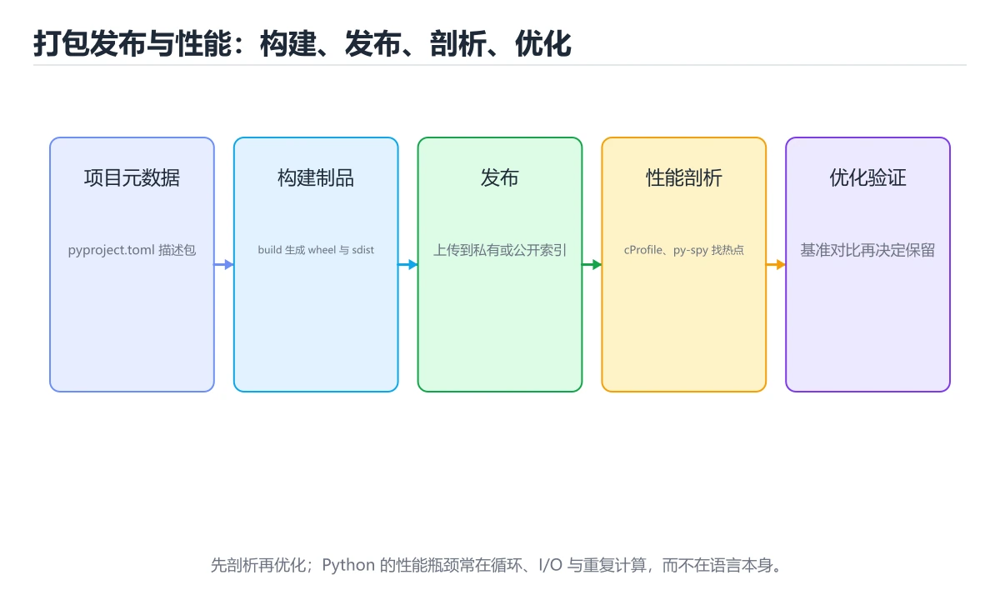
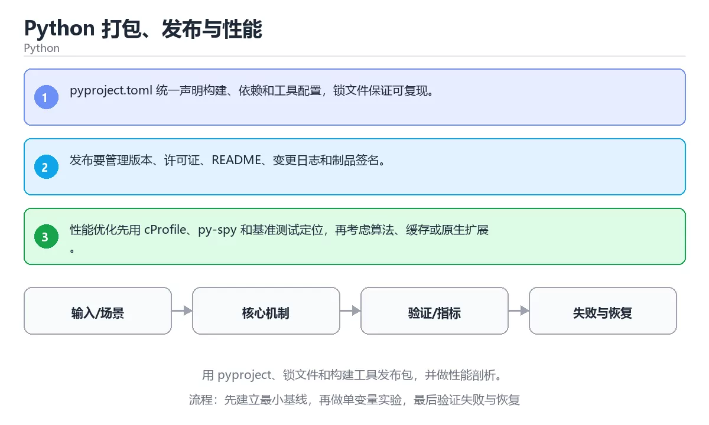

# Python 打包、发布与性能

> 内容更新时间：2026-10-06 · 学习阶段：高级 · 预计用时：25 分钟





## 本节知识框架

**课程定位**：所属分类 `python`（Python），课程主题 `Python 打包、发布与性能`，学习阶段 高级，建议用时 45 分钟。

本课主线：用 pyproject、锁文件和构建工具发布包，并做性能剖析。

**学完本课应当能够**
- 说清 `打包` 与 `pyproject` 的含义与区别，并各举一个正例和一个反例。
- 用本课示例验证 `性能剖析` 的行为，记录输入、输出与失败条件。
- 遇到「只写依赖清单不锁版本」这类问题时，能说出触发条件与修复顺序。

### 复习清单

- [ ] 能不看正文复述本课核心术语，并指出一个边界或反例。
- [ ] 能运行或推演本课示例，记录输入、输出与失败现象。
- [ ] 能完成一次自测，并把错题对照错误表定位原因。

## 核心概念定义

| 术语 | 操作性定义 | 常见边界与风险 |
| --- | --- | --- |
| 打包 | 把源码、依赖和元数据整理成可分发或可部署的产物。 | 不同版本与依赖组合的行为可能不同，升级或换环境前要按官方变更说明重新验证。 |
| pyproject | Python 项目的标准配置文件：声明构建后端、依赖与工具配置，取代 setup.py 的中心地位。 | 不同版本与依赖组合的行为可能不同，升级或换环境前要按官方变更说明重新验证。 |
| 性能剖析 | 用采样或插桩收集函数、调用栈和资源占用数据，定位真正的热点。 | 越界、悬垂引用与释放顺序会破坏结论，必须在边界输入下复验。 |
| 发布 | 把通过验证的版本交付给用户或部署到目标环境。 | 不同版本与依赖组合的行为可能不同，升级或换环境前要按官方变更说明重新验证。 |

## 原理与运行机制

### 机制总览

**教材衔接：核心知识**

### 1. pyproject.toml 统一声明构建、依赖和工具配置，锁文件保证可复现。

- 关键做法：先让 打包 的最小示例可复现，再加入并发或规模条件。
- 验证标准：pyproject 的异常路径有明确错误信息与恢复动作。

### 2. 发布要管理版本、许可证、README、变更日志和制品签名。

把这条结论放回「Python 打包、发布与性能」的完整流程里展开：

- 正文依据：能用自己的话解释：pyproject.toml 统一声明构建、依赖和工具配置，锁文件保证可复现。
- 落地检查：把「2. 发布要管理版本、许可证、README、变更日志和制品签名。」改写成一条可执行的核对项，逐条验证输入、超时与失败路径。

### 3. 性能优化先用 cProfile、py-spy 和基准测试定位，再考虑算法、缓存或原生扩展。

把这条结论放回「Python 打包、发布与性能」的完整流程里展开：

- 正文依据：能用自己的话解释：发布要管理版本、许可证、README、变更日志和制品签名。
- 落地检查：把「3. 性能优化先用 cProfile、py-spy 和基准测试定位，再考虑算法、缓存或原生扩展。」改写成一条可执行的核对项，逐条验证输入、超时与失败路径。

**教材衔接：关键流程**

**教材衔接：实践路径**

**教材衔接：版本与时效**

## 典型应用场景

**教材衔接：深度拓展与实战**

这一节把 打包 的定义、elapsed 的代码与常见失败串成一条复习路线。

### 工程检查表

- [ ] 能否用自己的话说明Python 打包、发布与性能解决什么问题，以及它不负责什么？
- [ ] 能否用「Python 打包、发布与性能」的最小示例复现一次失败并解释原因？
- [ ] 能否解释本课关键词在真实项目中的边界与取舍？
- [ ] 能否把 打包 的方法迁移到相近问题，并说明需要改哪一步？

### 最小验证场景

- 准备：保留 `text` 示例的原始输入，先记录 `Python 打包、发布与性能` 的基线输出和完整运行命令。
- 观察：先核对 调用了 `timeit()`，再改变一个与 `打包` 相关的条件。
- 判定：新结果与 `Python 打包、发布与性能` 的基线不同不等于错误；只有当差异破坏了 `打包` 的定义或错误表中的约束，才判定为失败。

### 选择与边界

- 使用 `打包` 时，先满足它的定义：把源码、依赖和元数据整理成可分发或可部署的产物；不同版本与依赖组合的行为可能不同，升级或换环境前要按官方变更说明重新验证。
- 使用 `pyproject` 时，先满足它的定义：Python 项目的标准配置文件：声明构建后端、依赖与工具配置，取代 setup.py 的中心地位；不同版本与依赖组合的行为可能不同，升级或换环境前要按官方变更说明重新验证。
- 使用 `性能剖析` 时，先满足它的定义：用采样或插桩收集函数、调用栈和资源占用数据，定位真正的热点；越界、悬垂引用与释放顺序会破坏结论，必须在边界输入下复验。
- 使用 `发布` 时，先满足它的定义：把通过验证的版本交付给用户或部署到目标环境；不同版本与依赖组合的行为可能不同，升级或换环境前要按官方变更说明重新验证。

## 代码/协议/SQL 示例

### 最小可验证示例

**教材衔接：最小可运行示例**

下面示例用于验证 打包 的最小输入、处理和输出。先原样运行，再只修改一个值：

```python
from timeit import timeit

elapsed = timeit("sum(range(1000))", number=1000)
print(f"ok={elapsed > 0}")
```

**教材衔接：预期输出**

```text
ok=True
```

## 时间/空间复杂度或性能分析

- **考点 3：关于「性能优化先用 cProfile，py-spy 和基准测试定位，再考虑算法」，下列说法正确的是？**：先独立作答，再回到本课对应小节核对判断依据；答错时记录是哪一个前提被忽略。

- 参考判断：性能优化先用 cProfile，py-spy 和基准测试定位，再考虑算法

1. 把 打包 放进一个只有单机、没有额外依赖的小项目，先保证正确再扩展。
2. 扩大 pyproject 的规模，记录本课结论在哪一个量级开始不成立。
3. 制造一次 打包 相关的依赖超时或错误输入，要求错误可解释且不留半完成状态。
5. 把 elapsed 的执行顺序调换一次，记录哪个中间结果先错；顺序敏感的地方就是本课的关键约束。
6. 限制 CPU 与内存上限后重跑 elapsed，观察哪一项参数需要重新设定。

**测量方法**：以 `Python 打包、发布与性能` 的 `打包` 场景为对象，固定输入跑一遍记录基线，再把规模或并发度提高一个数量级复测；两次结果的差值与波动范围才是结论依据。

## 常见误区与易错点

| 容易写错的做法 | 实际现象 | 原因与正确做法 |
| --- | --- | --- |
| 只写依赖清单不锁版本 | 部署结果不可复现。 | 锁定依赖版本并记录来源与哈希。 |
| 用打印做性能分析 | 定位不到真正的热点。 | 用剖析工具按函数统计耗时。 |
| 过早进行优化 | 复杂度没降，代码反而难读。 | 先测量再优化，并保留基准对比。 |

### 现场 1：只写依赖清单不锁版本

**症状**：部署结果不可复现。

**根因与修复**：锁定依赖版本并记录来源与哈希。

**自检**：在本课示例里复现「只写依赖清单不锁版本」，改成锁定依赖版本并记录来源与哈希后重跑；如果症状消失且失败路径按预期变化，说明定位正确。

### 现场 2：用打印做性能分析

**症状**：定位不到真正的热点。

**根因与修复**：用剖析工具按函数统计耗时。

**自检**：在本课示例里复现「用打印做性能分析」，改成用剖析工具按函数统计耗时后重跑；如果症状消失且失败路径按预期变化，说明定位正确。

### 现场 3：过早进行优化

**症状**：复杂度没降，代码反而难读。

**根因与修复**：先测量再优化，并保留基准对比。

**自检**：在本课示例里复现「过早进行优化」，改成先测量再优化，并保留基准对比后重跑；如果症状消失且失败路径按预期变化，说明定位正确。

## 与其他知识点的关系

**教材衔接：复习与迁移**

## 自测题与参考答案

> 先独立作答，再对照参考答案；答案都能在本课正文、术语表或错误表里找到依据。

### 自测 1（概念复述）

不看正文，写出 `打包` 的操作性定义，并说明它与 `pyproject` 的区别。

**参考答案**：把源码、依赖和元数据整理成可分发或可部署的产物。

`pyproject` 的定位是：Python 项目的标准配置文件：声明构建后端、依赖与工具配置，取代 setup.py 的中心地位；两者的差别要从适用对象与失败模式上说明。

### 自测 2（排错）

本课错误表记录了「只写依赖清单不锁版本」这类做法。请写出它会出现的现象、根因，以及修复顺序。

**参考答案**：现象是部署结果不可复现；正确做法是锁定依赖版本并记录来源与哈希。修复时先复现现象并保留证据，再改动一处假设重跑，确认现象消失。

### 自测 3（动手验证）

运行本课的 `text` 示例，改动其中一个输入后重新运行，记录输出与错误信息。

**参考答案**：正常输入下 `text` 示例应当复现正文给出的结果；改动输入后，如果结果改变或报错，先核对它是否满足 `Python 打包、发布与性能` 中`打包` 的适用范围，再检查错误表里是否有同类现象。

### 自测 4（代码阅读）

阅读本课开头的 `text` 示例，说明它体现了`打包` 的哪一条性质，并指出改动哪个输入会让这条性质不再成立。

**参考答案**：`打包` 的定义是 把源码、依赖和元数据整理成可分发或可部署的产物，示例正是在实现这条定义。改动与 `打包` 有关的一个输入后，如果结果不再符合 `Python 打包、发布与性能` 的正文描述，就说明该性质只在当前前提成立。

### 自测 5（迁移）

把 `Python 打包、发布与性能` 的方法迁移到自己的项目：围绕 `打包` 写出一个与错误表同类的风险点，并说明触发条件和检验方式。

**参考答案**：例如「过早进行优化」，它会导致复杂度没降，代码反而难读；检验方式是按先测量再优化，并保留基准对比改一处再复现，确认现象消失且没有引入新的失败分支。

### 自测 6（对比）

用一个表格对比 `打包` 与 `pyproject`：各写一行适用场景、一行失败表现。

**参考答案**：`打包` 的定义是把源码、依赖和元数据整理成可分发或可部署的产物；`pyproject` 的定义是Python 项目的标准配置文件：声明构建后端、依赖与工具配置，取代 setup.py 的中心地位。两者的失败表现分别对应本课错误表里与本术语相关的行。

### 自测 7（排错顺序）

面对「只写依赖清单不锁版本」引发的问题，请把“复现 部署结果不可复现 → 保留证据 → 锁定依赖版本并记录来源与哈希 → 回归验证”四步写成可执行的检查清单。

**参考答案**：第一步按部署结果不可复现复现；第二步记录输入、版本与完整报错；第三步按锁定依赖版本并记录来源与哈希只改一处；第四步重跑并确认失败路径也按预期变化。

### 自测 8（边界判断）

针对 `发布`，分别写出“可以使用”的条件和“结论不再成立”的条件。

**参考答案**：不同版本与依赖组合的行为可能不同，升级或换环境前要按官方变更说明重新验证。 同时要把 `发布` 的定义 把通过验证的版本交付给用户或部署到目标环境 与实际输入逐项对照。

### 自测 9（机制重建）

不看正文，按输入、转换、输出、验证四段重建 `打包` → `pyproject` → `性能剖析` → `发布` 的作用链。

**参考答案**：起点是 `打包` 的定义 把源码、依赖和元数据整理成可分发或可部署的产物；中间每一步都保留可观察状态；终点由 `发布` 检查，失败时回到错误表定位第一个偏离定义的步骤。

### 自测 10（综合排错）

在 `Python 打包、发布与性能` 中，现象是 复杂度没降，代码反而难读。请围绕 过早进行优化 写出最小复现、关键证据、修复动作和回归验证，并说明为什么不能只凭一次运行下结论。

**参考答案**：先复现 过早进行优化，记录输入与完整错误；再按 先测量再优化，并保留基准对比 只改一处。回归时同时跑正常路径和边界路径，只有两次结果都可解释，才把修复视为完成。

### 自测 11（一分钟复述）

用每分钟约 200 字的速度复述 `Python 打包、发布与性能`：先给主问题，再按顺序说出 `打包`、`pyproject`、`性能剖析`、`发布`，最后给一个失败案例。

**自评标准**：主问题必须对应 用 pyproject、锁文件和构建工具发布包，并做性能剖析；每个术语都要能接上一句定义或边界；失败案例必须写成可观察现象，不能用“可能有风险”代替证据。

## 延伸阅读

想更直观地理解本课概念？推荐参阅以下图解专题：

- [图解内存布局：栈、堆与引用](visual_memory_layout.md)

## 术语速查

| 术语 | 一句话说明 |
| --- | --- |
| `打包` | 把源码、依赖和元数据整理成可分发或可部署的产物。 |
| `pyproject` | Python 项目的标准配置文件：声明构建后端、依赖与工具配置，取代 setup.py 的中心地位。 |
| `性能剖析` | 用采样或插桩收集函数、调用栈和资源占用数据，定位真正的热点。 |
| `发布` | 把通过验证的版本交付给用户或部署到目标环境。 |

**术语关系**：`打包`（把源码、依赖和元数据整理成可分发或可部署的产物） → `pyproject`（Python 项目的标准配置文件：声明构建后端、依赖与工具配置） → `性能剖析`（用采样或插桩收集函数、调用栈和资源占用数据） → `发布`（把通过验证的版本交付给用户或部署到目标环境）。

## 考点精讲

`Python 打包、发布与性能` 的题库有 6 道题，下面逐题给出题干、正确项与判断依据：先自己作答，再核对正确项，最后回到正文对应小节复核。

### 考点 1：第 1 题

- **题目**：围绕“Python 打包、发布与性能”中的 打包、pyproject、性能剖析，下列哪两项是本课强调的实践判断？
- **正确项**：学习 打包 时要同时说明输入、输出和失败路径，不能只看正常流程；验证 pyproject 时要固定版本并覆盖边界输入，结论才可复现
- **判断依据**：这道题落在术语 `打包` 上：把源码、依赖和元数据整理成可分发或可部署的产物。复习时把 `打包` 的定义、适用边界和一个反例一起说清楚，再回到「核心概念定义」核对原文。

### 考点 2：第 2 题

- **题目**：在 `Python 打包、发布与性能` 里，与 `打包` 有关的说法中，哪一项最符合用 pyproject、锁文件和构建工具发布包，并做性能剖析。？
- **正确项**：发布要管理版本、许可证、README、变更日志和制品签名。
- **判断依据**：这道题落在术语 `打包` 上：把源码、依赖和元数据整理成可分发或可部署的产物。复习时把 `打包` 的定义、适用边界和一个反例一起说清楚，再回到「核心概念定义」核对原文。

### 考点 3：第 3 题

- **题目**：在 `Python 打包、发布与性能` 里，与 `打包` 有关的说法中，哪一项最符合用 pyproject、锁文件和构建工具发布包，并做性能剖析。？（Python 打包、发布与性能·Python 第 3 题）
- **正确项**：性能优化先用 cProfile，py-spy 和基准测试定位
- **判断依据**：这道题落在术语 `打包` 上：把源码、依赖和元数据整理成可分发或可部署的产物。复习时把 `打包` 的定义、适用边界和一个反例一起说清楚，再回到「核心概念定义」核对原文。

### 考点 4：第 4 题

- **题目**：`Python 打包、发布与性能` 的主线是：用 pyproject、锁文件和构建工具发布包，并做性能剖析。下面哪一项与这条主线一致？
- **正确项**：用 pyproject、锁文件和构建工具发布包，并做性能剖析。
- **判断依据**：这道题落在术语 `打包` 上：把源码、依赖和元数据整理成可分发或可部署的产物。复习时把 `打包` 的定义、适用边界和一个反例一起说清楚，再回到「核心概念定义」核对原文。

### 考点 5：第 5 题

- **题目**：填空：补齐下面这段术语说明中的空缺。课程 `用 pyproject、锁文件和构建工具发布包，并做性能剖析。`，这段说明是：`____`：用采样或插桩收集函数、调用栈和资源占用数据，定位真正的热点。空缺处应填哪个术语？
- **正确项**：性能剖析
- **判断依据**：这道题落在术语 `pyproject` 上：Python 项目的标准配置文件：声明构建后端、依赖与工具配置，取代 setup.py 的中心地位。复习时把 `pyproject` 的定义、适用边界和一个反例一起说清楚，再回到「核心概念定义」核对原文。

### 考点 6：第 6 题

- **题目**：结合 `Python 打包、发布与性能` 中围绕 `打包` 的代码，哪一项说法与“用 pyproject、锁文件和构建工具发布包，并做性能剖析。”一致？
- **正确项**：pyproject.toml 统一声明构建、依赖和工具配置，锁文件保证可复现。
- **判断依据**：这道题落在术语 `打包` 上：把源码、依赖和元数据整理成可分发或可部署的产物。复习时把 `打包` 的定义、适用边界和一个反例一起说清楚，再回到「核心概念定义」核对原文。

### 考点 7：`打包`

- **要点**：把源码、依赖和元数据整理成可分发或可部署的产物。
- **打包 的边界**：不同版本与依赖组合的行为可能不同，升级或换环境前要按官方变更说明重新验证。

### 考点 8：`pyproject`

- **要点**：Python 项目的标准配置文件：声明构建后端、依赖与工具配置，取代 setup.py 的中心地位。
- **pyproject 的边界**：不同版本与依赖组合的行为可能不同，升级或换环境前要按官方变更说明重新验证。

### 考点 9：`性能剖析`

- **要点**：用采样或插桩收集函数、调用栈和资源占用数据，定位真正的热点。
- **性能剖析 的边界**：越界、悬垂引用与释放顺序会破坏结论，必须在边界输入下复验。

### 考点 10：`发布`

- **要点**：把通过验证的版本交付给用户或部署到目标环境。
- **发布 的边界**：不同版本与依赖组合的行为可能不同，升级或换环境前要按官方变更说明重新验证。

### 考点 11：排错——只写依赖清单不锁版本

- **现象**：部署结果不可复现。
- **处理**：锁定依赖版本并记录来源与哈希。

### 考点 12：排错——用打印做性能分析

- **现象**：定位不到真正的热点。
- **处理**：用剖析工具按函数统计耗时。

### 考点 13：综合辨析——`打包` 与 `发布`

- **辨析点**：`打包` 的定义是 把源码、依赖和元数据整理成可分发或可部署的产物；`发布` 的定义是 把通过验证的版本交付给用户或部署到目标环境。
- **答题要求**：面对 `Python 打包、发布与性能` 的题目，先判断描述的是 `打包` 还是 `发布`，再归到对应定义，最后写出一个会让该定义失效的边界输入。

### 考点 14：排错评分点

- **现象分**：能写出 部署结果不可复现，而不是只写“程序有错”。
- **证据分**：保留触发 只写依赖清单不锁版本 的输入、版本和错误原文。
- **修复分**：按 锁定依赖版本并记录来源与哈希 只改一处，并同时回归正常路径与边界路径。

## 内容元数据

- 内容版本：v2.0
- 最后更新：2026-10-06
- 学习阶段：高级
- 适用环境：Python 3.12+；本课聚焦 打包。
- 内容来源：内置结构化课程与工程实践整理
- 相关主题：打包、pyproject、性能剖析、发布
- 质量版本：P0 测验标准 + P1 覆盖扩展 + P2 体验补全

## 参考资料与复核

- [本课资料锚点 python_packaging_performance](https://zh.wikipedia.org/w/index.php?search=python_packaging_performance)

- 最后复核：2026-10-04
- 下次复核：2026-12-10
- 复核范围：版本兼容、API 行为、安全建议与工程实践
- 来源性质：官方文档、标准或权威教材；本课核对关键词：打包、pyproject、性能剖析、发布。

| 参考资料 | 本课用途 |
| --- | --- |
| [Python 性能分析](https://docs.python.org/3/library/profile.html) | cProfile 与性能分析 |
| [asyncio 文档](https://docs.python.org/3/library/asyncio.html) | 异步 I/O 与并发任务 |
| [unittest 文档](https://docs.python.org/3/library/unittest.html) | 测试组织与断言 |

| [本课术语索引：Python 打包、发布与性能](#核心概念定义) | 按本课输入、术语边界和错误表现逐项核对 |
> 「Python 打包、发布与性能」的链接用于离线阅读后的延伸核对；App 不会自动联网。