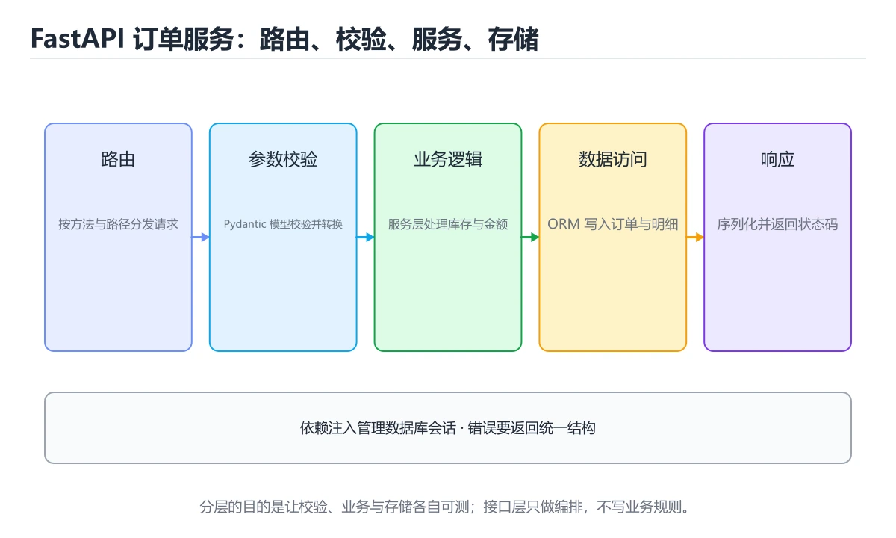
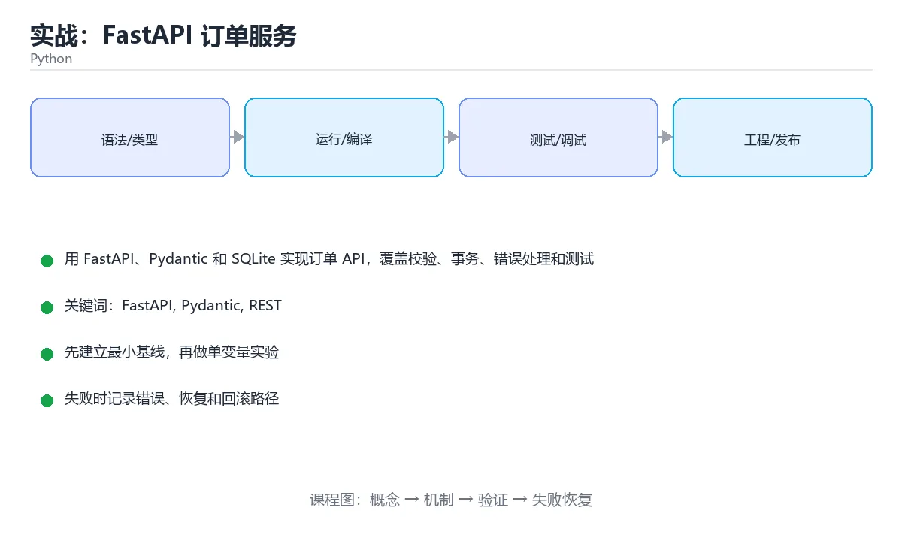

# 实战：FastAPI 订单服务





> 内容更新时间：2026-10-06 · 学习阶段：高级 · 预计用时：90 分钟

## 本节知识框架

想象你要开一家网上小店。顾客下单、查订单、取消订单——这些操作都需要一个"后台服务员"来接待。本课就是教你用 Python 搭建这样一个后台服务员，它的名字叫 **FastAPI**。

**本课主线**：用 FastAPI、Pydantic 和 SQLite 实现订单 API，覆盖校验、事务、错误处理和测试。

**学完本课你将会**
- 说清 `FastAPI` 与 `REST` 的含义与区别，并各举一个正例和一个反例。
- 用本课示例验证 `pytest` 的行为，记录输入、输出与失败条件。
- 遇到「金额使用浮点数」这类问题时，能说出触发条件与修复顺序。

### 复习清单

- [ ] 能不看正文复述本课核心术语，并指出一个边界或反例。
- [ ] 能运行或推演本课示例，记录输入、输出与失败现象。
- [ ] 能完成一次自测，并把错题对照错误表定位原因。

## 核心概念定义

让我们用"一句话定义 + 生活类比"的方式来认识每个核心概念。

| 术语 | 操作性定义 | 生活类比 | 常见边界与风险 |
| --- | --- | --- | --- |
| FastAPI | 基于类型注解的 Python Web 框架：自动校验请求并生成 OpenAPI 文档，原生支持异步。 | 像一位会检查身份证的餐厅前台——你递上菜单（请求），它自动检查格式对不对。 | 不同版本与依赖组合的行为可能不同，升级或换环境前要按官方变更说明重新验证。 |
| REST | 以资源 URI、HTTP 方法和状态码组织接口的无状态风格。 | 像打电话给客服：每个电话号码（URI）对应一项服务，每次通话互不干扰。 | 网络延迟、超时与版本协商会改变行为，只在真实链路或多版本客户端上验证才算数。 |
| pytest | 把验收改写成一条可执行的核对项，逐条验证输入、超时与失败路径。 | 像工厂质检线——每个产品都要过一遍检查，不合格的自动剔除。 | 网络延迟、超时与版本协商会改变行为，只在真实链路或多版本客户端上验证才算数。 |
| 依赖注入 | FastAPI 用 Depends 声明路由需要的会话、配置与鉴权，便于替换与测试。 | 像乐高积木——想换一块只需拔下来换一块新的，不影响整体结构。 | 不同版本与依赖组合的行为可能不同，升级或换环境前要按官方变更说明重新验证。 |
| 可观测性 | 由日志、指标与链路追踪组成，能在不重启、不改代码的前提下问出新问题。 | 像商场的监控摄像头——不用走进每家店铺就能知道哪里出了问题。 | 只在「由日志、指标与链路追踪组成，能在不重启、不改代码的前提下问出新问题」这一前提下成立，换输入或换环境要重新验证。 |

## 原理与运行机制

### 机制总览：订单服务是怎么工作的？

把整个订单服务想象成一家餐厅的运营流程：

- **顾客点单**（创建订单）：顾客把菜单交给服务员，服务员检查菜品是否存在、数量是否合理。
- **查看订单**（查询订单）：顾客问"我的菜做好了吗？"，服务员根据订单号查找状态。
- **取消订单**（取消订单）：顾客说"这道菜不要了"，但已经做好的菜不能退。

**技术栈**

- Python 3.12
- FastAPI（接待员）
- Pydantic（校验器）
- SQLite（小仓库）
- pytest（质检员）
- uvicorn（服务员上班的闹钟）

**架构与数据流**

用一个比喻来理解数据流：想象一条传送带。

1. 请求从客户端出发，像包裹一样被放到传送带上。
2. FastAPI 是传送带入口的安检员——检查包裹格式对不对（Pydantic 校验）。
3. 通过安检后，包裹进入业务逻辑区——扣库存、写订单（SQLite 事务）。
4. 最后，结果像包裹一样被送出，附上状态码（201 创建成功、409 冲突等）。

关键原则：
- 读路径要明确查询条件、分页方式和返回字段，避免一次加载全部数据。
- idempotency_key（幂等键）的写入要以幂等键为准，失败后能补偿或安全重试。
- 外部调用要设置超时、重试上限和降级策略。
- 每个关键阶段都要留下日志、指标或测试证据。

### 步骤 1：定义 Pydantic 请求模型——"菜单模板"

**类比**：Pydantic 模型就像一张标准化的菜单模板。它规定了每道菜必须写清楚名字（sku）、数量（quantity），还要求数量必须大于 0。如果顾客写了"数量：-1"，服务员会直接拒绝。

```python
from pydantic import BaseModel, Field

class CreateOrder(BaseModel):
    sku: str = Field(min_length=1)        # 商品编号不能为空
    quantity: int = Field(gt=0, le=99)    # 数量必须 1~99
    idempotency_key: str                   # 幂等键，防止重复下单
```

验证方法：用最小请求或单元测试证明校验结果正确。

### 步骤 2：建立 SQLite 表结构——"仓库货架"

**类比**：SQLite 表就像仓库里的货架。每个货架有编号（order_id），上面放着商品信息和金额。我们用 SQL 来搭建货架的格局。

```python
import sqlite3

def init_db(conn: sqlite3.Connection):
    conn.execute("""
        CREATE TABLE IF NOT EXISTS orders (
            order_id TEXT PRIMARY KEY,
            sku TEXT NOT NULL,
            quantity INTEGER NOT NULL,
            amount_cents INTEGER NOT NULL,
            status TEXT NOT NULL DEFAULT 'created',
            idempotency_key TEXT UNIQUE
        )
    """)
    conn.execute("""
        CREATE TABLE IF NOT EXISTS inventory (
            sku TEXT PRIMARY KEY,
            stock INTEGER NOT NULL DEFAULT 0
        )
    """)
    conn.commit()
```

### 步骤 3：实现创建、查询和取消三个接口——"三个服务窗口"

**类比**：想象银行有三个窗口——开户、查询、销户。我们的 API 也有三个"窗口"：

- `POST /orders`：创建订单（开户）
- `GET /orders/{order_id}`：查询订单（查余额）
- `DELETE /orders/{order_id}`：取消订单（销户）

```python
from fastapi import FastAPI, HTTPException

app = FastAPI()

@app.post('/orders', status_code=201)
def create_order(payload: CreateOrder):
    # 校验 → 扣库存 → 写订单，三步在一个事务里完成
    return {'order_id': 'ord-1001', 'status': 'created'}

@app.get('/orders/{order_id}')
def get_order(order_id: str):
    # 按订单号查找
    return {'order_id': order_id, 'status': 'created'}

@app.delete('/orders/{order_id}')
def cancel_order(order_id: str):
    # 已支付的订单不能取消
    return {'order_id': order_id, 'status': 'cancelled'}
```

### 步骤 4：事务——"要么全做，要么全不做"

**类比**：想象你在自动售货机买饮料。你投币后，机器要么同时完成"收钱+出货"，要么"退钱+不出货"。绝不能出现"收了钱不出货"的情况。这就是事务的含义。

```python
def create_order_in_tx(conn, payload):
    try:
        conn.execute(
            "UPDATE inventory SET stock = stock - ? WHERE sku = ? AND stock >= ?",
            (payload.quantity, payload.sku, payload.quantity),
        )
        conn.execute(
            "INSERT INTO orders (order_id, sku, quantity, amount_cents, idempotency_key) "
            "VALUES (?, ?, ?, ?, ?)",
            ('ord-1001', payload.sku, payload.quantity, 990, payload.idempotency_key),
        )
        conn.commit()
    except Exception:
        conn.rollback()
        raise
```

### 步骤 5：幂等键——"快递单号"

**类比**：你在网上购物，点击"提交订单"后网络卡了，你又点了一次。如果没有幂等键，系统会创建两个订单。有了幂等键（就像快递单号），系统会识别"这是同一个请求"，只处理一次。

### 步骤 6：用 pytest 和 TestClient 完成验收——"模拟考试"

**类比**：pytest 就像一场模拟考试。它模拟各种情况——正常下单、库存不足、重复提交——看看你的服务能不能正确处理每一种情况。

```python
from fastapi.testclient import TestClient

client = TestClient(app)

def test_create_order():
    resp = client.post('/orders', json={
        'sku': 'WIDGET-01',
        'quantity': 2,
        'idempotency_key': 'key-001',
    })
    assert resp.status_code == 201

def test_duplicate_idempotency_key():
    payload = {'sku': 'WIDGET-01', 'quantity': 1, 'idempotency_key': 'key-dup'}
    client.post('/orders', json=payload)
    resp = client.post('/orders', json=payload)
    assert resp.status_code == 409  # 重复提交被拒绝
```

**教材衔接：项目专属规格**
## 典型应用场景

### 项目背景

小型电商需要一个离线可运行的订单服务：创建订单、查询订单、取消订单，并对金额、库存和重复请求做校验。项目不依赖云服务，使用 SQLite 和本地测试即可完整验证。

**一句话摘要**：用 FastAPI、Pydantic 和 SQLite 实现订单 API，覆盖校验、事务、错误处理和测试。

### 核心场景

| 场景 | 说明 | 类比 |
| --- | --- | --- |
| 正常路径 | 最小输入得到预期输出 | 顾客正常点单，厨房正常出菜 |
| 边界路径 | 把输入推到上下限 | 顾客点了 0 道菜或 999 道菜 |
| 失败路径 | 依赖超时时快速失败 | 厨房发现食材用完了，立刻通知前台 |
| 幂等路径 | 同一请求执行两次不产生重复副作用 | 快递单号重复扫描不会发两次货 |
| 回滚路径 | 回滚后数据一致 | 交易失败后钱退回账户 |

### 建议仓库结构

```text
app/
  api/          # 接口层——服务窗口
  domain/       # 业务逻辑——厨房
  infra/        # 基础设施——仓库和水电
tests/          # 测试——模拟考试
README.md
```

## 代码/协议/SQL 示例

### 最小可验证示例：完整创建订单接口

让我们把前面分步学习的内容组合成一个完整的、可以运行的最小示例。

```python
from fastapi import FastAPI, HTTPException
from pydantic import BaseModel, Field

app = FastAPI()

class CreateOrder(BaseModel):
    sku: str = Field(min_length=1)
    quantity: int = Field(gt=0, le=99)
    idempotency_key: str

@app.post('/orders', status_code=201)
def create_order(payload: CreateOrder):
    if payload.quantity <= 0:
        raise HTTPException(status_code=422, detail='quantity must be positive')
    return {'order_id': 'ord-1001', 'status': 'created'}
```

**怎么运行？** 把上面的代码保存为 `main.py`，然后在终端输入：

```text
uvicorn main:app --reload
```

打开浏览器访问 `http://localhost:8000/docs`，你会看到 FastAPI 自动生成的交互式文档——这就是"自动生成 OpenAPI 文档"的威力。

### 验证命令与预期输出

```text
# 正常创建订单
curl -X POST http://localhost:8000/orders \
  -H "Content-Type: application/json" \
  -d '{"sku":"WIDGET-01","quantity":2,"idempotency_key":"key-001"}'

# 预期输出：{"order_id":"ord-1001","status":"created"}
```

```text
# 数量写 0，触发 Pydantic 校验
curl -X POST http://localhost:8000/orders \
  -H "Content-Type: application/json" \
  -d '{"sku":"WIDGET-01","quantity":0,"idempotency_key":"key-002"}'

# 预期输出：422 Unprocessable Entity（校验失败）
```

### 测试与验收

用 pytest 验证三个关键场景：

```python
from fastapi.testclient import TestClient
from main import app

client = TestClient(app)

def test_create_order_success():
    """正常路径：最小输入得到预期输出"""
    resp = client.post('/orders', json={
        'sku': 'WIDGET-01', 'quantity': 2, 'idempotency_key': 'key-001'
    })
    assert resp.status_code == 201
    assert resp.json()['status'] == 'created'

def test_quantity_zero_rejected():
    """边界路径：数量为零被拒绝"""
    resp = client.post('/orders', json={
        'sku': 'WIDGET-01', 'quantity': 0, 'idempotency_key': 'key-002'
    })
    assert resp.status_code == 422

def test_duplicate_idempotency_key():
    """幂等路径：重复提交同一幂等键只生成一个订单"""
    payload = {'sku': 'WIDGET-01', 'quantity': 1, 'idempotency_key': 'key-dup'}
    first = client.post('/orders', json=payload)
    assert first.status_code == 201
    second = client.post('/orders', json=payload)
    assert second.status_code == 409
```

## 时间/空间复杂度或性能分析

### 性能关注点

**类比**：想象你的小店从每天 10 个顾客变成 1000 个。哪些环节会先扛不住？

| 关注点 | 类比 | 本课开销 |
| --- | --- | --- |
| 执行时间 | 服务员处理每个订单的速度 | FastAPI 本身很快（异步），瓶颈通常在数据库 |
| 内存 | 服务员同时能记住几个订单 | Pydantic 校验会创建对象，大量请求时注意内存峰值 |
| 数据库 | 仓库找货的速度 | SQLite 适合小规模；长事务会放大锁等待 |
| 网络 | 快递员送货到客户手中的时间 | REST 接口的网络延迟无法避免，要设置超时 |

### 测量方法

1. **基线测量**：固定输入跑一遍，记录时间、内存和失败率。
2. **加压测量**：把规模或并发度提高一个数量级再测。
3. **对比分析**：两次结果的差值与波动范围才是结论依据。

### 需要控制的变量

- `FastAPI` 的版本、输入范围和资源上限
- `Pydantic` 的版本和校验复杂度
- `SQLite` 的数据量和索引大小
- `pytest` 的测试覆盖范围

**关键提醒**：达到边界时不要外推，必须重新测量。比如 SQLite 在并发写入超过 10 个/秒时可能出现锁等待，这时就需要换成 PostgreSQL。

## 常见误区与易错点

### 误区速查表

| 容易写错的做法 | 实际现象 | 原因与正确做法 |
| --- | --- | --- |
| 金额使用浮点数 | 对账出现精度误差 | 使用整数分或 Decimal |
| 接口先写订单再扣库存 | 失败时数据不一致 | 同一事务内完成写入或回滚 |
| 没有幂等键 | 重试生成重复订单 | 使用唯一索引和幂等键 |
| 只测正常请求 | 边界输入导致 500 | 覆盖空值、负数、超长字符串和重复请求 |

### 现场 1：金额使用浮点数

**症状**：对账出现精度误差。

**类比**：就像你用计算器算 0.1 + 0.2，结果是 0.30000000000000004 而不是 0.3。计算机用二进制存小数，有些十进制小数无法精确表示。

**根因与修复**：使用整数分或 Decimal。

```python
# 错误做法
price = 9.99  # 浮点数，可能有精度问题
total = price * 3  # 29.969999999999999

# 正确做法 1：用整数分
price_cents = 999  # 9.99 元 = 999 分
total_cents = price_cents * 3  # 2997 分 = 29.97 元

# 正确做法 2：用 Decimal
from decimal import Decimal
price = Decimal('9.99')
total = price * 3  # Decimal('29.97')
```

**自检**：在本课示例里复现「金额使用浮点数」，改成使用整数分或 Decimal 后重跑；如果症状消失且失败路径按预期变化，说明定位正确。

### 现场 2：接口先写订单再扣库存

**症状**：失败时数据不一致。

**类比**：就像你先在账本上记了"已卖出"，然后去仓库拿货时发现没货了——账本和仓库对不上。

**根因与修复**：同一事务内完成写入或回滚。

**自检**：在本课示例里复现「接口先写订单再扣库存」，改成同一事务内完成写入或回滚后重跑。

### 现场 3：没有幂等键

**症状**：重试生成重复订单。

**类比**：就像你在 ATM 取款，按了一次"确认"后网络卡了，你又按了一次——如果没有防重复机制，你会被扣两次钱。

**根因与修复**：使用唯一索引和幂等键。

**自检**：在本课示例里复现「没有幂等键」，改成使用唯一索引和幂等键后重跑。

### 现场 4：只测正常请求

**症状**：边界输入导致 500。

**类比**：就像考试只做了简单题，一遇到应用题就懵了。

**根因与修复**：覆盖空值、负数、超长字符串和重复请求。

**自检**：在本课示例里复现「只测正常请求」，改成覆盖空值、负数、超长字符串和重复请求后重跑。

## 与其他知识点的关系

### 知识图谱

```text
先修：实战：爬虫与数据分析（timeout、fillna）
  ↓
本课：实战：FastAPI 订单服务（FastAPI、Pydantic、REST、SQLite、pytest）
  ↓
后续：实战：CSV 到 SQLite 的 ETL 流水线
      实战：Node.js + Express REST API
      实战：REST API 与 SQLite 事务服务
```

### 术语归属

- `FastAPI`、`REST`、`pytest` 的定义以本课「核心概念定义」为准，换到其他课程时先确认定义是否被改写。
- 同一分类的《类型注解与测试》也涉及 `pytest`；两课衔接时先确认术语定义是否一致。
- 同一分类的《Python pytest 测试实战》也涉及 `pytest`；两课衔接时先确认术语定义是否一致。

## 自测题与参考答案

> 先独立作答，再对照参考答案；答案都能在本课正文、术语表或错误表里找到依据。

### 自测 1（概念复述）

不看正文，写出 `FastAPI` 的操作性定义，并说明它与 `REST` 的区别。

**参考答案**：基于类型注解的 Python Web 框架：自动校验请求并生成 OpenAPI 文档，原生支持异步。`REST` 的定位是：以资源 URI、HTTP 方法和状态码组织接口的无状态风格；FastAPI 是实现工具，REST 是设计原则。

### 自测 2（排错）

本课错误表记录了「金额使用浮点数」这类做法。请写出它会出现的现象、根因，以及修复顺序。

**参考答案**：现象是对账出现精度误差；正确做法是使用整数分或 Decimal。修复时先复现现象并保留证据，再改动一处假设重跑，确认现象消失。

### 自测 3（动手验证）

运行本课的代码示例，改动其中一个输入后重新运行，记录输出与错误信息。

**参考答案**：正常输入下示例应当返回 `{"order_id": "ord-1001", "status": "created"}`；如果把 quantity 改为 0，会收到 422 校验失败。

### 自测 4（代码阅读）

阅读本课开头的代码示例，说明它体现了 `FastAPI` 的哪一条性质，并指出改动哪个输入会让这条性质不再成立。

**参考答案**：`FastAPI` 的定义是基于类型注解的 Python Web 框架：自动校验请求并生成 OpenAPI 文档，原生支持异步。示例中 `CreateOrder` 模型体现了自动校验——当 quantity 为 0 时，Pydantic 会自动拒绝。

### 自测 5（迁移）

把本课的方法迁移到自己的项目：围绕 `FastAPI` 写出一个与错误表同类的风险点，并说明触发条件和检验方式。

**参考答案**：例如「只测正常请求」，它会导致边界输入导致 500；检验方式是按覆盖空值、负数、超长字符串和重复请求改一处再复现。

### 自测 6（对比）

用一个表格对比 `FastAPI` 与 `REST`：各写一行适用场景、一行失败表现。

**参考答案**：`FastAPI` 适用于 Python 后端开发，失败表现是版本升级后行为变化；`REST` 适用于所有 HTTP 接口设计，失败表现是网络延迟或超时导致行为不一致。

### 自测 7（排错顺序）

面对「金额使用浮点数」引发的问题，请把"复现 → 保留证据 → 修复 → 回归验证"四步写成可执行的检查清单。

**参考答案**：第一步按对账出现精度误差复现；第二步记录输入、版本与完整报错；第三步按使用整数分或 Decimal 只改一处；第四步重跑并确认失败路径也按预期变化。

### 自测 8（边界判断）

针对 `可观测性`，分别写出"可以使用"的条件和"结论不再成立"的条件。

**参考答案**：可观测性由日志、指标与链路追踪组成。当系统架构不变时可以使用；当更换了监控工具或日志格式后，需要重新验证。

### 自测 9（机制重建）

不看正文，按输入、转换、输出、验证四段重建 `FastAPI` → `REST` → `pytest` → `依赖注入` 的作用链。

**参考答案**：起点是 FastAPI 接收请求并校验；然后按 REST 风格路由到对应处理函数；pytest 验证整个流程的正确性；依赖注入让每个组件可替换。

### 自测 10（综合排错）

在实战中，现象是边界输入导致 500。请围绕“只测正常请求”写出最小复现、关键证据、修复动作和回归验证。

**参考答案**：先复现只测正常请求的状态，记录输入与完整错误；再按覆盖空值、负数、超长字符串和重复请求只改一处。回归时同时跑正常路径和边界路径。

### 自测 11（一分钟复述）

用每分钟约 200 字的速度复述本课：先给主问题，再按顺序说出五个核心术语，最后给一个失败案例。

**自评标准**：主问题必须对应"用 FastAPI、Pydantic 和 SQLite 实现订单 API"；每个术语都要能接上一句定义或边界；失败案例必须写成可观察现象。

### 项目交付物

完成本项目后，应交付以下内容：

1. **可运行的代码**：所有功能模块已实现并通过测试
2. **测试报告**：单元测试和集成测试全部通过
3. **文档**：README 说明使用方法，关键函数有注释
4. **复盘总结**：记录遇到的问题和解决方案

## 延伸阅读

想更直观地理解本课概念？推荐参阅以下图解专题：

- [图解一次网页请求的完整链路](visual_http_timeline.md)

## 术语速查

| 术语 | 一句话说明 |
| --- | --- |
| `FastAPI` | 基于类型注解的 Python Web 框架：自动校验请求并生成 OpenAPI 文档，原生支持异步。（餐厅前台服务员） |
| `REST` | 以资源 URI、HTTP 方法和状态码组织接口的无状态风格。（电话号码对应服务） |
| `Pydantic` | 数据校验库，根据类型注解自动检查输入是否合法。（安检门） |
| `pytest` | Python 测试框架，把验收改写成可执行的核对项。（质检员） |
| `依赖注入` | FastAPI 用 Depends 声明路由需要的会话、配置与鉴权，便于替换与测试。（乐高积木） |
| `可观测性` | 由日志、指标与链路追踪组成，能在不重启、不改代码的前提下问出新问题。（监控摄像头） |
| `幂等键` | 防止重复请求产生重复副作用的唯一标识。（快递单号） |
| `事务` | 一组操作要么全部成功，要么全部回滚。（自动售货机：收钱+出货） |

**术语关系**：`FastAPI`（框架）→ `REST`（风格）→ `Pydantic`（校验）→ `pytest`（测试）→ `依赖注入`（解耦）→ `可观测性`（监控）。

## 考点精讲

`实战：FastAPI 订单服务` 的题库有 6 道题，下面逐题给出题干、正确项与判断依据：先自己作答，再核对正确项，最后回到正文对应小节复核。

### 考点 1：第 1 题

- **题目**：围绕“实战：FastAPI 订单服务”中的 FastAPI、Pydantic、REST，下列哪两项是本课强调的实践判断？
- **选项**：
  - A. 把 Pydantic 的单次运行结果当成所有版本和规模都成立
  - B. 学习 FastAPI 时要同时说明输入、输出和失败路径，不能只看正常流程
  - C. 只要 FastAPI 的常规示例通过，就可以跳过边界与异常路径
  - D. 验证 Pydantic 时要固定版本并覆盖边界输入，结论才可复现
- **正确项**：B + D —— 学习 FastAPI 时要同时说明输入、输出和失败路径，不能只看正常流程；验证 Pydantic 时要固定版本并覆盖边界输入，结论才可复现
- **判断依据**：这道题落在术语 `FastAPI` 上：基于类型注解的 Python Web 框架：自动校验请求并生成 OpenAPI 文档，原生支持异步。复习时把 `FastAPI` 的定义、适用边界和一个反例一起说清楚，再回到「核心概念定义」核对原文。

### 考点 2：第 2 题

- **题目**：幂等键的主要作用是什么？
- **选项**：
  - A. 替代身份认证
  - B. 压缩响应体
  - C. 提高数据库索引速度
  - D. 避免重复请求产生重复订单
- **正确项**：D —— 避免重复请求产生重复订单
- **判断依据**：这道题检验本课主问题：用 FastAPI、Pydantic 和 SQLite 实现订单 API，覆盖校验、事务、错误处理和测试。幂等键就像快递单号，确保同一个请求无论发送多少次，只会被处理一次。复习时先复述本课主问题，再举一个会让结论失效的输入。

### 考点 3：第 3 题

- **题目**：Pydantic 模型最适合承担什么职责？
- **选项**：
  - A. 请求结构校验和类型转换
  - B. 页面渲染
  - C. 日志采集
  - D. 负责数据库迁移，但这会加重锁竞争
- **正确项**：A —— 请求结构校验和类型转换
- **判断依据**：这道题检验本课主问题：用 FastAPI、Pydantic 和 SQLite 实现订单 API，覆盖校验、事务、错误处理和测试。Pydantic 就像安检门，专门负责检查输入数据的格式和类型。复习时先复述本课主问题，再举一个会让结论失效的输入。

### 考点 4：第 4 题

- **题目**：取消已支付订单应该返回什么？
- **选项**：
  - A. 302 跳转首页
  - B. 409 Conflict 并说明状态不允许
  - C. 200 并静默成功
  - D. 500 并记录未知错误，但它只覆盖了部分情况
- **正确项**：B —— 409 Conflict 并说明状态不允许
- **判断依据**：这道题检验本课主问题：用 FastAPI、Pydantic 和 SQLite 实现订单 API，覆盖校验、事务、错误处理和测试。已支付的订单状态不允许取消，应该返回 409 冲突状态码，明确告诉客户端"这个操作不被允许"。复习时先复述本课主问题，再举一个会让结论失效的输入。

### 考点 5：第 5 题

- **题目**：下面 FastAPI 代码中，请求 quantity 为 0 时会怎样？
- **代码**：

```python
class CreateOrder(BaseModel):
    sku: str = Field(min_length=1)
    quantity: int = Field(gt=0, le=99)
```

- **选项**：
  - A. 服务崩溃返回 500
  - B. 自动改成数量 1
  - C. 创建订单成功
  - D. Pydantic 校验失败并返回 422
- **正确项**：D —— Pydantic 校验失败并返回 422
- **判断依据**：这道题落在术语 `FastAPI` 上：基于类型注解的 Python Web 框架：自动校验请求并生成 OpenAPI 文档，原生支持异步。`Field(gt=0, le=99)` 表示 quantity 必须大于 0 且小于等于 99。当 quantity 为 0 时，不满足 `gt=0` 的条件，Pydantic 会自动拒绝并返回 422 状态码。复习时把 `FastAPI` 的定义、适用边界和一个反例一起说清楚，再回到「核心概念定义」核对原文。

### 考点 6：第 6 题

- **题目**：下面几项都与 `FastAPI` 有关，请按 `实战：FastAPI 订单服务` 的正文顺序排列；该课主线是用 FastAPI、Pydantic 和 SQLite 实现订单 API，覆盖校验、事务、错误处理和测试。
- **选项**：
  - A. 项目背景
  - B. 技术栈
  - C. 架构与数据流
  - D. 功能范围
- **正确项**：A → B → C → D —— 项目背景 → 技术栈 → 架构与数据流 → 功能范围
- **判断依据**：这道题落在术语 `FastAPI` 上：基于类型注解的 Python Web 框架：自动校验请求并生成 OpenAPI 文档，原生支持异步。正文的组织顺序是先介绍项目背景（为什么做），再列出技术栈（用什么做），然后说明架构与数据流（怎么做），最后明确功能范围（做什么）。复习时把 `FastAPI` 的定义、适用边界和一个反例一起说清楚，再回到「核心概念定义」核对原文。

### 考点 7：`FastAPI`

- **要点**：基于类型注解的 Python Web 框架：自动校验请求并生成 OpenAPI 文档，原生支持异步。
- **FastAPI 的边界**：不同版本与依赖组合的行为可能不同，升级或换环境前要按官方变更说明重新验证。

### 考点 8：`REST`

- **要点**：以资源 URI、HTTP 方法和状态码组织接口的无状态风格。
- **REST 的边界**：网络延迟、超时与版本协商会改变行为，只在真实链路或多版本客户端上验证才算数。

### 考点 9：`pytest`

- **要点**：把验收改写成一条可执行的核对项，逐条验证输入、超时与失败路径。
- **pytest 的边界**：网络延迟、超时与版本协商会改变行为，只在真实链路或多版本客户端上验证才算数。

### 考点 10：`依赖注入`

- **要点**：FastAPI 用 Depends 声明路由需要的会话、配置与鉴权，便于替换与测试。
- **依赖注入的边界**：不同版本与依赖组合的行为可能不同，升级或换环境前要按官方变更说明重新验证。

### 考点 11：`可观测性`

- **要点**：由日志、指标与链路追踪组成，能在不重启、不改代码的前提下问出新问题。
- **可观测性的边界**：只在「由日志、指标与链路追踪组成，能在不重启、不改代码的前提下问出新问题」这一前提下成立，换输入或换环境要重新验证。

### 考点 12：排错——金额使用浮点数

- **现象**：对账出现精度误差。
- **处理**：使用整数分或 Decimal。

### 考点 13：排错——接口先写订单再扣库存

- **现象**：失败时数据不一致。
- **处理**：同一事务内完成写入或回滚。

### 考点 14：综合辨析——`FastAPI` 与 `可观测性`

- **辨析点**：`FastAPI` 的定义是"基于类型注解的 Python Web 框架：自动校验请求并生成 OpenAPI 文档，原生支持异步"；`可观测性` 的定义是"由日志、指标与链路追踪组成，能在不重启、不改代码的前提下问出新问题"。
- **答题要求**：面对本课的题目，先判断描述的是 `FastAPI` 还是 `可观测性`，再归到对应定义，最后写出一个会让该定义失效的边界输入。

### 考点 15：排错评分点

- **现象分**：能写出"对账出现精度误差"，而不是只写"程序有错"。
- **证据分**：保留触发金额使用浮点数的输入、版本和错误原文。
- **修复分**：按使用整数分或 Decimal 只改一处，并同时回归正常路径与边界路径。

## 内容元数据

- 内容版本：v2.0
- 最后更新：2026-10-06
- 学习阶段：高级
- 适用环境：Python 3.12+；本课聚焦 FastAPI。
- 内容来源：内置结构化课程与工程实践整理
- 相关主题：FastAPI、Pydantic、REST、SQLite、pytest
- 质量版本：P0 测验标准 + P1 覆盖扩展 + P2 体验补全

## 参考资料与复核

- [本课资料锚点 python_project_api](https://zh.wikipedia.org/w/index.php?search=python_project_api)

- 最后复核：2026-10-04
- 下次复核：2026-12-10
- 复核范围：版本兼容、API 行为、安全建议与工程实践
- 来源性质：官方文档、标准或权威教材；本课核对关键词：FastAPI、Pydantic、REST、SQLite、pytest。

| 参考资料 | 本课用途 |
| --- | --- |
| [FastAPI 官方文档](https://fastapi.tiangolo.com/) | FastAPI 框架核心概念、路由、依赖注入与 OpenAPI 文档生成 |
| [Pydantic 官方文档](https://docs.pydantic.dev/) | 数据校验、类型转换与模型定义 |
| [REST API 设计指南 (MDN)](https://developer.mozilla.org/en-US/docs/Glossary/REST) | REST 架构风格、HTTP 方法与状态码 |
| [SQLite 官方文档](https://www.sqlite.org/docs.html) | SQLite 事务、锁机制与并发控制 |
| [pytest 官方文档](https://docs.pytest.org/) | 测试组织、断言与 TestClient 集成 |
| [uvicorn 官方文档](https://www.uvicorn.org/) | ASGI 服务器配置与部署 |
| [Python Decimal 模块](https://docs.python.org/3/library/decimal.html) | 金额精度处理与浮点数替代方案 |

> 「实战：FastAPI 订单服务」的链接用于离线阅读后的延伸核对；App 不会自动联网。
