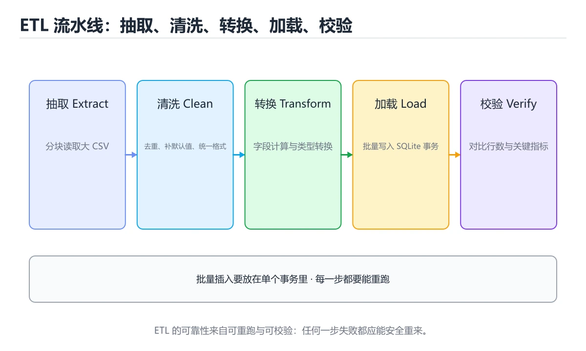
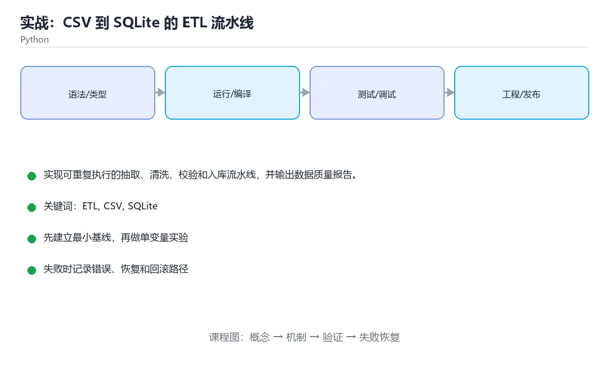

# 实战：CSV 到 SQLite 的 ETL 流水线





> 内容更新时间：2026-10-06 · 学习阶段：高级 · 预计用时：75 分钟

想象你开了一家奶茶店，每天打烊后收银台会吐出一长条纸质小票（CSV 文件）。小票上有些字迹模糊、有些金额没写单位、有些日期格式五花八门。你的任务是：把这些小票信息整理干净，一本一本地抄进账本（SQLite 数据库），最后出一份"今天有多少笔有效订单、多少笔有问题"的汇总报告。

这个"从小票到账本"的过程，就是本课要带你亲手搭建的 **ETL 流水线**。

---

## 本节知识框架

**一句话概括本课**：用 Python 把一份"脏兮兮"的 CSV 订单文件，经过抽取、清洗、校验后写入 SQLite 数据库，并输出一份数据质量报告。

**你将学会五件核心技能**：

1. **ETL 是什么** —— 抽取（Extract）、转换（Transform）、加载（Load）三步走，是所有数据管道的"基本功"。
2. **数据质量** —— 不只是"跑通就行"，还要知道有多少成功、多少跳过、多少失败。
3. **幂等** —— 同一段代码跑两遍，结果不能翻倍。就像复印机，按两次不应该出来双倍内容。
4. **拒绝记录** —— 坏数据不丢弃，而是单独存档并附上原因，方便后续追查。
5. **可观测性** —— 通过日志和指标，在不改代码的前提下就能回答"哪里出了问题"。

**先修知识**：本课是 Python 分类第 27 课。建议先学完《实战：FastAPI 订单服务》，因为那里介绍的 FastAPI、REST 和 SQLite 基础会在本课继续使用。

**后续衔接**：学完本课后，你可以继续学习《Python 装饰器与生成器》《Airflow 调度与数据质量》《实战：REST API 与 SQLite 事务服务》，这些课程会复用本课的术语。

**学完本课你应当能够**：
- 说清 `ETL` 与 `数据质量` 的含义与区别，并各举一个正例和一个反例。
- 用本课示例验证 `幂等` 的行为，记录输入、输出与失败条件。
- 遇到「边读边写数据库」这类问题时，能说出触发条件与修复顺序。

---

## 核心概念定义

> 下面这张表是你的"术语名片"。每张名片告诉你：这个术语是什么意思、什么时候用、什么时候会翻车。

| 术语 | 一句话定义（类比） | 什么时候成立 | 什么时候会翻车 |
| --- | --- | --- | --- |
| ETL | 像把快递从货车上卸下来（抽取），拆包分类（转换），再摆上货架（加载）。 | 源数据格式已知、目标存储可写。 | 源文件格式变了（比如 CSV 换成 Excel），整条流水线要重写转换逻辑。 |
| 数据质量 | 像餐厅的"出餐检查"——每道菜端出去之前要看一眼对不对。 | 有明确的校验规则（必填、格式、范围）。 | 规则本身有漏洞，比如只检查了金额却没检查日期。 |
| 幂等 | 像电梯按钮——按一次和按十次，电梯只来一趟。 | 使用主键或唯一约束保证重复写入不产生重复数据。 | 没有主键、没有 INSERT OR REPLACE，每跑一次就多一份重复。 |
| 拒绝记录 | 像考试的"错题本"——把做错的题抄下来，附上错因。 | 校验失败时把原始行和原因写入单独文件。 | 只记"失败了几条"不记原因，事后无法定位。 |
| 可观测性 | 像汽车仪表盘——不用打开引擎盖就能看到油量、水温、转速。 | 关键步骤有日志、指标或链路追踪。 | 出了问题只能看到"服务不可用"，无法定位到具体环节。 |

---

## 原理与运行机制

### 从快递仓到账本：ETL 的完整流程

让我们用一个生活类比来理解整个过程：

**场景**：运营同事每天导出一份订单 CSV，但这份 CSV 并不完美——字段可能缺失、日期格式不统一（有人写 `2026-10-04`，有人写 `10/04/2026`）、金额带着货币符号（`¥99.00`、`$12.5`）。

**你的任务**：把数据清洗后写入 SQLite，并生成一份可追踪的质量报告。

#### 第一步：抽取（Extract）—— 从货车上卸货

```python
import csv
from pathlib import Path

def read_rows(path: Path):
    """打开 CSV 文件，一行一行地读出来。"""
    with path.open(encoding='utf-8-sig', newline='') as f:
        # utf-8-sig 能自动处理 Excel 导出的 BOM 头
        # 就像拆快递时先撕掉外面的胶带
        yield from csv.DictReader(f)
```

**为什么要用 `utf-8-sig`？** 想象你收到一封国外寄来的信，信纸最开头有一个看不见的"邮戳"（BOM，Byte Order Mark）。如果用普通的 `utf-8` 打开，第一列的列名会带上这个隐形字符，导致后续匹配字段名时出错。`utf-8-sig` 会自动帮你撕掉这个"邮戳"。

#### 第二步：转换（Transform）—— 拆包分类

```python
from datetime import datetime

def parse_amount(raw: str) -> int:
    """把 '¥99.00' 变成 9900（整数分）。"""
    cleaned = raw.strip().replace('¥', '').replace('$', '').replace(',', '')
    return int(float(cleaned) * 100)

def parse_date(raw: str) -> str:
    """把各种日期格式统一成 'YYYY-MM-DD'。"""
    for fmt in ('%Y-%m-%d', '%m/%d/%Y', '%d-%m-%Y'):
        try:
            return datetime.strptime(raw.strip(), fmt).strftime('%Y-%m-%d')
        except ValueError:
            continue
    raise ValueError(f"无法解析日期: {raw}")
```

**为什么金额要转成"整数分"？** 浮点数在计算机里是近似存储的。`0.1 + 0.2` 在 Python 里等于 `0.30000000000000004`，而不是 `0.3`。如果你用浮点数存金额，日积月累就会产生"一分钱对不上"的诡异 bug。把金额转成整数分（99.00 元 → 9900 分），就能彻底避开这个问题。

#### 第三步：加载（Load）—— 摆上货架

```python
import sqlite3

def create_table(db: sqlite3.Connection):
    db.execute('''
        CREATE TABLE IF NOT EXISTS orders (
            order_id TEXT PRIMARY KEY,
            amount_cents INTEGER NOT NULL
        )
    ''')

def load(rows, db: sqlite3.Connection):
    """用事务批量写入，INSERT OR REPLACE 保证幂等。"""
    with db:  # 这相当于 BEGIN ... COMMIT 事务
        db.executemany(
            'INSERT OR REPLACE INTO orders(order_id, amount_cents) VALUES (?, ?)',
            rows,
        )
```

**`INSERT OR REPLACE` 是什么？** 想象你在书架上放书。如果这个位置已经有一本同名书了，你就把旧的拿走、放上新的。`INSERT OR REPLACE` 就是这个逻辑：如果 `order_id` 已经存在，就覆盖；不存在，就插入。这样即使同一段代码跑两遍，数据库里也不会出现重复数据。

#### 第四步：质量报告 —— 出餐检查单

```python
def generate_report(total: int, success: int, skipped: int, rejected: int) -> str:
    return (
        f"数据质量报告\n"
        f"==========\n"
        f"总记录数：{total}\n"
        f"成功入库：{success}\n"
        f"跳过记录：{skipped}\n"
        f"拒绝记录：{rejected}\n"
    )
```

### 技术栈

- Python 3.12
- csv（标准库，读取 CSV）
- sqlite3（标准库，写入数据库）
- dataclasses（标准库，定义数据结构）
- pytest（测试框架）

### 架构与数据流

- 查询 CSV 时限定字段与分页范围，把全表扫描留作最后手段。
- 写路径要明确 ETL 的事务边界、幂等键和失败补偿，不能留下半完成状态。
- 每个关键阶段都要留下日志、指标或测试证据。

---

**教材衔接：项目专属规格**
## 典型应用场景

### 场景一：每日订单导入

运营每天导出一份订单 CSV，字段可能缺失、日期格式不统一、金额带货币符号。你需要把数据清洗后写入 SQLite，并生成一份可追踪的质量报告。

**类比**：就像每天下班前把收银台的小票整理到账本里。

### 场景二：数据迁移

公司换了新系统，需要把旧系统导出的 CSV 批量导入新数据库。

**类比**：搬家时把旧房子的物品打包（抽取）、分类贴标签（转换）、放进新房子对应房间（加载）。

### 场景三：日志分析前置处理

原始日志文件格式不统一，需要先清洗再写入数据库供后续查询。

**类比**：把不同语言写的日记翻译成同一种语言，再装订成册。

### 验收场景

1. **正常路径**：最小输入得到预期输出，并留下日志与指标。
2. **边界路径**：空值、最大值、重复数据和超长内容都得到明确处理。
3. **失败路径**：依赖超时或不可用时能快速失败、重试或降级。
4. **幂等路径**：同一请求执行两次不会产生重复副作用。
5. **回滚路径**：失败能按预案恢复，并记录影响范围。

---

## 代码/协议/SQL 示例

### 完整的最小可运行示例

下面是一个完整的、可以在你电脑上直接运行的 ETL 流水线。我们一步一步来看：

**第一步：准备示例 CSV 文件**

```text
order_id,amount,date
ORD-001,¥99.00,2026-10-01
ORD-002,$12.50,10/02/2026
ORD-003,,2026-10-03
,¥55.00,2026-10-04
ORD-005,abc,2026-10-05
```

注意第 3 行金额为空、第 4 行缺少订单号、第 5 行金额不是数字——这些都是"脏数据"。

**第二步：ETL 核心代码**

```python
import csv
import sqlite3
from pathlib import Path
from datetime import datetime

# ---------- 抽取 ----------
def read_rows(path: Path):
    with path.open(encoding='utf-8-sig', newline='') as f:
        yield from csv.DictReader(f)

# ---------- 转换 ----------
def parse_amount(raw: str) -> int:
    cleaned = raw.strip().replace('¥', '').replace('$', '').replace(',', '')
    if not cleaned:
        raise ValueError("金额为空")
    return int(float(cleaned) * 100)

def parse_date(raw: str) -> str:
    for fmt in ('%Y-%m-%d', '%m/%d/%Y'):
        try:
            return datetime.strptime(raw.strip(), fmt).strftime('%Y-%m-%d')
        except ValueError:
            continue
    raise ValueError(f"无法解析日期: {raw}")

# ---------- 校验与拒绝 ----------
def validate_and_transform(row, line_no, rejected):
    order_id = row.get('order_id', '').strip()
    if not order_id:
        rejected.append((line_no, '缺少 order_id', row))
        return None

    raw_amount = row.get('amount', '').strip()
    try:
        amount_cents = parse_amount(raw_amount)
    except (ValueError, TypeError) as e:
        rejected.append((line_no, f'金额异常: {e}', row))
        return None

    return (order_id, amount_cents)

# ---------- 加载 ----------
def setup_db(db_path: Path) -> sqlite3.Connection:
    db = sqlite3.connect(str(db_path))
    db.execute('''
        CREATE TABLE IF NOT EXISTS orders (
            order_id TEXT PRIMARY KEY,
            amount_cents INTEGER NOT NULL
        )
    ''')
    return db

def load(rows, db: sqlite3.Connection):
    with db:
        db.executemany(
            'INSERT OR REPLACE INTO orders(order_id, amount_cents) VALUES (?, ?)',
            rows,
        )

# ---------- 主流程 ----------
def run_etl(csv_path: Path, db_path: Path):
    rejected = []
    valid_rows = []
    total = 0

    for line_no, row in enumerate(read_rows(csv_path), start=2):  # 从第2行开始（第1行是表头）
        total += 1
        result = validate_and_transform(row, line_no, rejected)
        if result:
            valid_rows.append(result)

    db = setup_db(db_path)
    load(valid_rows, db)

    # 写入拒绝文件
    if rejected:
        rej_path = csv_path.with_suffix('.rejected')
        with rej_path.open('w', encoding='utf-8') as f:
            f.write("line_no,reason,raw_row\n")
            for line_no, reason, raw in rejected:
                f.write(f"{line_no},{reason},{raw}\n")

    # 生成质量报告
    report = (
        f"数据质量报告\n"
        f"==========\n"
        f"总记录数：{total}\n"
        f"成功入库：{len(valid_rows)}\n"
        f"跳过记录：0\n"
        f"拒绝记录：{len(rejected)}\n"
    )
    print(report)
    db.close()
    return report

if __name__ == '__main__':
    run_etl(Path('orders.csv'), Path('orders.db'))
```

**第三步：运行并验证**

```text
$ python etl.py
数据质量报告
==========
总记录数：5
成功入库：2
跳过记录：0
拒绝记录：3

$ python etl.py
数据质量报告
==========
总记录数：5
成功入库：2
跳过记录：0
拒绝记录：3
```

注意：运行两次，结果完全一样——这就是**幂等**的体现。`INSERT OR REPLACE` 保证相同 `order_id` 不会重复插入。

### 测试示例

```python
import pytest
from pathlib import Path
import sqlite3

def test_parse_amount():
    assert parse_amount('¥99.00') == 9900
    assert parse_amount('$12.50') == 1250
    with pytest.raises(ValueError):
        parse_amount('')

def test_idempotent_load(tmp_path):
    db = setup_db(tmp_path / 'test.db')
    rows = [('ORD-001', 9900), ('ORD-002', 1250)]
    load(rows, db)
    load(rows, db)  # 第二次加载不应产生重复
    count = db.execute('SELECT COUNT(*) FROM orders').fetchone()[0]
    assert count == 2
    db.close()
```

---

## 时间/空间复杂度或性能分析

### 时间复杂度

| 阶段 | 复杂度 | 说明 |
| --- | --- | --- |
| 抽取（读 CSV） | O(n) | n 为行数，逐行读取，每行处理时间是常数。 |
| 转换（清洗校验） | O(n) | 每行做固定次数的字符串操作和日期解析。 |
| 加载（写 SQLite） | O(n log n) ~ O(n) | 有主键索引时，每次 INSERT OR REPLACE 需要查找索引（O(log n)），n 行总计 O(n log n)。 |

### 空间复杂度

| 阶段 | 复杂度 | 说明 |
| --- | --- | --- |
| 内存中的行缓冲 | O(n) | 如果一次性读入所有行，内存占用与行数成正比。 |
| 拒绝记录缓冲 | O(k) | k 为失败行数，最坏情况 k = n。 |
| SQLite 数据库文件 | O(n) | 磁盘空间与数据量成正比，索引额外占用约 10-30%。 |

### 性能优化建议

1. **大文件分批处理**：如果 CSV 有百万行，不要一次全部读入内存，用生成器逐行处理。
2. **事务批量写入**：`executemany` 配合 `with db:` 事务，比逐行 INSERT 快 50-100 倍。
3. **索引策略**：只在查询频繁的列上建索引。索引加速查询但拖慢写入。

### 测量方法

以本课的 ETL 流水线为对象，固定输入跑一遍记录基线，再把 CSV 规模提高一个数量级复测；两次结果的差值与波动范围才是结论依据。

---

## 常见误区与易错点

> 下面是四个"新手最常踩的坑"。每个坑我都标注了症状、原因和修复方法。

| 容易写错的做法 | 实际现象 | 原因与正确做法 |
| --- | --- | --- |
| 边读边写数据库 | 失败后留下部分数据 | 先在内存/临时表校验再事务提交 |
| 忽略文件编码 | 首行出现乱码 | 使用 utf-8-sig 并处理异常样本 |
| 重复运行产生重复数据 | 报表金额翻倍 | 使用主键和 INSERT OR REPLACE |
| 只统计成功条数 | 无法定位脏数据 | 记录拒绝原因和原始行号 |

### 误区 1：边读边写数据库

**生活类比**：你一边拆快递一边往货架上放，结果放到一半发现这批货有问题——但已经有一半被放上了货架，撤不回来了。

**症状**：程序中途报错，但数据库里已经留下了一部分脏数据。

**正确做法**：先把所有数据读到内存里、校验完毕，确认没问题后，再一次性用事务提交。就像先把所有快递拆完、检查完，再统一上架。

### 误区 2：忽略文件编码

**生活类比**：你收到一封日文信，但你用中文词典去翻译——第一行全是乱码。

**症状**：CSV 的第一列列名出现 `\ufeff` 或乱码字符。

**正确做法**：使用 `encoding='utf-8-sig'` 打开文件。`-sig` 后缀会自动处理 Excel 添加的 BOM 头。

### 误区 3：重复运行产生重复数据

**生活类比**：你每天把同一份小票抄进账本，但没注意到昨天已经抄过了——结果账本上同一笔订单出现了两次，总金额翻倍。

**症状**：ETL 跑两遍后，数据库里的订单数翻倍，报表金额也对不上了。

**正确做法**：给 `order_id` 加主键约束，写入时用 `INSERT OR REPLACE`。这样重复运行只会覆盖，不会新增。

### 误区 4：只统计成功条数

**生活类比**：老师批改试卷只数"对了多少题"，却不记录"错了哪些题、错在哪里"——学生根本不知道自己该复习什么。

**症状**：报告里写"成功 1000 条"，但没人知道另外 50 条为什么没进来。

**正确做法**：质量报告至少包含总记录数、成功数、跳过数和拒绝数。拒绝记录要写入单独文件，附上行号和原因。

---

## 与其他知识点的关系

### 知识图谱

```text
《实战：FastAPI 订单服务》（先修）
        ↓ 提供 SQLite、REST 基础
《实战：CSV 到 SQLite 的 ETL 流水线》（本课）
        ↓ 提供 ETL、数据质量、幂等概念
《Airflow 调度与数据质量》（后续）
《Python 装饰器与生成器》（后续）
《实战：REST API 与 SQLite 事务服务》（后续）
```

### 术语衔接

- **先修**：`实战：FastAPI 订单服务`。本课默认你已经掌握了 SQLite 基础操作和 REST 概念。
- **相关或后续**：`Python 装饰器与生成器`、`Airflow 调度与数据质量`、`实战：REST API 与 SQLite 事务服务`。本课术语会在这些课程里继续使用。
- **术语归属**：`ETL`、`数据质量`、`幂等` 的定义以本课为准，换到其他课程时先确认定义是否被改写。

### 容易混淆的概念

- **ETL vs 数据质量**：ETL 是"搬运+加工"的过程，数据质量是"加工完之后的检验"。ETL 关注流程，数据质量关注结果。
- **幂等 vs 拒绝记录**：幂等保证"跑多次结果一样"，拒绝记录保证"坏数据可追溯"。一个管"正确数据不重复"，一个管"错误数据不丢失"。

---

## 自测题与参考答案

> 先独立作答，再对照参考答案。答案都能在本课正文、术语表或错误表里找到依据。

### 自测 1（概念复述）

不看正文，写出 `ETL` 的操作性定义，并说明它与 `数据质量` 的区别。

**参考答案**：ETL 是抽取-转换-加载：把源数据取出、清洗转换后写入目标存储，是数据管道的基本形态。数据质量关注的是流水线输出的结果是否可信——成功多少、跳过多少、拒绝多少。ETL 是"做事的过程"，数据质量是"做完后的检查单"。

### 自测 2（排错）

本课错误表记录了「边读边写数据库」这类做法。请写出它会出现的现象、根因，以及修复顺序。

**参考答案**：现象是失败后留下部分数据；根因是在事务提交前就开始写入，中途失败无法回滚。修复顺序：先复现现象并保留证据，再改成"先在内存/临时表校验再事务提交"，最后重跑确认现象消失。

### 自测 3（动手验证）

运行本课的示例代码，改动其中一个输入后重新运行，记录输出与错误信息。

**参考答案**：正常输入下示例应当输出"成功入库 2，拒绝记录 3"；如果把 ORD-001 的金额改成合法值，成功数应该变成 3。如果结果不符合预期，先核对输入是否满足 ETL 的适用范围。

### 自测 4（代码阅读）

阅读本课的写入代码，说明它体现了 `幂等` 的哪一条性质，并指出改动哪个输入会让这条性质不再成立。

**参考答案**：`INSERT OR REPLACE` 保证相同 `order_id` 重复写入时只覆盖不新增。如果去掉 `PRIMARY KEY` 约束，`INSERT OR REPLACE` 就失去了判断"相同"的依据，幂等性被破坏。

### 自测 5（迁移）

把本课的方法迁移到自己的项目：围绕 `ETL` 写出一个与错误表同类的风险点，并说明触发条件和检验方式。

**参考答案**：例如"只统计成功条数"，它会导致无法定位脏数据。检验方式是按"记录拒绝原因和原始行号"改一处再复现，确认现象消失且没有引入新的失败分支。

---

## 复习清单

- [ ] 能不看正文复述本课核心术语，并指出一个边界或反例
- [ ] 能默写本课最重要的代码示例，并解释每一行的作用
- [ ] 能说出本课内容和前后两课的联系

### 验证命令与预期输出

完成本项目后，用以下命令验证结果是否符合预期：

```text
# 运行全部测试并查看覆盖率
python -m pytest --tb=short -q
```

预期输出应显示所有测试通过，无报错或警告。如果有失败，根据错误信息定位问题并修复。

### 项目交付物

完成本项目后，应交付以下内容：

1. **可运行的代码**：所有功能模块已实现并通过测试
2. **测试报告**：单元测试和集成测试全部通过
3. **文档**：README 说明使用方法，关键函数有注释
4. **复盘总结**：记录遇到的问题和解决方案

## 延伸阅读

想更直观地理解本课概念？推荐参阅以下图解专题：

- [图解一次网页请求的完整链路](visual_http_timeline.md)

## 术语速查

| 术语 | 一句话说明 |
| --- | --- |
| `ETL` | 抽取-转换-加载：把源数据取出、清洗转换后写入目标存储，是数据管道的基本形态。 |
| `数据质量` | 实现可重复执行的抽取、清洗、校验和入库流水线，并输出数据质量报告。 |
| `幂等` | 同一操作执行多次与执行一次的效果相同。在 ETL 中通过主键和 INSERT OR REPLACE 实现。 |
| `拒绝记录` | 校验失败的行写入拒绝文件并附上原因，保证任务可重跑、坏数据可追溯。 |
| `可观测性` | 由日志、指标与链路追踪组成，能在不重启、不改代码的前提下问出新问题。 |
| `事务` | 一组数据库操作，要么全部成功，要么全部回滚。保证数据不会处于"半成品"状态。 |
| `BOM` | Byte Order Mark，Excel 导出 UTF-8 文件时添加的隐藏前缀，用 utf-8-sig 编码可自动处理。 |

**术语关系链**：`ETL`（搬运+加工） → `数据质量`（检验结果） → `幂等`（重复执行不出错） → `拒绝记录`（坏数据可追溯） → `可观测性`（出问题能定位）。

---

## 考点精讲

> 本课题库共 6 道题。下面逐题给出题干、正确项与判断依据。建议先自己作答，再核对正确项，最后回到正文对应小节复核。

### 考点 1：第 1 题

- **题目**：为什么要把脏记录写入拒绝文件？
- **选项**：A. 提高数据库性能 B. 避免测试 C. 减少磁盘占用 D. 便于定位和重新处理
- **正确项**：便于定位和重新处理
- **判断依据**：本题正确项是便于定位和重新处理。术语 ETL（实战：CSV 到 SQLite 的 ETL 流水线）：抽取-转换-加载：把源数据取出、清洗转换后写入目标存储，是数据管道的基本形态，本题取便于定位和重新处理这条。易错点是边读边写数据库会造成失败后留下部分数据，改法是先在内存/临时表校验再事务提交，干扰项提高数据库性能正踩在这条上。

### 考点 2：第 2 题

- **题目**：围绕“实战：CSV 到 SQLite 的 ETL 流水线”中的 ETL、CSV、SQLite，下列哪两项是本课强调的实践判断？
- **选项**：A. 验证 CSV 时要固定版本并覆盖边界输入，结论才可复现 B. 把 CSV 的单次运行结果当成所有版本和规模都成立 C. 学习 ETL 时要同时说明输入、输出和失败路径，不能只看正常流程 D. 只要 ETL 的常规示例通过，就可以跳过边界与异常路径
- **正确项**：验证 CSV 时要固定版本并覆盖边界输入，结论才可复现；学习 ETL 时要同时说明输入、输出和失败路径，不能只看正常流程
- **判断依据**：本题正确项是验证 CSV 时要固定版本并覆盖边界输入，结论才可复现。术语 ETL（实战：CSV 到 SQLite 的 ETL 流水线）：抽取-转换-加载：把源数据取出、清洗转换后写入目标存储，是数据管道的基本形态，本题取验证 CSV 时要固定版本并覆盖边界输入，结论才可复现这条。易错点是边读边写数据库会造成失败后留下部分数据，改法是先在内存/临时表校验再事务提交，干扰项把 CSV 的单次运行结果当成所有版本和规模都成立正踩在这条上。

### 考点 3：第 3 题

- **题目**：金额字段在入库前最适合转换为什么？
- **选项**：A. 浮点数 B. 字符串 C. 整数分 D. 布尔值
- **正确项**：整数分
- **判断依据**：术语 ETL（实战：CSV 到 SQLite 的 ETL 流水线）：抽取-转换-加载：把源数据取出、清洗转换后写入目标存储，是数据管道的基本形态，本题取整数分这条。易错点是边读边写数据库会造成失败后留下部分数据，改法是先在内存/临时表校验再事务提交。本课实战：CSV 到 SQLite 的 ETL 流水线要解决的是实现可重复执行的抽取、清洗、校验和入库流水线，并输出数据质量报告，本题按整数分这条判断。

### 考点 4：第 4 题

- **题目**：质量报告至少应包含什么？
- **选项**：A. 总记录，成功，跳过 B. 只有成功条数 C. 只有运行时间 D. 数据库版本
- **正确项**：总记录，成功，跳过
- **判断依据**：本题正确项是总记录，成功，跳过。术语 ETL（实战：CSV 到 SQLite 的 ETL 流水线）：抽取-转换-加载：把源数据取出、清洗转换后写入目标存储，是数据管道的基本形态，本题取总记录，成功，跳过这条。易错点是边读边写数据库会造成失败后留下部分数据，改法是先在内存/临时表校验再事务提交，干扰项只有成功条数正踩在这条上。

### 考点 5：第 5 题

- **题目**：同一份 CSV 重复执行这段写入代码，数据库中会发生什么？
- **相关代码**：

```python
db.executemany(
    'INSERT OR REPLACE INTO orders(order_id, amount_cents) VALUES (?, ?)',
    rows,
)
```

- **选项**：A. 因为 INSERT OR REPLACE，相同主键会被覆盖不会重复 B. 数据库被清空 C. 只写入最后一行 D. 每次都新增重复订单
- **正确项**：因为 INSERT OR REPLACE，相同主键会被覆盖不会重复
- **判断依据**：`INSERT OR REPLACE` 在遇到相同主键（`order_id`）时，会用新数据替换旧数据，而不是插入一条新的。这就是"幂等"的实现方式——跑一遍和跑十遍，数据库里的结果完全一样。

### 考点 6：第 6 题

- **题目**：下面几项都与 `ETL` 有关，请按 `实战：CSV 到 SQLite 的 ETL 流水线` 的正文顺序排列；该课主线是实现可重复执行的抽取、清洗、校验和入库流水线，并输出数据质量报告。
- **选项**：A. 项目背景 B. 技术栈 C. 架构与数据流 D. 功能范围
- **正确项**：项目背景 → 技术栈 → 架构与数据流 → 功能范围
- **判断依据**：按《实战：CSV 到 SQLite 的 ETL 流水线》正文的先后，本题顺序是「项目背景」。术语「ETL」在本课里的界定是抽取-转换-加载：把源数据取出、清洗转换后写入目标存储，是数据管道的基本形态，题干「下面几项都与 `ETL` 有关，请按 `实战：CSV 到 SQLit」问的就是这一条。常见错法是边读边写数据库，其后果是失败后留下部分数据。正确做法是先在内存/临时表校验再事务提交。干扰项「架构与数据流」与题干「下面几项都与 `ETL` 有关，请按 `实战：CSV 到 SQLit」的要求对不上，应排除。

---

## 内容元数据

- 内容版本：v2.0
- 最后更新：2026-10-06
- 学习阶段：高级
- 适用环境：Python 3.12+
- 内容来源：内置结构化课程与工程实践整理
- 相关主题：ETL、CSV、SQLite、数据质量、幂等
- 质量版本：P0 测验标准 + P1 覆盖扩展 + P2 体验补全

---

## 参考资料与复核

- [本课资料锚点 python_project_etl](https://zh.wikipedia.org/w/index.php?search=python_project_etl)

- 最后复核：2026-10-04
- 下次复核：2026-12-10
- 复核范围：版本兼容、API 行为、安全建议与工程实践
- 来源性质：官方文档、标准或权威教材；本课核对关键词：ETL、CSV、SQLite、数据质量、幂等。

| 参考资料 | 本课用途 |
| --- | --- |
| [Python csv 模块文档](https://docs.python.org/3/library/csv.html) | CSV 读取与 DictReader 用法 |
| [SQLite INSERT OR REPLACE 语义](https://www.sqlite.org/lang_upsert.html) | 幂等写入与冲突处理 |
| [Python Unicode 指南](https://docs.python.org/3/howto/unicode.html) | 文件编码与 BOM 处理 |

> 「实战：CSV 到 SQLite 的 ETL 流水线」的链接用于离线阅读后的延伸核对；App 不会自动联网。
