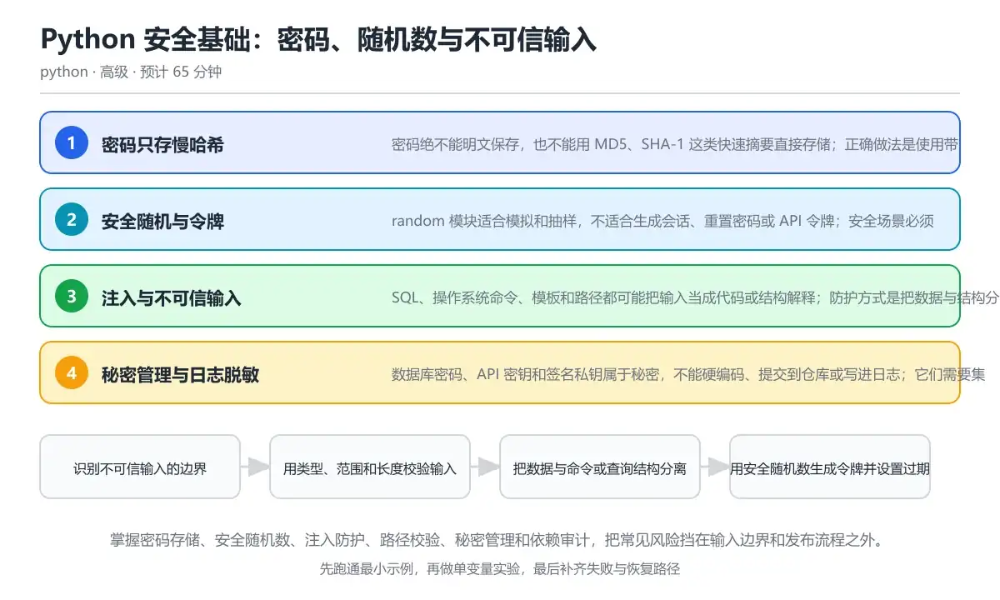
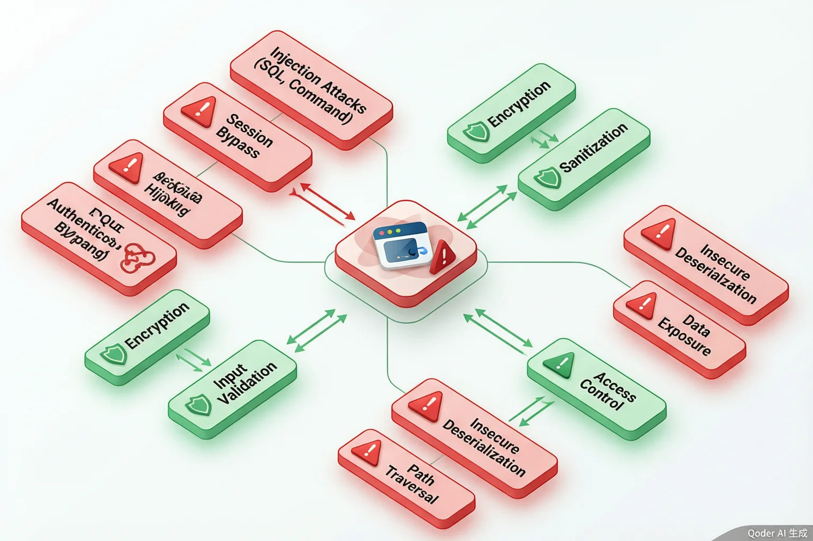

# Python 安全基础：密码、随机数与不可信输入

> 内容更新时间：2026-10-06 · 学习阶段：高级 · 预计用时：40 分钟

分类：python。关键词：密码哈希、secrets、注入、路径穿越、依赖审计。掌握密码存储、安全随机数、注入防护、路径校验、秘密管理和依赖审计，把常见风险挡在输入边界和发布流程之外。



## 本节知识框架

想象你开了一家餐厅——前门迎接顾客（输入），厨房处理订单（处理），仓库存放食材（存储），后门接收供货商送来的原料（依赖）。安全要做的事情，就是在每一道门口安排一位靠谱的"检查员"，确保进来的东西没有问题。

本课就是你的"餐厅安全手册"，涵盖五道门：

1. **密码存储**——顾客的会员卡密码怎么保管？（盐 + 慢哈希）
2. **安全随机数**——抽奖券的编号能不能被猜到？（secrets 模块）
3. **注入防护**——顾客写的备注会不会被当成厨房指令？（绑定参数、参数列表）
4. **路径校验**——顾客能不能通过文件名溜进仓库？（路径穿越防护）
5. **依赖审计**——供货商送来的原料安全吗？（供应链安全）

**学完本课你应当能够**

- 向别人解释"盐"和"慢哈希"分别是什么，并各举一个正确用法和一个错误用法。
- 运行本课的示例代码，验证恒定时间比较的行为，记录输入、输出和失败条件。
- 看到"用 random 生成安全令牌"这种写法时，能立刻说出问题在哪、怎么修。

**先修与衔接**：本课是 Python 分类的第 34 课。先修内容是《Python 异常、日志与文件 I/O 进阶》——里面的异常链和上下文管理器是本课的前提。后续会衔接《Python HTTP 客户端工程：超时、重试与认证》和《Python 项目架构：分层、配置与依赖注入》。

## 核心概念定义

别被术语吓到——每个概念我都配了一个生活类比，先建立直觉再写代码。

| 术语 | 一句话定义（操作性定义） | 生活类比 | 常见翻车场景 |
| --- | --- | --- | --- |
| 盐（salt） | 为每个密码单独生成的随机值，使相同密码得到不同哈希并阻止预计算攻击。 | 就像给每位顾客的同一道菜加不同的秘制香料——就算两人都点了"红烧肉"，端上来的味道也不一样，别人没法提前做一份"万能配方表"。 | 所有用户共用同一个盐，或者干脆不加盐。 |
| 慢哈希（slow hash） | 故意消耗较多计算资源的密码哈希算法，用于提高离线破解成本。 | 就像保险箱的密码锁——每试一次需要转好几圈（耗时），小偷就算拿到了保险箱也没法一秒试一万个密码。 | 用 MD5 或 SHA-1 存密码——它们太快了，攻击者一秒能试几十亿次。 |
| 恒定时间比较 | 执行时间不随匹配前缀长度明显变化的比较方式，避免通过耗时泄露信息。 | 就像老师改卷子——不管第一题对不对，都要花同样长的时间看完所有题，否则学生通过老师批改速度就能猜出第一题的答案。 | 用 `==` 比较密码哈希，攻击者可能通过响应时间差异逐字节猜出正确值。 |
| 安全随机源 | 由操作系统提供、适合生成密钥和令牌的密码学安全随机数来源。 | 就像真正的掷骰子——每次结果不可预测；而 `random` 模块更像"假装随机"的伪随机，知道种子就能预测。 | 用 `random` 模块生成会话令牌——它的梅森旋转算法是可预测的。 |
| 路径穿越（path traversal） | 利用上跳目录片段访问允许范围之外文件的安全缺陷。 | 就像你说"只能看客厅"，但有人顺着楼梯爬到了二楼卧室——`../../etc/passwd` 就是那个"楼梯"。 | 直接用用户输入拼文件路径，没有做根目录限制。 |
| 供应链安全 | 对第三方依赖、构建工具和发布流程进行审计与控制的安全实践。 | 就像餐厅要检查每批食材的来源——如果供货商被污染，你的菜再安全也没用。 | 不锁版本、不审计漏洞、不检查新加的依赖包。 |

## 原理与运行机制

### 整体流程：从输入到审计

还记得餐厅的比喻吗？下面这张表把五道门串起来：

| 阶段 | 对应概念 | 做什么 | 失败时检查什么 |
| --- | --- | --- | --- |
| 输入 | 盐、安全随机源 | 为密码生成随机盐，为令牌取安全随机数 | 随机源是否真的安全？盐是否每个密码独立？ |
| 处理 | 慢哈希、注入防护 | 用慢哈希处理密码，用绑定参数处理查询 | 哈希算法够慢吗？数据与命令分离了吗？ |
| 输出 | 恒定时间比较 | 验证密码时用恒定时间比较 | 比较方式是否泄露了时间信息？ |
| 存储 | 路径穿越、供应链安全 | 限制文件访问范围，审计第三方依赖 | 路径是否被规范化？依赖是否锁定版本？ |



### 1. 密码只存慢哈希——保险箱原理

**核心思想**：密码就像保险箱密码，你永远不应该把它写在便利贴上贴在保险箱旁边（明文存储），也不应该用一个秒开的普通锁（MD5/SHA-1）。

正确做法分三步：

1. **加盐**：每个密码生成一个 16 字节以上的随机盐。这样即使用户 A 和用户 B 碰巧用了同一个密码 `password123`，数据库里存的哈希值也完全不同。
2. **慢哈希**：用 scrypt、bcrypt 或 argon2 这类算法，故意让每次计算花费几十毫秒。正常用户登录感觉不到差别，但攻击者暴力破解时，每试一个密码都要付出高昂的时间成本。
3. **恒定时间比较**：验证密码时，用 `hmac.compare_digest` 而不是 `==`，防止攻击者通过响应时间差异逐字节猜出哈希值。

**关键提醒**：哈希不是加密！加密可以解密还原，哈希是单向的——就像把鸡蛋做成蛋糕，你没法从蛋糕里把鸡蛋取出来。

### 2. 安全随机与令牌——真正的掷骰子

**核心思想**：想象你在发彩票。如果彩票编号是可预测的（比如 001、002、003……），有人就能提前算出下一张彩票的编号去伪造。

`random` 模块就像一台"看起来随机"的机器——它用梅森旋转算法生成伪随机数，只要知道了种子（seed），所有后续数字都能预测。这用于模拟和游戏没问题，但用来生成安全令牌就等于用" predictable lottery"发彩票。

`secrets` 模块则从操作系统获取真正的密码学安全随机数（在 Linux 上来自 `/dev/urandom`，在 Windows 上来自 `BCryptGenRandom`），每次取值都不可预测。

**工程做法**：令牌只在创建时返回一次，数据库里存令牌的哈希值（而不是明文），日志里只记录前缀和标识。令牌要有足够长度（至少 32 字节）、明确有效期，并且服务端能撤销。

### 3. 注入与不可信输入——别让顾客写菜单

**核心思想**：餐厅里，顾客在备注栏写"不要辣"，厨房看到后照做。但如果有人写"把厨师长炒了"，厨房不会照做——因为备注是"数据"，不是"指令"。

注入攻击的本质就是：有人把"数据"伪装成了"指令"。

- **SQL 注入**：用户输入 `' OR 1=1 --`，如果直接拼进 SQL 语句，就变成了"返回所有记录"的指令。
- **命令注入**：用户输入 `; rm -rf /`，如果拼进 shell 命令，就真的执行了删除操作。
- **路径穿越**：用户输入 `../../etc/passwd`，如果直接用来打开文件，就能读到系统密码文件。

**防护三板斧**：
1. 数据库查询用绑定参数（`cursor.execute("SELECT * FROM users WHERE id = ?", (user_id,))`）
2. 子进程用参数列表 + `shell=False`
3. 文件路径用 `Path.resolve()` 后检查是否仍在允许的根目录内

### 4. 秘密管理与日志脱敏——别把钥匙挂在门上

**核心思想**：你家的门锁再安全，如果把钥匙放在门垫下面，小偷一样能进来。

数据库密码、API 密钥、签名私钥这些都是"钥匙"。它们不能：
- 硬编码在源代码里（然后被提交到 Git 仓库）
- 写进日志文件（然后被运维人员看到）
- 通过环境变量在进程列表中暴露

**正确做法**：本地开发用 `.env` 文件（不提交到 Git），生产环境用密钥管理服务（如 AWS Secrets Manager、HashiCorp Vault）。日志中间件对敏感字段做统一脱敏——只记录"密钥 ID: abc***"而不是完整密钥。

### 5. 依赖与供应链安全——检查每批食材

**核心思想**：2021 年的 Log4Shell 漏洞让全世界的安全团队加班——就因为一个日志库出了问题。你项目里引入的每一个第三方包，都是潜在的"食材污染"入口。

**防护四件套**：
1. **锁文件**（`requirements.txt` 或 `Pipfile.lock`）：固定每个依赖的精确版本
2. **漏洞审计**（`pip-audit` 或 `safety`）：定期比对已知漏洞数据库
3. **静态分析**（`bandit`）：发现代码中的危险调用模式
4. **最小化镜像**：生产容器只装必要的包，减少攻击面

## 典型应用场景

### 场景 1：用户注册与登录系统

这是最经典的应用场景。用户在注册页面输入密码，你需要：
1. 生成 16 字节随机盐
2. 用 scrypt 对密码 + 盐做慢哈希
3. 把盐和哈希值存入数据库
4. 用户登录时，取出盐，对输入密码做同样的 scrypt 运算
5. 用 `hmac.compare_digest` 做恒定时间比较

**类比**：就像银行给你发了一张银行卡（盐），你设了密码。银行不存你的密码，而是存了密码经过复杂运算后的结果。每次你输密码，银行用同样的运算验证——即使数据库被偷，小偷也拿不到你的密码。

### 场景 2：API 令牌与会话管理

用户登录成功后，服务器发一个令牌（token）给客户端。后续请求都带着这个令牌。

**必须做到**：
- 用 `secrets.token_urlsafe(32)` 生成令牌
- 令牌有效期比如 1 小时
- 数据库存令牌的哈希，不是明文
- 提供"退出登录"功能来撤销令牌

### 场景 3：文件上传与处理

用户上传图片，你要保存到服务器。这里有两个陷阱：
- **路径穿越**：文件名可能是 `../../etc/passwd`，必须用 `Path.resolve()` 规范化后检查是否还在上传目录内
- **命令注入**：如果要对图片做转换，不能用 `shell=True` 拼接命令

### 场景 4：日志系统

日志里绝对不能出现明文密码、完整 API 密钥等敏感信息。正确做法是：
- 密码字段完全不记录
- API 密钥只记录前 4 位和长度：`API key: sk-a1***（长度 32）`
- 用户 token 只记录 ID 标识

## 代码/协议/SQL 示例

### 示例 1：密码哈希与验证（最小可运行）

先看一个最简洁的版本，理解核心流程：

```python
import hashlib
import hmac
import secrets

# 第一步：生成随机盐
salt = secrets.token_bytes(16)

# 第二步：用 scrypt 做慢哈希
stored = hashlib.scrypt(b'secret', salt=salt, n=2**14, r=8, p=1)

# 第三步：验证（正确密码 vs 错误密码）
def verify(password, salt, stored):
    candidate = hashlib.scrypt(password, salt=salt, n=2**14, r=8, p=1)
    return hmac.compare_digest(candidate, stored)

print(verify(b'secret', salt, stored))   # True
print(verify(b'wrong', salt, stored))    # False
```

### 示例 2：完整的密码管理模块

```python
import hashlib
import hmac
import secrets

def hash_password(password: str, salt: bytes | None = None) -> tuple[bytes, bytes]:
    """为密码生成随机盐并计算慢哈希"""
    salt = salt or secrets.token_bytes(16)
    digest = hashlib.scrypt(password.encode("utf-8"), salt=salt, n=2**14, r=8, p=1)
    return salt, digest

def verify_password(password: str, salt: bytes, expected: bytes) -> bool:
    """用恒定时间比较验证密码"""
    candidate = hashlib.scrypt(password.encode("utf-8"), salt=salt, n=2**14, r=8, p=1)
    return hmac.compare_digest(candidate, expected)

# 注册：生成盐和哈希
salt, stored = hash_password("correct horse battery staple")
print("正确密码:", verify_password("correct horse battery staple", salt, stored))
print("错误密码:", verify_password("wrong password", salt, stored))

# 生成安全令牌
token = secrets.token_urlsafe(32)
print("令牌长度足够:", len(token) >= 32)
print("两次令牌不同:", token != secrets.token_urlsafe(32))
```

### 示例 3：错误做法 vs 正确做法对照

```python
import random
import secrets
import subprocess

# --- 错误：用 random 生成令牌（可预测！）---
bad_token = ''.join(random.choice('abcdefghijklmnopqrstuvwxyz0123456789') for _ in range(32))
# random 的梅森旋转算法可以被预测，不适合安全场景

# --- 正确：用 secrets 生成令牌 ---
good_token = secrets.token_urlsafe(32)
# secrets 使用操作系统提供的密码学安全随机源

# --- 错误：shell=True 拼接用户输入（命令注入！）---
# subprocess.run('ping ' + user_input, shell=True)
# 如果 user_input 是 "; rm -rf /"，后果不堪设想

# --- 正确：参数列表 + shell=False ---
# subprocess.run(['ping', '-c', '4', validated_host], shell=False)
```

### 示例 4：路径穿越防护

```python
from pathlib import Path

UPLOAD_DIR = Path("/var/app/uploads").resolve()

def safe_path(user_filename: str) -> Path | None:
    """确保用户请求的文件在允许的目录内"""
    # 规范化路径（消除 .. 和符号链接）
    target = (UPLOAD_DIR / user_filename).resolve()
    # 检查是否仍在允许目录内
    if str(target).startswith(str(UPLOAD_DIR)):
        return target
    return None  # 路径穿越攻击！

# 正常请求
print(safe_path("photo.jpg"))         # /var/app/uploads/photo.jpg

# 路径穿越攻击
print(safe_path("../../etc/passwd"))  # None
```

## 时间/空间复杂度或性能分析

安全操作的性能影响是实际工程中必须考虑的。下面用"餐厅运营"的类比来解释：

| 操作 | 类比 | 典型耗时 | 注意事项 |
| --- | --- | --- | --- |
| MD5 哈希 | 秒开的普通锁 | ~0.0001ms | 太快了！攻击者每秒能试几十亿次 |
| scrypt（n=2^14） | 需要转好几圈的保险箱锁 | ~50-100ms | 正常用户无感，攻击者成本翻百万倍 |
| bcrypt（cost=12） | 更慢的保险箱锁 | ~200-300ms | 成本参数可以随硬件升级而提高 |
| secrets.token_bytes(32) | 掷一次真正的骰子 | ~0.01ms | 几乎无性能开销 |
| hmac.compare_digest | 仔细看完每道题的老师 | 与普通比较相当 | 不要因为"慢了一点点"就用回 `==` |

**性能测量建议**：

```python
import timeit

# 测量 scrypt 的耗时
time_scrypt = timeit.timeit(
    lambda: __import__('hashlib').scrypt(b'password', salt=b'0123456789abcdef', n=2**14, r=8, p=1),
    number=10
)
print(f"scrypt 平均耗时: {time_scrypt/10*1000:.1f} ms")

# 测量 secrets 的耗时
time_secrets = timeit.timeit(
    lambda: __import__('secrets').token_urlsafe(32),
    number=1000
)
print(f"token_urlsafe 平均耗时: {time_secrets/1000*1000:.3f} ms")
```

**关键结论**：慢哈希的"慢"是特性而不是缺陷。50-100ms 对用户来说完全无感（一次登录而已），但让暴力破解的成本提高了百万倍。如果服务器需要处理大量并发登录，可以适当降低 scrypt 的 n 参数，但不要低于 2^10。

## 常见误区与易错点

| 错误做法 | 会发生什么 | 正确做法 |
| --- | --- | --- |
| 用 `random` 生成安全令牌 | 令牌的随机源可预测，攻击者观察足够多的输出后能推算出后续令牌 | 改用 `secrets.token_urlsafe` 或 `token_bytes` 生成密码学安全随机值 |
| 用 MD5/SHA-1 存密码 | 离线暴力破解速度极快，现代 GPU 每秒能试几十亿个 | 使用 scrypt、bcrypt 或 argon2 等带盐慢哈希，并设置合理成本参数 |
| `subprocess.run('ping ' + host, shell=True)` | 用户输入可以注入额外命令，比如 `; rm -rf /` | 使用参数列表与 `shell=False`，并对主机名做白名单和格式校验 |
| 用 `pickle.loads` 处理外部上传内容 | 反序列化时可能执行任意代码 | 优先使用 JSON 等安全格式，YAML 使用 `safe_load`，绝不反序列化不可信 pickle |

### 误区详解 1："我的密码够复杂，MD5 也行"

不对！问题不在于密码复杂度，而在于 MD5 的计算速度太快。攻击者拿到数据库后，可以用 GPU 集群每秒尝试几十亿个密码。即使用 8 位复杂密码，几个小时就能穷举完。而 scrypt 让每次尝试花费 50ms，穷举同样的空间需要几万年。

### 误区详解 2："random 和 secrets 不都是随机数吗？"

`random` 模块用的是梅森旋转算法（Mersenne Twister），这是一种伪随机数生成器。它的特点是：给定相同的种子（seed），会产生完全相同的序列。更糟糕的是，只要观察到足够多的输出（624 个 32 位整数），就能完全预测后续所有输出。

`secrets` 模块则从操作系统的密码学安全随机源取数。在 Linux 上是 `/dev/urandom`，在 Windows 上是 `BCryptGenRandom`。这些来源利用硬件噪声（温度波动、磁盘访问时间等）产生真正的不可预测随机数。

### 误区详解 3："我用了白名单，应该安全了吧？"

白名单是好习惯，但还不够。白名单本身也需要有类型检查和长度上限。比如你允许文件名只包含字母和数字，但如果没限制长度，攻击者可以发送一个 10MB 长的文件名来耗尽内存。文件名还要做规范化（resolve），拒绝上跳片段（`..`）、保留设备名和超长路径。

## 与其他知识点的关系

### 知识地图

```text
Python 异常、日志与文件 I/O 进阶（先修）
    ├── 异常链 → 本课的错误处理基础
    └── 上下文管理器 → 本课的文件安全操作
          ↓
Python 安全基础：密码、随机数与不可信输入（本课）
    ├── 盐 + 慢哈希 → 密码存储
    ├── secrets → 安全令牌
    ├── 注入防护 → 不可信输入处理
    └── 路径穿越 → 文件安全
          ↓
Python HTTP 客户端工程（后续）
    └── 认证、超时、重试 → 安全通信
          ↓
Python 项目架构（后续）
    └── 分层、配置、依赖注入 → 安全架构
```

### 容易混淆的概念对比

**盐 vs 慢哈希**：盐解决的是"相同密码产生相同哈希"的问题（加盐后每个密码都不同）；慢哈希解决的是"破解速度太快"的问题（让每次尝试都变慢）。两者配合使用——盐让预计算攻击失效，慢哈希让暴力破解变慢。

**哈希 vs 加密**：哈希是单向的（密码 → 固定长度摘要，无法还原）；加密是双向的（明文 → 密文 → 明文）。密码存储只用哈希，不用加密——因为如果密钥和密文存在同一个数据库里，泄露后等于明文。

**random vs secrets**：`random` 是伪随机（可预测，适合模拟和游戏）；`secrets` 是真随机（不可预测，适合安全场景）。简单记忆：涉及安全的场景，一律用 `secrets`。

## 自测题与参考答案

> 先独立作答，再对照参考答案。答案都能在本课正文和术语表中找到依据。

### 自测 1（概念复述）

不看正文，用自己的话解释"盐"是什么，并说明为什么需要"慢哈希"。

**参考答案**：盐是为每个密码单独生成的随机值，让相同密码产生不同的哈希结果，这样攻击者没法用预计算的"彩虹表"来批量破解。慢哈希是故意消耗较多计算资源的哈希算法，目的是让攻击者每秒只能尝试很少的密码，而不是几十亿个。两者配合：盐阻止预计算，慢哈希阻止暴力破解。

### 自测 2（排错）

代码里看到 `token = ''.join(random.choice(chars) for _ in range(32))`，这有什么问题？怎么修？

**参考答案**：问题在于 `random.choice` 使用的梅森旋转算法是可预测的伪随机源。攻击者观察足够多的令牌输出后，可以推算出内部状态，预测后续令牌。修复方法是改用 `secrets.token_urlsafe(32)`，它使用操作系统提供的密码学安全随机源。

### 自测 3（代码阅读）

阅读以下代码，说出输出结果：

```python
import hashlib, hmac, secrets
salt = secrets.token_bytes(16)
stored = hashlib.scrypt(b'secret', salt=salt, n=2**14, r=8, p=1)
def verify(pw, salt, stored):
    return hmac.compare_digest(
        hashlib.scrypt(pw, salt=salt, n=2**14, r=8, p=1), stored
    )
print(verify(b'secret', salt, stored), verify(b'wrong', salt, stored))
```

**参考答案**：输出 `True False`。正确密码经过相同的盐和相同的 scrypt 参数运算后得到相同的哈希值，所以 `compare_digest` 返回 True。错误密码得到不同的哈希值，返回 False。

### 自测 4（迁移）

如果你要设计一个"文件分享"功能，用户上传图片后其他人可以查看。你需要考虑哪些安全问题？

**参考答案**：至少三个方面——(1) 路径穿越：文件名必须用 `resolve()` 规范化后检查是否仍在上传目录内；(2) 命令注入：如果对图片做处理（如缩放），用参数列表而不是 `shell=True` 拼接命令；(3) 文件类型白名单：只允许 `.jpg`、`.png` 等安全格式，并检查文件头魔数而不是只看扩展名。

### 自测 5（一分钟复述）

用一分钟时间复述本课的核心内容：主问题是什么？五个关键概念分别是什么？举一个失败案例。

**自评标准**：主问题应该是"掌握密码存储、安全随机数、注入防护、路径校验、秘密管理和依赖审计，把常见风险挡在输入边界和发布流程之外"。五个概念是盐、慢哈希、恒定时间比较、安全随机源、路径穿越/供应链安全。失败案例要写成可观察的现象，比如"用 random.choice 拼接会话令牌，随机源可预测"。

## 复习清单

- [ ] 能不看正文复述本课核心术语，并指出一个边界或反例
- [ ] 能默写本课最重要的代码示例，并解释每一行的作用
- [ ] 能说出本课内容和前后两课的联系

## 延伸阅读

想更直观地理解本课概念？推荐参阅以下图解专题：

- [图解 HTTPS 证书链与 TLS 握手](visual_https_cert.md)

## 术语速查

| 术语 | 一句话说明 |
| --- | --- |
| 盐 | 为每个密码单独生成的随机值，使相同密码得到不同哈希并阻止预计算攻击。（每道菜的独特香料） |
| 慢哈希 | 故意消耗较多计算资源的密码哈希算法，用于提高离线破解成本。（保险箱的慢锁） |
| 恒定时间比较 | 执行时间不随匹配前缀长度明显变化的比较方式，避免通过耗时泄露信息。（老师统一速度改卷） |
| 安全随机源 | 由操作系统提供、适合生成密钥和令牌的密码学安全随机数来源。（真正的掷骰子） |
| 路径穿越 | 利用上跳目录片段访问允许范围之外文件的安全缺陷。（偷偷爬上二楼） |
| 供应链安全 | 对第三方依赖、构建工具和发布流程进行审计与控制的安全实践。（检查每批食材来源） |

**术语链**：盐（让每个密码不同）→ 慢哈希（让破解变慢）→ 恒定时间比较（让验证不泄露信息）→ 安全随机源（让令牌不可预测）→ 路径穿越（防止溜进禁区）→ 供应链安全（确保原料安全）

## 考点精讲

本课题库共有 5 道题。下面逐题给出题干、选项、正确答案和判断依据。建议先自己作答，再核对答案。

### 考点 1：第 1 题

- **题目**：存储用户密码的正确方式是？
- **选项**：
  - A. 为每个密码生成随机盐并使用 scrypt 等慢哈希
  - B. 保存 MD5 摘要
  - C. 使用对称加密后保存密文和密钥在同一数据库
  - D. 保存明文但限制数据库访问
- **正确项**：“为每个密码生成随机盐并使用 scrypt 等慢哈希”
- **判断依据**：这道题对应核心术语"盐"和"慢哈希"。MD5 计算速度太快，攻击者每秒能试几十亿次（B 错）。对称加密如果把密钥和密文放在同一数据库，泄露后等于明文（C 错）。明文存储一次泄露就全量暴露（D 错）。只有 A 同时满足了"加盐"（阻止预计算）和"慢哈希"（阻止暴力破解）两个要求。

### 考点 2：第 2 题

- **题目**：生成会话令牌应该使用哪个模块？
- **选项**：
  - A. secrets
  - B. random
  - C. hashlib
  - D. uuid.uuid1
- **正确项**：“secrets”
- **判断依据**：secrets 从操作系统密码学安全随机源取值，适合生成会话令牌、密钥和重置链接。random 的梅森旋转算法可预测（B 错）。hashlib 是哈希工具不是随机数生成器（C 错）。uuid1 包含时间和节点信息，可预测且泄露机器信息（D 错）。

### 考点 3：第 3 题

- **题目**：以下哪些做法能降低注入风险？（多选）
- **选项**：
  - A. 数据库使用绑定参数
  - B. subprocess 使用参数列表并保持 shell=False
  - C. 把用户输入拼进模板后关闭自动转义
  - D. 对路径做规范化并检查允许根目录
- **正确项**：“数据库使用绑定参数；subprocess 使用参数列表并保持 shell=False；对路径做规范化并检查允许根目录”（即 A、B、D）
- **判断依据**：绑定参数让数据库把数据和 SQL 结构分开（A 对）。参数列表 + shell=False 让操作系统把每个参数当作独立的操作数（B 对）。路径规范化 + 根目录检查防止路径穿越（D 对）。关闭自动转义会让用户输入被当成代码执行，正是 XSS 的常见来源（C 错）。

### 考点 4：第 4 题

- **题目**：阅读代码，正确密码与错误密码的输出分别是？  salt = secrets.token_bytes(16) stored = hashlib.scrypt(b'secret', salt=salt, n=2**14, r=8, p=1) print(verify('secret', salt, stored), verify('wrong', salt, stored))

- **选项**：
  - A. True False
  - B. True True
  - C. False True
  - D. False False
- **正确项**：“True False”
- **判断依据**：相同密码 + 相同盐 + 相同参数 = 相同的派生值，所以 `verify('secret', ...)` 返回 True。不同密码得到不同的派生值，所以 `verify('wrong', ...)` 返回 False。注意 verify 函数内部应使用 `hmac.compare_digest` 做恒定时间比较。

### 考点 5：第 5 题

- **题目**：下面依赖处理有什么风险？

```python
subprocess.run('convert ' + user_filename, shell=True)
with open(user_filename) as handle:
    data = handle.read()
```

- **选项**：
  - A. shell=True 拼接用户输入存在命令注入，文件路径也缺少根目录限制
  - B. subprocess 不能运行外部程序
  - C. open 不支持变量路径
  - D. convert 必须使用文本模式
- **正确项**：“shell=True 拼接用户输入存在命令注入，文件路径也缺少根目录限制”
- **判断依据**：`shell=True` 会把整段字符串交给 shell 解释，文件名中的分号、管道或反引号可以执行额外命令。同时 `open(user_filename)` 直接打开用户路径，可能通过 `../../` 上跳访问任意文件。正确做法是使用参数列表 + `shell=False`，并在允许根目录内规范化路径。

## 内容元数据

- 内容版本：v2.0
- 最后更新：2026-10-06
- 学习阶段：高级

| 字段 | 值 |
| --- | --- |
| 课程 ID | `python_security` |
| 所属分类 | `python` |
| 难度 | 高级 |
| 预计用时 | 55 分钟 |
| 关键词 | 密码哈希、secrets、注入、路径穿越、依赖审计 |
| 配图 | `images/lesson_python_security.webp` |
| 参考资料 | 5 条 |
| 内容更新时间 | 2026-10-06 |

## 参考资料与复核

- 来源性质：官方文档、标准或权威教材；本课核对关键词：密码哈希、secrets、注入、路径穿越、依赖审计。
- 最后复核：2026-10-04
- 下次复核：2026-12-10
- 复核范围：版本兼容、API 行为与工程实践

下面列出的资料用于核对本课结论，复习时可以对照阅读：
- [OWASP 密码存储备忘单](https://cheatsheetseries.owasp.org/cheatsheets/Password_Storage_Cheat_Sheet.html)
- [Python secrets 模块官方文档](https://docs.python.org/3/library/secrets.html)
- [Python hashlib 官方文档](https://docs.python.org/3/library/hashlib.html)
- [OWASP 注入防护备忘单](https://cheatsheetseries.owasp.org/cheatsheets/Injection_Prevention_Cheat_Sheet.html)
- [OWASP 依赖安全备忘单](https://cheatsheetseries.owasp.org/cheatsheets/Vulnerable_Dependency_Management_Cheat_Sheet.html)

> 复核提示：《Python 安全基础：密码、随机数与不可信输入》的结论如与资料冲突，以资料中的规范文本为准，并在笔记里记录差异与日期。
