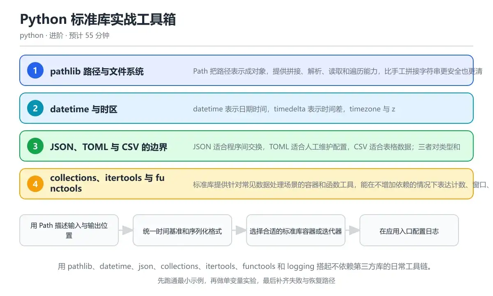
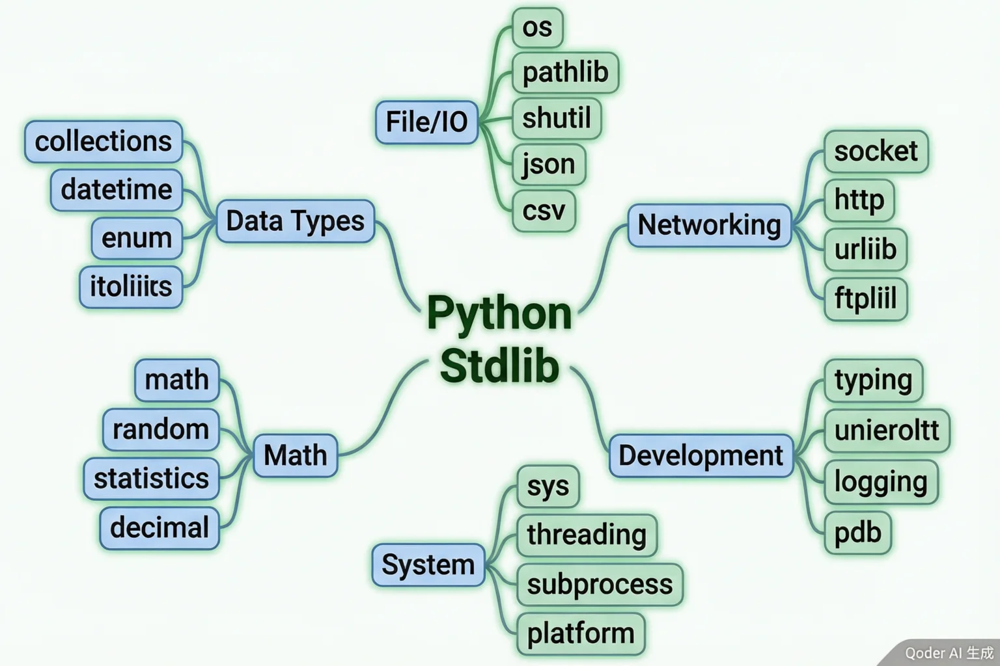

# Python 标准库实战工具箱

> 内容更新时间：2026-10-06 · 学习阶段：进阶 · 预计用时：80 分钟

分类：python。关键词：pathlib、datetime、json、collections、logging。用 pathlib、datetime、json、collections、itertools、functools 和 logging 搭起不依赖第三方库的日常工具链。



## 本节知识框架

**课程定位**：所属分类 `python`（Python），课程主题 `Python 标准库实战精选`，学习阶段 进阶，建议用时 60 分钟。

本课主线：用 pathlib、datetime、json、collections、itertools、functools 和 logging 搭起不依赖第三方库的日常工具链。

**学完本课应当能够**
- 说清 `Path` 与 `aware datetime` 的含义与区别，并各举一个正例和一个反例。
- 用本课示例验证 `序列化` 的行为，记录输入、输出与失败条件。
- 遇到「用字符串拼接路径」这类问题时，能说出触发条件与修复顺序。

### 复习清单

- [ ] 能不看正文复述本课核心术语，并指出一个边界或反例。
- [ ] 能运行或推演本课示例，记录输入、输出与失败现象。
- [ ] 能完成一次自测，并把错题对照错误表定位原因。

## 核心概念定义

> 把每个概念想象成工具箱里的一把工具——你得先知道它是干什么的，才不会拿扳手去拧螺丝。

| 术语 | 一句话说明 |
| --- | --- |
| Path | 就像导航 App 里的"地址管理器"，不管你在哪个城市（操作系统），它都能帮你找到正确的路。（pathlib 提供的路径对象，可跨平台完成拼接、解析与文件读写。；易错：在《Python 标准库实战精选》里采用「写 base + '/' + name 处理文件路径，换到 Windows 后分隔符和转义都出问题」时，用字符串拼接路径会表现为错误结果、异常中断或状态不一致；正确做法是改用 Path(base) / name，让路径库处理平台差异。） |
| aware datetime | 就像一张写了时区的机票——不仅告诉你几点起飞，还告诉你是在哪个时区起飞。（携带时区信息且能定位到绝对时间点的 datetime 对象。；只在「携带时区信息且能定位到绝对时间点的 datetime 对象」这一前提下成立，换输入或换环境要重新验证。） |
| 序列化 | 就像把冰箱里的食材打包成快递包裹——从"内存里的鲜鱼"变成"可以寄出去的泡沫箱"。（把内存对象转换成可存储或传输格式，并在需要时反向还原的过程。；易错：在《Python 标准库实战精选》里采用「json.dumps({'created': datetime.now()}) 直接抛 TypeError」时，JSON 直接序列化日期对象会表现为错误结果、异常中断或状态不一致；正确做法是在写入前转成 ISO 字符串，或给 default 参数提供统一转换函数。） |
| deque | 就像一个两头都能进出的传送带——你从一头放东西，从另一头取东西，速度飞快。（支持两端常数时间追加和弹出的双端队列，可设置最大长度形成滑动窗口。；只在「支持两端常数时间追加和弹出的双端队列，可设置最大长度形成滑动窗口」这一前提下成立，换输入或换环境要重新验证。） |
| lru_cache | 就像你桌上的便签纸——最近算过的答案贴在上面，下次遇到同样的问题直接看便签，不用再算一遍。（按最近最少使用策略缓存函数结果的装饰器，适合参数可哈希的纯函数。；缓存与状态残留会让结果过期，先明确失效策略再判断正确性。） |
| logger 层级 | 就像公司的组织架构——基层员工（子 logger）写的报告会自动上报给部门经理（父 logger）。（按点分名称组织的日志记录器树，事件会向父记录器传播。；只在「按点分名称组织的日志记录器树，事件会向父记录器传播」这一前提下成立，换输入或换环境要重新验证。） |

## 原理与运行机制

> 把标准库想象成一个瑞士军刀——每一把小工具都有专门的用途，了解它们的原理才能选对工具。



### 1. pathlib：你的跨平台导航员

**生活类比**：想象你在不同国家开车。手动拼接字符串就像自己画地图——在中国靠右行驶（正斜杠 `/`），到了英国可能就得靠左（反斜杠 `\`），一不小心就撞车了。而 `Path` 对象就像内置了 GPS 的导航系统，它自动识别当前国家的交通规则，帮你规划正确的路径。

`Path` 把路径表示成对象，提供拼接、解析、读取和遍历能力，比手工拼接字符串更安全也更清晰。

斜杠运算符 `/` 连接路径片段，`resolve()` 计算绝对路径，`glob()` 按模式匹配文件，`read_text()` 与 `write_text()` 封装文本读写；不同操作系统会自动使用正确的路径分隔符。

```python
from pathlib import Path

# 用 / 运算符拼接路径——就像在导航里输入"家 → 公司 → 咖啡厅"
base = Path("demo_data")
base.mkdir(exist_ok=True)          # 创建目录，已存在也不报错
report = base / "report.json"      # 跨平台拼接，Windows 自动用反斜杠

# 路径对象自带各种实用属性
print(report.name)                 # 文件名：report.json
print(report.suffix)               # 扩展名：.json
print(report.stem)                 # 不含扩展名的文件名：report
```

**边界提醒**：用户提供的相对路径可能包含 `..` 上跳片段，用于访问受限目录前必须做规范化与根目录检查。

### 2. datetime：你的全球时间协调员

**生活类比**：如果你和朋友约好"下午三点视频通话"，但一个在北京、一个在纽约，不说时区就会错过。`aware datetime` 就是那张写明了时区的约会提醒——它告诉你"北京时间下午三点"到底是地球上的哪个瞬间。

`datetime` 表示日期时间，`timedelta` 表示时间差，`timezone` 与 `zoneinfo` 提供时区信息；带时区的时间叫 aware，不带时区的叫 naive。

```python
from datetime import datetime, timedelta, timezone

# 创建一个"带时区"的时间——就像在邀请函上写明"北京时间"
tz = timezone(timedelta(hours=8))
now = datetime(2026, 10, 8, 12, 0, tzinfo=tz)
print("时区:", now.isoformat())              # 2026-10-08T12:00:00+08:00

# 三天后的同一时刻——timedelta 就像日历上的"往后翻 3 页"
print("三天后:", (now + timedelta(days=3)).date().isoformat())
```

**边界提醒**：夏令时切换会让本地时间出现重复或缺失，定时任务应保存 UTC 时间点并携带原始时区标识。aware 与 naive 直接比较会抛 `TypeError`——就像把摄氏度和华氏度直接比大小，必须先统一单位。

### 3. JSON 与数据序列化：你的数据打包站

**生活类比**：序列化就像搬家时打包行李。你不能直接把一整柜衣服塞进卡车（内存对象不能直接存到文件），得先叠好、装箱、贴标签（转成 JSON 字符串）。到了新家再拆箱、挂回衣柜（反序列化还原对象）。

JSON 适合程序间交换，TOML 适合人工维护配置，CSV 适合表格数据；三者对类型和转义的支持不同，不能互相假设。

```python
import json
from pathlib import Path

# 把字典"打包"成 JSON 文件——就像把礼物装进盒子
payload = {"created": "2026-10-08", "items": [1, 2, 3]}
report = Path("demo_data") / "report.json"
report.write_text(json.dumps(payload, ensure_ascii=False), encoding="utf-8")

# 从文件"拆包"还原——打开盒子检查礼物
data = json.loads(report.read_text(encoding="utf-8"))
print("内容:", data)
```

**边界提醒**：JSON 没有日期、集合和二进制类型。`json.dumps` 遇到 `datetime` 对象会直接抛 `TypeError`——快递站不认识"活鱼"，你得先把它冻好（转成 ISO 字符串）才能寄。

### 4. collections、itertools 与 functools：数据处理三件套

**生活类比**：
- `Counter` 就像投票时的"正"字计数——每出现一次就画一笔，最后数"正"字就知道谁票最多。
- `deque` 就像地铁的旋转门——人从一边进，从另一边出，不管多少人 throughput 都一样快。设了 `maxlen` 后就像限流闸，超过人数上限时最早进来的人自动被请出去。
- `lru_cache` 就像考试时的草稿纸——算过的答案写下来，下次遇到同样的题直接抄，不用再算。

```python
from collections import Counter, deque
from itertools import islice
from functools import lru_cache

# Counter：自动统计频率——像老师数全班同学最喜欢的水果
print("计数:", Counter("abracadabra").most_common(2))
# [('a', 5), ('b', 2)]

# deque + maxlen：滑动窗口——像监控录像只保留最近 3 天
window = deque([1, 2, 3, 4], maxlen=3)
window.append(5)
print("滑动窗口:", list(window))  # [3, 4, 5]，最早的 1 和 2 被自动丢弃

# islice：惰性切片——像从流水线上只取前两个产品
print("前两项:", list(islice(range(10), 2)))  # [0, 1]

# lru_cache：函数 memoization——把算过的结果存起来
@lru_cache(maxsize=128)
def expensive_calculation(n):
    return sum(i * i for i in range(n))
```

**边界提醒**：`lru_cache` 要求参数可哈希且函数不能有副作用（比如不能有随机数），缓存会占用内存；`deque` 的随机访问（按索引取值）比列表慢，选型要看访问模式。

### 5. logging：你的应用黑匣子

**生活类比**：`print` 就像随手在餐巾纸上记笔记——方便但容易丢。`logging` 就像飞机的黑匣子——每条记录都有时间戳、严重等级、来源模块，而且可以自动写入文件、按大小轮转、按级别过滤。

`logging` 按级别和来源记录事件，支持格式化、轮转和多目标输出。logger 形成层级树，事件沿层级传播到 handler；formatter 决定文本布局，级别过滤在记录端和处理端都可能发生。

```python
import logging

# 在应用入口统一配置——就像给黑匣子设定记录规则
logging.basicConfig(
    level=logging.DEBUG,
    format="%(asctime)s [%(levelname)s] %(name)s: %(message)s"
)

# 每个模块用自己的名字获取 logger——就像每个部门有自己的报告模板
logger = logging.getLogger(__name__)
logger.info("程序启动")

try:
    1 / 0
except ZeroDivisionError:
    logger.exception("计算出错")  # exc_info 自动附带完整回溯
```

**边界提醒**：日志不能包含密码、令牌和完整个人信息。在库代码里调用 `basicConfig` 会污染宿主应用的配置——就像在图书馆里大声放音乐，你的配置会覆盖别人的设置。

```text
用 Path 描述输入与输出位置 → 统一时间基准和序列化格式 → 选择合适的标准库容器或迭代器 → 在应用入口配置日志 → 为读写和边界输入补测试
```

**教材衔接：项目专属规格**
## 典型应用场景

> 学完了工具，来看看它们在实际项目里能帮你做什么。

### 场景 1：目录巡检脚本

**任务**：写一个脚本，用 pathlib 统计指定目录下各类扩展名的文件数量和总大小。

```python
from pathlib import Path
from collections import Counter, defaultdict

def scan_directory(root: str):
    root_path = Path(root).resolve()       # 先规范化，防止 .. 逃逸
    counts = Counter()
    sizes = defaultdict(int)

    for file in root_path.rglob("*"):
        if file.is_file():
            ext = file.suffix or "(无扩展名)"
            counts[ext] += 1
            sizes[ext] += file.stat().st_size

    for ext, count in counts.most_common():
        print(f"{ext}: {count} 个文件, 总大小 {sizes[ext] / 1024:.1f} KB")
```

### 场景 2：带时区的报告生成器

**任务**：生成一份 JSON 报告，包含创建时间和最近 N 条记录。

```python
import json
from datetime import datetime, timedelta, timezone
from collections import deque
from pathlib import Path

def make_report(records, tz_hours=8):
    tz = timezone(timedelta(hours=tz_hours))
    window = deque(records, maxlen=5)       # 只保留最近 5 条
    report = {
        "created": datetime.now(tz).isoformat(),
        "latest": list(window),
    }
    path = Path("reports") / "latest.json"
    path.parent.mkdir(parents=True, exist_ok=True)
    path.write_text(json.dumps(report, ensure_ascii=False, indent=2), encoding="utf-8")
    return path
```

### 场景 3：缓存 + 日志的命令行工具

**任务**：一个反复调用的计算函数，用 `lru_cache` 加速，用 `logging` 记录调用。

```python
import logging
from functools import lru_cache

logger = logging.getLogger(__name__)

@lru_cache(maxsize=64)
def fibonacci(n):
    logger.debug("计算 fibonacci(%d)", n)
    if n < 2:
        return n
    return fibonacci(n - 1) + fibonacci(n - 2)
```

### 验收场景

1. **正常路径**：跑通上面三个场景的最小示例并保存输出。
2. **边界路径**：在临时目录创建一份 JSON 报告，再用路径对象的 `name`、`suffix` 和 `read_text` 读取它。
3. **失败路径**：出现「写 base + '/' + name 处理文件路径，换到 Windows 后分隔符和转义都出问题」时按 改用 Path(base) / name，让路径库处理平台差异 恢复。

## 代码/协议/SQL 示例

> 下面是一个完整的最小可运行示例，把本课所有工具串在一起。复制粘贴到 Python 3.10+ 即可运行。

### 完整示例

```python
import json
import logging
from collections import Counter, deque
from datetime import datetime, timedelta, timezone
from functools import lru_cache
from itertools import islice
from pathlib import Path

# ── 1. 日志配置（在应用入口统一设置） ──
logging.basicConfig(
    level=logging.DEBUG,
    format="%(asctime)s [%(levelname)s] %(name)s: %(message)s"
)
logger = logging.getLogger("stdlib_demo")

# ── 2. pathlib 路径操作 ──
base = Path("demo_data")
base.mkdir(exist_ok=True)
report = base / "report.json"

# ── 3. JSON 序列化（注意 datetime 需要手动转换） ──
payload = {"created": "2026-10-08", "items": [1, 2, 3]}
report.write_text(json.dumps(payload, ensure_ascii=False), encoding="utf-8")
print("路径:", report.name, report.suffix)
print("内容:", json.loads(report.read_text(encoding="utf-8")))

# ── 4. datetime 时区处理 ──
tz = timezone(timedelta(hours=8))
now = datetime(2026, 10, 8, 12, 0, tzinfo=tz)
print("时区:", now.isoformat())
print("三天后:", (now + timedelta(days=3)).date().isoformat())

# ── 5. collections 容器 ──
print("计数:", Counter("abracadabra").most_common(2))
window = deque([1, 2, 3, 4], maxlen=3)
window.append(5)
print("滑动窗口:", list(window))

# ── 6. itertools 惰性迭代 ──
print("前两项:", list(islice(range(10), 2)))

# ── 7. functools 缓存 ──
@lru_cache(maxsize=32)
def square(x):
    logger.debug("计算 square(%d)", x)
    return x * x

print("缓存:", square(5), square(5))  # 第二次直接命中缓存
```

### 预期输出

```text
路径: report.json .json
内容: {'created': '2026-10-08', 'items': [1, 2, 3]}
时区: 2026-10-08T12:00:00+08:00
三天后: 2026-10-11
计数: [('a', 5), ('b', 2)]
滑动窗口: [3, 4, 5]
前两项: [0, 1]
缓存: 25 25
```

### 验证命令与预期输出

| 步骤 | 命令 | 预期输出 |
| --- | --- | --- |
| 准备环境 | Python 3.10+ 已安装 | 无第三方依赖 |
| 运行示例 | `python demo.py` | 路径: report.json .json |
| 边界输入 | 替换 `maxlen=3` 为 `maxlen=1` | 滑动窗口只保留最后一个元素 |
| 失败演练 | 去掉 `tzinfo=tz` 后与 aware 时间比较 | TypeError |

## 时间/空间复杂度或性能分析

> 选对工具不仅影响代码能不能跑，还影响跑得快不快、占不占内存。

| 操作 | 时间复杂度 | 空间复杂度 | 生活类比 |
| --- | --- | --- | --- |
| `Path` 拼接 `/` | O(1) | O(n)，n 为路径长度 | 在导航里加一个途经点，瞬间完成 |
| `deque.append / appendleft` | O(1) | O(n) | 旋转门两头都能进出，不管多少人速度一样 |
| `deque` 按索引访问 | O(n) | — | 在排队队伍中间找人，得从头数起 |
| `Counter.most_common(k)` | O(n log k) | O(k) | 从所有候选人里选出前 k 名 |
| `lru_cache` 命中 | O(1) | O(maxsize) | 翻便签纸看答案，比重新算快得多 |
| `json.dumps / loads` | O(n) | O(n) | 打包 / 拆包的时间和包裹大小成正比 |
| `islice` | O(k) | O(1) | 从流水线上取前 k 个，不需要先把所有产品排好 |

**测量建议**：固定输入跑一遍记录基线，再把规模提高一个数量级复测；两次结果的差值与波动范围才是结论依据。达到边界时不要外推，必须重新测量。

## 常见误区与易错点

> 这些都是前人踩过的坑，你可以直接绕过去。

| 容易写错的做法 | 实际现象 | 原因与正确做法 |
| --- | --- | --- |
| 用字符串拼接路径 | 在《Python 标准库实战精选》里采用「写 base + '/' + name 处理文件路径，换到 Windows 后分隔符和转义都出问题」时，用字符串拼接路径会表现为错误结果、异常中断或状态不一致。 | 改用 Path(base) / name，让路径库处理平台差异 |
| 混用带时区与不带时区时间 | 在《Python 标准库实战精选》里采用「把 datetime.now() 与带时区时间直接比较，运行时抛 TypeError」时，混用带时区与不带时区时间会表现为错误结果、异常中断或状态不一致。 | 明确统一到 UTC aware 时间，展示时再转换到目标时区 |
| JSON 直接序列化日期对象 | 在《Python 标准库实战精选》里采用「json.dumps({'created': datetime.now()}) 直接抛 TypeError」时，JSON 直接序列化日期对象会表现为错误结果、异常中断或状态不一致。 | 在写入前转成 ISO 字符串，或给 default 参数提供统一转换函数 |
| 库模块擅自配置全局日志 | 在《Python 标准库实战精选》里采用「在可复用模块里调用 logging.basicConfig，宿主应用的格式和级别被覆盖」时，库模块擅自配置全局日志会表现为错误结果、异常中断或状态不一致。 | 库只获取 logger 并写日志，配置留给应用入口 |

### 误区详解 1：用字符串拼接路径

**症状**：在《Python 标准库实战精选》里采用「写 base + '/' + name 处理文件路径，换到 Windows 后分隔符和转义都出问题」时，用字符串拼接路径会表现为错误结果、异常中断或状态不一致。

**类比理解**：就像你习惯用"往前走 200 米左转"给人指路，但对方可能在另一个城市，那里的路是环形放射状的——你的描述完全不适用。

**根因与修复**：改用 Path(base) / name，让路径库处理平台差异。

### 误区详解 2：混用带时区与不带时区时间

**症状**：在《Python 标准库实战精选》里采用「把 datetime.now() 与带时区时间直接比较，运行时抛 TypeError」时，混用带时区与不带时区时间会表现为错误结果、异常中断或状态不一致。

**类比理解**：就像拿一把没有刻度的尺子和一把有刻度的尺子比长短——Python 拒绝猜测，直接报错。

**根因与修复**：明确统一到 UTC aware 时间，展示时再转换到目标时区。

### 误区详解 3：JSON 直接序列化日期对象

**症状**：在《Python 标准库实战精选》里采用「json.dumps({'created': datetime.now()}) 直接抛 TypeError」时，JSON 直接序列化日期对象会表现为错误结果、异常中断或状态不一致。

**类比理解**：JSON 格式只认识字符串、数字、布尔、数组、对象和 null 这几种"通用包装"。datetime 就像一件形状不规则的艺术品，快递站（JSON）不知道怎么打包，你得先给它量好尺寸写成纸条（ISO 字符串）。

**根因与修复**：在写入前转成 ISO 字符串，或给 default 参数提供统一转换函数。

### 误区详解 4：库模块擅自配置全局日志

**症状**：在《Python 标准库实战精选》里采用「在可复用模块里调用 logging.basicConfig，宿主应用的格式和级别被覆盖」时，库模块擅自配置全局日志会表现为错误结果、异常中断或状态不一致。

**类比理解**：就像你在合租房里擅自把客厅的灯换成了迪斯科球——你的配置会覆盖所有室友的偏好。

**根因与修复**：库只获取 logger 并写日志，配置留给应用入口。

## 与其他知识点的关系

> 知识不是孤岛，每个概念都和别的岛屿有海底连线。

### 知识地图

```text
《模块、包与虚拟环境》
        │
        ▼
《Python 标准库实战精选》（本课）
        │
        ├──► 《Python 异常、日志与文件 I/O 进阶》
        │
        └──► 《Python CLI 与自动化实战》
```

### 先修与后续

- **先修**：`模块、包与虚拟环境`。本课默认这些内容已经掌握——你得先知道怎么 `import` 一个模块，才能用好标准库。
- **相关或后续**：`Python 异常、日志与文件 I/O 进阶`、`Python CLI 与自动化实战`。本课术语会在这些课程里继续使用。
- **术语归属**：`Path`、`aware datetime`、`序列化` 的定义以本课「核心概念定义」为准，换到其他课程时先确认定义是否被改写。

## 自测题与参考答案

> 先独立作答，再对照参考答案；答案都能在本课正文、术语表或错误表里找到依据。

### 自测 1（概念复述）

不看正文，写出 `Path` 的操作性定义，并说明它与 `aware datetime` 的区别。

**参考答案**：pathlib 提供的路径对象，可跨平台完成拼接、解析与文件读写。`aware datetime` 的定位是：携带时区信息且能定位到绝对时间点的 datetime 对象；两者的差别要从适用对象与失败模式上说明。

### 自测 2（排错）

本课错误表记录了「用字符串拼接路径」这类做法。请写出它会出现的现象、根因，以及修复顺序。

**参考答案**：现象是在《Python 标准库实战精选》里采用「写 base + '/' + name 处理文件路径，换到 Windows 后分隔符和转义都出问题」时，用字符串拼接路径会表现为错误结果、异常中断或状态不一致；正确做法是改用 Path(base) / name，让路径库处理平台差异。修复时先复现现象并保留证据，再改动一处假设重跑，确认现象消失。

### 自测 3（动手验证）

运行本课的完整示例，改动其中一个输入后重新运行，记录输出与错误信息。

**参考答案**：正常输入下示例应当复现正文给出的结果；改动输入后，如果结果改变或报错，先核对它是否满足 `Python 标准库实战精选` 中 `Path` 的适用范围，再检查错误表里是否有同类现象。

### 自测 4（代码阅读）

阅读本课的完整示例，说明它体现了 `Path` 的哪一条性质，并指出改动哪个输入会让这条性质不再成立。

**参考答案**：`Path` 的定义是 pathlib 提供的路径对象，可跨平台完成拼接、解析与文件读写，示例正是在实现这条定义。改动与 `Path` 有关的一个输入后，如果结果不再符合 `Python 标准库实战精选` 的正文描述，就说明该性质只在当前前提成立。

### 自测 5（迁移）

把 `Python 标准库实战精选` 的方法迁移到自己的项目：围绕 `Path` 写出一个与错误表同类的风险点，并说明触发条件和检验方式。

**参考答案**：例如「库模块擅自配置全局日志」，它会导致在《Python 标准库实战精选》里采用「在可复用模块里调用 logging.basicConfig，宿主应用的格式和级别被覆盖」时，库模块擅自配置全局日志会表现为错误结果、异常中断或状态不一致；检验方式是按库只获取 logger 并写日志，配置留给应用入口改一处再复现，确认现象消失且没有引入新的失败分支。

### 自测 6（对比）

用一个表格对比 `Path` 与 `aware datetime`：各写一行适用场景、一行失败表现。

**参考答案**：`Path` 的定义是 pathlib 提供的路径对象，可跨平台完成拼接、解析与文件读写；`aware datetime` 的定义是携带时区信息且能定位到绝对时间点的 datetime 对象。两者的失败表现分别对应本课错误表里与本术语相关的行。

### 项目交付物

完成本项目后，应交付以下内容：

1. **可运行的代码**：所有功能模块已实现并通过测试
2. **测试报告**：单元测试和集成测试全部通过
3. **文档**：README 说明使用方法，关键函数有注释
4. **复盘总结**：记录遇到的问题和解决方案

## 延伸阅读

想更直观地理解本课概念？推荐参阅以下图解专题：

- [图解内存布局：栈、堆与引用](visual_memory_layout.md)

## 术语速查

| 术语 | 一句话说明 |
| --- | --- |
| `Path` | pathlib 提供的路径对象，可跨平台完成拼接、解析与文件读写。（导航 App 的地址管理器） |
| `aware datetime` | 携带时区信息且能定位到绝对时间点的 datetime 对象。（写了时区的机票） |
| `序列化` | 把内存对象转换成可存储或传输格式，并在需要时反向还原的过程。（搬家时打包行李） |
| `deque` | 支持两端常数时间追加和弹出的双端队列，可设置最大长度形成滑动窗口。（两头都能进出的传送带） |
| `lru_cache` | 按最近最少使用策略缓存函数结果的装饰器，适合参数可哈希的纯函数。（桌上的便签纸） |
| `logger 层级` | 按点分名称组织的日志记录器树，事件会向父记录器传播。（公司的组织架构） |

**术语关系**：`Path`（路径管理器） → `aware datetime`（时间协调员） → `序列化`（数据打包站） → `deque`（传送带） → `lru_cache`（便签纸） → `logger 层级`（组织架构）。

## 考点精讲

> 本课题库共有 5 道题，下面逐题给出题干、选项、正确项与判断依据。先自己作答，再核对正确项，最后回到正文对应小节复核。注意：题目中的引号使用中文全角引号“ ”。

### 考点 1：第 1 题

- **题目**：创建跨平台路径最推荐的写法是？
- **选项**：
  - A. “Path(base) / name”
  - B. “base + '/' + name”
  - C. “base + '\\\\' + name”
  - D. “os.path.join(base, name) 后再强制转字符串”
- **正确项**：“Path(base) / name”
- **判断依据**：这道题落在术语 `Path` 上：pathlib 提供的路径对象，可跨平台完成拼接、解析与文件读写。`/` 运算符是 Path 对象重载的拼接方式，它会根据操作系统自动选择正确的分隔符。复习时把 `Path` 的定义、适用边界和一个反例一起说清楚，再回到「核心概念定义」核对原文。

### 考点 2：第 2 题

- **题目**：比较 datetime.now() 与带时区的 datetime 会发生什么？
- **选项**：
  - A. “抛出 TypeError，因为 aware 与 naive 不能直接比较”
  - B. “自动按本地时区转换”
  - C. “只比较日期部分”
  - D. “返回 False 而不是报错”
- **正确项**：“抛出 TypeError，因为 aware 与 naive 不能直接比较”
- **判断依据**：这道题检验本课主问题：用 pathlib、datetime、json、collections、itertools、functools 和 logging 搭起不依赖第三方库的日常工具链。`datetime.now()` 返回的是 naive 时间（不带时区），而带时区的 datetime 是 aware 时间，Python 拒绝猜测你比较的是哪个时区，直接抛出 TypeError。复习时先复述本课主问题，再举一个会让结论失效的输入。

### 考点 3：第 3 题

- **题目**：关于标准库容器与迭代器，哪些说法正确？（多选）
- **选项**：
  - A. “Counter 可统计可哈希元素的出现次数”
  - B. “deque 设置 maxlen 后会自动丢弃旧元素”
  - C. “islice 可以只取生成器的前若干项”
  - D. “lru_cache 可以安全缓存带随机的有副作用函数”
- **正确项**：“Counter 可统计可哈希元素的出现次数；deque 设置 maxlen 后会自动丢弃旧元素；islice 可以只取生成器的前若干项”
- **判断依据**：这道题落在术语 `deque` 上：支持两端常数时间追加和弹出的双端队列，可设置最大长度形成滑动窗口。Counter、deque 和 islice 都是标准库中经过充分验证的工具，而 lru_cache 缓存带随机的函数会导致结果不可预测——因为缓存会返回第一次计算的结果，而不是重新生成随机数。复习时把 `deque` 的定义、适用边界和一个反例一起说清楚，再回到「核心概念定义」核对原文。

### 考点 4：第 4 题

- **题目**：阅读代码，输出哪一项正确？  window = deque([1, 2, 3, 4], maxlen=3) window.append(5) print(list(window))
- **选项**：
  - A. “[3, 4, 5]”
  - B. “[2, 3, 4]”
  - C. “[1, 2, 3]”
  - D. “[5, 1, 2]”
- **正确项**：“[3, 4, 5]”
- **判断依据**：这道题落在术语 `deque` 上：支持两端常数时间追加和弹出的双端队列，可设置最大长度形成滑动窗口。初始 `deque([1, 2, 3, 4], maxlen=3)` 创建时就已经截断为 `[2, 3, 4]`（丢弃最左边的 1），再 `append(5)` 后丢弃最左边的 2，最终剩下 `[3, 4, 5]`。复习时把 `deque` 的定义、适用边界和一个反例一起说清楚，再回到「核心概念定义」核对原文。

### 考点 5：第 5 题

- **题目**：这段日志代码在库模块中有什么问题？  import logging logging.basicConfig(level=logging.INFO) logger = logging.getLogger(__name__)
- **选项**：
  - A. “库模块不应擅自调用 basicConfig，会覆盖宿主应用的日志配置”
  - B. “logger 名称使用 __name__ 是错误的”
  - C. “logging 只能输出到控制台”
  - D. “日志级别 INFO 会导致程序崩溃”
- **正确项**：“库模块不应擅自调用 basicConfig，会覆盖宿主应用的日志配置”
- **判断依据**：这道题检验本课主问题：用 pathlib、datetime、json、collections、itertools、functools 和 logging 搭起不依赖第三方库的日常工具链。`basicConfig` 是全局配置，只应在应用入口调用一次。库模块应该只用 `getLogger(__name__)` 获取 logger 并写日志，把配置权留给使用这个库的应用程序。复习时先复述本课主问题，再举一个会让结论失效的输入。

### 考点 6：核心概念串联

- **要点**：本课六个核心概念形成一条链条——`Path`（路径管理） → `aware datetime`（时间协调） → `序列化`（数据打包） → `deque`（滑动窗口） → `lru_cache`（函数缓存） → `logger 层级`（日志传播）。
- **答题要求**：面对综合题时，先判断描述的是哪个概念，再归到对应定义，最后写出一个会让该定义失效的边界输入。

## 内容元数据

- 内容版本：v2.0
- 最后更新：2026-10-06
- 学习阶段：进阶

| 字段 | 值 |
| --- | --- |
| 课程 ID | `python_stdlib` |
| 所属分类 | `python` |
| 难度 | 进阶 |
| 预计用时 | 60 分钟 |
| 关键词 | pathlib、datetime、json、collections、logging |
| 配图 | `images/lesson_python_stdlib.webp` |
| 参考资料 | 6 条 |
| 内容更新时间 | 2026-10-06 |

## 参考资料与复核

- [本课资料锚点 python_stdlib](https://zh.wikipedia.org/w/index.php?search=python_stdlib)

- 来源性质：官方文档、标准或权威教材；本课核对关键词：pathlib、datetime、json、collections、logging。
- 最后复核：2026-10-04
- 下次复核：2026-12-10
- 复核范围：版本兼容、API 行为与工程实践

下面列出的资料用于核对本课结论，复习时可以对照阅读：
- [Python pathlib 官方文档](https://docs.python.org/3/library/pathlib.html)
- [Python datetime 官方文档](https://docs.python.org/3/library/datetime.html)
- [Python json 官方文档](https://docs.python.org/3/library/json.html)
- [Python collections 官方文档](https://docs.python.org/3/library/collections.html)
- [Python itertools 官方文档](https://docs.python.org/3/library/itertools.html)
- [Python logging 使用手册](https://docs.python.org/3/howto/logging.html)

> 复核提示：《Python 标准库实战精选》的结论如与资料冲突，以资料中的规范文本为准，并在笔记里记录差异与日期。
