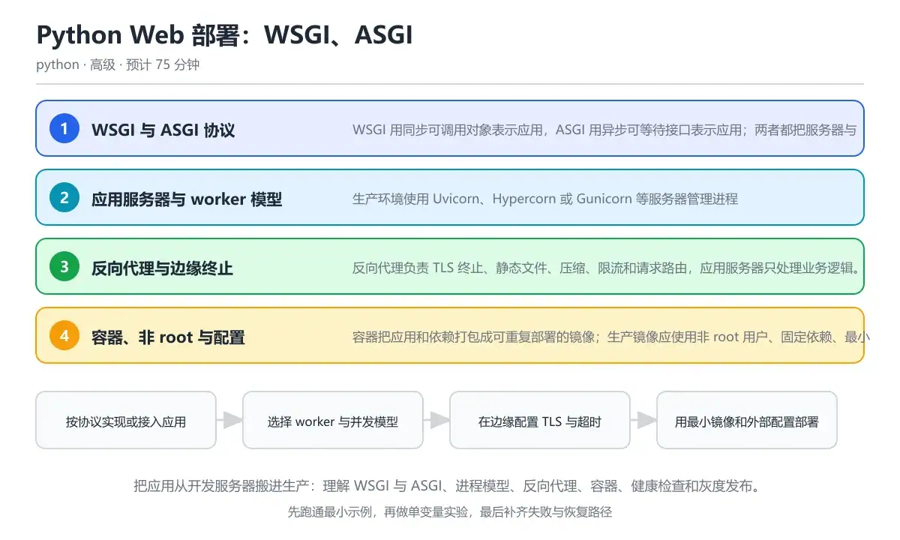
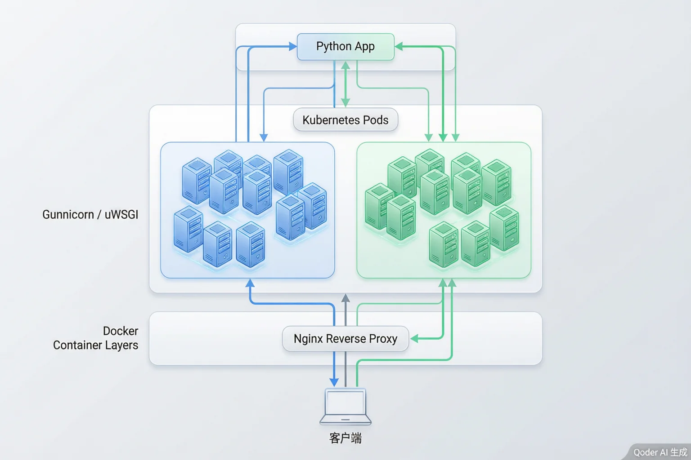

# Python Web 部署：WSGI、ASGI 与容器化

> 内容更新时间：2026-10-06 · 学习阶段：高级 · 预计用时：45 分钟

分类：python。关键词：WSGI、ASGI、Uvicorn、容器化、健康检查。把应用从开发服务器搬进生产：理解 WSGI 与 ASGI、进程模型、反向代理、容器、健康检查和灰度发布。



## 本节知识框架

**课程定位**：所属分类 `python`（Python），课程主题 `Python Web 部署：WSGI、ASGI 与容器化`，学习阶段 高级，建议用时 55 分钟。

本课主线：把应用从开发服务器搬进生产：理解 WSGI 与 ASGI、进程模型、反向代理、容器、健康检查和灰度发布。

**学完本课应当能够**
- 说清 `WSGI` 与 `ASGI` 的含义与区别，并各举一个正例和一个反例。
- 用本课示例验证 `worker` 的行为，记录输入、输出与失败条件。
- 遇到「把开发服务器用于生产」这类问题时，能说出触发条件与修复顺序。

### 复习清单

- [ ] 能复述 WSGI 的职责，并给出一个输入越界时的反例。
- [ ] 能推演 WSGI 的示例：先写预期输出，再运行并记录差异与失败现象。
- [ ] 能完成一次自测，并把错题对照错误表定位原因。

## 核心概念定义

| 术语 | 操作性定义 | 常见边界与风险 |
| --- | --- | --- |
| WSGI | Python 同步 Web 服务器与应用之间的标准调用接口。 | 易错：把框架自带的自动重载开发服务器直接对外服务；同步接口只能靠多 worker 进程提升并发，生产要换成经验证的服务器并关掉调试模式。 |
| ASGI | 支持异步、WebSocket 与生命周期事件的新一代服务器应用接口。 | 应用按 scope、receive、send 交换事件消息，在协程里执行阻塞代码会占住事件循环；`http.response.start` 晚于 body 发出，服务器就无法确定响应头。 |
| worker | 独立加载应用并处理请求的进程或执行单元。 | 易错：在《Python Web 部署：WSGI、ASGI 与容器化》里采用「每个 CPU 核启动多个进程并复制数据库连接，资源和连接池迅速耗尽」时，worker 数量盲目放大会表现为错误结果、异常中断或状态不一致；正确做法是根据压测、内存和数据库连接上限设置 worker，异步服务优先提升单 worker 并发。 |
| 反向代理 | 位于客户端与应用之间，负责转发、TLS、缓存和限流的服务器。 | 易错：无条件信任客户端送上来的转发头，真实来源可被伪造，必须只信已知代理地址；代理超时短于应用超时还会造成重复请求。 |
| 健康检查 | 平台定期探测服务是否存活或已准备好接收流量的接口。 | 易错：只配存活探测，新实例还没预热连接就被放进流量；就绪与存活要分开提供，健康检查需暴露独立接口。 |
| 优雅停机 | 停止接收新请求并等待正在处理的请求完成后再退出进程。 | 直接杀死旧实例会中断在途请求，写操作可能已部分完成、客户端重试造成重复提交；要先摘流并设置最长宽限期。 |

## 原理与运行机制

### 机制总览

**教材衔接：核心知识**

### 1. WSGI 与 ASGI 协议

WSGI 用同步可调用对象表示应用，ASGI 用异步可等待接口表示应用；两者都把服务器与框架解耦，让同一应用可以运行在不同服务器上。

WSGI 接收 environ 与 start_response，逐个返回响应体字节块；ASGI 接收 scope、receive、send，通过事件消息支持 HTTP、WebSocket 和生命周期事件。

在Python Web 部署：WSGI、ASGI 与容器化里可以这样验证：手写一个最小 ASGI 应用，按协议发送响应开始和响应体两条消息。

边界：异步框架里执行阻塞代码会占住事件循环；同步框架在异步服务器中仍受 worker 数量限制，协议不会自动解决数据库连接和线程池问题。

工程视角：应用代码不依赖某个服务器的私有对象，中间件按协议编写，测试直接调用 ASGI 接口而不启动真实网络。

### 2. 应用服务器与 worker 模型

生产环境使用 Uvicorn、Hypercorn 或 Gunicorn 等服务器管理进程与连接；worker 数量决定并发能力，也决定内存占用。

每个 worker 独立加载应用并处理请求，主进程负责创建、监控和重启；异步 worker 在单进程内可以处理大量 I/O 并发，CPU 密集任务需要更多进程或独立任务队列。

在Python Web 部署：WSGI、ASGI 与容器化里可以这样验证：用四核机器上的两个异步 worker 启动服务，记录启动内存和并发请求下的 CPU 使用率。

边界：worker 不是越多越好，数据库连接数、文件描述符和内存会成倍增长；有状态会话不能依赖进程内存。

工程视角：并发参数从压测和资源上限反推，启动时预热连接，滚动重启时先摘流再退出。

### 3. 反向代理与边缘终止

反向代理负责 TLS 终止、静态文件、压缩、限流和请求路由，应用服务器只处理业务逻辑。

代理转发请求时添加 X-Forwarded-For、Host 等头，应用需要信任链和真实客户端解析；超时、上传大小和请求体限制要在边缘与应用两侧保持一致。

在Python Web 部署：WSGI、ASGI 与容器化里可以这样验证：配置代理转发到本地应用端口，并用带转发头的请求验证客户端地址解析。

边界：无条件信任客户端提供的转发头可以被伪造，必须只信任已知代理地址；代理超时短于应用超时会造成重复请求。

工程视角：边缘与应用共享超时预算，静态资源加缓存指纹，上传和 WebSocket 单独配置长连接。

### 4. 容器、非 root 与配置

容器把应用和依赖打包成可重复部署的镜像；生产镜像应使用非 root 用户、固定依赖、最小基础层和外部注入配置。

多阶段构建先在构建阶段安装编译工具和依赖，再把 wheel 复制到运行阶段；环境变量与密钥在运行时注入，健康检查暴露独立接口，停机信号触发应用停止接收新请求。

在Python Web 部署：WSGI、ASGI 与容器化里可以这样验证：查看一个多阶段 Dockerfile，确认最终镜像没有编译器、以非 root 运行且只包含运行依赖。

边界：镜像不应携带构建缓存和秘密；容器重启会丢失本地文件，状态必须放在数据库或对象存储。

工程视角：镜像标签使用版本或摘要，启动命令不含明文秘密，资源限制和健康检查写入部署清单。



### 5. 可观测性与渐进发布

生产系统需要日志、指标和追踪回答是否正常、哪里变慢以及影响哪些用户；发布策略决定新版本出问题时如何快速止损。

结构化日志带请求编号，指标记录延迟分位数、错误率、队列长度和资源使用，追踪贯穿代理到数据库；蓝绿发布切换流量，金丝雀先放小比例用户，指标异常自动回滚。

在Python Web 部署：WSGI、ASGI 与容器化里可以这样验证：为一次发布定义成功率、P95 延迟和错误率阈值，并说明指标超标时的回滚步骤。

边界：平均值会掩盖长尾延迟，日志过多会拖慢系统；发布窗口和回滚时间必须提前演练。

工程视角：每次发布有版本号、变更说明和回滚包，关键指标接入告警，数据库迁移保证新旧版本同时可用。

**教材衔接：关键流程**

```text
按协议实现或接入应用 → 选择 worker 与并发模型 → 在边缘配置 TLS 与超时 → 用最小镜像和外部配置部署 → 通过健康检查与指标完成灰度发布
```

1. 按协议实现或接入应用
2. 选择 worker 与并发模型
3. 在边缘配置 TLS 与超时
4. 用最小镜像和外部配置部署
5. 通过健康检查与指标完成灰度发布

## 典型应用场景

**教材衔接：深度拓展与实战**

### 机制对照表

| 概念 | 解决什么问题 | 关键前提 | 失败信号 |
| --- | --- | --- | --- |
| WSGI 与 ASGI 协议 | WSGI 用同步可调用对象表示应用，ASGI 用异步可等待接口表示应用；两者都把 | 异步框架里执行阻塞代码会占住事件循环；同步框架在异步服务器中仍受 wor | 应用代码不依赖某个服务器的私有对象，中间件按协议编写，测试直接调用 AS |
| 应用服务器与 worker 模型 | 生产环境使用 Uvicorn、Hypercorn 或 Gunicorn 等服务器 | worker 不是越多越好，数据库连接数、文件描述符和内存会成倍增长；有 | 并发参数从压测和资源上限反推，启动时预热连接，滚动重启时先摘流再退出。 |
| 反向代理与边缘终止 | 反向代理负责 TLS 终止、静态文件、压缩、限流和请求路由，应用服务器只处理业务 | 无条件信任客户端提供的转发头可以被伪造，必须只信任已知代理地址；代理超时 | 边缘与应用共享超时预算，静态资源加缓存指纹，上传和 WebSocket  |
| 容器、非 root 与配置 | 容器把应用和依赖打包成可重复部署的镜像；生产镜像应使用非 root 用户、固定依 | 镜像不应携带构建缓存和秘密；容器重启会丢失本地文件，状态必须放在数据库或 | 镜像标签使用版本或摘要，启动命令不含明文秘密，资源限制和健康检查写入部署 |
| 可观测性与渐进发布 | 生产系统需要日志、指标和追踪回答是否正常、哪里变慢以及影响哪些用户；发布策略决定 | 平均值会掩盖长尾延迟，日志过多会拖慢系统；发布窗口和回滚时间必须提前演练 | 每次发布有版本号、变更说明和回滚包，关键指标接入告警，数据库迁移保证新旧 |

### 自测问答

**问 1**：ASGI 应用通过哪组参数与服务器交互？

**答**：scope、receive、send。ASGI 使用 scope 描述连接类型与元数据，receive 读取事件，send 发送事件，因此可以统一支持 HTTP、WebSocket 和生命周期事件；environ 与 start_response 是 WSGI 的同步接口。理解协议边界有助于写出与具体服务器解耦的应用和中间件。 正确选项「scope、receive、send」对应《Python Web 部署：WSGI、ASGI 与容器化》的要点「WSGI 与 ASGI 协议」：WSGI 用同步可调用对象表示应用，ASGI 用异步可等待接口表示应用；两者都把服务器与框架解耦，让同一应用可以运行在不同服务器上。判断「WSGI 与 ASGI 协议」时先确认前提是否成立，再回到《Python Web 部署：WSGI、ASGI 与容器化》的示例核对一次；把别的语言或框架的默认做法直接搬到WSGI 与 ASGI 协议上，往往会在本课的边界条件里失效。

**问 2**：异步服务中 worker 数量不能盲目增加，最主要的原因是什么？

**答**：每个 worker 都会消耗内存和数据库连接等有限资源。worker 越多，应用内存、连接池、文件描述符和数据库连接都会成倍增长，可能先压垮数据库而不是提升吞吐。异步 worker 单进程已经能处理大量 I/O 并发，应该通过压测和资源上限确定数量，并为 CPU 密集任务使用独立进程或任务队列。 正确选项「每个 worker 都会消耗内存和数据库连接等有限资源」对应《Python Web 部署：WSGI、ASGI 与容器化》的要点「应用服务器与 worker 模型」：生产环境使用 Uvicorn、Hypercorn 或 Gunicorn 等服务器管理进程与连接；worker 数量决定并发能力，也决定内存占用。判断「应用服务器与 worker 模型」时先确认前提是否成立，再回到《Python Web 部署：WSGI、ASGI 与容器化》的示例核对一次；借鉴相邻主题的经验之前，先核对应用服务器与 worker 模型的前提是否成立。

**问 3**：生产容器部署应满足哪些要求？（多选）

**答**：最终镜像以非 root 用户运行；依赖版本固定且构建工具不进入运行镜像；配置和秘密在运行时注入。非 root、最小镜像和外部配置能减少攻击面并让同一镜像跨环境部署；秘密写入 Dockerfile 会永久留在镜像层和历史记录中。还要配合只读文件系统、资源限制、健康检查和优雅停机。 正确选项「最终镜像以非 root 用户运行；依赖版本固定且构建工具不进入运行镜像；配置和秘密在运行时注入」对应《Python Web 部署：WSGI、ASGI 与容器化》的要点「反向代理与边缘终止」：反向代理负责 TLS 终止、静态文件、压缩、限流和请求路由，应用服务器只处理业务逻辑。判断「反向代理与边缘终止」时先确认前提是否成立，再回到《Python Web 部署：WSGI、ASGI 与容器化》的示例核对一次；记住反向代理与边缘终止的结论之外还要记住适用条件，换一个输入往往就不成立了。

**问 4**：这个 ASGI 应用最先发送哪条消息？

**答**：http.response.start。响应必须先发送 http.response.start 声明状态码与头部，再发送一个或多个 http.response.body 消息；顺序颠倒会让服务器无法确定响应头。http.request 是服务器通过 receive 传给应用的请求事件，lifespan.startup 属于应用生命周期。这段代码展示的是 ASGI 协议的消息顺序，和 WSGI 的同步调用方式不同。

**问 5**：滚动发布时旧实例收到停机信号后立即被杀死，可能出现什么问题？

**答**：正在处理的请求被中断，客户端看到连接重置或重复提交。强制终止会让正在处理的请求丢失响应，写操作可能已经部分完成，客户端重试还可能造成重复提交。正确流程是先摘除流量、停止接收新请求、等待处理完成并设置最长宽限期，再退出进程；数据库迁移也要保证新旧版本兼容。这道题对应 ASGI 服务的优雅停机：容器终止前必须等健康检查和在途请求处理完成。 正确选项「正在处理的请求被中断，客户端看到连接重置或重复提交」对应《Python Web 部署：WSGI、ASGI 与容器化》的要点「可观测性与渐进发布」：生产系统需要日志、指标和追踪回答是否正常、哪里变慢以及影响哪些用户；发布策略决定新版本出问题时如何快速止损。判断「可观测性与渐进发布」时先确认前提是否成立，再回到《Python Web 部署：WSGI、ASGI 与容器化》的示例核对一次；把可观测性与渐进发布的做法换到别的约束下未必成立，先确认边界再决定答案。

### 排错速查

- 看到「直接运行框架自带的 reload 开发服务器对外提供服务」时，先按「使用经过生产验证的 ASGI 或 WSGI 服务器，关闭自动重载和调试模式」处理，再用Python Web 部署：WSGI、ASGI 与容器化的最小示例确认结论是否恢复。
- 看到「每个 CPU 核启动多个进程并复制数据库连接，资源和连接池迅速耗尽」时，先按「根据压测、内存和数据库连接上限设置 worker，异步服务优先提升单 worker 并发」处理，再用Python Web 部署：WSGI、ASGI 与容器化的最小示例确认结论是否恢复。
- 看到「最终镜像使用完整基础镜像、root 用户和未固定的依赖」时，先按「多阶段构建，固定依赖版本，使用非 root 用户和最小运行镜像」处理，再用Python Web 部署：WSGI、ASGI 与容器化的最小示例确认结论是否恢复。
- 看到「滚动更新时新实例尚未就绪就接收流量，旧实例被强制终止」时，先按「提供就绪与存活检查，停机时先摘流、停止接收请求并等待正在处理的请求结束」处理，再用Python Web 部署：WSGI、ASGI 与容器化的最小示例确认结论是否恢复。

### 工程检查表

- [ ] 按协议实现或接入应用
- [ ] 选择 worker 与并发模型
- [ ] 在边缘配置 TLS 与超时
- [ ] 用最小镜像和外部配置部署
- [ ] 通过健康检查与指标完成灰度发布
- [ ] 【WSGI 与 ASGI 协议】应用代码不依赖某个服务器的私有对象，中间件按协议编写，测试直接调用 ASGI 接口而不启动真实网络。
- [ ] 【应用服务器与 worker 模型】并发参数从压测和资源上限反推，启动时预热连接，滚动重启时先摘流再退出。
- [ ] 【反向代理与边缘终止】边缘与应用共享超时预算，静态资源加缓存指纹，上传和 WebSocket 单独配置长连接。
- [ ] 【容器、非 root 与配置】镜像标签使用版本或摘要，启动命令不含明文秘密，资源限制和健康检查写入部署清单。
- [ ] 【可观测性与渐进发布】每次发布有版本号、变更说明和回滚包，关键指标接入告警，数据库迁移保证新旧版本同时可用。

### 结论与下一步

- **把开发服务器用于生产**：典型现象是在《Python Web 部署：WSGI、ASGI 与容器化》里采用「直接运行框架自带的 reload 开发服务器对外提供服务」时，把开发服务器用于生产会表现为错误结果、异常中断或状态不一致；正确做法是使用经过生产验证的 ASGI 或 WSGI 服务器，关闭自动重载和调试模式。
- **worker 数量盲目放大**：典型现象是在《Python Web 部署：WSGI、ASGI 与容器化》里采用「每个 CPU 核启动多个进程并复制数据库连接，资源和连接池迅速耗尽」时，worker 数量盲目放大会表现为错误结果、异常中断或状态不一致；正确做法是根据压测、内存和数据库连接上限设置 worker，异步服务优先提升单 worker 并发。
- **容器以 root 运行且包含构建工具**：典型现象是在《Python Web 部署：WSGI、ASGI 与容器化》里采用「最终镜像使用完整基础镜像、root 用户和未固定的依赖」时，容器以 root 运行且包含构建工具会表现为错误结果、异常中断或状态不一致；正确做法是多阶段构建，固定依赖版本，使用非 root 用户和最小运行镜像。
- **没有健康检查和优雅停机**：典型现象是在《Python Web 部署：WSGI、ASGI 与容器化》里采用「滚动更新时新实例尚未就绪就接收流量，旧实例被强制终止」时，没有健康检查和优雅停机会表现为错误结果、异常中断或状态不一致；正确做法是提供就绪与存活检查，停机时先摘流、停止接收请求并等待正在处理的请求结束。

### 最小验证场景

- 准备：保留 `text` 示例的原始输入，先记录 `Python Web 部署：WSGI、ASGI 与容器化` 的基线输出和完整运行命令。
- 判定：新结果与 `Python Web 部署：WSGI、ASGI 与容器化` 的基线不同不等于错误；只有当差异破坏了 `WSGI` 的定义或错误表中的约束，才判定为失败。

### 选择与边界

- 使用 `WSGI` 时，Python 同步 Web 服务器与应用之间的标准调用接口；易错：在《Python Web 部署：WSGI、ASGI 与容器化》里采用「直接运行框架自带的 reload 开发服务器对外提供服务」时，把开发服务器用于生产会表现为错误结果、异常中断或状态不一致；正确做法是使用经过生产验证的 ASGI 或 WSGI 服务器，关闭自动重载和调试模式。
- 使用 `ASGI` 时，支持异步、WebSocket 与生命周期事件的新一代服务器应用接口；易错：在《Python Web 部署：WSGI、ASGI 与容器化》里采用「直接运行框架自带的 reload 开发服务器对外提供服务」时，把开发服务器用于生产会表现为错误结果、异常中断或状态不一致；正确做法是使用经过生产验证的 ASGI 或 WSGI 服务器，关闭自动重载和调试模式。
- 使用 `worker` 时，独立加载应用并处理请求的进程或执行单元；易错：在《Python Web 部署：WSGI、ASGI 与容器化》里采用「每个 CPU 核启动多个进程并复制数据库连接，资源和连接池迅速耗尽」时，worker 数量盲目放大会表现为错误结果、异常中断或状态不一致；正确做法是根据压测、内存和数据库连接上限设置 worker，异步服务优先提升单 worker 并发。
- 使用 `反向代理` 时，位于客户端与应用之间，负责转发、TLS、缓存和限流的服务器；缓存与状态残留会让结果过期，先明确失效策略再判断正确性。
- 使用 `健康检查` 时，平台定期探测服务是否存活或已准备好接收流量的接口；易错：在《Python Web 部署：WSGI、ASGI 与容器化》里采用「滚动更新时新实例尚未就绪就接收流量，旧实例被强制终止」时，没有健康检查和优雅停机会表现为错误结果、异常中断或状态不一致；正确做法是提供就绪与存活检查，停机时先摘流、停止接收请求并等待正在处理的请求结束。

## 代码/协议/SQL 示例

### 最小可验证示例

**教材衔接：原文最小示例**

```python
await send({"type": "http.response.start", "status": 200, "headers": []})
await send({"type": "http.response.body", "body": b"ok"})
```

```python
import asyncio

async def app(scope, receive, send):
    assert scope["type"] == "http"
    body = b"hello asgi"
    await send({
        "type": "http.response.start",
        "status": 200,
        "headers": [(b"content-type", b"text/plain; charset=utf-8")],
    })
    await send({"type": "http.response.body", "body": body})

async def main():
    messages = []

    async def receive():
        return {"type": "http.request", "body": b"", "more_body": False}

    async def send(message):
        messages.append(message)

    await app({"type": "http", "method": "GET", "path": "/"}, receive, send)
    print("状态:", messages[0]["status"])
    print("正文:", messages[1]["body"].decode("utf-8"))

asyncio.run(main())
```

## 时间/空间复杂度或性能分析

**性能关注点（Python Web 部署：WSGI、ASGI 与容器化）**：解释执行与对象分配是主要成本：记录执行时间、内存峰值与 GC 次数，必要时对比其他实现。

**本课特有开销（Python Web 部署：WSGI、ASGI 与容器化 · WSGI）**：并发度提高后要观察是否出现拐点：延迟上升而吞吐不增，说明瓶颈已转移。

**测量方法**：以 `Python Web 部署：WSGI、ASGI 与容器化` 的 `WSGI` 场景为对象，固定输入跑一遍记录基线，再把规模或并发度提高一个数量级复测；两次结果的差值与波动范围才是结论依据。

## 常见误区与易错点

| 容易写错的做法 | 实际现象 | 原因与正确做法 |
| --- | --- | --- |
| 把开发服务器用于生产 | 在《Python Web 部署：WSGI、ASGI 与容器化》里采用「直接运行框架自带的 reload 开发服务器对外提供服务」时，把开发服务器用于生产会表现为错误结果、异常中断或状态不一致。 | 使用经过生产验证的 ASGI 或 WSGI 服务器，关闭自动重载和调试模式 |
| worker 数量盲目放大 | 在《Python Web 部署：WSGI、ASGI 与容器化》里采用「每个 CPU 核启动多个进程并复制数据库连接，资源和连接池迅速耗尽」时，worker 数量盲目放大会表现为错误结果、异常中断或状态不一致。 | 根据压测、内存和数据库连接上限设置 worker，异步服务优先提升单 worker 并发 |
| 容器以 root 运行且包含构建工具 | 在《Python Web 部署：WSGI、ASGI 与容器化》里采用「最终镜像使用完整基础镜像、root 用户和未固定的依赖」时，容器以 root 运行且包含构建工具会表现为错误结果、异常中断或状态不一致。 | 多阶段构建，固定依赖版本，使用非 root 用户和最小运行镜像 |
| 没有健康检查和优雅停机 | 在《Python Web 部署：WSGI、ASGI 与容器化》里采用「滚动更新时新实例尚未就绪就接收流量，旧实例被强制终止」时，没有健康检查和优雅停机会表现为错误结果、异常中断或状态不一致。 | 提供就绪与存活检查，停机时先摘流、停止接收请求并等待正在处理的请求结束 |

### 现场 1：把开发服务器用于生产

**症状**：在《Python Web 部署：WSGI、ASGI 与容器化》里采用「直接运行框架自带的 reload 开发服务器对外提供服务」时，把开发服务器用于生产会表现为错误结果、异常中断或状态不一致。

**根因与修复**：使用经过生产验证的 ASGI 或 WSGI 服务器，关闭自动重载和调试模式。

**自检**：在本课示例里复现「把开发服务器用于生产」，改成使用经过生产验证的 ASGI 或 WSGI 服务器，关闭自动重载和调试模式后重跑；如果症状消失且失败路径按预期变化，说明定位正确。

### 现场 2：worker 数量盲目放大

**症状**：在《Python Web 部署：WSGI、ASGI 与容器化》里采用「每个 CPU 核启动多个进程并复制数据库连接，资源和连接池迅速耗尽」时，worker 数量盲目放大会表现为错误结果、异常中断或状态不一致。

**根因与修复**：根据压测、内存和数据库连接上限设置 worker，异步服务优先提升单 worker 并发。

**自检**：在本课示例里复现「worker 数量盲目放大」，改成根据压测、内存和数据库连接上限设置 worker，异步服务优先提升单 worker 并发后重跑；如果症状消失且失败路径按预期变化，说明定位正确。

### 现场 3：容器以 root 运行且包含构建工具

**症状**：在《Python Web 部署：WSGI、ASGI 与容器化》里采用「最终镜像使用完整基础镜像、root 用户和未固定的依赖」时，容器以 root 运行且包含构建工具会表现为错误结果、异常中断或状态不一致。

**根因与修复**：多阶段构建，固定依赖版本，使用非 root 用户和最小运行镜像。

**自检**：在本课示例里复现「容器以 root 运行且包含构建工具」，改成多阶段构建，固定依赖版本，使用非 root 用户和最小运行镜像后重跑；如果症状消失且失败路径按预期变化，说明定位正确。

### 现场 4：没有健康检查和优雅停机

**症状**：在《Python Web 部署：WSGI、ASGI 与容器化》里采用「滚动更新时新实例尚未就绪就接收流量，旧实例被强制终止」时，没有健康检查和优雅停机会表现为错误结果、异常中断或状态不一致。

**根因与修复**：提供就绪与存活检查，停机时先摘流、停止接收请求并等待正在处理的请求结束。

**自检**：在本课示例里复现「没有健康检查和优雅停机」，改成提供就绪与存活检查，停机时先摘流、停止接收请求并等待正在处理的请求结束后重跑；如果症状消失且失败路径按预期变化，说明定位正确。

## 与其他知识点的关系

**教材衔接：复习与迁移**

## 自测题与参考答案

> 先独立作答，再对照参考答案；答案都能在本课正文、术语表或错误表里找到依据。

### 自测 1（概念复述）

不看正文，写出 `WSGI` 的操作性定义，并说明它与 `ASGI` 的区别。

**参考答案**：Python 同步 Web 服务器与应用之间的标准调用接口。

`ASGI` 的定位是：支持异步、WebSocket 与生命周期事件的新一代服务器应用接口；两者的差别要从适用对象与失败模式上说明。

### 自测 2（排错）

本课错误表记录了「把开发服务器用于生产」这类做法。请写出它会出现的现象、根因，以及修复顺序。

**参考答案**：现象是在《Python Web 部署：WSGI、ASGI 与容器化》里采用「直接运行框架自带的 reload 开发服务器对外提供服务」时，把开发服务器用于生产会表现为错误结果、异常中断或状态不一致；正确做法是使用经过生产验证的 ASGI 或 WSGI 服务器，关闭自动重载和调试模式。修复时先复现现象并保留证据，再改动一处假设重跑，确认现象消失。

### 自测 3（动手验证）

运行本课的 `text` 示例，改动一个与 WSGI 有关的输入后重跑，记录输出与错误信息。

**参考答案**：正常输入下 `text` 示例应当复现正文给出的结果；改动输入后，如果结果改变或报错，先核对它是否满足 `Python Web 部署：WSGI、ASGI 与容器化` 中`WSGI` 的适用范围，再检查错误表里是否有同类现象。

### 自测 4（代码阅读）

阅读本课开头的 `text` 示例，说明它体现了`WSGI` 的哪一条性质，并指出改动哪个输入会让这条性质不再成立。

**参考答案**：`WSGI` 的定义是 Python 同步 Web 服务器与应用之间的标准调用接口，示例正是在实现这条定义。改动与 `WSGI` 有关的一个输入后，如果结果不再符合 `Python Web 部署：WSGI、ASGI 与容器化` 的正文描述，就说明该性质只在当前前提成立。

### 自测 5（迁移）

把 `Python Web 部署：WSGI、ASGI 与容器化` 的方法迁移到自己的项目：围绕 `WSGI` 写出一个与错误表同类的风险点，并说明触发条件和检验方式。

**参考答案**：例如「没有健康检查和优雅停机」，它会导致在《Python Web 部署：WSGI、ASGI 与容器化》里采用「滚动更新时新实例尚未就绪就接收流量，旧实例被强制终止」时，没有健康检查和优雅停机会表现为错误结果、异常中断或状态不一致；检验方式是按提供就绪与存活检查，停机时先摘流、停止接收请求并等待正在处理的请求结束改一处再复现，确认现象消失且没有引入新的失败分支。

### 自测 6（对比）

用一个表格对比 `WSGI` 与 `ASGI`：各写一行适用场景、一行失败表现。

**参考答案**：`WSGI` 的定义是Python 同步 Web 服务器与应用之间的标准调用接口；`ASGI` 的定义是支持异步、WebSocket 与生命周期事件的新一代服务器应用接口。两者的失败表现分别对应本课错误表里与本术语相关的行。

### 自测 7（排错顺序）

面对「把开发服务器用于生产」引发的问题，请把“复现 在《Python Web 部署：WSGI、ASGI 与容器化》里采用「直接运行框架自带的 reload 开发服务器对外提供服务」时，把开发服务器用于生产会表现为错误结果、异常中断或状态不一致 → 保留证据 → 使用经过生产验证的 ASGI 或 WSGI 服务器，关闭自动重载和调试模式 → 回归验证”四步写成可执行的检查清单。

**参考答案**：第一步按在《Python Web 部署：WSGI、ASGI 与容器化》里采用「直接运行框架自带的 reload 开发服务器对外提供服务」时，把开发服务器用于生产会表现为错误结果、异常中断或状态不一致复现；第二步记录输入、版本与完整报错；第三步按使用经过生产验证的 ASGI 或 WSGI 服务器，关闭自动重载和调试模式只改一处；第四步重跑并确认失败路径也按预期变化。

### 自测 8（边界判断）

针对 `优雅停机`，分别写出“可以使用”的条件和“结论不再成立”的条件。

**参考答案**：易错：在《Python Web 部署：WSGI、ASGI 与容器化》里采用「滚动更新时新实例尚未就绪就接收流量，旧实例被强制终止」时，没有健康检查和优雅停机会表现为错误结果、异常中断或状态不一致；正确做法是提供就绪与存活检查，停机时先摘流、停止接收请求并等待正在处理的请求结束。 同时要把 `优雅停机` 的定义 停止接收新请求并等待正在处理的请求完成后再退出进程 与实际输入逐项对照。

### 自测 9（机制重建）

不看正文，按输入、转换、输出、验证四段重建 `WSGI` → `ASGI` → `worker` → `反向代理` 的作用链。

**参考答案**：起点是 `WSGI` 的定义 Python 同步 Web 服务器与应用之间的标准调用接口；中间每一步都保留可观察状态；终点由 `优雅停机` 检查，失败时回到错误表定位第一个偏离定义的步骤。

### 自测 10（综合排错）

在 `Python Web 部署：WSGI、ASGI 与容器化` 中，现象是 在《Python Web 部署：WSGI、ASGI 与容器化》里采用「滚动更新时新实例尚未就绪就接收流量，旧实例被强制终止」时，没有健康检查和优雅停机会表现为错误结果、异常中断或状态不一致。请围绕 没有健康检查和优雅停机 写出最小复现、关键证据、修复动作和回归验证，并说明为什么不能只凭一次运行下结论。

**参考答案**：先复现 没有健康检查和优雅停机，记录输入与完整错误；再按 提供就绪与存活检查，停机时先摘流、停止接收请求并等待正在处理的请求结束 只改一处。回归时同时跑正常路径和边界路径，只有两次结果都可解释，才把修复视为完成。

### 自测 11（一分钟复述）

用每分钟约 200 字的速度复述 `Python Web 部署：WSGI、ASGI 与容器化`：先给主问题，再按顺序说出 `WSGI`、`ASGI`、`worker`、`反向代理`，最后给一个失败案例。

**自评标准**：主问题必须对应 把应用从开发服务器搬进生产：理解 WSGI 与 ASGI、进程模型、反向代理、容器、健康检查和灰度发布；每个术语都要能接上一句定义或边界；失败案例必须写成可观察现象，不能用“可能有风险”代替证据。

## 延伸阅读

想更直观地理解本课概念？推荐参阅以下图解专题：

- [图解一次网页请求的完整链路](visual_http_timeline.md)
- [图解 Kubernetes 调度与探针](visual_k8s_scheduling.md)

## 术语速查

| 术语 | 一句话说明 |
| --- | --- |
| `WSGI` | Python 同步 Web 服务器与应用之间的标准调用接口。 |
| `ASGI` | 支持异步、WebSocket 与生命周期事件的新一代服务器应用接口。 |
| `worker` | 独立加载应用并处理请求的进程或执行单元。 |
| `反向代理` | 位于客户端与应用之间，负责转发、TLS、缓存和限流的服务器。 |
| `健康检查` | 平台定期探测服务是否存活或已准备好接收流量的接口。 |
| `优雅停机` | 停止接收新请求并等待正在处理的请求完成后再退出进程。 |

**术语关系**：`WSGI`（Python 同步 Web 服务器与应用之间的标准调用接口） → `ASGI`（支持异步、WebSocket 与生命周期事件的新一代服务器应用接口） → `worker`（独立加载应用并处理请求的进程或执行单元） → `反向代理`（位于客户端与应用之间）。

## 考点精讲

`Python Web 部署：WSGI、ASGI 与容器化` 的题库有 5 道题，下面逐题给出题干、正确项与判断依据：先自己作答，再核对正确项，最后回到正文对应小节复核。

### 考点 1：第 1 题

- **题目**：ASGI 应用通过哪组参数与服务器交互？
- **正确项**：scope、receive、send
- **判断依据**：本题正确项是「scope、receive、send」。术语 ASGI（Python Web 部署：WSGI、ASGI 与容器化）：支持异步、WebSocket 与生命周期事件的新一代服务器应用接口，本题取「scope、receive、send」这条。易错点是把开发服务器用于生产，会造成在《Python Web 部署：WSGI、ASGI 与容器化》里采用「直接运行框架自带的 reload 开发服务器对外提供服务」时，把开发服务器用于生产会表现为错误结果、异常中断或状态不一致，改法是使用经过生产验证的 ASGI 或 WSGI 服务器，关闭自动重载和调试模式。

### 考点 2：第 2 题

- **题目**：异步服务中 worker 数量不能盲目增加，最主要的原因是什么？
- **正确项**：每个 worker 都会消耗内存和数据库连接等有限资源
- **判断依据**：本题正确项是「每个 worker 都会消耗内存和数据库连接等有限资源」。术语 worker（Python Web 部署：WSGI、ASGI 与容器化）：独立加载应用并处理请求的进程或执行单元，本题取「每个 worker 都会消耗内存和数据库连接等有限资源」这条。易错点是worker 数量盲目放大，会造成在《Python Web 部署：WSGI、ASGI 与容器化》里采用「每个 CPU 核启动多个进程并复制数据库连接，资源和连接池迅速耗尽」时，worker 数量盲目放大会表现为错误结果、异常中断或状态不一致，改法是根据压测、内存和数据库连接上限设置 worker，异步服务优先提升单 worker 并发。

### 考点 3：第 3 题

- **题目**：生产容器部署应满足哪些要求？（多选）
- **正确项**：最终镜像以非 root 用户运行；依赖版本固定且构建工具不进入运行镜像；配置和秘密在运行时注入
- **判断依据**：按《Python Web 部署：WSGI、ASGI 与容器化》的正文口径，本题要同时选中「最终镜像以非 root 用户运行」、「依赖版本固定且构建工具不进入运行镜像」、「配置和秘密在运行时注入」，漏掉任一项都算没答全。术语 WSGI（Python Web 部署：WSGI、ASGI 与容器化）：Python 同步 Web 服务器与应用之间的标准调用接口。易错点是容器以 root 运行且包含构建工具，会造成在《Python Web 部署：WSGI、ASGI 与容器化》里采用「最终镜像使用完整基础镜像、root 用户和未固定的依赖」时，容器以 root 运行且包含构建工具会表现为错误结果、异常中断或状态不一致，改法是多阶段构建，固定依赖版本，使用非 root 用户和最小运行镜像。

### 考点 4：第 4 题

- **题目**：这个 ASGI 应用最先发送哪条消息？
- **正确项**：http.response.start
- **判断依据**：本题正确项是「http.response.start」。术语 ASGI（Python Web 部署：WSGI、ASGI 与容器化）：支持异步、WebSocket 与生命周期事件的新一代服务器应用接口，本题取「http.response.start」这条。易错点是没有健康检查和优雅停机，会造成在《Python Web 部署：WSGI、ASGI 与容器化》里采用「滚动更新时新实例尚未就绪就接收流量，旧实例被强制终止」时，没有健康检查和优雅停机会表现为错误结果、异常中断或状态不一致，改法是提供就绪与存活检查，停机时先摘流、停止接收请求并等待正在处理的请求结束。

### 考点 5：第 5 题

- **题目**：滚动发布时旧实例收到停机信号后立即被杀死，可能出现什么问题？
- **正确项**：正在处理的请求被中断，客户端看到连接重置或重复提交
- **判断依据**：本题正确项是「正在处理的请求被中断，客户端看到连接重置或重复提交」。术语 WSGI（Python Web 部署：WSGI、ASGI 与容器化）：Python 同步 Web 服务器与应用之间的标准调用接口，本题取「正在处理的请求被中断，客户端看到连接重置或重复提交」这条。易错点是把开发服务器用于生产，会造成在《Python Web 部署：WSGI、ASGI 与容器化》里采用「直接运行框架自带的 reload 开发服务器对外提供服务」时，把开发服务器用于生产会表现为错误结果、异常中断或状态不一致，改法是使用经过生产验证的 ASGI 或 WSGI 服务器，关闭自动重载和调试模式。

### 考点 6：`WSGI`

- **要点**：Python 同步 Web 服务器与应用之间的标准调用接口。
- **WSGI 的边界**：易错：在《Python Web 部署：WSGI、ASGI 与容器化》里采用「直接运行框架自带的 reload 开发服务器对外提供服务」时，把开发服务器用于生产会表现为错误结果、异常中断或状态不一致；正确做法是使用经过生产验证的 ASGI 或 WSGI 服务器，关闭自动重载和调试模式。

### 考点 7：`ASGI`

- **要点**：支持异步、WebSocket 与生命周期事件的新一代服务器应用接口。
- **ASGI 的边界**：易错：在《Python Web 部署：WSGI、ASGI 与容器化》里采用「直接运行框架自带的 reload 开发服务器对外提供服务」时，把开发服务器用于生产会表现为错误结果、异常中断或状态不一致；正确做法是使用经过生产验证的 ASGI 或 WSGI 服务器，关闭自动重载和调试模式。

### 考点 8：`worker`

- **要点**：独立加载应用并处理请求的进程或执行单元。
- **worker 的边界**：易错：在《Python Web 部署：WSGI、ASGI 与容器化》里采用「每个 CPU 核启动多个进程并复制数据库连接，资源和连接池迅速耗尽」时，worker 数量盲目放大会表现为错误结果、异常中断或状态不一致；正确做法是根据压测、内存和数据库连接上限设置 worker，异步服务优先提升单 worker 并发。

### 考点 9：`反向代理`

- **要点**：位于客户端与应用之间，负责转发、TLS、缓存和限流的服务器。
- **反向代理 的边界**：缓存与状态残留会让结果过期，先明确失效策略再判断正确性。

### 考点 10：`健康检查`

- **要点**：平台定期探测服务是否存活或已准备好接收流量的接口。
- **健康检查 的边界**：易错：在《Python Web 部署：WSGI、ASGI 与容器化》里采用「滚动更新时新实例尚未就绪就接收流量，旧实例被强制终止」时，没有健康检查和优雅停机会表现为错误结果、异常中断或状态不一致；正确做法是提供就绪与存活检查，停机时先摘流、停止接收请求并等待正在处理的请求结束。

### 考点 11：`优雅停机`

- **要点**：停止接收新请求并等待正在处理的请求完成后再退出进程。
- **优雅停机 的边界**：易错：在《Python Web 部署：WSGI、ASGI 与容器化》里采用「滚动更新时新实例尚未就绪就接收流量，旧实例被强制终止」时，没有健康检查和优雅停机会表现为错误结果、异常中断或状态不一致；正确做法是提供就绪与存活检查，停机时先摘流、停止接收请求并等待正在处理的请求结束。

### 考点 12：排错——把开发服务器用于生产

- **现象**：在《Python Web 部署：WSGI、ASGI 与容器化》里采用「直接运行框架自带的 reload 开发服务器对外提供服务」时，把开发服务器用于生产会表现为错误结果、异常中断或状态不一致。
- **处理**：使用经过生产验证的 ASGI 或 WSGI 服务器，关闭自动重载和调试模式。

### 考点 13：排错——worker 数量盲目放大

- **现象**：在《Python Web 部署：WSGI、ASGI 与容器化》里采用「每个 CPU 核启动多个进程并复制数据库连接，资源和连接池迅速耗尽」时，worker 数量盲目放大会表现为错误结果、异常中断或状态不一致。
- **处理**：根据压测、内存和数据库连接上限设置 worker，异步服务优先提升单 worker 并发。

### 考点 14：综合辨析——`WSGI` 与 `优雅停机`

- **辨析点**：`WSGI` 的定义是 Python 同步 Web 服务器与应用之间的标准调用接口；`优雅停机` 的定义是 停止接收新请求并等待正在处理的请求完成后再退出进程。
- **答题要求**：面对 `Python Web 部署：WSGI、ASGI 与容器化` 的题目，先判断描述的是 `WSGI` 还是 `优雅停机`，再归到对应定义，最后写出一个会让该定义失效的边界输入。

### 考点 15：排错评分点

- **现象分**：能写出 在《Python Web 部署：WSGI、ASGI 与容器化》里采用「直接运行框架自带的 reload 开发服务器对外提供服务」时，把开发服务器用于生产会表现为错误结果、异常中断或状态不一致，而不是只写“程序有错”。
- **证据分**：保留触发 把开发服务器用于生产 的输入、版本和错误原文。
- **修复分**：按 使用经过生产验证的 ASGI 或 WSGI 服务器，关闭自动重载和调试模式 只改一处，并同时回归正常路径与边界路径。

## 内容元数据

- 内容版本：v2.0
- 最后更新：2026-10-06
- 学习阶段：高级

| 字段 | 值 |
| --- | --- |
| 课程 ID | `python_web_deployment` |
| 所属分类 | `python` |
| 难度 | 高级 |
| 预计用时 | 75 分钟 |
| 关键词 | WSGI、ASGI、Uvicorn、容器化、健康检查 |
| 配图 | `images/lesson_python_web_deployment.webp` |
| 参考资料 | 4 条 |
| 内容更新时间 | 2026-10-06 |

## 参考资料与复核

- 来源性质：官方文档、标准或权威教材；本课核对关键词：WSGI、ASGI、Uvicorn、容器化、健康检查。
- 最后复核：2026-10-04
- 下次复核：2026-12-10
- 复核范围：版本兼容、API 行为与工程实践

下面列出的资料用于核对本课结论，复习时可以对照阅读：
- [ASGI 规范](https://asgi.readthedocs.io/en/latest/)
- [Uvicorn 部署文档](https://www.uvicorn.org/deployment/)
- [Gunicorn 设计文档](https://gunicorn.org/design/)
- [Docker Python 镜像指南](https://docs.docker.com/language/python/)

| [本课术语索引：Python Web 部署：WSGI、ASGI 与容器化](#核心概念定义) | 按本课输入、术语边界和错误表现逐项核对 |
> 复核提示：《Python Web 部署：WSGI、ASGI 与容器化》的结论如与资料冲突，以资料中的规范文本为准，并在笔记里记录差异与日期。