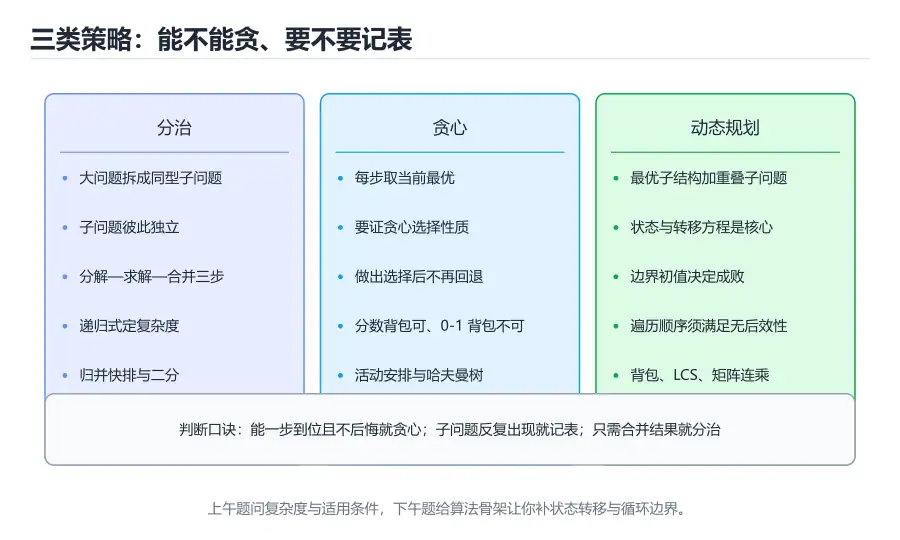

# 算法设计与复杂度分析



> 内容更新时间：2026-10-06 · 学习阶段：进阶 · 预计用时：55 分钟

## 本节知识框架

**课程定位**：所属分类 `ruankao`（软考初级与中级），课程主题 `算法设计与复杂度分析`，学习阶段 进阶，建议用时 55 分钟。上一门课讲「东西怎么放」，这一门讲「拿到一类问题该用哪种套路，以及这套做完值多少阶」。上午卷里它通常占 4~7 分：递归式求阶 1~2 分、算法策略选择 1~2 分、图算法与关键路径 2 分左右、NP 概念 1 分；下午的算法填空大题则整道都在考递推式、边界初值与循环不变式，属于「概念不难但必须写对」的区域。

本课主线分三段推进。第一段解决「这个递归式是多少阶」，用主定理三种情形一把卡死；第二段解决「这道题该用哪种策略」，用问题特征（能不能划分成独立子问题、能不能一步到位不后悔、子问题会不会被反复算到）做判别；第三段解决「策略写出来凭什么说它最优」，靠贪心选择性质加最优子结构这两块砖，以及动态规划的状态、转移、边界、顺序四要素。

**学完本课应当能够**
- 面对 T(n) = aT(n/b) + f(n)，快速说出它落在主定理哪一种情形、渐进解是什么，并解释情形三为什么还要验正则条件。
- 判断一类问题能否用贪心：能就写出「替换后不劣」的三句话论证，不能就举出一组反例数据。
- 用四要素写出 0-1 背包、LCS、矩阵链乘、最长上升子序列的状态转移，并说清填表顺序与滚动数组的遍历方向。
- 解释 Dijkstra 为什么排斥负权边，并说清 Prim、Kruskal、Floyd、拓扑排序各自的前提与代价。
- 在定义层面区分 P、NP 与 NP 完全，并说出这一类考点的正确表述方式。

### 复习清单

- [ ] 能写出主定理三种情形的判定式与结论，并举出一个不能套用主定理的递归式。
- [ ] 能用三句话证明活动安排的贪心：可替换、替换后不劣、剩下的子问题同型。
- [ ] 能在草稿纸上画出 0-1 背包一维滚动数组的遍历方向，并解释为什么必须从大容量往小容量扫。
- [ ] 能写出关键路径的正推式与逆推式，并说明总时差为零意味着什么。

## 核心概念定义

| 术语 | 操作性定义（白话版） | 常见边界与风险 |
| --- | --- | --- |
| 递归式 | 用「子问题的规模」描述自身运行时间的方程，形如 T(n) = aT(n/b) + f(n)。 | 易错：a 是子问题个数，n/b 是每个子问题的规模，f(n) 是分解与合并的代价，三者别混。 |
| 主定理 | 比较 f(n) 与 n^(log_b a) 的阶，直接给出递归式渐进解的判据表。 | 易错：子问题规模不是常数分之一的递归式（如 T(n) = T(n-1) + n）不能套用。 |
| 正则条件 | 情形三要求存在常数 d 小于 1，使 a·f(n/b) ≤ d·f(n) 对足够大的 n 成立。 | 易错：只验 f(n) 更高阶、不验正则条件，结论可能不成立。 |
| 分治法 | 把问题划成若干同型且相互独立的子问题，递归求解后再合并结果。 | 易错：合并代价若高于子问题代价之和，分治就没有收益。 |
| 贪心法 | 每步取当前最优且不再回退，靠贪心选择性质与最优子结构保证整体最优。 | 易错：贪心不保证最优，0-1 背包按单位价值装就是反例。 |
| 贪心选择性质 | 存在某个最优解包含当前这一步的贪心选择，通常用替换论证证明。 | 易错：只证「局部最优」而不证「可替换」，论证不成立。 |
| 最优子结构 | 问题的最优解包含其子问题的最优解。 | 易错：动态规划与贪心都要求它，但只有贪心额外要求选择性质。 |
| 动态规划 | 把重叠子问题的解记进表，按无后效性的顺序自底向上构造最优解。 | 易错：状态定义过窄会漏解，过宽会白白增加复杂度。 |
| 无后效性 | 某阶段状态一旦确定，就不再受此后决策影响，只取决于此前过程。 | 易错：填表顺序违反依赖关系时，转移读到的是脏值。 |
| 回溯法 | 带约束剪枝的深度优先搜索，用于枚举全部解或任一解。 | 易错：只判列冲突、忘了两条对角线，会漏判冲突。 |
| 分支限界法 | 用限界函数算上界、按优先或广度方式扩展结点以求最优解。 | 易错：上界取得松（太乐观）时剪枝效果差，空间开销高于回溯。 |
| NP 完全 | 属于 NP，且 NP 中任何问题都能多项式归约到它的一类判定问题。 | 易错：NP 的含义是验证快，不是「非多项式」。 |

## 原理与运行机制

**一、递归式与主定理：三种情形一张判据表。** 令 c = log_b a，它正好是递归树的「叶层指数」：树共 log_b n 层，第 i 层有 a^i 个结点、每结点代价 f(n/b^i)，叶层共 a^(log_b n) = n^c 个叶子。三种情形比的就是「越往下越大」还是「越往下越小」。

- 情形一：f(n) = O(n^(c−ε))，ε > 0。合并便宜、叶子多，代价被叶层支配，T(n) = Θ(n^c)。例：T(n) = 3T(n/2) + Θ(n) 中 c = log2 3 ≈ 1.585 大于 1，解为 Θ(n^1.585)；Strassen 乘法的 T(n) = 7T(n/2) + Θ(n²) 中 c ≈ 2.808 大于 2，解为 Θ(n^2.808)。
- 情形二：f(n) = Θ(n^c log^k n)，k ≥ 0，则 T(n) = Θ(n^c log^(k+1) n)。归并排序 T(n) = 2T(n/2) + Θ(n) 里 c = 1、f 与 n^c 同阶、k = 0，得 Θ(n log n)；折半查找 T(n) = T(n/2) + Θ(1) 里 c = 0，得 Θ(log n)；T(n) = 4T(n/2) + Θ(n²) 里 c = 2、k = 0，得 Θ(n² log n)。
- 情形三：f(n) = Ω(n^(c+ε)) 且满足正则条件，则 T(n) = Θ(f(n))。例：T(n) = 2T(n/2) + Θ(n²) 中 c = 1，2·(n/2)² = n²/2，取 d = 1/2 即满足正则条件，解为 Θ(n²)。正则条件的作用是排除「f(n) 与 n^c 振荡、谁也不支配谁」的病态函数。

两条边界要记住：子问题规模不是常数分之一时不能套主定理，例如快速排序最坏的 T(n) = T(n−1) + Θ(n) 要展开成级数求和，得 Θ(n²)；a = 1 且 f(n) 为常数时是退化到线性的二分型递归，也是情形二。

**二、分治：切一刀、递归、合并。** 适用信号是「能划成同型且互相独立的子问题，且合并代价不超过子问题代价之和」。归并排序的合并是 O(n)，故 T(n) = 2T(n/2) + O(n)，得 O(n log n)，稳定，但要 O(n) 辅助空间；快速排序每趟划分确定一个元素的最终位置，平均 O(n log n)、最坏 O(n²)，原地但不稳定，工程上用随机化枢轴或三数取中把最坏情况的概率压下去。

最大子段和的分治写法最容易出错：把区间从中点切开后，最优子段只有三种落点——全在左半、全在右半、跨越中点。跨越中点的那一段等于「左半以中点结尾的最大后缀」加「右半从中点右侧开头的最大前缀」，两侧各扫一遍取累计和的峰值，合并代价 O(n)，于是 T(n) = 2T(n/2) + O(n) 得 O(n log n)。同一条式子写成递推 f(i) = max(f(i−1) + a_i, a_i)（f(i) 定义为以 a_i 结尾的最大子段和），答案取所有 f(i) 的最大值，就降到 O(n) 时间与 O(1) 空间。同一道题三种策略三种代价，这正是考试的出题点：序列 −2、11、−4、13、−5、2 的最大子段和是 20，对应子段 11、−4、13。

**三、贪心：只证两件事，口气要像证明。** 一个策略能贪，必须同时具备贪心选择性质与最优子结构。前者用「反证加替换」表述：取任一最优解，若它的第一步不是贪心选择，就把贪心选择换进去，替换后仍然可行且目标值不劣，于是存在一个包含贪心选择的最优解；后者表述为：做完这一步选择之后，剩下的实例与原问题同型，且子问题的最优解拼上这一步就是原问题的最优解。两句话写完，贪心策略才算被证明。

活动安排问题（给一堆起止时间，求最多相容活动数）的正确贪心是「按结束时间升序排，能相容就选」。不按最早开始、不按最短时长的原因是：最早开始可能选到一个横跨大半时段的长活动，最短时长则可能选到一个把许多活动拦腰切断的短活动；而任何最优解的第一个活动的结束时间都必然不早于全局最早结束的活动，把它替换掉之后剩余可用时间只多不少。哈夫曼树的贪心是「每次合并两个最小权值」：贪心性质靠「权值小的结点一定可以挪到最深一层且互为兄弟」来证，合并后把新权值放回集合就得到同型子问题。分数背包按单位重量价值降序装、装不满就切开装，能贪是因为「剩余容量里装单位价值最高的部分不亏」；0-1 背包不能这样贪。反例只需三个物品：容量 10，（价值,重量）分别为 (10,6)、(9,5)、(8,4)，按单位价值从高到低会先取 2.0 的 (8,4)、再取 1.8 的 (9,5)，累计 17 且只剩 1 的容量装不下任何物品，而最优点是 (8,4) 加 (10,6) = 18。同一组数据的分数背包上界是 18.67，这个数正好可以当分支限界的上界用——贪心松弛与限界搜索是连在一起的。

**四、动态规划四要素：状态、转移、边界、顺序。** 状态定义决定一切：它要能唯一确定子问题的最优解，又要压缩到刚好支撑转移。

- 0-1 背包：dp[i][c] = max(dp[i−1][c], dp[i−1][c−w_i] + v_i)，边界 dp[0][c] = 0，答案 dp[n][W]，时间 O(nW)、空间 O(W)。压成一维后必须让容量从大到小遍历，这样 dp[c−w] 读到的还是「上一行」的值，保证每件物品至多用一次；从小到大遍历会让同一件物品被反复计入，那恰好是完全背包的写法。两个方向的差别是下午题最爱留的空。
- 最长公共子序列 LCS：x_i = y_j 时 c[i][j] = c[i−1][j−1] + 1，否则 c[i][j] = max(c[i−1][j], c[i][j−1])，首行首列全为 0。「ABCBDAB」与「BDCABA」的 LCS 长度是 4（例如 BCBA）。公共子序列不要求连续，这一点与公共子串截然不同。
- 矩阵链乘是区间型 DP：m[i][j] = min(m[i][k] + m[k+1][j] + p_(i−1)·p_k·p_j)，k 从 i 到 j−1，边界 m[i][i] = 0，按区间长度由短到长填表。维数序列 (10,100,5,50) 对应 A1(10×100)、A2(100×5)、A3(5×50)：先算 (A1A2)A3 需 10·100·5 + 10·5·50 = 7500 次乘法，先算 A1(A2A3) 需 100·5·50 + 10·100·50 = 75000 次，相差十倍。乘法总次数只由加括号方式决定，这是 DP 值得用表换时间的根本原因。
- 最长上升子序列 LIS：dp[i] = 1 + max(dp[j])，其中 j < i 且 a_j < a_i，取不到时 dp[i] = 1，答案取 max dp[i]，时间 O(n²)；再快就维护「长度为 k 的上升子序列的最小末尾」并配合二分查找，降到 O(n log n)，但那个数组本身不是答案序列。序列 3、10、7、15、9、11 的 LIS 长度是 4（3、7、9、11），最大值第一次出现在第 6 个位置。

判别口诀：子问题会被反复算到才需要 DP 的记表；只需切一刀再合并就回到分治；能一步到位且不后悔就贪心。

**五、回溯与分支限界。** 回溯是带约束剪枝的深度优先：逐层扩展候选，一旦发现当前部分解违反约束就立刻回退，适合求全部解或任一解。N 皇后按行放置，用「列、主对角线 r−c、副对角线 r+c」三个集合判冲突，搜索空间从 n 的 n 次方降到 n! 量级，8 皇后共 92 个解、6 皇后共 4 个解。分支限界则是「带上界的择优扩展」：每个结点算一个目标值上界（0-1 背包常用分数背包松弛），用优先队列先扩展上界最好的结点，一旦某结点的上界不超过当前已得最优解就整棵子树剪掉，它求最优解，空间开销通常高于回溯。考试常见问法里的区分口径是：回溯用深度优先与约束函数剪枝、常求全部解；分支限界用广度或最优优先方式、靠限界函数剪枝、求最优解。

**六、图算法：前提条件比复杂度更重要。** Dijkstra 每轮从未定集合取出当前距离最小的顶点并一次性定死，它依赖「边权非负 ⇒ 绕道别处不会更短」这一单调性。负权边正好破坏它：设 s→u 权 1、s→v 权 2、v→u 权 −5，算法先把 u 定成 1，而真实最短路是 s→v→u = −3，u 从此被永久定错。带负权得改用 Bellman-Ford（O(VE)，还能检出负权回路），无负回路的任意点对负权图可用 Floyd。Floyd 的三重循环必须把中转点 k 放在最外层：d[i][j] = min(d[i][j], d[i][k] + d[k][j]) 的语义是「只允许经过前 k 个顶点作中转」的递推，k 是阶段，写成 i 在最外层会得到错误结果，这是下午题改错的高频点。最小生成树：Prim 从已选顶点集向外接最小边，邻接矩阵实现 O(n²)，稠密图划算；Kruskal 先把边排序再用并查集判环，O(e log e)，稀疏图划算；两者求出的权值和相同，边权互不相同时生成树唯一。拓扑排序只对有向无环图存在：反复取出度为 0 的顶点并删掉它的出边，若结束时处理数少于 n 说明图中有环。AOE 网的关键路径在此之上计算：正推事件最早发生时间 ve(j) = max(ve(i) + w(i,j))，逆推最迟发生时间 vl(i) = min(vl(j) − w(i,j))，ve 与 vl 相等的事件串起来就是关键路径；活动总时差为 vl(终点) − ve(起点) − 活动工期，为零者称关键活动，压缩非关键活动不会缩短总工期。

**七、NP 只考定义层。** 需要记住的四句话：P 是能用多项式时间判定的决策问题类；NP 是「给定一个候选解，能在多项式时间内验证它是否成立」的决策问题类，关键词是验证快而不是求解快；NP 完全问题既属于 NP，又满足 NP 中所有问题可在多项式时间内归约到它，是 NP 里最难的一档；只要有一个 NP 完全问题存在多项式算法，就有 P = NP。常举的例子是 SAT（第一个被证明的 NP 完全问题）、顶点覆盖、团、哈密顿回路、图 3-着色、子集和以及 TSP 的判定版本。工程退路有四条：限定规模、近似算法、随机化与启发式、带剪枝的指数时间算法。注意「TSP 是 NP 完全问题」指的是判定版本（是否存在长度不超过 K 的回路），最优化版本通常称 NP 难。

### 考场上怎么认出它

| 策略 | 题面信号词 | 认出来之后的第一步 |
| --- | --- | --- |
| 分治 | 划分为两个规模减半的子问题、合并结果、给出递归式 | 先写 T(n) = aT(n/b) + f(n)，再用主定理定阶 |
| 贪心 | 每次选当前最优、不回头、最多相容、最少资源、字典序最小 | 先造一个小反例试吹，吹不倒再写替换论证 |
| 动态规划 | 有多少种方案、最大最小收益、区间合并、序列对齐、装包 | 先写状态定义的一句话，再写转移与边界 |
| 回溯 | 输出所有解、排列组合枚举、约束满足、八皇后 | 画出搜索树，标出约束函数位置 |
| 分支限界 | 上界、优先队列、活度表、剪枝求最优解 | 先给松弛问题（常是分数版）算上界 |
| 图算法 | 最少跳数、最短路径、工期、依赖顺序、连通与生成树 | 先问边权是否非负、图是否可能有环 |
| NP | 是否存在、判定、多项式验证、归约 | 只在定义层回答，不去论证 P 与 NP 关系 |

## 典型应用场景

| 场景 | 典型输入或前提 | 首选策略与代价 |
| --- | --- | --- |
| 大规模排序 | 内存放得下、要求稳定 | 归并排序 O(n log n) + O(n) 辅助空间 |
| 内存受限排序 | 允许不稳定、要求原地 | 快速排序平均 O(n log n)、最坏 O(n²) |
| 时段调度 | 一批起止时间与互斥约束 | 按最早结束时间排序的贪心，O(n log n) |
| 前缀编码 | 各符号频率已知 | 哈夫曼贪心 O(n log n)，WPL 最优 |
| 资源分配 | 有限预算内取价值最大组合 | 0-1 背包 DP O(nW)，或分支限界 |
| 文本比对与差异高亮 | 两条序列 | LCS DP O(nm)，空间可滚成一维 |
| 表达式与乘法次序 | 一串矩阵维数 | 区间 DP 的矩阵链乘 O(n³) |
| 依赖排序与排期 | 有向无环图加活动工期 | 拓扑排序求关键路径 O(n + e) |
| 约束枚举 | 需要全部可行布局 | 回溯加约束剪枝，最坏指数级 |

## 代码/协议/SQL 示例

把主定理判型、0-1 背包与完全背包的遍历方向差异、LCS、矩阵链乘、最大子段和两种写法压成一段可直接跑的 Python：

```python
import math

def master(a, b, e, k=0):
    """按主定理比较 f(n)=n^e log^k n 与 n^(log_b a)。"""
    c = math.log(a, b)
    if e > c + 1e-9:
        return '情形三：Θ(f(n))，另需验证正则条件'
    if abs(e - c) < 1e-9:
        return '临界情形二：Θ(n^c log^(k+1) n)'
    return '情形一：Θ(n^log_b a)'

def zero_one(items, cap, reverse=True):
    dp = [0] * (cap + 1)
    rng = range(cap, -1, -1) if reverse else range(cap + 1)
    for v, w in items:
        for c in rng:
            if c >= w:
                dp[c] = max(dp[c], dp[c - w] + v)
    return dp[cap]

def lcs(x, y):
    prev = [0] * (len(y) + 1)
    for i in range(1, len(x) + 1):
        cur = [0]
        for j in range(1, len(y) + 1):
            cur.append(prev[j - 1] + 1 if x[i - 1] == y[j - 1]
                       else max(prev[j], cur[j - 1]))
        prev = cur
    return prev[-1]

def matrix_chain(p):
    n = len(p) - 1
    m = [[0] * (n + 1) for _ in range(n + 1)]
    for length in range(2, n + 1):
        for i in range(1, n - length + 2):
            j = i + length - 1
            m[i][j] = min(m[i][k] + m[k + 1][j] + p[i - 1] * p[k] * p[j]
                          for k in range(i, j))
    return m[1][n]

def max_subarray(a):
    """f(i) = max(f(i-1) + a_i, a_i)，答案取所有 f(i) 的最大值。"""
    best = cur = a[0]
    for x in a[1:]:
        cur = max(x, cur + x)
        best = max(best, cur)
    return best

print(master(2, 2, 1), master(3, 2, 1), master(2, 2, 2))
print(zero_one([(8, 4), (9, 5), (10, 6)], 10), lcs('ABCBDAB', 'BDCABA'),
      matrix_chain([10, 100, 5, 50]), max_subarray([-2, 11, -4, 13, -5, 2]))
print(zero_one([(6, 2)], 10), zero_one([(6, 2)], 10, False))   # 6 30：逆序与顺序的差别
```

输出依次是三种主定理判型、0-1 背包的最优值 18、LCS 长度 4、矩阵链乘 7500 次乘法、最大子段和 20，与前面手算的结果逐一对得上。最后一行是遍历方向的对照实验：只有一件（价值 6、重量 2）的物品、容量 10，逆序遍历得到 6，也就是这件物品至多使用一次；顺序遍历得到 30，因为它把同一件物品重复装了 5 次，那正是完全背包的语义。两类问题只差一行遍历方向，这组数字值得在草稿上默写一遍。

读代码填空在下午题里常以 C 语言骨架出现，本课口径下最稳的写法是把递推与边界同时写出：

```c
/* 求 1..n 的最大不交子段和，f 只保留“以 i 结尾”这一维状态 */
int max_subarray(const int *a, int n, int *out) {
    int best = a[0], cur = a[0];
    *out = 0;
    for (int i = 1; i < n; ++i) {          /* 循环不变式：cur 恒等于以 i-1 结尾的最大子段和 */
        cur = (a[i] > cur + a[i]) ? a[i] : cur + a[i];
        if (cur > best) { best = cur; *out = i; }
    }
    return best;                            /* n 为 0 时调用方需自行短路 */
}
```

## 时间/空间复杂度或性能分析

这一域的考题几乎都在问「阶」与「表」两件事：阶由递归式决定，表由状态定义决定。

递归式的三条常见结论：T(n) = 2T(n/2) + Θ(n) 是 Θ(n log n)，T(n) = 2T(n/2) + Θ(n²) 是 Θ(n²)，T(n) = T(n/2) + Θ(n) 是 Θ(n)（这条仍在主定理射程内，属情形三：c = log2 1 = 0，正则条件取 d = 1/2 即成立）。真正必须展开成级数求和的是子问题规模不按固定分数缩小的一类，例如 T(n) = T(n−1) + Θ(n) 得 Θ(n²)。查表规模与代价的换算关系如下：

| 递推来源 | 时间 | 附加空间 | 主要代价来源 |
| --- | --- | --- | --- |
| 归并排序 | O(n log n) | O(n) | 合并阶段的搬移 |
| 快速排序平均 | O(n log n) | O(log n) | 划分阶段的交换与递归栈 |
| 0-1 背包二维表 | O(nW) | O(W) | 状态数 n×(W+1) 次转移 |
| LCS 二维表 | O(nm) | O(min(n,m)) | 每格一次比较两次取大 |
| 矩阵链乘 | O(n³) | O(n²) | 区间数 n² 乘每个区间的分割点 |
| LIS 朴素 | O(n²) | O(n) | 每个状态回看所有前驱 |
| Floyd | O(n³) | O(n²) | 三重循环，k 在外层 |
| Dijkstra 配二叉堆 | O(e log n) | O(n) | 每条边至多一次松弛入队 |
| Kruskal | O(e log e) | O(n) | 边排序，并查集近似线性 |
| 拓扑排序与关键路径 | O(n + e) | O(n) | 每条边被松弛两次（正推与逆推） |

空间这边有一条备考经验：DP 的表是「用空间换时间」，能滚成一维的前提是转移只依赖固定的少数行。0-1 背包能滚是因为转移只看 dp[i−1][·]，且必须逆序；LCS 能滚到一维是因为转移只看上一行与左边一格，但要额外存一个变量保存被覆盖的左上角值；矩阵链乘不能滚，因为它的子区间彼此交叉，必须留 O(n²) 的表。下午题常在这一层设空：问「把空间降到 O(W) 时遍历顺序应如何调整」，答案就是「外层物品、内层容量从大到小」。

常数与实测也有考点意义：同样标 O(n log n)，归并的搬移使它在大数组上慢于快排，快排在近乎有序的数据上因划分不平衡而退化，堆排序因内存访问跳跃而对缓存不友好。这就是「平均复杂度相同但实测差数倍」的标准解释，也是考试问「为什么工程默认用快排或内省排序」时的采分句。

## 常见误区与易错点

| 容易答错的做法 | 考场上的实际现象 | 原因与正确做法 |
| --- | --- | --- |
| 给 T(n) = T(n−1) + n 套主定理 | 得出 Θ(n log n) | b 不是常数，只能展开求和得 Θ(n²) |
| 情形三只比阶不验正则条件 | 概念题选错 | 需要 a·f(n/b) ≤ d·f(n)，d 小于 1 |
| 认为贪心求出的就是最优解 | 0-1 背包填空丢分 | 必须先证贪心选择性质与最优子结构 |
| 0-1 背包一维滚动改成正序遍历 | 样例结果偏大 | 正序等价于完全背包，逆序才限制每件只用一次 |
| 把最长公共子序列当连续子串 | LCS 长度算短 | 子序列允许跳着取，转移里要保留 max 分支 |
| LIS 的 tails 数组当成答案序列输出 | 下午题写错 | 它只维护各长度下的最小末尾，需另存前驱才能还原 |
| 认为 Dijkstra 能处理负权边 | 概念题丢分 | 首次定死的顶点可能被更短的负权路径改写 |
| Floyd 把 i 写在最外层 | 结果与标准答案不符 | 中转点 k 必须是阶段，放最外层 |
| 说 Kruskal 与 Prim 结果不同 | 选型题选错 | 权值和相同，只有边集合在等权时可能不同 |
| 有环图上仍做拓扑排序 | 关键路径题卡住 | 取出顶点数小于 n 就说明存在环，先消环 |
| 压缩非关键活动来缩短工期 | 排期题判断错 | 只有总时差为零的关键活动会影响总工期 |
| 把 NP 解释成非多项式问题 | 概念题选错 | NP 指解可在多项式时间内验证 |

## 与其他知识点的关系

- **前置**：`ruankao_data_structure` 的树、图、散列与排序是本课策略的载体，主定理里的递归式几乎都来自它的排序算法；`ruankao_cs_basics` 的对数、进制与组合计数是算阶的工具。
- **并列**：`ruankao_os_and_arch` 的调度算法（先来先服务、短作业优先、时间片轮转）本质是贪心与牺牲最优换公平的例子；`ruankao_network_security` 的最短路路由与本课的 Dijkstra、Floyd 直接对应，密钥长度与暴力搜索的指数复杂度对应 NP 部分。
- **后续**：`ruankao_db_design` 的查询优化用动态规划思想枚举连接次序；`ruankao_case_paper` 的下午算法大题把本课的递推式、边界初值与循环不变式改写成代码填空，是这些结论的直接验收场。

## 自测题与参考答案

作答时先盖上答案区，每题限时 4 分钟；做完把错题对应的小节翻一遍，手算过程写在草稿上。

### 题目 1（单选题）

递归式 T(n) = 2T(n/2) + n 按主定理分析，下列说法正确的是？

- A. 属于临界情形，f(n) 与 n^(log2 2) 同阶，解为 Θ(n log n)
- B. 属于情形一，f(n) 多项式量级小于递归项，解为 Θ(n)
- C. 属于情形三，f(n) 支配递归项，解为 Θ(n)
- D. 无法用主定理判断，必须展开成级数后才能求阶

**参考答案**：A

**解析**：本题正确项是「属于临界情形，f(n) 与 n^(log2 2) 同阶，解为 Θ(n log n)」。这里 a = 2、b = 2，于是 c = log2 2 = 1，而 f(n) = n 恰与 n^1 同阶，属情形二（k = 0），每层代价基本持平、共 log n 层，直接得 Θ(n log n)，归并排序的复杂度就是这样定出来的。干扰项「属于情形一，f(n) 多项式量级小于递归项，解为 Θ(n)」把同阶误当成低阶；干扰项「属于情形三，f(n) 支配递归项，解为 Θ(n)」既判错情形又写错结论；「无法用主定理判断，必须展开成级数后才能求阶」混淆了适用条件，只有子问题规模非固定分数（如 T(n) = T(n−1) + n）时才需要展开求和。

### 题目 2（单选题）

在容量为 10 的背包中有三件物品（价值,重量）分别为 (10,6)、(9,5)、(8,4)，下列求解方式正确的是？

- A. 按单位重量价值降序贪心装填可得最优值 18
- B. 用动态规划求解，dp[i][c] 取 max(dp[i−1][c], dp[i−1][c−w_i]+v_i)，最优值 18
- C. 按单位重量价值降序贪心可得最优值 18.67
- D. 用贪心从价值最大入手先装 10，再补 9，最优值 19

**参考答案**：B

**解析**：本题正确项是「用动态规划求解，dp[i][c] 取 max(dp[i−1][c], dp[i−1][c−w_i]+v_i)，最优值 18」。三件物品的最优组合是重量 4 与 6 那两件，价值 8 + 10 = 18；单位价值排序是 2.0、1.8、1.667，贪心先取 2.0 的 (8,4) 再取 1.8 的 (9,5)，累计 17 且剩余容量 1 装不下任何东西，比最优少 1，可见 0-1 背包不具备贪心选择性质。干扰项「按单位重量价值降序贪心可得最优值 18.67」里的 18.67 其实是允许切开装填的分数背包上界，不是整数解；干扰项「按单位重量价值降序贪心装填可得最优值 18」把结果记错；「用贪心从价值最大入手先装 10，再补 9，最优值 19」违反容量约束，重量 6 加 5 已经超过 10。

### 题目 3（单选题）

关于 Dijkstra 算法不能处理负权边，正确的说法是？

- A. 负权边会让优先队列无法取出当前最小元素，实现层面根本不可行
- B. 负权边会把最短路的权值和算成负数，输出的距离失去比较意义
- C. 含负权边的图不存在最短路径，只能改用深度优先搜索逐条枚举
- D. 算法把首次定下的顶点视为最终结果，负权边可能让已定顶点被更短路改写

**参考答案**：D

**解析**：本题正确项是「算法把首次定下的顶点视为最终结果，负权边可能让已定顶点被更短路改写」。算法每轮从未定集合取出当前估计最小的顶点就一次性定死，靠的是「边权非负 ⇒ 绕道别处不会更短」这一单调性；用 s→u 权 1、s→v 权 2、v→u 权 −5 这组数据，u 会被定成 1，而真实最短路是 −3，此后不再更新。干扰项「负权边会把最短路的权值和算成负数，输出的距离失去比较意义」把结论当成否定理由，负距离本身完全有意义；「含负权边的图不存在最短路径，只能改用深度优先搜索逐条枚举」只在存在负权回路时才成立，一般负权图有最短路，交给 Bellman-Ford 即可；「负权边会让优先队列无法取出当前最小元素」混淆了堆的性质与权值符号，堆对负数同样工作。

### 题目 4（读代码）

阅读下面这段求最长上升子序列的代码，输出结果是什么？

```python
a = [3, 10, 7, 15, 9, 11]
dp = [1] * len(a)
for i in range(1, len(a)):
    for j in range(i):
        if a[j] < a[i]:
            dp[i] = max(dp[i], dp[j] + 1)
print(max(dp), dp.index(max(dp)) + 1)
```

- A. 4 6
- B. 3 5
- C. 4 5
- D. 6 6

**参考答案**：A

**解析**：本题正确项是「4 6」。dp[i] 表示以第 i 个元素结尾的上升子序列的最大长度，逐格回看所有前驱：3、10、7、15、9、11 对应的 dp 依次是 1、2、2、3、3、4，最大值 4 出现在下标 5，程序输出下标的 1 基位置 6，因此打印 4 6。这条递推的时间是 O(n²)，因为每个状态都要回看它的全部前驱。干扰项「3 5」是把 3、7、15 这类可见的三元组当成答案而漏掉 11；「4 5」只错在下标起点，把 0 基位置当成 1 基位置；「6 6」则把 dp 数组长度本身当成了最大长度。

### 题目 5（多选）

关于动态规划与贪心的设计要点，下列说法正确的是？

- A. 状态定义要能唯一确定子问题的最优解
- B. 转移顺序必须满足无后效性，按依赖关系的拓扑次序填表
- C. 写出转移方程之后就可以不再关心边界初值
- D. 贪心法要成立，必须同时具备贪心选择性质与最优子结构
- E. 只要子问题有重叠，就一定可以用动态规划求最优解

**参考答案**：A、B、D

**解析**：多选题要同时选中「状态定义要能唯一确定子问题的最优解」、「转移顺序必须满足无后效性，按依赖关系的拓扑次序填表」与「贪心法要成立，必须同时具备贪心选择性质与最优子结构」三条。状态、转移、边界、顺序四要素是一条链条：状态定窄了会漏解、定宽了白白增加复杂度；转移的读写次序决定表里读到的是不是已经算好的值；而贪心的两条前提是缺一不可的，最优子结构对动态规划同样必要，但只有它并不够。干扰项「写出转移方程之后就可以不再关心边界初值」与常识相反，背包里 dp[0][c] = 0、矩阵链里 m[i][i] = 0，边界错则满盘皆错；干扰项「只要子问题有重叠，就一定可以用动态规划求最优解」忽略了最优子结构这个前提，重叠只是值得记表的信号，不是能保证最优的条件。

### 题目 6（排序题）

把用分治法求最大子段和的四个动作按先后排列：

- A. 求跨越中点的最大子段和：左半取以中点结尾的最大后缀，右半取最大前缀，两者相加
- B. 把序列从中间一分为二，得到两个规模减半的同型子问题
- C. 取左半结果、右半结果与跨越结果三者中的最大值作为原问题的答案
- D. 递归地对左右两半分别求最大子段和，直到区间只剩一个元素

**参考答案**：B → D → A → C

**解析**：本题顺序是「把序列从中间一分为二，得到两个规模减半的同型子问题」→「递归地对左右两半分别求最大子段和，直到区间只剩一个元素」→「求跨越中点的最大子段和：左半取以中点结尾的最大后缀，右半取最大前缀，两者相加」→「取左半结果、右半结果与跨越结果三者中的最大值作为原问题的答案」。分解—求解—合并是分治的固定节拍：先划边界再递归到基例，合并阶段才需要跨越信息，最后取三者最大。跨中点那一步是本题的失分重灾区，很多人误写成「左半最大值加右半最大值」，那样得到的两段可能中间断开，并不构成连续子段。按这一结构，合并代价是 O(n)，递推为 T(n) = 2T(n/2) + O(n)，故总时间是 O(n log n)；把状态改成「以 i 结尾」的递推可进一步降到 O(n)。

## 考点精讲

本课题库共 6 道题，下面逐题复述题干原文、答案字母（A 是第 1 个选项）与判断依据，字段内容与题库完全一致。

### 考点 1（单选题 · 递归式定阶）

- **题目**：递归式 T(n) = 2T(n/2) + n 按主定理分析，下列说法正确的是？
- **答案**：A
- **正确项**：属于临界情形，f(n) 与 n^(log2 2) 同阶，解为 Θ(n log n)
- **判断依据**：本题正确项是「属于临界情形，f(n) 与 n^(log2 2) 同阶，解为 Θ(n log n)」。这里 a = 2、b = 2，于是 c = log2 2 = 1，而 f(n) = n 恰与 n^1 同阶，属情形二（k = 0），每层代价基本持平、共 log n 层，直接得 Θ(n log n)，归并排序的复杂度就是这样定出来的。干扰项「属于情形一，f(n) 多项式量级小于递归项，解为 Θ(n)」把同阶误当成低阶；干扰项「属于情形三，f(n) 支配递归项，解为 Θ(n)」既判错情形又写错结论；「无法用主定理判断，必须展开成级数后才能求阶」混淆了适用条件，只有子问题规模非固定分数（如 T(n) = T(n−1) + n）时才需要展开求和。

### 考点 2（单选题 · 贪心与背包）

- **题目**：在容量为 10 的背包中有三件物品（价值,重量）分别为 (10,6)、(9,5)、(8,4)，下列求解方式正确的是？
- **答案**：B
- **正确项**：用动态规划求解，dp[i][c] 取 max(dp[i−1][c], dp[i−1][c−w_i]+v_i)，最优值 18
- **判断依据**：本题正确项是「用动态规划求解，dp[i][c] 取 max(dp[i−1][c], dp[i−1][c−w_i]+v_i)，最优值 18」。三件物品的最优组合是重量 4 与 6 那两件，价值 8 + 10 = 18；单位价值排序是 2.0、1.8、1.667，贪心先取 2.0 的 (8,4) 再取 1.8 的 (9,5)，累计 17 且剩余容量 1 装不下任何东西，比最优少 1，可见 0-1 背包不具备贪心选择性质。干扰项「按单位重量价值降序贪心可得最优值 18.67」里的 18.67 其实是允许切开装填的分数背包上界，不是整数解；干扰项「按单位重量价值降序贪心装填可得最优值 18」把结果记错；「用贪心从价值最大入手先装 10，再补 9，最优值 19」违反容量约束，重量 6 加 5 已经超过 10。

### 考点 3（单选题 · 最短路前提）

- **题目**：关于 Dijkstra 算法不能处理负权边，正确的说法是？
- **答案**：D
- **正确项**：算法把首次定下的顶点视为最终结果，负权边可能让已定顶点被更短路改写
- **判断依据**：本题正确项是「算法把首次定下的顶点视为最终结果，负权边可能让已定顶点被更短路改写」。算法每轮从未定集合取出当前估计最小的顶点就一次性定死，靠的是「边权非负 ⇒ 绕道别处不会更短」这一单调性；用 s→u 权 1、s→v 权 2、v→u 权 −5 这组数据，u 会被定成 1，而真实最短路是 −3，此后不再更新。干扰项「负权边会把最短路的权值和算成负数，输出的距离失去比较意义」把结论当成否定理由，负距离本身完全有意义；「含负权边的图不存在最短路径，只能改用深度优先搜索逐条枚举」只在存在负权回路时才成立，一般负权图有最短路，交给 Bellman-Ford 即可；「负权边会让优先队列无法取出当前最小元素」混淆了堆的性质与权值符号，堆对负数同样工作。

### 考点 4（代码题 · 递推与状态）

- **题目**：阅读下面这段求最长上升子序列的代码，输出结果是什么？
- **答案**：A
- **正确项**：4 6
- **判断依据**：本题正确项是「4 6」。dp[i] 表示以第 i 个元素结尾的上升子序列的最大长度，逐格回看所有前驱：3、10、7、15、9、11 对应的 dp 依次是 1、2、2、3、3、4，最大值 4 出现在下标 5，程序输出下标的 1 基位置 6，因此打印 4 6。这条递推的时间是 O(n²)，因为每个状态都要回看它的全部前驱。干扰项「3 5」是把 3、7、15 这类可见的三元组当成答案而漏掉 11；「4 5」只错在下标起点，把 0 基位置当成 1 基位置；「6 6」则把 dp 数组长度本身当成了最大长度。

### 考点 5（多选题 · 设计要点）

- **题目**：关于动态规划与贪心的设计要点，下列说法正确的是？
- **答案**：A、B、D
- **正确项**：状态定义要能唯一确定子问题的最优解；转移顺序必须满足无后效性，按依赖关系的拓扑次序填表；贪心法要成立，必须同时具备贪心选择性质与最优子结构
- **判断依据**：多选题要同时选中「状态定义要能唯一确定子问题的最优解」、「转移顺序必须满足无后效性，按依赖关系的拓扑次序填表」与「贪心法要成立，必须同时具备贪心选择性质与最优子结构」三条。状态、转移、边界、顺序四要素是一条链条：状态定窄了会漏解、定宽了白白增加复杂度；转移的读写次序决定表里读到的是不是已经算好的值；而贪心的两条前提是缺一不可的，最优子结构对动态规划同样必要，但只有它并不够。干扰项「写出转移方程之后就可以不再关心边界初值」与常识相反，背包里 dp[0][c] = 0、矩阵链里 m[i][i] = 0，边界错则满盘皆错；干扰项「只要子问题有重叠，就一定可以用动态规划求最优解」忽略了最优子结构这个前提，重叠只是值得记表的信号，不是能保证最优的条件。

### 考点 6（排序题 · 分治节拍）

- **题目**：把用分治法求最大子段和的四个动作按先后排列：
- **答案**：B → D → A → C
- **正确项**：把序列从中间一分为二 → 递归地对左右两半分别求最大子段和 → 求跨越中点的最大子段和 → 取三者中的最大值作为原问题的答案
- **判断依据**：本题顺序是「把序列从中间一分为二，得到两个规模减半的同型子问题」→「递归地对左右两半分别求最大子段和，直到区间只剩一个元素」→「求跨越中点的最大子段和：左半取以中点结尾的最大后缀，右半取最大前缀，两者相加」→「取左半结果、右半结果与跨越结果三者中的最大值作为原问题的答案」。分解—求解—合并是分治的固定节拍：先划边界再递归到基例，合并阶段才需要跨越信息，最后取三者最大。跨中点那一步是本题的失分重灾区，很多人误写成「左半最大值加右半最大值」，那样得到的两段可能中间断开，并不构成连续子段。按这一结构，合并代价是 O(n)，递推为 T(n) = 2T(n/2) + O(n)，故总时间是 O(n log n)；把状态改成「以 i 结尾」的递推可进一步降到 O(n)。

## 术语速查

| 术语 | 一句话说明 |
| --- | --- |
| 主定理 | 比较 f(n) 与 n^(log_b a) 的阶，一步给出 T(n) = aT(n/b) + f(n) 的渐进解。 |
| 正则条件 | 情形三的附加校验：a·f(n/b) 至多是 d·f(n)，d 为小于 1 的常数。 |
| 递归树 | 把递归展开成树来数层数与每层代价，是主定理结论的直观来源。 |
| 贪心选择性质 | 存在某个最优解包含当前这一步的贪心选择，用替换论证来证。 |
| 最优子结构 | 最优解里嵌着子问题的最优解，贪心与动态规划共同的先决条件。 |
| 无后效性 | 状态一旦定下，后续决策只依赖它而不追溯此前过程。 |
| 状态压缩 | 把二维表滚成一维，0-1 背包必须逆序遍历容量才不会重复装。 |
| 限界函数 | 分支限界里给结点算的目标值上界，用于整棵剪掉不可能更优的子树。 |
| 关键路径 | AOE 网中 ve 与 vl 相等的事件串，长度即工程总工期。 |
| NP 完全 | 属于 NP 且 NP 中所有问题可多项式归约到它，是最难的一档判定问题。 |

## 参考资料与复核

- [中国计算机技术职业资格网首页（软考官方门户）](https://www.ruankao.org.cn/)
- [软件设计师考试大纲与考试介绍](https://www.ruankao.org.cn/exam/)
- [Open Data Structures 教材站（算法复杂度与递归分析）](https://opendatastructures.org/)
- [Python 官方中文教程（数据结构与标准库 heapq）](https://docs.python.org/zh-cn/3/tutorial/)
- [GCC 优化选项手册（复杂度与常数因子的工程解释）](https://gcc.gnu.org/onlinedocs/gcc/Optimize-Options.html)
- 最后复核：2026-10-04
- 下次复核：2027-09-10
- 复核范围：主定理三种情形的判定式与示例结论、0-1 背包反例 (10,6)(9,5)(8,4) 的贪心值 17 与最优值 18、分数背包上界 18.67、LCS 长度 4、矩阵链乘 7500 与 75000、LIS 示例输出 4 与 6、最大子段和 20、8 皇后 92 个解与 6 皇后 4 个解、Dijkstra 负权反例的 −3、Floyd 循环次序、关键路径正推逆推公式。
- 来源性质：教材通用结论与本仓自主重算结果，文中全部数值均可用示例代码复现，不涉及任何官方命题内容。

## 内容元数据

- 内容版本：v2.0
- 分类归属：`ruankao`（软考初级与中级），本课为第 5 门（order 4）
- 学习阶段：进阶 · 预计用时：55 分钟
- 适用考试：软件设计师 / 程序员（上午基础知识算法与程序设计段、下午应用技术试题四）
- 相关课程：`ruankao_data_structure`、`ruankao_os_and_arch`、`ruankao_db_design`、`ruankao_case_paper`
- 质量口径：与 `tool/content_pipeline/validate_pack.js` 的结构与题库门禁对齐，题目全部自主命制
- 说明：主定理、贪心两条前提、动态规划四要素与 NP 定义为长期稳定的知识，不随年度大纲变动；具体年度题型分布以当期官方大纲说明为准
