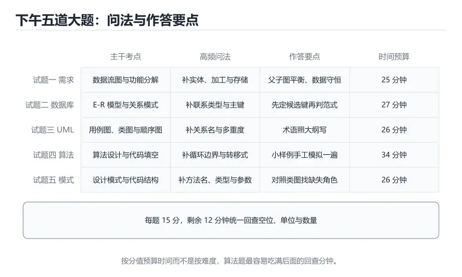

# 下午应用技术科目作答方法



> 内容更新时间：2026-10-06 · 学习阶段：高级 · 预计用时：55 分钟

## 本节知识框架

**课程定位**：所属分类 `ruankao`（软考初级与中级），课程主题 `下午应用技术科目作答方法`，学习阶段 高级，建议用时 55 分钟。

上午科目考「知不知道」，下午科目考「会不会做」，而后者才是多数人被挡在门外的原因。下午应用技术卷 150 分钟、5 道大题、每题 15 分，满分 45 分才算通过，也就是说整场允许你放弃一到一题半的分数——这个事实决定了作答方法的本质不是把五道题全做完，而是把会做的部分一分不丢地写清楚。丢分的常见形态非常固定：空位漏填、术语跟大纲不一致、单位没写、约束没标、时间被一道题吃掉导致后面两题的空格全白。这些都不是知识缺口，是流程缺口。

配图是一张五行四列的作答表：行按试题一到试题五排列，列依次是主干考点、高频问法、作答要点与时间预算。横着读一行就是一道题的完整打法——第一行是需求与数据流图，问补实体、补加工与补数据存储，作答要点是父子图平衡与数据守恒，预算 25 分钟；第二行是 E-R 模型与关系模式，问补联系类型与主键，要点是先定候选键再判范式，预算 27 分钟；第三行是 UML 三张图，问补关系名与多重度，要点是术语照大纲写，预算 26 分钟；第四行是算法与代码填空，问补循环边界与状态转移式，要点是拿小样例手工模拟一遍，预算 34 分钟；第五行是设计模式与代码结构，问补方法名、类型与参数，要点是对着类图找缺失的角色，预算 26 分钟。表下那行备注是整场的时间结构：每题 15 分，五题合计留出 12 分钟统一回查空位、单位与数量。按分值分配时间而不是按难度，是这张表最想让你记住的一句话，因为算法题最容易把后面的回查分钟吃光。

**学完本节应当能够**

- 说出下午科目五道大题各自的考点来源，并把它们映射到前八门课的具体章节。
- 用 25、27、26、34、26 分钟的预算表安排一次 150 分钟的模拟作答，并说明什么情况下要主动降低某题预算。
- 按「读问题、定位、写、查」四步处理一道大题，指出每一步该在草稿纸上留下什么。
- 判断一道填空题的评分点在哪里，写出术语、单位与约束的标准表达。
- 在算法填空与设计模式填空之间选择作答顺序，并说明为什么模式题的性价比通常更高。

### 复习清单

- [ ] 能否写出数据流图检查的三件事：父子图平衡、数据守恒、加工都有输入与输出。
- [ ] 能否说明 M:N 联系转换成关系模式时为什么必须单独建表，并写出它的主键。
- [ ] 能否用一句话解释「先定候选键再判范式」，并指出跳过候选键会错在哪一步。
- [ ] 能否在 3 分钟内用给定的 6 个元素手工模拟一遍最大子段和循环，填出每轮的当前值。
- [ ] 能否说出模式填空题的三个检查点：角色是否齐全、抽象与具体的引用方向、构造参数从哪里传入。

## 核心概念定义

| 概念 | 一句话定义 | 考场判分点 |
| --- | --- | --- |
| 下午应用技术 | 以案例分析与填空形式考查设计、建模与编码能力的科目 | 按空给分，空白即零分，写完一题再优化排版是错误顺序 |
| 数据流图 | 用外部实体、加工、数据存储与数据流描述系统功能需求的图 | 补画类问题只问缺什么，不问画得好看与否 |
| 父子图平衡 | 分解后的子图输入输出数据流与父图对应加工保持一致 | 检查时只看数据流名字与方向，不看加工内部逻辑 |
| 数据守恒 | 一个加工的输出必须能由它的输入推导出来 | 凭空多出的输出与多余的输入都是错误点 |
| 外部实体 | 系统之外与系统交换数据的人、组织或其他系统 | 命名要写角色而不是写具体个人姓名 |
| 数据存储 | 加工之间共享的数据在文件或者表中的静态表示 | 只有读或只有写的存储常是漏画的信号 |
| E-R 模型 | 用实体、属性与联系描述信息结构的概念模型 | 联系类型 1:1、1:N、M:N 判错会连带主键位置一起错 |
| 联系转关系模式 | M:N 联系单独成表，1:N 联系并入多端并加外键 | 联系的属性必须跟着落到那张表里 |
| 候选键与主键 | 能唯一标识元组的最小属性集，从中选定一个作主键 | 先求候选键再判范式，顺序颠倒必然误判 |
| 范式判定 | 依次检查部分依赖、传递依赖与多值依赖 | 判错往往是候选键选错，而不是定义记错 |
| 用例图 | 从参与者视角描述系统做什么的图 | 包含与扩展的箭头方向是高频填空点 |
| 类图 | 描述类及其静态关系的图 | 多重度写在两端，聚合与组合的菱形位置不能反 |
| 顺序图 | 按时间轴展示对象之间消息传递的图 | 补消息时要同时给出消息名与方向 |
| 算法填空 | 给出算法骨架只留关键表达式或边界条件 | 空位前后的变量含义是唯一线索 |
| 循环边界 | 决定循环次数的初值、终值与增量 | 差一错误几乎都在这一处扣分 |
| 状态转移式 | 动态规划里由子问题推出当前值的表达式 | 写出递推式后要立刻用小样例验证 |
| 设计模式填空 | 以类图加代码的形式考查模式的类与协作 | 先认模式再补代码，认模式靠的是角色清单 |
| 术语一致性 | 答案用词与当期大纲和题干用词保持一致 | 意思相近但用词不同可能不给分 |
| 待查标记 | 机考作答界面上给不确定题目打的记号 | 标记的意义是把回查顺序固定下来 |
| 回查 | 最后统一检查空位、单位、下标与约束 | 回查只补漏，不建议推翻已有答案 |
| 说明 | 本课的题数、分值与选做安排按现行常见口径整理，以当期官方说明与准考证为准 | 出现官方调整时，答题策略不变，预算表按分值重算 |

## 原理与运行机制

**判分口径决定写法**：下午卷按空给分，一个 15 分的大题通常拆成 5 到 8 个空位，每个空位 2 到 3 分。这意味着两件事：一是任何空位都不该留白，即使完全不会也要写出与题干同族的名词；二是空位之间互相独立，前一空写错通常不影响后一空得分，所以不要为了「把整题做完美」而反复修改第一空。术语口径要跟着大纲和题干走——题干写「数据存储」就不要答「数据文件」，题干写「加工」就不要答「处理功能」，这类同义替换在人工评分时可能被接受，在按关键词比对的评分口径下就是零分。

**四步作答法**：拿到一道大题，先读小题问什么，把「补全」「说明」「指出差异」这类动词圈出来；再用题干里的关键词定位到图或代码的具体位置，缩小到几个空位；然后动笔写，空位多的题先填有把握的；最后查，检查单位、下标、约束和是否与题干用词一致。这四步的价值在于把「读题」和「作答」分开——很多人是从头到尾读一遍题干再回头找问题，结果读完已经忘了要答什么，时间成本翻倍。草稿纸上要留下的东西也很具体：候选键、循环变量的取值表、模式的类清单，每张图或每段代码只画一份，不要抄题干。

**时间预算为什么按分值**：150 分钟除以 75 分等于每分 2 分钟，每题 15 分的理论预算是 30 分钟。但五道题的难度不均衡、个人掌握度更不均衡，于是策略是把相对容易的模式题与数据库题压到 26 到 27 分钟，把算法题放宽到 34 分钟，最后统一留 12 分钟回查。这套预算的约束条件是总时长不能超过 150 分钟；一旦某题超出预算 5 分钟以上，正确动作是先做标记再跳到下一题，因为卡在一题上损失的不是这一题的分数，而是后面所有题的空白分。

**五道题的知识来源**：本课不引入新的知识点，它把前八门的内容重新组合。试题一的数据流图与功能分解来自数据结构与软件工程基础那两门；试题二的 E-R 与关系模式、范式判定、SQL 全部落在数据库与 SQL 一课；试题三的用例图、类图、顺序图与设计模式术语来自面向对象与 UML 一课；试题四的递归、分治、贪心、动态规划与复杂度分析来自算法设计与分析一课；试题五的类与协作结构同样回到 UML 与设计模式，只是换了 Java 或 C++ 的语言外壳。也就是说，下午卷的复习效率取决于上午课的熟练度，做再多的下午题也不能弥补概念缺口。

**机考环境下的三个动作**：现在下午科目在统一机考界面作答，答案是逐空提交的，这带来三个操作层面的注意事项。第一，输入用半角还是全角要和题干一致，数字与英文字母一律半角，中文术语照题干抄；第二，代码类空位里逗号、分号与括号属于答案内容，写错符号会直接判不一致；第三，作答界面通常有已答与未答的导航，交卷前必须逐题点开确认没有空位——空位是最容易被漏掉的零分来源，也是回查阶段唯一的收益点。

## 典型应用场景

| 场景 | 该用哪条规则 | 常见问法 |
| --- | --- | --- |
| 题干给出一张缺三个元素的数据流图 | 父子图平衡与数据守恒 | 补出缺的外部实体、加工与数据存储名称 |
| 图中某加工只有输出没有输入 | 数据守恒，输入缺失 | 指出该加工违反了什么原则并补数据流 |
| 给 E-R 图要求写成关系模式 | 联系类型决定落表方式 | 写出关系模式并标明主键与外键 |
| 关系模式已给出，问属于第几范式 | 先求候选键再判依赖 | 指出理由并给出分解后的模式 |
| 顺序图缺两条消息 | 交互语义与对象职责 | 补消息名、方向与触发事件 |
| 类图缺关系与多重度 | 关系强度链与端点记号 | 补关联、聚合或泛化并写多重度 |
| 算法代码留两处空位 | 递推式与循环边界 | 填表达式、初值与判断条件 |
| 模式代码留三个空位 | 角色清单与调用方向 | 写出缺失的类名、方法签名或参数 |
| 某题超时 5 分钟以上 | 预算优先，标记后跳题 | 无（执行层决策） |
| 交卷前 10 分钟 | 只做回查不做改动 | 无（执行层决策） |

## 代码/协议/SQL 示例

试题四最常见的填空形态是给一个动态规划或扫描算法的骨架。下面这段 C 代码求最大子段和，两个空位分别落在状态转移与更新判断上，作答时先别急着填，拿一行数据把 cur 与 best 逐轮写出来：

```c
#include <stdio.h>

int max_subarray(const int *a, int n) {
    int best = a[0], cur = a[0];
    for (int i = 1; i < n; i++) {
        cur = (cur + a[i] > a[i]) ? cur + a[i] : a[i];
        if (cur > best) {
            best = cur;
        }
    }
    return best;
}

int main(void) {
    int a[] = {6, -3, 9, -2, 7, -5, 4};
    printf("%d\n", max_subarray(a, 7));
    return 0;
}
```

程序输出 17。手算时把每轮的 cur 记成一行：6、3、12、10、17、12、16，最大值出现在第 5 轮，这就是 best 的最终值。这类题的陷阱通常在初始值——如果把 cur 与 best 都写成 0，遇到全负数的输入就会答 0 而不是最大的负数，判分点正好在这一处。

试题二的 SQL 空位则考约束与查询的写法顺序。给「学生选修课程并记录成绩」这一场景写建表与查询：

```sql
CREATE TABLE enroll (
    student_no  CHAR(8)  NOT NULL,
    course_no   CHAR(6)  NOT NULL,
    score       SMALLINT CHECK (score BETWEEN 0 AND 100),
    PRIMARY KEY (student_no, course_no)
);

SELECT c.course_no, COUNT(e.student_no) AS enrolled
FROM enroll e JOIN course c ON c.course_no = e.course_no
GROUP BY c.course_no
HAVING COUNT(e.student_no) >= 3
ORDER BY enrolled DESC;
```

这段代码有三个判分点：M:N 联系单独成表且主键是两个外键的组合；CHECK 约束里 BETWEEN 的闭区间写法；聚合与分组不能同时用 WHERE 过滤，必须落到 HAVING。空位问「主键是什么」时，答案是那个二元组，写单属性直接零分。

试题五的模式填空通常给类图加一段 Java 代码，缺的是角色名或方法签名。判断模式靠三查：有没有一族可互换的算法（策略）、有没有一个类负责创建产品家族（抽象工厂）、有没有一对一对多的通知关系（观察者）。以策略为例，作答时先确认上下文持的是接口引用而不是具体类引用，再补构造或 set 方法传入的具体实现。

## 时间/空间复杂度或性能分析

下午卷的「性能」体现在两个层面：算法题本身的复杂度判定，以及整场考试的时间分配。

算法题里最常考的是扫描型 O(n)、二分与树高型 O(log n)、双层循环 O(n²)、动态规划按状态数乘转移代价三类。判定时先把代码归一成「循环嵌套层数 × 每层执行次数」，再看有没有记忆化把指数级降下来。给一段 5 个空位的代码问时间复杂度的题，几乎年年出现，把 n=1000 代入估算再对照选项，比背结论表更可靠。

时间分配层面，把 150 分钟拆成五段是策略而非技巧：25、27、26、34、26 分钟加 12 分钟回查，合计 150 分钟。这套预算的隐含假设是各题正确率相近；如果实测数据流图题只能拿到 9 分而模式题能拿 13 分，就应该把模式题的准备时间前置，把省下的分钟投给弱项题的补漏，而不是继续按平均主义分配。

另一个数字是及格线结构：上午与下午必须同时达到 45 分。下午卷 45 分等于 5 道题里稳拿 3 道，即 45 分刚好落在「做对三题」这一档。因此复习目标不该是「五道题都会」，而是「把最有把握的三到四道题练到一分不丢」，剩下的一到两题按步骤分策略处理，能拿多少拿多少。

| 指标 | 常见取值或结论 | 易错点 |
| --- | --- | --- |
| 下午考试时长 | 150 分钟 | 与上午 150 分钟混记成两小时 |
| 大题数与分值 | 5 题各 15 分，总分 75 分 | 以为有选做大题可以不答 |
| 及格线 | 上午、下午同时 45 分 | 以为总分 90 即通过 |
| 每题平均耗时 | 约 30 分钟 | 实际预算应压到 25 至 27 分钟 |
| 算法题预算 | 34 分钟 | 与难度无关，按耗时上限给 |
| 回查时长 | 12 分钟 | 被最后一题挤掉是最大失分来源 |
| 单个空位分值 | 2 至 3 分 | 以为整题按最终结果给分 |
| 扫描型算法 | O(n) | 把初始化循环也算成嵌套 |
| 二维动态规划 | O(n × m) | 忘记乘转移代价 |
| 二分查找 | O(log n) | 与归并排序的复杂度互换 |
| 递归无记忆化 | 指数级 | 以为递归一定慢于循环 |
| M:N 联系转表 | 新增一张表，主键为两外键组合 | 写成在任意一端加外键 |

## 常见误区与易错点

| 容易答错的做法 | 考场上的实际现象 | 原因与正确做法 |
| --- | --- | --- |
| 从头读完题干再回头找问题 | 单题耗时超 10 分钟 | 先读小题问什么，带着问题回读题干 |
| 五道题按平均时间分配 | 最后两题大面积空白 | 按 25、27、26、34、26 分钟预算并留回查 |
| 某题卡住后继续死磕 | 损失后面所有题的步骤分 | 超预算 5 分钟即标记跳题，回查阶段再补 |
| 用自造同义词替换大纲术语 | 意思对了却不给分 | 术语照题干与大纲抄，不改字 |
| 忘记写单位与百分号 | 数值正确判不完整 | 数量、单位与百分比符号一并写全 |
| 数据流图补名不查平衡 | 补出的加工仍缺数据流 | 每个加工都要有输入与输出，且与父图一致 |
| M:N 联系并入某一端 | 主键与外键全部写错 | 联系单独成表，主键是两个外键的组合 |
| 不先求候选键就判范式 | 判成 3NF 实为 1NF | 先定候选键，再依次查部分依赖与传递依赖 |
| 动态规划不验证小样例 | 转移式写反方向 | 用 4 到 6 个元素手工模拟一遍再落笔 |
| 循环边界凭感觉写 | 差一错误反复出现 | 把初值、终值、增量三件各写一次核对 |
| 模式题只背代码不背角色 | 认不出变形写法 | 先列角色清单，再对照类图找缺失者 |
| 交卷前不点未答导航 | 漏填空位无人提醒 | 逐题点开确认无空位 |
| 推翻已写答案去改最后一题 | 前面得分同时受损 | 回查只补漏，不做无依据的改动 |

## 与其他知识点的关系

- **前置**：`ruankao_data_structure` 与 `ruankao_algo_design` 直接支撑试题四的递归、分治、贪心、动态规划与复杂度判定；`ruankao_db_and_sql` 支撑试题二的 E-R 转换、范式判定与 SQL 写法；`ruankao_ood_uml` 支撑试题三的三张图与试题五的模式填空。
- **并列**：`ruankao_os_and_arch` 的性能与可靠性指标偶尔作为试题一的背景材料出现；`ruankao_net_security` 的等级保护与备份恢复常作为案例分析的题干情境；`ruankao_ip_law_std` 的许可类型与标准效力在需求与验收条款设问时被借用。
- **后续**：本课是这一分类的收官，不再引出更深的课程；接下来的动作是把五道大题按预算表做一次完整模拟，把丢分点逐条归因回上面三门前置课程，再回到对应章节补概念。`ruankao_exam_overview` 给出的报名与成绩发布流程是考场之外的收尾事项。

## 自测题与参考答案

作答时先盖上答案区，每题限时 5 分钟；做完把配图的第五列重新算一遍，确认五段预算与回查时间相加正好等于 150。

### 题目 1（单选题）

下午应用技术科目共 5 道大题、每题 15 分、总时长 150 分钟。按分值分配时间的下列做法，正确的是？

- A. 按难度从难到易作答，先把最耗时的算法题做透再处理其余四题
- B. 每题平均 30 分钟，按试题一到试题五的顺序依次作答，做完一题再开始下一题
- C. 先挑自己最熟的题，做完几题算几题，剩余时间不做计划随机分配
- D. 容易题压到 26 分钟、算法题放到 34 分钟，末尾统一留约 12 分钟回查空位

**参考答案**：D

**解析**：本题正确项是「容易题压到 26 分钟、算法题放到 34 分钟，末尾统一留约 12 分钟回查空位」。150 分钟除以 75 分是每分 2 分钟，每题的均分预算约 30 分钟，但均分不等于平均分给每道题：把稳定得分的题压缩、把耗时上限最高的算法题放宽，并固定留出一段回查时间，才能保住最容易被漏掉的空白分。干扰项「按难度从难到易作答，先把最耗时的算法题做透再处理其余四题」把最难的一道放在时间最充裕却最不确定的位置，风险在于算法题吃满分钟后面全部变空白；干扰项「每题平均 30 分钟，按试题一到试题五的顺序依次作答，做完一题再开始下一题」看似公平，实际不留任何回查与补漏的余地；干扰项「先挑自己最熟的题，做完几题算几题，剩余时间不做计划随机分配」方向没错但没有预算约束，跳题之后仍然会失控。

### 题目 2（单选题）

检查数据流图中某个加工是否满足数据守恒，判断依据是？

- A. 该加工的输入数据流与输出数据流的条数必须完全相等
- B. 该加工关联的全部数据存储都必须出现在它的输入一侧
- C. 该加工的每条输出都能由它的输入推导出来，且没有多余的输入
- D. 该加工与至少一个外部实体之间存在双向的数据流

**参考答案**：C

**解析**：本题正确项是「该加工的每条输出都能由它的输入推导出来，且没有多余的输入」。守恒讲的是数据来源而非数量：输出不能凭空产生，输入也不能进了加工却没有任何去处，检查时把每条数据流的名字与其去向列成一串对照即可。干扰项「该加工的输入数据流与输出数据流的条数必须完全相等」把语义问题换成了计数问题，一个加工读三张表只输出一个结果完全合法；干扰项「该加工关联的全部数据存储都必须出现在它的输入一侧」混淆了读写方向，只写不读的中间存储正是漏画错误的信号；干扰项「该加工与至少一个外部实体之间存在双向的数据流」把外部实体的位置强加给加工，内部加工完全可以不与外部实体直接交换数据。

### 题目 3（单选题）

把「学生与课程之间 M:N 的选修联系，并记录成绩」转换成关系模式，正确的做法是？

- A. 单独建一个选修关系，主键由学生号与课程号共同构成，成绩作为它的属性
- B. 在学生关系中增加课程号外键，把成绩挂在学生关系的元组上
- C. 在课程关系中增加学生号外键，并按课程号对成绩做分组统计
- D. 把学生号与课程号拼成一个属性存入学生关系，用逗号分隔多个取值

**参考答案**：A

**解析**：本题正确项是「单独建一个选修关系，主键由学生号与课程号共同构成，成绩作为它的属性」。M:N 联系的两端都无法用单个外键表达对方的多个取值，因此联系本身必须落成一张表，两个外键的组合作为主键，联系的属性写在这张表里，这是判分时三个动作各给一次分。干扰项「在学生关系中增加课程号外键，把成绩挂在学生关系的元组上」把 1:N 的做法搬到了 M:N 上，一个学生选多门课时会出现多值属性或大量空值；干扰项「在课程关系中增加学生号外键，并按课程号对成绩做分组统计」同样装不下多对多，还把统计逻辑混进了模式设计；干扰项「把学生号与课程号拼成一个属性存入学生关系，用逗号分隔多个取值」违反第一范式对属性原子性的要求。

### 题目 4（代码阅读题）

阅读下面这段求最大子段和的 C 代码，程序输出的结果是多少？

```c
int max_subarray(const int *a, int n) {
    int best = a[0], cur = a[0];
    for (int i = 1; i < n; i++) {
        cur = (cur + a[i] > a[i]) ? cur + a[i] : a[i];
        if (cur > best) {
            best = cur;
        }
    }
    return best;
}

int a[] = {6, -3, 9, -2, 7, -5, 4};
printf("%d\n", max_subarray(a, 7));
```

- A. 17
- B. 16
- C. 12
- D. 21

**参考答案**：A

**解析**：本题正确项是「17」。逐轮写出 cur 的值是 6、3、12、10、17、12、16，best 在第 5 轮被更新到 17 之后再没被超过，因此返回 17，对应的子段是前五个元素 6、-3、9、-2、7 这一段。三目表达式的作用是在「延续前一段」与「从当前元素重新起一段」之间取较大者，初值取 a[0] 而不是 0，这保证全为负数时返回的仍是最大的那个负数。干扰项「16」是最后一轮的 cur 值，把它当成了历史最大值；干扰项「12」只统计到第 6 轮就停了；干扰项「21」把 6、9、7 与最后的 4 直接相加，忽略了题目要求的是连续子段。

### 题目 5（多选题）

关于下午科目填空题的作答规范，下列说法正确的是？

- A. 术语要用大纲里的标准叫法，自造的同义词即使意思相近也可能不给分
- B. 数据流图补名只要与题干文字一致即可，不必检查父子图的输入输出是否平衡
- C. 关系模式填空只要写出属性名，主键与外键的标注可以留给评分员自行推断
- D. 不会的空位可以先跳过，同一信息常在后文的其他空位里反向暴露出来
- E. 机考提交的答案里，单位与百分号属于内容本身，漏写可能被判为不完整

**参考答案**：A、D、E

**解析**：多选题要同时选中「术语要用大纲里的标准叫法，自造的同义词即使意思相近也可能不给分」、「不会的空位可以先跳过，同一信息常在后文的其他空位里反向暴露出来」与「机考提交的答案里，单位与百分号属于内容本身，漏写可能被判为不完整」。下午卷按空给分，用词口径跟着题干与大纲是最省力的得分方式；空位之间彼此独立，跳过后回来后文往往已经把答案写在别处，反推比硬猜可靠；数字与单位在按关键词比对的评分口径下是一体的，写对数值漏掉百分号仍判不完整。干扰项「数据流图补名只要与题干文字一致即可，不必检查父子图的输入输出是否平衡」把评分点说窄了，父子图平衡本身就是常见的设问点；干扰项「关系模式填空只要写出属性名，主键与外键的标注可以留给评分员自行推断」丢掉的正是这道题的分值所在，主键与外键通常各占一个空位。

### 题目 6（排序题）

把处理一道下午大题的四个环节按先后排列：

- A. 写：按术语与格式作答，空位多的题目先填有把握的空位
- B. 读问题：先看每小题问什么，再回到图或代码里找对应位置
- C. 查：核对单位、下标与约束是否自洽，标记过的题目最后统一补
- D. 定位：用题干里的关键词把范围缩到具体的几个空位

**参考答案**：B → D → A → C

**解析**：本题顺序是「读问题：先看每小题问什么，再回到图或代码里找对应位置」→「定位：用题干里的关键词把范围缩到具体的几个空位」→「写：按术语与格式作答，空位多的题目先填有把握的空位」→「查：核对单位、下标与约束是否自洽，标记过的题目最后统一补」。这条链的形状是先确定要答什么，再确定在哪答，然后动笔，最后一次性做质量检查。把「查」放在每题写完之后而不是全部做完之后，是这类流程题最常设的干扰：单题内的小检查可以做，但整场的回查必须留在末尾统一执行，否则容易在已得分的空位上反复改动。

## 考点精讲

本课题库共 6 道题，下面逐题复述题干原文、答案字母（A 是第 1 个选项）与判断依据，字段内容与题库完全一致。

### 考点 1（单选题 · 按分值分配时间）

- **题目**：下午应用技术科目共 5 道大题、每题 15 分、总时长 150 分钟。按分值分配时间的下列做法，正确的是？
- **答案**：D
- **正确项**：容易题压到 26 分钟、算法题放到 34 分钟，末尾统一留约 12 分钟回查空位
- **判断依据**：本题正确项是「容易题压到 26 分钟、算法题放到 34 分钟，末尾统一留约 12 分钟回查空位」。150 分钟除以 75 分是每分 2 分钟，每题的均分预算约 30 分钟，但均分不等于平均分给每道题：把稳定得分的题压缩、把耗时上限最高的算法题放宽，并固定留出一段回查时间，才能保住最容易被漏掉的空白分。干扰项「按难度从难到易作答，先把最耗时的算法题做透再处理其余四题」把最难的一道放在时间最充裕却最不确定的位置，风险在于算法题吃满分钟后面全部变空白；干扰项「每题平均 30 分钟，按试题一到试题五的顺序依次作答，做完一题再开始下一题」看似公平，实际不留任何回查与补漏的余地；干扰项「先挑自己最熟的题，做完几题算几题，剩余时间不做计划随机分配」方向没错但没有预算约束，跳题之后仍然会失控。

### 考点 2（单选题 · 数据守恒的检查依据）

- **题目**：检查数据流图中某个加工是否满足数据守恒，判断依据是？
- **答案**：C
- **正确项**：该加工的每条输出都能由它的输入推导出来，且没有多余的输入
- **判断依据**：本题正确项是「该加工的每条输出都能由它的输入推导出来，且没有多余的输入」。守恒讲的是数据来源而非数量：输出不能凭空产生，输入也不能进了加工却没有任何去处，检查时把每条数据流的名字与其去向列成一串对照即可。干扰项「该加工的输入数据流与输出数据流的条数必须完全相等」把语义问题换成了计数问题，一个加工读三张表只输出一个结果完全合法；干扰项「该加工关联的全部数据存储都必须出现在它的输入一侧」混淆了读写方向，只写不读的中间存储正是漏画错误的信号；干扰项「该加工与至少一个外部实体之间存在双向的数据流」把外部实体的位置强加给加工，内部加工完全可以不与外部实体直接交换数据。

### 考点 3（单选题 · M:N 联系的转换）

- **题目**：把「学生与课程之间 M:N 的选修联系，并记录成绩」转换成关系模式，正确的做法是？
- **答案**：A
- **正确项**：单独建一个选修关系，主键由学生号与课程号共同构成，成绩作为它的属性
- **判断依据**：本题正确项是「单独建一个选修关系，主键由学生号与课程号共同构成，成绩作为它的属性」。M:N 联系的两端都无法用单个外键表达对方的多个取值，因此联系本身必须落成一张表，两个外键的组合作为主键，联系的属性写在这张表里，这是判分时三个动作各给一次分。干扰项「在学生关系中增加课程号外键，把成绩挂在学生关系的元组上」把 1:N 的做法搬到了 M:N 上，一个学生选多门课时会出现多值属性或大量空值；干扰项「在课程关系中增加学生号外键，并按课程号对成绩做分组统计」同样装不下多对多，还把统计逻辑混进了模式设计；干扰项「把学生号与课程号拼成一个属性存入学生关系，用逗号分隔多个取值」违反第一范式对属性原子性的要求。

### 考点 4（代码阅读题 · 最大子段和）

- **题目**：阅读下面这段求最大子段和的 C 代码，程序输出的结果是多少？
- **答案**：A
- **正确项**：17
- **判断依据**：本题正确项是「17」。逐轮写出 cur 的值是 6、3、12、10、17、12、16，best 在第 5 轮被更新到 17 之后再没被超过，因此返回 17，对应的子段是前五个元素 6、-3、9、-2、7 这一段。三目表达式的作用是在「延续前一段」与「从当前元素重新起一段」之间取较大者，初值取 a[0] 而不是 0，这保证全为负数时返回的仍是最大的那个负数。干扰项「16」是最后一轮的 cur 值，把它当成了历史最大值；干扰项「12」只统计到第 6 轮就停了；干扰项「21」把 6、9、7 与最后的 4 直接相加，忽略了题目要求的是连续子段。

### 考点 5（多选题 · 作答规范）

- **题目**：关于下午科目填空题的作答规范，下列说法正确的是？
- **答案**：A、D、E
- **正确项**：术语要用大纲里的标准叫法，自造的同义词即使意思相近也可能不给分；不会的空位可以先跳过，同一信息常在后文的其他空位里反向暴露出来；机考提交的答案里，单位与百分号属于内容本身，漏写可能被判为不完整
- **判断依据**：多选题要同时选中「术语要用大纲里的标准叫法，自造的同义词即使意思相近也可能不给分」、「不会的空位可以先跳过，同一信息常在后文的其他空位里反向暴露出来」与「机考提交的答案里，单位与百分号属于内容本身，漏写可能被判为不完整」。下午卷按空给分，用词口径跟着题干与大纲是最省力的得分方式；空位之间彼此独立，跳过后回来后文往往已经把答案写在别处，反推比硬猜可靠；数字与单位在按关键词比对的评分口径下是一体的，写对数值漏掉百分号仍判不完整。干扰项「数据流图补名只要与题干文字一致即可，不必检查父子图的输入输出是否平衡」把评分点说窄了，父子图平衡本身就是常见的设问点；干扰项「关系模式填空只要写出属性名，主键与外键的标注可以留给评分员自行推断」丢掉的正是这道题的分值所在，主键与外键通常各占一个空位。

### 考点 6（排序题 · 单题四步作答法）

- **题目**：把处理一道下午大题的四个环节按先后排列：
- **答案**：B → D → A → C
- **正确项**：读问题：先看每小题问什么，再回到图或代码里找对应位置 → 定位：用题干里的关键词把范围缩到具体的几个空位 → 写：按术语与格式作答，空位多的题目先填有把握的空位 → 查：核对单位、下标与约束是否自洽，标记过的题目最后统一补
- **判断依据**：本题顺序是「读问题：先看每小题问什么，再回到图或代码里找对应位置」→「定位：用题干里的关键词把范围缩到具体的几个空位」→「写：按术语与格式作答，空位多的题目先填有把握的空位」→「查：核对单位、下标与约束是否自洽，标记过的题目最后统一补」。这条链的形状是先确定要答什么，再确定在哪答，然后动笔，最后一次性做质量检查。把「查」放在每题写完之后而不是全部做完之后，是这类流程题最常设的干扰：单题内的小检查可以做，但整场的回查必须留在末尾统一执行，否则容易在已得分的空位上反复改动。

## 术语速查

| 术语 | 一句话说明 |
| --- | --- |
| 按空给分 | 下午卷以填空位为最小计分单位，空白即零分，与整题评分的思路完全不同。 |
| 父子图平衡 | 子图的输入输出数据流必须与父图对应加工保持一致，是补画题最常见的检查项。 |
| 数据守恒 | 加工的输出要能由输入推导出来，既不能凭空产生也不能有多余的输入。 |
| 联系落表 | M:N 联系单独成表、1:N 联系并入多端加外键、1:1 联系可并入任意一端的转换规则。 |
| 步骤分 | 过程写对但结果错时仍能获得的分数，写法是把中间结论分行留在答题区。 |
| 角色清单 | 判断设计模式时先列出该模式应有的类与职责，再对照类图找缺失者。 |
| 记忆化 | 把子问题结果存表避免重复求解，是从指数级递归降到多项式复杂度的常用手段。 |
| 差一错误 | 循环初值、终值或增量写错一位，是算法填空题最常见的失分点。 |
| 待查标记 | 机考作答界面上给不确定题目做的记号，用来把回查顺序固定下来。 |
| 回查 | 末尾统一检查空位、单位与约束的执行阶段，原则是只补漏不改动。 |

## 参考资料与复核

- 最后复核：2026-10-04
- 下次复核：2027-09-10
- 复核范围：下午应用技术科目的时长、题数与每题分值、及格线的双科口径、五道大题的考点归属与预算表、数据流图三项检查、E-R 联系转换规则、候选键先行的范式判定、最大子段和示例的逐轮取值与结果、按空给分的作答规范、机考界面的提交与导航注意事项。
- 来源性质：现行考试常见题型口径与自主编写的示例代码，示例结果均可用文中代码复现；本课不引用任何官方命题内容，题数与选做安排以当期官方说明为准。

| 参考资料 | 本课用途 |
| --- | --- |
| [中国计算机技术职业资格网首页（软考官方门户）](https://www.ruankao.org.cn/) | 科目设置、考试时长与机考安排的官方入口 |
| [教育部考试中心首页](https://www.neea.edu.cn/) | 考试实施与成绩发布流程的上级主管渠道 |
| [PostgreSQL 官方文档：SQL 语法教程](https://www.postgresql.org/docs/current/tutorial-sql.html) | 试题二建表约束与分组查询写法的参照实现 |
| [Refactoring.Guru 设计模式目录](https://refactoring.guru/design-patterns) | 试题五角色清单与类图结构的对照来源 |

## 内容元数据

> 内容更新时间：2026-10-06 · 学习阶段：高级 · 预计用时：55 分钟

- 内容版本：v2.0
- 分类归属：`ruankao`（软考初级与中级），本课为第 10 门（order 9）
- 适用考试：软件设计师 / 程序员（下午应用技术科目：需求分析、数据库设计、UML 建模、算法设计与面向对象程序设计）
- 题量与题型：6 题（单选 3 题、代码阅读 1 题、多选 1 题、排序 1 题），全部自主命题
- 质量口径：与 `tool/content_pipeline/validate_pack.js` 的结构与题库门禁对齐
- 相关课程：`ruankao_algo_design`、`ruankao_db_and_sql`、`ruankao_ood_uml`、`ruankao_data_structure`、`ruankao_ip_law_std`
- 说明：本课的题数、分值与时间预算按现行常见口径整理，具体以当期官方说明与准考证为准；示例代码输出可复现，不涉及任何真题内容
