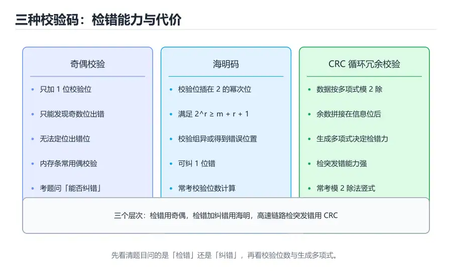

# 计算机科学基础：数制转换、码制与算术逻辑



## 本节知识框架

**课程定位**：所属分类 `ruankao`（软考初级与中级），课程主题 `计算机科学基础`，学习阶段 基础，建议用时 40 分钟。这一域在软件设计师上午题里常年占 6~9 分，属于「算对了就白送、算错了没法猜」的一类。

本课主线：先把进制当成一套「计数货币」换算清楚，再看计算机怎么用补码把减法变成加法，最后把三种校验码（奇偶、海明、CRC）按「能不能检错、能不能定位、能不能纠错」这条线排成三层。

**学完本课应当能够**
- 在 10 秒内完成二进制、八进制、十进制、十六进制之间的互转，包括带小数部分的数。
- 说清原码、反码、补码、移码各自解决什么问题，并手算 8 位补码加法是否溢出。
- 用 2^r ≥ m + r + 1 判断海明码需要几位校验位，用模 2 除法算出 CRC 冗余位。
- 见到「检错还是纠错」的字眼，能立刻把奇偶校验、海明码、CRC 三档对上号。

### 复习清单

- [ ] 能把 1A4H、八进制 27、二进制 101101 分别转成十进制，并倒过来验算一遍。
- [ ] 能手算 8 位补码下 100 + 55 的位模式，并解释为什么硬件得到的「结果」是负数。
- [ ] 能写出 8 位数据所需海明校验位的推导过程，而不只是记住「4 位」这个数字。
- [ ] 能用一句话区分 CRC 与海明码：一个擅长检突发错但不纠错，一个能定位并纠正 1 位错。

## 核心概念定义

| 术语 | 操作性定义（白话版） | 常见边界与风险 |
| --- | --- | --- |
| 进位计数制 | 每个数字的价值 = 数字本身 × 基数的「位权」次幂，就像 1 元 2 角 3 分。 | 易错：把小数点右边的位权按 10 的负幂写成 2 的负幂时搞混基数。 |
| 按权展开 | 把任意进制数写成 Σ(数码 × 基数^位序)，是所有进制转换的通用兜底方法。 | 易错：位序从 0 开始，小数部分从 −1 开始，写成从 1 开始会整体翻一倍。 |
| 原码 | 最高位当符号位，其余位照抄真值的绝对值，加减前要「先比大小再决定加还是减」。 | 易错：原码里 +0 与 −0 是两套位模式，硬件不喜欢这种重复。 |
| 补码 | 负数用「模减去其绝对值」表示，于是减法可以当成加法做，是机器里真正存放的形式。 | 易错：n 位补码范围是 −2^(n−1) 到 2^(n−1)−1，负端比正端多一个数。 |
| 反码 | 负数把原码除符号位外全部取反，是通往补码的中间步骤（补码 = 反码 + 1）。 | 易错：正数的反码、补码都等于原码本身。 |
| 移码 | 在真值上加一个固定偏移（通常 2^(n−1)）得到的编码，专门用来比阶码大小。 | 易错：IEEE 754 单精度阶码是 8 位移码，偏移 127，不是 128。 |
| 符号扩展 | 把短整数变长时，正数高位补 0、负数高位补 1，保持数值不变。 | 易错：无符号数只做 0 扩展，把补码当无符号扩展会改变数值。 |
| 溢出 | 运算结果超出该位宽所能表示的范围，有符号数看「同号相加得异号」。 | 易错：进位标志 CF 与溢出标志 OF 是两回事，无符号看 CF，有符号看 OF。 |
| BCD 码（8421） | 每 4 位二进制表示 1 位十进制数字，12 写成 0001 0010。 | 易错：4 位组合 1010~1111 在 8421 里非法，不是「十六进制的 A~F」。 |
| ASCII | 7 位字符编码，数字 '0' 是 48，'A' 是 65，'a' 是 97，大小写相差 32。 | 易错：题目问「小写字母 a 的 ASCII 码」时，别把十六进制的 97 当十进制。 |
| 国标码与机内码 | 汉字先有区位码，加 2020H 得国标码，再加 8080H 得机内码（最高位置 1 以免与 ASCII 混淆）。 | 易错：区位码是十进制号位，转的时候要先把「区号、位号」各当两位十进制数转成十六进制再加。 |
| 定点数与浮点数 | 定点数小数点位置固定，浮点数用「阶码 + 尾数」把小数点挪起来，换取更大动态范围。 | 易错：浮点数精度由尾数位数决定，范围由阶码位数决定，两者不能混。 |
| 规格化 | 把浮点数尾数调整到约定形式（如最高有效位为 1），同样的位数表达更精确。 | 易错：右规一次尾数右移一位、阶码加 1，两个动作必须同时做。 |
| 奇偶校验 | 在数据后加 1 位，使整串里 1 的个数按约定为奇或偶，出错奇数位就能被发现。 | 易错：它能检错、不能定位、不能纠错；偶错直接漏检。 |
| 海明码 | 把校验位插在 2 的幂次位置上，用若干异或分组的结果拼出出错位的编号。 | 易错：校验位数按 2^r ≥ m + r + 1 计算，别把 m 当成总位数。 |
| CRC | 把数据当多项式系数，补 0 后用生成多项式做模 2 除法，余数即冗余位。 | 易错：模 2 减法是异或，不借位；余数的位数比生成多项式次数少不了一点。 |
| ALU | 算术逻辑单元，负责加减与与或非异或等位运算，同时产出状态标志。 | 易错：ALU 本身不区分有符号无符号，是程序员按标志位来解读结果。 |

## 原理与运行机制

**第一层：进制就是不同的「计数货币」。** 我们习惯十进制，是因为手指头有十根；计算机用二进制，是因为晶体管只有导通与截止两种稳定状态。换算时只有一句通法：按权展开。比如十六进制 1A4，按权展开是 1×16² + 10×16¹ + 4×16⁰ = 256 + 160 + 4 = 420。反过来，十进制转二进制就是「不断除以基数、把余数倒着写」；小数部分相反，「不断乘以基数、把整数部分正着写」。

真正省事的通道是二进制与八进制、十六进制之间的分组：因为 8 = 2³、16 = 2⁴，每 3 位（或 4 位）二进制正好对应 1 位八（十六）进制，从二进制小数点向两边分组即可。所以考场上最稳的路线是「十六进制 → 二进制 → 十进制」，绕开大数除法。例：0xAC → 1010 1100 → 128 + 32 + 8 + 4 = 172。

**第二层：补码把减法变成加法。** 想象一个只有 8 位的里程表，读数是 200，再走 100 公里，表针转过了 255 归零，最终显示 44。这就是「模 2⁸ 运算」：硬件永远只保留低 8 位，进位丢进 CF 标志。负数为什么能用补码表示？因为 −k 与 2⁸ − k 在这块表上指在同一格：−5 与 251 等价，而 251 的位模式就是 11111011，恰好是「取反加一」的结果。于是 A − B 只需算 A + (−B 的补码)，硬件不用另配一套减法器，这是补码成为机器内部形式的根本原因。

递进一步，看溢出。8 位补码能表示 −128~127。算 100 + 55：真实结果 155 落在正数区之外，保留低 8 位后位模式是 10011011，按补码解读就是 −101（也就是 155 − 256）。两个正数相加得到负数，硬件把 OF（溢出标志）置 1。判断口诀：同号相加、结果符号与操作数相反 → 溢出；异号相加永远不溢出。无符号数则只看有没有进位或借位，也就是 CF。**同一块硬件、同一串位模式，按有符号读是 −101，按无符号读是 155**，这就是「ALU 不带符号观念」的含义。

**第三层：校验码的三层递进。** 传输线路上电磁干扰会把某几位翻掉，于是需要冗余。

- 第一层奇偶校验：只加 1 位。它只能回答「有没有错」，而且如果同时错了两位，1 的个数奇偶性不变，直接漏检。内存条上的 parity、以及教材里说「偶校验」，讲的都是这一层。
- 第二层海明码：目标是「指出错在哪一位并翻转它」。若有 m 位数据、r 位校验，出错位置一共有 m + r 种可能，再加「没错」这一种，所以需要 2^r ≥ m + r + 1。数据位 8 位时，r = 3 只给 8 种组合，连 12 种情况都覆盖不了；r = 4 给 16 ≥ 13，够用。校验位插在位号为 1、2、4、8 的位置，每个校验位负责一批位（位号二进制表示里对应位为 1 的那些），把出错的那些组异或结果按顺序拼起来，得到的二进制数就是出错位的编号。
- 第三层 CRC：网络链路和磁盘扇区关心的是「突发错」（一次干扰糊掉一串位），要求检错能力极强、算得极快，不要求纠错——纠错交给上层的重传。做法是把数据看成一个二进制多项式，末尾补上 r 个 0（r 是生成多项式的次数），用生成多项式做模 2 除法。模 2 除法里减法就是异或、不借位，所以硬件只要一排异或门，移位即可，没有进位链。余数（不足位数前面补 0）作为冗余位接在后面。接收方整串再除一次，余数为 0 判为通过。

**应试视角**：这一域的题面几乎年年都是三种问法——「下列数制转换正确的是」（4 个选项各算一遍，用十六进制↔二进制通道最快）；「n 位补码表示范围/做加法后是否溢出」；「海明码要几位校验位/CRC 冗余位几位、生成多项式怎么写」。看到「校验位」三个字先问自己：这题要的是检错还是纠错？

## 典型应用场景

| 场景 | 典型输入或前提 | 期望产物 |
| --- | --- | --- |
| 上午题数制转换 | 给出十六进制带小数，如 2B.8H | 二进制位串与十进制值，小数部分按 2 的负幂展开 |
| 判断运算是否溢出 | 8 位补码加法，或给四个标志位截图 | 读 OF/CF，分别给出有符号与无符号的结论 |
| 设计链路校验方案 | 高速串行链路、突发错为主 | 选 CRC 并给出冗余位数与检错能力说明 |
| 内存单元保护 | 单 bit 翻转概率高、要求在线纠正 | 选海明码，按 2^r ≥ m + r + 1 定校验位数 |
| 中文文本存取 | 需与 ASCII 混排、要求不歧义 | 由区位码推出国标码再推出机内码 |
| 浮点数近似计算 | 需要较大动态范围、可接受精度损失 | 阶码 + 规格化尾数，比较两数先看阶码 |

## 代码/协议/SQL 示例

下面这段 Python 把本课的四个「手上功夫」串起来：进制互转、8 位补码回绕、海明校验位数、CRC 模 2 除法。它不追求工业级，只要求每一步都能对答案。

```python
BASES = {"hex": 16, "oct": 8, "bin": 2}

def to_dec(s, radix):
    """按权展开的通用版：十六进制小数也能算。"""
    whole, _, frac = s.partition(".")
    value = 0.0
    for ch in whole:
        value = value * radix + int(ch, radix)
    scale = 1.0
    for ch in frac:
        scale /= radix
        value += int(ch, radix) * scale
    return value

def add8(a, b):
    """8 位补码加法：硬件只留低 8 位，再按有符号解释。"""
    raw = (a + b) & 0xFF            # 里程表式回绕，CF 由这一句体现
    signed = raw - 256 if raw >= 128 else raw
    overflow = (a >= 0) == (b >= 0) and (signed < 0) != (a < 0)
    return raw, signed, overflow

def hamming_parity_bits(data_bits):
    r = 0
    while 2 ** r < data_bits + r + 1:
        r += 1
    return r

def crc_remainder(message_bits, generator_bits):
    """模 2 除法：减法就是异或，不借位。"""
    gen_len = len(generator_bits)
    dividend = list(message_bits) + [0] * (gen_len - 1)
    for i in range(len(message_bits)):
        if dividend[i] == 1:
            for j in range(gen_len):
                dividend[i + j] ^= generator_bits[j]
    return "".join(map(str, dividend[-(gen_len - 1):]))

print(to_dec("1A4", 16))                     # 420.0
print(to_dec("0.101", 2))                    # 0.625
print(add8(100, 55))                         # (155, -101, True) 溢出
print(add8(100, -55))                        # (45, 45, False) 安全
print(hamming_parity_bits(8))                # 4
print(hamming_parity_bits(16))               # 5
```

信息位 `1011001` 配生成多项式 G(x) = x³ + x + 1（位串 `1011`，次数 3，所以补 3 个 0）时，余数由下面这段独立跑一遍，输出就是接在信息位后面的冗余位：

```python
data = [1, 0, 1, 1, 0, 0, 1]
poly = [1, 0, 1, 1]
print(crc_remainder(data, poly))             # 3 位冗余位：011
```

再用一段 C 语言看一眼真实的硬件行为——`unsigned char` 与 `signed char` 是同一串位、两套解读：

```c
#include <stdio.h>
int main(void) {
    unsigned char a = 200, b = 100;
    unsigned char sum = a + b;        /* 300 mod 256 = 44，进位丢失 */
    printf("raw=%u signed=%d\n", sum, (signed char)sum);
    return 0;
}
```

## 时间/空间复杂度或性能分析

这一域的「性能」有两层含义，都要抓。

第一层是**做题速度**。把每个考点拆成「单位时间的得分产出」：

| 考点 | 上午题约占分 | 稳定拿分所需训练量 | 结论 |
| --- | --- | --- | --- |
| 进制互转 | 1~2 | 20 道口算，一次成型 | 必拿，性价比最高 |
| 补码范围与溢出 | 1~2 | 10 道手算加法 | 必拿，套路固定 |
| 原/反/补/移码关系 | 1 | 3 小时归纳 | 记忆为主，容易混 |
| 浮点数规格化与 IEEE 754 | 1~2 | 6 道逐步推演 | 中性价比，别死记 |
| 奇偶校验 | 1 | 1 小时 | 概念清楚即得分 |
| 海明码位数与纠错位 | 1 | 5 道公式代入 | 高性价比，公式就一个 |
| CRC 模 2 除法 | 1~2 | 4 道竖式 | 竖式练熟不再出错 |
| 汉字编码换算 | 1 | 2 小时 | 加 2020H 再加 8080H，两步 |
| ALU 与标志位 | 1 | 3 道判断题 | 分清 CF 与 OF |

按本课的算法，数制转换一道题的合理耗时上限是 40 秒：超过这个时间说明还在用「十进制中转」的笨办法，应当换成二进制分组通道。

第二层是**真实硬件代价**。校验强度与冗余开销是一笔明账：奇偶校验只花 1/8 ≈ 12.5% 的额外位（8 位数据配 1 位），检出能力有限；海明码为 8 位数据配 4 位校验，冗余 50%，换来定位并纠正 1 位错；CRC 常用 16 位或 32 位冗余位，对 1024 字节帧来说冗余只有约 1.2%~2.3%，却能检出几乎全部突发错误——这就是它统治数据链路层的原因。算法上，CRC 的硬件实现是移位寄存器加异或门，时间复杂度 O(n)（n 为位流长度），没有除法器的进位延迟；海明码的纠错要多做 r 次分组异或，同样是 O(n)，但需要能把校验组结果写成位号，逻辑更复杂。

浮点数与定点数的取舍同理：同一串 32 位，定点数能表示的范围窄但精度均匀；IEEE 754 单精度范围约 ±3.4×10³⁸，但只有约 7 位十进制有效数字。做累加时把大量小量与一个极大量相加，可能因对阶舍入而丢掉小量，这就是「浮点加法不满足结合律」的实际来源。

## 常见误区与易错点

| 容易答错的做法 | 考场上的实际现象 | 原因与正确做法 |
| --- | --- | --- |
| 用十进制做中转去比大小 | 2 分钟算不完一题 | 十六进制↔二进制分组，比大小先看位数再看高位 |
| 把 8 位补码范围记成 −127~127 | 溢出判断题必错 | 负端到 −2⁷ = −128，因为 −128 没有对应正数 |
| 认为有进位就算溢出 | CF、OF 混成一谈 | 无符号看 CF，有符号看 OF；两者可同时置起也可只置一个 |
| 把 2^r ≥ m + r + 1 的 m 当总位数 | 校验位数算少一位 | m 是数据位（信息位）数，r 要同时出现在两边 |
| 说 CRC 能纠错 | 选项里带「并纠正」就选错 | CRC 只检错，纠错靠重传或上层协议 |
| 奇偶校验遇到两位错也能发现 | 判断题丢分 | 偶数个位翻转时奇偶性不变，直接漏检 |
| 小数转二进制时把结果倒着写 | 0.625 写成 0.101 反过来 | 小数部分是「乘基数取整、正着写」，整数部分才是「除基数取余、倒着写」 |
| 机内码与国标码的加数写反 | 汉字编码题整片放弃 | 区位码 →(+2020H) 国标码 →(+8080H) 机内码，顺序不能颠倒 |
| 尾数右移就以为数值变了 | 规格化步骤写不全 | 右规同时阶码加 1，数值不变，这是「一移一补」的成对动作 |
| 忽略 BCD 的非法组合 | 把 1100 当成合法 8421 码 | 4 位组合 1010~1111 在 8421 里不表示任何十进制数字 |

## 与其他知识点的关系

- **前置**：`ruankao_exam_overview` 给出分值地图，本课的 6~9 分就落在它的「计算机组成与数制」那一格里。
- **并列**：`ruankao_os_and_arch` 会用本课的补码与规格化知识去算 Cache 与流水线；`ruankao_data_structure` 里 KMP、哈夫曼编码等题依赖本课的位运算直觉。
- **后续**：`ruankao_network_security` 讲 CRC 在以太网帧里的位置，`ruankao_afternoon_case` 的下午算法填空题经常要求把位运算或进制换算结果写进代码空位。

## 自测题与参考答案

作答时先盖上答案区，每题限时 3 分钟；做完把错题对应的正文小节翻一遍。

### 自测 1

下列数制转换的结果中，正确的是？

- A. 十六进制 1A4 换算成十进制等于 420
- B. 八进制 17 换算成十进制等于 17
- C. 二进制 1011 换算成十进制等于 13
- D. 十进制 100 换算成二进制是 101100

**答案：A（十六进制 1A4 换算成十进制等于 420）**

**解析**：本题正确项是「十六进制 1A4 换算成十进制等于 420」。按权展开最稳：1×16² + 10×16¹ + 4×16⁰ = 256 + 160 + 4 = 420；也可以走十六进制到二进制的分组通道，把 1、A、4 展开成 1 1010 0100 再折算，两条路通向同一个数。干扰项「八进制 17 换算成十进制等于 17」把不同进制的字面量当成同一个数，实际是 1×8 + 7 = 15；干扰项「二进制 1011 换算成十进制等于 13」漏算了中间的位权，正确值是 8 + 2 + 1 = 11；干扰项「十进制 100 换算成二进制是 101100」是倒序取余的老毛病，除 2 取余要倒着写，正解是 1100100。

### 自测 2

在 8 位补码表示下执行加法 100 + 55，硬件保留的位模式与按有符号数解读的结果是？

- A. 位模式 10011011，按有符号读仍是 155，运算没有异常
- B. 位模式 10011011，按有符号读为 −101，属于正溢出
- C. 位模式 01100101，按有符号读为 101，需要再算一次减法
- D. 硬件自动扩展成 16 位，结果 155 被完整保留下来

**答案：B（位模式 10011011，按有符号读为 −101，属于正溢出）**

**解析**：本题正确项是「位模式 10011011，按有符号读为 −101，属于正溢出」。100 与 55 都是正数，真值和为 155，超出 8 位补码上限 127；硬件只保留低 8 位，得到 10011011，把最高位当符号位解读就是 155 − 256 = −101，两个同号数相加得到异号结果，溢出标志 OF 置 1。干扰项「位模式 10011011，按有符号读仍是 155，运算没有异常」承认了位模式却拒绝换成有符号口径，正好漏掉 OF；干扰项「位模式 01100101，按有符号读为 101，需要再算一次减法」把 155 的二进制写错了位；至于「硬件自动扩展成 16 位，结果 155 被完整保留下来」，那是任意精度语言的整数行为，不是 8 位加法器的行为。

### 自测 3

为 8 位数据配置能够纠正 1 位错误的海明码，校验位数与判定式应取哪一项？

- A. 3 位，只要 2 的幂次不小于数据位数就够用
- B. 4 位，把 4 位校验位依次接在数据的最高 4 位之后
- C. 4 位，取满足 2^r ≥ m + r + 1 的最小整数 r
- D. 8 位，校验位必须与数据位一一对应才能纠错

**答案：C（4 位，取满足 2^r ≥ m + r + 1 的最小整数 r）**

**解析**：本题正确项是「4 位，取满足 2^r ≥ m + r + 1 的最小整数 r」。不等式左边的组合数要覆盖右边全部可能：m 位数据加 r 位校验共 m + r 个位置可能出错，再加上「没错」这一种，所以是 m + r + 1。r = 3 只有 8 种组合，装不下 8 + 3 + 1 = 12 种情况；r = 4 有 16 种，才够标记 12 个位置与无错。干扰项「3 位，只要 2 的幂次不小于数据位数就够用」漏掉了不等式里的 r + 1，是这类题最常见的算式陷阱；干扰项「4 位，把 4 位校验位依次接在数据的最高 4 位之后」数字碰对了，位置却错，校验位必须落在位号为 1、2、4、8 的那些格子上，异或分组才能直接拼出出错位编号；「8 位，校验位必须与数据位一一对应才能纠错」把海明码想成了逐位冗余。

### 自测 4

关于奇偶校验、海明码与循环冗余校验 CRC 的检错与纠错能力，下列说法正确的是？

- A. 奇偶校验能发现任意偶数位出错，只是无法定位出错位
- B. CRC 通过若干校验组的异或结果直接给出出错位编号
- C. 海明码只能检错，出现 1 位错误时仍要靠重传恢复
- D. CRC 用模 2 除法的余数作冗余位，检错但不纠错

**答案：D（CRC 用模 2 除法的余数作冗余位，检错但不纠错）**

**解析**：本题正确项是「CRC 用模 2 除法的余数作冗余位，检错但不纠错」。三档校验码要按能力分层记忆：奇偶校验只加 1 位，能发现奇数位翻转，既不能定位也不能纠错，偶数位同时出错还会漏检；海明码把校验位插在 2 的幂次位，用各组异或结果拼出出错位号，因而能定位并纠正 1 位错；CRC 做不借位除法，冗余位数少、检突发错能力强，链路层用它决定这一帧丢不丢，纠错交给上层重传。干扰项「奇偶校验能发现任意偶数位出错，只是无法定位出错位」把奇数位与偶数位说反了；干扰项「CRC 通过若干校验组的异或结果直接给出出错位编号」说的是海明码；「海明码只能检错，出现 1 位错误时仍要靠重传恢复」则低估了海明码，能纠错本来就是它的卖点。

### 自测 5（读代码）

阅读下面这段 Python，它模拟 CRC 求冗余位的第一步，输出结果是什么？

```python
data = [1, 0, 1, 1, 0, 0, 1]
poly = [1, 0, 1, 1]
pad = [0] * (len(poly) - 1)
dividend = data + pad
print(len(pad), "".join(map(str, dividend)))
```

- A. 3 1011001000
- B. 3 1011001011
- C. 4 10110010000
- D. 2 101100100

**答案：A（3 1011001000）**

**解析**：本题正确项是「3 1011001000」。生成多项式 1011 共有 4 位，最高次数是 3，因此要在信息位末尾补 3 个 0，1011001 加上这 3 位得到 10 位的被除数 1011001000，print 先输出补零个数再输出整串。接着用 1011 做模 2 除法，减法是异或、不借位，最后的余数是 011，那才是真正拼到帧尾的冗余位。「补几个 0」与「余数是什么」是两件事，把它们混起来就会挑错答案；而按多项式位数 4 去补零，或者把次数减成 2，同样对不上竖式的位数要求。

### 自测 6（排序）

用竖式求 CRC 冗余位时，下列四个步骤应按怎样的先后顺序排列？

- A. 把生成多项式对齐到当前被除数中最高位的 1
- B. 在信息位末尾补上与生成多项式次数相同个数的 0
- C. 用异或做不借位减法，每处理完一段就把对齐位右移
- D. 把最后剩下的余数作为冗余位拼接在信息位后面

**答案：B、A、C、D（在信息位末尾补上与生成多项式次数相同个数的 0 → 把生成多项式对齐到当前被除数中最高位的 1 → 用异或做不借位减法，每处理完一段就把对齐位右移 → 把最后剩下的余数作为冗余位拼接在信息位后面）**

**解析**：排序题的判据是把竖式在纸上重演一遍：先按生成多项式的次数决定补几个 0，得到扩展后的被除数；再把生成多项式对齐到当前被除数最高位的 1 下面；然后用异或做不借位减法，商 1 并把对齐位右移，直到处理完原来的信息位；最后剩下的那位数就是余数，接在信息位之后组成要发送的帧。因此正确顺序是 B、A、C、D。四步中任何一步提前或推后，都会让余数的位数与生成多项式次数对不上，接收方再做一次模 2 除法时余数就不会是全 0。

## 考点精讲

### 精讲 1

下列数制转换的结果中，正确的是？

本题正确项是「十六进制 1A4 换算成十进制等于 420」。按权展开最稳：1×16² + 10×16¹ + 4×16⁰ = 256 + 160 + 4 = 420；也可以走十六进制到二进制的分组通道，把 1、A、4 展开成 1 1010 0100 再折算，两条路通向同一个数。干扰项「八进制 17 换算成十进制等于 17」把不同进制的字面量当成同一个数，实际是 1×8 + 7 = 15；干扰项「二进制 1011 换算成十进制等于 13」漏算了中间的位权，正确值是 8 + 2 + 1 = 11；干扰项「十进制 100 换算成二进制是 101100」是倒序取余的老毛病，除 2 取余要倒着写，正解是 1100100。

答案：A

### 精讲 2

在 8 位补码表示下执行加法 100 + 55，硬件保留的位模式与按有符号数解读的结果是？

本题正确项是「位模式 10011011，按有符号读为 −101，属于正溢出」。100 与 55 都是正数，真值和为 155，超出 8 位补码上限 127；硬件只保留低 8 位，得到 10011011，把最高位当符号位解读就是 155 − 256 = −101，两个同号数相加得到异号结果，溢出标志 OF 置 1。干扰项「位模式 10011011，按有符号读仍是 155，运算没有异常」承认了位模式却拒绝换成有符号口径，正好漏掉 OF；干扰项「位模式 01100101，按有符号读为 101，需要再算一次减法」把 155 的二进制写错了位；至于「硬件自动扩展成 16 位，结果 155 被完整保留下来」，那是任意精度语言的整数行为，不是 8 位加法器的行为。

答案：B

### 精讲 3

为 8 位数据配置能够纠正 1 位错误的海明码，校验位数与判定式应取哪一项？

本题正确项是「4 位，取满足 2^r ≥ m + r + 1 的最小整数 r」。不等式左边的组合数要覆盖右边全部可能：m 位数据加 r 位校验共 m + r 个位置可能出错，再加上「没错」这一种，所以是 m + r + 1。r = 3 只有 8 种组合，装不下 8 + 3 + 1 = 12 种情况；r = 4 有 16 种，才够标记 12 个位置与无错。干扰项「3 位，只要 2 的幂次不小于数据位数就够用」漏掉了不等式里的 r + 1，是这类题最常见的算式陷阱；干扰项「4 位，把 4 位校验位依次接在数据的最高 4 位之后」数字碰对了，位置却错，校验位必须落在位号为 1、2、4、8 的那些格子上，异或分组才能直接拼出出错位编号；「8 位，校验位必须与数据位一一对应才能纠错」把海明码想成了逐位冗余。

答案：C

### 精讲 4

关于奇偶校验、海明码与循环冗余校验 CRC 的检错与纠错能力，下列说法正确的是？

本题正确项是「CRC 用模 2 除法的余数作冗余位，检错但不纠错」。三档校验码要按能力分层记忆：奇偶校验只加 1 位，能发现奇数位翻转，既不能定位也不能纠错，偶数位同时出错还会漏检；海明码把校验位插在 2 的幂次位，用各组异或结果拼出出错位号，因而能定位并纠正 1 位错；CRC 做不借位除法，冗余位数少、检突发错能力强，链路层用它决定这一帧丢不丢，纠错交给上层重传。干扰项「奇偶校验能发现任意偶数位出错，只是无法定位出错位」把奇数位与偶数位说反了；干扰项「CRC 通过若干校验组的异或结果直接给出出错位编号」说的是海明码；「海明码只能检错，出现 1 位错误时仍要靠重传恢复」则低估了海明码，能纠错本来就是它的卖点。

答案：D

### 精讲 5（读代码）

阅读下面这段 Python，它模拟 CRC 求冗余位的第一步，输出结果是什么？

本题正确项是「3 1011001000」。生成多项式 1011 共有 4 位，最高次数是 3，因此要在信息位末尾补 3 个 0，1011001 加上这 3 位得到 10 位的被除数 1011001000，print 先输出补零个数再输出整串。接着用 1011 做模 2 除法，减法是异或、不借位，最后的余数是 011，那才是真正拼到帧尾的冗余位。「补几个 0」与「余数是什么」是两件事，把它们混起来就会挑错答案；而按多项式位数 4 去补零，或者把次数减成 2，同样对不上竖式的位数要求。

答案：A

### 精讲 6（排序）

用竖式求 CRC 冗余位时，下列四个步骤应按怎样的先后顺序排列？

排序题的判据是把竖式在纸上重演一遍：先按生成多项式的次数决定补几个 0，得到扩展后的被除数；再把生成多项式对齐到当前被除数最高位的 1 下面；然后用异或做不借位减法，商 1 并把对齐位右移，直到处理完原来的信息位；最后剩下的那位数就是余数，接在信息位之后组成要发送的帧。因此正确顺序是 B、A、C、D。四步中任何一步提前或推后，都会让余数的位数与生成多项式次数对不上，接收方再做一次模 2 除法时余数就不会是全 0。

答案：B、A、C、D

## 术语速查

| 术语 | 一句话说明 |
| --- | --- |
| 按权展开 | 把每一位数码乘以基数的位序次幂再求和，是任何进制转十进制的通用做法。 |
| 补码 | 用模减去绝对值来表示负数，使减法能用加法电路完成，n 位范围是 −2^(n−1) 到 2^(n−1)−1。 |
| 移码 | 真值加上固定偏移后的编码，保持单调递增，专门用于浮点数阶码比较。 |
| 规格化 | 调整尾数与阶码使尾数最高有效位为 1，用同样位数换更高精度。 |
| 溢出标志 OF | 有符号运算结果超出范围时置 1，判据是同号相加得到异号结果。 |
| 进位标志 CF | 无符号运算产生进位或借位时置 1，与有符号溢出是两套独立结论。 |
| 8421 码 | 用 4 位二进制表示 1 位十进制数的 BCD 编码，1010 及以上为非法组合。 |
| 机内码 | 汉字在机器内部的编码，等于国标码加 8080H，最高位为 1 以避开 ASCII。 |
| 海明码 | 校验位插在 2 的幂次位的纠错码，用分组异或结果拼出出错位编号，可纠 1 位错。 |
| CRC | 用生成多项式对补零后的信息位做模 2 除法，取余数作冗余位的检错码。 |

## 参考资料与复核

- [中国计算机技术职业资格网首页（软考官方门户）](https://www.ruankao.org.cn/)
- [软件设计师考试大纲与考试介绍](https://www.ruankao.org.cn/exam/)
- [工业和信息化部教育与考试中心](https://www.miiteec.org.cn/)
- [国家标准全文公开系统（查询 GB 2312、GBK 等信息编码标准原文）](https://openstd.samr.gov.cn/bzgk/gb/)
- 最后复核：2026-10-04。数制、码制、校验码的结论来自通用教材口径，与年度大纲无关，可放心背。
- 下次复核：2027-09-10

## 内容元数据

> 内容更新时间：2026-10-06 · 学习阶段：基础 · 预计用时：40 分钟

- 内容版本：v2.0
- 适用考试：软件设计师 / 程序员（上午基础知识第 1~10 题区间）
- 相关课程：`ruankao_os_and_arch`、`ruankao_data_structure`、`ruankao_afternoon_case`
- 质量口径：与 `tool/content_pipeline/validate_pack.js` 的结构与题库门禁对齐
- 说明：本课的公式（补码范围、海明码不等式、CRC 冗余位数）为长期稳定结论，不随年度安排变化
